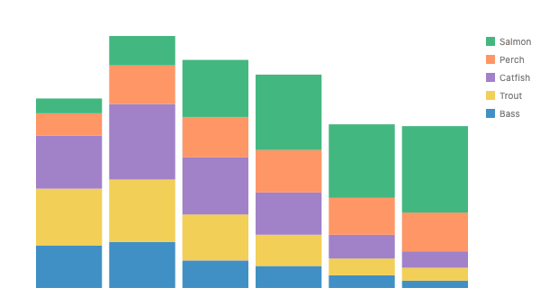
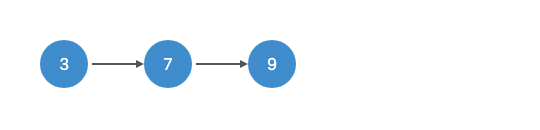
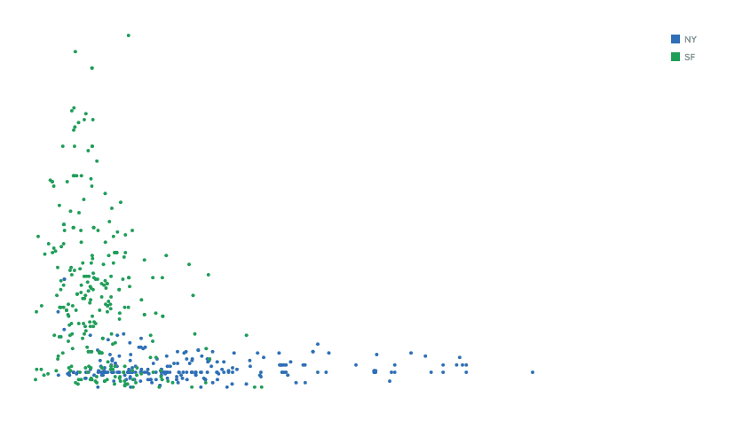
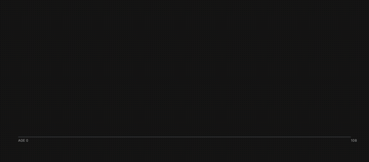
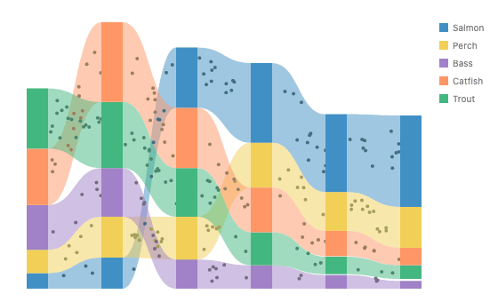

# Scenes on a timeline: an animation grammar for GoFish

**Summary.**

1. Two containers with one job each. `layer([...])` holds the parts of one picture, which are all present once it is built. `timeline([...])` holds scenes, which are different pictures over time. Spatial clauses go in `layer(...).relate()`, temporal clauses go in `timeline(...).relate()`, and putting one in the other is a loud error.
2. Every scene has a real interval, the way a mark has a size. `.duration(ms)` sets how long it is on screen. `time.after(a, b, { gap })` places scenes, and `time.transition(a, b)` is a temporal relational mark that fills exactly the gap between them, the way an `arrow` spans the space between two shapes. It takes no duration.
3. A working prototype draws five hard examples in this spelling: stacked ↔ grouped bars, a diagram magic move, R2D3's segue, Periscopic's gun deaths, and a ribbon chart with particles.

**Status.** Version 3 (2026-10-15). Decided in Josh's reviews: the separate `timeline` container, transitions with no duration of their own, scene intervals, a scene's length as a `.duration(ms)` modifier, every time size named `duration`, a `time.sequence` whose `duration` works like `spread`'s `w`, `gap` arrays, `Curve.bezier({ controls })`, and `Animation.draw` as the entry for paths. Five questions remain at the end.

Prototype branch: `worktree-animation-grammar-proposal` (Storybook: "Animation/Grammar Prototype/…"). It is throwaway quality, and its shortcuts are listed in the last section.

---

## Terms

- **Scene.** One whole picture that is on screen for an interval: the stacked chart, the R2D3 histogram, the year 1975.
- **Interval.** The time a scene is on screen, from its start to its end. It is the time version of a bounding box. Rhombus pict calls it a "time box".
- **Duration.** Any node's size on the time axis. A scene's duration (`.duration(ms)`) is how long it stays on screen, the role of pict's `sustain` and gganimate's `state_length`. An effect's `duration` is how long it plays, and a sequence's `duration` is its total.
- **Gap.** The time between two scenes, which a transition fills. It is the time version of `spread`'s spacing.
- **Transition.** The in-between frames from one scene to the next. It is a relational mark on time: it spans the gap between two scenes the way an `arrow` spans the space between two shapes.
- **Magic move.** A transition that finds the same object in both scenes and moves it. The name comes from Keynote. Rhombus pict uses `magic_move`, and Motion uses `layoutId`.
- **Identity.** What makes a mark in one scene "the same" as a mark in another.
- **Build-in.** The parts of one picture entering over time, such as bars growing in one after another. The picture is complete once the build-in ends.
- **Clause.** One entry in `.relate()`.
- **Data time** and **presentation time.** Data time is a field read on a time scale (`time.sequence({ by: "year" })`). Presentation time is order the author picks (`time.stagger`). This split was settled in #901.

## What already exists (main)

`time.sequence({ by })` (keyframes in data time), `time.transition()` (interpolate between keyframes), `time.history({ last })` (trails), `time.stagger`, `time.parallel`, the chained `.transition({ enter, update, exit })` on marks and operators, and the effects `Animation.grow/shrink/fadeIn/fadeOut/appear/wipe`. These came from #886, #892, #901 and #902. The 2026-10-04 comment on #697 proposed the time container `timeline([...]).relate(...)`. This proposal builds it.

## The model

|                        | `layer([...])`                            | `timeline([...])`                                         |
| ---------------------- | ----------------------------------------- | --------------------------------------------------------- |
| Children               | parts of one picture                      | scenes                                                    |
| At rest                | all present together                      | one scene at a time (or several, if clauses overlap them) |
| Clauses in `.relate()` | spatial: `Constraint.*`, `arrow`, `line`  | temporal: `time.after`, `time.align`, `time.transition`   |
| Time inside            | build-ins only (`.transition({ enter })`) | scene intervals                                           |

The interval rules:

- A scene's interval is from its start to its start plus its length. The length is `.duration(ms)`, or else the length of the scene's own build-in (0 for a static scene). A duration shorter than the build-in is a loud error.
- A scene is drawn only during its own interval. There is no other rule about what stays on screen.
- `time.after(a, b, { gap })` means b starts `gap` ms after a ends. `time.align({ t: "start" | "end" }, [...])` makes scenes start or end together. A scene no clause places starts at 0. Conflicting clauses and cycles are loud errors.
- `time.transition(a, b)` spans exactly from a's end to b's start, and neither scene is drawn during it. A zero gap is a cut. A transition between overlapping scenes is a loud error.

Identity is the key join. **A mark is matched by the rows it draws, compared by `key`.** The default key is row identity, which covers a change of encoding over the same data. An explicit `key` (a field name or a function) is needed when the rows differ, as when gapminder's years are separate scenes. `time.sequence({ by })` defaults it to the remaining split fields. Marks that draw no rows, such as the boxes of a hand-built diagram, match by their `.name()` path. That is the one branch, and it exists because those marks have no rows.

`time.sequence(opts, [children])` is the shorthand for the common case, a chain. It lowers literally to a timeline: child i and child i + 1 are joined by `time.after(…, { gap: gap_i })` and a `time.transition`, and `.transition({ update: Animation.tween({ ease, curve }) })` sets every transition's ease and curve. Its options:

- `gap`: one number for every gap, or an array of exactly n − 1 gaps for n scenes (n with `cyclic`, where the last gap is the wrap back to the first scene). Any other length is a loud error that names the expected count. Short arrays are not recycled.
- `cyclic`: time on a circle. The last scene transitions back into the first.
- `duration`: works like `spread`'s `w`. Left out, the total is inferred from the scenes' durations plus the gaps. Given, it fixes the total, and the same size solve that fits a `spread` to a fixed `w` decides what flexes: only data-valued scene durations (`.duration(datum(v))`, the twin of `w: datum(…)`). Fixed durations, build-in lengths and gaps never flex, just as `spread` never derives spacing (`chainClaim` in `constraints/distribute.ts`, solved by `claim.width.inverse` in `solver/scopes.ts`).
- `key`, `playing`, `at` (ms).

The flow form `time.sequence({ by, duration })` is unchanged. Both forms' `duration` is the same thing, the total. The flow form places keyframes by data value, so its total cannot be inferred and defaults to 5000 ms.

## The five examples

Each example is rendered from a real prototype story. The GIFs are in `img/`.

### 1. Stacked ↔ grouped bars (Heer & Robertson 2007, Bostock)



```js
const stacked = () =>
  chart(seafood)
    .flow(spread({ by: "lake", dir: "x" }), stack({ by: "species", dir: "y" }))
    .mark(rect({ h: "count", fill: "species" }));
const grouped = () =>
  chart(seafood)
    .flow(
      spread({ by: "lake", dir: "x" }),
      spread({ by: "species", dir: "x", spacing: 0 })
    )
    .mark(rect({ h: "count", fill: "species" }));

timeline([
  stacked().name("stacked").duration(1800),
  grouped().name("grouped").duration(1800),
  stacked().name("back"),
]).relate(({ stacked, grouped, back }) => [
  time.after(stacked, grouped, { gap: 1000 }),
  time.transition(stacked, grouped, { ease: "cubicInOut" }),
  time.after(grouped, back, { gap: 1000 }),
  time.transition(grouped, back, { ease: "cubicInOut" }),
]);
```

```python
timeline([
    stacked().name("stacked").duration(1800),
    grouped().name("grouped").duration(1800),
    stacked().name("back"),
]).relate(lambda: [
    time.after(ref("stacked"), ref("grouped"), gap=1000),
    time.transition(ref("stacked"), ref("grouped"), ease="cubicInOut"),
    time.after(ref("grouped"), ref("back"), gap=1000),
    time.transition(ref("grouped"), ref("back"), ease="cubicInOut"),
])
```

The shorthand: `time.sequence({ gap: 1200, cyclic: true }, [stacked().duration(800), grouped().duration(800)]).transition({ update: Animation.tween({ ease: "cubicInOut" }) })` (`img/e1a.gif`). With a fixed total, `time.sequence({ duration: 6000, gap: 1200, cyclic: true }, [stacked().duration(datum(1)), grouped().duration(datum(2))])` solves the scale to 1200 ms per unit, so the scenes stay 1.2 s and 2.4 s (`img/e3-filmstrip.png`). Bostock's per-lake delay is the existing operator stagger, `spread({ by: "lake", dir: "x" }).transition({ update: time.stagger({ lag: 150 }) })` (`img/e1c.gif`). Heer and Robertson's two stages (x first, then y) are one extra scene in the middle (`img/e1d.gif`).

### 2. Magic move on a hand-built diagram (linked-list insertion)



```js
const node = (id, label, { box = false, fill = BLUE } = {}) =>
  layer([
    (box
      ? rect({ w: 64, h: 44, rx: 10, ry: 10, fill })
      : circle({ r: 24, fill })
    ).name("shape"),
    text({ text: label, fill: "white", fontSize: 16 }).name("label"),
  ])
    .relate(({ shape, label }) => [
      Constraint.align({ x: "middle", y: "middle" }, [shape, label]),
    ])
    .name(id);

const list = (nodes, ids) =>
  layer(nodes).relate((env) => {
    const ns = ids.map((id) => env[id]);
    return [
      Constraint.distribute({ dir: "x", spacing: 56 }, ns),
      Constraint.align({ y: "middle" }, ns),
      ...ns.slice(1).map((n, i) => arrow({ stroke: "#555" }, [ns[i], n])),
    ];
  });

time
  .sequence({ gap: 2000, cyclic: true }, [s1, s2, s3]) // s1..s3 built with list(...)
  .transition({ update: Animation.tween({ ease: "cubicInOut" }) });
```

This example keeps the containers apart naturally: spatial `.relate()` lives inside each scene, and the time composition is outside. Nodes have no rows, so they match by `.name()`. C slides right, the new node fades in, the circle morphs into a rounded rect while its color mixes, and the label cross-fades from "8" to "new". The arrows are redrawn from the moving nodes every frame, so they stay attached.

### 3. R2D3's segue (the animation that motivated Gemini and Data Animator)

The Animated Vega-Lite paper (§6.1.1) says "the authors of Data Animator and Gemini were both motivated in part by R2D3". Gemini's running example is R2D3's homes in San Francisco and New York, staggered by elevation. The data is the real R2D3 set (492 homes, CC BY-NC-SA).



```js
time
  .sequence({ gap: [2000, 1400, 1400], cyclic: true }, [
    scatterplot().duration(3000),
    layer([
      histogram(),
      threshold().transition({ enter: Animation.fadeIn({ delay: 600 }) }), // a build-in inside the scene
    ]).duration(3000),
    layer([split(), threshold()]).duration(3000),
  ])
  .transition({ update: Animation.tween({ ease: "cubicInOut" }) });
// histogram()'s scatter-by-bin operator carries
// .transition({ update: time.stagger({ by: field("elevation").sort(), dwell: 0.6 }) })
```

R2D3 is a chain, so it is a sequence. The third gap is the wrap from the split back to the scatterplot. Version 2 wrote the same animation as a `timeline` with six clauses and a repeated scatterplot scene. A `timeline` is for timing that is not a chain: scenes that overlap, scenes aligned on their ends, branches. The threshold line is a part of the histogram picture, not a scene, so it enters as a build-in. It matches by name into the split scene and stays still. The dots change parents in every scene (scatter, then bin, then pile), and the key join still matches each home.

### 4. Periscopic's U.S. Gun Deaths (2013)

The AVL paper quotes Data Animator's author on this piece: "How do you have the circle appear and then drop, and then the line keeps going?" The data is 1,200 rows sampled from Periscopic's published 2013 file. The "could have lived to" ages come from an approximate life table.



Gun deaths is one picture built in, not a sequence of scenes. So it is a `layer` with build-ins, and it uses no timeline.

```js
const victims = gunDeaths2013.map((d) => ({
  ...d,
  stolen: d.potential - d.age,
}));
const years = (name) => field(name, "years");

// one arch from age 0 to the age the person could have lived to
const arch = (stroke) =>
  layer([
    stack({ dir: "x", spacing: 0 }, [
      blank({ w: 0, h: 0 }).name("birth"),
      blank({ w: years("potential"), h: 0 }),
      blank({ w: 0, h: 0 }).name("end"),
    ]),
  ]).relate(({ birth, end }) => [
    line(
      {
        stroke,
        strokeWidth: 1,
        opacity: 0.5,
        // Periscopic's curve: controls at 25% and 75% of the chord, lifted
        curve: Curve.bezier({
          controls: [
            [0.25, LIFT],
            [0.75, LIFT],
          ],
        }),
      },
      [birth, end]
    ),
  ]);

// orange up to the age of death, grey after it
const band = (w) => rect({ y: -TALL, h: TALL, w: years(w), fill: "white" });
const life = layer([
  mask([
    stack({ dir: "x", spacing: 0 }, [
      blank({ w: years("age"), h: 0 }),
      band("stolen"),
    ]),
    arch(GREY),
  ]),
  mask([band("age"), arch(ORANGE)]),
]).transition({
  enter: Animation.draw({ duration: "potential", ease: "linear" }), // one pen over both copies
});

const lives = (from, to, arrangement) =>
  chart(victims)
    .flow(
      filter((d) => d.i >= from && d.i < to),
      time.stagger({ by: "i", ...arrangement })
    )
    .mark(life);

layer([
  axis(),
  layer([
    lives(0, 2, { spacing: 0 }), // one life, then the next
    lives(2, 5, { lag: 720 }), // a few, overlapping
    lives(5, N, { lag: 11, ease: "quadOut" }), // the rest, faster and faster
  ]).transition({ enter: time.stagger({ spacing: 480 }) }),
]);
```

"Life, then stolen years" is no longer two parts in series. It is one `Animation.draw` along the whole arch, which reaches the age of death on its own. `draw` reveals a stroke along its path by length, using the renderer's own measure (`pathLength`), so it works on any curve. It reveals the orange and grey copies as one pen. The arch is Periscopic's own curve: a cubic with controls at 25% and 75% of the chord. The three opening acts are three filtered charts. The acceleration is a named ease on the stagger instead of a formula. That ease is close to the original but not exact: start times differ by up to 19% of the span.

Drawing the arc is an entry animation. The orange and grey split is part of the finished picture, a separate, static question. It is still done with masks over age bands, which is a stopgap (see "What the prototype taught").

### 5. Ribbon chart with particles flowing along the ribbons (Meeks, "Sankey Particles")



Each particle has two keyframes: one at the right edge of its segment in lake i, and one at the left edge of the same species in lake i + 1. A transition joins them, and its curve is the ribbon's own edge curve, so a particle on lane λ stays inside its ribbon. The ribbon is the spatial trace of the particle's motion.

```js
chart(seafood)
  .flow(
    spread({ by: "lake", dir: "x", spacing: 56 }),
    stack({ by: field("species").sort("count"), dir: "y" })
  )
  .mark(/* each segment: rect({ … }).name("bars") plus its particle stops circle({ … }).name("stops") */)
  .layer(
    chart(selectAll("bars"))
      .flow(group({ by: "species" }))
      .mark(ribbon({ opacity: 0.5 }))
  )
  .layer(
    chart(selectAll("stops"))
      .flow(group({ by: "pid" }))
      .mark(time.transition({ along: "k", at: loop, curve: Curve.bezier() }))
  );
```

This example has not been moved to the timeline. Each particle is an endless loop rather than a sequence of scenes. It shows that a transition's `curve` can mean two things: a smoothing of values over time, or a route between two placed boxes on screen (#950).

---

## Does every spatial construct have a temporal analog?

Mostly yes. "Exact" means the temporal construct is the spatial one with the time axis substituted, and the same solver math applies. With the timeline split, the analogs below sit in `timeline` when they relate scenes, and in build-ins when they order the parts of one picture.

| Spatial construct             | Temporal analog                                          | Verdict                                                        | Precedent                                                                       |
| ----------------------------- | -------------------------------------------------------- | -------------------------------------------------------------- | ------------------------------------------------------------------------------- |
| bounding box                  | scene interval                                           | exact                                                          | pict: "a time box's duration is analogous to a bounding box's width or height"  |
| `w` / `h`                     | `.duration(ms)`                                          | exact in meaning; a modifier rather than an option (see below) | gganimate `state_length`, pict `sustain`                                        |
| fit to a size                 | fit to a total duration                                  | exact                                                          | Manim `AnimationGroup`, Gemini `totalDuration`, Firefly glue                    |
| `layer`                       | `timeline` (scenes share one frame)                      | exact                                                          | pict `overlay`/`concurrent`, SMIL `<par>`                                       |
| `stack`                       | one scene after another                                  | exact                                                          | pict `switch`, Gemini `concat`, SMIL `<seq>`, Manim `Succession`                |
| `spread({ by })`              | `time.stagger({ by })`                                   | exact                                                          | Gemini `staggering`, Canis `grouping`, GSAP/Motion `stagger`                    |
| `scatter` (position by value) | `time.sequence({ by: "year" })` on a time scale          | exact                                                          | AVL `time` encoding, gganimate `transition_time`                                |
| `Constraint.align`            | `time.align({ t: "start" \| "end" })`                    | exact                                                          | Allen _starts_/_finishes_, Gemini `sync` anchor                                 |
| `Constraint.distribute`       | `time.after(a, b, { gap })`                              | exact                                                          | SMIL `begin="a.end+1s"`, Madeus `BEFORE`/`MEETS`                                |
| `Constraint.position`         | start at an absolute time                                | exact                                                          | GSAP numeric position, Remotion `from`                                          |
| `Constraint.nest`, `enclose`  | _during_: live as long as a group                        | exact                                                          | Allen _during_, Madeus `DURING`, CAST nesting                                   |
| `ref` / `selectAll`           | the same objects, with anchors on t (start, middle, end) | exact                                                          | SMIL syncbase `a.end`, GSAP labels, pict `Find`                                 |
| `.name()`                     | identity of data-less marks across scenes                | exact                                                          | pict identity, Figma layer names, CSS `view-transition-name`, Motion `layoutId` |
| `arrow`, `line({ along })`    | `time.transition(a, b)`; its length is the gap           | exact                                                          | pict `magic_move`, Remotion `TransitionSeries.Transition`, GoFish paper §8      |
| connector `curve`             | the path through the in-between frames                   | exact for smoothing, partial for routes                        | AE motion paths, SMIL `animateMotion`                                           |
| `ribbon`                      | split and merge transitions (1:n, n:1)                   | partial                                                        | Data Animator, flubber `separate`/`combine`                                     |
| coordinate transform          | time warp: easing, acceleration, `cyclic`                | partial (must stay monotone)                                   | pict `bend`, AE time remapping                                                  |
| scale                         | time scale, `timer()`                                    | exact (on main)                                                | AVL `time.scale`                                                                |
| axis                          | scrubber with scene ticks                                | exact in the model, unbuilt                                    | player UIs                                                                      |
| clip, `mask`                  | `time.history({ last })` window                          | exact (on main)                                                | gganimate `shadow_wake`                                                         |
| `filter`                      | filter by data time                                      | exact (on main)                                                | AVL predicate                                                                   |
| `label`                       | captions that ride a mark's lifetime                     | partial (#887, #920)                                           | Canis                                                                           |
| z-order                       | none: paint order does not change with time              | none                                                           |                                                                                 |
| `Overlap.separate()`          | none: "no overlap in time" is just `stack`               | none                                                           |                                                                                 |

**Why a scene's duration is a modifier and not an option like `w`.** A mark's `w` is an option because a mark's shape is its own business. A chart or a layer has no size option either: its size comes from its contents, and an outer operator may fit it. A scene is similar. Its intrinsic length is its build-in, and the timeline places it. `.duration(ms)` says "stay this long", which reads like `.name()`, a fact the container uses. The name is the same as everywhere else on the time axis. And like `w: datum(…)`, `.duration(datum(v))` can flex when a sequence fixes its total.

**Precedent for the two-container split.** Madeus (1998) put Allen relations and spatial align in one constraint system, and found it workable. SMIL kept them apart: `<par>`/`<seq>` for time, layout regions for space. None of the five examples needed a spatial and a temporal clause in the same `.relate()`, and the linked list shows how they combine when needed: spatial clauses inside each scene, temporal clauses outside.

## Precedent

| System                          | What the user writes                                                                    | What the system decides                | Fits GoFish?                                                           |
| ------------------------------- | --------------------------------------------------------------------------------------- | -------------------------------------- | ---------------------------------------------------------------------- |
| Animated Vega-Lite              | `time: { field, key, scale, rescale }`                                                  | keyframes per value, tweening by key   | data time, `key`, `rescale` match; no series/parallel, no segues       |
| Gemini / Gemini²                | `sync` (with `anchor`), `concat`, `staggering { by, overlap }`, steps between two specs | interpolation, recommended staging     | `sync` = align on t, `concat` = stack on t; two states only, selectors |
| Canis / CAST                    | `grouping { groupBy, delay, sort }`, `reference: "start after previous"`                | effects on a dSVG                      | nested grouping = nested spread on t; selector-based                   |
| Data Animator                   | storyboards of keyframe charts                                                          | matching by data scope (1:1, 1:n, n:1) | matching by rows is the key join                                       |
| Heer & Robertson 2007 / DynaVis | parallel and sequential composition, split by visual variable, staggering               |                                        | staging = an inserted scene                                            |
| gganimate                       | `transition_states(state_length, transition_length)`, `enter_grow`, `shadow_wake`       | tweening by `group`                    | `state_length` = duration, `transition_length` = gap                   |
| d3-transition                   | `.transition().delay((d, i) => …)`, chained `.transition()`                             |                                        | stacked-to-grouped is two chained stages                               |
| Motion                          | `animate(sequence)` with `at: "<"`, `stagger()`, `layoutId`                             | FLIP between layouts                   | `layoutId` = name identity                                             |
| GSAP                            | `tl.to(…, "<+=0.5")`, labels, nested timelines                                          |                                        | cursor strings instead of relations                                    |
| Rhombus pict                    | `switch`, `concurrent`, `magic_move`, `sustain`/`pad`, `Find`, `bend`                   | time boxes compose like bounding boxes | the closest model                                                      |
| SMIL                            | `<seq>`, `<par>`, `begin="a.end+1s"`, `dur`, `fill="freeze"`                            |                                        | syncbase = `time.after`, `dur` = duration                              |
| CSS View Transitions            | `view-transition-name`                                                                  | the browser moves matched boxes        | name identity                                                          |
| Remotion                        | `<Series>`, `<Sequence durationInFrames>`, `<TransitionSeries.Transition>`              |                                        | a transition is an element between two sequences                       |
| Manim                           | `Succession`, `AnimationGroup(lag_ratio)`, `TransformMatchingShapes`                    | point alignment                        | `lag_ratio` = stagger                                                  |
| Allen 1983, Madeus 1998         | 13 interval relations, spatial align beside them                                        | constraint solve                       | Madeus mixed the two kinds of clause in one system                     |
| flubber, d3-interpolate-path    |                                                                                         | resample paths to equal point counts   | the general morph, not built here                                      |

## Approaches considered

### B. A separate `timeline` (chosen 2026-10-15)

Described above. It keeps the two kinds of clause apart, and it keeps `layer` meaning "all present together". Build-ins do not break that: they reveal a picture whose parts are all present once it is built.

### A. Time composes inside `layer` (version 1's pick)

`layer` was the time container and `.relate()` took both kinds of clause. It was rejected for two reasons. First, R2D3's scenes are never on screen together, which contradicts what `layer` means. Second, it needed a hidden rule: a child stayed drawn unless a transition "consumed" it, so `time.after` meant "replace" in one place and "add" in another. Scene intervals remove that rule.

### C. States and magic move only (Keynote, pict `switch`, CSS view transitions)

Only `time.sequence({ … }, [states])` with inferred matching. It survives as the shorthand. It cannot express a build-in inside a scene or scenes of different lengths.

### D. One schedule object (Gemini, GSAP, Motion `animate(sequence)`)

```js
schedule(chart)
  .add(selectAll("bars"), Animation.grow(), { at: 0 })
  .add(ref("note"), Animation.fadeIn(), { at: ">+200" });
```

The foil. It restates the structure in selectors and strings and has no data-driven keyframes. animation.md §9.1 already rejected a separate animation sub-language.

## What the prototype taught

1. **Matching by path is wrong; matching by rows is right.** R2D3's dots and the particles change parents between scenes. The key join covers every example with one rule.
2. **A transition's curve is either a smoothing or a route** (#950).
3. **The orange and grey split in gun deaths is a static question, and the masks are a stopgap.** `intersect` and `subtract` are color compositors and cannot clip a stroke. `subtract([arch, rect])` also drew the rect minus the arch, the opposite of its doc comment ("A − B"), which looks like a library bug that needs its own issue. Candidates for the real answer: one stroke with a color change at a point on the curve, or the `cut` operator (#404).
4. **A mark cannot be placed at a data x without a scale.** Gun deaths places each arch's ends as zero-size blanks in an x-stack, `potential` years apart, instead of writing `x: 0` and `x2: "potential"`. The bands need a data-side `stolen = potential - age` column and a pixel-tall `TALL` rect.
5. **Strategy parameters cannot read a field.** Every arch uses one `LIFT`, so the original's height variation (which depends on age) is lost. `Curve.bezier({ controls: [[0.25, "lift"], …] })` would need data-valued strategy parameters, which no family has. #1101 (extensible strategy families) is the other route.
6. **The acceleration is approximate.** A named ease on the stagger replaces the formula, at up to 19% error in start times.
7. **A fixed total is stricter in time than in space.** With a fixed `w`, `spread` silently leaves slack when nothing flexes and silently overflows when the fixed parts are too long. The prototype's sequence throws in both cases ("nothing in it flexes", "over-constrained"). Either `spread` should throw too (loud errors over broken pictures), or the two should match some other way. They should not differ.
8. **Counters.** A "PEOPLE KILLED" counter still needs the clock as a dataset (#830).
9. **Staggering a segue per mark** sits on the destination scene's operator ("arriving here"), which reads oddly.
10. **Scenes share scales,** so per-scene rescale is the open #854.

## Open questions for Josh

1. **Explicit key.** On `time.transition` and `time.sequence` (built), or also on `timeline` as a default for all its transitions?
2. **Curve versus route.** One `curve` key whose family decides, or two keys (`curve` for smoothing, `route` for paths)?
3. **Segue stagger.** Keep it on the destination operator, or move it to `time.transition(a, b, { stagger })`?
4. **Placing marks at data positions** (wall 4). Is `blank` in an x-stack acceptable, or should a bare mark accept `x: datum(…)` without a chart scale?
5. **Fixed totals** (wall 7). Should `spread` also throw when nothing can flex or the fixed parts overflow, so space and time agree?

## Syntax changes to review

- New: `timeline({ cyclic?, playing?, at? }, [...]).relate(...)` with `time.after`, `time.align` and `time.transition(a, b)` as clauses.
- New: `.duration(ms)` (or `.duration(datum(v))`, which can flex) on any mark, `layer`, `timeline` or chart.
- Changed: `time.sequence(opts, [children])` combinator: `gap` (number or exact-length array), `duration` (total, inferred or fixed like `spread`'s `w`), `cyclic`, `key`, `at` in ms. The old `hold` and `loop` options are errors. The flow form is unchanged.
- New: `time.stagger(opts, [children])` combinator form.
- New: `Animation.draw({ duration, ease, delay })`, which reveals a stroke along its path by length. New `delay` on every `Animation.*` effect. `Animation.wipe` from a side now works on any mark.
- New: `Curve.bezier({ controls: [[t, h], [t, h]] })`: `t` is the fraction along the chord, `h` the offset across it in chord lengths, positive to the left of travel (up for a left-to-right chord). No `controls` is exactly the old curve. `Curve.arc({ height })`. Both cross to Python.
- New IR: optional `PathItem.pathLength` and a `pathLength` live channel, used by `draw`.
- Changed: `time.transition` takes `key` and no `duration`. It accepts a screen route (`Curve.bezier()` and the other routers) as well as data-space curves.
- Errors: a time clause in `layer(...).relate()`, a spatial clause in `timeline(...).relate()`, a duration shorter than the build-in, a transition between overlapping scenes, conflicting or cyclic time clauses, a `gap` array of the wrong length, a fixed total that nothing can meet.
- Python: a `time` namespace shadows the standard library's `time` module. `from gofish import time` still works, but it may deserve a note (#1022).

## Related issues

- #697 animation grammar design; the 2026-10-04 comment proposed `timeline().relate()`.
- #881 spelling of `.layer(time.transition())`; answered by the timeline clause and chained `.transition()`.
- #831 `.update` is `.connect` on time; named it `transition`.
- #54 spread in time and interpolation marks.
- #211 early `motion()` / `tween` sketch.
- #404 the `cut` operator; a candidate for the gun-deaths color split.
- #673 stable identity from spec position and data key; the key join refines it.
- #674 incremental layout; transitions here run at paint time and avoid it.
- #830 inputs are datasets; counters.
- #854 rescale per keyframe.
- #887 chrome (axes, labels) does not tween.
- #907 relational-mark z-order on the selection tier.
- #914–#921 build-in bugs.
- #950 screen-space curves vs data-space interpolation.
- #1022 a serializable form for animation (Python).
- #1101 one extensibility model for strategy families (custom curves).
- #769 barley slope → heatmap morph, a future segue target.
- #1138 roadmap item "unified animation language".

## Prototype shortcuts (all marked `PROTOTYPE` in code)

- A cyclic timeline closes exactly one loop, and a transition across the seam must end at the seam.
- The duration fit handles only the affine case. Data-valued durations accept only `datum(v)`, not a field name. The default gap of 1000 ms is a pick.
- The timeline clock is separate from the build-in clock. The tween and morph take options for whether the scenes or the morph draw the keyframes.
- Only `arrow` is redrawn from moving operands. Axes and legends are not matched.
- Non-box shapes cross-fade and move rigidly. There is no general path morph (flubber-style resampling would be the follow-up).
- `draw` replaces a stroke's own dash pattern and leaves `pathLength = 1` after it finishes. `draw` plus a side wipe on one mark is an error.
- Gun deaths uses masks over pixel-tall bands, blanks for arch ends and one `LIFT` (walls 3 to 5). Its filmstrip times out in `capture-one` (thousands of masks), so its frames come from a Storybook recorder.
- R2D3 has no axes (axes inside scenes do not draw), and its pile spacing is picked by eye.
- The particles bind rows to combinator children by hand and write the loop wrap into the data.
- `.layer(...)` chains (`LayerBuilder`) have no `.duration`.
- The internals wiki essays for `timeline.ts` and `time.ts` are not updated.
