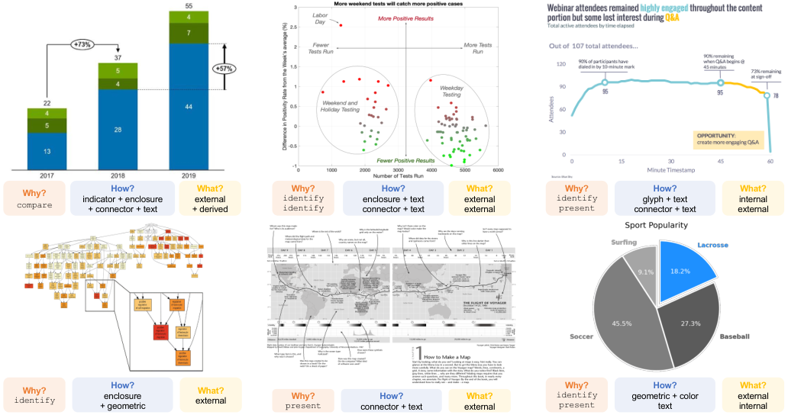
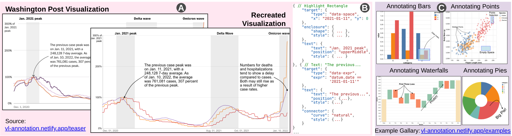
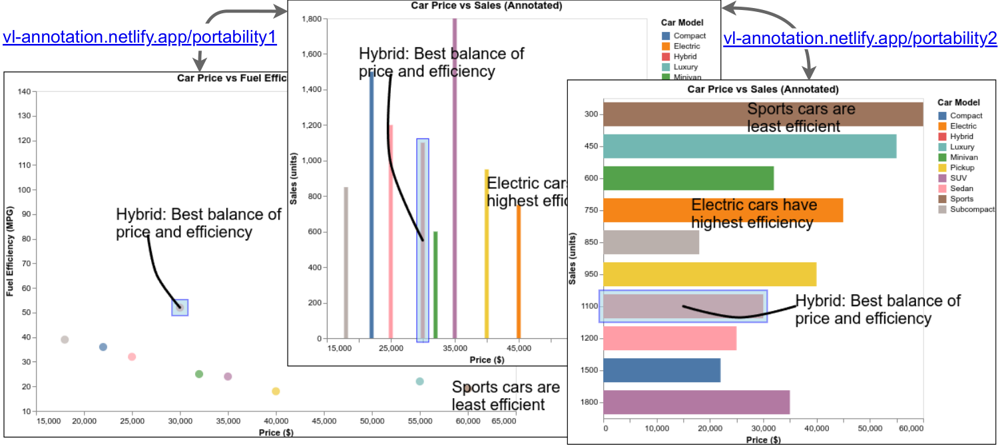
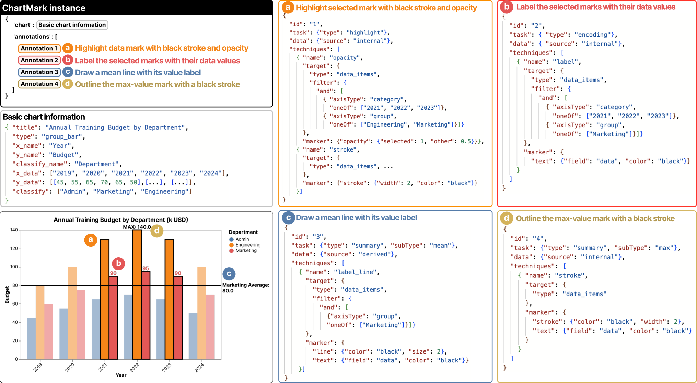
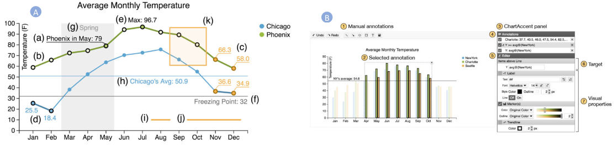
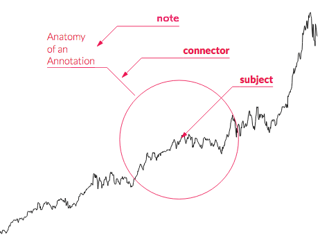

# Annotations: prior-work survey

This survey covers how research systems, libraries, and design tools let authors add
annotations to visualizations and diagrams. Annotations here means shapes, lines,
arrows, color highlights, callouts, enclosures, reference lines and bands, and text
notes attached to data. It feeds a GoFish API proposal. The question behind it came from
Md Dilshadur Rahman: will GoFish support "different annotation types (shapes, lines,
arrows, color highlights)" beyond the declarative `.label()` API?

Conventions:

- **Verified** means I read the primary source (paper PDF/HTML, official docs, or repo
  source) in this session. **Unverified** means I am relying on memory or on a
  secondary summary. Each such claim is marked.
- Code blocks are verbatim from the cited source unless marked "illustrative".
- Images live in `../img/`. The image index at the end lists each one's source URL.

---

## Part 1. Rahman et al.: the annotation research line (Utah, Rosen lab)

Rahman's VIS 2026 page (https://dilshadur.com/vis2026.html) lists the TVCG survey and the
EuroVis/CGF design-considerations paper. His home page (https://dilshadur.com/) lists the
full annotation line. In chronological order:

| Year / venue                      | Paper                                                                                                                      | Contribution type                                            |
| --------------------------------- | -------------------------------------------------------------------------------------------------------------------------- | ------------------------------------------------------------ |
| VisComm 2022 + VIS poster         | _A Qualitative Evaluation and Taxonomy of Student Annotations on Bar Charts_                                               | first taxonomy (5 types)                                     |
| InfoVis journal 2025 (study 2022) | _Exploring Annotation Taxonomy in Grouped Bar Charts: A Qualitative Classroom Study_ (doi 10.1177/14738716241270247)       | refined 5+1 types, ensembles, tasks                          |
| VisComm 2023 + VIS 2024 poster    | _Exploring Annotation Strategies in Professional Visualizations: Insights from Prominent US News Portals_                  | 72 news charts, 5 strategies                                 |
| TVCG 2025 (VIS 2024)              | _A Qualitative Analysis of Common Practices in Annotations: A Taxonomy and Design Space_ (arXiv 2306.06043)                | **7-type taxonomy**, Why/How/What design space, 1,888 charts |
| TVCG 2025 (VIS 2026 talk)         | _A Survey on Annotations in Information Visualization_ (arXiv 2410.05579)                                                  | 191-paper survey; type, generation, referent                 |
| VIS 2025 short                    | **AnnoGram: An Annotative Grammar of Graphics Extension** (arXiv 2507.04236)                                               | **declarative grammar**, Vega-Lite prototype                 |
| CGF / EuroVis 2026                | _Designing Annotations in Visualization: Considerations from Visualization Practitioners and Educators_ (arXiv 2604.07691) | 6 design considerations, 10 practitioners + 7 educators      |

Companion interactive sites: `/annotation-taxonomy/`, `/annotation-strategies/`,
`/annotation-design-space/`, `/annotation-survey/`, `/annotation-grammar/`,
`/annotation-design/` (all under dilshadur.com).

### 1.1 Design space and the seven annotation types (TVCG 2025, arXiv 2306.06043). Verified.

Corpus: 8,768 Google Images results for "annotated {chart type}" across 14 chart types.
After filtering, 1,888 annotated charts were coded by two coders (mean Cohen's κ 0.886).
The paper defines annotations as "supplementary elements, such as graphical shapes, text,
or color" added to a chart's basic elements.

The design space has three axes, following Brehmer and Munzner's Why/How/What:

- **Why (task):** present, identify, summarize, compare.
- **How (type):** seven types, alone or in ensembles.
- **What (data source):** internal (the chart's data), derived (computed from it, such
  as a mean or trend), external (outside facts). External 53% and internal 52% of
  charts; derived 17%.

Seven types (definitions quoted from the paper; frequencies are shares of the 1,888 charts):

| Type          | Definition (paper)                                                                                          | Share     |
| ------------- | ----------------------------------------------------------------------------------------------------------- | --------- |
| **Text**      | "words or sentences to provide answers regarding the data"                                                  | 76%       |
| **Enclosure** | "a partially or fully closed boundary, including ellipses, brackets, rectangles, etc."                      | 31%       |
| **Indicator** | annotations that "indicate trends, statistics, thresholds, etc. in the data" (trend lines, reference lines) | 20% (424) |
| **Connector** | "a line encompassing various forms, such as solid, dotted, or directional (i.e., arrows) lines"             | 21%       |
| **Glyph**     | "symbols or shapes ... to identify specific objects or categories"                                          | 14%       |
| **Color**     | "any property of color (generally, but not exclusively, hue)"                                               | 14%       |
| **Geometric** | modifying chart regions, e.g. enlarging/zooming into part of a chart (exploded pie slice, inset)            | 3%        |

**Ensembles.** The most frequent are enclosure+connector+text, connector+text,
enclosure+text, and glyph+color. Dependencies are **one-way** (one annotation stands
alone and the other reinforces it) or **two-way** (neither works alone; a connector
without text is the canonical case). Ensembles of 4 or more types were often redundant.



### 1.2 Classroom taxonomy (Information Visualization 2025). Verified via the companion site.

Students annotated grouped bar charts to answer questions (20 analyzed submissions,
about 45 annotations each). The types and subtypes show the vocabulary at a finer grain:

| Type                 | Count | Subtypes                                                    |
| -------------------- | ----- | ----------------------------------------------------------- |
| Connector            | 201   | line (undirected), arrow (directional)                      |
| Color                | 194   | highlight (translucent overlay), hue variation              |
| Text                 | 156   | description, value, legend                                  |
| Enclosure            | 144   | ellipse, rectangle, half-box, bracket                       |
| Mark (later "glyph") | 33    | checkmark, small circle, underline, T-shape, numeral/letter |
| Residual             | n/a   | special symbols such as "#" for a computation               |

Findings that matter for API design:

- Connectors almost never appeared alone. "Without an anchoring type, a connector
  cannot indicate its referent."
- Sort tasks always needed ensembles (arrow + text). Color never appeared in sort tasks.
- With a non-chronological axis, a date range that one enclosure could cover in a
  chronological chart had to be split into several enclosures or marks. An enclosure's
  target is a set of marks, and that set need not be contiguous on screen.

### 1.3 Survey (TVCG 2025, arXiv 2410.05579). Verified (first 100k chars of the HTML).

Classifies 191 papers by:

- **Type:** textual (additive vs observational), graphical (shapes: enclosures,
  connectors, marks; highlights: color, size, stroke, contrast; trends; images/icons;
  geometric), data-aware (reacts to selection/brushing), ensembles.
- **Generation:** manual, semi-automatic, automatic.
- **Referent:** it reuses two schemes rather than inventing one.
  - Ren et al. (ChartAccent): data item/set/series; coordinate space; chart element;
    prior annotation.
  - Hullman et al.: single data points; groups or regions; the entire view.

Open problems listed: placement and quantity, practitioner input, context-dependent
comprehension, LLM generation, and a unified design space across static and dynamic
charts. The survey does not discuss declarative specification directly.

### 1.4 AnnoGram (IEEE VIS 2025 short paper, arXiv 2507.04236). Verified.

Rahman, Rahat-uz-Zaman, McNutt, Rosen. Site: https://dilshadur.com/annotation-grammar/.
Playground: https://vl-annotation.netlify.app/. LOC comparison code:
https://github.com/shape-vis/codelines-comparison.

**Model.** Annotations become a top-level grammar element, "a peer of scales and
geometries". Each annotation answers three questions: **target** (what is annotated),
**type** (how it is drawn), and **placement** (where it goes; automatic by default and
overridable). The authors compare the style to CSS: one target, several visual effects.

**Grammar (verbatim from the site):**

```
Root
- target := (id | FixedPos | ChartPart | DataPoint | Axis | None)[]
- text :=opt Annotation<TextAnn>
- enclosure :=opt Annotation<EnclosureAnn>
- connector :=opt Annotation<ConnectorAnn>
- indicator :=opt Annotation<IndicatorAnn>
- ···

Annotation Targets
- DataPoint := Expression | index[]
- ChartPart := title | legend | subtitle | caption | ···
- Axis := axis := x | y, parts := label | tick | grid | tick-label
  range :=opt Coord[] | Expression

Annotation Types
- Annotation<X> := (id, Style, X),  Style = ···
- TextAnn := (string, Position | None)
- EnclosureAnn := (Rect | Ellipse | SVGShapePath | ···, Position | None)
- ConnectorAnn := (Markers | None, SVGShapePath, linear | catmull-rom | ···)
- IndicatorAnn := (line | area | arrow | ···, Expression)

Placement
- Position := FixedPos | Anchor1D | Anchor2D
- Anchor1D := auto | start | mid | end
- Anchor2D := auto | upLeft | midRight | ···
- FixedPos := {type := data | pixel, x := Coord, y := Coord}
- Coord := string | number
```

**Spec excerpt (verbatim from the teaser figure; `...` elisions are the authors'):**

```json
{ // Highlight Rectangle
  "target": {
    "type": "data-space",
    "x": "2021-01-11", "y": 0
  },
  "enclosure": {
    "shape": { ... },
    "style": { ... },
  },
  "text": {
    "text": "Jan. 2021 peak",
    "position": "upperMiddle",
    "style": { ... }
  }
}, { // Text: "The previous...
  "target": {
    "type": "data-expr",
    "expr": "datum.date == '2021-01-11'"
  },
  "text": {
    "text": "The previous...",
    "position": {...},
    "style": {...}
  },
  "connector": {
    "curve": "natural",
    "style": {...}
  }
}
```

Key points:

- **One target, several effects in one object.** `text`, `enclosure`, `connector`, and
  `indicator` are optional sibling slots of one annotation. This is the d3-annotation
  decomposition (section 3.1), moved up to the grammar level.
- **Target kinds:** a data predicate (`data-expr`), data indices, a fixed data-space or
  pixel-space position, an axis part with an optional range, a chart part (title,
  legend), another annotation by `id`, or none.
- **Inter-annotation relations:** _reference_ (link to another annotation's `id`) and
  _composite_ (a group describing a repeated pattern).
- **Placement:** a user position wins. Otherwise a position resolver reads the Vega
  scene graph and finds free space by backtracking to reduce occlusion.
- **Portability claim:** a data-space target transfers across chart types. The same
  spec can annotate a scatterplot point and a bar of the same datum. The resolver
  detects the target's mark type.
- **Implementation:** an external wrapper with a five-stage pipeline (parse, resolve
  positions, assemble, transpile into Vega marks/data, post-add special shapes such as
  ellipses straight into the scene graph).
- **Evaluation:** a heuristic comparison, not a user study. Annotation lines of code for
  the bar chart: AnnoGram 101, d3 151, Vega-Lite 259, Vega 515. Tools are grouped as
  "without annotation constructs" (D3, Vega, Vega-Lite), "primitives, weakly coupled"
  (d3-annotation, ggplot2, ggplot2-annotate, Highcharts, visual editors), and
  "embedded in the grammar" (AnnoGram).
- **Stated limitations:** one annotation per type per target. No facet, layer, or
  concat. Only the common types are implemented; the prototype covers 4 of the 7
  (text, enclosure, connector, indicator; not color, glyph, or geometric). The flat
  structure limits "nested or highly coordinated ensembles".




### 1.5 Designing Annotations (CGF / EuroVis 2026, arXiv 2604.07691). Verified.

Interviews with 10 practitioners and 7 educators produced six considerations (paper
Figure 1 labels: Audience, Hierarchy, Associate Placement, Associate Style, Cohesion,
Amount):

1. Tailor annotations to audience knowledge and stakes.
2. Hierarchy: "Treat multiple annotations as an attention plan anchored in the data.
   Choose one primary annotation ..." and keep the others visibly secondary.
3. "Place annotation text next to data before using connectors or legends." The
   fallback order is adjacent text, then a short uncrossed connector or a single
   enclosure, then a key or legend.
4. Use color and style to associate the label with the data element, always paired with
   a non-color cue (proximity, a connector tick, a swatch, an enclosure).
5. Decide whether annotations blend with the chart or stand apart from it, then reuse
   that style consistently.
6. Scale annotation count to chart clarity and available space (an annotation budget).

**Tooling findings (important for us).** Nine of ten practitioners built the base chart
in one tool and "finished annotations elsewhere" (PowerPoint, Illustrator, Figma). This
"breaks data linkage and accumulates maintenance debt". Quotes: P3 "cannot put
annotations exactly where you want"; P10 said dashboards cannot place labels across
screen sizes and still "move with the data". The paper's tool implication: represent
"annotations as first-class objects linked to target elements, with explicit control
over placement and style". So the gap practitioners describe is control _plus_ data
binding, not brevity.

---

## Part 2. Other annotation grammars and research tools

### 2.1 ChartMark (IEEE VIS 2025, arXiv 2507.21810). Verified (paper HTML and teaser figure).

Chen, Wu, Shen, Xie, Shen, Xiong, Luo. "A Structured Grammar for Chart Annotation". It
separates annotation _semantics_ from the rendering library. Converters target
Vega-Lite (demonstrated), with ECharts and D3 mentioned.

Structure: `{chart, annotations: [ {id, task, data, techniques/operations: [ {name, target, marker} ]} ]}`.
The prose calls the list `operations`; the teaser figure spells it `techniques`.

- **task.type:** reference, highlight, description, summary (subType max/min/mean),
  trend, encoding.
- **data.source:** external, derived, internal, none (the same split as Rahman's "What").
- **target.type:** `data_items` (with a filter), `coordinate` (region, interval,
  point, line), `chart_element`, `annotation` (by id). These four are the ChartAccent
  target types.
- **marker:** display settings (line, text, stroke, opacity, ...).

Verbatim from the teaser (annotation "a": highlight selected marks with black stroke and
opacity):

```json
{
  "id": "1",
  "task": {"type": "highlight"},
  "data": {"source": "internal"},
  "techniques": [
    { "name": "opacity",
      "target": {
        "type": "data_items",
        "filter": {
          "and": [
            { "axisType": "category",
              "oneOf": ["2021", "2022", "2023"]},
            { "axisType": "group",
              "oneOf": ["Engineering", "Marketing"]}]}
      },
      "marker": {"opacity": {"selected": 1, "other": 0.5}}},
    { "name": "stroke",
      "target": {
        "type": "data_items", ...
      },
      "marker": {"stroke": {"width": 2, "color": "black"}}
    }]
}
```

and annotation "c", a mean line with a value label:

```json
{
  "id": "3",
  "task": { "type": "summary", "subType": "mean" },
  "data": { "source": "derived" },
  "techniques": [
    {
      "name": "label_line",
      "target": {
        "type": "data_items",
        "filter": {
          "and": [{ "axisType": "group", "oneOf": ["Marketing"] }]
        }
      },
      "marker": {
        "line": { "color": "black", "size": 2 },
        "text": { "field": "data", "color": "black" }
      }
    }
  ]
}
```

Note `"opacity": {"selected": 1, "other": 0.5}`. Emphasis is a property of the
selected/unselected _partition_, not of the selected marks alone (compare gghighlight,
section 3.6). There is no user evaluation. Extension means registering a new
Marker/Operation node with parsing rules and a target mapping.



### 2.2 ChartAccent (Ren, Brehmer, Lee, Höllerer, Choe; PacificVis 2017). Verified (PDF).

PDF: https://sites.cs.ucsb.edu/~holl/pubs/Ren-2017-PacificVis.pdf. Tool:
https://chartaccent.github.io. This is the origin of the target taxonomy that later
work reuses.

**Dimension 1: form.** Text, shapes ("line, arrow, curve, rectangle, ellipse, bracket,
star, speech bubble"), highlights ("altering or embellishing the target to emphasize or
diminish its importance", e.g. size, stroke, fill), and images. "Any single target can
be annotated with several annotations."

**Dimension 2: target type** (Figure 2 letters):

- **Data item, set, and series:** (a) a single item, (b) a series, (c) a set, (d) items
  satisfying an inequality ("below the freezing point"), (e) items with extreme values.
- **Coordinate space:** (f) a value on one axis (32°), (g) a span on one attribute
  (March–May), (h) a statistic of a series (min/mean/median/max), (i) a point (x,y),
  (j) a partial span at a fixed value, (k) a 2D region.
- **Chart elements:** title, axes, axis labels, ticks, legend, plot area, whole chart.
- **Prior annotations:** annotations on annotations.

**Data-driven selection.** A coordinate-space target can select data items "above or
below a position or within or outside a span". The selection stays coupled: moving the
line re-selects the items. A target editor accepts formulas such as `avg@(NewYork)` with
min/max/mean/median. Defaults: selecting an item gives a black stroke plus a value label;
selecting a coordinate target gives a perpendicular line or rectangle plus a value label.
Set/series targets can take a trend line or a Bubble Set contour.

**Study (11 participants, reproduction tasks).** The mean time per task was 102.7 s.
Ratings: easy to learn 5.8/7, easy to use 6.2/7, enjoyable 6.7/7, would use again 6.9/7.
P11: "I liked [that] it was semantic based ... I will be able to modify values and the
annotation might be able to follow the similar rules". The main friction was z-order
between annotations. Future work named "an annotation specification language" so
data-driven annotations can be reapplied to other data with the same schema. AnnoGram
and ChartMark are, in effect, that language.



### 2.3 Kong & Agrawala, Graphical Overlays (InfoVis 2012). Partly verified (abstract, dissertation summary).

"Graphical Overlays: Using Layered Elements to Aid Chart Reading". There are five overlay
types: **reference structures** (gridlines), **highlights** (outlines around important
marks), **redundant encodings** (numerical data labels), **summary statistics** (mean,
max), and **annotations** (descriptive text). The overlays are generated by analyzing the
chart bitmap, not the spec. Kong et al. later distinguished _internal_ cues (changing
existing marks) from _external_ cues (added arrows or outlines). That split matches the
"recolor vs add" line in the synthesis below. Source:
https://ieeevis.org/year/2012/paper/infovis/graphical-overlays-using-layered-elements-aid-chart-reading.
The internal/external terminology is unverified (from a secondary citation).

### 2.4 Contextifier (Hullman, Diakopoulos, Adar; CHI 2013). Unverified detail.

It automatically annotates stock-price line charts with text drawn from news articles.
It picks points by combining news relevance with visual salience (peaks, troughs). The
author specifies the article and the system decides what to annotate and where. The
2410.05579 survey confirms this one-line summary; I did not read the paper.

### 2.5 "Annotation graphs" (Zhao et al., VAST 2016). Note only.

"Annotation Graphs: A Graph-Based Visualization for Meta-Analysis of Data Based on
User-Authored Annotations". It visualizes a _collection_ of analyst annotations; it is
not an annotation-authoring primitive. Not relevant to the API except as a reminder
that "annotation" also means analyst notes and provenance.

### 2.6 AnnoSketch (arXiv 2609.14289, Sept 2026). Abstract only.

1,600 human annotation sketches over 160 chart+caption pairs, used to guide MLLM
annotation generation. It is a possible source of real-world annotation examples; no
taxonomy is given in the abstract.

---

## Part 3. Libraries

### 3.1 d3-annotation (Susie Lu, 2017). Verified (repo docs and source).

Docs: https://d3-annotation.susielu.com. Source:
https://github.com/susielu/d3-annotation (`docs/content/*.md`, `src/Types-d3.js`).

**Decomposition:** "All annotations are made of just three parts, a **note**, a
**connector**, and a **subject**." The subject is the thing pointed at (optional), the
note is the text, and the connector is the line between them.



**Types are presets over the three parts.** In `src/Types-d3.js` every built-in type is
`customType(base, {className, subject, connector, note})`:

| Type                      | Subject                                              | Connector       | Note                                 |
| ------------------------- | ---------------------------------------------------- | --------------- | ------------------------------------ |
| `annotationLabel`         | none                                                 | line            | `align: "middle"`                    |
| `annotationCallout`       | none                                                 | line            | `lineType: "horizontal"` (underline) |
| `annotationCalloutElbow`  | none                                                 | `type: "elbow"` | horizontal                           |
| `annotationCalloutCurve`  | none                                                 | `type: "curve"` | horizontal                           |
| `annotationCalloutCircle` | `circle` (radius, radiusPadding)                     | elbow           | horizontal                           |
| `annotationCalloutRect`   | `rect` (width, height)                               | elbow           | horizontal                           |
| `annotationXYThreshold`   | `threshold` (x1,x2 or y1,y2)                         | default         | default                              |
| `annotationBadge`         | `badge` (text, radius, x: left/right, y: top/bottom) | none            | none                                 |

The connector has `end: "arrow" | "dot"` and `type: "line" | "elbow" | "curve"` (curve
takes `points`). The note has `title`, `label`, `wrap`, `align`, `orientation`,
`lineType`, `padding`, and `bgPadding`. `d3.annotationCustomType(type, settings)` makes a
new preset.

**Positioning** (API doc, verbatim field descriptions):

- `x, y` (pixels): "Position of the subject and one end of the connector".
- `data` + `.accessors({x, y})`: place by data instead of pixels.
- `dx, dy` (pixels): "Position of the note ... as an offset from x,y".
- `nx, ny`: the note's absolute position.
- `disable: ['connector' | 'subject' | 'note']` turns parts off.

There is no automatic placement; the author sets `dx/dy`. `editMode(true)` adds drag
handles, and `json()` copies the dragged positions back. The workflow is drag to place,
then paste into code.

```js
const annotations = [
  {
    note: { label: "Hi" },
    x: 100,
    y: 100,
    dy: 137,
    dx: 162,
    type: d3.annotationCalloutElbow,
    connector: { end: "arrow" },
  },
];

d3.annotation().annotations(annotations);
```

```js
d3.annotation().accessors({
  x: (d) => x(parseTime(d.date)),
  y: (d) => y(d.close),
});
```

### 3.2 matplotlib `annotate`. Verified (API reference).

https://matplotlib.org/stable/api/_as_gen/matplotlib.axes.Axes.annotate.html

```
Axes.annotate(text, xy, xytext=None, xycoords='data', textcoords=None,
              arrowprops=None, annotation_clip=None, **kwargs)
```

- **Two points, each with its own coordinate system.** `xy` is the annotated point and
  `xytext` is where the text goes. `xycoords` and `textcoords` name the systems:
  `'data'`, `'axes fraction'`, `'axes pixels'`, `'axes points'`, `'figure fraction'`,
  `'figure pixels'`, `'subfigure ...'`, `'polar'`. A tuple gives separate x and y
  systems, e.g. `('data', 'axes fraction')` for "at this x, at the top of the axes".
  `textcoords` adds `'offset points'`, `'offset pixels'`, and `'offset fontsize'`
  (offset from `xy`).
- **Anchoring to another artist:** `xycoords` may be an `Artist`. Then `xy` is a
  _fraction of that artist's bounding box_: `(0.5, 1)` is its top center. It may also be
  a `Transform` or a callable returning a Bbox or Transform. This is the most general
  "anchor to another mark's geometry" mechanism in any library surveyed.
- **arrowprops:** simple mode (`width`, `headwidth`, `headlength`, `shrink`) or fancy
  mode (`arrowstyle`, `connectionstyle` such as `"arc3,rad=0.2"` or `"angle3"`,
  `relpos` start point on the text box, `patchA/patchB` to clip ends, `shrinkA/shrinkB`).
- `annotation_clip` hides the annotation when `xy` leaves the axes.

Illustrative (the canonical pattern; not quoted from the page):

```python
ax.annotate("local max", xy=(2, 1), xycoords="data",
            xytext=(-40, 30), textcoords="offset points",
            arrowprops=dict(arrowstyle="->", connectionstyle="arc3,rad=.2"))
```

`ax.axhline/axvline/axhspan/axvspan` cover reference lines and bands. Their extent along
the other axis is in axes fraction, which is a mixed coordinate system again.

### 3.3 Plotly `layout.annotations` and `layout.shapes`. Verified (reference pages).

- Annotations: `x, y` with `xref/yref` set to an axis id (`"x"`, data coordinates),
  `"paper"` (0–1 of the plot area), or `"x domain"` (fraction of that axis's domain).
  `ax, ay` give the arrow tail. With `axref/ayref` at the default `"pixel"` they are
  pixel offsets; set to the axis they become data coordinates. Also `showarrow`,
  `arrowhead` (0–8), `xanchor/yanchor`, `xshift/yshift` (pixels), `standoff` (pull the
  arrowhead back from the point), and `clicktoshow` (`"onoff"`/`"onout"`, tied to data
  points).
- Shapes: `type` is one of `rect`, `circle`, `line`, `path`, with `x0,x1,y0,y1` and
  the same refs. `layer: "below" | "above" | "between"`. `xsizemode: "pixel"` with
  `xanchor` sizes in pixels around a data anchor. `label: {text, textposition}`.
  `editable`.

Illustrative:

```js
annotations: [{ x: '2021-01-11', y: 248128, xref: 'x', yref: 'y',
                text: 'Jan. 2021 peak', showarrow: true, ax: 40, ay: -40 }],
shapes: [{ type: 'rect', xref: 'x', yref: 'paper', x0: '2021-06-01', x1: '2021-09-01',
           y0: 0, y1: 1, fillcolor: 'gray', opacity: 0.2, layer: 'below' }]
```

`yref: 'paper'` with an `xref: 'x'` span is the full-height band: a mixed coordinate
system again.

### 3.4 Observable Plot. Verified (docs source, `docs/marks/tip.md`, `arrow.md`).

There is no annotation subsystem. Annotations are ordinary marks with literal data:

- `Plot.ruleY([0])` and `Plot.ruleX(...)` for reference lines; `Plot.rectX/rectY` with
  `x1/x2` for bands; `Plot.text` with `dx/dy` and `frameAnchor` for notes.
- `Plot.arrow` (x1,y1 → x2,y2) with `bend` (degrees, `true` = 22.5°), `sweep`,
  `insetStart/insetEnd` ("useful if the arrow points to a dot"), `headAngle`,
  `headLength`. `Plot.link` is the same without a head.
- `Plot.tip` is a callout box with a pointer. `anchor` takes 9 positions; when omitted
  it is chosen automatically via `preferredAnchor`. It is used interactively with
  `Plot.pointer`, or statically. The docs warn: "When multiple tips are visible
  simultaneously, some may collide". No collision avoidance.

Static tip (verbatim):

```js
Plot.plot({
  y: { grid: true },
  marks: [
    Plot.lineY(aapl, { x: "Date", y: "Close" }),
    Plot.tip(
      [
        `Apple stock reaches a new high of $133 on Feb. 23, 2015. The release of the first Apple Watch, slated for April, is hotly anticipated.`,
      ],
      { x: new Date("2015-02-23"), y: 133, dy: -3, anchor: "bottom" }
    ),
    Plot.tip(
      [
        `Apple stock drops 8% after the company misses Q2 revenue targets and reports declining iPhone sales. It reaches a two-year low of $90.34 on May 12.`,
      ],
      { x: new Date("2016-05-12"), y: 90.34, dy: 3, anchor: "top" }
    ),
  ],
});
```

The anchor point is resolved as: midpoint of `x1/x2`, else `x`, else `x1`, else
`frameAnchor`. A tip on a bar therefore anchors at the bar's middle in x.

### 3.5 Vega-Lite / Altair. Verified for the absence claim (AnnoGram paper); syntax from memory.

There is no annotation primitive. AnnoGram: "users must instead define separate data
sources and specify annotation marks using basic graphical primitives". The patterns:

- Reference line: a layer with `{"mark": "rule", "encoding": {"y": {"datum": 300}}}`, or
  an aggregate `{"y": {"aggregate": "mean", "field": "price"}}`.
- Band: a `rect` layer over a small inline dataset, with `x`/`x2`.
- Note: a `text` layer with `datum` positions and `dx/dy`. Arrows have no built-in mark.
- Highlight: conditional encoding,
  `"color": {"condition": {"test": "datum.year == 2008", "value": "red"}, "value": "lightgray"}`
  (or a `param` selection). This is the gghighlight pattern spelled as an encoding rule.

Altair mirrors this: `alt.Chart(df).mark_rule().encode(y=alt.datum(300))`.

### 3.6 R: ggplot2 `annotate()`, ggforce, ggrepel, gghighlight

**ggplot2 `annotate(geom, x, y, xmin, xmax, ymin, ymax, xend, yend, ...)`.** It adds a
layer whose data is the given vectors rather than the plot's data. `annotate("rect",
xmin=, xmax=, ymin=-Inf, ymax=Inf, alpha=.2)` is the standard band (`-Inf/Inf` means
"to the panel edge"). `annotate("segment", ..., arrow = arrow())` is an arrow, and
`annotate("text", ...)` a note. It is just a mark in data space. From memory; this is
standard ggplot2.

**ggforce `geom_mark_rect/circle/ellipse/hull`.** Verified (reference page). Enclosure
plus callout in one geom, driven by data:

- The `label` (title) and `description` aesthetics produce a text box placed outside
  the data, with a connector (`con.type = "elbow" | "straight" | "none"`, `con.cap`).
- `filter` aesthetic: which rows get a mark. The geom still avoids the removed data
  when placing labels.
- Placement is automatic, "without obscuring any of the datapoints in the layer".
  `label.buffer` sets a keep-out zone. If no space fits, the label is **not drawn**.
- `expand` and `radius` grow the enclosure and round its corners.

Illustrative, the docs pattern:

```r
ggplot(iris, aes(Petal.Length, Petal.Width)) +
  geom_mark_ellipse(aes(fill = Species, label = Species,
                        filter = Species == "versicolor",
                        description = "Versicolor has medium-sized petals")) +
  geom_point()
```

The target is a _group of rows_ (via `group`, `fill`, and `filter`). The enclosure shape
is computed from the points (Khachiyan ellipse, convex hull, bounding rectangle). This
is data-bound enclosure plus callout in one call.

**ggrepel.** `geom_text_repel` / `geom_label_repel` take `box.padding`,
`point.padding`, `min.segment.length`, `nudge_x/y`, `direction`, `force`, and
`max.overlaps`. Labels repel each other and the points, and a leader segment is drawn
when a label moves far from its point. From memory; well established. This is the
canonical "avoid overlap + leader line" solver.

**gghighlight.** Verified (vignette). Highlight by predicate; everything else is grayed:

```r
ggplot(d) +
  geom_line(aes(idx, value, colour = type), linewidth = 5) +
  gghighlight(max(value) > 19,
              unhighlighted_params = list(linewidth = 1, colour = alpha("pink", 0.4)))
```

The predicate is evaluated per group (like `dplyr::filter` on grouped data).
`use_direct_label = TRUE` (default) adds direct labels to the highlighted series via
`label_key`. **Emphasis is defined as restyling the complement.** The annotation's
effect lands on marks it does _not_ target.

### 3.7 Highcharts annotations module. Verified (docs and API reference).

`annotations: [{ labels: [...], shapes: [...], labelOptions, shapeOptions }]`.

- A label's `point` is either the **id of an existing series point** (anchor to a mark)
  or a mock point `{x, y, xAxis, yAxis}`. Without axes, `x/y` are chart pixels and stay
  fixed on zoom; with axes they are axis values and move.
- Shapes: `rect` (point, width, height), `circle` (point, r), `ellipse` (points, ry),
  `path` (points, with `markerStart/markerEnd: 'arrow' | 'reverse-arrow'`).

```javascript
annotations: [
  {
    labels: [
      {
        point: { x: 0, y: 0 },
        text: "Label",
      },
    ],
  },
];
```

Highcharts also has `xAxis.plotLines` / `plotBands` for reference lines and bands
(from memory). These are configured on the axis, not as annotations: the AnnoGram
"Axis" target kind.

---

## Part 4. Designer tools

### 4.1 Datawrapper. Verified (Academy and blog via search summaries).

- **Text annotations:** clicking the chart creates a note _with_ an arrow; dragging out
  a text box creates one without. Options: line type, line width, line end, and
  "distance from the data point". The line can be colored like the text.
- **Range highlights and reference lines:** rectangles spanning the full chart width
  or height, positioned by axis values. A line can be switched to a range and back.
  In multi-panel charts they repeat across panels.
- **Responsive:** annotation width scales with the chart. On small screens
  "annotations get numbered and move below the chart" (a key), unless "Show as key on
  mobile" is off.
- Later extended to bar, range, and dot charts (blog: "Annotations in bar, range, and
  dot charts").
- Unverified: whether stored positions are data coordinates. The articles do not say.

### 4.2 Flourish. Verified (help center via search).

"Axis highlights" in a mini-syntax typed into a settings field:

- Line: `Label :: 01/10/2020` (vertical or horizontal at an axis value).
- Range: `Label :: 2013 >> 2015` (a shaded span, with color, opacity, and texture:
  fill, diagonal stripe, grid, dots).
- Ranges can target a category on bar charts.

Flourish also has separate free-positioned "story annotations"; I did not verify their
syntax. The `Label :: a >> b` string is a short spec for "band on axis + label".

### 4.3 Figma, Illustrator, PowerPoint/Excel

- **Figma Dev Mode annotations** (Verified, help center): `Shift T`, select a layer,
  type a note _or insert a property_ (e.g. alignment, sizing). "Since annotations are
  connected to a layer on the canvas, any property or measurement will change as designs
  change." Annotations have **categories** (filterable). **Measurements** (`Shift M`)
  are a separate tool: a distance between two layers, drawn as a dimension line. So the
  target is a layer (a mark), and the content can be a live property of that target.
  This is the design-tool version of `.label(field)`.
- **FigJam / community annotation kits** (Unverified, general knowledge): numbered
  markers ("badges") placed on the design, with a matching legend list of notes. This
  is the same "numbered key" fallback Datawrapper uses on mobile.
- **PowerPoint/Excel shapes gallery** (from memory): a **Callouts** group (e.g. "Speech
  Bubble: Rectangle", "Callout: Line", "Callout: Bent Line", "Callout: Line with Accent
  Bar") whose pointer tip is a yellow adjustment handle the user drags onto the target.
  The target is not bound to anything. Excel chart **data labels** can be shown as
  "Data Callout" shapes bound to a point, and can show "Value From Cells". Excel and
  PowerPoint call the leader line of a moved label a "leader line".
- **Illustrator** (from memory): no annotation primitive. Designers draw text, lines,
  and arrowheads (stroke panel "Arrowheads"). In practice this is the "export and
  finish" step the CGF 2026 paper documents.

Vocabulary across tools: **callout** (a note box with a pointer), **leader line**
(Excel, cartography, the label-placement literature), **connector** (d3-annotation,
Rahman, ggforce `con.*`; in Figma/Visio a "connector" is a line glued to two shapes),
**badge** (d3-annotation, annotation kits), **range highlight / plot band**, **reference
line / plot line / rule**, **highlight**.

---

## Part 5. Math and diagram side

### 5.1 Math Augmentation (Head, Xie, Hearst; CHI 2022 Best Paper). Verified (PDF).

https://andrewhead.info/assets/pdf/augmented-formulas.pdf. A content analysis of 1.1k
augmentations ("maugs") on 281 formulas in 47 documents, plus 12 author interviews. There
are 16 kinds in 4 categories (Figure 4):

- **Visual notation:** geometry, data (a visualization _as_ an expression).
- **Style:** font color (most common: 41.6% of formulas, 70.2% of documents),
  brightness/opacity, spacing.
- **Annotation** ("marks ... overlaid atop or underlaid beneath a formula"): border,
  background color, strikethrough, pointer, **extent marker** (a brace or line in the
  margin, e.g. `\underbrace`), **connector arrow** (between expressions or formulas;
  arrows can carry labels that contain formulas), **label** (in 48.9% of documents;
  average 3.3 labels per labeled formula).
- **Interactivity:** editable, scrubbable, external controls, linked selection.

Findings relevant to us:

- **Color as a visual link** (70.2% of documents): the same color on an expression and on
  its prose, a mark in a nearby chart, or code. That is a cross-figure annotation; the
  target is in another view.
- Targets: identifiers 31.4%, but 49.9% were _compound subexpressions_.
- Recommendations: R1 support multiple maugs per formula (47.7% of formulas used more
  than one kind). **R6 "separate code for augmenting a formula from the specification of
  the underlying formula"**, citing HTML/CSS and Penrose. R8 a rich label design space
  (labels containing math, 29.8%; icons). R11 limit the number and variety of
  augmentations (authors felt more is worse).

### 5.2 FFL (Wu, Li, Ma, Kambhamettu, Head; UIST 2023). Verified (PDF).

"Formula Formatting Language" is CSS for formulas: **selector + properties**, written
separately from the LaTeX.

- Selectors: a literal LaTeX match `$y$`, wildcards `$x_*$` / `$y_?$`, classes
  `*.target`, union `,`, intersection `intersection(a, b)` (shorthand `a b`), and
  `:nth(i)`.
- Properties: CSS styles (`color`, `font-weight`, `background`) and **labels**:
  `label`, `label-marker: extent` (a margin bracket instead of a leader line), and
  `label-position: below`.
- Label placement is automatic, "designed to avoid overlapping labels and to place
  labels as close to their corresponding expressions as possible". A label is anchored
  to the first match, and labels move when the formula changes.

Verbatim (from the paper's walkthrough):

```
$y_?$, $y$, *.target { color: Crimson      }
$x_*$, *.feat        { color: DodgerBlue   }
$\beta_*$, *.slope   { color: MediumPurple }
$\beta_0$            { color: inherit      }

$y$               { label: target    }
$\beta_0$         { label: intercept }
$\beta_?$:nth(1) { label: slope term }
$x_1$ {
  label: feature;
  label-position: below
}
$M$ { label: # of features }
```

Note that `*.target` lets one rule color both the symbol in the formula and the
matching span in the prose. This is the cross-view color link from 5.1, expressed as a
shared selector.

### 5.3 FreeForm (Tao, Yan, Shi, Ginsberg, Head; CHI 2025). Verified (PDF, partial read).

A projectional editor. Graphical selection on the rendered formula, or the syntax-tree
view, applies an augmentation from a menu (color, label, border, strike, brace
annotation, alignment). The edit is written back into LaTeX macros (`\overbrace`,
`\underbrace`, `\textcolor`, `\cancel`), and edits flow both ways. In a controlled study
against Overleaf and FFL, FreeForm was faster for coloring and labeling tasks. The
motivating complaint: markup tangles "annotation markup with the underlying formula",
while graphical editors leave annotations "unmoored from the structure of the formula".
A quoted author wish: "if you could attach pointing labels to things, and now when I
move the thing, the label moves".

### 5.4 Delta (Dai, Khan, Tao, Hearst, Head; UIST 2026). Verified (PDF, partial read).

A TypeScript-embedded DSL for interactive formula explanations. The `Config` declares
formulas (LaTeX), variables (name, default, input mode such as `"drag"` / `"inline"`,
range), `semantics` functions (computation), linked `graph2d` / `graph3d` specs, and
step-by-step walkthroughs. Walkthrough steps attach **labels keyed by a LaTeX
subexpression**:

```js
step({
  labels: {
    "\\sum_{i=1}^{n} X_i": "sum is now " + sum,
  ...
```

Like FFL, the target is the subexpression's source text. Hovering a label highlights its
symbol (a linked highlight).

### 5.5 TikZ / LaTeX. From memory (standard).

- `\node[draw, circle, pin=above:{max}] (m) at (2,3) {};`: `pin` is a label attached
  to a node by a short edge, at an angle or direction. Distinct from `label=`, which has
  no edge.
- `\draw[->] (note) -- (m);` or `\draw[->] (note) to[bend left] (m);`: arrows between
  _named nodes_, with anchors such as `(m.north east)`.
- `\draw[decorate, decoration={brace, amplitude=5pt}] (a.north) -- (b.north) node[midway, above] {span};`:
  a brace over a span. In math: `\underbrace{x+y}_{\text{sum}}` and `\overbrace`.
- `fit` library: `\node[draw, fit=(a) (b) (c)] {};` is an enclosure around named nodes.

TikZ shows the diagram-native anchoring model: annotate _named objects_, and attach at
named anchors on their geometry (`.north`, `.east`, `.center`, an angle).

### 5.6 Bluefish (Pollock et al., UIST 2024). Verified (docs source in repo).

Relations over references: `Background` (an enclosure around children),
`Align`/`Distribute` (placement constraints), `Arrow` (a connector between two
referenced shapes), and `Ref select="name"` (refer to an already-placed shape without
owning it). The annotation is the _composition_ of relations. A label is a `Text` that
is aligned and distributed relative to a `Ref`, plus an `Arrow` between the two `Ref`s:

```jsx
<Background padding={10}>
  <StackH spacing={50}>
    <Circle name="mercury" r={15} fill="#EBE3CF" stroke-width={3} stroke="black" />
    ...
  </StackH>
</Background>
<Align alignment="centerX">
  <Text name="label">Mercury</Text>
  <Ref select="mercury" />
</Align>
<Distribute direction="vertical" spacing={60}>
  <Ref select="label" />
  <Ref select="mercury" />
</Distribute>
<Arrow>
  <Ref select="label" />
  <Ref select="mercury" />
</Arrow>
```

This is d3-annotation's subject/note/connector, decomposed into three separate
relations: subject = `Ref`, note placement = `Align` + `Distribute`, connector = `Arrow`.

### 5.7 Penrose (Ye et al., SIGGRAPH 2020). From memory.

Substance (what objects exist), Style (how each type is drawn, with constraints and
objectives), and Domain (types). Annotation-like elements such as labels are Style rules
over Substance objects, placed by optimization (e.g. `ensure disjoint(label, shape)`).
Head et al. cite it for the content/style split (R6).

---

## Part 6. Synthesis

### 6(a) Cross-system table: annotation types and how each is targeted

Rows are annotation types (Rahman's seven plus callout/reference band). Each cell shows
how the system targets that type. "—" means no first-class support (do it with generic
marks).

| Type                                        | AnnoGram                                                                                         | ChartMark                           | ChartAccent                                  | d3-annotation                                          | matplotlib                                                 | Plotly                           | Obs. Plot                                               | ggplot2 family                                      | Highcharts                                      | Datawrapper / Flourish             | FFL / Bluefish / TikZ                                                      |
| ------------------------------------------- | ------------------------------------------------------------------------------------------------ | ----------------------------------- | -------------------------------------------- | ------------------------------------------------------ | ---------------------------------------------------------- | -------------------------------- | ------------------------------------------------------- | --------------------------------------------------- | ----------------------------------------------- | ---------------------------------- | -------------------------------------------------------------------------- |
| **Text note**                               | `text` slot; target = predicate / data pos / pixel / axis / chart part; anchor auto or `upLeft`… | `marker.text` on target             | click item → value label; free text          | note at `x,y` + `dx,dy`                                | `xy`+`xytext` in any coord system                          | `x,y` + xref (data/paper/domain) | `text`/`tip` with literal data + `dx,dy`, `frameAnchor` | `annotate("text")`, `geom_text_repel`               | label `point` = series point id or `{x,y,axis}` | click to place; key on mobile      | FFL `label:`; Bluefish `Text`+`Align`; TikZ `pin`/`label`                  |
| **Connector / arrow**                       | `connector` slot (curve, markers), links note↔target                                            | — (via markers)                     | dropline / arrow shape                       | `connector` part: line/elbow/curve, end arrow/dot      | `arrowprops` (arrowstyle, connectionstyle, shrink, relpos) | `showarrow`, `ax,ay`, `standoff` | `Plot.arrow` (bend, inset), `Plot.link`                 | `annotate("segment", arrow=)`, ggforce `con.type`   | `path` with markerEnd                           | line type/width/end/distance       | FFL leader line; Bluefish `Arrow(Ref,Ref)`; TikZ `\draw[->]` between nodes |
| **Enclosure**                               | `enclosure` slot (rect/ellipse/path, padding) around target                                      | `marker.stroke` outline             | rect/ellipse shape; Bubble Set on set/series | subject `circle`/`rect` (pixel size)                   | patches (manual)                                           | shape rect/circle                | — (rect with literal data)                              | ggforce `geom_mark_*` (computed from rows)          | shape rect/circle/ellipse                       | circles around area                | Bluefish `Background`; TikZ `fit`                                          |
| **Indicator: reference line**               | `indicator` line with expression; Axis target + range                                            | `label_line` summary mean           | coordinate target (value, statistic `avg@`)  | `xyThreshold` subject                                  | `axhline/axvline`                                          | shape line, `yref:'paper'`       | `ruleY`                                                 | `geom_hline`, `annotate("segment")`                 | `plotLines` (axis)                              | reference line                     | —                                                                          |
| **Indicator: band / range**                 | Axis target with range; `indicator` area                                                         | coordinate interval / region        | coordinate span (1D/2D)                      | —                                                      | `axhspan/axvspan`                                          | shape rect + mixed refs          | `rectX` with x1/x2                                      | `annotate("rect", ymin=-Inf, ymax=Inf)`             | `plotBands`                                     | range highlight; Flourish `a >> b` | TikZ brace over span; `\underbrace`                                        |
| **Indicator: trend**                        | `indicator` with expression                                                                      | `trend` task                        | trend line on set/series                     | —                                                      | (fit manually)                                             | —                                | `linearRegressionY`                                     | `geom_smooth`                                       | —                                               | —                                  | —                                                                          |
| **Color / highlight (emphasis)**            | not implemented (1 of 3 missing types)                                                           | `opacity {selected, other}`, stroke | highlight form (fill/stroke/size on target)  | —                                                      | —                                                          | —                                | (conditional channel)                                   | **gghighlight**: predicate + `unhighlighted_params` | —                                               | —                                  | FFL `color:`; maug font color / background                                 |
| **Glyph / badge**                           | not implemented                                                                                  | cross marks (fig. 2)                | star, image shapes                           | `badge` subject                                        | marker                                                     | —                                | `dot`/`text` symbol                                     | `annotate("point")`                                 | —                                               | —                                  | annotation-kit numbered markers                                            |
| **Callout (note+connector+subject preset)** | ensemble in one object                                                                           | —                                   | combination of forms                         | types are presets: callout, elbow, curve, circle, rect | annotate = callout                                         | annotation w/ arrow              | `Plot.tip`                                              | ggforce `geom_mark_*` label/description             | label + shape                                   | text with arrow                    | PowerPoint callout shapes; TikZ `pin`                                      |
| **Geometric (zoom/inset/explode)**          | not implemented                                                                                  | —                                   | —                                            | —                                                      | inset axes (`indicate_inset_zoom`, from memory)            | —                                | —                                                       | (ggforce `facet_zoom`, from memory)                 | —                                               | —                                  | —                                                                          |
| **Annotation on annotation**                | `id` reference, composite                                                                        | target type `annotation`            | prior-annotation target                      | —                                                      | `xycoords=<Annotation artist>`                             | —                                | —                                                       | —                                                   | —                                               | —                                  | Bluefish `Ref` to any named thing; TikZ named nodes                        |

Target-kind vocabulary that recurs across the table:

1. **Data predicate / selection:** AnnoGram `data-expr`, ChartMark `data_items.filter`,
   ChartAccent inequality/extreme, gghighlight predicate, ggforce `filter`, Vega-Lite
   `condition.test`.
2. **Data coordinates (literal):** almost everyone (`x,y` in data space; Plot literal
   data; ggplot `annotate`).
3. **Mixed coordinates per axis:** matplotlib tuple xycoords, Plotly `xref:'x'` +
   `yref:'paper'`, ggplot `-Inf/Inf`, Datawrapper/Flourish full-height ranges. A data
   value on one axis and "the whole extent" on the other: the reference band.
4. **Chart-relative / frame:** matplotlib `axes fraction`, Plotly `paper`, Plot
   `frameAnchor`, AnnoGram `FixedPos{type: pixel}`.
5. **Another element's geometry:** matplotlib `xycoords=Artist` (bbox fraction),
   Highcharts point id, Figma layer, TikZ node anchors, Bluefish `Ref`, AnnoGram
   annotation `id`, ChartAccent prior annotation.
6. **Chart parts / guides:** axis, tick, gridline, title, legend (ChartAccent, AnnoGram
   `Axis`/`ChartPart`, ChartMark `chart_element`, Highcharts plotLines on the axis).
7. **Pixel offset relative to the anchor:** d3-annotation `dx,dy`, matplotlib
   `offset points`, Plotly `ax,ay` (pixel default), Plot `dx,dy`.

### 6(b) Recurring decompositions

1. **subject / connector / note** (d3-annotation; anatomy figure). AnnoGram's sibling
   slots `enclosure` (≈ subject), `connector`, and `text` (≈ note) are the same three
   parts plus `indicator`. Bluefish expresses them as three relations (`Ref`,
   `Align`+`Distribute`, `Arrow`). matplotlib fuses them in one call (`xy` = subject
   point, `xytext` = note, `arrowprops` = connector). Plotly does the same (`x,y`,
   `ax,ay`, `showarrow`). Named "types" (callout, elbow, badge) are **presets** over the
   three parts, not separate primitives. This is literally true in d3-annotation's
   source.
2. **target × effect(s)** (AnnoGram "target + one or more visual effects ... like CSS";
   ChartMark `target` + `marker`; FFL `selector { properties }`; Head R6 "separate
   augmentation from content"). The target is chosen once and several effects hang off
   it.
3. **form × target type** (ChartAccent's two dimensions; Rahman's How × What; ChartMark
   task × source × target). Annotation type and target kind are orthogonal axes in every
   taxonomy.
4. **anchor point + offset + coordinate system per point** (matplotlib, Plotly, d3).
   Each end of an annotation (subject point, note position) independently picks a
   coordinate system: data, axes fraction, pixel offset, or another artist's bbox.
5. **predicate → (selected, unselected) styling** (gghighlight `unhighlighted_params`,
   ChartMark `opacity {selected, other}`, Vega-Lite `condition`/`value`). Emphasis
   annotations are defined on a partition of the existing marks, not as added marks.
6. **ensemble with dependencies** (Rahman). One-way vs two-way: a connector depends on a
   note or subject, and text can stand alone.

### 6(c) "Just marks in data space" vs new machinery

**Already "just marks in data space"** (any grammar with layering and literal data
covers these; Plot and ggplot `annotate` prove it):

- Reference line at a literal or aggregate value (rule/line mark).
- Band/range on one axis. This needs **mixed coordinates**: data on one axis, the
  full frame extent on the other. Most libraries special-case it (Plotly `paper`,
  ggplot `-Inf`, matplotlib `axvspan`). Whether a grammar can say "full extent" without
  a special case is a real design question, not a given.
- Free text note at a data position with a pixel offset.
- Arrow between two data positions (Plot `arrow`).
- Trend line or summary statistic (derived data + line mark).
- Glyph or badge at a data point.

**Needs new machinery** (where the papers and libraries spend their complexity):

1. **Anchoring to another mark's geometry**, not its data position: "the top of this
   bar", "the edge of this circle", "the bbox of this label". Examples: matplotlib
   `xycoords=Artist` bbox fractions, TikZ `.north`, Bluefish `Ref`, Highcharts point id,
   AnnoGram's resolver detecting the mark type (so one spec works on bars and points).
   The same datum maps to different geometry per mark type, which is why AnnoGram has
   to inspect the Vega scene graph.
2. **Enclosure computed from a set of marks:** bounding rect, ellipse (Khachiyan),
   hull, Bubble Set (ggforce, ChartAccent). The set can be non-contiguous (Rahman's
   non-chronological-axis finding), so "one enclosure per contiguous run" vs "one
   shape around all" is a choice.
3. **Connector routing:** endpoints clipped to shape boundaries (matplotlib
   `patchA/B` + `shrinkA/B`, Plot `insetStart/End`, Plotly `standoff`), curvature
   (`connectionstyle`, `bend`, elbow, curve), and attaching at a side of the note box
   (`relpos`, d3 note `orientation`). Rahman's practitioners asked for "short,
   uncrossed connectors".
4. **Placement avoiding overlap:** AnnoGram backtracking over free space, ggforce
   (omit the label if nothing fits), ggrepel force-based repulsion with leader lines,
   FFL label layout, Plot `tip` auto anchor (no collision avoidance). Datawrapper's
   alternative on small screens: replace placement with a numbered key.
5. **Emphasis that restyles other marks:** gghighlight, ChartMark `other: 0.5`,
   ChartAccent highlight. The annotation targets a selection but must change the
   _complement's_ encoding (gray, lower opacity). That requires reaching back into
   marks the annotation does not own. It is a channel override, not an added layer.
6. **Annotations referencing annotations and guides:** prior-annotation targets
   (ChartAccent, AnnoGram `id`, ChartMark `annotation`), axis/tick/legend targets.
   This requires chrome (axes, legends) to be nameable targets.
7. **Cross-view links:** maug color links (same color on a formula term and the chart
   mark), FFL shared selectors. The target lives in another figure or in prose.
8. **Geometric annotations (zoom inset, exploded slice):** these change the chart's
   own layout, not overlays. Rare (3%) and arguably operators rather than annotations.

### 6(d) Brevity vs customization: what the papers report

- **Practitioners want control and data binding together, not brevity alone.**
  (CGF 2026) Nine of ten finish annotations in PowerPoint, Illustrator, or Figma for
  "precise placement and styling", and pay with broken data linkage and re-annotation on
  every update. Complaints: "cannot put annotations exactly where you want", "really
  boxed in", and labels that do not "move with the data" across screen sizes. Implication:
  automatic placement must be overridable per annotation without losing the binding.
- **Automatic first, override always.** AnnoGram: "manual positioning is never
  required" but user positions take priority. Plot `tip`: auto anchor unless `anchor` is
  given. ggforce: auto placement, but it _silently drops_ labels that do not fit, a
  sharp edge worth avoiding.
- **Semantic, rule-based targets are valued.** ChartAccent P11: "I liked [that] it was
  semantic based ... the annotation might be able to follow the similar rules". With
  predicate targets an annotation survives data changes. ChartAccent's own future work
  asked for a specification language for exactly this reason.
- **Concision of markup matters, and separation helps.** Math Augmentation interviewees
  found LaTeX augmentation macros clutter the formula (R6). FFL's selector/property split
  improved "speed and ease of editing augmentation markup" over LaTeX baselines.
  FreeForm (CHI 2025) found graphical selection plus synchronized markup faster still for
  coloring and labeling, since authors want to _point at_ the target.
- **Fewer annotations, clear hierarchy.** Rahman's 4+-type ensembles were often
  redundant. CGF 2026 considerations 2 and 6 (one primary annotation, an annotation
  budget). Head R11 (limit the number and variety of augmentations). The API should
  make a primary/secondary style distinction cheap rather than make it cheap to pile on
  more annotations.
- **Placement preference order** (CGF 2026, consideration 3): adjacent text, then a short
  connector or a single enclosure, then a numbered key or legend. This maps directly onto
  a label-placement strategy family with fallbacks.
- **Friction points seen in a direct-manipulation tool** (ChartAccent): z-order between
  annotations and deleting vs hiding. Layer order of annotations relative to data
  (Plotly `layer: below/above`) is a real option.
- **Evaluation caveat:** AnnoGram's LOC numbers come from a heuristic comparison on a
  few expert examples, not a user study. ChartMark has no evaluation. ChartAccent had
  11 participants doing reproduction tasks. None of the grammars has been tested with
  users authoring their own annotations.

---

## Image index

All under `proposals/annotations/img/`. These are downloaded reference images (third-party
figures, for internal design discussion only).

| File                              | Shows                                                                                             | Source URL                                                                                      |
| --------------------------------- | ------------------------------------------------------------------------------------------------- | ----------------------------------------------------------------------------------------------- |
| `ref-annogram-teaser.png`         | AnnoGram teaser: WaPo COVID chart, recreation, spec excerpt, gallery on bars/points/waterfall/pie | https://arxiv.org/html/2507.04236v1/Teaser.drawio.png                                           |
| `ref-annogram-portability.png`    | One AnnoGram spec applied to three chart types                                                    | https://arxiv.org/html/2507.04236v1/portability.drawio.png                                      |
| `ref-annogram-pipeline.png`       | AnnoGram implementation pipeline (parse → resolve → assemble → transpile → post-add)              | https://arxiv.org/html/2507.04236v1/implementation-pipeline.png                                 |
| `ref-annogram-fig1-recreated.png` | AnnoGram site hero: recreated WaPo chart with bands, notes, arrows (converted from webp)          | https://dilshadur.com/annotation-grammar/images/fig1-recreated.webp                             |
| `ref-rahman2024-teaser.png`       | Six annotated charts coded by Why/How/What                                                        | https://arxiv.org/html/2306.06043v2/teaser.png                                                  |
| `ref-rahman2024-design-space.png` | The Why/How/What annotation design space                                                          | https://arxiv.org/html/2306.06043v2/design-space.png                                            |
| `ref-rahman2024-cs1.png`          | Economist "deaths of despair" chart with indicator/text/color/enclosure/connector                 | https://arxiv.org/html/2306.06043v2/cs1.png                                                     |
| `ref-rahman2024-cs3.png`          | WaPo COVID chart at four annotation stages                                                        | https://arxiv.org/html/2306.06043v2/cs3.png                                                     |
| `ref-chartaccent-targets.png`     | (A) ChartAccent Fig. 2 target types a–k on a temperature line chart; (B) ChartAccent UI           | https://arxiv.org/html/2410.05579v1/chartaccent.png (survey figure reproducing Ren et al. 2017) |
| `ref-chartmark-teaser.png`        | ChartMark spec (4 annotations) beside the rendered grouped bar chart                              | https://arxiv.org/html/2507.21810v1/teaser_v8.png                                               |
| `ref-chartmark-line-group.png`    | ChartMark scatter example: per-group trend lines, note, cross marks                               | https://arxiv.org/html/2507.21810v1/Line_Group.png                                              |
| `ref-d3annotation-anatomy.png`    | d3-annotation anatomy: note / connector / subject                                                 | https://raw.githubusercontent.com/susielu/d3-annotation/master/docs/img/anatomy.png             |

## Sources

- Rahman pages: https://dilshadur.com/vis2026.html, https://dilshadur.com/,
  https://dilshadur.com/annotation-grammar/, https://dilshadur.com/annotation-taxonomy/,
  https://dilshadur.com/annotation-design-space/, https://dilshadur.com/annotation-strategies/
- Design space: https://arxiv.org/abs/2306.06043 · Survey: https://arxiv.org/abs/2410.05579 ·
  AnnoGram: https://arxiv.org/abs/2507.04236 · Designing Annotations: https://arxiv.org/abs/2604.07691
- ChartMark: https://arxiv.org/abs/2507.21810 ·
  https://aa.ieeevis.org/year/2025/program/paper_5b91b14a-3bf6-41db-9687-a9c0406af811.html
- ChartAccent: https://sites.cs.ucsb.edu/~holl/pubs/Ren-2017-PacificVis.pdf
- Kong & Agrawala: https://ieeevis.org/year/2012/paper/infovis/graphical-overlays-using-layered-elements-aid-chart-reading
- AnnoSketch: https://arxiv.org/abs/2609.14289
- d3-annotation: https://github.com/susielu/d3-annotation (docs/content/api.md, inpractice.md; src/Types-d3.js)
- matplotlib: https://matplotlib.org/stable/api/_as_gen/matplotlib.axes.Axes.annotate.html
- Plotly: https://plotly.com/javascript/reference/layout/annotations/ ,
  https://plotly.com/javascript/reference/layout/shapes/
- Observable Plot: https://github.com/observablehq/plot (docs/marks/tip.md, docs/marks/arrow.md)
- ggforce: https://ggforce.data-imaginist.com/reference/geom_mark_ellipse.html ·
  gghighlight: https://yutannihilation.github.io/gghighlight/articles/gghighlight.html
- Highcharts: https://www.highcharts.com/docs/advanced-chart-features/annotations-module ,
  https://api.highcharts.com/highcharts/annotations.labels.point
- Datawrapper: https://www.datawrapper.de/academy/how-to-create-text-annotations ,
  https://www.datawrapper.de/academy/range-highlights-and-lines ,
  https://www.datawrapper.de/blog/better-more-responsive-annotations-in-Datawrapper-data-visualizations/
- Flourish: https://helpcenter.flourish.studio/hc/en-us/articles/8827954189839-How-to-add-axis-highlights
- Figma: https://help.figma.com/hc/en-us/articles/20774752502935
- Head et al.: https://andrewhead.info/ (augmented-formulas.pdf, ffl.pdf, freeform.pdf, delta.pdf)
- Bluefish: https://arxiv.org/abs/2307.00146 , https://github.com/bluefishjs/bluefish
  (docs/.vitepress/theme/CustomLayout.vue)
