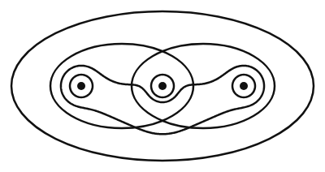
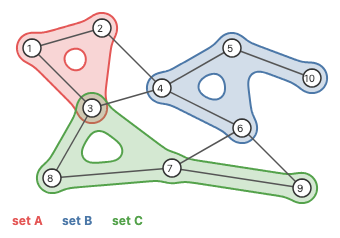
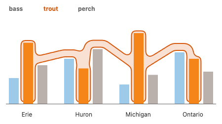

# Background and hull: an API proposal

**Summary.**
GoFish already has a box-only `enclose` (also exported as `background`). This proposal turns it into one relational mark that draws an outline around a set of nodes: a box, or a region built from discs around the members and links between them.
The outlines are values of one strategy family, `Shape`, chosen with a `shape` option, the same way `Curve` is chosen with `curve` on `line`. The region member, `Shape.blob()`, fills the space between members with the alpha shape's rule (dialed by `convexity`), links them with a spanning tree, and blurs the result so the outline's curvature never jumps. The convex hull and the spine are two shortcuts of it, the way `sina()` and `jitter()` are shortcuts of `noise()`.
The construct keeps working in all three places `enclose` works today (around fresh children, around refs, and mixed), and gains the bag form that `line` and `ribbon` have.

**Recommendation.** Rebuild `enclose` with `createRelationalMark` and give it `shape: Shape.box({ rx, ry }) | Shape.blob({ convexity, neck, smoothing, avoiding, via, clearance })`, with two shortcuts, `Shape.hull(opts)` = `Shape.blob({ convexity: 1, neck: 1, ...opts })` and `Shape.spine(opts)` = `Shape.blob({ convexity: 0, ...opts })`. `padding` and paint stay on `enclose`. Delete the `background` alias. Do not add a `.background()` modifier now; keep it as the runner-up, to add later as exact sugar if per-group backgrounds turn out to be common.

```js
// one hull per species: group the points in a second layer
chart(penguins)
  .flow(scatter({ x: "Beak Length (mm)", y: "Beak Depth (mm)" }))
  .mark(circle({ r: 3, fill: "Species" }).name("points"))
  .layer(
    chart(selectAll("points"))
      .flow(group({ by: "Species" }))
      .mark(
        enclose({
          shape: Shape.hull(),
          padding: 6,
          fill: "Species",
          opacity: 0.2,
        })
      )
  );

// a set that contains a and c but not b (combinator form over refs)
layer([a, b, c]).relate(({ a, b, c }) => [
  enclose(
    {
      shape: Shape.spine({ avoiding: [b], neck: 0.7, smoothing: 40 }),
      padding: 21,
      fill: "#ff2400",
    },
    [a, c]
  ),
]);
```

All pictures in this document are real renders of throwaway prototype stories in
`packages/gofish-graphics/stories/_proposals/BackgroundHull.stories.tsx`. Because
`Shape` does not exist yet, those stories place their members at fixed pixel
positions and compute each outline with story-local code (a convex hull, an alpha
shape built on Delaunay triangles, a bubble set assembled from `bubblesets-js` parts,
a simple KelpFusion prototype for section 6b, and the generalized construction of
section 6a), then draw it with `polygon`. The box panels use the real `enclose`. The code shown beside each
picture is the proposed spelling, not the story's code.

---

## 1. Terminology

- **Box.** The axis-aligned bounding box (often shortened to AABB) of the members: the smallest rectangle, with sides parallel to the axes, that holds them all. This is what `enclose` draws today.
- **Convex hull.** The smallest convex shape that holds the members. A shape is convex when the straight line between any two of its points stays inside it, so a convex hull never has dents.
- **Alpha shape.** A generalization of the convex hull that can have dents. Picture a disc of radius _alpha_ rolling around the points: it carves out every opening wide enough for it to enter. A very large disc carves nothing, so it gives the convex hull. A small disc follows the points closely.
- **Bubble set, spine.** A shape built in two steps (Collins et al., 2009). First, connect the members with a tree of lines that bends around things that are not members. Second, draw a smooth outline at a fixed distance around that tree and the members. Josh calls the strategy **spine** after that connecting tree.
- **KelpFusion, blob.** KelpFusion (Meulemans et al., 2013) draws a set as discs around its members, links between them, and some filled faces, with one dial from a tree to the convex hull. **Blob** is this proposal's name for the generalized version (section 6a). Delaunay triangulation, Voronoi cell, Minkowski sum and morphological closing are defined there.
- **Member, non-member.** The nodes a shape must contain, and the nodes it must keep out.
- **Hyperedge.** An edge that joins any number of nodes rather than exactly two. A set of nodes drawn as one region is a hyperedge.
- **Relational mark.** A mark whose geometry comes from other, already placed nodes (its **operands**), like `line` and `ribbon`. It is built with `createRelationalMark` and gets the combinator form, the bag form, fusion into a flow, and painting below its operands for free.
- **Strategy family.** A capitalized namespace of option values, such as `Curve.monotone()` or `Overlap.separate()` (#1013).
- **Modifier.** A chained method that applies to any mark or operator, such as `.name()`, `.label()` and `.zOrder()`.
- **Padding.** Distance in pixels between the members and the outline (#1005 settled `padding` as "inset around the outer edge", as opposed to `spacing` between siblings).

## 2. Josh's tensions, answered

**"Somewhere in between a relational mark and an operator, because you may want the background to be a component."**
In GoFish this is not a choice between two kinds of construct. Issue #707 (one combinator indexed by operand kind) and its essay `operators-over-placed-nodes.md` already show that what decides "operator" versus "relational mark" is the kind of operands, not the construct: all fresh children behave like an operator, all refs plus drawn ink behave like a connector, and a mix is an open term. `enclose` is the one construct used in all three rows today. So the proposal keeps one construct and makes it a relational mark, which still has the combinator form `enclose(opts, [children])`. Over fresh children that form _is_ the component: it lays out its children, has a box, takes up space, can be `.name()`d and pointed at with an arrow, just like a TikZ `fit` node or a Mermaid subgraph. Over refs it is a relation. The planets picture below is the component case, rendered by today's code.

There is a second reading of "component": the drawn shape itself being something the user supplies, as Bluefish's `Background` takes a `background={() => <Rect/>}` callback and the Math3ma story passes a hand-made `Blob`. In this proposal that is the function escape hatch of the `Shape` family, which #1101 (one extensibility model for strategy families) is designing for every family at once: a user function that receives the members' outlines and returns a path.

**"SwiftUI exposes it as a modifier, so maybe we could do that?"**
SwiftUI's `.background` decorates exactly one view, and that view decides the size. GoFish can say the same thing already, because `enclose(opts, [node])` wraps any one node. A `.background()` modifier would be exact sugar for that wrap, and on an operator it could give one background per group, the way `.label()` on an operator gives one label per group (#750). It cannot express the hard cases: a modifier attaches to one node of the tree, so it cannot enclose nodes that live in different places (the Topology a/c set, a hyperedge in a graph, one species across several lakes). Section 6 shows it as Approach B, and the recommendation keeps it as the runner-up (Approach C).

**"Spine is a bubble set, in between containment and connection; maybe the syntax should reflect that."**
The literature agrees and gives a reason. The set-visualization survey (Alsallakh et al., 2016) files Bubble Sets as a region, and the hypergraph survey (Fischer et al., 2021) files it as node-link, because the algorithm first connects the members and then inflates the connection into a region. KelpFusion turns this into one dial from a spanning tree (pure connection) to a convex hull (pure containment), and the alpha shape has a dial of the same kind. So box, hull and spine are one family that differs in how much connection structure it shows. The proposal reflects that in three ways:

1. The construct is a relational mark, the same family as `line` and `ribbon`, which GoFish uses for connection. Containment is not moved into a separate operator.
2. Connection and containment are one dial, `convexity`, on one member, `Shape.blob()`: 0 is a tree of links (`Shape.spine()`), 1 is the convex hull (`Shape.hull()`).
3. `via` can take real connections, such as the edges of a graph, as links. Then the same edges are drawn once as lines and once as the spine of the set (see the hyperedge picture).

## 3. Related issues

- **#397** Bring back a bubble-set enclosure after the `wrap` operator was deleted; floats `bubbleset: true` on `enclose` versus a separate operator.
- **#717** Concave hulls for `enclose`. Josh's comment there proposes one `enclose` with `shape: "rect" | "ellipse" | "hull" | "alpha" | "bubble"`, an `avoiding` list, and "relation, not function".
- **#974** A `boundary` geometry query (a node's outline as points). Hull enclosures are named as its first user.
- **#1138** Roadmap: "Hulls: a group of marks in, a path out", an agent one-shot.
- **#707** Operators over placed nodes: one combinator indexed by operand kind; plural refs never auto-map.
- **#929** Remaining `relate()` steps, including `.each` templates and item 6, drawing clauses missing the paint-below default.
- **#986** Relational paint-below default not applied to `.relate()` drawing clauses. The box panel in the strategy grid shows this today: the real `enclose` paints its fill over the gray non-members.
- **#935** (parked) relate() follow-ups; uses `background([a, b])` as an example. Not re-asked here.
- **#752** Default split for fused relational marks; its design note says enclose follows the same rule with order ignored, and defers an option word ("over").
- **#1101** Extensibility model for strategy families (custom curves, tiles, overlaps).
- **#1013** One uppercase namespace per strategy family.
- **#802** Operators cannot be `.name()`d, which limits selecting the groups an operator makes.
- **#844** A `ref()` to a constraint-placed sibling lands at the origin; its repro is an `enclose` over a ref.
- **#171** Enclose broken for the nested waffle chart (the story has it commented out).
- **#1109** Annotation tutorial; "enclose around selected marks" as the elaborated form.
- **#1084** Venn docs example (an Euler-diagram neighbor of this feature).
- **#396, #713, #714, #716** History: `wrap` deleted; enclose keeps placed refs in place ("enclose = layer + hull ink"); enclose gets paint options and paints behind its children.
- **#47** Stacked and divided ribbons (open): should Sankey-like pictures connect elements with a stack of ribbons instead of one? Today a ribbon is one-to-one; the issue asks about one-to-many, like a join between a source set and a target set. Where a `by` option on relational marks may come back.
- **#877** A `selectAll` plus `group({ by })` before a ribbon is ignored, and the fused default threads the inner tier instead. The penguin spelling goes through the same path.
- **#740** Spike: does `group()` plus `resolve()` cover regrouping refs for connectors?
- **#1018** `noise()` with `sina()` and `jitter()` as presets: the model for `hull` and `spine` over `blob`.

## 4. Nearby GoFish decisions and how this design lines up

| Decision                                                                               | What was decided                                                                                                                                                                                                       | This design                                                                                                                                                                                          |
| -------------------------------------------------------------------------------------- | ---------------------------------------------------------------------------------------------------------------------------------------------------------------------------------------------------------------------- | ---------------------------------------------------------------------------------------------------------------------------------------------------------------------------------------------------- |
| Strategy namespaces (#1013)                                                            | An option whose value is one of several strategies, some with arguments, gets an uppercase family: `Overlap.separate()`, calls only, family type inside the namespace (`Curve.Curve`), Python module bound as `Curve`. | **Matches.** `Shape.box()`, `Shape.blob()`, `Shape.hull()`, `Shape.spine()`, type `Shape.Shape`, `gofish-graphics/shape` subpath, Python `from gofish import Shape`.                                 |
| Presets over one general strategy (#1018)                                              | `sina()` and `jitter()` are `noise()` with params preset; they emit `kind: "noise"`, the presets are declared in the `STRATEGIES` table, and any option overrides a preset.                                            | **Matches.** `Shape.hull()` and `Shape.spine()` are `Shape.blob()` with `convexity` (and for hull, `neck`) preset; they emit `kind: "blob"`.                                                         |
| One-strategy options (three-surfaces.md, `pack`)                                       | An option with one strategy has no option at all.                                                                                                                                                                      | **Matches.** Three strategies, so the option earns its place.                                                                                                                                        |
| Closed families plus escape hatch (#1101)                                              | Families are closed; a user function is the planned escape hatch.                                                                                                                                                      | **Matches.** Bluefish's custom background shape, and Josh's ellipse, become that escape hatch (section 6a), not a new option.                                                                        |
| `curve` on `line`/`ribbon` (#637)                                                      | One key picks the drawn geometry of a relational mark; every curve is computed in screen space after placement.                                                                                                        | **Matches.** `shape` is to `enclose` what `curve` is to `line`. Outlines are computed in screen space after layout, so they work under polar and other coordinate transforms the same way curves do. |
| Relational marks and `.layer()` (#745)                                                 | Relational marks paint below their operands by default; `.layer()` hands each tier the previous tier's marks; `.connect()` deleted.                                                                                    | **Matches.** A background is the clearest case of "paint below what it relates".                                                                                                                     |
| Blank fusion (#748)                                                                    | `.mark(R(opts))` becomes `.mark(blank(anchor)).layer(R(rest))`; all paint goes to the relational mark.                                                                                                                 | **Matches**, inherited from `createRelationalMark`.                                                                                                                                                  |
| Default split (#752)                                                                   | A fused relational mark splits on every flow grouping except the path tier; `along` names the path tier; for enclose the order half is vacuous and the option word is deferred.                                        | **Matches.** `group(Species)` then `scatter` plus `.layer(enclose())` gives one hull per species with no option. No `along`/`over` is proposed, since no example needs it.                           |
| Plural refs never auto-map (#707)                                                      | `enclose(opts, points)` is one outline around the whole selection; per-element needs `.each`.                                                                                                                          | **Matches.**                                                                                                                                                                                         |
| `relate()` drawing clauses (#878, #930)                                                | Clauses may hold ink such as `background` over refs and open terms.                                                                                                                                                    | **Matches**, and inherits the #986 paint-order gap, which this feature makes more visible.                                                                                                           |
| `padding` vs `spacing` (#1005)                                                         | `padding` = inset around the outer edge; `spacing` = gap between siblings.                                                                                                                                             | **Matches.** `padding` grows every strategy's outline.                                                                                                                                               |
| Geometry queries (#966, #968, #974)                                                    | One file per query; `boundary` enters with its first user.                                                                                                                                                             | **Matches.** Hull and spine read each member's `boundary` (falling back to box corners). This is the first user #974 waits for.                                                                      |
| Modifier versus option (shape geometry, 10-03)                                         | `overlap` stays an option because modifiers apply to any mark or operator; the `.jitter()` modifier was dropped.                                                                                                       | **Consistent.** A background passes the "applies to anything" test, so a modifier is legitimate (Approach B/C). It is deferred on the "one concept, one spelling" rule, not ruled out.               |
| `.label()` on operators (#741, #750)                                                   | A modifier on an operator yields one label per group, lowered to ordinary marks.                                                                                                                                       | **Precedent** for Approach B's per-group `.background()`.                                                                                                                                            |
| Refs inside a strategy argument (route vs interpolation note, `Curve.bundle({ via })`) | Secondary geometry is a strategy argument, never columns in the flow. Not shipped.                                                                                                                                     | **Matches** in spirit: `Shape.spine({ avoiding, via })` takes selections as arguments. Reuses the word `via`. New wire detail: a strategy parameter that holds refs.                                 |
| No back-compat; delete, don't gate                                                     | No aliases, no accepted-and-ignored options, migrate call sites.                                                                                                                                                       | **Matches.** `background` alias deleted; `rx`/`ry` move into `Shape.box()` instead of being ignored by the blob; `avoiding` and `via` exist only on the blob, where they mean something.             |
| Python surface (#1008)                                                                 | Children positional, snake_case kwargs, `Family.member()` strategies.                                                                                                                                                  | **Matches.** `enclose([a, c], shape=Shape.spine(avoiding=[b]), padding=8)`.                                                                                                                          |
| Designer names, survey first (#196, #404, #762)                                        | Prefer names designers know; survey precedent before naming.                                                                                                                                                           | Partly. `box` and `hull` have strong precedent. `spine` is Josh's name; precedent says "bubble". `blob` follows Bluefish's `Blob` (see 5).                                                           |

**Where it departs, and why.**

- From Josh's #717 comment: shapes are family calls instead of strings (#1013 came later); `avoiding` lives on `Shape.blob()` instead of on `enclose` with a warning for the box (no accepted-and-ignored options); `ellipse` goes through the custom-shape function first (decision 7); `alpha` is dropped (decision 10).
- From #397's leaning (`bubbleset: true`): a boolean cannot grow into three strategies.
- From today's `enclose`: `rx`/`ry` move into `Shape.box()`. `rect` also spells corner rounding `rx`/`ry`, so the names stay.

Not re-asked: #935 (parked relate() follow-ups), #954, #1053/#1054, #290.

## 5. Precedent

Full survey: `survey-precedent.md`. The short version:

| System          | Spelling                                                                     | Model                                                                                   | Image                                       |
| --------------- | ---------------------------------------------------------------------------- | --------------------------------------------------------------------------------------- | ------------------------------------------- |
| SwiftUI         | `view.background(.blue, in: RoundedRectangle(cornerRadius: 8))`              | Modifier on one view; the view sets the size. Shape is a value.                         | none obtained                               |
| Bluefish        | `Background({ padding: 40 }, [Ref("label"), Ref("mercury")])`                | A relation over refs; filed beside `Arrow`; box only; custom shape callback.            | `precedent/bluefish-background-planets.png` |
| TikZ            | `\node[draw, circle, fit=(a)(b)(c)] {};`                                     | A node fitted to other nodes; outline shape chosen separately; nameable and labelable.  | `precedent/tikz-fit-box-circle.png`         |
| Graphviz        | `subgraph cluster_0 { ... }`                                                 | Structural group that the layout honors; box only; tree only.                           | `precedent/graphviz-cluster.svg`            |
| ggforce         | `geom_mark_hull(aes(fill = Species), concavity = 1, expand = unit(5, "mm"))` | One geom per shape (`rect`, `ellipse`, `circle`, `hull`); shared `expand` and `radius`. | `precedent/ggforce-mark-hull.png`           |
| Observable Plot | `Plot.hull(penguins, { x, y, fill: "species" })`                             | Convex hull mark; groups by `z`, which defaults to the fill channel.                    | `precedent/observable-plot-hull.jpg`        |
| bubblesets-js   | `createOutline(members, nonMembers, edges, options)`                         | Members, non-members and optional real edges in; contour out.                           | `precedent/bubblesets-js.png`               |
| KelpFusion      | (paper)                                                                      | Graph dial `t` from spanning tree to convex hull, plus a face-size limit `A` (see 6b).  | `precedent/kelpfusion-fig5-t-sweep.png`     |

What GoFish should take: one name with a shape value (SwiftUI, Compose, TikZ), a relation over refs that also nests (Bluefish), a shared `padding` plus one knob per strategy (ggforce), members, non-members and real edges as the spine's inputs (bubblesets-js). What it should not take: one function per shape (ggforce), grouping inferred from the color channel (Plot; GoFish uses the flow's grouping instead), field-physics knobs (`nodeR0`, `edgeR1`).

**Names.** `box` matches TikZ's default and ggforce's `rect`. `hull` matches Plot, ggforce, d3 and the roadmap. For the third strategy no library uses "spine"; Bubble Sets, bubblesets-js and Josh's own #717 comment say "bubble". On its merits, `spine` names the mechanism, the connecting skeleton that makes the shape a hyperedge, and it reads well with `via` ("a spine via these edges"). `bubble` names the look and is what readers of the set-visualization literature will search for. The docs also use the phrase "space-filling spine" descriptively for mosaic layouts; that prose could be reworded later if `spine` becomes an API name. This proposal keeps `spine` for the shortcut.

**The general member's name.** Candidates: `kelp`, `bubble`, `blob`, `region`, `outline`, `set`. `kelp` credits KelpFusion, but the word means nothing to most readers and the construction here differs from the paper (smoothing, `via`, thick necks). `bubble` is the Bubble Sets word and Josh's #717 word, but Bubble Sets is a different algorithm (an energy field), and in KelpFusion a bubble is one node's disc, so it would name a part. `region` collides with GoFish's region-compositing operators. `outline` is a candidate for the option key itself (decision 4) and also means a stroke. `set` names the data, not the drawing, and shadows JavaScript's `Set`. `blob` is an everyday word for a rounded free-form region and is the name Bluefish already uses for a hand-drawn set outline (`Blob` in the Math3ma example). This proposal uses `blob` (decision 3).

**The knobs.** Libraries disagree on the direction of a hull's concavity knob: `concavity` in ggforce and concaveman gets _more convex_ as it grows; `alpha` is a radius in CGAL (bigger is more convex) and an inverse radius in Python's `alphashape` (bigger is more concave); Shapely's `ratio` and PostGIS's `pctconvex` are fractions toward convex. An earlier version of this proposal used `alpha` as a pixel radius. v3 replaced it with `density`; v4 brings alpha back as `convexity`, whose direction reads from the name (more convexity is more convex), which has no unit (alpha is measured against the members' typical spacing, so it survives a resize), and which avoids `density`'s clash with density plots. `smoothing` is a pixel radius, bigger is smoother and fuller, the same direction as `smoothing` on `noise()`, though there it is in data units. `neck` is the everyday word for the narrow part that joins two bulges.

## 6. The strategy grid

Same members (blue, a U-shaped cluster) and the same two non-members (gray) in each panel. `padding: 8` everywhere.

| `Shape.box()`                                                                              | `Shape.hull()`                                              | alpha shape, alpha 40 (earlier proposal; now dropped)                                            | bubble-set spine (earlier prototype)                                                         |
| ------------------------------------------------------------------------------------------ | ----------------------------------------------------------- | ------------------------------------------------------------------------------------------------ | -------------------------------------------------------------------------------------------- |
|                                                                |                 |                                                    |                                                              |
| The padded bounding box. Real `enclose` (note its fill painting over the gray dots, #986). | Convex hull of the padded member outlines. Never has dents. | Alpha shape: openings wider than the disc are carved out. Depends only on where the members are. | Routes a connecting tree around the listed non-members and draws a smooth outline around it. |

This grid shows the earlier three-member design, kept for comparison; section 6a shows the same data under the blob. The concave hull and the spine look alike here, but they answer different questions. The hull's dent comes from the members' own spacing, so it would not appear if the U were drawn with sparse points, and it ignores the gray dots. The spine's dent comes from the `avoiding` list, so it keeps out exactly what is named. The Topology example below is the case only the spine can draw.

## 6a. One construction: a smooth region with hull and spine as shortcuts

Josh asked whether KelpFusion could be generalized, by making the size of the circles around the points configurable, so that it covers the usual hull, and whether it and the alpha shape could be unified. The previous version (v3) answered with `Shape.blob()`, a generalized KelpFusion with hull and spine as shortcuts, the way `sina()` and `jitter()` are shortcuts of `noise()` (#1018, which made the scatter overlap strategy one `noise()` with two presets). This version (v4) keeps that factoring and changes how the region is built, after Josh's review of v3.

### What changed in v4, and why

Josh's review of v3 made three points:

1. "Alpha shapes still seem to have a nice aesthetic to them because they're a bit more convex than the kelp comparisons."
2. The Munkres {a, c} outline "still feels too shrinkwrapped."
3. "I don't want to see a shape curvature change when the circle connects to the link."

The third point is a hard requirement, and v3 could not meet it. Its outline was a union of circle arcs, straight tube sides and closing arcs. Where an arc meets a straight side the outline has no corner, but its curvature jumps at once from 1/_R_ to 0 (G1, not G2). The curvature plot below shows the jumps. v4 changes three things:

- **Smoothing ends with a Gaussian blur of the region.** The outline is the level ½ of the blurred region, which is curvature-continuous everywhere. The next subsection compares this with two other ways to get a smooth outline.
- **`density` is replaced by `convexity`.** The alpha shape's fill rule (fill the Delaunay triangles that are small enough) comes back as the dial from spine to hull, with a unitless spelling and a spanning tree that keeps the set in one piece.
- **Links that bound a filled triangle are drawn at full width.** Filled parts then get the alpha shape's even, straight sides instead of scallops between the discs.

### Terms

- **Delaunay triangulation.** The standard way to split a point set into triangles: no point lies inside the circle through any triangle's three corners. Its outer boundary is the convex hull.
- **Voronoi cell.** The part of the plane that is closer to one point than to any other point of the set.
- **Minkowski sum with a disc.** Growing a shape by a distance _r_ in every direction, so it holds every point within _r_ of the shape. Padding is this operation.
- **Morphological closing.** Grow a shape by _s_, then shrink the result by _s_. Convex parts come back unchanged, every concave corner gets rounded with radius _s_, and every gap narrower than about 2 _s_ is filled. Picture a disc of radius _s_ rolling around the outside of the shape: closing fills everything the disc cannot reach.
- **Alpha hull and alpha shape.** In the original paper (Edelsbrunner, Kirkpatrick and Seidel 1983), the alpha hull is what remains when every disc of radius alpha that holds no point is removed from the plane. The alpha shape is the same thing drawn with straight edges between the points instead of arcs.
- **Curvature.** How sharply the outline bends at a point: 1 divided by the radius of the circle that fits the outline best there. A straight run has curvature 0 and a circle of radius _R_ has curvature 1/_R_ all the way round. Here it counts as positive where the outline bulges out and negative where it dents in.
- **G1 and G2 continuity.** An outline is G1 when its direction never jumps (no corners). It is G2 when its curvature never jumps either. A circle joined to a straight line that touches it is G1 but not G2: the bend goes from 1/_R_ to 0 at once. Josh's requirement is G2.
- **Curvature plot and curvature comb.** Two ways to see curvature. The plot draws curvature against the distance walked along the outline. The comb draws a short tooth across the outline at many points, with length proportional to the curvature there; a jump in curvature shows as a step in the line joining the tooth tips.
- **Implicit field and iso-contour.** An implicit field gives every point of the plane a number. Its iso-contour at a level _c_ is the curve where the field equals _c_. If the field is smooth, its iso-contour is smooth too, wherever the field is not flat.
- **Convolution surface.** An implicit field made by adding up a smooth bump (the kernel) placed along a skeleton of points, segments and triangles; the outline is one iso-contour (Bloomenthal and Shoemake, "Convolution surfaces", SIGGRAPH 1991; from memory). Bubble Sets' energy field is of this kind.
- **Gaussian blur.** Replacing each point's value by a weighted average of the values around it, with weights that fall off as a bell curve of width σ (sigma).
- **Circumradius.** The radius of the circle through a triangle's three corners.
- **Alpha complex.** The triangles of the Delaunay triangulation whose circumradius is at most alpha, and the edges whose smallest circle (half their length, for the edges that matter here) is at most alpha. Filling it gives the alpha shape.

### Alpha shape and KelpFusion: what is the same and what is not

| Question                                         | Answer                                                                                                                                                                                                                                                                                                                                                                                  | Status                                                                                                                                                                                      |
| ------------------------------------------------ | --------------------------------------------------------------------------------------------------------------------------------------------------------------------------------------------------------------------------------------------------------------------------------------------------------------------------------------------------------------------------------------- | ------------------------------------------------------------------------------------------------------------------------------------------------------------------------------------------- |
| What is the alpha hull, in terms of closing?     | Exactly the closing of the point set by a disc of radius alpha. "Remove every empty disc of radius alpha" is the definition of closing.                                                                                                                                                                                                                                                 | Definition from Edelsbrunner, Kirkpatrick, Seidel, "On the shape of a set of points in the plane", IEEE Trans. Inf. Theory 29(4), 1983. The match with closing is my derivation (inferred). |
| What is the alpha complex?                       | The points, edges and triangles of the Delaunay triangulation whose smallest empty circle has radius at most alpha. Its union is the alpha shape.                                                                                                                                                                                                                                       | Edelsbrunner and Mücke, "Three-dimensional alpha shapes", ACM TOG 13(1), 1994. From memory, not re-read for this note.                                                                      |
| How does it relate to discs?                     | Put a disc of radius alpha on every point and cut each disc down to its point's Voronoi cell. The alpha complex has an edge exactly where two cut discs touch and a triangle where three meet, and the union of the discs has the same pieces and holes as the alpha shape.                                                                                                             | Edelsbrunner, "The union of balls and its dual shape", Discrete Comput. Geom. 13, 1995. From memory.                                                                                        |
| What is a KelpFusion node area?                  | A disc of radius _r_ cut down to the node's Voronoi cell, which is exactly Edelsbrunner's cut disc.                                                                                                                                                                                                                                                                                     | Definition verified in the KelpFusion paper (survey §3.10); the identity is inferred.                                                                                                       |
| Is the alpha shape a special case of KelpFusion? | No. KelpFusion's node areas touch along the alpha complex of radius _r_, but KelpFusion does not take its links from that complex. It takes them from the shortest-path graph SPG(_t_), which always connects all members and does not change when the picture is scaled. The alpha complex falls apart into pieces once alpha is below half the widest gap, and it changes with scale. | Inferred from the definitions.                                                                                                                                                              |
| Is KelpFusion a special case of the alpha shape? | No. For 1 < _t_ < ∞, SPG(_t_) keeps long links without the triangles around them, which no alpha complex does.                                                                                                                                                                                                                                                                          | Inferred.                                                                                                                                                                                   |
| What do they share?                              | Both keep some links of the Delaunay triangulation (KelpFusion's own implementation only considers Delaunay neighbors), fill some faces, and grow the result. Both end at the full triangulation, whose outline is the convex hull: alpha = ∞ and _t_ = 1.                                                                                                                              | KelpFusion part verified; alpha part from memory.                                                                                                                                           |

So they unify as one pipeline, not as one parameter. KelpFusion picks links with a dial that has no unit and keeps the set in one piece; the alpha shape picks links and faces with a length. For drawing a set, one piece is what we want: a set drawn as two islands reads as two sets.

Where non-member avoidance lives: the alpha shape has none; it only looks at the members. KelpFusion avoids non-members in three places: links are routed around other nodes, a face that holds a non-member is not filled, and every non-member's area is cut out at the end.

### Three ways to get a curvature-continuous outline

All three start from the same skeleton (member points, links, filled triangles) and were prototyped in story section (e).

**(a) A convolution surface.** Add up a Gaussian bump along the whole skeleton, with weights set so that each piece on its own would end at its target offset (a lone member at `padding`, a lone link at its half-width), and draw one iso-contour. The outline is as smooth as it gets, and it is close to Bubble Sets' energy field. But where pieces meet their fields add up, so the outline swells there: in the picture the lobes around a and c come out well outside the dashed rings at the promised padding, and the U dents in toward b. `padding` stops being a promise, so this candidate is out.

**(b) A closed curve through the v3 outline.** Josh asked whether GoFish's own interpolation could do this. Of today's `Curve` members, the data-space ones (`linear`, `step`, `monotone`, `smooth`) interpolate a function _y_(_x_), so they do not apply to a closed outline, which doubles back on itself. The connector ones (`bezier`, `orthogonal`, `arc`, `perfectArrows`) join two endpoints. Only `catmullRom` draws a curve through placed points on screen, and it is open and only G1 (verified in `src/families/curve.ts` and `src/spline.ts`). So the prototype adds three closed curves of its own and runs each through points taken every so many pixels along the v3 outline: centripetal Catmull-Rom (G1, the foil), a periodic natural cubic spline (C2: the curve and its first two derivatives are continuous), and a Yuksel-style C2 blend of circles through consecutive triples of points (Yuksel, "A Class of C2 Interpolating Curves", ACM TOG 2020, which #957 lists; the paper's idea, with the parametrization of each circle chosen by me, so this variant is inferred, not the paper's code). `smoother`, the 1D Yuksel blend removed in #960, is a function of _x_ and does not apply either.

**(c) Blur the region (chosen).** Keep v3's region (discs, tubes, filled triangles, closing, cut), blur it with a Gaussian, and draw the level ½. The blurred region is a sum of smooth bumps, so its level line is curvature-continuous wherever the field is not flat. This is one step of the Merriman, Bence and Osher scheme for moving a curve by its curvature (1992; from memory). Its effect is easy to state: a straight side does not move, a bulge of radius _r_ moves in by about σ²/(2*r*), and a dent moves out by the same amount. The prototype draws discs, tubes and cut zones slightly larger to cancel the move, so a lone member ends exactly at `padding`, a lone link at its half-width, and the cut at `clearance`.


Top: the Topology {a, c} set avoiding b, with dashed rings at the promised padding. Bottom: the U at `convexity: 0.5`. Columns: v3, (a), (b) with knots 25 px apart on the Topology and 12 px on the U, (c).

**The curvature plot.** Each row is one outline of the {a, c} set with v3's parameters (`padding: 21`, `neck: 0.7`, `smoothing: 40`, `clearance: 10`). Left: the outline with its curvature comb. Right: curvature against distance along the outline, starting at the leftmost point. The gray lines mark 1/_R_ (a's circle) and −1/40 (the closing radius). The numbers are measured on each outline.


- **v3** (measured from the traced outline, so it is noisy) jumps between 1/_R_, 0 and −1/40 at every join. Those steps are the curvature changes Josh saw.
- **(c), the blurred region,** is computed exactly from the field, with no noise. It moves smoothly between the same values, each change spread over about 20 px of outline. It keeps the promises: padding at a is 26.0 px (asked 26) and the gap to b's ring is 10.1 px (asked 10). It stays within 1.9 px of v3.
- **(b), the curves through v3,** cannot do both things at once. With knots 10 px apart the natural spline follows v3 to 0.3 px, but it keeps v3's sudden changes, now squeezed between two knots instead of removed. With knots 25 px apart the changes spread out, but the natural spline and the Yuksel blend ripple (the curvature swings up and down between knots), and all three cut into b's clearance (8.1 to 8.5 px instead of 10). Catmull-Rom jumps at every knot, as a G1 curve must. A curve through points knows only the points, not the padding or the avoided nodes, so it cannot keep either promise.

**Where a `curve` key would fit.** The idea was `enclose({ shape: Shape.hull(), curve: Curve.<x>() })`, reusing the relational marks' `curve` key. Recommendation: do not add it. No `Curve` member is closed today, a curve through outline points breaks `padding` and `clearance` as shown, and it would be a second smoothing control next to `smoothing`. The region blur is the smoothing, inside `Shape.blob()`. The findings do feed #957 (better screen-space curves than Catmull-Rom; it asks whether its candidates "work for closed curves (enclosures)"): the closed Yuksel-style blend is easy to build and C2, and it ripples where point spacing is uneven. A closed C2 member would have other users, such as smooth polygon outlines or the output of the custom-shape function below, and an implementation could still use one to turn the traced points into a few Bézier pieces, which is not an API question.

### The construction (v4)

`Shape.blob()` draws one set in five steps. The prototype is section (e) of the story file.

1. **Skeleton.** Take the Delaunay triangulation of the member centers. Fill a triangle when its circumradius is at most alpha and no avoided node's keep-out zone (the node grown by `clearance`) touches it; alpha comes from `convexity` (below). The links are the edges of the filled triangles, the other Delaunay edges no longer than 2 alpha that no avoided node blocks, the minimum spanning tree over links routed around the avoided nodes (always, so the set stays in one piece), and any `via` edges.
2. **Pieces.** Each member grown by `padding` (its bulge, radius _R_). Each link that bounds a filled triangle is a tube as wide as the bulge; every other link is a tube `neck` times the bulge. The filled triangles.
3. **Closing.** The union of the pieces is closed by a disc of radius `smoothing`, as in v3.
4. **Cut.** Each avoided node's keep-out zone is cut back out.
5. **Blur.** The region is blurred with a Gaussian of width σ = ½ min(`smoothing`, thinnest piece), where the thinnest piece is the smallest bulge, tube half-width or keep-out radius; the outline is the level ½. A wider blur would erase the thinnest piece (the neck under b vanished in an early try with σ = `smoothing` / 2). The prototype traces the level with marching squares and then moves every point onto the exact level line with a few Newton steps on the field, so the grid waviness noted in v3 is gone.

| Parameter                | Meaning                                                                                                                                       | Direction                         | Default           |
| ------------------------ | --------------------------------------------------------------------------------------------------------------------------------------------- | --------------------------------- | ----------------- |
| `padding` (on `enclose`) | The bulge around each member, from the member's own outline. Exact for a member on its own.                                                   | Bigger is fatter.                 | as today          |
| `convexity`              | How much of the space between members is filled, from 0 (a spanning tree of links) to 1 (every Delaunay triangle: the convex hull). Unitless. | Bigger is fuller and more convex. | 0.5               |
| `neck`                   | Width of links that do not bound a filled triangle, as a fraction of the bulge.                                                               | Bigger is thicker; 1 is as thick. | 1                 |
| `smoothing`              | Closing radius in pixels; it also sets the blur, so the curvature changes gradually over a length that grows with it.                         | Bigger is smoother and fuller.    | same as `padding` |
| `avoiding`               | Nodes to keep out. Each listed node that is not a member is avoided.                                                                          |                                   | none              |
| `via`                    | Edges to use as links. Always kept, never rerouted.                                                                                           |                                   | none              |
| `clearance`              | Gap in pixels kept from each avoided node.                                                                                                    | Bigger keeps farther away.        | 4                 |

### Convexity: the alpha fill rule, back

`convexity` maps to the alpha of the alpha complex as alpha = _m_ × `convexity` / (1 − `convexity`), where _m_ is the median link length of the members' minimum spanning tree (a typical distance between neighbors). So 0 fills nothing, 0.5 fills triangles up to about the typical spacing, and 1 fills everything. The name says its direction: more convexity is more convex. That avoids the trap the survey found, where ggforce's and concaveman's `concavity` and the alpha of alpha shapes run in opposite directions. Three properties of alpha that a plain length would bring are handled:

- **Units.** Alpha is a length in pixels, so a fixed alpha fills different triangles when the chart is resized. Measuring it in units of _m_ makes the rule depend only on the shape of the point set, not its size. Tying it to `padding` instead was the other option; it would still change with a resize, since `padding` stays fixed in pixels while the points move apart.
- **Pieces.** The alpha complex falls apart once alpha is below the widest gap. The spanning tree is always added, so the set stays one region.
- **Avoided nodes.** A triangle touching an avoided node's keep-out zone is never filled, and the zone is cut out at the end, as in v3.

**`density` is dropped.** It chose links by KelpFusion's shortest-path graph. Convexity covers the same range, from the tree to the hull, and its middle looks like the alpha shapes Josh liked: dense parts fill in and sparse parts stay as links. KelpFusion's own middle (long links kept without the triangles around them) is no longer reachable; no example needs it.


The U data (`padding: 8`, `smoothing: 8`, gray dots avoided): the classic alpha shape (alpha 40), v3 at `density: 0.5`, and v4 at `convexity` 0, 0.5, 0.8 and 1. At 0.5 the two-dot-thick arms fill and get the alpha shape's straight sides, but with rounded joins and the opening kept clear of the gray dots. At 0.8 and 1 the triangles across the opening fill except where they touch a gray dot, which leaves holes (drawn white) shaped by the triangles that were left out. That is faithful to the rule and not pretty; `convexity: 1` with `avoiding` is the case to look at.


One penguin species (Gentoo, green) with the other two species avoided (gray), `padding: 4`, `smoothing: 6`, same six panels with alpha 12 for the classic alpha shape. The classic alpha shape leaves stray points outside; v4 always keeps them, linked by the tree. At 0.8 the outline is close to the alpha shape's look while still holding every point. One member near the top left is walled in by gray points, so no link can reach it, and it is drawn as its own small region in every panel below `convexity: 1`.

### The shortcuts

| Shortcut            | Is exactly                                       | Draws                                        |
| ------------------- | ------------------------------------------------ | -------------------------------------------- |
| `Shape.hull(opts)`  | `Shape.blob({ convexity: 1, neck: 1, ...opts })` | the convex hull grown by `padding`, smoothed |
| `Shape.spine(opts)` | `Shape.blob({ convexity: 0, ...opts })`          | the spanning tree of thick tubes, smoothed   |

As `sina()` and `jitter()` do over `noise()`, a shortcut makes the same object as the general call (`kind: "blob"`), declared once as a preset in the `STRATEGIES` table, and any option overrides the preset. So `Shape.hull({ avoiding: others })` is legal and draws a hull that leaves out triangles touching other nodes.

**The hull shortcut is no longer exact, but it is within half a pixel.** Before the blur it is exact, for the reason given in v3: with nothing avoided, every Delaunay triangle is filled and every hull edge is a tube as wide as the bulge, so the union is the convex hull grown by the bulge, and closing a convex shape changes nothing. The blur rounds the hull's corners, and the slightly larger discs that cancel the blur on a lone member stand out by a fraction of a pixel near the corners. Measured against a true padded convex hull (black line): never inside it, and at most 0.5 px outside it with `smoothing` equal to `padding` (U and Gentoo), 0.9 px with `smoothing: 20`.


**The spine shortcut** draws exactly the spanning tree (plus `via`), smoothed; at `convexity: 0` alpha is 0, so no triangle is filled and no extra edge is added.

### The previous version (v3), for reference

v3 picked links with KelpFusion's SPG(_t_) at _t_ = 1 / `density`, filled every closed face without an avoided node, and smoothed only by closing, then rounded the cut's corners with a small opening. Its parameter grid is below. Its outlines were G1, which is the main reason for the change; its `density` middle was less full than the alpha shape; and its Topology outline was the shrink-wrapped one in section 7.


### Custom shapes and the ellipse

`Shape.box()` stays separate: a box is a rectangle grown by padding, not a union of discs, so no blob setting draws it. Josh's ellipse fits the #1101 escape hatch (one extensibility model for strategy families): a user function in place of a `Shape` value. The function would receive the members as `{ box, boundary }` (box and outline points, in pixels, after placement), the box of all members, the avoided nodes in the same form, and `padding`. It returns a closed outline as a list of points. `enclose` still paints it, paints it below the members, and uses its box as the mark's box.

```js
const oval = ({ box, padding }) => ellipsePoints(box, padding); // user code
enclose({ shape: oval, padding: 30 }, [a, b]);
```

```python
enclose([a, b], shape=lambda s: ellipse_points(s.box, s.padding), padding=30)
```

From Python, the function would cross the bridge the way derive lambdas do. If ellipses turn out to be common (TikZ, ggforce and Munkres all draw them), `Shape.ellipse()` can become a declared member later. The Munkres render in section 7 draws its ellipses this way.

## 6b. KelpFusion and bubble sets

Josh asked whether KelpFusion has the convex hull as a special case, and how it compares to a bubble set. This section answers from the two papers, then puts both, and the convex hull, on the same four examples. It is the background for section 6a; the renders here use the earlier, simpler KelpFusion prototype.

Sources: Meulemans, Henry Riche, Speckmann, Alper, Dwyer, "KelpFusion: A Hybrid Set Visualization Technique", IEEE TVCG 19(11), 2013 (author copy: https://www.microsoft.com/en-us/research/wp-content/uploads/2016/12/kelpfusion_tvcg2013.pdf). Collins, Penn, Carpendale, "Bubble Sets: Revealing Set Relations with Isocontours over Existing Visualizations", IEEE TVCG 15(6), 2009 (author copy: https://vialab.ca/wp-content/publication_media/pdf/col2009c.pdf). Kelp Diagrams (Dinkla et al., 2012) and LineSets (Alper et al., 2011) are described below as the KelpFusion paper describes them; I did not read those two papers directly.

### How KelpFusion is built

KelpFusion draws each set separately, in three steps.

1. **Connect the members.** First it builds a candidate graph. For every pair of members, the candidate edge is the shortest route between them that stays clear of every other node, member or not. "Clear" means it keeps out of each node's _allocation area_, a disc of radius `r` around the node (cut down to the node's Voronoi cell, the part of the plane closer to that node than to any other), with an extra margin of half the drawn edge width `w`. Then it keeps only some of those candidates, using a _shortest-path graph_ with one parameter `t ≥ 1`. Each edge gets the weight (its length) to the power `t`, and an edge is kept only if no other path in the graph between its two ends is lighter. At `t = 1` every candidate is kept: the graph is complete, and its outline is the convex hull. As `t` grows, long edges lose to chains of short ones, and as `t` goes to infinity the graph becomes the _minimum spanning tree_ (the tree of shortest total length that connects all members). The steps in between are nested: an edge kept at some `t` is kept at every smaller `t`. In practice the paper's own implementation only considers pairs that are neighbors in the _Delaunay triangulation_ (the standard way to split a point set into well-shaped triangles), which makes it fast.
2. **Fill some faces.** A _face_ is a region fully enclosed by kept edges. A face is filled only if (1) its area divided by one more than its number of corner nodes is below a second parameter `A`, (2) it contains no node outside the set, and (3, 4) it does not hide the edges of a set drawn beneath it, and does not share an edge with such a set unless all its nodes belong to that set.
3. **Draw.** The set is the union of the node discs, the kept edges drawn with width `w`, and the filled faces. That union is smoothed, and every non-member's allocation area is cut back out of it.

The paper's Figure 5 shows `t` going from 4.5 (a tree) down to 1 (the convex hull):


**Is the convex hull an exact special case?** For the graph, yes: at `t = 1` the outline of the shortest-path graph is exactly the convex hull of the member points, and the paper says so. For the drawn shape, only under conditions. The faces must all be fillable, so `A` must be large enough and no non-member may sit inside the hull (rule 2 leaves any face that holds one open). Even then, the drawing is the hull plus discs of radius `r` at the nodes and half-width `w/2` along the edges, which is not the same as the hull grown evenly by a padding. So at `t = 1` KelpFusion gives "the convex hull, minus the faces that would cover a non-member", which is a set-aware hull. Our `Shape.hull()` ignores non-members.

### How a bubble set is built

1. **Connect the members with virtual edges.** Starting from the member nearest the set's center and working outward, each member is joined to the already visited member that minimizes distance times the number of non-members on the straight line between them. Any of these _virtual edges_ that crosses a non-member's bounding box is bent around a corner of that box, pushed out by a buffer; if that fails, other corners and smaller buffers are tried, up to an iteration limit. If the data has real edges, they can be used instead.
2. **Build an energy field.** Every pixel gets a score: members and edges add energy that falls from 1 at distance `R0` to 0 at distance `R1`; non-members subtract (weight −0.8). Only the nearest segment of each routed edge counts, to avoid bulges at the bends.
3. **Trace the outline.** The set's outline is the curve where the energy equals a threshold (an _isocontour_), found with marching squares. If some member ends up outside, the threshold is lowered, then member weights are raised and non-member weights lowered, until all members are inside. The result is smoothed with splines.

The paper says plainly that it "cannot guarantee that non-set member items will be excluded"; such items are marked with a white border instead.


### Side by side on the same data

Each grid reads from line-like to area-like: KelpFusion at `t = ∞`, 2, 1.5 and 1, then the plain convex hull and a bubble set. KelpFusion here is a story-local prototype of the paper's three steps with `A = ∞` (fill every allowed face). Simplifications, all declared in the story: allocation areas are discs (or the bar grown by the padding) without the Voronoi cut, filled faces keep straight sides even where an edge bends, rules 3 and 4 are skipped (they only matter between overlapping sets), and there is no smoothing pass.

**Topology, the set {a, c} avoiding b.** With two members there is only one edge, so every `t` gives the same picture: a bent tube around b. Only the convex hull covers b.


**Set C of the hyperedge example.** KelpFusion uses positions only, so its edges do not follow the graph's own edges; at `t = 1` it fills the triangle 3, 7, 9, which covers the graph edges 4 to 6 and 6 to 7. The bubble set uses the graph edges as its skeleton (`via`).


**Trout across lakes.** Every face between trout bars holds a bass or perch bar, so rule 2 keeps all faces empty and KelpFusion stays a set of lines at every `t`; lowering `t` only adds longer routed edges over the tops. The hull end of the dial cannot be reached here.


**One penguin species (Gentoo) among the others.** This is where KelpFusion shines: at `t = 2` and 1.5 the dense core fills in while the stragglers stay attached by lines. At `t = 1` it is the convex hull with a bite taken out where Chinstrap and Adelie points sit inside it.


|             | KelpFusion                                                                                                                                                                                                                                                                                                                                               | Bubble set                                                                                                                                                                                                  |
| ----------- | -------------------------------------------------------------------------------------------------------------------------------------------------------------------------------------------------------------------------------------------------------------------------------------------------------------------------------------------------------- | ----------------------------------------------------------------------------------------------------------------------------------------------------------------------------------------------------------- |
| Input       | Node positions and set membership. Builds its own graph; does not take data edges.                                                                                                                                                                                                                                                                       | Item shapes (boxes) and membership; can follow real data edges instead of virtual ones.                                                                                                                     |
| Non-members | Every edge is routed around every other node's allocation area; faces that hold a non-member stay open; non-member areas are cut out after smoothing.                                                                                                                                                                                                    | Virtual edges are bent around non-member boxes by a corner heuristic with an iteration limit; non-members push the outline away with negative energy. Can still enclose a non-member, which is then marked. |
| Extremes    | `t = ∞`: minimum spanning tree drawn as lines and node discs. `t = 1`: the convex hull, minus faces holding non-members.                                                                                                                                                                                                                                 | None built in. Large `R1` gives blobby regions, small `R1` gives thin tubes; the skeleton is always a tree (or the given edges).                                                                            |
| Parameters  | `t` (graph density; larger is sparser, unitless, and the graph does not change when the drawing is scaled); `A` (largest face to fill, an area per node, so it does change with scale); `r` and `w` (drawing sizes).                                                                                                                                     | `R0`, `R1` for nodes and for edges, the routing buffer, the energy weights, the threshold and its decay. All are pixel distances or weights.                                                                |
| Stability   | Discrete. Each edge switches on at its own `t`, which can be precomputed, so dragging `t` is smooth in time but jumps in shape. The paper lists stability under added or removed items as future work. Inferred: a small move of a point can change the Delaunay neighbors and so the edges and faces.                                                   | Discrete too (inferred). The visiting order, the corner chosen for each bend and the threshold loop can all flip under a small move.                                                                        |
| Cost        | `O(n⁴)` with full routing; `O(n² log n)` with Delaunay pairs (paper).                                                                                                                                                                                                                                                                                    | `O(K·N·(N + H·W))` for `K` sets, `N` items and an `H × W` pixel grid (paper).                                                                                                                               |
| User study  | 13 people, four overlapping sets on a map: accuracy 86.5% versus 54.5% for Bubble Sets (LineSets 84.3%); mean time 12.4 s versus 17.2 s (LineSets 14.2 s). People also rated it less cluttered and better at showing groups than Bubble Sets. The authors note that Bubble Sets was designed for sets that do not overlap, which the study did not test. | Same study, from the other side. The original paper has case studies, not a controlled comparison.                                                                                                          |

**The line end of the spectrum.** LineSets draws each set as one smooth curve through its members, which reads as an order even when the set has none; it is pure connection. Kelp Diagrams draws node discs joined by a sparse graph: a minimum spanning tree plus extra edges that shorten detours enough, routed around other nodes. KelpFusion keeps the Kelp look and replaces the detour rule with the shortest-path graph, which adds short edges inside clusters first and so produces small faces worth filling.

### What it meant for the strategy factoring

An earlier version of this proposal concluded that KelpFusion overlapped both hull and spine in part and replaced neither: its hull end avoided non-members and was not an even padding, its line end could not follow real edges, and its edges were thin straight strips. Each of those gaps is closed by one parameter of the generalized construction in section 6a: `avoiding` is optional (so the hull end is the plain hull), `via` adds real edges, and `neck` and `smoothing` give even, smooth tubes. With those, hull and spine are two settings of one member rather than two strategies, which is the factoring section 6a recommends. The earlier recommendation (three separate members on a shared kernel, with `Shape.kelp({ t })` left for later) is kept as the runner-up in section 9.

## 7. Where it lives: three approaches

The approaches differ in where the construct lives. How its strategies and parameters are spelled is a separate axis, covered in section 8; all three approaches below use the recommended `shape: Shape.*` spelling.

### Approach A: `enclose` becomes a relational mark (recommended)

`enclose` is rebuilt with `createRelationalMark` (today it is a `createNodeOperator`). It keeps the combinator form for fresh children, refs, or a mix, and gains the bag form and fusion.

**Example 1, the component case (fresh children).** Unchanged except for the corner option.

```js
enclose(
  {
    padding: 20,
    fill: "#252150",
    stroke: "none",
    shape: Shape.box({ rx: 16, ry: 16 }),
  },
  [
    spread(
      { dir: "x", spacing: 50, alignment: "middle" },
      planets.map((d) => circle(d))
    ),
  ]
);
```

```python
enclose([spread([circle(**d) for d in planets], dir="x", spacing=50, alignment="middle")],
        padding=20, fill="#252150", stroke="none", shape=Shape.box(rx=16, ry=16))
```


**Example 2, one hull per group.** Hard real example: Palmer penguins, three species. The points are named, and a second layer groups them and draws one hull per group.

```js
chart(penguins)
  .flow(scatter({ x: "Beak Length (mm)", y: "Beak Depth (mm)" }))
  .mark(circle({ r: 3, fill: "Species" }).name("points"))
  .layer(
    chart(selectAll("points"))
      .flow(group({ by: "Species" }))
      .mark(
        enclose({
          shape: Shape.hull(),
          padding: 6,
          fill: "Species",
          opacity: 0.2,
        })
      )
  );
```

```python
(chart(penguins)
   .flow(scatter(x="Beak Length (mm)", y="Beak Depth (mm)"))
   .mark(circle(r=3, fill="Species").name("points"))
   .layer(
       chart(select_all("points"))
         .flow(group(by="Species"))
         .mark(enclose(shape=Shape.hull(), padding=6, fill="Species", opacity=0.2))))
```

| `Shape.hull()`                                      | `Shape.box()`, same data                           |
| --------------------------------------------------- | -------------------------------------------------- |
|  |  |

The boxes overlap so much that they stop separating the species; the hulls show where each species actually lies. (Prototype: axes are hand-drawn, and the hull is computed from pixel positions. The hull shortcut draws this padded convex hull to within half a pixel, section 6a.)

- **Why not `enclose({ by: "Species" })`?** #752 (the default-split rule for relational marks) removed `by` from `line` and `ribbon`. Splits are written in the flow, so a `by` on `enclose` would bring back a second spelling. Josh is open to bringing `by` back later, when the design of stacked and divided ribbons in #47 is worked out (a ribbon today joins one element to one element; #47 asks for one-to-many, like a join between a source set and a target set). #740, a spike on whether `group()` plus `resolve()` covers regrouping refs for connectors, is related.
- **Dependency.** This spelling goes through the same `chart(selectAll(...)).flow(group({ by }))` path that #877 reports as broken for `ribbon`: the `group` is ignored, and the fused default threads the inner tier instead. It likely needs that fix for `enclose` too. This is unverified for `enclose`; the prototype draws the hulls with story-local code and does not exercise that path.
- **The shorter form**, `group` in the first layer's flow followed by a fused `.layer(enclose({ shape: Shape.hull(), ... }))`, also works when the grouping is already there for other reasons.

**Example 3, a set that avoids a point (refs).** Hard real example: the three-point topologies from Munkres, _Topology_ (2nd ed., §12, the figure of the nine topologies on {a, b, c}). Math3ma reproduces the figure, Bluefish ported it, and the GoFish port's a/c neighborhood is today a hand-transcribed Bezier path (#717).


Source of the image: the Math3ma post "Topology vs. 'A Topology' (cont.)" (https://math3ma.com/blog/topology-vs-a-topology), captioned "Image from Topology by J. Munkres". In the last panel, the {a, c} set wraps a and c with an even margin and joins them with a thick band that passes under b, with smooth S-shaped joins and no sharp elbows.

```js
layer([a, b, c]).relate(({ a, b, c }) => [
  enclose({ shape: Shape.hull(), padding: 16, fill: "#009dff" }, [a, b]),
  enclose(
    {
      shape: Shape.spine({
        avoiding: [b],
        neck: 0.85,
        smoothing: 40,
        clearance: 6,
      }),
      padding: 22,
      fill: "#ff2400",
    },
    [a, c]
  ),
]);
```

```python
layer([a, b, c]).relate(lambda a, b, c: [
    enclose([a, b], shape=Shape.hull(), padding=16, fill="#009dff"),
    enclose([a, c], shape=Shape.spine(avoiding=[b], neck=0.85, smoothing=40, clearance=6),
            padding=22, fill="#ff2400"),
])
```

| `Shape.hull()` for {a, c}: covers b                        | before: bubble-set spine avoiding b                     |
| ---------------------------------------------------------- | ------------------------------------------------------- |
|  |  |

Before and after, with a ring of radius 14 around b as the avoided node. First panel: v3 with `padding: 21`, `neck: 0.7`, `smoothing: 40`. Second: v4 with the same parameters, which keeps the same margins and gap to b but has no curvature jumps. Third: v4 with `padding: 22`, `neck: 0.85`, which is the fuller, thicker band used in the panel below. Fourth: v4 with b treated as a wall during the closing (decision 13), `padding: 20`, `neck: 0.8`.


Munkres' last panel redrawn with v4 (the v3 version, now trimmed, is `img/topology-munkres-panel-blob.png`). The whole set and the pairs {a, b} and {b, c} are ellipses through the custom-shape function (section 6a). Left: {a, c} is `Shape.spine({ avoiding: [b], neck: 0.85, smoothing: 40, clearance: 6 })` with `padding: 22`. Right: the same idea with b as a wall.

| v4                                                          | v4, b as a wall                                                              | reference (Munkres, last panel)    |
| ----------------------------------------------------------- | ---------------------------------------------------------------------------- | ---------------------------------- |
|  |  | see the figure above, bottom right |

How close it gets now. Matched: even margins around a and c, a thick band, and smooth joins with no visible change in bend where the circles meet the band (the curvature plot in section 6a). Closer than v3: the band is fuller, and with b as a wall the top of the band wraps b in a U at the clearance, as in the reference. Still different: the bottom of the band is a wide V rather than Munkres' flatter bottom, because the link is the shortest path around b, and the wall version has a short flat shelf between a and b where the closing fills up to b's zone. Munkres' teardrop lobes come from a band that leaves each circle low down; a link rule that bends the band to follow b's outline at a fixed gap would get closer, and is a change to routing rather than a new parameter.

Future work, not part of this proposal: this example may be drawn best by placing the points and the region together, with an energy that pushes shapes apart and rewards symmetry, as Penrose and Keenan Crane's work do. Every strategy here draws around shapes that are already placed, so that would be a change to layout, not a new shape.

**Example 4, hyperedges over a node-link diagram.** Each row of `memberships` is `{ set, node }`. The graph's edges are the spine.

```js
layer([
  graph, // nodes named "nodes", edges named "edges"
  chart(memberships)
    .flow(resolve(["node"], { from: selectAll("nodes") }), group({ by: "set" }))
    .mark(
      enclose({
        members: "node", // new: the column whose refs are the operands, like line's from/to
        shape: Shape.spine({
          via: selectAll("edges"),
          avoiding: selectAll("nodes"),
        }),
        padding: 9,
        fill: "set",
        opacity: 0.25,
      })
    ),
]);
```

```python
layer([
    graph,
    chart(memberships)
      .flow(resolve(["node"], from_=select_all("nodes")), group(by="set"))
      .mark(enclose(members="node", shape=Shape.spine(via=select_all("edges"), avoiding=select_all("nodes")),
                    padding=9, fill="set", opacity=0.25)),
])
```

| before: bubble-set spine                           | after: `Shape.spine({ via, avoiding, neck: 0.75, smoothing: 10 })` |
| -------------------------------------------------- | ------------------------------------------------------------------ |
|  |            |

The right panel is v4's spine shortcut (`neck: 0.75`, `smoothing: 10`, `clearance: 3`). The blob uses the graph's edges between members as links that are always kept; a cycle of `via` edges around an empty space leaves a hole, as in sets A and B. Set C's edges 3 to 8, 8 to 7 and 7 to 9 already connect it, so no other link is added. KelpFusion alone could not draw this: it builds its own links from positions.

This example needs one more option than the others: rows that hold refs in a column need a way to say which column is the operand list, as `line({ from, to })` does for pairs. The sketch calls it `members` (decision 9). `avoiding: selectAll("nodes")` lists every node; the rule is "avoid each listed node that is not a member", so the user never computes a set difference. Node 3 is in sets A and C, and both spines reach it.

**Example 5, members that are not next to each other in a visualization.** One species across four lakes in a grouped bar chart. A box or a convex hull would cover the other species' bars.

```js
chart(catch)
  .flow(spread({ by: "lake", dir: "x" }), spread({ by: "species", dir: "x", spacing: 9 }))
  .mark(rect({ h: "count", fill: "species" }).name("bars"))
  .layer(
    chart(selectAll("bars"))
      .flow(filter((d) => d.species === "trout"))
      .mark(enclose({ shape: Shape.spine({ avoiding: selectAll("bars") }), stroke: "#d6580c" }))
  )
```

| `avoiding`: the other bars and the axis band                 | `avoiding`: the other bars only                                             |
| ------------------------------------------------------------ | --------------------------------------------------------------------------- |
|  |  |

The two renders above are the earlier bubble-set prototype. The same set with v4's spine shortcut (`neck: 0.5, smoothing: 8`, avoiding the other bars and the axis band) routes each link over the bar tops as the shortest path that clears the other bars:



This is the hardest case. With the other bars as the only obstacles, the bubble-set routing sends the Huron to Michigan connection under the baseline, because it goes around whichever side of a box cuts off less of it, and below a bar is open space. With the axis line and its labels also treated as an obstacle, every connection runs as a thin tube over the bar tops and no non-member bar is covered. The spelling above does not say that yet: either the axis has to be listed in `avoiding`, or the spine has to stay inside the plot area by rule (decision 11).

**How it composes.** `enclose(opts, operands)` is `layer(operands)` plus one outline node computed after the operands are placed; that is the framing #713 already uses ("enclose = layer + hull ink"). The outline is a path computed from each operand's `boundary` (#974; box corners when a mark has no better answer) and the strategy. No new core node kind: the existing enclose node gains a geometry strategy. The bag form, fusion, the #752 split, per-group paint with homogeneity collapse, and the paint-below default all come from `createRelationalMark`. Under a coordinate transform the outline is computed in screen space after placement, like curves. Its box is the box of the drawn outline (#707's ink rule: own ink plus fresh operands; refs add nothing). Under animation the outline is recomputed each frame from placed members; how a changing outline should tween is out of scope.

**Overlap check.**

- `layer`: exact composition (enclose = layer + outline). Fine.
- `Constraint.nest` with a `rect` outer: agrees with box mode over fresh children (a small degenerate case). `nest` sizes a user's mark from its contents; enclose draws ink. Build box mode's padded union through the same code `nest` uses so they cannot drift.
- `rect` + `Constraint.align({ x: "span", y: "span" })`: agrees with box mode at zero padding over refs. Degenerate.
- `line`/`ribbon`: a spine of two members looks like a thick rounded line. Degenerate; a spine always encloses its members.
- `subtract` (region compositing): not an overlap. `avoiding` routes the outline around a node; `subtract` would cut a hole of the node's shape.
- `pack`: its enclosing circle is a possible future `Shape.circle()` (decision 7), not an overlap.

**Trade-offs.** One name, one mental model, every hard example expressible. New terms: `Shape`, `blob`, `hull`, `spine`, `convexity`, `neck`, `smoothing`, `avoiding`, `via`, `clearance`. Cost to extend: a new member of a closed family, or #1101's function hatch. Awkward: the per-group "background behind each lake" needs `chart(selectAll("bars")).flow(group({ by: "lake" })).mark(enclose())`, which is longer than a modifier would be.

### Approach B: a `.background()` modifier only (SwiftUI)

`.background(opts)` on any mark or operator. On a mark it encloses that mark; on an operator it encloses each group the operator makes, as `.label()` labels each group.

```js
text("H").background({ padding: 4, fill: "#ffe8a3" })
chart(catch)
  .flow(spread({ by: "lake", dir: "x" }).background({ padding: 8, fill: "#f0f1f3" }),
        spread({ by: "species", dir: "x", spacing: 9 }))
  .mark(rect({ h: "count", fill: "species" }))
```

```python
(chart(catch)
   .flow(spread(by="lake", dir="x").background(padding=8, fill="#f0f1f3"),
         spread(by="species", dir="x", spacing=9))
   .mark(rect(h="count", fill="species")))
```


(Prototype: drawn with story-local boxes; `enclose` per group would draw the same.)

**How it composes.** Desugars to the `enclose` combinator wrapped around the node, so it needs the same core. **Overlap check.** Exact composition with `enclose`. **Trade-offs.** Short and familiar for one-node decorations and per-group panels. Fails every hard example: the Topology a/c set, hyperedges, and the trout set are not single nodes of the tree, so a modifier has nowhere to attach. It would also need the `enclose` combinator anyway for the refs case, which makes it a second spelling, not a replacement.

### Approach C: Approach A plus the modifier as sugar (runner-up)

Everything in A, plus `.background(opts)` defined by the rewrite `x.background(opts)` = `enclose(opts, [x])` (and per group on operators). This is the "exact composition" regime of api-design.md, so it is allowed, but it gives one concept two names. It also raises a naming question: if the construct is `enclose`, the modifier is either `.enclose()` (reads oddly on a text mark) or `.background()` (a second word). **What would make it the pick:** a run of real examples where a per-node or per-group background inside a flow is the common case, such as label pills, facet panel backgrounds and zebra stripes, so that the long `selectAll` + `group` spelling becomes the norm.

## 8. How strategies and parameters are spelled (independent axis)

**S1, one option with a family (recommended).** `shape: Shape.box({ rx, ry }) | Shape.blob({ convexity, neck, smoothing, avoiding, via, clearance })`, with the shortcuts `Shape.hull(opts)` and `Shape.spine(opts)` as presets of the blob (section 6a). `padding` and the paint options (`fill`, `stroke`, `strokeWidth`, `strokeDasharray`, `opacity`) stay on `enclose` because every strategy uses them. Each strategy carries only the parameters it uses. Default `shape` is `Shape.box()`, today's behavior.

**S1', three separate members (the earlier pick, now runner-up).** `Shape.box({ rx, ry }) | Shape.hull({ alpha }) | Shape.spine({ avoiding, via })`, each with its own knobs, built on a shared kernel. It has fewer parameters per member, but hull and spine have no common dial, the middle (filled where dense, links where sparse) needs a fourth member, and a raw `alpha` brings a pixel length whose direction libraries disagree on. v4's `convexity` is that alpha, unitless and named by its direction.

**S2, one function per strategy (ggforce).** `box()`, `hull()`, `spine({ avoiding })` as three relational marks. Changing strategy means changing the function. It splits one concept into three operators, against "one concept is one operator" (api-design.md) and the #397/#717 direction.

**S3, string values with flat options (#717 comment).** `shape: "box" | "hull" | "spine"` with `convexity` and `avoiding` on `enclose`. Rejected by #1013: a family with arguments is a namespace of calls, and flat options would be accepted and ignored by the strategies that do not use them.

## 9. Recommendation

Approach A with S1.

- **It desugars into the existing core.** The enclose node stays; the outline is one more geometry computed from `boundary`, which #974 has been waiting to ship with exactly this user (principles.md, "Why keep the core small").
- **One concept, one construct, one general strategy.** Box, hull and spine are one family in the literature (KelpFusion's single dial) and one construct here. Hull and spine are not two strategies but two settings of one, `Shape.blob()`, as `sina()` and `jitter()` are settings of `noise()` (#1018). The hull shortcut is exact before the final blur and within half a pixel after it (section 6a). Its overlaps with `nest`, `align span`, `layer` and `line` are degenerate or exact (api-design.md, "Overlap is fine at the edges").
- **Few new terms, matching precedent.** `box` and `hull` are the common names; `Shape` mirrors SwiftUI, Compose and TikZ, where the outline is a separate shape value.
- **Closed family plus a function escape hatch,** like `Curve`, `Tile` and `Overlap` (#1013, #1101).
- **Same shape in JS and Python.**
- **It answers all of Josh's tensions with existing machinery:** the component case is the combinator form, the relation case is the refs form, and connection versus containment is the `convexity` dial plus `via`, and Josh's thick, smooth necks are `neck` and `smoothing`, with an outline whose curvature never jumps.

Runner-up for where it lives: Approach C. What would change the pick: per-group backgrounds inside flows becoming common (see C), or Josh preferring the SwiftUI spelling for the easy case enough to accept two names.

Runner-up for the strategies: the earlier three-member design (S1' in section 8). What would change the pick: real examples needing an alpha shape that splits into pieces, or the blob's parameters proving hard to explain, so that two members with fewer knobs read better than one member with shortcuts. Runner-up for the smoothing: a closed C2 curve through the outline (section 6a, candidate (b)); what would change the pick is a curve that can keep a promised distance from given points, which none of the tested ones can.

## 10. Decisions for Josh

Earlier questions 5 (`alpha` as a pixel radius) and 10 (a shared kernel, and `Shape.kelp({ t })` left out) were retired in v3. In v4, question 5 is rewritten for the new parameters, question 10 (leave alpha out) is retired because alpha is back as `convexity`, and questions 12 to 14 are new.

1. Keep `enclose` as the one name and delete the `background` alias? (Alternatives: keep `background` and delete `enclose`; or rename to `hull`.)
2. Make `enclose` a relational mark now, and defer any `.background()` modifier?
3. One general member with two shortcuts: name it `blob` (or `kelp`, `bubble`), and keep the shortcut names `hull` and `spine`?
4. Option key and family `shape: Shape.*`, or `outline: Outline.*`?
5. The blob's parameters: `convexity` (0 to 1, a tree to the hull; default 0.5), `neck` (width of links that do not bound a filled triangle, as a fraction of the bulge; default 1), `smoothing` (pixels; closing radius, which also sets the blur; default same as `padding`) and `clearance` (pixels; default 4)? `density` is dropped.
6. `avoiding` and `via` on `Shape.blob()`, so also on both shortcuts, with "avoid each listed node that is not a member", and `Shape.hull({ avoiding })` drawing a hull that leaves out faces holding other nodes?
7. Draw ellipses through the #1101 custom-shape function first, and add `Shape.ellipse()` only when examples call for it?
8. Move `rx`/`ry` from `enclose` into `Shape.box({ rx, ry })`?
9. For rows that carry refs (the hyperedge example), name the ref column with a `members` option, by analogy with `line({ from, to })`?
10. (Retired in v4: alpha is back, as `convexity`.)
11. In a chart, should a spine stay inside the plot area by rule, or should the user list the axis in `avoiding`?
12. `convexity` as the name, with alpha = _m_ × `convexity` / (1 − `convexity`) and _m_ the median spanning-tree link, so it does not change with a resize? (Alternatives: a length relative to `padding`; or a pixel `alpha`.)
13. Should an avoided node that sits inside the set (inside the members' convex hull) be a wall during the closing, so the outline wraps it snugly in a U (the "b as a wall" panels), or should the outline only detour around it (the default here)?
14. Keep all smoothing inside `Shape.blob()` (the region blur), and not add a `curve` key to `enclose`; take the closed-curve findings to #957 instead?

## 11. User-facing syntax changes to review

| Today                                                    | Proposed                                                                                        |
| -------------------------------------------------------- | ----------------------------------------------------------------------------------------------- |
| `background({ padding: 20, rx: 16, ry: 16, fill }, [x])` | `enclose({ padding: 20, shape: Shape.box({ rx: 16, ry: 16 }), fill }, [x])`                     |
| `enclose({ padding: 6 }, [a, b, c])`                     | unchanged (default `Shape.box()`)                                                               |
| no way to draw one outline per group                     | `.layer(chart(selectAll("points")).flow(group({ by })).mark(enclose({ shape: Shape.hull() })))` |
| hand-drawn concave `polygon` (Topology)                  | `enclose({ shape: Shape.spine({ avoiding: [b], neck: 0.85, smoothing: 40 }) }, [a, c])`         |
| no in-between shape                                      | `enclose({ shape: Shape.blob({ convexity: 0.5, avoiding }) }, members)`                         |
| `background = enclose` in Python                         | removed; `enclose([...], shape=Shape.spine(smoothing=40), padding=8)`                           |
| new import                                               | `import { Shape } from "gofish-graphics"` / `from gofish import Shape`                          |

Docs follow-up if approved: the handwritten Basics and Diagrams tutorials teach `background()`. Their code blocks can be migrated, but their prose names the construct "background", so an issue would record what went stale rather than rewriting it.

## 12. Prototype notes

- The stories live in `packages/gofish-graphics/stories/_proposals/BackgroundHull.stories.tsx` (title "Proposals/Background Hull"). They are throwaway and import `delaunator` by a relative path into the pnpm store, since it is not a declared dependency.
- The prototype's classic alpha shape (used for comparison only) grows the outline with sharp corners at dents.
- Spine outlines use bubblesets-js's routing and contour tracing, but the energy field is assembled in the story, closer to the paper than the library's own `compute()`. Three changes fixed the earlier sagging and lumpy renders. Each non-member's box is grown by the tube's half-width plus a gap before routing, so the drawn tube clears it, not only the tube's center line. Each routed edge counts as one shape whose distance is the distance to its nearest segment (the paper's rule; the library adds every segment, which bulges at each bend). Energy falls off over a short distance (a few pixels), so neighboring fields do not add up into lumps. The earlier trout render also passed hand-made `via` edges at the bar tops, which pulled the outline across non-member bars; it now routes on its own.
- The KelpFusion prototype (section 6b) follows the paper's three steps with the simplifications listed there. Like the paper's implementation, it only considers Delaunay neighbors as candidate edges.
- The v3 blob prototype (story section (d), the `Blob*` stories) builds the links with SPG(_t_) on Delaunay neighbors plus `via` edges, routes them on a visibility graph around polygons standing in for the avoided nodes, and does the closing, the cut and a small opening (shrink then grow, which rounds the cut's corners) on a half-pixel grid with exact distance transforms. The outline is traced with marching squares and lightly relaxed, which leaves a slight waviness on long straight edges. Holes are painted white instead of cut out. A 0.01 pixel nudge breaks exact ties between routing above and below an avoided node, toward below; a real rule for ties is open. Links start from member centers; links from outlines (#974) are needed for exact hulls of mixed shapes.
- The v4 prototype (story section (e), the `V4*` stories) reuses v3's routing and grid machinery. It builds the alpha complex and spanning tree, rasterizes the pieces on a grid of 0.25 to 0.5 px, closes and cuts with exact distance transforms, draws an anti-aliased version of the region, blurs it with a separable Gaussian, and traces the level ½ with marching squares. Each traced point is then moved onto the exact level line by Newton steps on the field, which is evaluated as a sum of Gaussians over the grid cells, so the outline has no grid waviness. Curvature for the plot comes from the field's first and second derivatives at those points. The compensation (drawing discs, tubes and cut zones slightly larger) is solved numerically per radius. The convolution surface (candidate (a)) and the three closed curves (candidate (b)) are in the same section; the Yuksel-style blend is my own variant (circles with a quadratic angle map), not the paper's code. The "b as a wall" option is a prototype flag (`walls`), not a proposed parameter.
- The capture harness screenshots a full-width root, so every PNG came out 1264 px wide with the drawing at the left. The v4 images and the v3 Munkres panel were trimmed to their content with a small script (pngjs), since the story cannot size the root.
- Pictures added in v4 and referenced in sections 6a and 7: `img/smooth-candidates-field-vs-curve.png`, `img/smooth-curvature-topology-ac.png`, `img/smooth-convexity-grid-u.png`, `img/smooth-convexity-grid-penguins.png`, `img/smooth-hull-preset-vs-true-hull.png`, `img/smooth-topology-ac-before-after.png`, `img/topology-munkres-panel-smooth.png`, `img/topology-munkres-panel-smooth-walls.png`, `img/hyperedges-smooth-spine.png`, `img/bars-trout-smooth-spine.png`. Still referenced from v3: `img/blob-parameter-grid.png`, `img/topology-munkres-panel-blob.png` (trimmed), and the reference `precedent/munkres-fig12-1-nine-topologies.png`. No longer referenced: `img/blob-hull-shortcut-vs-true-hull.png`, `img/blob-smoothing-vs-alpha-shape.png`, `img/topology-ac-blob-neck-smoothing.png`, `img/hyperedges-blob-spine.png`, `img/bars-trout-blob-spine.png`.
