# Background and hull: an API proposal

**Summary.**
GoFish already has a box-only `enclose` (also exported as `background`). This proposal turns it into one relational mark that draws an outline around a set of nodes: a box, or a smooth region built from discs around the members and links between them.
The outlines are values of one strategy family, `Shape`, chosen with a `shape` option, the same way `Curve` is chosen with `curve` on `line`. The region member, `Shape.blob()`, fills the space between members with the alpha shape's rule (dialed by `convexity`), links them with a spanning tree so the set stays in one piece, and rounds the outline so its curvature never jumps. Its knobs do not overlap. `convexity` decides the silhouette: how much of the space between members is filled. `holes` (off by default, as in PostGIS, Shapely and JTS) decides whether a cycle left open inside the silhouette stays a hole. `roundness` changes only how sharply the outline bends, and never fills a gap, opens a hole or joins two pieces. The convex hull and the spine are two shortcuts of it, the way `sina()` and `jitter()` are shortcuts of `noise()`.
The construct keeps working in all three places `enclose` works today (around fresh children, around refs, and mixed), and gains the bag form that `line` and `ribbon` have. A member can be any placed shape, so a graph's edges can be members next to its nodes.
The design idea is a discrete choice followed by continuous tuning: pick a shape from a small set (box, hull, blob, spine), then adjust the blob's parameters to taste.

**Recommendation.** Rebuild `enclose` with `createRelationalMark` and give it `shape: Shape.box({ rx, ry }) | Shape.blob({ convexity, holes, roundness, neck, avoiding, clearance })`, with two shortcuts, `Shape.hull(opts)` = `Shape.blob({ convexity: 1, neck: 1, ...opts })` and `Shape.spine(opts)` = `Shape.blob({ convexity: 0, ...opts })`. `padding` and paint stay on `enclose`. Delete the `background` alias. Do not add a `.background()` modifier now; keep it as the runner-up, to add later as exact sugar if per-group backgrounds turn out to be common.

The page has three parts. The top is the current proposal only. The middle is context: Josh's tensions, alternatives, nearby GoFish decisions, precedent and related issues. The bottom, "History", holds the earlier versions and the retired decisions.

All pictures are real renders of throwaway prototype stories in
`packages/gofish-graphics/stories/_proposals/BackgroundHull.stories.tsx`. Because
`Shape` does not exist yet, those stories place their members at fixed pixel
positions, compute each outline with story-local code, and draw it with `polygon`.
Every outline in the current part comes from the current construction (story
sections (e) and (f), the `V4*` and `Grid*` stories). The box panels use the real
`enclose`. The code shown beside each picture is the proposed spelling, not the
story's code.

---

# Part 1. The current proposal

## 1. Terms

- **Box.** The axis-aligned bounding box of the members: the smallest rectangle, with sides parallel to the axes, that holds them all. This is what `enclose` draws today.
- **Convex hull.** The smallest convex shape that holds the members. A shape is convex when the straight line between any two of its points stays inside it, so a convex hull never has dents.
- **Member, non-member.** The nodes a shape must contain, and the nodes it must keep out.
- **Relational mark.** A mark whose geometry comes from other, already placed nodes (its **operands**), like `line` and `ribbon`. It is built with `createRelationalMark` and gets the combinator form, the bag form, fusion into a flow, and painting below its operands for free.
- **Strategy family.** A capitalized namespace of option values, such as `Curve.monotone()` or `Overlap.separate()` (#1013, which settled one uppercase namespace per family).
- **Padding.** Distance in pixels between the members and the outline (#1005 settled `padding` as "inset around the outer edge", as opposed to `spacing` between siblings).
- **Spine.** A tree of links that joins the members, drawn as a smooth tube around them. The bubble sets of Collins et al. (2009) are built this way; Josh calls it a spine after the connecting tree.
- **Hyperedge.** An edge that joins any number of nodes rather than exactly two. A set of nodes drawn as one region is a hyperedge.
- **Delaunay triangulation.** The standard way to split a point set into triangles: no point lies inside the circle through any triangle's three corners. Its outer boundary is the convex hull.
- **Minimum spanning tree.** The tree of shortest total length that connects all members.
- **Alpha shape.** The Delaunay triangles whose circumradius (the radius of the circle through the three corners) is at most a length alpha, filled. A large alpha fills every triangle and gives the convex hull; a small alpha follows the points closely and can fall apart into pieces.
- **Morphological closing.** Grow a shape by _s_, then shrink the result by _s_. Convex parts come back unchanged, every concave corner gets rounded with radius _s_, and every gap narrower than about 2 _s_ is filled. The current construction does not use it (History, v6).
- **Gaussian blur.** Replacing each point's value by a weighted average of the values around it, with weights that fall off as a bell curve of width σ (sigma).
- **Gaussian smoothing along the outline.** The same weighted average, taken over the outline's own points: each point moves to the average of its neighbors along the outline, within a few σ of it.
- **Curvature.** How sharply the outline bends at a point: 1 divided by the radius of the circle that fits the outline best there. A straight run has curvature 0 and a circle of radius _R_ has curvature 1/_R_.
- **Topology.** Here, how many separate pieces an outline has and how many holes. Two outlines have the same topology when one can be bent into the other without cutting, joining or filling anything.
- **Sensitivity matrix.** A table with one row per measured property of the outline and one column per knob. Each cell says how much that knob alone moves that property, from 0 (not at all) to 1 (as much as the property ever moves). Knobs that do not overlap give a table with one large cell per row.
- **Curvature-continuous (G2).** An outline whose direction never jumps (no corners) and whose curvature never jumps either. A circle joined to a straight line that touches it has no corner, but its curvature jumps from 1/_R_ to 0 at once.

## 2. The syntax

```js
// one hull per species: group the points in a second layer
chart(penguins)
  .flow(scatter({ x: "Beak Length (mm)", y: "Beak Depth (mm)" }))
  .mark(circle({ r: 3, fill: "Species" }).name("points"))
  .layer(
    chart(selectAll("points"))
      .flow(group({ by: "Species" }))
      .mark(
        enclose({
          shape: Shape.hull(),
          padding: 6,
          fill: "Species",
          opacity: 0.2,
        })
      )
  );

// a set that contains a and c but not b (combinator form over refs)
layer([a, b, c]).relate(({ a, b, c }) => [
  enclose(
    {
      shape: Shape.spine({
        avoiding: [b],
        neck: 0.85,
        clearance: 6,
      }),
      padding: 22,
      fill: "#ff2400",
    },
    [a, c]
  ),
]);

// the component case: fresh children
enclose(
  {
    padding: 20,
    fill: "#252150",
    stroke: "none",
    shape: Shape.box({ rx: 16, ry: 16 }),
  },
  [
    spread(
      { dir: "x", spacing: 50, alignment: "middle" },
      planets.map((d) => circle(d))
    ),
  ]
);
```

```python
(chart(penguins)
   .flow(scatter(x="Beak Length (mm)", y="Beak Depth (mm)"))
   .mark(circle(r=3, fill="Species").name("points"))
   .layer(
       chart(select_all("points"))
         .flow(group(by="Species"))
         .mark(enclose(shape=Shape.hull(), padding=6, fill="Species", opacity=0.2))))

layer([a, b, c]).relate(lambda a, b, c: [
    enclose([a, c], shape=Shape.spine(avoiding=[b], neck=0.85, clearance=6),
            padding=22, fill="#ff2400"),
])

enclose([spread([circle(**d) for d in planets], dir="x", spacing=50, alignment="middle")],
        padding=20, fill="#252150", stroke="none", shape=Shape.box(rx=16, ry=16))
```

### Members and presets

| Value               | Is exactly                                       | Draws                                                                |
| ------------------- | ------------------------------------------------ | -------------------------------------------------------------------- |
| `Shape.box(opts)`   | its own member; options `rx`, `ry`               | the padded bounding box with rounded corners; the default `shape`    |
| `Shape.blob(opts)`  | the general region                               | discs, links and filled triangles, rounded (section 2, construction) |
| `Shape.hull(opts)`  | `Shape.blob({ convexity: 1, neck: 1, ...opts })` | the convex hull grown by `padding`, rounded (section 4)              |
| `Shape.spine(opts)` | `Shape.blob({ convexity: 0, ...opts })`          | the routed spanning tree of tubes and nothing else, rounded          |

As `sina()` and `jitter()` do over `noise()` (#1018, which made the scatter overlap strategy one `noise()` with two presets), a shortcut makes the same object as the general call (`kind: "blob"`), declared once as a preset in the `STRATEGIES` table, and any option overrides the preset. So `Shape.hull({ avoiding: others })` is legal and draws the hull with each other node inside it cut out as a round hole, and `Shape.hull({ roundness: 15 })` is legal and draws a hull with softer corners. `Shape.box()` stays separate: a box is a rectangle grown by padding, not a union of discs, so no blob setting draws it.

So the four values are a small discrete menu, and the blob's parameters are the continuous dials behind three of them. A user picks the shape that reads best first (dataset (c) shows the four side by side), and only then tunes `convexity`, `holes`, `roundness` and `neck`.

### Parameters

| Parameter             | On           | Meaning                                                                                                                                                                                                                                                                                                                                                                                                                                                                                                                                            | Direction                                                                                                                                      | Default           |
| --------------------- | ------------ | -------------------------------------------------------------------------------------------------------------------------------------------------------------------------------------------------------------------------------------------------------------------------------------------------------------------------------------------------------------------------------------------------------------------------------------------------------------------------------------------------------------------------------------------------- | ---------------------------------------------------------------------------------------------------------------------------------------------- | ----------------- |
| `padding`             | `enclose`    | The bulge around each member, from the member's own outline (for a line, around its whole length). Exact for a member on its own.                                                                                                                                                                                                                                                                                                                                                                                                                  | Bigger is fatter.                                                                                                                              | as today          |
| `fill`, `stroke`, ... | `enclose`    | Paint, shared by every member of the family.                                                                                                                                                                                                                                                                                                                                                                                                                                                                                                       |                                                                                                                                                | as today          |
| `rx`, `ry`            | `Shape.box`  | Corner rounding, as on `rect`.                                                                                                                                                                                                                                                                                                                                                                                                                                                                                                                     | Bigger is rounder.                                                                                                                             | 0                 |
| `convexity`           | `Shape.blob` | The silhouette: how much of the space between members is filled, from 0 (a spanning tree of links) to 1 (every Delaunay triangle: the convex hull). Unitless. It is the only parameter that fills gaps between members, so it decides the pieces and the filled area.                                                                                                                                                                                                                                                                              | Bigger is fuller and more convex.                                                                                                              | 0.5               |
| `holes`               | `Shape.blob` | Whether a hole inside the silhouette that holds no avoided node stays a hole. Off, every such hole is filled; an avoided node's clearance circle stays a hole either way, because avoidance is asked for explicitly. As `allow_holes` in PostGIS and Shapely, and `isHolesAllowed` in JTS.                                                                                                                                                                                                                                                         | `true` keeps open cycles open.                                                                                                                 | `false`           |
| `roundness`           | `Shape.blob` | How far the outline's corners are rounded, in pixels (the smoothing width σ is half of it). It changes curvature only: the pieces and holes stay the same, and the filled area moves by a few percent at most. It takes effect up to the smallest circle in the region: a member's grown radius, a link's half-width, a box's corner, or a keep-out circle.                                                                                                                                                                                        | Bigger is rounder.                                                                                                                             | same as `padding` |
| `neck`                | `Shape.blob` | How far the outline is pulled in between members. Every part of the outline that is not on a member's bulge moves toward the middle of the region by (1 − `neck`) times the region's half-width there, and at most (1 − `neck`) times the bulge. So a lone link becomes a tube `neck` times the bulge, and the edge of a filled region sinks in between its members. A thinned link meets its member's bulge in a plain corner, which only `roundness` rounds. It changes shape only: the pieces and holes are those of `neck: 1`, at every value. | 0 to 1. Bigger is fuller; 1 does not pull in. Above 1 is an error: the outline would have to move out, which only repeats `padding`, unevenly. | 1                 |
| `avoiding`            | `Shape.blob` | Nodes to keep out. Each listed node that is not a member is avoided, so the user never computes a set difference.                                                                                                                                                                                                                                                                                                                                                                                                                                  |                                                                                                                                                | none              |
| `clearance`           | `Shape.blob` | Gap in pixels kept from each avoided node.                                                                                                                                                                                                                                                                                                                                                                                                                                                                                                         | Bigger keeps farther away.                                                                                                                     | 4                 |

### How the blob is built

`Shape.blob()` draws one set in seven steps, after layout, in screen space (so it works under polar and other coordinate transforms the way curves do).

1. **Skeleton.** Each member is its own geometry: a node is its center, and a line member (such as a graph edge) is its segment, which already links its two ends. Take the Delaunay triangulation of the members' points (node centers and line ends). Fill every triangle whose circumradius is at most alpha, whatever it holds. The links are the edges of the filled triangles, the other Delaunay edges no longer than 2 alpha that no avoided node blocks, and the minimum spanning tree over the members, routed around the avoided nodes (always, so the set stays in one piece). Where a routed link wraps an avoided node, it follows that node's keep-out circle exactly: the route is straight lines tangent to the circles and arcs of them. A spanning-tree link runs between the closest points of two members' geometries, so members that touch, like an edge and its end node, are joined at no cost. Every link is chosen and routed at its full width, so `neck` never changes which links there are or where they run.
2. **Pieces.** Each member grown by `padding` (its bulge, radius _R_; for a line member, a tube around its whole length). Each link, as a tube as wide as the bulge. The filled triangles. The union of these pieces is the region, and nothing else fills it.
3. **Cut.** Each avoided node's keep-out zone (the node grown by `clearance`) is cut out of the region. A zone inside the region becomes a hole that is exactly that circle. A zone across the region's edge becomes a round notch.
4. **Exact outline.** The outline of what is left is traced exactly. Every piece and every zone has a distance in closed form (a disc, a tube, a box, a triangle, or a tube bent around an avoided node), so each outline point is found to a ten-thousandth of a pixel, on a 1 px grid that is searched only near the outline. Each point records the circle it lies on, if any, and whether it lies on a member's bulge. With `holes: false`, every hole of the traced outline that holds no avoided node is then dropped, which fills it; a hole holds an avoided node when part of its edge is a keep-out circle or a node's center lies in it. This step does not depend on `neck` or `roundness`.
5. **Neck.** Every outline point that is not on a member's bulge moves inward by (1 − `neck`) times the region's half-width there: the radius of the largest disc inside the region that touches the outline at that point, capped at the link's own half-width. It moves along its own piece's normal (straight toward a link's middle line, or straight away from a keep-out circle's center), so each side of a link moves exactly as a thinner tube's side would. Where two pieces meet in a corner, the two moved sides are carried on until they meet, so the corner stays a corner: the pull never rounds anything, and `roundness` alone sets the fillet. Along a lone link the disc is the link's tube, so the tube thins to `neck` times its width about its middle. On a filled region's edge the cap holds, so the edge sinks in by (1 − `neck`) times the bulge between its members. Where two parts of the region only touch, the disc is the narrow place between them, so it thins but never parts. A point that would move into a member's bulge stops on the bulge's edge, so a lone member still ends exactly at `padding`, and a hole cut by keep-out zones alone stays exactly as cut. No point moves past the middle of its disc, so each loop stays one loop and no two loops meet: the pieces and holes are those of the full-width region. Where moving points by different amounts makes a short run of the outline cross itself (a small knot, at a cusp between two bulges), the knot is cut out at the crossing. If two parts of the outline would still cross, the pull is halved near that crossing only (within two link widths of it) until they do not; the rest of the outline keeps the asked `neck`.
6. **Rounding.** The outline is smoothed along its own length with a Gaussian of width σ = `roundness` / 2. Smoothing pulls a circle of radius _r_ toward its center by a known factor (about σ²/(2 _r_)), so first every point that lies on a circle is moved out from that circle's center by the same factor. Circles and straight sides then come back exactly where they were, and only corners and joins change: they round. So a lone member ends exactly at `padding`, a hole is exactly its clearance circle, and the outline is curvature-continuous, because a smoothed curve has derivatives of every order. Two cases need more. Smoothing along the outline cannot reach across a narrow inlet, whose two sides are close in the plane but far apart along the outline, so an inlet narrower than 1.5 σ is closed first. And smoothing fills corners a little, so each point near a keep-out zone is moved out by a smooth maximum of its gap and 0; the outline never enters a zone.
7. **Topology.** Smoothing moves each traced loop on its own, so the pieces and holes are the traced ones at every `roundness`. If two loops, or two parts of one, would cross, σ is narrowed by bisection until they do not. Rounding also stops at the smallest circle in the region (a member's bulge, a link's half-width, a box corner, a keep-out circle), because rounding further would bend that circle.

**Holes and detours.** Step 1 decides whether an avoided node becomes a hole or the outline goes around it, and the user does not choose. `holes` does not change this: a clearance circle is a hole at every setting. A node inside a filled triangle is inside the region, so it becomes a hole. A node that no filled triangle covers stays outside, and the links route around it. In the Topology example, a and c form no triangle, so b is never inside, and the band passes under b at every `convexity`.

**The convexity scale.** `convexity` maps to alpha as alpha = _m_ × `convexity` / (1 − `convexity`), where _m_ is the median link length of the members' minimum spanning tree (a typical distance between neighbors). So 0 fills nothing, 0.5 fills triangles up to about the typical spacing, and 1 fills everything. Measuring alpha in units of _m_ makes the rule depend only on the shape of the point set, not on the chart's size. The name says its direction, which avoids the trap where ggforce's `concavity` and the alpha of alpha shapes run in opposite directions.

### Why these knobs are orthogonal

Josh found that `convexity` and the old `smoothing` overlapped. They did, because both filled gaps. `convexity` fills the Delaunay triangles whose circumradius is at most alpha. The old `smoothing` was a morphological closing by a radius _s_, and on discs of radius _R_ a closing fills the same triangles as an alpha shape with alpha = _R_ + _s_, because the closing's disc fits in a triangle's gap exactly when that triangle's empty circle is wider than _R_ + _s_. So the two knobs ran one operation twice at two scales. The blur, the only step that changed curvature alone, had no knob of its own, since its width was half of `smoothing`.

Now `convexity` decides topology and filled area, `roundness` decides only curvature, and `neck` decides only how far the outline pulls in between members. The closing is gone, so every fill comes from `convexity`'s triangles, and the rounding is the `roundness` knob.

To check this, we measured eight properties of the outline over a full grid of the knobs: `convexity` at 0, 0.25, 0.5, 0.75 and 1; the second knob at 0, ½, 1 and 2 times the padding; `neck` at 0.5, 0.75 and 1; and `padding` and `clearance` at three values each. We used four datasets: the U, the Gentoo penguins with the other species avoided, Topology, and the hyperedges with edges as members. The properties are these.

- **Fill.** The area beyond the padded spanning tree, as a share of the padded convex hull.
- **Gap.** The radius of the widest empty disc inside the padded hull that is neither filled nor a keep-out zone.
- **Radius.** The smallest radius of curvature on the outline (capped at 40 px).
- **Padding.** The measured distance from the outermost members to the outline.
- **Neck.** The narrowest link width, as a share of the bulge.
- **Clearance.** The measured gap at avoided nodes the outline comes near.
- **Hole shape.** A hole's area divided by its keep-out circle's area, where 1 is an exact circle.
- **Topology.** Whether the number of pieces or holes changes.

Each cell is the average, over all settings of the other knobs, of how far the property moves along this knob alone, divided by how far it moves over the whole grid. For topology, the cell is the share of sweeps along which the count changes. The four datasets are averaged.

| Before     | `convexity` | `smoothing` | `neck` | `padding` | `clearance` |
| ---------- | ----------: | ----------: | -----: | --------: | ----------: |
| Fill       |        0.55 |        0.19 |   0.14 |      0.10 |        0.03 |
| Gap        |        0.44 |        0.03 |   0.06 |      0.21 |        0.20 |
| Radius     |        0.23 |        0.51 |   0.12 |      0.10 |        0.08 |
| Padding    |        0.01 |        0.03 |   0.00 |      0.94 |        0.00 |
| Neck       |        0.13 |        0.05 |   0.42 |      0.05 |        0.29 |
| Clearance  |        0.04 |        0.03 |   0.01 |      0.25 |        0.57 |
| Hole shape |        0.12 |        0.23 |   0.21 |      0.21 |        0.31 |
| Topology   |        0.88 |        0.48 |   0.45 |      0.37 |        0.49 |

| After      | `convexity` | `roundness` |   `neck` | `padding` | `clearance` |
| ---------- | ----------: | ----------: | -------: | --------: | ----------: |
| Fill       |        0.57 |    **0.08** |     0.16 |      0.09 |        0.03 |
| Gap        |        0.62 |    **0.01** |     0.14 |      0.13 |        0.10 |
| Radius     |        0.29 |    **0.23** |     0.31 |      0.11 |        0.05 |
| Padding    |        0.02 |    **0.03** |     0.03 |      0.93 |        0.00 |
| Neck       |        0.06 |    **0.04** |     0.64 |      0.05 |        0.23 |
| Clearance  |        0.03 |    **0.02** |     0.38 |      0.13 |        0.34 |
| Hole shape |        0.00 |    **0.03** |     0.01 |      0.06 |        0.89 |
| Topology   |        1.00 |    **0.00** | **0.00** |      0.33 |        0.50 |

The rows that move with `padding` and `clearance` are expected. Those knobs are distances, and a distance can join two pieces or close a hole, so the claim is about the three shape knobs: `convexity`, `roundness` and `neck`.

Before, `smoothing` moved the filled area (0.19), the hole shape (0.23) and the topology (along 48% of its sweeps), and `convexity` moved the smallest radius (0.23), so each knob did part of the other's job. After, `roundness` changes the topology along none of its sweeps (0.00) and the hole shape hardly at all (0.03). Its largest effect is on the radius (0.21), which is its job. Its smaller effects on fill and clearance are the bit of area that rounding a concave corner adds, and the lips of a notch moving as they round. `convexity` still moves the radius, because filling triangles makes new corners, so that is the shape changing, not a second rounding control. The hole shape now depends on `clearance` alone (0.89).

`neck` now changes the topology along none of its sweeps (0.00; it was 0.48 when `neck` set the width of the drawn tubes, History, v8). Its largest effect is on the neck row (0.64), which is its job. It also moves the radius (0.31), because pulling a tube in makes the joins to its bulges sharper, and the fill (0.16), because a thinner tube covers less. It moves the clearance row (0.38) in one direction only: a link routed at full width runs against a keep-out zone, and when it thins about its middle it moves off that zone, so the gap grows and never shrinks below `clearance`.

The neck check, on its own: every set of every playground dataset, 14 sets (Topology, the U, the penguins avoiding nothing and avoiding the other species, the hyperedges, ChartAccent avoiding nothing and avoiding the other regions, and Munkres' panel), at `convexity` 0, 0.25, 0.5, 0.75 and 1, with `neck` swept from 0.1 to 1 in steps of 0.02, with `roundness` 0 and with `roundness` equal to `padding`, and with `holes` off and on. The pieces and holes stay the same along 140 of 140 sweeps at each `holes` value, and no necked outline crosses itself. Josh's two spellings on the Adelie set (spine, `padding: 4`, `roundness: 0`, the other species avoided) draw the same pieces and holes:

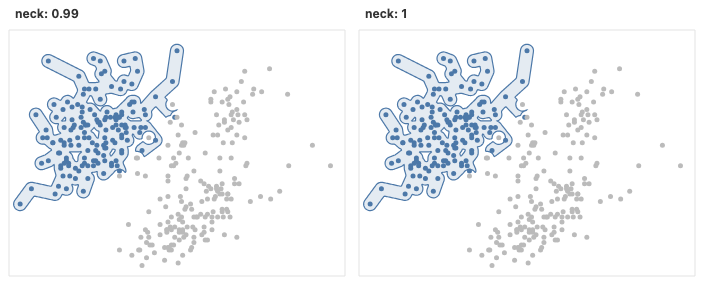

Columns are `convexity` and rows are `neck` (0.4, 0.6, 0.8, 1), with `roundness` equal to `padding`; the penguins avoid nothing, and all three species thin together. Down a column the pieces and holes never change. At `convexity: 1` the hull's edges sink in between their members, so the outline waists between neighbors while the inside stays filled and the holes stay exact. At 0 the tubes thin. Where the full-width region already had a hairline slit between two rows of dots (the U at 0 and 0.25), thinning widens it into a visible notch.

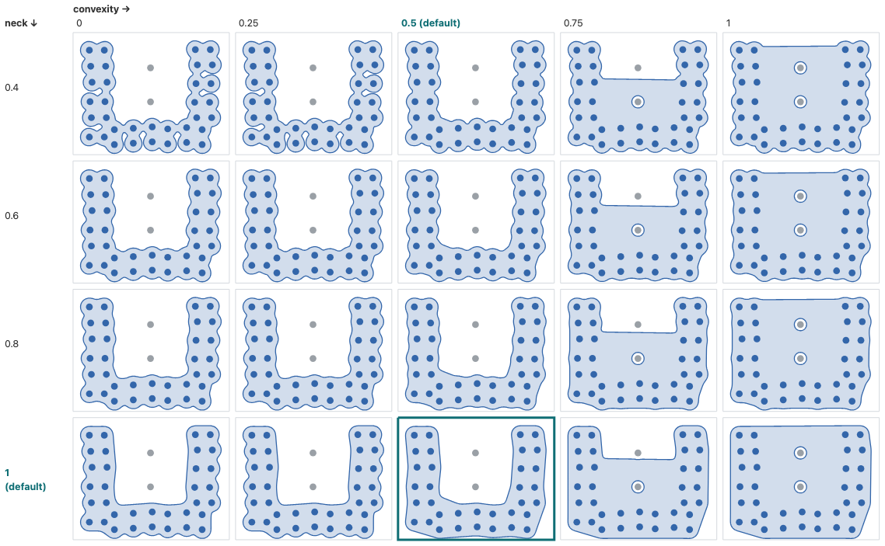

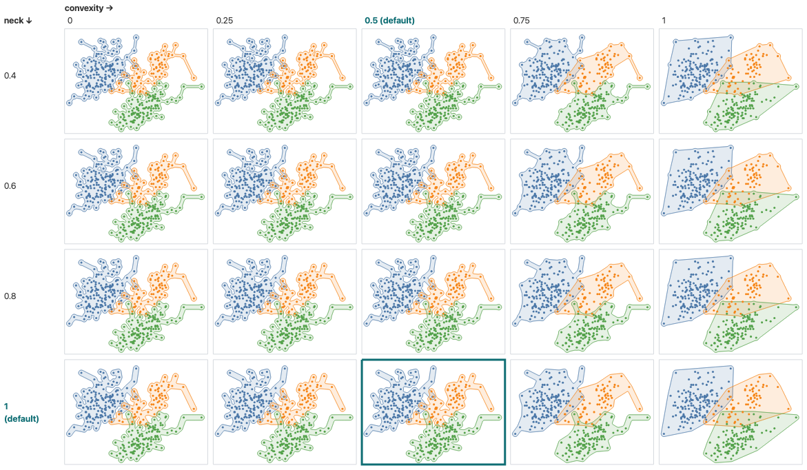

The topology check, on its own: the same 14 sets at seven values of `convexity` (0, 0.25, 0.5, 0.65, 0.75, 0.9 and 1), with `roundness` swept over 0, ¼, ½, 1, 1.5, 2, 3 and 4 times the padding. The pieces and holes stay the same along 98 of 98 sweeps, with `holes` off and with it on. (The comparison with the old `smoothing`, which changed them along 9 of 35 sweeps, is in History, v6.) On the U at high convexity the holes are the clearance circles at every roundness, and roundness only softens the corners, from the angular hull at 0 to the softest the 9 px keep-out circles allow.

| `roundness` across, at convexity 0.65, 0.9 and 1 (the hull) |
| ----------------------------------------------------------- |
| 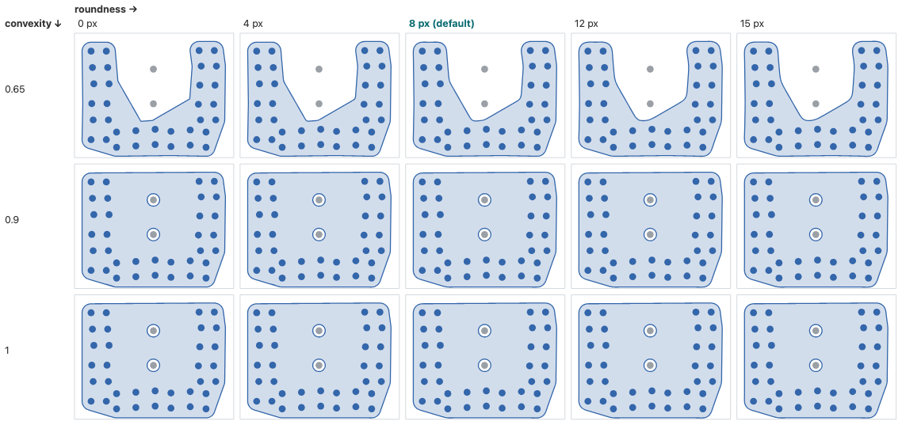                        |

On the hyperedges at convexity 0.25, roundness changes little, because the edge members are slim tubes (6.75 px), and roundness stops at the smallest circle in the region.

| `roundness` across, at convexity 0.25                                                |
| ------------------------------------------------------------------------------------ |
| 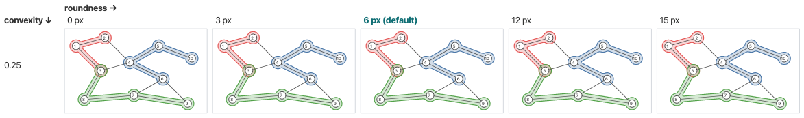 |

### Holes are a separate switch

Josh: lowering `convexity` on the hyperedges did not only change the silhouette, it also opened holes, so the name did not fit. Now `convexity` is the silhouette and `holes` is a separate boolean, off by default, as in the GIS libraries that compute concave hulls:

| Library   | Spelling                                                                  | Holes                |
| --------- | ------------------------------------------------------------------------- | -------------------- |
| PostGIS   | `ST_ConcaveHull(geom, param_pctconvex, param_allow_holes = false)`        | off unless asked     |
| Shapely 2 | `shapely.concave_hull(geometry, ratio=0.0, allow_holes=False)`            | off unless asked     |
| JTS       | `ConcaveHull.concaveHullByLengthRatio(geom, lengthRatio, isHolesAllowed)` | off unless asked     |
| JTS       | `ConcaveHull.alphaShape(geom, alpha, isHolesAllowed)`                     | the flag is required |

(Sources and exact signatures in `survey-precedent.md`, section 3.11.) With `holes: false`, every hole that holds no avoided node is filled. With `holes: true` it stays, which is the behavior before this change. A hole cut by an avoided node is its clearance circle in both. Filling only drops loops of the traced outline, so it costs nothing measurable, and it never joins or splits pieces.

```js
enclose(
  {
    shape: Shape.blob({
      convexity: 0.35,
      holes: true,
      avoiding: selectAll("nodes"),
    }),
    padding: 6,
  },
  setNodesAndEdges
);
```

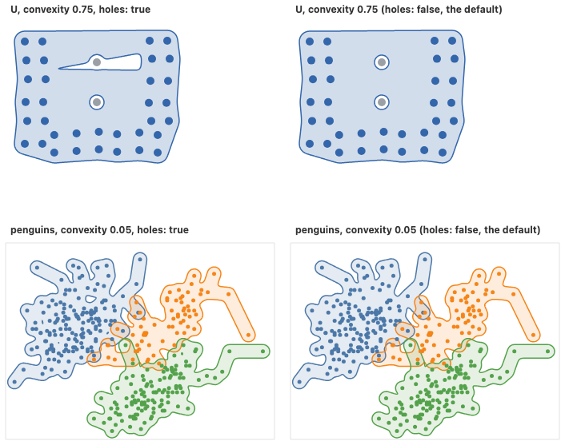

On the hyperedges at 0.35, each set's links are drawn but its triangles are not yet filled, so with `holes: true` each set has a hole in each triangle; the default fills them. On the penguins at 0.25, `holes: true` keeps the small gaps between touching dots (Adelie has five), and the default fills them. The presets: `Shape.hull()` has no empty holes, so nothing changes. `Shape.spine()` over a cycle of member edges gets its cycle filled unless `holes: true` is given (decision 15).

### Custom shapes and the ellipse

Josh's ellipse fits the #1101 escape hatch (one extensibility model for strategy families, still being designed): a user function in place of a `Shape` value. The function would receive the members as `{ box, boundary }` (box and outline points, in pixels, after placement), the box of all members, the avoided nodes in the same form, and `padding`. It returns a closed outline as a list of points. `enclose` still paints it, paints it below the members, and uses its box as the mark's box. The Munkres panel in section 3 draws its ellipses this way.

```js
const oval = ({ box, padding }) => ellipsePoints(box, padding); // user code
enclose({ shape: oval, padding: 30 }, [a, b]);
```

```python
enclose([a, b], shape=lambda s: ellipse_points(s.box, s.padding), padding=30)
```

From Python, the function would cross the bridge the way derive lambdas do. If ellipses turn out to be common (TikZ, ggforce and Munkres all draw them), `Shape.ellipse()` can become a declared member later.

## 3. Dataset explorer

One grid per dataset, all with the same two parameters. **Columns are `convexity` (0, 0.25, 0.5, 0.75, 1) and rows are `roundness` (0, half the padding, equal to it, twice it), because these are the two blob knobs that change the outline's character: what is filled, and how sharply the outline bends. `padding` and `clearance` are plain distances whose effect reads from their names.** Down a column the pieces and holes never change. The teal frame marks the recommended defaults cell (`convexity: 0.5`, `neck: 1`, `roundness` equal to `padding`). Where convexity does nothing on a dataset, the columns are `neck` instead, and the grid's header says so. Every cell is a render of the current construction.

### (a) Topology: {a, c} avoiding b

```js
enclose(
  {
    shape: Shape.spine({ avoiding: [b], neck, roundness, clearance: 6 }),
    padding: 22,
  },
  [a, c]
);
```

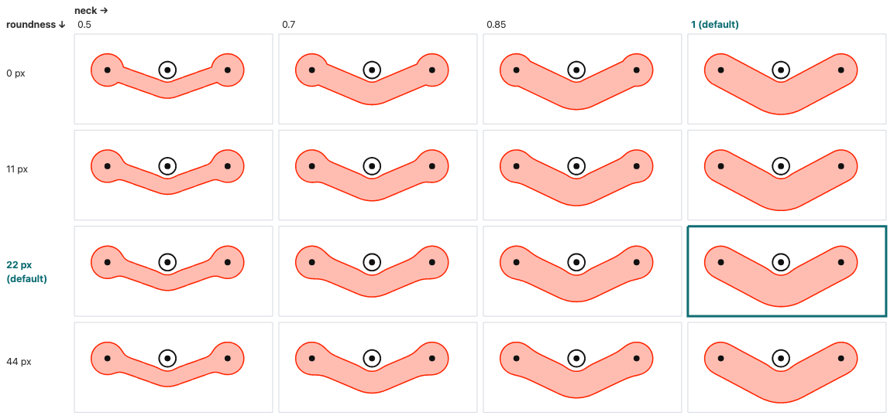

Columns are `neck` (0.5, 0.7, 0.85, 1), because with two members there is no triangle to fill and the one link is always kept, so every `convexity` draws the same thing. Rows are `roundness` 0, 11, 22 and 44 px. The band always passes under b, because a and c form no triangle that could hold b. Roundness rounds the joins between the band and the circles, up to the smallest circle in the region (the band's half-width at small `neck`, else b's 20 px keep-out circle), so 44 px draws what 22 px draws. The spelling in section 2 (`neck: 0.85`, `roundness` at its default of 22) is the third row of the third column.

### (b) The U-shaped point cloud with non-members inside

```js
enclose(
  { shape: Shape.blob({ convexity, roundness, avoiding: others }), padding: 8 },
  members
);
```

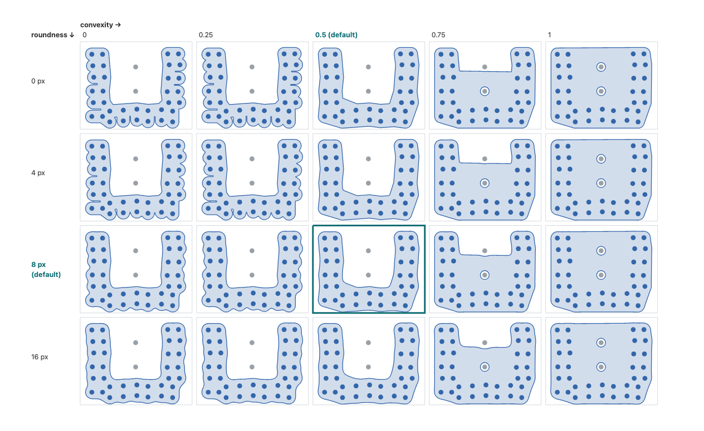

At 0 the U is a tree of tubes, wavy along the arms. At 0.5 the two-dot-thick arms fill and get straight sides, and the opening stays clear. At 0.75 the triangles across the bottom of the opening fill, so the lower gray dot is inside and becomes a round hole (drawn white), while the upper one sits in a notch. At 1 both gray dots are round holes. The holes are the clearance circles at every roundness, so the half-rounded triangles of the old grid (History, v6) are gone. Down each column only the corners change, and the waves between neighboring dots flatten. At 0 and 4 px the spine keeps narrow slits between touching dots. Rounding closes a slit up to where it is 1.5 σ wide, so at 4 px the slits close only where they are narrowest, and at 8 px they close completely; a closed slit is filled, never pinched into a hole.

### (c) Penguins: the discrete choice, then the dials

First the discrete choice. All three species, each with its own outline, at `padding: 6` and the same light fill, so overlaps and fit can be compared. Each panel uses the shape's defaults; nothing is avoided.

```js
chart(penguins)
  .flow(
    group({ by: "Species" }),
    scatter({ x: "Beak Length (mm)", y: "Beak Depth (mm)" })
  )
  .mark(circle({ r: 2.5, fill: "Species" }))
  .layer(enclose({ shape, padding: 6, fill: "Species", opacity: 0.15 }));
// shape: Shape.box(), Shape.hull(), Shape.blob() or Shape.spine()
```

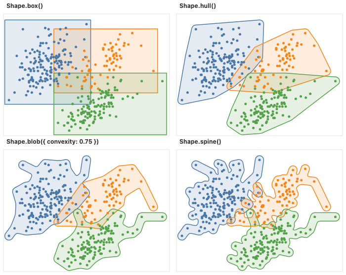

The boxes overlap so much that the species blur together. The hulls separate them well and are easy to read, with a sliver of overlap between each pair. The blob and the spine follow the points closely and show where each species is dense; on data this dense they look almost the same, because the discs already touch and there is little space left for `convexity: 0.5` to fill. Box and hull are reasonable choices here; blob and spine trade a calm outline for a closer fit.

Then the dials. The same three species in every cell, convexity by roundness.

```js
.layer(enclose({ shape: Shape.blob({ convexity, roundness }), padding: 6, fill: "Species", opacity: 0.15 }))
```

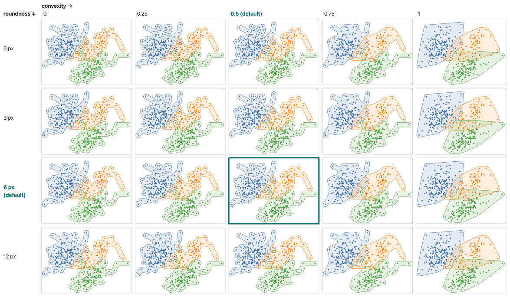

The defaults cell is the `Shape.blob()` panel above, and the convexity 1 column is the `Shape.hull()` panel. At 0.75 each species becomes one calm region that still leaves out its empty corners, which is the step between the blob and the hull. Down each column the pieces and holes stay the same, and roundness only calms the small bumps between neighboring points. Roundness stops at the points' grown radius (8.5 px here), so 12 px draws what 8.5 px draws. Adding `avoiding: selectAll("points")` to the blob would cut each species' outline away from the other species' points, as dataset (b) shows for the U.

### (d) Hyperedges over a node-link graph

**The edges are members.** Each set's members are its nodes plus the graph edges whose two ends are both in the set. An edge member is a line, held inside the outline at `padding` along its whole length, and it already links its two ends (History, v5, has the edge parameter this replaced).

```js
layer([
  graph, // nodes named "nodes" (keyed by id), edges named "edges" (keyed by id)
  chart(setMembers) // rows { set, member }: the set's nodes, then the edges among them
    .flow(
      resolve(["member"], { from: [selectAll("nodes"), selectAll("edges")] }), // new: a list
      group({ by: "set" })
    )
    .mark(
      enclose({
        members: "member", // new (decision 9): the column whose refs are the operands
        shape: Shape.spine({ avoiding: selectAll("nodes") }),
        padding: 6,
        fill: "set",
        opacity: 0.25,
      })
    ),
]);
```

```python
layer([
    graph,
    chart(set_members)
      .flow(resolve(["member"], from_=[select_all("nodes"), select_all("edges")]), group(by="set"))
      .mark(enclose(members="member", shape=Shape.spine(avoiding=select_all("nodes")),
                    padding=6, fill="set", opacity=0.25)),
])
```

As a spine, each set is its nodes and its edges, drawn as slim tubes at the padding, and nothing else: the members already touch, so the spanning tree adds no link.

The grid:

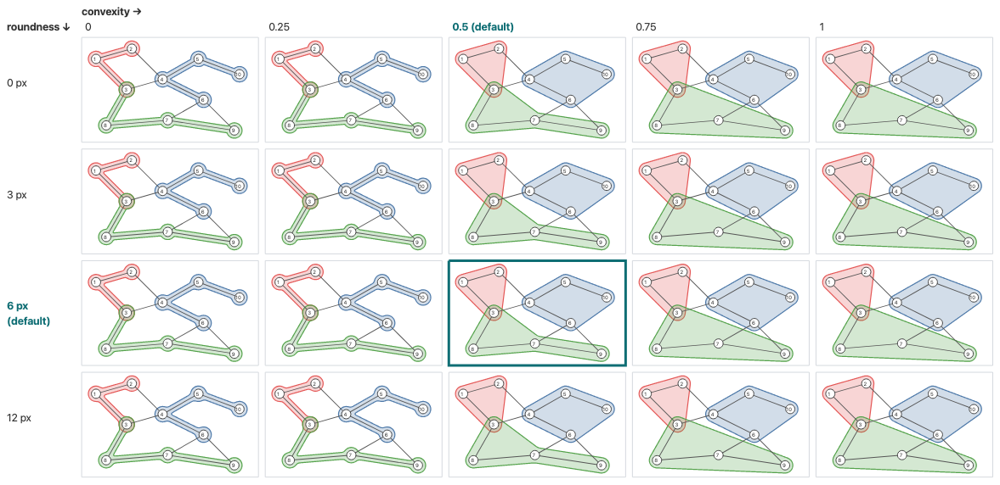

At 0 and 0.25 each set is a tube along its own edges. From 0.5 the triangles fill. At 0.75 and 1 set C fills the triangle 3, 8, 9, which covers the graph edges 6 to 7 and 4 to 6; nodes 4 and 6 stay outside. Edges as members add what must be inside, and say nothing about what must stay out.

Two harder cases, both as a spine:

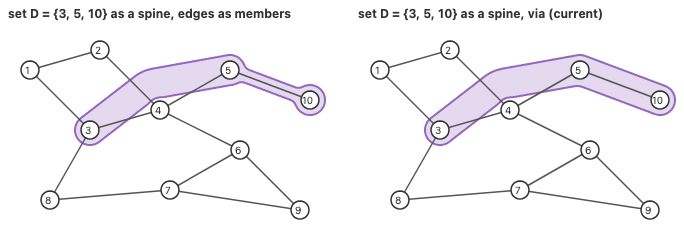

Set {3, 5, 10} reaches 5 from 3 only through node 4, which is not a member. Its member subgraph is in two pieces (node 3, and the edge 5 to 10), and the spanning tree joins them with a link routed around node 4, as wide as the node bulge.

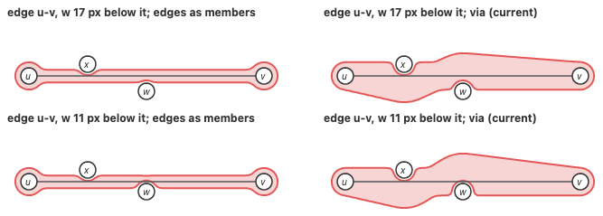

An edge u to v passes non-members x (13 px above it) and w (17 px, then 11 px, below it). The outline is a slim tube that clears both with a small notch. When w is 11 px away, w's keep-out zone (its radius plus `clearance`) reaches the edge itself, and `clearance` wins, so the outline touches the drawn edge at w. Here no outline can keep both promises; the rule is the same one that applies to a node member near a non-member.

**What the user writes.** The data is two tables: `edges` rows `{ id, source, target }` and `memberships` rows `{ set, node }`. "This set's nodes plus the edges among them" is built in plain code today:

```js
const inSet = new Set(memberships.map((m) => `${m.set}/${m.node}`));
const setMembers = [
  ...memberships.map(({ set, node }) => ({ set, member: node })),
  ...sets.flatMap((set) =>
    edges
      .filter(
        (e) =>
          inSet.has(`${set}/${e.source}`) && inSet.has(`${set}/${e.target}`)
      )
      .map((e) => ({ set, member: e.id }))
  ),
];
```

```python
in_set = {(m["set"], m["node"]) for m in memberships}
set_members = [{"set": m["set"], "member": m["node"]} for m in memberships] + [
    {"set": s, "member": e["id"]}
    for s in sets for e in edges
    if (s, e["source"]) in in_set and (s, e["target"]) in in_set
]
```

The edge half alone can be written with existing operators: `chart(edges).flow(join(sourceSets, { on: "source" }), join(targetSets, { on: "target" }), filter((d) => d.sourceSet === d.targetSet))`, where `sourceSets` and `targetSets` are `memberships` with its columns renamed. That is awkward, and it still cannot be put together with the node rows, because a flow has no operator that appends one table's rows to another's. So three things are missing, and the smallest fix for each is: `resolve` takes a list of selections in `from` (the nodes and the edges are two layers); the edges need a key column (`id`) so they can be referred to; and `enclose` needs the `members` option of decision 9. The plain-code table above is the honest spelling until a flow can append rows.

**What it needs from #974.** #974 is the issue that plans one geometry query per file, with a `boundary` query (a node's own outline) entering only when something first needs it. Edges as members are that first user: the blob needs a line mark's geometry (its path and stroke width), not just its box or center, both to grow it by `padding` and to start spanning-tree links at the closest point. The prototype reads straight segments; a curved edge would need its path as points.

**Box and hull.** Members are just shapes, so `Shape.box()` and `Shape.hull()` contain line members too, through the same `boundary` query. When both ends of an edge are members, the edge already lies inside, since both shapes are convex; it matters only for an edge whose end is outside the set.

### (e) ChartAccent: Sub-Saharan Africa on fertility against life expectancy

ChartAccent (Ren, Brehmer, Lee, Höllerer and Choe, PacificVis 2017) is a chart annotation tool. One of its examples, "Fertility Rate vs. Life Expectancy", draws a bubble set around the Sub-Saharan countries in a scatterplot of 191 countries, with bubble area by population and the other regions faded. The replica uses ChartAccent's own sample data (its `gapminder.csv`, one year, about 2000; source in `survey-precedent.md`, section 3.12) and the same 48 countries as members. Like the original, the outline does not avoid the other regions: it covers some of their faded bubbles.

```js
chart(countries)
  .flow(scatter({ x: "FertilityRate", y: "LifeExpectancy" }))
  .mark(circle({ area: "Population", fill: "Region" }).name("countries"))
  .layer(
    chart(selectAll("countries"))
      .flow(filter((d) => d.Region === "Sub-Saharan Africa"))
      .mark(
        enclose({
          shape: Shape.blob({ convexity: 0.25, neck: 0.6 }),
          padding: 6,
          fill: "#47b8a0",
          opacity: 0.3,
        })
      )
  );
```

| Replica (current construction)                      | Reference (ChartAccent, example 5)                                               |
| --------------------------------------------------- | -------------------------------------------------------------------------------- |
| 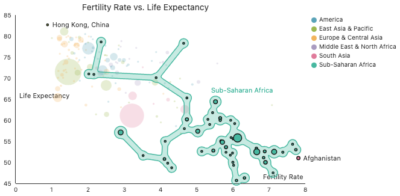 | 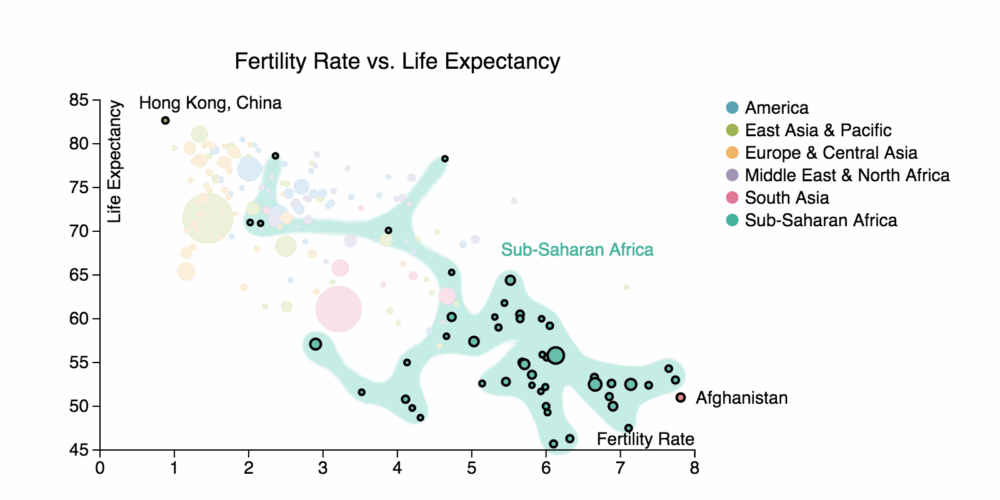 |

Matched: the same members and the same tree. The band joins the two high-life-expectancy countries near fertility 2 to the one near 4, runs down past the cluster at 4.7, and branches into the dense group between 5 and 8; the arm to the country near (2.9, 57) runs down through (3.5, 52) and (4.1, 51), as in the original. Still different: ChartAccent's outline is a soft, blurred field with no stroke and rounder lobes; ours is a crisp outline. It fills the dense group a little less, because `convexity: 0.25` fills only the smallest triangles there.

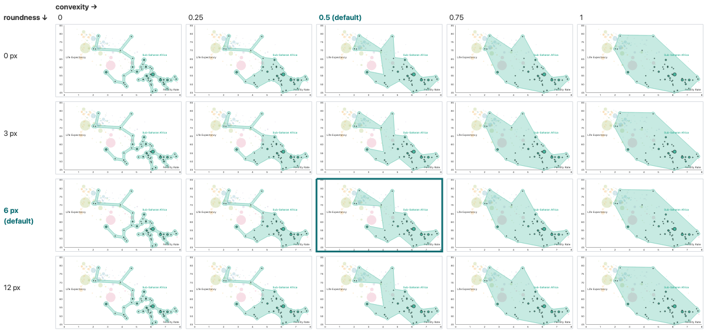

Columns are `convexity` and rows are `roundness`, at `neck: 0.6`. From 0.75 the set fills across the middle of the chart and covers South Asia and the Middle East, which is not what the example says; 0.25 to 0.5 keep the reading of a connected region.

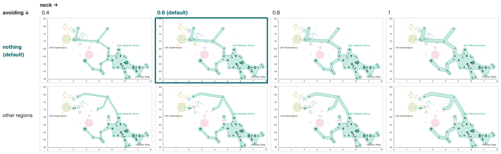

Columns are `neck`, at `convexity: 0.25`. The top row avoids nothing, as the original does; the bottom row adds `avoiding: selectAll("countries")`, which routes the band around the other regions' bubbles, with long detours over the top of the chart.

### (f) Munkres' three-point topology

Munkres, _Topology_ (2nd ed., §12), draws the nine topologies on {a, b, c}. In the last panel, the {a, c} set wraps a and c with an even margin and joins them with a thick band that passes under b. Math3ma reproduces the figure, Bluefish ported it, and the GoFish port's a/c neighborhood is today a hand-transcribed Bézier path (#717, concave hulls for `enclose`).

```js
layer([a, b, c]).relate(({ a, b, c }) => [
  enclose({ shape: oval, padding: 30 }, [a, b, c]),
  enclose({ shape: oval, padding: 16 }, [a, b]),
  enclose({ shape: oval, padding: 16 }, [b, c]),
  enclose(
    {
      shape: Shape.spine({ avoiding: [b], neck, roundness, clearance: 6 }),
      padding: 22,
    },
    [a, c]
  ),
]);
```

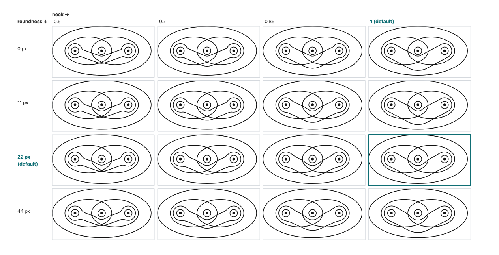

Columns are `neck`, as in (a). The whole set and the pairs {a, b} and {b, c} are ellipses through the custom-shape function. The recommended spelling (`neck: 0.85`, `padding: 22`, `roundness` at its default) on its own, next to the reference:

| Current construction                                    | Reference (Munkres, Figure 12.1; image from Math3ma)                       |
| ------------------------------------------------------- | -------------------------------------------------------------------------- |
| 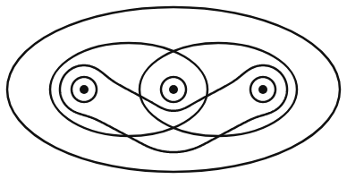 | 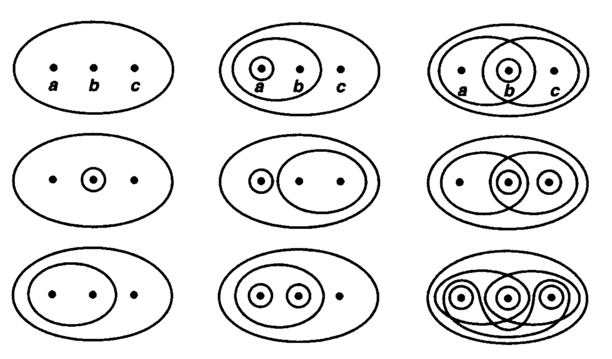 |

Matched: even margins around a and c, a thick band, and smooth joins. Still different: the bottom of the band is a wide V rather than Munkres' flatter bottom, because the link is the shortest path around b. Munkres' teardrop lobes come from a band that leaves each circle low down; a link rule that bends the band to follow b's outline at a fixed gap would get closer, and is a change to routing rather than a new parameter.

## 4. The hull preset is within half a pixel

Before rounding the hull shortcut is exact: with nothing avoided, every Delaunay triangle is filled and every hull edge is a tube as wide as the bulge, so the union is the convex hull grown by the bulge. Rounding keeps the circles and the straight sides where they are and changes only the joins between them, where the curvature steps from 1/_R_ to 0. Measured against a true padded convex hull (black line), the outline is within 0.2 px of it with `roundness` equal to `padding` (U and Gentoo), and within 0.3 px at `roundness: 15`, the most the U allows.

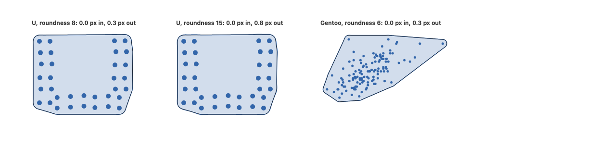

The spine shortcut draws exactly the members and the routed spanning tree, rounded. At `convexity: 0` alpha is 0, so no triangle is filled and no extra edge is added, and since there is no closing, nothing else is filled either.

## 5. The curvature never jumps

Josh's requirement was "I don't want to see a shape curvature change when the circle connects to the link." The plot below is the {a, c} outline of section 2's spelling. Left: the outline with its curvature comb, a short tooth across the outline at many points with length proportional to the curvature there. Right: curvature against distance along the outline, starting at the leftmost point, from the circle through the outline points 3 px before and after each point, every 0.5 px. The gray lines mark 1/_R_ (a's circle) and −1/40 for scale.

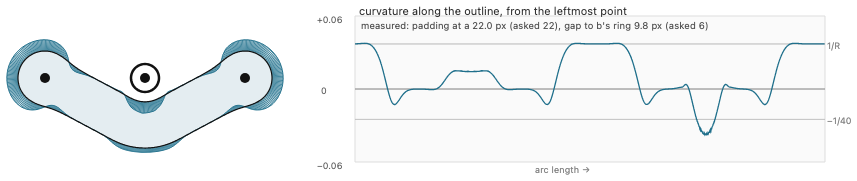

The curve moves smoothly between 1/_R_ around the circles, about 0 along the band, and negative values at the joins, with every change spread over about 20 px of outline. Under b the band bends around b's keep-out circle, concentric with it, so there the curvature is nearly constant, and it turns into and out of that bend over about 10 px. It keeps its promises: padding at a is 22.0 px (asked 22), and the gap to b's ring is 9.8 px, more than the 6 px asked, because `neck: 0.85` thins the band about its middle, which was routed at full width to touch b's ring.

## 6. One outline per group: penguins and `by`

The points are named, and a second layer groups them and draws one hull per group (code in section 2).

| `Shape.hull()`                                      | `Shape.box()`, same data                           |
| --------------------------------------------------- | -------------------------------------------------- |
| 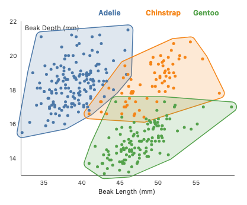 | 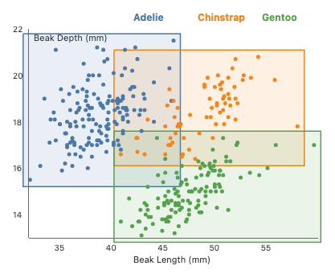 |

The boxes overlap so much that they stop separating the species; the hulls show where each species actually lies. (Prototype: axes are hand-drawn.)

- **Why not `enclose({ by: "Species" })`?** #752 (the default-split rule for relational marks) removed `by` from `line` and `ribbon`. Splits are written in the flow, so a `by` on `enclose` would bring back a second spelling. Josh is open to bringing `by` back later, when the design of stacked and divided ribbons in #47 is worked out (a ribbon today joins one element to one element; #47 asks for one-to-many, like a join between a source set and a target set). #740, a spike on whether `group()` plus `resolve()` covers regrouping refs for connectors, is related.
- **Dependency.** This spelling goes through the same `chart(selectAll(...)).flow(group({ by }))` path that #877 reports as broken for `ribbon`: the `group` is ignored, and the fused default threads the inner tier instead. It likely needs that fix for `enclose` too. This is unverified for `enclose`; the prototype draws the hulls with story-local code and does not exercise that path.
- **The shorter form**, `group` in the first layer's flow followed by a fused `.layer(enclose({ shape: Shape.hull(), ... }))`, also works when the grouping is already there for other reasons.

## 7. Future work: placing points and regions together

Not part of this proposal: the Munkres example may be drawn best by placing the points and the region together, with an energy that pushes shapes apart and rewards symmetry, as Penrose and Keenan Crane's work do. Every strategy here draws around shapes that are already placed, so that would be a change to layout, not a new shape.

## 8. Open decisions

1. Keep `enclose` as the one name and delete the `background` alias? (Alternatives: keep `background` and delete `enclose`; or rename to `hull`.)
2. Make `enclose` a relational mark now, and defer any `.background()` modifier?
3. One general member with two shortcuts: name it `blob` (or `kelp`, `bubble`), and keep the shortcut names `hull` and `spine`?
4. Option key and family `shape: Shape.*`, or `outline: Outline.*`?
5. The blob's parameters and defaults: `convexity` 0.5, `roundness` equal to `padding`, `neck` 1, `clearance` 4 px (the teal cells in section 3)?
6. `avoiding` on `Shape.blob()`, so also on both shortcuts, with "avoid each listed node that is not a member", and `Shape.hull({ avoiding })` drawing the hull with each other node inside it cut out as a round hole?
7. Draw ellipses through the #1101 custom-shape function first, and add `Shape.ellipse()` only when examples call for it?
8. Move `rx`/`ry` from `enclose` into `Shape.box({ rx, ry })`?
9. For rows that carry refs (the hyperedge example), name the ref column with a `members` option, by analogy with `line({ from, to })`? The same example also needs `resolve` to take a list of selections (dataset (d)).
10. In a chart, should a spine stay inside the plot area by rule, or should the user list the axis in `avoiding` (the trout example, History v9)?
11. Confirm `holes` (default `false`), following PostGIS, Shapely and JTS, with `convexity` as the silhouette only.
12. Keep all rounding inside `Shape.blob()` (the outline rounding of step 6), and add no `curve` key to `enclose`? (History, v4, shows why a curve through the outline cannot keep `padding` or `clearance`.)
13. Confirm: a graph's edges are enclosed as members (dataset (d)), with no separate edge parameter (History, v5). Box and hull contain line members too, since members are just shapes, and the blob reads their geometry through #974's `boundary` query.
14. Should `roundness` go past the smallest circle in the region, so a hull's corners can round more than the members' grown radius? The cost is that `padding` and `clearance` become approximate near those circles.
15. Should `Shape.spine()` keep the one default `holes: false`, so a spine over a cycle of edges is filled? (Recommended: yes. In the data, the holes a spine leaves are mostly small gaps between touching dots, five per penguin species; a ring is `Shape.spine({ holes: true })`.)

---

# Part 2. Context

## 9. Josh's tensions, answered

**"Somewhere in between a relational mark and an operator, because you may want the background to be a component."**
In GoFish this is not a choice between two kinds of construct. Issue #707 (one combinator indexed by operand kind) and its essay `operators-over-placed-nodes.md` already show that what decides "operator" versus "relational mark" is the kind of operands, not the construct: all fresh children behave like an operator, all refs plus drawn ink behave like a connector, and a mix is an open term. `enclose` is the one construct used in all three rows today. So the proposal keeps one construct and makes it a relational mark, which still has the combinator form `enclose(opts, [children])`. Over fresh children that form _is_ the component: it lays out its children, has a box, takes up space, can be `.name()`d and pointed at with an arrow, just like a TikZ `fit` node or a Mermaid subgraph. Over refs it is a relation.

There is a second reading of "component": the drawn shape itself being something the user supplies, as Bluefish's `Background` takes a `background={() => <Rect/>}` callback and the Math3ma story passes a hand-made `Blob`. In this proposal that is the function escape hatch of the `Shape` family (#1101).

**"SwiftUI exposes it as a modifier, so maybe we could do that?"**
SwiftUI's `.background` decorates exactly one view, and that view decides the size. GoFish can say the same thing already, because `enclose(opts, [node])` wraps any one node. A `.background()` modifier would be exact sugar for that wrap, and on an operator it could give one background per group, the way `.label()` on an operator gives one label per group (#750). It cannot express the hard cases: a modifier attaches to one node of the tree, so it cannot enclose nodes that live in different places (the Topology a/c set, a hyperedge in a graph, one species across several lakes). Section 10 shows it as Approach B, and the recommendation keeps it as the runner-up (Approach C).

**"Spine is a bubble set, in between containment and connection; maybe the syntax should reflect that."**
The literature agrees. The set-visualization survey (Alsallakh et al., 2016) files Bubble Sets as a region, and the hypergraph survey (Fischer et al., 2021) files it as node-link, because the algorithm first connects the members and then inflates the connection into a region. KelpFusion turns this into one dial from a spanning tree (pure connection) to a convex hull (pure containment). The proposal reflects that in three ways:

1. The construct is a relational mark, the same family as `line` and `ribbon`, which GoFish uses for connection.
2. Connection and containment are one dial, `convexity`, on one member, `Shape.blob()`: 0 is a tree of links (`Shape.spine()`), 1 is the convex hull (`Shape.hull()`).
3. Real connections, such as the edges of a graph, can be members themselves, so the outline follows them (dataset (d)).

## 10. Where it lives: three approaches

How the strategies are spelled is a separate axis (section 11); all three approaches use `shape: Shape.*`.

### Approach A: `enclose` becomes a relational mark (recommended)

`enclose` is rebuilt with `createRelationalMark` (today it is a `createNodeOperator`). It keeps the combinator form for fresh children, refs, or a mix, and gains the bag form and fusion. The component case is unchanged except for the corner option:

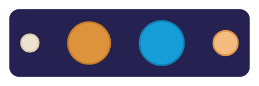

**How it composes.** `enclose(opts, operands)` is `layer(operands)` plus one outline node computed after the operands are placed; that is the framing #713 already uses ("enclose = layer + hull ink"). The outline is a path computed from each operand's `boundary` (#974, a geometry query for a node's outline as points; box corners when a mark has no better answer) and the strategy. No new core node kind: the existing enclose node gains a geometry strategy. The bag form, fusion, the #752 split, per-group paint with homogeneity collapse, and the paint-below default all come from `createRelationalMark`. Its box is the box of the drawn outline (#707's ink rule: own ink plus fresh operands; refs add nothing). Under animation the outline is recomputed each frame from placed members; how a changing outline should tween is out of scope.

**Overlap check.**

- `layer`: exact composition (enclose = layer + outline). Fine.
- `Constraint.nest` with a `rect` outer: agrees with box mode over fresh children (a small degenerate case). Build box mode's padded union through the same code `nest` uses so they cannot drift.
- `rect` + `Constraint.align({ x: "span", y: "span" })`: agrees with box mode at zero padding over refs. Degenerate.
- `line`/`ribbon`: a spine of two members looks like a thick rounded line. Degenerate; a spine always encloses its members.
- `subtract` (region compositing): not an overlap. `avoiding` routes the outline around a node; `subtract` would cut a hole of the node's shape.
- `pack`: its enclosing circle is a possible future `Shape.circle()`, not an overlap.

**Trade-offs.** One name, one mental model, every hard example expressible. New terms: `Shape`, `blob`, `hull`, `spine`, `convexity`, `roundness`, `neck`, `avoiding`, `clearance`. Cost to extend: a new member of a closed family, or #1101's function hatch. Awkward: the per-group "background behind each lake" needs `chart(selectAll("bars")).flow(group({ by: "lake" })).mark(enclose())`, which is longer than a modifier would be.

### Approach B: a `.background()` modifier only (SwiftUI)

`.background(opts)` on any mark or operator. On a mark it encloses that mark; on an operator it encloses each group the operator makes, as `.label()` labels each group.

```js
text("H").background({ padding: 4, fill: "#ffe8a3" })
chart(catch)
  .flow(spread({ by: "lake", dir: "x" }).background({ padding: 8, fill: "#f0f1f3" }),
        spread({ by: "species", dir: "x", spacing: 9 }))
  .mark(rect({ h: "count", fill: "species" }))
```

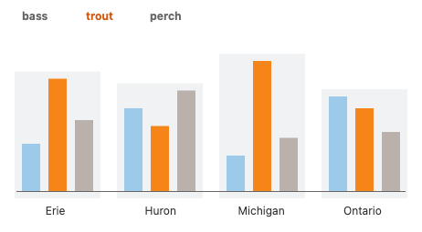

(Prototype: drawn with story-local boxes; `enclose` per group would draw the same.) Desugars to the `enclose` combinator wrapped around the node. Short and familiar for one-node decorations and per-group panels. Fails every hard example: the Topology a/c set, hyperedges, and the trout set are not single nodes of the tree. It would also need the `enclose` combinator anyway for the refs case, which makes it a second spelling, not a replacement.

### Approach C: Approach A plus the modifier as sugar (runner-up)

Everything in A, plus `.background(opts)` defined by the rewrite `x.background(opts)` = `enclose(opts, [x])` (and per group on operators). This is the "exact composition" regime of api-design.md, so it is allowed, but it gives one concept two names. **What would make it the pick:** a run of real examples where a per-node or per-group background inside a flow is the common case, such as label pills, facet panel backgrounds and zebra stripes.

## 11. How strategies and parameters are spelled

**S1, one option with a family (recommended).** `shape: Shape.box({ rx, ry }) | Shape.blob({ ... })`, with the shortcuts `Shape.hull(opts)` and `Shape.spine(opts)`. `padding` and the paint options stay on `enclose` because every strategy uses them. Each strategy carries only the parameters it uses. Default `shape` is `Shape.box()`, today's behavior.

**S2, one function per strategy (ggforce).** `box()`, `hull()`, `spine({ avoiding })` as three relational marks. It splits one concept into three operators, against "one concept is one operator" (api-design.md) and the #397/#717 direction.

**S3, string values with flat options (#717 comment).** `shape: "box" | "hull" | "spine"` with `convexity` and `avoiding` on `enclose`. Rejected by #1013: a family with arguments is a namespace of calls, and flat options would be accepted and ignored by the strategies that do not use them.

## 12. Nearby GoFish decisions and how this design lines up

| Decision                                                                               | What was decided                                                                                                                                                                                                       | This design                                                                                                                                                                                                                                                               |
| -------------------------------------------------------------------------------------- | ---------------------------------------------------------------------------------------------------------------------------------------------------------------------------------------------------------------------- | ------------------------------------------------------------------------------------------------------------------------------------------------------------------------------------------------------------------------------------------------------------------------- |
| Strategy namespaces (#1013)                                                            | An option whose value is one of several strategies, some with arguments, gets an uppercase family: `Overlap.separate()`, calls only, family type inside the namespace (`Curve.Curve`), Python module bound as `Curve`. | **Matches.** `Shape.box()`, `Shape.blob()`, `Shape.hull()`, `Shape.spine()`, type `Shape.Shape`, `gofish-graphics/shape` subpath, Python `from gofish import Shape`.                                                                                                      |
| Presets over one general strategy (#1018)                                              | `sina()` and `jitter()` are `noise()` with params preset; they emit `kind: "noise"`, the presets are declared in the `STRATEGIES` table, and any option overrides a preset.                                            | **Matches.** `Shape.hull()` and `Shape.spine()` are `Shape.blob()` with `convexity` (and for hull, `neck`) preset; they emit `kind: "blob"`.                                                                                                                              |
| One-strategy options (three-surfaces.md, `pack`)                                       | An option with one strategy has no option at all.                                                                                                                                                                      | **Matches.** Two members plus two presets, so the option earns its place.                                                                                                                                                                                                 |
| Closed families plus escape hatch (#1101)                                              | Families are closed; a user function is the planned escape hatch.                                                                                                                                                      | **Matches.** Bluefish's custom background shape, and Josh's ellipse, become that escape hatch, not a new option.                                                                                                                                                          |
| `curve` on `line`/`ribbon` (#637)                                                      | One key picks the drawn geometry of a relational mark; every curve is computed in screen space after placement.                                                                                                        | **Matches.** `shape` is to `enclose` what `curve` is to `line`. Outlines are computed in screen space after layout, so they work under polar and other coordinate transforms the same way curves do.                                                                      |
| Relational marks and `.layer()` (#745)                                                 | Relational marks paint below their operands by default; `.layer()` hands each tier the previous tier's marks; `.connect()` deleted.                                                                                    | **Matches.** A background is the clearest case of "paint below what it relates".                                                                                                                                                                                          |
| Blank fusion (#748)                                                                    | `.mark(R(opts))` becomes `.mark(blank(anchor)).layer(R(rest))`; all paint goes to the relational mark.                                                                                                                 | **Matches**, inherited from `createRelationalMark`.                                                                                                                                                                                                                       |
| Default split (#752)                                                                   | A fused relational mark splits on every flow grouping except the path tier; `along` names the path tier; for enclose the order half is vacuous and the option word is deferred.                                        | **Matches.** `group(Species)` then `scatter` plus `.layer(enclose())` gives one hull per species with no option. No `along`/`over` is proposed, since no example needs it.                                                                                                |
| Plural refs never auto-map (#707)                                                      | `enclose(opts, points)` is one outline around the whole selection; per-element needs `.each`.                                                                                                                          | **Matches.**                                                                                                                                                                                                                                                              |
| `relate()` drawing clauses (#878, #930)                                                | Clauses may hold ink such as `background` over refs and open terms.                                                                                                                                                    | **Matches**, and inherits the #986 paint-order gap (drawing clauses in `.relate()` miss the paint-below default), which this feature makes more visible.                                                                                                                  |
| `padding` vs `spacing` (#1005)                                                         | `padding` = inset around the outer edge; `spacing` = gap between siblings.                                                                                                                                             | **Matches.** `padding` grows every strategy's outline.                                                                                                                                                                                                                    |
| Geometry queries (#966, #968, #974)                                                    | One file per query; `boundary` enters with its first user.                                                                                                                                                             | **Matches.** The blob reads each member's `boundary` (falling back to box corners). This is the first user #974 waits for.                                                                                                                                                |
| Modifier versus option (shape geometry, 10-03)                                         | `overlap` stays an option because modifiers apply to any mark or operator; the `.jitter()` modifier was dropped.                                                                                                       | **Consistent.** A background passes the "applies to anything" test, so a modifier is legitimate (Approach B/C). It is deferred on the "one concept, one spelling" rule, not ruled out.                                                                                    |
| `.label()` on operators (#741, #750)                                                   | A modifier on an operator yields one label per group, lowered to ordinary marks.                                                                                                                                       | **Precedent** for Approach B's per-group `.background()`.                                                                                                                                                                                                                 |
| Refs inside a strategy argument (route vs interpolation note, `Curve.bundle({ via })`) | Secondary geometry is a strategy argument, never columns in the flow. Not shipped.                                                                                                                                     | **Matches** in spirit: `Shape.blob({ avoiding })` takes a selection as an argument. `avoiding` is the only strategy parameter that holds refs. It could later become a second operand role of `enclose` (the nodes to keep out, beside the members), not redesigned here. |
| No back-compat; delete, don't gate                                                     | No aliases, no accepted-and-ignored options, migrate call sites.                                                                                                                                                       | **Matches.** `background` alias deleted; `rx`/`ry` move into `Shape.box()` instead of being ignored by the blob; `avoiding` exists only on the blob, where it means something.                                                                                            |
| Python surface (#1008)                                                                 | Children positional, snake_case kwargs, `Family.member()` strategies.                                                                                                                                                  | **Matches.** `enclose([a, c], shape=Shape.spine(avoiding=[b]), padding=8)`.                                                                                                                                                                                               |
| Designer names, survey first (#196, #404, #762)                                        | Prefer names designers know; survey precedent before naming.                                                                                                                                                           | Partly. `box` and `hull` have strong precedent. `spine` is Josh's name; precedent says "bubble". `blob` follows Bluefish's `Blob` (section 13).                                                                                                                           |

**Where it departs, and why.**

- From Josh's #717 comment: shapes are family calls instead of strings (#1013 came later); `avoiding` lives on `Shape.blob()` instead of on `enclose` with a warning for the box (no accepted-and-ignored options); `ellipse` goes through the custom-shape function first (decision 7); a separate `alpha` member is not needed, since `convexity` is alpha on a unitless scale.
- From #397's leaning (`bubbleset: true`): a boolean cannot grow into several strategies.
- From today's `enclose`: `rx`/`ry` move into `Shape.box()`. `rect` also spells corner rounding `rx`/`ry`, so the names stay.

Not re-asked: #935 (parked relate() follow-ups), #954, #1053/#1054, #290.

## 13. Precedent

Full survey: `survey-precedent.md`. The short version:

| System                | Spelling                                                                     | Model                                                                                       | Image                                                    |
| --------------------- | ---------------------------------------------------------------------------- | ------------------------------------------------------------------------------------------- | -------------------------------------------------------- |
| SwiftUI               | `view.background(.blue, in: RoundedRectangle(cornerRadius: 8))`              | Modifier on one view; the view sets the size. Shape is a value.                             | none obtained                                            |
| Bluefish              | `Background({ padding: 40 }, [Ref("label"), Ref("mercury")])`                | A relation over refs; filed beside `Arrow`; box only; custom shape callback.                | `precedent/bluefish-background-planets.png`              |
| TikZ                  | `\node[draw, circle, fit=(a)(b)(c)] {};`                                     | A node fitted to other nodes; outline shape chosen separately; nameable and labelable.      | `precedent/tikz-fit-box-circle.png`                      |
| Graphviz              | `subgraph cluster_0 { ... }`                                                 | Structural group that the layout honors; box only; tree only.                               | `precedent/graphviz-cluster.svg`                         |
| ggforce               | `geom_mark_hull(aes(fill = Species), concavity = 1, expand = unit(5, "mm"))` | One geom per shape (`rect`, `ellipse`, `circle`, `hull`); shared `expand` and `radius`.     | `precedent/ggforce-mark-hull.png`                        |
| Observable Plot       | `Plot.hull(penguins, { x, y, fill: "species" })`                             | Convex hull mark; groups by `z`, which defaults to the fill channel.                        | `precedent/observable-plot-hull.jpg`                     |
| bubblesets-js         | `createOutline(members, nonMembers, edges, options)`                         | Members, non-members and optional real edges in; contour out.                               | `precedent/bubblesets-js.png`                            |
| KelpFusion            | (paper)                                                                      | Graph dial `t` from spanning tree to convex hull, plus a face-size limit `A` (History, v2). | `precedent/kelpfusion-fig5-t-sweep.png`                  |
| Globs                 | (editor; no API)                                                             | Hand-placed circles joined by smooth necks shaped with handles. See below.                  | `precedent/glassner-globs-design.png`                    |
| PostGIS, Shapely, JTS | `ST_ConcaveHull(geom, pctconvex, allow_holes = false)`                       | A concave hull: one fill number, and a separate holes switch that is off by default.        | none                                                     |
| ChartAccent           | (annotation tool; no API)                                                    | A bubble set drawn around a chosen group of scatterplot points. Dataset (e).                | `precedent/chartaccent-fertility-vs-life-expectancy.png` |

**Globs (Steve Ruiz).** Josh said the new outlines remind him of an older Steve Ruiz project; it is Globs, "a globs-based vector editor" (demo at https://globs.design, source at https://github.com/steveruizok/globs; Ruiz also made perfect-freehand and perfect-arrows, which GoFish already uses). It implements the glob primitive of Andrew Glassner, "Globs: A Primitive Shape for Graceful Blends Between Circles", _Journal of Computer Graphics Techniques_ 4(3), 2015. A glob is two circles of any radii joined by a smooth neck. The neck is two Bézier curves that leave each circle along a tangent, and four control points (the handles) set where each side of the neck leaves the circles and how much it bulges, so one glob ranges from a fat blob to a thin boomerang. In the editor you place nodes (circles with a radius handle), connect them with globs, and drag the handles; a glob stays attached when its nodes move. tldraw ships a globs editor example built the same way (https://tldraw.dev/examples/globs-editor).

How it compares with `Shape.blob()`:

- **Hand-placed versus computed.** A glob's neck is drawn by hand: the user places the handles. The blob computes every neck from the members, the `avoiding` list and a few numbers, so it can draw a hundred penguin outlines or a set over a graph without any handles. Globs has no notion of non-members to keep out.
- **Pairs versus sets.** A glob joins two circles; a drawing joins many with many globs. The blob joins any number of members in one region, and fills the space between them when `convexity` asks for it.
- **Smoothness.** Glassner's construction guarantees that the neck meets each circle along a tangent (no corner, G1); his page does not claim that curvature is continuous there, and a Bézier leaving a circle generally jumps in curvature at the join. The blob's outline is curvature-continuous (G2) everywhere, which was Josh's requirement (section 5). The look Josh noticed is shared: round ends, necks that narrow and widen gracefully.
- **What GoFish could take.** The glob is a candidate output for the #1101 custom-shape function, and its neck controls are a reference point for a future link rule that shapes the band in Munkres' panel.

Image: `precedent/glassner-globs-design.png`, from Glassner's own page on globs (https://glassner.com/?p=3004; file https://glassner.com/wp-content/uploads/2025/10/Globs-design.png). Left: a glob with its two circle centers (red) and the neck handles (orange and teal). Right: the same glob filled. No image from globs.design itself could be obtained; the page renders client side and showed only "Loading...".

What GoFish should take overall: one name with a shape value (SwiftUI, Compose, TikZ), a relation over refs that also nests (Bluefish), a shared `padding` plus one knob per strategy (ggforce), members, non-members and real edges as the blob's inputs (bubblesets-js). What it should not take: one function per shape (ggforce), grouping inferred from the color channel (Plot; GoFish uses the flow's grouping instead), field-physics knobs (`nodeR0`, `edgeR1`).

**Names.** `box` matches TikZ's default and ggforce's `rect`. `hull` matches Plot, ggforce, d3 and the roadmap. For the spine shortcut no library uses "spine"; Bubble Sets, bubblesets-js and Josh's own #717 comment say "bubble". `spine` names the mechanism, the connecting skeleton that makes the shape a hyperedge, and reads well over a graph ("a spine along these edges"). The docs also use the phrase "space-filling spine" descriptively for mosaic layouts; that prose could be reworded later if `spine` becomes an API name.

**The general member's name.** Candidates: `kelp`, `bubble`, `blob`, `region`, `outline`, `set`. `kelp` credits KelpFusion, but the word means nothing to most readers and the construction differs from the paper. `bubble` is the Bubble Sets word, but Bubble Sets is a different algorithm (an energy field), and in KelpFusion a bubble is one node's disc. `region` collides with GoFish's region-compositing operators. `outline` is a candidate for the option key itself (decision 4) and also means a stroke. `set` names the data, not the drawing, and shadows JavaScript's `Set`. `blob` is an everyday word for a rounded free-form region and is the name Bluefish already uses for a hand-drawn set outline (`Blob` in the Math3ma example). This proposal uses `blob` (decision 3).

**The knobs.** Libraries disagree on the direction of a hull's concavity knob: `concavity` in ggforce and concaveman gets _more convex_ as it grows; `alpha` is a radius in CGAL (bigger is more convex) and an inverse radius in Python's `alphashape` (bigger is more concave); Shapely's `ratio` and PostGIS's `pctconvex` are fractions toward convex. `convexity` reads its direction from the name and has no unit. Holes are a separate boolean in all three GIS libraries (`allow_holes` in PostGIS and Shapely, `isHolesAllowed` in JTS), off by default; `holes` follows them, in GoFish's plain style without the verb. `roundness` is a pixel length, bigger is rounder. It is the plain word for the property, and its unit matches the pixel corner radius that CSS (`border-radius`), Vega-Lite (`cornerRadius`) and Figma use. It is not called `smoothing`, because `smoothing` on `noise()` and the old blob knob both change what is filled, and `roundness` never does. `neck` is the everyday word for the narrow part that joins two bulges, and it is also Glassner's word for the part of a glob between its circles.

## 14. Related issues

- **#397** Bring back a bubble-set enclosure after the `wrap` operator was deleted; floats `bubbleset: true` on `enclose` versus a separate operator.
- **#717** Concave hulls for `enclose`. Josh's comment there proposes one `enclose` with `shape: "rect" | "ellipse" | "hull" | "alpha" | "bubble"`, an `avoiding` list, and "relation, not function".
- **#974** A `boundary` geometry query (a node's outline as points). Hull enclosures are named as its first user.
- **#1138** Roadmap: "Hulls: a group of marks in, a path out", an agent one-shot.
- **#707** Operators over placed nodes: one combinator indexed by operand kind; plural refs never auto-map.
- **#929** Remaining `relate()` steps, including `.each` templates and item 6, drawing clauses missing the paint-below default.
- **#986** Relational paint-below default not applied to `.relate()` drawing clauses.
- **#935** (parked) relate() follow-ups; uses `background([a, b])` as an example. Not re-asked here.
- **#752** Default split for fused relational marks; its design note says enclose follows the same rule with order ignored, and defers an option word ("over").
- **#1101** Extensibility model for strategy families (custom curves, tiles, overlaps).
- **#1013** One uppercase namespace per strategy family.
- **#802** Operators cannot be `.name()`d, which limits selecting the groups an operator makes.
- **#844** A `ref()` to a constraint-placed sibling lands at the origin; its repro is an `enclose` over a ref.
- **#171** Enclose broken for the nested waffle chart (the story has it commented out).
- **#1109** Annotation tutorial; "enclose around selected marks" as the elaborated form.
- **#1084** Venn docs example (an Euler-diagram neighbor of this feature).
- **#396, #713, #714, #716** History: `wrap` deleted; enclose keeps placed refs in place ("enclose = layer + hull ink"); enclose gets paint options and paints behind its children.
- **#47** Stacked and divided ribbons (open): should Sankey-like pictures connect elements with a stack of ribbons instead of one? Where a `by` option on relational marks may come back.
- **#877** A `selectAll` plus `group({ by })` before a ribbon is ignored, and the fused default threads the inner tier instead. The penguin spelling goes through the same path.
- **#740** Spike: does `group()` plus `resolve()` cover regrouping refs for connectors?
- **#1018** `noise()` with `sina()` and `jitter()` as presets: the model for `hull` and `spine` over `blob`.
- **#957** Better screen-space curves than Catmull-Rom; asks whether its candidates work for closed curves such as enclosures (History, v4).

## 15. User-facing syntax changes to review

| Today                                                    | Proposed                                                                                        |
| -------------------------------------------------------- | ----------------------------------------------------------------------------------------------- |
| `background({ padding: 20, rx: 16, ry: 16, fill }, [x])` | `enclose({ padding: 20, shape: Shape.box({ rx: 16, ry: 16 }), fill }, [x])`                     |
| `enclose({ padding: 6 }, [a, b, c])`                     | unchanged (default `Shape.box()`)                                                               |
| no way to draw one outline per group                     | `.layer(chart(selectAll("points")).flow(group({ by })).mark(enclose({ shape: Shape.hull() })))` |
| hand-drawn concave `polygon` (Topology)                  | `enclose({ shape: Shape.spine({ avoiding: [b], neck: 0.85 }) }, [a, c])`                        |
| no in-between shape                                      | `enclose({ shape: Shape.blob({ convexity: 0.5, avoiding }) }, members)`                         |
| `background = enclose` in Python                         | removed; `enclose([...], shape=Shape.spine(), padding=8)`                                       |
| new import                                               | `import { Shape } from "gofish-graphics"` / `from gofish import Shape`                          |

Docs follow-up if approved: the handwritten Basics and Diagrams tutorials teach `background()`. Their code blocks can be migrated, but their prose names the construct "background", so an issue would record what went stale rather than rewriting it.

## 16. Prototype notes

- The stories live in `packages/gofish-graphics/stories/_proposals/BackgroundHull.stories.tsx` (title "Proposals/Background Hull"). They are throwaway and import `delaunator` by a relative path into the pnpm store, since it is not a declared dependency.
- The current construction is story section (e), `smoothBlob`. It builds the alpha complex and spanning tree, routes blocked links on a visibility graph around polygons standing in for the avoided nodes (A\* over the vertices a shortest route can bend at), then tightens each route onto the circles those polygons stand for. The region's outline is traced exactly: a quadtree over a 1 px grid keeps, per cell, only the pieces and zones that can be nearest there (distances are 1-Lipschitz, so a cell farther from the outline than its half-diagonal is settled), marching squares joins the crossed cells, and each crossing is found on its grid edge by regula falsi on the exact distance. Pieces that lie inside other pieces are left out first (a disc inside a link at least as wide, a link between two filled triangles whose other sides are as wide). The rounding is a Gaussian along the resampled outline (1 px), with each point on a circle first moved out by that circle's discrete smoothing factor; then inlets are closed, the keep-out smooth maximum is applied, and loops are checked for crossings with a grid. Every stage is remembered by its own inputs (the sites per member list; the skeleton per member list, avoided nodes and knobs; routes per avoided nodes and clearance; the traced outline per skeleton), so a `roundness` change reruns only the rounding. Holes are painted white instead of cut out. Links start from member centers, or from the closest point of a line member; links from outlines (#974) are needed for exact hulls of mixed shapes. Line members (`kind: "segment"`) are in section (g). The current construction has no `via`; only the v1 and v3 constructions, kept for History, still read one.
- Speed (node, all sets of a dataset, median over 7 cold runs with nothing remembered; then the median per slider step): penguins avoiding nothing 14 ms cold and 11 ms per step (2 ms for a roundness step, 6 ms for a neck step); penguins avoiding the other species 18 ms cold and 13 ms per step; ChartAccent avoiding nothing 4 ms cold and 3 ms per step; ChartAccent avoiding the other regions 48 ms cold and 8 ms per step (its padding and clearance steps reroute 143 avoided bubbles, about 45 ms); the U, Topology, hyperedges and Munkres 1 to 3 ms.
- The dataset grids are story section (f), the `Grid*` stories, and the rows in "Why these knobs are orthogonal" are section (h), the `Roundness*` stories. The "before" rows were rendered once from the previous version of the stories file. The measurements are scripts in `tests/tmp/orth/` (`metrics.ts`, `sens.mjs`, `topotable.mjs`). Wide grids are shrunk with CSS `zoom` to fit the 1264 px capture root, and every PNG was trimmed to its content with a small pngjs script.
- Current images: `img/explore-round-topology.png`, `img/explore-round-u.png`, `img/penguins-four-shapes.png`, `img/explore-round-penguins.png`, `img/explore-round-hyperedges-members.png`, `img/hyperedges-members-routed-link.png`, `img/hyperedges-members-near-edge.png`, `img/chartaccent-replica.png`, `img/explore-round-chartaccent.png`, `img/neck-grid-chartaccent.png`, `img/explore-round-munkres.png`, `img/neck-adelie-099-vs-1.png`, `img/neck-grid-u.png`, `img/neck-grid-penguins.png`, `img/roundness-u.png`, `img/roundness-hyperedges-members.png`, `img/holes-hyperedges-penguins.png`, `img/topology-munkres-panel-smooth.png`, `img/smooth-hull-preset-vs-true-hull.png`, `img/current-curvature-topology-ac.png`, `img/penguins-hull-per-species.png` (the hull preset), `img/penguins-box-per-species.png`, `img/planets-box-component.png`, `img/bars-box-per-lake-group.png`. The ChartAccent stories are section (j) and the holes story is section (k); the ChartAccent data is `proposals/background-hull/playground/src/chartaccent.json`, converted from the downloaded CSV.

---

# Part 3. History

The earlier versions, oldest first. Nothing here is part of the current proposal.

## v1: three strategies, with the alpha shape

The first version had three members: `Shape.box()`, `Shape.hull({ alpha })` (convex, or concave as an alpha shape with a pixel radius), and `Shape.spine({ avoiding, via })` built as a bubble set (Collins et al., 2009: connect the members with a tree of lines that bends around non-members, then draw a smooth outline at a fixed distance around it).

| `Shape.box()`                                                                              | `Shape.hull()`                                              | alpha shape, alpha 40                                                                            | bubble-set spine                                                                             |
| ------------------------------------------------------------------------------------------ | ----------------------------------------------------------- | ------------------------------------------------------------------------------------------------ | -------------------------------------------------------------------------------------------- |
| 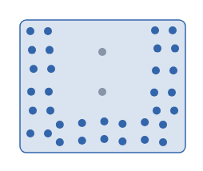                                                               | 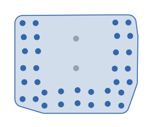                | 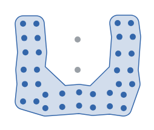                                                   | 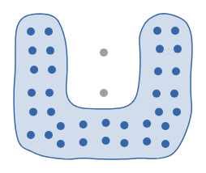                                                             |
| The padded bounding box. Real `enclose` (note its fill painting over the gray dots, #986). | Convex hull of the padded member outlines. Never has dents. | Alpha shape: openings wider than the disc are carved out. Depends only on where the members are. | Routes a connecting tree around the listed non-members and draws a smooth outline around it. |

The concave hull and the spine look alike on the U, but the hull's dent comes from the members' own spacing and ignores the gray dots, while the spine's dent comes from the `avoiding` list. On the Topology set only the spine can keep b out:

| `Shape.hull()` for {a, c}: covers b                        | bubble-set spine avoiding b                             |
| ---------------------------------------------------------- | ------------------------------------------------------- |
| 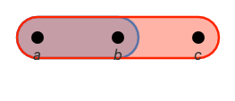 | 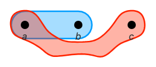 |

The bubble-set spine on the hyperedges and on trout across lakes. With the other bars as the only obstacles, the bubble-set routing sent the Huron to Michigan link under the baseline (right), because it goes around whichever side of a box cuts off less of it.

| hyperedges                                         | trout, avoiding bars and axis band                           | trout, avoiding bars only                                                   |
| -------------------------------------------------- | ------------------------------------------------------------ | --------------------------------------------------------------------------- |
| 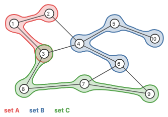 | 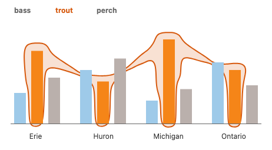 | 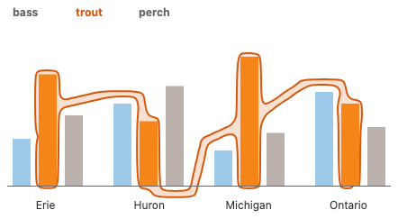 |

S1', the three-member spelling, was the pick of v1 and v2: `Shape.box({ rx, ry }) | Shape.hull({ alpha }) | Shape.spine({ avoiding, via })` on a shared kernel. It had fewer parameters per member, but hull and spine had no common dial, the middle (filled where dense, links where sparse) needed a fourth member, and a raw `alpha` brought a pixel length whose direction libraries disagree on.

Prototype notes for v1: spine outlines used bubblesets-js's routing and contour tracing, with the energy field assembled in the story. Each non-member's box was grown by the tube's half-width plus a gap before routing, each routed edge counted as one shape whose distance is the distance to its nearest segment, and energy fell off over a few pixels so neighboring fields did not add up into lumps. The classic alpha shape grows the outline with sharp corners at dents.

## v2: KelpFusion and bubble sets compared

Josh asked whether KelpFusion has the convex hull as a special case, and how it compares to a bubble set. This version answered from the two papers, then put both, and the convex hull, on the same four examples.

Sources: Meulemans, Henry Riche, Speckmann, Alper, Dwyer, "KelpFusion: A Hybrid Set Visualization Technique", IEEE TVCG 19(11), 2013 (author copy: https://www.microsoft.com/en-us/research/wp-content/uploads/2016/12/kelpfusion_tvcg2013.pdf). Collins, Penn, Carpendale, "Bubble Sets: Revealing Set Relations with Isocontours over Existing Visualizations", IEEE TVCG 15(6), 2009 (author copy: https://vialab.ca/wp-content/publication_media/pdf/col2009c.pdf). Kelp Diagrams (Dinkla et al., 2012) and LineSets (Alper et al., 2011) are described as the KelpFusion paper describes them; I did not read those two papers directly.

### How KelpFusion is built

KelpFusion draws each set separately, in three steps.

1. **Connect the members.** For every pair of members, the candidate edge is the shortest route between them that stays clear of every other node's _allocation area_, a disc of radius `r` around the node cut down to the node's Voronoi cell (the part of the plane closer to that node than to any other), with an extra margin of half the drawn edge width `w`. It keeps only some candidates, using a _shortest-path graph_ with one parameter `t ≥ 1`: each edge gets the weight (its length) to the power `t`, and an edge is kept only if no other path between its two ends is lighter. At `t = 1` every candidate is kept and the outline is the convex hull; as `t` goes to infinity the graph becomes the minimum spanning tree. The paper's own implementation only considers Delaunay neighbors.
2. **Fill some faces.** A _face_ is a region fully enclosed by kept edges. A face is filled only if its area divided by one more than its number of corner nodes is below a second parameter `A`, it contains no node outside the set, and it does not hide or share edges with a set drawn beneath it.
3. **Draw.** The set is the union of the node discs, the kept edges drawn with width `w`, and the filled faces. That union is smoothed, and every non-member's allocation area is cut back out of it.

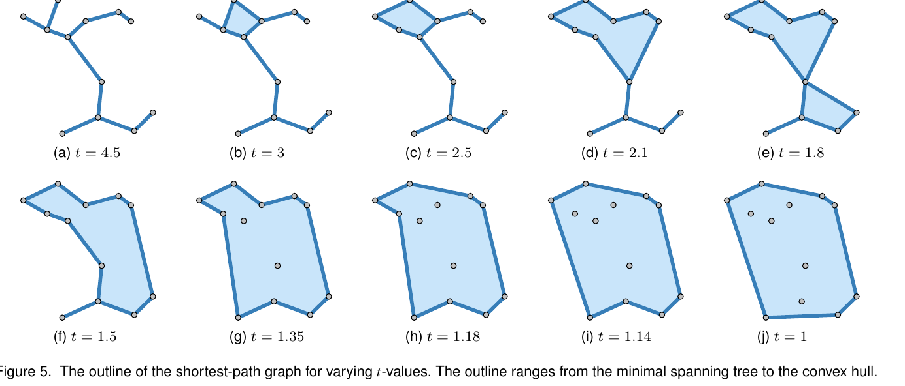

**Is the convex hull an exact special case?** For the graph, yes: at `t = 1` the outline is exactly the convex hull of the member points. For the drawn shape, only when every face can be filled and no non-member sits inside the hull, and even then the drawing is the hull plus discs and edge widths, not the hull grown evenly by a padding.

### How a bubble set is built

1. **Connect the members with virtual edges.** Starting from the member nearest the set's center, each member is joined to the already visited member that minimizes distance times the number of non-members on the straight line between them. Edges that cross a non-member's box are bent around a corner of that box. Real edges can be used instead.
2. **Build an energy field.** Members and edges add energy that falls from 1 at distance `R0` to 0 at `R1`; non-members subtract.
3. **Trace the outline** where the energy equals a threshold (an _isocontour_), lowering the threshold and reweighting until all members are inside. The paper says plainly that it "cannot guarantee that non-set member items will be excluded".

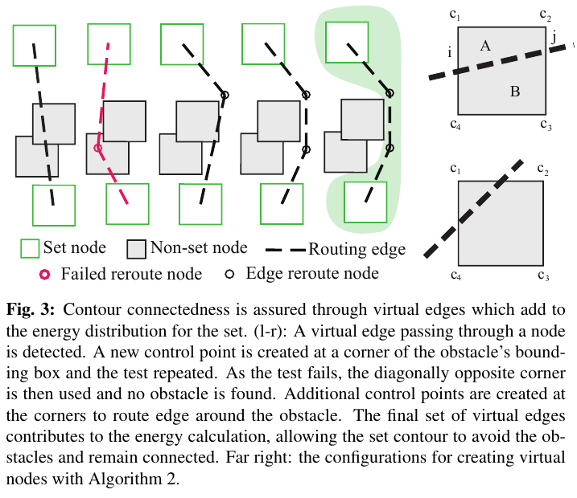

### Side by side on the same data

Each grid reads from line-like to area-like: KelpFusion at `t = ∞`, 2, 1.5 and 1, then the plain convex hull and a bubble set. KelpFusion here is a story-local prototype with `A = ∞`, discs without the Voronoi cut, straight-sided faces, no rules 3 and 4, and no smoothing pass.

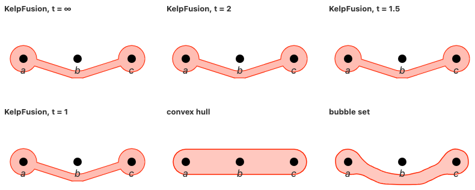

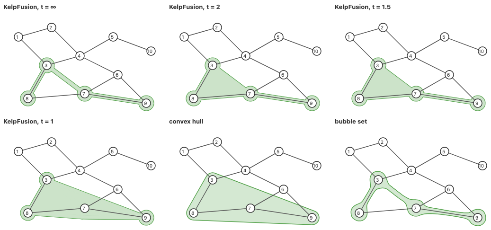

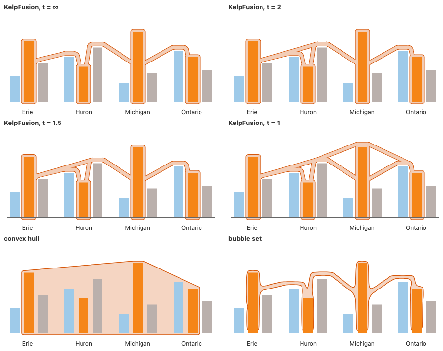

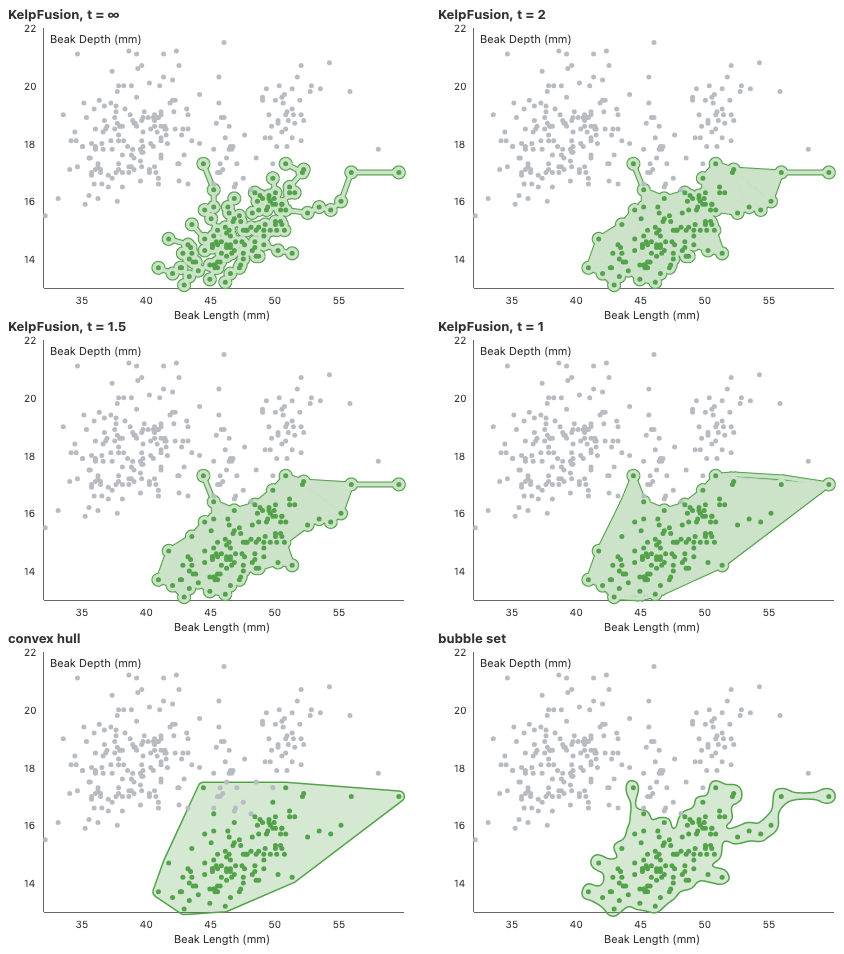

Topology: with two members every `t` gives the same bent tube; only the convex hull covers b. Hyperedges: KelpFusion uses positions only, so at `t = 1` it fills the triangle 3, 7, 9 across graph edges; the bubble set follows the graph's edges. Trout: every face between trout bars holds another bar, so KelpFusion stays a set of lines at every `t`. Penguins: at `t = 2` and 1.5 the dense core fills while stragglers stay attached, which is where KelpFusion shines.

|             | KelpFusion                                                                                                                     | Bubble set                                                                                                    |
| ----------- | ------------------------------------------------------------------------------------------------------------------------------ | ------------------------------------------------------------------------------------------------------------- |
| Input       | Node positions and set membership. Builds its own graph; does not take data edges.                                             | Item shapes (boxes) and membership; can follow real data edges.                                               |
| Non-members | Edges routed around every other node; faces that hold a non-member stay open; non-member areas cut out after smoothing.        | Edges bent around non-member boxes by a corner heuristic; negative energy. Can still enclose a non-member.    |
| Extremes    | `t = ∞`: minimum spanning tree. `t = 1`: the convex hull, minus faces holding non-members.                                     | None built in.                                                                                                |
| Parameters  | `t` (unitless; the graph does not change when the drawing is scaled), `A` (an area per node, so it does change), `r` and `w`.  | `R0`, `R1` for nodes and edges, the routing buffer, the energy weights, the threshold. All pixels or weights. |
| User study  | 13 people, four overlapping sets on a map: accuracy 86.5% versus 54.5% for Bubble Sets (LineSets 84.3%); 12.4 s versus 17.2 s. | Same study, from the other side.                                                                              |

The conclusion then: KelpFusion overlapped both hull and spine in part and replaced neither. That led to v3.

## v3: the generalized KelpFusion (`Shape.blob` with `density`)

Josh asked whether KelpFusion could be generalized, by making the size of the circles around the points configurable, so that it covers the usual hull, and whether it and the alpha shape could be unified. v3 introduced `Shape.blob({ density, neck, smoothing, avoiding, via })` with hull and spine as shortcuts. It picked links with KelpFusion's shortest-path graph at _t_ = 1 / `density`, filled every closed face without an avoided node, smoothed only by morphological closing, then rounded the cut's corners with a small opening.

### Alpha shape and KelpFusion: what is the same and what is not

| Question                                         | Answer                                                                                                                                                                                                         | Status                                                                                                                           |
| ------------------------------------------------ | -------------------------------------------------------------------------------------------------------------------------------------------------------------------------------------------------------------- | -------------------------------------------------------------------------------------------------------------------------------- |
| What is the alpha hull, in terms of closing?     | Exactly the closing of the point set by a disc of radius alpha.                                                                                                                                                | Definition from Edelsbrunner, Kirkpatrick, Seidel, IEEE Trans. Inf. Theory 29(4), 1983. The match with closing is my derivation. |
| What is the alpha complex?                       | The points, edges and triangles of the Delaunay triangulation whose smallest empty circle has radius at most alpha. Its union is the alpha shape.                                                              | Edelsbrunner and Mücke, ACM TOG 13(1), 1994. From memory.                                                                        |
| How does it relate to discs?                     | Discs of radius alpha cut to Voronoi cells touch along the alpha complex.                                                                                                                                      | Edelsbrunner, Discrete Comput. Geom. 13, 1995. From memory.                                                                      |
| Is the alpha shape a special case of KelpFusion? | No. KelpFusion takes its links from the shortest-path graph, which always connects all members and does not change with scale; the alpha complex falls apart below half the widest gap and changes with scale. | Inferred.                                                                                                                        |
| Is KelpFusion a special case of the alpha shape? | No. For 1 < _t_ < ∞ it keeps long links without the triangles around them, which no alpha complex does.                                                                                                        | Inferred.                                                                                                                        |
| What do they share?                              | Both keep some Delaunay links, fill some faces, grow the result, and end at the convex hull.                                                                                                                   | KelpFusion part verified; alpha part from memory.                                                                                |

So they unify as one pipeline, not as one parameter.

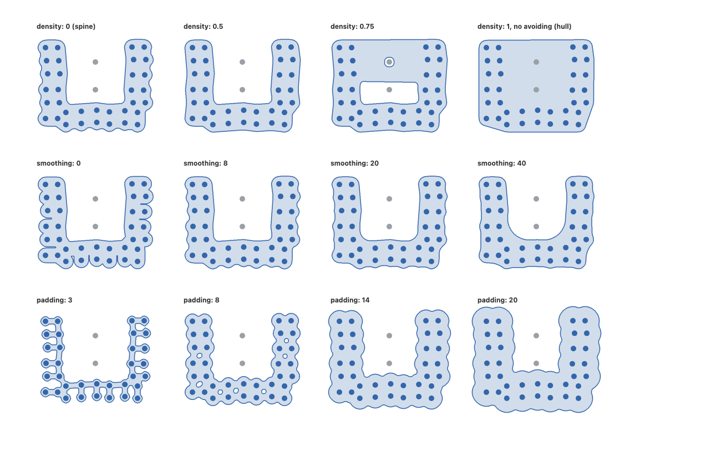

The v3 Munkres panel:

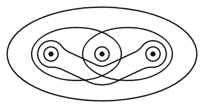

Josh's review of v3 made three points: alpha shapes "still seem to have a nice aesthetic to them because they're a bit more convex than the kelp comparisons"; the Munkres {a, c} outline "still feels too shrinkwrapped"; and "I don't want to see a shape curvature change when the circle connects to the link." The third was a hard requirement v3 could not meet: its outline was a union of circle arcs, straight tube sides and closing arcs, so its curvature jumped from 1/_R_ to 0 at every join.

## v4: the move to the current construction

v4 made three changes, which are the current construction: the region is blurred and the outline is its level ½; `density` was replaced by `convexity`, the alpha fill rule on a unitless scale plus a spanning tree; and links that bound a filled triangle are drawn at full width, so filled parts get straight sides. `density`'s middle (long links kept without the triangles around them) is no longer reachable; no example needs it.

The v4 comparison grids put the classic alpha shape and v3 beside the new construction. Josh's verdict on them: the classic alpha shape fits the data worse than the new construction.

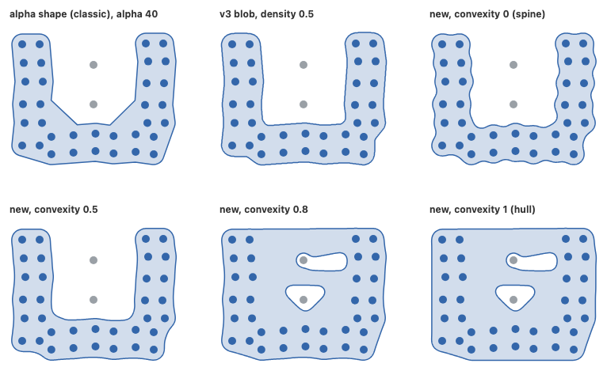

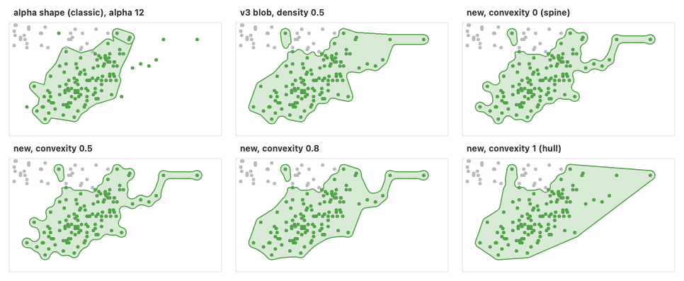

v3 against the new construction on the Topology set: v3 with `padding: 21`, `neck: 0.7`, `smoothing: 40`; the new construction with the same parameters, which keeps the same margins and gap to b but has no curvature jumps; and the new construction with `padding: 22`, `neck: 0.85`, the spelling now in section 2.

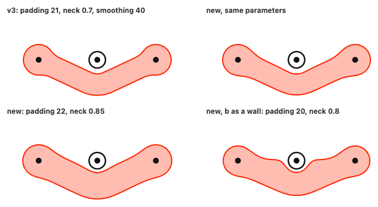

### Three ways to get a curvature-continuous outline, and the rejected `curve` key

All three start from the same skeleton.

**(a) A convolution surface.** Add up a Gaussian bump along the whole skeleton, with weights set so that each piece on its own would end at its target offset, and draw one iso-contour (the curve where the summed field equals a level). The outline is very smooth and close to Bubble Sets' energy field, but where pieces meet their fields add up, so the outline swells there: the lobes around a and c come out well outside the promised padding. Out.

**(b) A closed curve through the v3 outline.** Of today's `Curve` members, the data-space ones (`linear`, `step`, `monotone`, `smooth`) interpolate a function _y_(_x_), and the connector ones join two endpoints. Only `catmullRom` draws through placed points, and it is open and only G1. So the prototype ran three closed curves through points taken along the v3 outline: centripetal Catmull-Rom (G1, the foil), a periodic natural cubic spline (C2), and a Yuksel-style C2 blend of circles (Yuksel, "A Class of C2 Interpolating Curves", ACM TOG 2020, which #957 lists; my own variant of the paper's idea).

**(c) Blur the region (chosen).** Described in section 2.

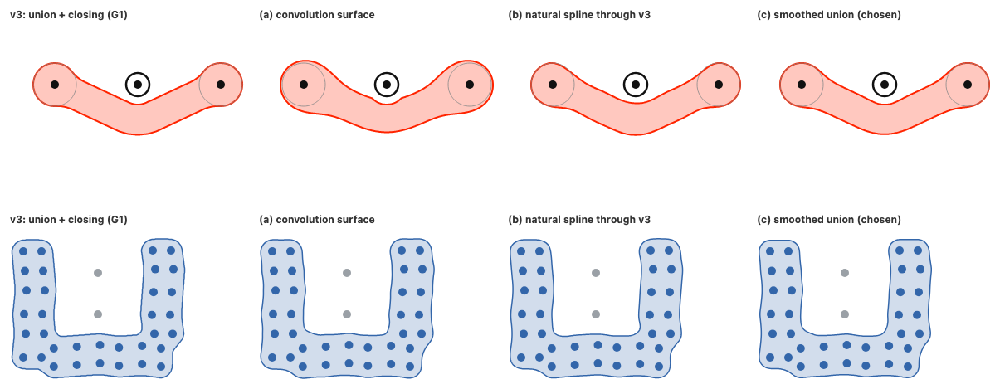

Top: the Topology {a, c} set avoiding b, with dashed rings at the promised padding. Bottom: the U at `convexity: 0.5`. Columns: v3, (a), (b), (c).

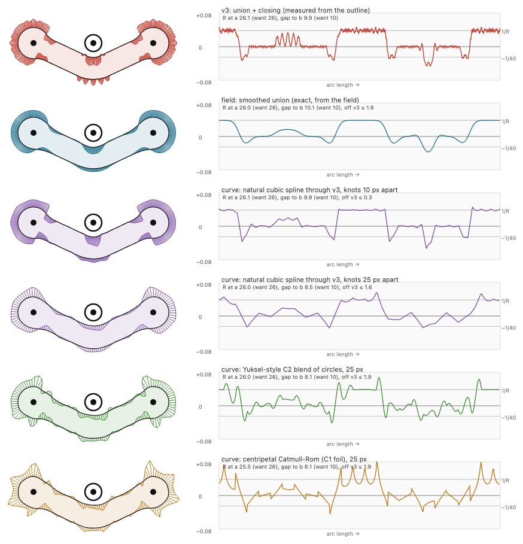

v3 jumps between 1/_R_, 0 and −1/40 at every join. The blurred region moves smoothly between the same values, keeps padding at a to 26.0 px (asked 26) and the gap to b's ring to 10.1 px (asked 10), and stays within 1.9 px of v3. The curves through v3 cannot do both things at once: with knots 10 px apart the spline follows v3 to 0.3 px but keeps its sudden changes; with knots 25 px apart the changes spread out, but the spline and the Yuksel blend ripple, and all three cut into b's clearance (8.1 to 8.5 px instead of 10). A curve through points knows only the points, not the padding or the avoided nodes.

**The `curve` key, rejected.** The idea was `enclose({ shape: Shape.hull(), curve: Curve.<x>() })`. No `Curve` member is closed today, a curve through outline points breaks `padding` and `clearance` as shown, and it would be a second smoothing control next to `smoothing`. The findings go to #957 instead: the closed Yuksel-style blend is easy to build and C2, and it ripples where point spacing is uneven.

v4 also tried treating an avoided node inside the set as a wall during the closing, so the {a, c} band wrapped b snugly in a U. That variant is dropped (retired decision below).

## v5: `via`, replaced by edges as members

v5 took a graph's edges as a strategy parameter, `Shape.blob({ via: selectAll("edges") })`: each listed edge between two members was a link, always kept and never rerouted. It was replaced because the edges can simply be members, which removes a strategy parameter that holds refs and draws the spine without links the graph does not have. The old grid:

```js
enclose({
  members: "node",
  shape: Shape.blob({
    convexity,
    smoothing,
    via: selectAll("edges"),
    avoiding: selectAll("nodes"),
    clearance: 3,
  }),
  padding: 6,
});
```

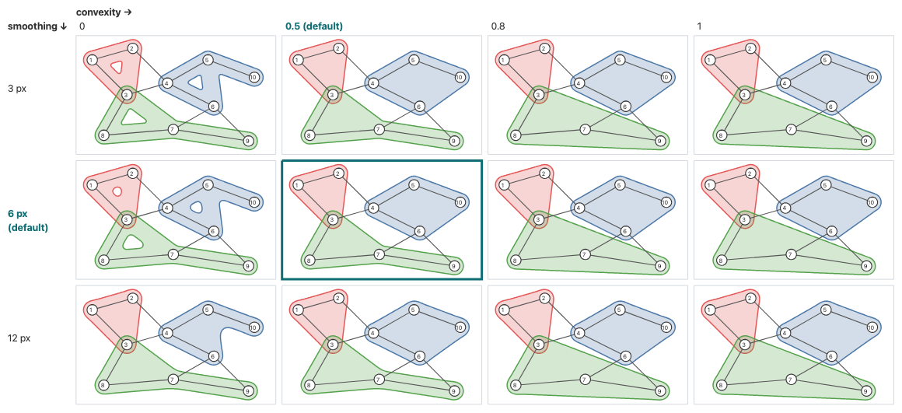

v5 also showed the Gentoo species alone, with the other two avoided and cropped to its cluster; the dataset now shows all three species.

The comparison that dropped it, on the hyperedges:

| nodes + edges as members against `via`, as a spine and at the defaults |
| ---------------------------------------------------------------------- |
| 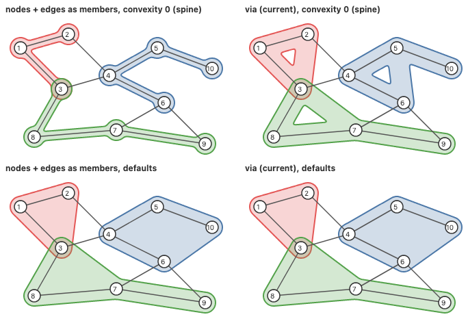     |

As a spine (top row) the two differ. With edges as members, each set is its nodes and its edges, drawn as slim tubes at the padding, and nothing else: the members already touch, so the spanning tree adds no link. With `via`, the spanning tree over node centers adds a link the graph does not have (2 to 3 in set A, 3 to 7 in set C, 5 to 6 in set B), and each extra link closes a cycle with a hole in it. At the defaults (bottom row) the two are the same picture, because the filled triangles cover the edges either way.

**What `via` did that edges as members do not.** Two things, neither needed by an example. `via` could make the outline follow a route it does not draw, but a route the outline follows is inside it at the padding anyway, so it might as well be a member; a route with no mark can be drawn as an invisible line. And `via` drew each edge as a tube as wide as the node bulge, while a member edge is slim (its stroke plus `padding`); a wider look comes from `padding` or from `convexity`. So `via` can be dropped.

## v6: `smoothing`, replaced by `roundness`

Josh: convexity and smoothing overlapped; both fill gaps. Until v6 the blob had a closing step and a different rule for avoided nodes:

- A triangle was filled only when no avoided node's keep-out zone touched it, so an avoided node inside the set left a hole shaped like the triangles around it.
- The union of the pieces was closed by a disc of radius `smoothing`, which filled gaps narrower than about twice that radius.
- The blur width was σ = ½ min(`smoothing`, thinnest piece).

So `smoothing` filled gaps the way `convexity` does, and it also reshaped the holes: small values left triangle holes, middle values half-rounded them, and only large values filled the triangles back in and cut just the circles. The section "Why these knobs are orthogonal" measures the overlap. The old dataset grids, with columns `convexity` (0, 0.5, 0.8, 1) and rows `smoothing` (half the padding, equal to it, twice it), or columns `neck` where convexity did nothing:


The v6 topology check: each dataset of the time (with the hyperedges both with edges as members and with `via`) at seven values of `convexity` (0, 0.25, 0.5, 0.65, 0.75, 0.9 and 1), with the second knob swept over 0, ¼, ½, 1, 1.5, 2, 3 and 4 times the padding. A cell lists pieces/holes along the sweep.

Before, the counts stayed the same along 26 of 35 sweeps; after, along 35 of 35, with roundness 0 included. (The exact trace keeps one more small gap open on the Gentoo at low convexity than the old 0.5 px grid did, at every roundness.) The sweeps that changed before:

| dataset           | convexity | before (`smoothing`)            | after (`roundness`)             |
| ----------------- | --------: | ------------------------------- | ------------------------------- |
| U                 |       0.9 | 1/2 1/2 1/2 1/3 1/2 1/2 1/2 1/2 | 1/2 1/2 1/2 1/2 1/2 1/2 1/2 1/2 |
| U                 |         1 | 1/2 1/2 1/2 1/3 1/2 1/2 1/2 1/2 | 1/2 1/2 1/2 1/2 1/2 1/2 1/2 1/2 |
| Gentoo            |         0 | 1/2 1/4 1/1 1/1 2/0 2/0 2/0 1/0 | 1/5 1/5 1/5 1/5 1/5 1/5 1/5 1/5 |
| Gentoo            |      0.25 | 1/2 1/4 1/1 1/1 2/0 2/0 2/0 1/0 | 1/5 1/5 1/5 1/5 1/5 1/5 1/5 1/5 |
| Gentoo            |       0.5 | 1/2 1/4 1/1 1/1 2/0 2/0 2/0 1/0 | 1/4 1/4 1/4 1/4 1/4 1/4 1/4 1/4 |
| Gentoo            |      0.65 | 1/2 1/2 1/2 1/0 2/0 2/0 2/0 1/0 | 1/2 1/2 1/2 1/2 1/2 1/2 1/2 1/2 |
| Gentoo            |      0.75 | 1/0 1/0 1/0 1/0 2/0 2/0 1/0 1/0 | 1/0 1/0 1/0 1/0 1/0 1/0 1/0 1/0 |
| hyperedges, `via` |         0 | 3/3 3/3 3/3 3/3 3/1 3/0 3/0 3/0 | 3/3 3/3 3/3 3/3 3/3 3/3 3/3 3/3 |
| hyperedges, `via` |      0.25 | 3/3 3/3 3/3 3/3 3/1 3/0 3/0 3/0 | 3/3 3/3 3/3 3/3 3/3 3/3 3/3 3/3 |

Josh's two cases, before and after. On the U at high convexity, the old smoothing first left triangle-shaped holes, then half-rounded them, and only at high values cut just the circles. Now the holes are the clearance circles at every roundness, and roundness only softens the corners, from the angular hull at 0 to the softest the 9 px keep-out circles allow. Convexity 0.65 is the third case Josh named: there too only the corners soften.

| Before: `smoothing` across, at convexity 0.65, 0.9 and 1 (the hull) |
| ------------------------------------------------------------------- |
|                      |

| After: `roundness` across, same rows |
| ------------------------------------ |
|  |

On the hyperedges at convexity 0.25, the old smoothing filled the three cycles at 12 px and above, which looked like a higher convexity. With roundness the cycles stay open at every value. The holes get smaller as their corners round, because a triangle's corners are the part of it that is cut.

| Before: `smoothing` across, at convexity 0.25 (with `via`)        |
| ----------------------------------------------------------------- |
|  |

| After: `roundness` across, same row                                                  |
| ------------------------------------------------------------------------------------ |
|                                |
|  |

With edges as members (the second row), roundness changes little, because the edge members are slim tubes (6.75 px), and roundness stops at the smallest circle in the region.

## v7: the same outline, computed in milliseconds

Josh: the computation was too slow (122 ms per slider step on the penguins). v6 rasterized the region on a 0.5 px grid, blurred it, and checked the topology with more blurs, so its cost grew with the area of the drawing. v7 keeps the knobs and the promises and changes how the outline is computed (section 2, steps 4, 6 and 7): the region's outline is traced exactly from closed-form distances, and it is rounded by smoothing along its own length, with circles held in place. So the cost grows with the length of the outline, and a change of `roundness` reruns only the rounding. A Gaussian along the outline cannot join two pieces or open a hole, so the topology check of v6 became a check that loops do not cross. Two rules were added for what the blur did for free: an inlet narrower than 1.5 σ is closed before smoothing, and the outline is kept out of every keep-out zone by a smooth maximum. Routed links now follow the avoided nodes' keep-out circles exactly where they wrap them.

What changed in the drawings: the band under b in the Topology example now hugs b's ring (gap 7.6 px for 6 asked, was 11.0), and its joins there turn over about 10 px instead of 20; holes are exact circles to 0.001 px (were within 0.7 px); the hull preset is within 0.3 px of the true padded hull (was 0.8 px outside); and rounding now stops at the smallest circle in the region, keep-out circles and box corners included, so the trout bars' corners round less at 8 px than before (the cap is their 4 px corner radius).

## v8: `neck` pulls the outline in

Josh: changing `neck` from 0.99 to 1 changed the topology of the Adelie outline (spine, `padding: 4`, `roundness: 0`, the other species avoided), and at `convexity: 1` `neck` did nothing. Until v8, `neck` was the width of the links that do not bound a filled triangle, as a fraction of the bulge, and it was an input to the skeleton: each link was routed as a tube `neck` times the bulge. So a thinner tube had a shorter way around an avoided node, and the spanning tree picked different links. On the Adelie set two links compete to join the member at (221.4, 89.6) to the tree: one routed from (199.6, 66.4) around an avoided Chinstrap, and a straight one from (188.0, 86.7), 33.553 px long. At 0.99 the routed link is 33.545 px, just shorter, so the tree takes it. At 1 the wider tube wraps the Chinstrap on a larger circle, the route grows past 33.553 px, and the tree takes the straight link instead. Even with the routes held fixed, thinning tubes in the region changed the pieces and holes: tubes that only touched at full width came apart, gaps between nearby tubes became new holes, and a hull edge thinned past an avoided node near it opened that node's hole to the outside. Over the 65 sweeps of the neck check, that was 1641 new holes, 490 lost holes and 233 split pieces. And since the links that bound a filled triangle were always full width, `neck` did nothing at `convexity: 1`, so `neck` and `convexity` overlapped in part.

v8 routes every link at full width and moves `neck` after the trace (section 2, step 5): it pulls the outline in by a share of the region's half-width, which cannot part what touches or open a hole. It now acts at every `convexity`, it is shape only, and a change of `neck` reruns only the pull and the rounding. What changed in the drawings: a thin band that was routed against a keep-out zone now runs about its full-width middle, so it leaves the zone (the gap to b's ring in section 5 is 9.8 px, was 7.6 px); and at `convexity` above 0 the edges of filled regions sink in between their members.

## v9: `neck` keeps its corners, `holes`, ChartAccent

**The flare.** Josh, on the hyperedges at `convexity: 0.22`, `neck: 0.42`, `roundness: 3.5`, `padding: 4`, `clearance: 3` (with `via`, as the playground then had it): the thinned necks met node 4 through a wide triangular web, far bigger than `roundness` 3.5 should give. The cause was the direction of the pull. Each outline point moved along the outline's own normal, and at a corner between two pieces (the corner of a hole between two links that leave the same node, or where a link meets another link) that normal turns through the corner. So moving every point by the same distance rounded each such corner with a radius equal to the pull itself, (1 − `neck`) times the bulge: about 7.5 px here, and more at lower `neck`. That is an erosion of the union, while a thinned tube is the union of eroded pieces; the difference is the web. Now each point moves along its own piece's normal, and where two pieces meet, the moved sides are carried on until they meet, so the corner stays a corner. On Josh's settings the blue set's hole grows from 1545 to 1767 px², which is the web removed, and the three sets lose 2 to 6 percent of their filled area the same way. Curvature stays continuous with `roundness` above 0, but the now-sharp corners round to a tighter bend (the largest curvature on the hyperedges went from 0.18 to 0.56 per px at `roundness: 6`).


The same settings after, with `neck` at 0.2, 0.42, 0.7 and 1:


**`neck` only thinned the blue penguins.** Josh: on the penguins, `neck` only changed the blue (Adelie) necks. The cause was the guard against crossings. When two parts of a necked outline crossed anywhere (a misjudged half-width at a sharp tip), the pull for the whole set was narrowed by bisection until nothing crossed. On the Chinstrap and Gentoo sets some crossing always appeared, so their pull was cut to about 0.16 of what was asked (at `convexity: 0` the Chinstrap pull was 0 for every `neck` from 0.7 to 1), while the Adelie set happened to have none. Now the pull is halved only near each crossing, within two link widths of it, and the rest of the outline keeps the asked `neck`. With the other species avoided, at `convexity: 0.5`, `neck` from 1 to 0.1 took the Chinstrap area from 9500 to 8692 px² and now takes it to 6707; the Gentoo went from 11476 to 10373 and now goes to 8914. The Adelie area is unchanged (14700 to 11447).

**Penguins avoid nothing.** Josh: the species overlap too much for avoidance to look good. The penguin images now avoid nothing; the playground keeps avoidance behind a checkbox, as a speed test.

**`via` is gone** from the construction, the playground and the current images. The comparisons that used it are in v5 and v6.

**Trout, dropped.** Josh: it looks bad. ChartAccent's fertility example replaces it as dataset (e). The trout grid as it was:

```js
chart(catch)
  .flow(spread({ by: "lake", dir: "x" }), spread({ by: "species", dir: "x", spacing: 9 }))
  .mark(rect({ h: "count", fill: "species" }).name("bars"))
  .layer(
    chart(selectAll("bars"))
      .flow(filter((d) => d.species === "trout"))
      .mark(enclose({ shape: Shape.spine({ avoiding: selectAll("bars"), neck, roundness }), padding: 4, stroke: "#d6580c" }))
  );
```


Columns are `neck` (0.5, 0.7, 0.85, 1), because the spine is the useful setting here: the trout bars stand among other bars, and a filled triangle between them would hold those bars as holes. The prototype also avoids the axis line and its labels (decision 10). Each link runs over the bar tops as the shortest path that clears the other bars. `neck` sets the tube's thickness, and `roundness` rounds the bends.

**`holes`.** Josh: lowering `convexity` on the hyperedges also opened holes, so `convexity` did not name what it did. Rejected alternative: rename `convexity` to `solidity` (the area share of the convex hull) and keep holes tied to it. Chosen: keep `convexity` for the silhouette and add `holes`, off by default, as PostGIS, Shapely and JTS do.

## Retired decisions

- **The two shape knobs as decision 11** (`convexity` and `roundness`, and whether `roundness` should be `cornerRadius`) (v9). Replaced by the `holes` decision.
- **Narrowing the whole set's pull when two parts of its outline cross** (v9). Now only the places that cross give way.
- **Trout across lakes as a dataset** (v9). Josh: it looks bad.
- **`neck` as the width of the links that do not bound a filled triangle** (v8). Replaced by a pull on the outline. Josh: changing `neck` from 0.99 to 1 changed the topology, and at `convexity: 1` `neck` did nothing.
- **`smoothing` on `Shape.blob()`** (v6). Replaced by `roundness`. Josh: convexity and smoothing overlapped; both fill gaps.
- **Leave out triangles that touch an avoided node** (v6). Replaced by filling them and cutting the node's clearance circle out, so an avoided node inside the set is always a round hole.
- **`convexity` alone as decision 11** (v6). Decision 11 now asks about both shape knobs.
- **`via` on `Shape.blob()`** (v5). Replaced by edges as members (decision 13).

- **`alpha` as a pixel radius on `Shape.hull()`** (v1 question 5). Retired in v3; alpha came back in v4 as `convexity`.
- **A shared kernel for three members, with `Shape.kelp({ t })` left out** (v1 question 10). Retired in v3, when hull and spine became shortcuts of one member.
- **Leave alpha out** (v3 question 10). Retired in v4: alpha is back, as `convexity`.
- **`density`** as the blob's dial (v3). Dropped in v4 for `convexity`.
- **An avoided node inside the set as a wall during the closing** (v4 question 13). Retired. Josh: creates a cusp (a point where the outline turns sharply).
- **A `curve` key on `enclose`** (v4). Rejected; see "Three ways" above. Decision 12 asks Josh to confirm.
