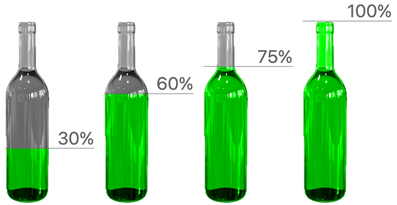
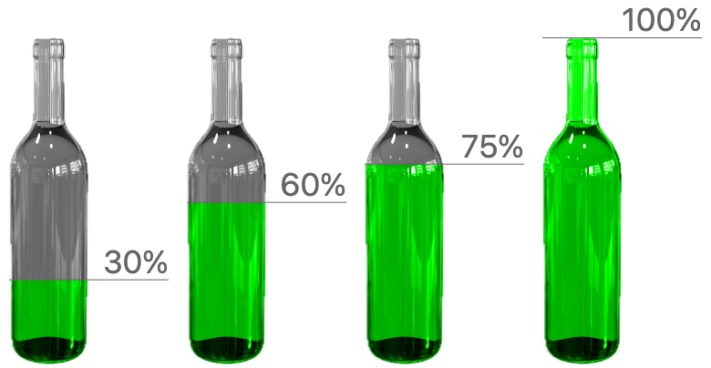
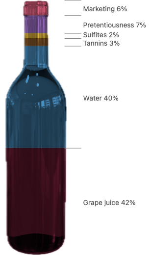
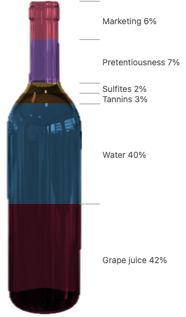
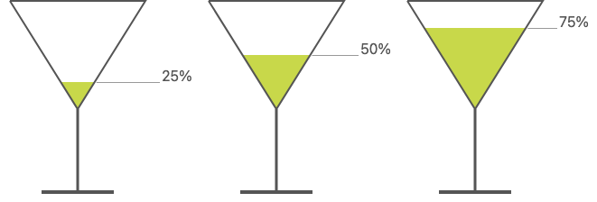
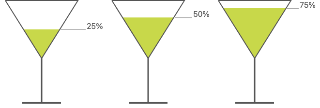
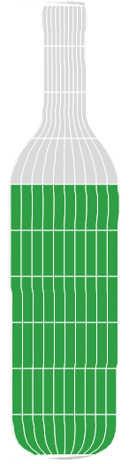
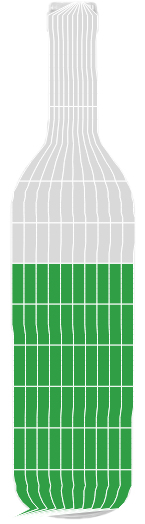
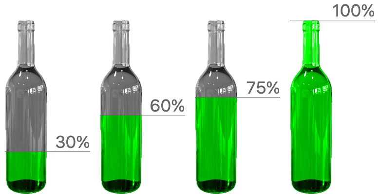

# Bottle area fill: encoding an amount as the filled area of a silhouette

**Summary.** Today the bottle chart encodes an amount as the fill's height, so 75% fills a bottle to 75% of its height, which holds 88% of its area. Filling by area means finding the level at which the filled part of the silhouette has the right share of its area, which is the inverse of the silhouette's cumulative area. That inverse is a coordinate transform: it maps the unit square onto the silhouette with constant area scaling, the same idea as `d3.scaleRadial` and the proposed `Coord.clock({ radius: "area" })`.

**Recommendation.** The bottle fill is `Coord.envelope` from #1284, plus a per-axis measure option, `"length"` (the default) or `"area"`. #1284 (bend and envelope, deferred) records coords that take a guide shape as an operand: the coord reads the guide and never draws it. `Coord.bend({ along })` uses Barraud's map `U(x) + y·N(x)`, and `Coord.envelope({ top, bottom })` maps the inner box into the region between two curves. A height-filled bottle is an envelope on its side: the guide curves are the silhouette's left and right edges, and the rows go up. With `y: "area"`, rows are spaced by cumulative area (the Knothe–Rosenblatt map, fully equal-area: the Jacobian's determinant is constant). The liquid stays `rect({ h: "amount" })`; stacking several liquids, waffles of equal-area cells and fill animations then work with no new mark or channel. The proposal also adds a whole-shape form, `Coord.envelope({ of: ref("glass"), y: "area" })`, beside `{ top, bottom }`; its spelling is open. Runner-up: a data helper `fillLevel(outline, { measure: "area" })` used in `derive`, which works for a single fill but breaks stacking.

**Taking up #1284.** #1284 keeps bend and envelope deferred until a real example needs them. The bottle is that example, so this proposal argues to take #1284 up.

All pictures below are real GoFish renders from `packages/gofish-graphics/stories/proposals/BottleArea.stories.tsx`. None of the proposed APIs exist yet: each render draws the result the proposal would produce with today's primitives, with the fill levels computed in JS from the bottle PNG's alpha profile. They are emulations of the output, not of the code path.

## Terminology

- **Silhouette**: the set of pixels a node covers, as drawn ("Alpha is shape" in `api-design.md`; #1267, the region-compositing rework).
- **Guide**: the shape a guide coord (bend, envelope) reads as an operand. The coord never draws it (#1284).
- **Width profile** `w(y)`: the silhouette's width at height `y`.
- **Cumulative area** `A(y)`: the area of the silhouette below height `y`, the integral of `w`.
- **Fill level**: the height at which the liquid's top sits.
- **Height encoding**: level = share of the height. This is today's story.
- **Area encoding**: level = `A⁻¹(share × A(top))`, so the filled area is the share.
- **Volume encoding**: as area encoding, but weighting each row by `w(y)²`, which treats the silhouette as a solid of revolution.
- **Equal-area map**: a map from the unit square onto a region whose area scaling is the same everywhere. Mathematicians call the triangular version below a Knothe–Rosenblatt map.

## How far apart the encodings are

For `stories/assets/wilsonblanco.png` (157 × 650 px), measured from its alpha channel:

| amount | level, height | level, area | level, volume |
| -----: | ------------: | ----------: | ------------: |
|    30% |          0.30 |        0.26 |          0.24 |
|    42% |          0.42 |        0.35 |          0.33 |
|    60% |          0.60 |        0.49 |          0.45 |
|    75% |          0.75 |        0.61 |          0.55 |
|    90% |          0.90 |        0.80 |          0.66 |

The top 30% of the height (neck and shoulder) holds 15% of the area and 7% of the volume. So height encoding overstates every amount, most near the top. For a martini glass, a cone, area grows with the square of the level: 50% by area sits at 71% of the depth.




## Prior work

| System                                                           | Model                                                                                                                                                                                               | Names                                | Fit for GoFish                                                                                                                                                                                                             |
| ---------------------------------------------------------------- | --------------------------------------------------------------------------------------------------------------------------------------------------------------------------------------------------- | ------------------------------------ | -------------------------------------------------------------------------------------------------------------------------------------------------------------------------------------------------------------------------- |
| PiCCL (Shi et al., VIS 2025)                                     | Pictures whose properties are bound with `mapValue("height", field)`; the GoFish port is the bottle story (#198, #366).                                                                             | `mapValue`, `replicate`, `pointSnap` | The source of the bottle chart. Maps height, not area.                                                                                                                                                                     |
| echarts-liquidfill                                               | A value in 0..1 sets the wave's level in a `shape` (`circle`, `rect`, `path://...`). The source sets `waterLevel = radiusY - value * radiusY * 2`, a share of the box height, even inside a circle. | `shape`, `waterLevel`                | A foil: the liquid-fill gauge library uses height encoding everywhere.                                                                                                                                                     |
| Vega-Lite, Observable Plot                                       | No support. Users clip a bar to an SVG `clipPath` of the picture and set its height.                                                                                                                | `clip`                               | Height encoding by construction.                                                                                                                                                                                           |
| Figma, Illustrator                                               | Clipping mask: the bottom shape of a group clips the rest. No data.                                                                                                                                 | "Use as mask", "Clipping mask"       | Same as GoFish's `atop` / `intersect`.                                                                                                                                                                                     |
| Bertin (1967), p. 357–358                                        | For quantities, area is proportional to Q, so radius grows with √Q.                                                                                                                                 | "area = Q"                           | The principle behind `circle({ area })` (#972).                                                                                                                                                                            |
| `d3.scaleRadial` (d3-scale #90)                                  | A radius scale whose range is squared, so ring areas are linear in the data.                                                                                                                        | `scaleRadial`                        | The disk case of this proposal, along rings instead of rows.                                                                                                                                                               |
| Lambert cylindrical equal-area projection (1772)                 | `y = sin(latitude)`: the cumulative area of the sphere's bands, inverted.                                                                                                                           | "equal-area projection"              | The same trick on a sphere; cartography's word is "equal-area".                                                                                                                                                            |
| Knothe (1957), Rosenblatt (1952)                                 | Map the unit square onto a region: first by the inverse cumulative distribution of one coordinate, then the other within each slice. Area scaling is constant.                                      | "Knothe–Rosenblatt rearrangement"    | Exactly the 2D map recommended below.                                                                                                                                                                                      |
| Tank calibration ("strapping") tables                            | A table from dipstick level to volume for a tank of known shape.                                                                                                                                    | "strapping table", "tank chart"      | Real-world precedent: level and volume are different numbers, and people keep a table between them.                                                                                                                        |
| Cleveland and McGill (1984); Stevens (1957)                      | People judge position and length more accurately than area; perceived area grows roughly with area^0.7.                                                                                             |                                      | Area encoding is not automatically "more accurate". It makes the drawn amount of liquid agree with the data. Whether readers judge the level or the liquid is a question for the reader, so it is a choice, not a default. |
| Haroz, Kosara and Franconeri, "ISOTYPE Visualization" (CHI 2015) | Pictographs and repeated icons do not hurt accuracy and help memory.                                                                                                                                | isotype                              | Supports pictorial fills; the equal-area waffle below is an isotype in a silhouette.                                                                                                                                       |
| Tufte (1983), "lie factor"                                       | Scaling a picture in two dimensions for one-dimensional data inflates the effect.                                                                                                                   | lie factor                           | The reverse case here: a 1D level in a 2D container misstates the 2D amount.                                                                                                                                               |

## Related GoFish issues

- #1284 Bend and envelope: coords that take a guide shape as an operand, read but never drawn. Deferred until a real example needs them.
- #75 "rendering IR": where warping along a spine or into an envelope first came up, under a misleading title. Closed; #1284 is its home now.
- #605 A ref under another coord reads the target's unwarped box.
- #198 PiCCL bottle graphic, and #366, the PR that added the bottle story.
- #640 Latency bottle chart: data-driven image sizing (`image({ h })`).
- #587 A fill rect with no width collapses under intrinsic sizing in the bottle story.
- #1330 The bottle chart does not render properly on mobile.
- #208, #404 The `cut` operator (slices a shape by length along `x` or `y`).
- #540 `cut` beyond `x` and `y` (angular and radial cuts).
- #1282 `cut`: options first, the source as its one child.
- #544, #1229 Croissant charts: cut data-driven area marks, painted vector intersect.
- #1267 Shape definitions: region compositing, `.hidden()`, alpha is shape.
- #365 Make Porter-Duff an option on layer instead of separate operators?
- #1209 Clipping: where content is clipped to a box, and how it relates to compositing.
- #972, #1323 `circle({ area })`: area is its own channel kind.
- #1325 Lint: warn when a circle's radius is sized by an amount.
- #1331, #1340 `polygon({ w, h, d })`: a unit-box outline stretched into its box.
- #1342 Geometry unbent under coords, all marks.
- #36, #247 PiCCL operators and PiCCL constraints.
- #739 A grid/waffle reshape primitive. #171 enclose for a nested waffle.

## Approaches

The approaches differ on one axis: where the inverse cumulative area is computed. In the data (A), in a channel of the container mark (B), in a coordinate transform (C), or by a constraint on a clipped node (D). A second, independent axis is where the silhouette comes from (a raster image's alpha, or a vector outline), and a third is which measure to equalize (length, area, volume). Those two are treated after the approaches.

### A. A data helper in `derive`

The user computes the level and draws it as today.

```js
// The data side cannot read an image, so the outline is a vector path.
const level = fillLevel(BOTTLE_D, { measure: "area" }); // share -> share of height

chart(data, { axes: false })
  .flow(
    derive((rows) =>
      rows.map((d) => ({ ...d, level: 100 * level(d.amount / 100) }))
    ),
    spread({ by: "category", dir: "x", spacing: 20, axes: { x: false } })
  )
  .mark(/* today's mark, with "level" in place of "amount" for h and y */);
```

```python
level = fill_level(BOTTLE_D, measure="area")

chart(DATA, axes=False).flow(
    derive(lambda rows: [{**d, "level": 100 * level(d["amount"] / 100)} for d in rows]),
    spread(by="category", dir="x", spacing=20, axes={"x": False}),
).mark(BOTTLE_MARK)
```

Stacked liquids (the hard case):

```js
const level = fillLevel(BOTTLE_D, { measure: "area" });
let below = 0;
const bands = wine.map((d) => {
  const lo = level(below / 100);
  below += d.amount;
  return { ...d, h: 100 * (level(below / 100) - lo) };
});
chart(bands)
  .flow(stack({ dir: "y" }))
  .mark(rect({ h: "h", fill: "category" }));
```

- **Composes**: with everything, since it is only data. Desugars to nothing new.
- **Breaks**: units and `CanSum`. `level` is a length share, not an amount, so its unit is not the data's. In the stacked case each band's `h` depends on all bands below it, so the `h` values are not amounts, do not add up as amounts, and change when the order changes. The data type no longer says what the picture says (Mackinlay's expressiveness rule in `api-design.md`).
- **Needs a vector outline**. The data pass runs before images load, so it cannot read a PNG.
- **Cannot do** the equal-area waffle (it needs a 2D map) or a fill animation at a constant pour rate without the user recomputing levels per frame.
- **Overlap**: none. It is the escape hatch every other approach desugars into.

### B. A channel of the container mark

Like `circle({ area })`, give the container a fill channel.

```js
image({
  href: bottlePng,
  h: v(100),
  liquid: { amount: "amount", measure: "area", fill: "#00ff00" },
});
```

```python
image(href=BOTTLE_PNG, h=datum(100), liquid={"amount": "amount", "measure": "area", "fill": "#00ff00"})
```

- **The wall**: `circle({ area })` works because the area is the circle's own geometry. Here the level depends on another shape, the container. Putting the channel on the container makes the liquid a part of one mark kind (`image`), not a mark. Stacking, labeling the liquid, coloring it by a field, or putting a waffle in the bottle each need another option on the same channel.
- **Overlap**: large and partial with `atop` + `rect` (which already draw a liquid) and with `cut`. That is the sign the factoring is wrong (`api-design.md`, "Overlap is fine at the edges, not in the middle").
- Not recommended. Recorded because the analogy with `circle({ area })` is the first one that comes to mind.

### C. `Coord.envelope` with a measure option (recommended)

`Coord.envelope({ of: shape, y })` maps its layer's box into `shape`'s silhouette. Height in the layer runs up the silhouette by the chosen measure; width runs across the silhouette at each level, from its left edge to its right edge. With `y: "area"`, every rect in the layer has screen area proportional to its data area. As #1284 says, the guide is an operand: the coord reads it in the frame the coord sits in and never draws it. So the bottle is drawn outside the coord, and it is not warped.

**Bottle row.** The only change from today is the coord layer around the liquid, and the guide line now aligns to the liquid's top instead of reading `y: "amount"` itself.

```js
chart(data, { axes: false })
  .flow(spread({ by: "category", dir: "x", spacing: 20, axes: { x: false } }))
  .mark(
    layer([
      atop({ blendMode: "color" }, [
        image({ href: bottlePng, h: v(100), filter: Filter.grayscale }).name(
          "glass"
        ),
        layer({ coord: Coord.envelope({ of: ref("glass"), y: "area" }) }, [
          rect({ h: "amount", fill: "#00ff00" }).name("liquid"),
        ]),
      ]).name("bottle"),
      rect({ h: 1, fill: "#666", w: 175 }).name("line"),
      text({ fontSize: 35, fill: "#666", text: (d) => `${d.amount}%` }).name(
        "label"
      ),
    ]).relate(({ line, label, bottle, liquid }) => [
      Constraint.align({ x: "start" }, [bottle, line]),
      Constraint.align({ y: "end" }, [liquid, line]),
      Constraint.distribute({ dir: "y", spacing: 0 }, [line, label]),
      Constraint.align({ x: "end" }, [label, line]),
    ])
  )
  .render(container, {});
```

```python
chart(DATA, axes=False).flow(
    spread(by="category", dir="x", spacing=20, axes={"x": False})
).mark(
    layer([
        atop([
            image(href=BOTTLE_PNG, h=datum(100), filter=Filter.grayscale).name("glass"),
            layer(
                [rect(h="amount", fill="#00ff00").name("liquid")],
                coord=Coord.envelope(of=ref("glass"), y="area"),
            ),
        ], blend_mode="color").name("bottle"),
        rect(h=1, fill="#666", w=175).name("line"),
        text(text=lambda d: f"{d['amount']}%", font_size=35, fill="#666").name("label"),
    ]).relate(lambda bottle, liquid, line, label: [
        Constraint.align([bottle, line], x="start"),
        Constraint.align([liquid, line], y="end"),
        Constraint.distribute([line, label], dir="y", spacing=0),
        Constraint.align([label, line], x="end"),
    ])
)
```

**Stacked liquids** ("What's in a bottle of wine", the data of the Cut story). The bands are a plain `stack` of amounts; the coord does the inversion once for the cumulative sums, so `CanSum` survives.

```js
atop({ blendMode: "multiply" }, [
  image({ href: bottlePng, h: 520, filter: Filter.grayscale }).name("glass"),
  chart(wine, { coord: Coord.envelope({ of: ref("glass"), y: "area" }) })
    .flow(stack({ dir: "y" }))
    .mark(rect({ h: "amount", fill: "category" })),
]).render(container, {});
```

 

**Hard example 1: martini glasses.** The container is the bowl, not the picture: the stem and foot are solid glass. So the envelope's guide must be a shape the user names, here the bowl's outline (`polygon({ w, h, d })` from #1340), not the whole glass.

```js
chart(cocktails, { axes: false })
  .flow(spread({ by: "drink", dir: "x", spacing: 70 }))
  .mark(
    layer([
      polygon({
        w: 150,
        h: v(100),
        d: "M0 1 L1 1 L.5 0 Z",
        fill: "none",
        stroke: "#555",
      }).name("bowl"),
      layer({ coord: Coord.envelope({ of: ref("bowl"), y: "area" }) }, [
        rect({ h: "full", fill: "#c8d84a" }),
      ]),
      rect({ w: 3, h: 90, fill: "#555" }).name("stem"),
    ]).relate(({ bowl, stem }) => [
      Constraint.distribute({ dir: "y", spacing: 0 }, [stem, bowl]),
      Constraint.align({ x: "middle" }, [stem, bowl]),
    ])
  )
  .render(container, {});
```




**Hard example 2: an equal-area waffle in the bottle.** A 10 × 10 grid laid out in the coord. Every cell has the same area, so "60 of 100 cells" is 60% of the bottle. The neck cells are tall and thin. Only a 2D map can draw this; a level alone cannot.

```js
layer([
  image({ href: bottlePng, h: 520, opacity: 0.35 }).name("glass"),
  chart(cells, { coord: Coord.envelope({ of: ref("glass"), y: "area" }) })
    .flow(stack({ by: "row", dir: "y" }), stack({ by: "col", dir: "x" }))
    .mark(
      rect({ fill: (d) => (d.k < 60 ? "#2f9e44" : "#d9d9d9"), stroke: "white" })
    ),
]).render(container, {});
```

 

**The map.** For a point `(u, v)` in the unit square, take the level `y = A⁻¹(u · A_total)` and the point `v` of the way across the silhouette's width at that level. Its area scaling is `w(y) · dy/du = A_total`, a constant. This is the Knothe–Rosenblatt map: the Jacobian's determinant is the same everywhere, so the map is fully equal-area, not only along the level axis.

**The limit: rows that cross the silhouette more than once.** An envelope between two curves crosses each row once, from one curve to the other. A silhouette can cross a row two or more times: a mug with a handle, the legs of a figure, a ring. That needs a rule, and #1284 does not settle it. One candidate: `v` runs across the spans in order, left to right, which keeps the scaling constant but puts one rect partly in the body and partly in the handle. Others: use the outer hull of each row, or make it an error and ask for a shape that crosses once (as the martini's bowl does).

**How it composes.**

- _Stacking_: a plain `stack` in the coord. The data stays amounts; the coord inverts the cumulative sums. This is the "fixed by geometry" kind of nonlinearity from the scale-transforms proposal: the data stays linear in a measure (area), so `CanSum` and the origin survive, and stacked liquids still sum.
- _Labels and guide lines_: anything that should sit at the level either lives in the coord or aligns to a node in it. `y: "amount"` outside the coord is now a different height, which is the honest answer: the outer space is in length, the inner in area.
- _Animation_: tweening `h` from 0 to the amount raises the liquid at a constant pour rate, fast in the body and slow in the neck. Height encoding rises at constant speed, which no real liquid does.
- _Glyph rule_: a circle or text placed in the coord is a glyph and is not warped (the rule from #1323). A rect's area is warped, which is the point.
- _Other coords_: an envelope inside a polar or geo layer needs coords to nest. Whether the engine composes nested coords today is unverified; that is a cost, not a design change.
- _Desugaring_: a coord is a point map, so this adds no node kind. The new part is that its operand is another node's silhouette, read after that node is laid out (and, for a raster, after its pixels load). This is #1284's open question about refs across coords, which depends on #605.

**Overlap check.**

- `atop` / `intersect` clip a liquid to the bottle. With `y: "length"`, `Coord.envelope` plus a full-width rect draws the same picture as today's `atop` clip: a small, exact overlap. `atop` keeps its job (paint and blending); the coord only places.
- `cut` slices a source by length along `x` or `y`. An area-measured cut would be the same slices placed in an envelope. Giving `cut` its own `measure` option would make a large partial overlap with C, so this proposal does not add one.
- `Coord.clock({ radius: "area" })` uses the same kernel, the inverse cumulative area, along rings instead of rows. For a disk, the envelope gives horizontal slices (a round flask) and the clock gives rings (a pie). See "One area option across guide coords" below.
- `circle({ area })`: no overlap. That channel sizes a mark's own glyph; this coord places marks in another shape's measure.

**Trade-offs.** Easy: every fill picture is today's code in a coord layer; stacks, waffles and animations come free. Awkward: a coord that reads a sibling is a new layout dependency (the sibling first, then the coord layer), and reading a raster's alpha at layout needs the image decoded first. New terms: none beyond #1284's coord, one measure option and one whole-shape form.

#### Envelope forms and direction

#1284 sketches `Coord.envelope({ top, bottom })`: two curves, with the inner box's x running along them. The bottle's guide curves are its left and right sides, and the rows go up. That is the same envelope turned on its side. A silhouette also gives both curves at once, so the bottle wants a whole-shape form beside the two-curve one.

```js
// #1284's form: the inner box maps into the region between two curves.
// x runs along the curves; y runs from the bottom curve to the top one.
Coord.envelope({ top: ref("upper"), bottom: ref("lower") });

// The bottle is the same envelope on its side: the guide curves are the
// silhouette's left and right edges, and the rows go up.
Coord.envelope({ left: ref("leftEdge"), right: ref("rightEdge"), y: "area" });

// Proposed whole-shape form: one silhouette gives both edges.
Coord.envelope({ of: ref("glass"), y: "area" });
```

```python
Coord.envelope(top=ref("upper"), bottom=ref("lower"))
Coord.envelope(left=ref("left_edge"), right=ref("right_edge"), y="area")
Coord.envelope(of=ref("glass"), y="area")
```

Precedent for the whole-shape form:

| Tool                           | Model                                                                                                                           | Spelling                       |
| ------------------------------ | ------------------------------------------------------------------------------------------------------------------------------- | ------------------------------ |
| Illustrator, Envelope Distort  | The topmost object becomes the envelope; the art below is fitted into it. Also "Make with Warp" (presets) and "Make with Mesh". | "Make with Top Object"         |
| Inkscape, Envelope Deformation | Four bend paths, one per side: top, right, bottom, left. Any of them can be left straight.                                      | top, right, bottom, left paths |
| Inkscape, Bend; Barraud        | One skeleton path; a point `(x, y)` goes to `U(x) + y·N(x)`.                                                                    | "skeleton path"                |
| warpjs#11                      | Fit a word into an arbitrary shape with mean value coordinates.                                                                 | none                           |

Candidates for the operand's key: `{ of: ref("glass") }` reads as "the envelope of the glass" and is short in both languages; `{ shape: ref("glass") }` is plain but sits close to the `Shape` family (`enclose(Shape.oval)`); `{ object: ref("glass") }` follows Illustrator but says little. This proposal uses `of`. Inkscape's four sides suggest that `{ left, right }` is as natural as `{ top, bottom }`.

**Direction.** Which axis is the level axis must be explicit. In the two-curve forms the pair says it: `{ top, bottom }` runs levels along x, and `{ left, right }` runs them along y. The whole-shape form has no pair, so this proposal defaults to rows along y, since liquids fill up. A sideways silhouette (a horizontal thermometer) would then need a way to say x. Whether that is the axis named in the measure option (`x: "area"`) or a separate `dir` is open.

#### One area option across guide coords

The `"area"` measure is defined on bounded guide coords, where it means equal fractions of the whole. An envelope maps a bounded box into a bounded region, so its total area is finite: cumulative area normalizes to 0..1, and `"area"` spaces rows by equal shares of it. The clock's disk is bounded too (r from 0 to R), which is why `Coord.clock({ radius: "area" })` works; it is the scale-transforms proposal's spelling of `d3.scaleRadial`. The bottle is `Coord.envelope({ ..., y: "area" })`. Same option, same meaning.

```js
// Bounded guide coords: "area" means equal fractions of the whole.
Coord.clock({ radius: "area" }); // the disk, r from 0 to R (scale transforms)
Coord.envelope({ of: ref("glass"), y: "area" }); // the bottle

// Open: a bend's strip need not be bounded, so there may be no whole.
Coord.bend({ along: ref("spine"), y: "area" }); // meaning undecided
```

The clock can be written as a bend along a circle, but it does not have to be. It stands on its own as a coord, and this proposal does not redefine it through bend.

A bend is a different kind. It maps a strip along a spine, and the strip need not be bounded: the normal offset y can grow without limit, and the spine may be open. With no total area there is nothing to take a fraction of. Barraud's bend scales area by `1 − y·κ`, where κ is the spine's curvature, so the most an area option could mean for a bend is a local correction that makes the scaling constant along the spine. That is not "a fraction of the whole". Whether bend gets an area option at all is an open question, not a recommendation.

- _Geometry-fixed nonlinearity_: the warp is set by the guide's shape, not chosen by the author as a scale. Data stays linear in a measure, so `CanSum` and the origin survive, and stacked liquids still sum.
- _The embedding rule_: "embedding decides the invariant", so a 2D fill keeps area. That is the argument for `area` over `volume` (see "Which measure" below).
- _The glyph rule_ from #1323: circles and labels placed in the coord are glyphs and are not warped; only their position moves.

### D. A clipped liquid plus a solved constraint

The liquid is the bottle intersected with a rect, and a constraint solves the rect's height so the clipped area is the share.

```js
layer([
  image({ href: bottlePng, h: v(100) }).name("glass"),
  intersect([ref("glass").hidden(), rect({ fill: "#00ff00" })]).name("liquid"),
]).relate(({ glass, liquid }) => [
  Constraint.share({ measure: "area", value: "amount", whole: 100 }, [
    liquid,
    glass,
  ]),
]);
```

```python
layer([
    image(href=BOTTLE_PNG, h=datum(100)).name("glass"),
    intersect([ref("glass").hidden(), rect(fill="#00ff00")]).name("liquid"),
]).relate(lambda glass, liquid: [
    Constraint.share([liquid, glass], measure="area", value="amount", whole=100),
])
```

- **Composes** badly with stacking: n liquids need n chained constraints, each reading the ones below. It cannot draw the waffle.
- **Overlap**: it is approach C restricted to one rect, solved by root finding instead of a closed-form inverse. That is a degenerate case of C, so it should not be its own construct.
- **New machinery**: a nonlinear constraint that reads painted area. Today's constraints are alignments and distributions.

## The other axes

### Where the silhouette comes from

| Source                                                                | How the profile is read                                                                                      | Cost                                                                                                                                      |
| --------------------------------------------------------------------- | ------------------------------------------------------------------------------------------------------------ | ----------------------------------------------------------------------------------------------------------------------------------------- |
| A vector outline (`polygon({ points })`, `polygon({ d })` from #1340) | Exact, from the polygon or path.                                                                             | The user must have or draw an outline.                                                                                                    |
| A raster image's alpha                                                | Decode the image, count opaque pixels per row (what this proposal's prototype does offline, at alpha > 128). | Layout must wait for the image to load; the threshold is a choice; the Python bridge renders through JS, so it is not a separate problem. |

The martini shows that the container is often not the picture's silhouette. So the envelope's operand must be any node the user names, and a ref is the natural spelling. A raster read is then one way a node exposes its silhouette, not a separate option.

### Which measure

`y: "length"` reproduces today's picture, `y: "area"` fills by area, and `y: "volume"` weights each row by its width squared, as for a bottle that is a solid of revolution. The scale-transforms proposal's rule "embedding decides the invariant" says a 2D mark keeps a 2D measure, which argues for `area` and against `volume`. But a real bottle holds volume, and tank charts exist because people need it. The table at the top shows how far apart they are.

| `{ y: "length" }`         | `{ y: "area" }`        | `{ y: "volume" }`        |
| ------------------------- | ---------------------- | ------------------------ |
|  |  |  |

### What "full" means

The coord warps its frame, the guide's box. It does not own a data domain. So the scale is shared with the siblings as today: `image({ h: v(100) })` says 100 is the bottle's full height, and the coord turns that full height into the full area. No new option is needed for the bottle row. A stacked composition that sums to 100 fills the bottle exactly.

## Recommendation

Approach C, `Coord.envelope` from #1284, with a per-axis measure `{ y: "length" | "area" }` (default `"length"`) and a whole-shape form `{ of: ref(name) }` beside `{ top, bottom }`.

- _It desugars into the core._ A coord is a point map; the liquid, stacks and waffles are existing marks and operators. The coord is already designed in #1284; this adds one option and one form (`principles.md`, "Why keep the core small").
- _One concept, one operator._ Fill-by-area for one liquid, stacked liquids, equal-area waffles and area-measured cuts are one idea, an equal-area map into a bounded region. Approaches B and D each cover one case of it. Its overlaps with `atop` and `cut` are exact compositions (`api-design.md`, "Overlap is fine at the edges").
- _Meaning stays on the data._ Amounts stay amounts, so `CanSum` survives and stacks stay order-independent in their totals. This matches the "fixed by geometry" nonlinearity already decided for `circle({ area })` and `Coord.clock({ radius: "area" })`.
- _One option, one meaning._ On the bounded guide coords, clock and envelope, `"area"` means equal fractions of the whole. The coord names its own axis, as the clock names `radius`.
- _Names match precedent._ "Envelope" is #1284's name and the word Illustrator and Inkscape use. The name `Coord.region`, used in an earlier draft, is dropped: GoFish already has a `region()` mark, which draws the cell it sits in (a partition's or a treemap's cell), and that is not the same thing as an envelope.
- _A default is sugar._ `y: "length"` is a writable value that reproduces today's picture; `y: "area"` is the explicit override. Neither is hidden.
- _Same shape in JS and Python._ `Coord.envelope(of=ref("glass"), y="area")`.
- _It takes up #1284._ Its deferral waits for a real example, and the bottle is one.

**Runner-up: A** (`fillLevel` in `derive`). It is cheaper and needs no layout dependency. Pick it instead if a coord that reads a sibling turns out to be too costly for the layout engine, or if single-liquid bottles are the only real use. It should exist anyway as the documented escape hatch, perhaps as a how-to rather than an export.

**What would change the pick.** If coords cannot read another node's geometry without a second layout pass, the envelope's operand should become a literal outline (`Coord.envelope({ of: Shape.path(d) })`), which loses the raster case. If Josh decides that `volume` is in scope, C still holds, but the option grows a third value and the "embedding decides the invariant" rule needs an exception for vessels.

## Decisions for Josh

1. Is filling a silhouette by area a coord (C, `Coord.envelope` from #1284) or a data helper (A)? If C, is the bottle the real example that takes #1284 out of deferral?
2. May envelope take one silhouette as well as two curves, and how is it spelled: `{ of: ref("glass") }`, `{ shape }`, `{ object }`, or only `{ left, right }`?
3. Which axis is the level axis? Does the curve pair pick it (`{ top, bottom }` along x, `{ left, right }` along y), and does the whole-shape form default to rows along y?
4. Spell the measure as a per-axis option, `{ y: "area" }`, with default `"length"`?
5. Is `"area"` one rule for the bounded coords, clock and envelope? Does bend get one, and what would it mean without a bound?
6. What is the rule for rows that cross the silhouette more than once (a mug's handle): spans in order, the outer hull, or an error?
7. Is `y: "volume"` (solid of revolution) in scope?
8. May a coord's operand be a ref to a sibling, laid out first, or only a literal outline?
9. Does a raster image's alpha count as a silhouette at layout time, or must the user give a vector outline?
10. `cut` stays length-only, and an area cut is a cut in an envelope. Agreed?
11. Switch the Bottle gallery story to area once this exists, and fix the Cut story's "by volume" comment now?

## Things found along the way

- The `Forward Syntax/Cut` story says "What's actually in a bottle of wine, by volume" but slices the bottle by height. Water and grape juice (82%) take 82% of the height, which holds about 91% of the area.
- `echarts-liquidfill` uses height encoding even in its default circle shape.
