# Bubble treemap contours (#1221)

**Summary.** A bubble treemap (Görtler et al., TVCG 2018) is a nested circle
pack in which every group is drawn as a smooth contour that hugs its children,
with a gap between levels that can carry uncertainty. GoFish already gets most
of the way with `pack` and `enclose`: the look works today, and the honest
version (each contour hugs the contours inside it, and the pack makes room for
it) needs two internal changes and pack padding (#973), with no new operator.

**Recommendation.** Approach B: a contour is a node in the layout, not a layer
over it. `enclose` reports its outline as its geometry, so a `pack` that holds
it packs the contour and an outer `enclose` hugs it. This already has a
spelling, the combinator form `enclose(opts, [child])`. The one new spelling to
decide is `enclose(opts)` as a step in `.flow()`. The paper's look comes from
one new `Shape` member, `Shape.arcs({ radius })` (chosen by Josh on 2026-10-28,
prototyped in `enclose/arcs.ts`).

Review page: https://claude.ai/artifact/PNXx7RNpxwJ9yR5UG62W3M

Prototype stories: `packages/gofish-graphics/stories/_proposals/BubbleTreemap.stories.tsx`
(throwaway; internal changes marked `// PROTOTYPE #1221` in `pack.tsx` and
`enclose.tsx`). Images are in `img/`.

## Terms

- **Contour**: the outline drawn around one group. The paper's word; GoFish's
  `enclose` draws it, and its shape is a `Shape` value.
- **Footprint**: the region a node takes up when its parent lays it out. Today
  `pack` uses each child's smallest enclosing circle.
- **Contour distance**: how far a contour sits from what it encloses. In
  `enclose` this is `padding`. The paper splits it into margin + width +
  padding.
- **Closing**: grow a shape by a radius _s_, then shrink it by _s_. Gaps
  narrower than about 2*s* fill in and concave corners become arcs of radius
  _s_. It is what the paper's "tangent arcs" compute.

## How close is `enclose` today?

| What                                          | Today                                                                                                            |
| --------------------------------------------- | ---------------------------------------------------------------------------------------------------------------- |
| Nested pack of circles                        | Works: `.flow(pack({ by: "continent" }), pack({ by: "region" }), pack())`                                        |
| One contour per group, smooth, hugging leaves | Works: `chart(selectAll("leaves")).flow(group({ by })).mark(enclose({ shape: Shape.blob() }))`                   |
| Nested look (two contours per leaf group)     | Works, by giving the outer level a larger `padding`                                                              |
| Sibling contours never touch                  | **Fails**: `pack` reserves no room for contours (no padding, #973), and contour layers are drawn over the layout |
| Outer contour hugs the inner contours         | **Fails**: an `enclose` member that is itself an outline (or a pack) is read as its box                          |
| `enclose(opts, [pack(...)])`                  | **Throws** `node type "pack" has no lower()` (bug)                                                               |
| Contour distance from data, per group         | Combinator form only; the chart form's `padding` is one number                                                   |
| Uncertainty band (a filled ring)              | Draws, but the next contour out reads the filled band as its box (#1207)                                         |
| The paper's arc-only contour                  | No `Shape` value makes it; `Shape.blob({ convexity: 0.1–0.2 })` looks close                                      |
| Pack fits the canvas                          | No (#967); every render here overflows its `w`/`h`                                                               |

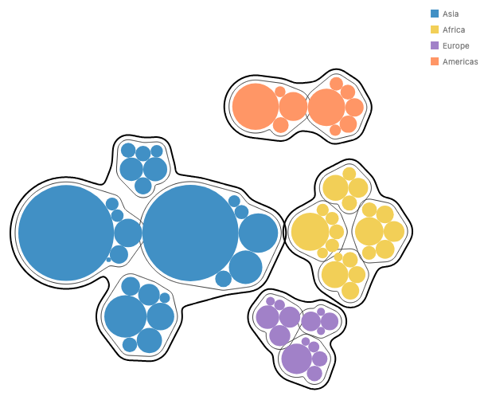

_Today's spelling, zero library changes. It reads as a bubble treemap, but East
and South Asia's region contours cross, and Asia's and Africa's continent
contours touch._

## Prior work

**Bubble Treemaps (Görtler, Schulz, Weiskopf, Deussen, TVCG 2018).**
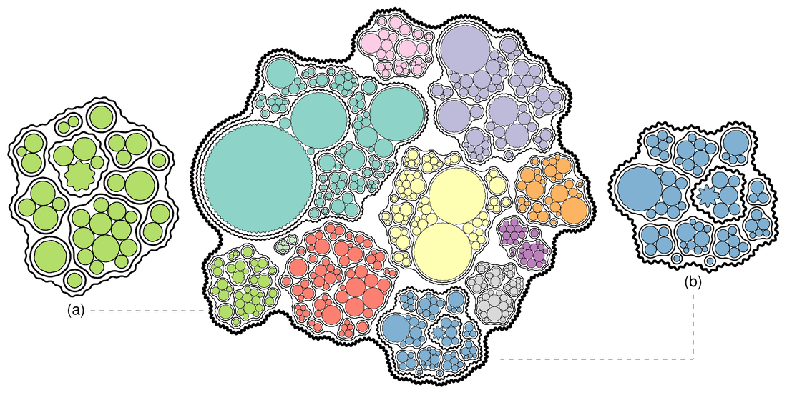

- Layout: start from a Wang-style circle pack, then bottom up, treat each
  child group as a rigid body made of its leaf circles grown by the contour
  distance, and pull the bodies together with springs (Box2D, 8000 steps). A
  group's footprint is its contour, not its enclosing circle. The result is not
  deterministic.
- Contour: grow every leaf circle by d = margin + width + padding, and fill
  concave corners with tangent arcs of radius _s_ ("smoothness", set per
  level). The outline is made only of circular arcs (G1: tangent continuous,
  curvature jumps at every joint). _s_ → 0 is the union of grown circles, _s_ →
  ∞ the convex hull.
  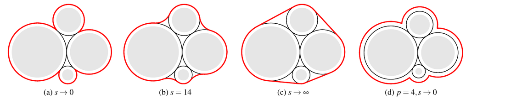
- Nesting: every ancestor draws its own contour around all its leaves; the
  distance grows by one step per level, and _s_ shrinks a little per level so
  the contours read like isolines.
- Uncertainty lives on the contour: opacity, dashes, wave frequency (constant
  width), or blur, an error-bar-like "interval", wave amplitude (variable
  width). Standard deviations combine up the tree as a root sum of squares.
  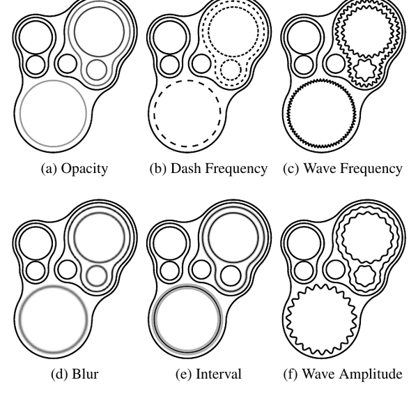

**Reference JS, `grtlr/bubble-treemaps` (`d3.bubbletreemap()`).** Options
`padding` (10, applied once per depth level) and `curvature` (10, the arc
radius, labeled "Smoothness" in the demo); per-node `uncertainty` becomes the
stroke width and adds to the offset. Layout = `d3.pack` then planck-js bodies.
One opaque call: hierarchy in, contour paths out.
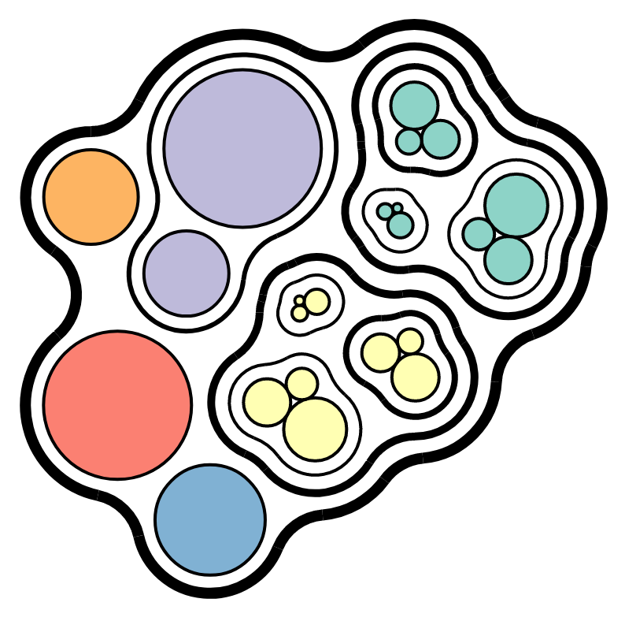

**d3-hierarchy `pack`, Vega `pack`, `circlify`, ggraph circlepack.** Every group
is its enclosing circle; `padding` is the gap between siblings and to the
parent circle. This is the footprint bubble treemaps replace.
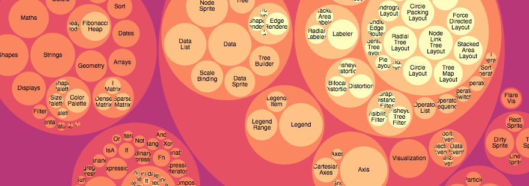

**ggforce `geom_mark_hull` / `_circle` / `_ellipse` / `_rect`.** The closest
precedent for `enclose`: a mark that draws around grouped points, with `expand`
(distance), `radius` (corner rounding) and `concavity`. Flat, and the outline
never moves the points.
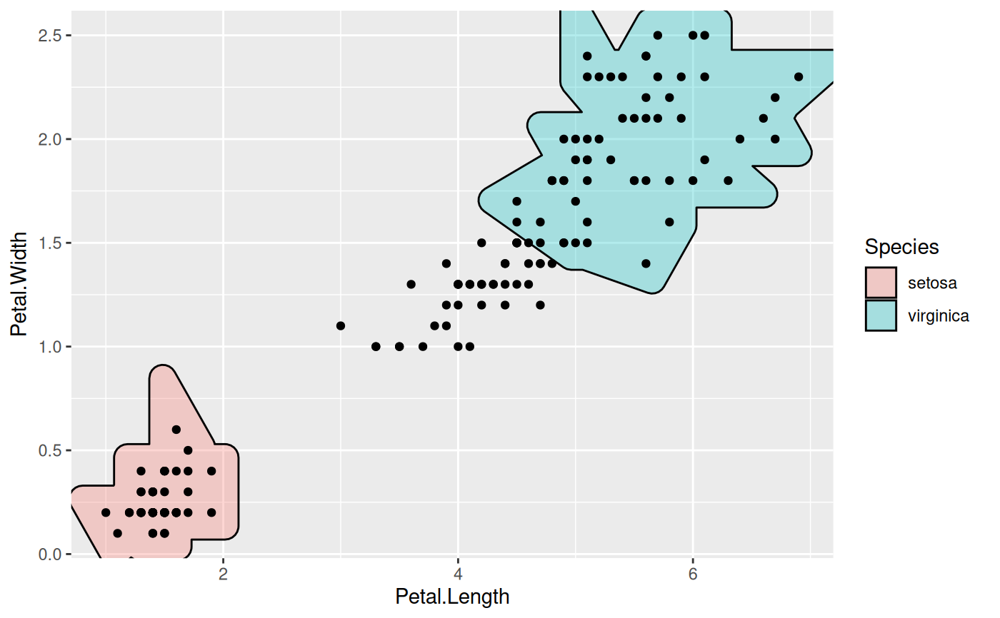

**Bubble Sets, KelpFusion, LineSets.** Set outlines over points that are
already placed. Bubble Sets is pixel-sampled; the paper chose arcs to get an
exact offset.
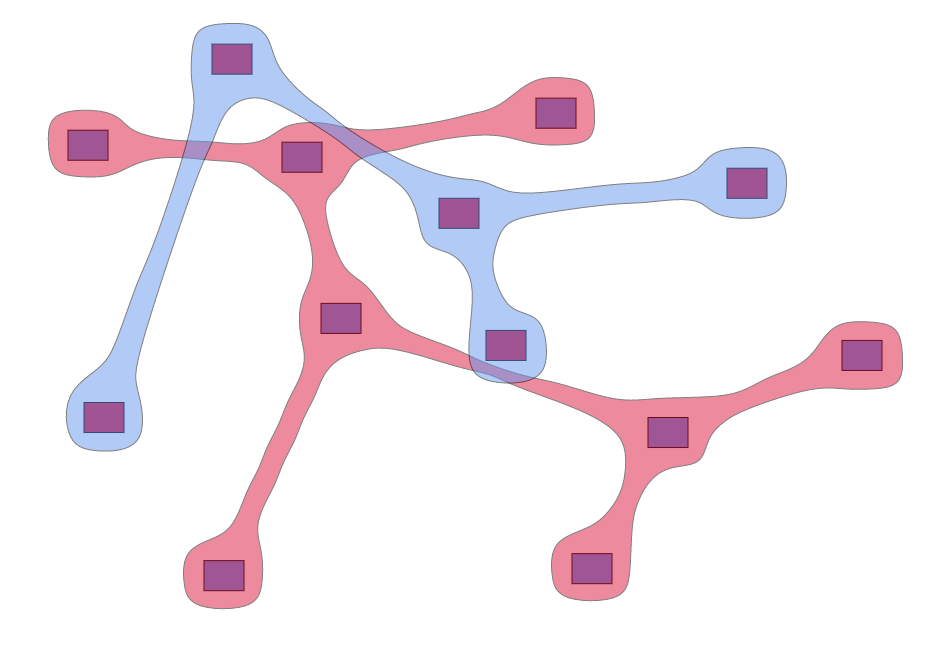

**Voronoi treemaps (Balzer and Deussen 2005; `d3-voronoi-treemap`), for
#1222.** The opposite direction: the parent's region is given and its children
partition it. A bubble treemap derives the parent's region from its children.
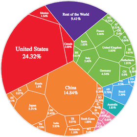

**Design tools and math.** Illustrator "Offset Path" + Pathfinder "Unite",
Figma "Union", Inkscape "Outset". The math names are offset curve / Minkowski
sum with a disc (the grown union) and morphological closing (the tangent arcs).

## The independent choices

1. **Where the contour lives**: as a layer drawn over the finished layout, or as
   a node in the layout that its parent packs. (Approaches A, B, C.)
2. **The contour's shape**: `Shape.blob` as is, or a new closing-by-radius
   member that matches the paper.
3. **What `pack` packs against**: each child's enclosing circle (today), or its
   outline (the paper's force step).
4. **Uncertainty**: contour distance from data, a band, or stroke styles.

### Approach A: contours are layers over the leaves (today's chart form)

```js
chart(countries)
  .flow(
    pack({ by: "continent", padding: 24 }), // room for both contours, by hand
    pack({ by: "region", padding: 12 }),
    pack()
  )
  .mark(circle({ r: "pop", fill: "continent" }).name("leaves"))
  .layer(
    chart(selectAll("leaves"))
      .flow(group({ by: "region" }))
      .mark(enclose({ shape: Shape.blob(), padding: 4, fill: "none" }))
  )
  .layer(
    chart(selectAll("leaves"))
      .flow(group({ by: "continent" }))
      .mark(enclose({ shape: Shape.blob(), padding: 10, fill: "none" }))
  );
```

```python
(
    chart(countries)
    .flow(
        pack(by="continent", padding=24),
        pack(by="region", padding=12),
        pack(),
    )
    .mark(circle(r="pop", fill="continent").name("leaves"))
    .layer(
        chart(select_all("leaves"))
        .flow(group(by="region"))
        .mark(enclose(shape=Shape.blob(), padding=4, fill="none"))
    )
    .layer(
        chart(select_all("leaves"))
        .flow(group(by="continent"))
        .mark(enclose(shape=Shape.blob(), padding=10, fill="none"))
    )
)
```

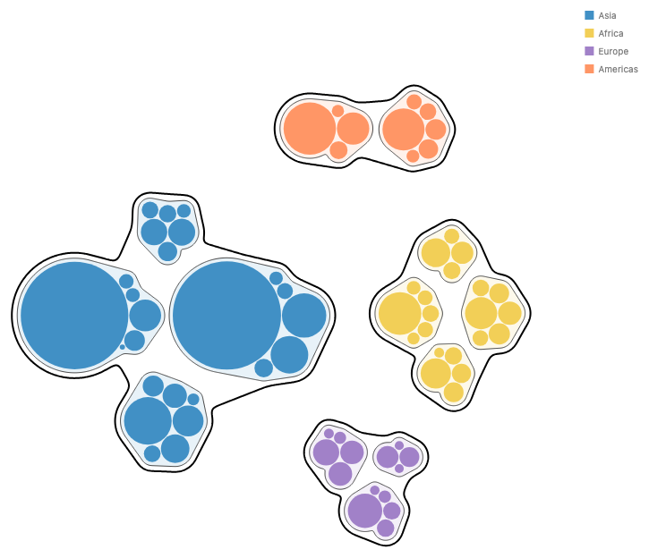

- Changes: pack padding only (#973). Everything else exists.
- The user does the arithmetic: each pack's padding must cover the contours of
  every level below it, around an enclosing circle, so the gaps come out large.
- The outer contour sits a fixed distance from the leaves, not from the inner
  contours. With per-group distances (uncertainty) the levels cannot stay
  parallel, and the pack cannot make room for a distance it does not know.
- Overlap: none new. This is `enclose`'s bag form as designed (dressing over
  the plot, which never moves its members).

### Approach B: contours are nodes in the layout (recommended)

The contour is a child of the pack, so the pack packs it, and an outer contour
hugs the inner ones. The combinator form spells this today:

```js
pack(
  { padding: 4 },
  continents.map((cont) =>
    enclose({ shape: Shape.arcs({ radius: 12 }), padding: 4, fill: "none" }, [
      pack(
        { padding: 4 },
        regions(cont).map((reg) =>
          enclose(
            { shape: Shape.arcs({ radius: 8 }), padding: 4, fill: "none" },
            [
              pack(
                { padding: 1 },
                reg.map((d) => circle({ r: d.r }))
              ),
            ]
          )
        )
      ),
    ])
  )
);
```

The proposed chart-form spelling puts `enclose` in the flow, between the levels
it wraps. With no `by`, a flow step that is not a split wraps each group's
subtree, as its combinator form wraps its children:

```js
chart(countries)
  .flow(
    pack({ by: "continent", padding: 4 }),
    enclose({ shape: Shape.arcs({ radius: 12 }), padding: 4, fill: "none" }),
    pack({ by: "region", padding: 4 }),
    enclose({
      shape: Shape.arcs({ radius: 8 }),
      padding: "uncertainty", // per-group distance from data (decision 3)
      fill: "none",
    }),
    pack()
  )
  .mark(circle({ r: "pop", fill: "continent" }));
```

```python
(
    chart(countries)
    .flow(
        pack(by="continent", padding=4),
        enclose(shape=Shape.arcs(radius=12), padding=4, fill="none"),
        pack(by="region", padding=4),
        enclose(shape=Shape.arcs(radius=8), padding="uncertainty", fill="none"),
        pack(),
    )
    .mark(circle(r="pop", fill="continent"))
)
```

| `Shape.arcs`, radius 12 / 8         | region `padding` = 2 + uncertainty                 |
| ----------------------------------- | -------------------------------------------------- |
| 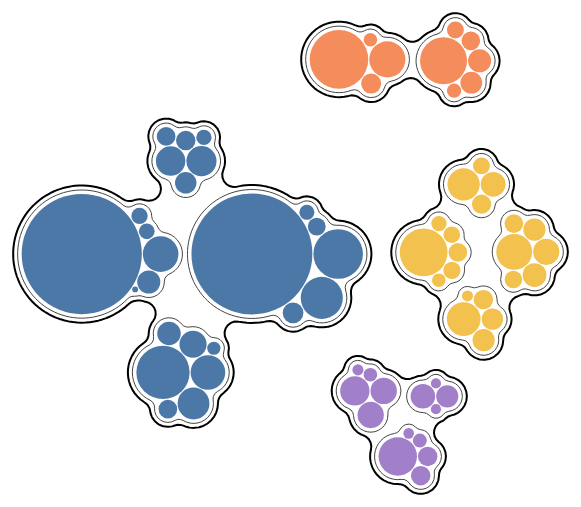 | 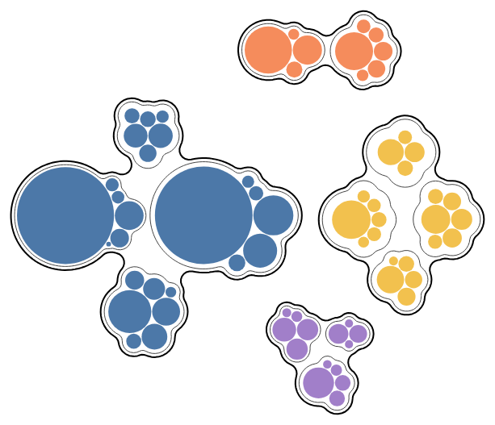 |

| `Shape.blob({ convexity: 0.1 })`              | `Shape.blob()` (default convexity 0.5) |
| --------------------------------------------- | -------------------------------------- |
| 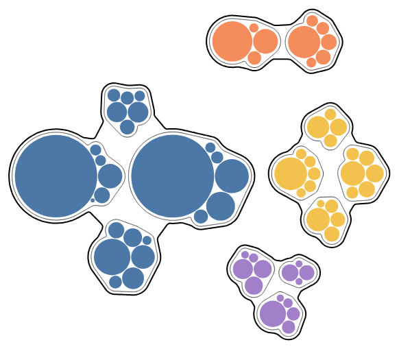 | 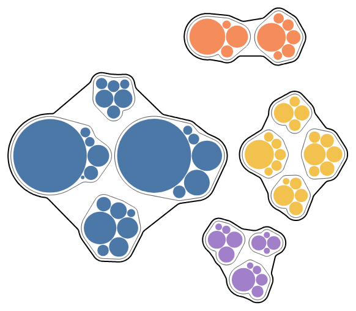 |

_Rendered from the combinator form with the prototype changes; the flow
spelling is not wired yet and would build the same tree._

- Internal changes (prototyped, about 56 lines):
  1. `enclose` answers `geometry()`: its outline loops, and an enclosing circle
     of them plus half the stroke. Today it falls back to its box.
  2. `pack` answers `outline` as its children's outlines, and gets a `lower`
     like `layer`'s (fixes the `enclose(opts, [pack(...)])` crash). The general
     form is #974: a group's outline is its children's outlines, not its box.
  3. Pack padding (#973), now only for the gap between sibling contours.
- User-facing: `enclose(opts)` as a flow step (decision 2); `padding` read per
  group from a field (decision 3).
- Composes: any operator that reads child geometry (pack today; `separate`
  later) sees the contour; coordinate transforms are unaffected because the
  blob is traced in pixels after layout; animation sees an ordinary node.
- Overlap: the bag form and the flow step draw the same contour and differ in
  one thing, whether the contour takes room in the layout. That is the same
  split as a `.label()` (placed around existing marks) versus a `text` mark (laid
  out with them), so it is a small shared case, not a second operator.
- Trade-offs: deep combinator nesting is noisy until the flow step exists; the
  pack still packs circles, so gaps between continents are wider than the
  paper's (choice 3).

### Approach C: a bubble-treemap operator or option

```js
chart(countries)
  .flow(
    pack({
      by: ["continent", "region"],
      contour: Shape.blob(),
      gap: 4,
      smoothness: 12,
    })
  )
  .mark(circle({ r: "pop" }));
```

This is the reference implementation's model (`d3.bubbletreemap().padding().curvature()`,
picture above). It gives one call for the common case, but it repeats
`enclose`'s shape, padding and paint inside `pack`, which is a large partial
overlap: every `enclose` option would need a twin. As sugar it is fine later,
as a chart template (#35) that expands to Approach B. Not recommended as an
operator.

## Choice 2: the contour's shape, `Shape.arcs({ radius })` (decided 2026-10-28)

Josh chose a new `Shape` member over keeping only blob. It is a separate
member, not a blob preset, because its one radius both fills gaps and rounds
corners, and blob keeps those apart (`convexity` fills; `roundness` only
bends).

```js
enclose({ shape: Shape.arcs({ radius: 12 }), padding: 6 }, members);
```

```python
enclose(members, shape=Shape.arcs(radius=12), padding=6)
```

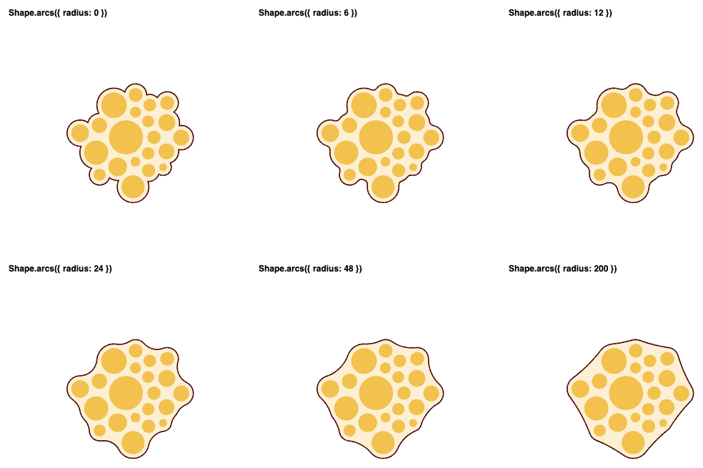

_`Shape.arcs` at radius 0, 6, 12, 24, 48, 200 on Africa's leaves, with the
paper's construction overlaid as a dashed red line._

- **What it draws:** the members, each grown by `padding`, then closed by a
  disc of `radius`: grow by `radius`, keep the outer boundary, shrink back by
  `radius`. Convex parts are the padded members' own edges; each concave corner
  becomes an arc of `radius`. Holes are always filled, as in the paper.
  `radius: 0` is exactly the padded union; a very large radius approaches the
  convex hull.
- **Accuracy:** on discs it matches the paper's construction to within 0.17 px
  at every radius tried. Boxes are exact; rings and lines are capsules around
  their pieces; an ellipse that is not a circle is read as its larger disc, as
  blob reads it.
- **Name and default:** `radius` follows ggforce's `radius`; the paper says
  smoothness _s_, the reference JS `curvature`. Default 12 px.
- **Accepted trade:** the outline is made only of circular arcs, so curvature
  jumps at each joint. That is the paper's look; blob keeps its
  curvature-continuous rule.
- **Cost:** about 120 ms for the nested treemap's 17 outlines, against about
  55 ms for `Shape.blob()` on the same members.
- **Correction:** "gaps narrower than 2·radius fill" holds only for flat or
  large members. Two discs of radius _a_ with gap _g_ join only when
  2*a*·radius ≥ _a_·_g_ + *g*²/4 (discs of radius 10, 30 px apart, need radius
  26). Below that, `arcs` returns separate pieces, where blob always joins
  them. In a bubble treemap the padded leaves already touch, so this does not
  come up.

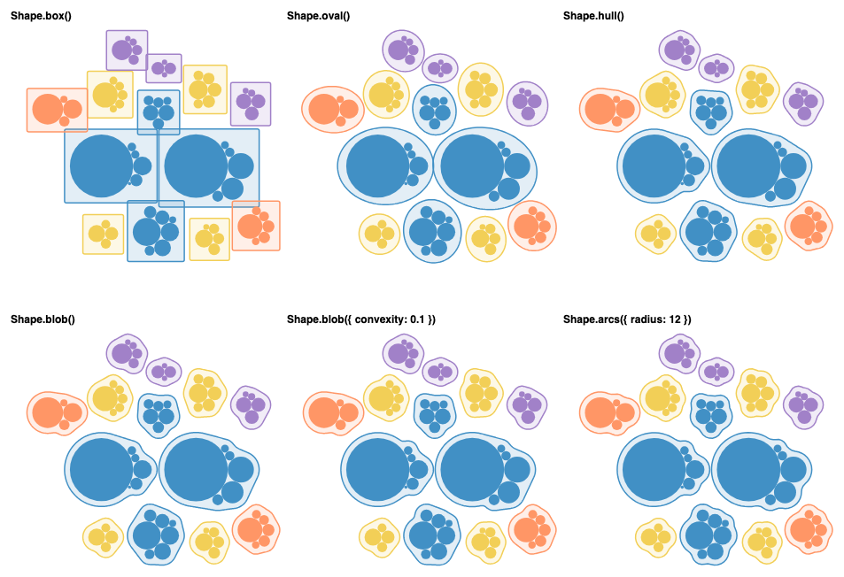

_One level, every shape: box, oval, hull, blob(), blob({ convexity: 0.1 }),
arcs({ radius: 12 })._

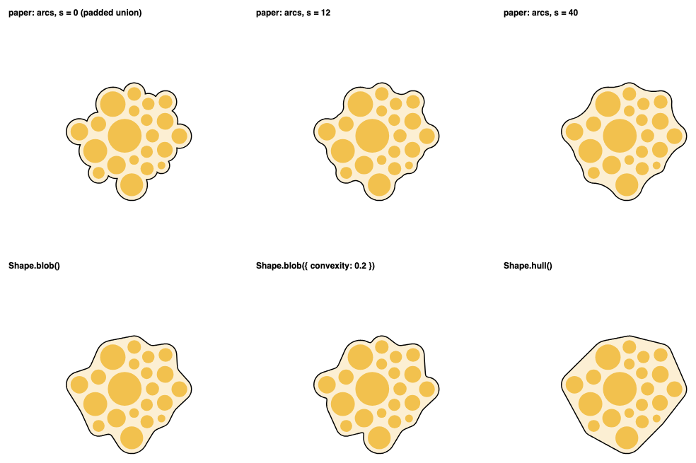

_Why blob could not do it: the paper's construction (top, s = 0, 12, 40)
against `Shape.blob()`, `Shape.blob({ convexity: 0.2 })`, `Shape.hull()`._

## Choice 3: what pack packs against

The paper packs groups by their contours with a force step; `pack` packs
enclosing circles with d3's front chain, which is deterministic and fast. In B
the pack already packs the contour's own enclosing circle, so it never
overlaps; it only leaves more space than the paper. Packing against outlines
would be a second `pack` strategy (the `method` family planned with #973), with
no change to `enclose`. Defer until a real example needs the tighter packing.

## Choice 4: uncertainty

- **Contour distance from data**: works in B once `padding` may be read per
  group (decision 3). The pack makes room for it automatically.
- **Band** (the paper's "interval"): an `enclose` of an `enclose`, with the
  outer one filled. It draws, but the next contour out reads a filled band as
  its box until #1207 (a filled-ring member) lands.
  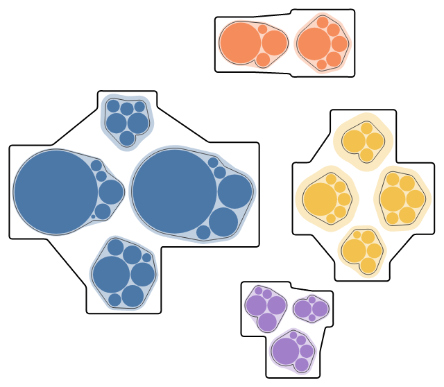
- **Propagation**: data-side (`derive`), root sum of squares; no layout change.
- **On the line itself**: the paper puts uncertainty on how the contour is
  drawn (width, blur, waves, dashes), not on where it sits. Those are line
  styles for any outline or line, left for later (2026-10-28).
  `strokeDasharray` exists; a thicker or wavier line would reserve its own room
  through the rule that already counts half the stroke width.

## Related issues

- #1221: this issue, bubble treemap contours.
- #1222: Voronoi treemap; children partition a given parent region, the
  opposite direction.
- #974: a `boundary` / outline geometry query on every node; Approach B's
  change 2 is a case of it.
- #1167 (closed): extensible `enclose` shapes on the geometry interface; where
  a closing-radius shape would go.
- #1101: one extensibility model for strategy families (custom shapes).
- #1207: filled polygon and ribbon members are read as their box; blocks the
  uncertainty band.
- #1160: a `members` option and `resolve` over a list of selections.
- #1161: whether blob outlines stay inside the plot area.
- #973: pack padding, `circles({ padding })`.
- #967: pack fits its canvas; every render here overflows.
- #968 (merged): `geometry()` with `enclosingCircle`, and the `pack` operator.
- #35: chart templates, where a `bubbleTreemap` shortcut could live.
- #1152 (merged): `enclose` with the `Shape` family.

## Recommendation

Approach B. It desugars into what exists: the combinator form already lays out
an `enclose` with its children, and the change is that the node reports its
real outline instead of its box, which is the direction #974 already set. One
concept stays one operator: the bubble treemap is `pack` plus `enclose`, with
no contour option on `pack` and no new mark. It adds no new terms. The one new
spelling, `enclose` in `.flow()`, follows the rule that each operator works both
in a flow and as a combinator. It reads the same in JS and Python.

What would change the pick: if Josh wants contours to stay dressing that never
moves the plot (the rule from #1152), then A with #973 is the honest minimum,
and the gaps stay hand-computed.

## Decisions for Josh

1. **Contour as a layout node.** Should an `enclose` with fresh children report
   its outline, so a `pack` packs the contour and an outer `enclose` hugs it?
2. **Flow step.** Is `enclose(opts)` as a step inside `.flow()` the chart-form
   spelling, wrapping each group's subtree? Or stay combinator-only for now?
3. **Per-group padding.** May `enclose`'s `padding` be a field read once per
   group (constant within the group, in pixels), like `fill`?
4. **`Shape.arcs` details.** `Shape.arcs({ radius })` is chosen. Is the 12 px
   default right? Should holes always be filled (no `holes` option, as in the
   paper), unlike blob?
5. **Tighter packing.** Defer packing against outlines (the paper's force step)
   to a later `pack` strategy?

## Found along the way

- `enclose(opts, [pack(...)])` throws `node type "pack" has no lower()`. A bug
  independent of this proposal; worth its own issue.
