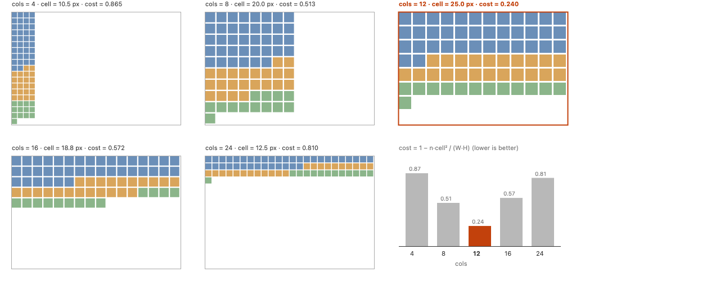
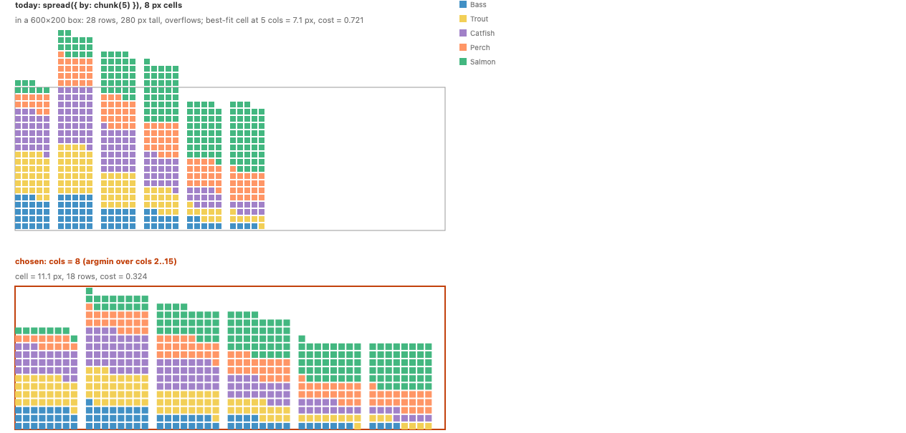
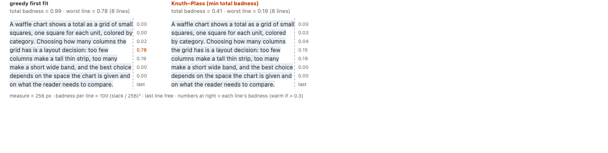
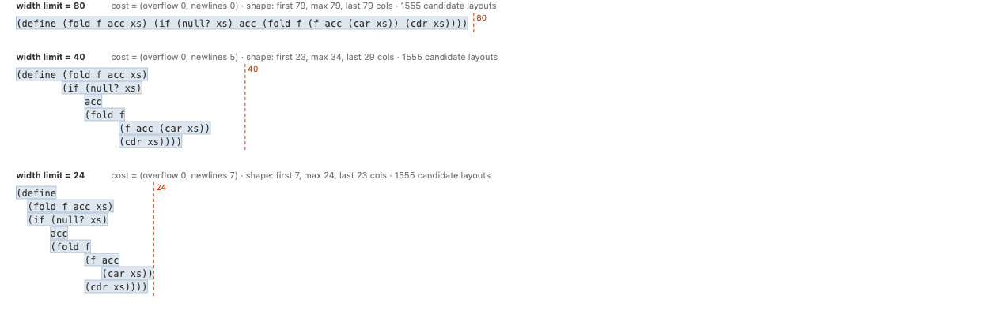
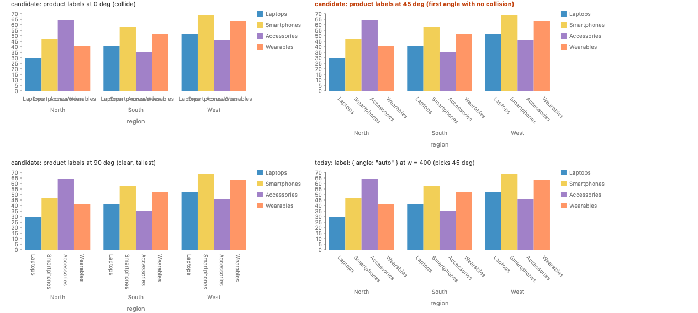
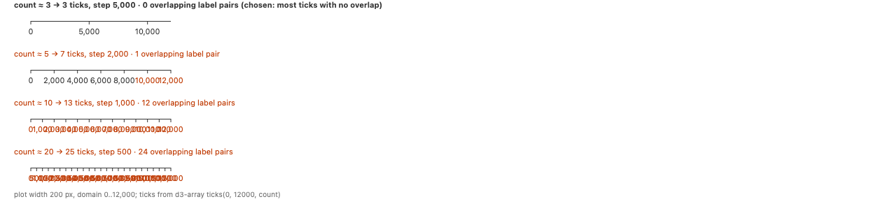
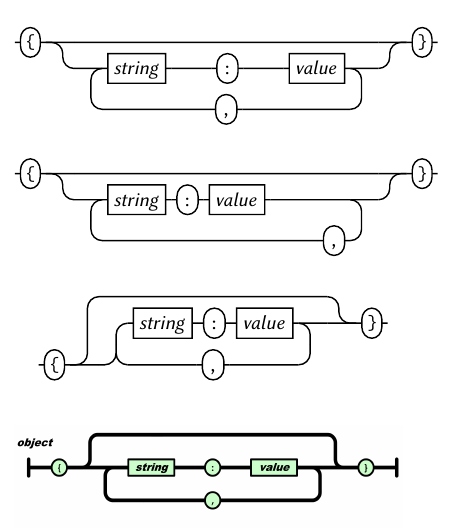
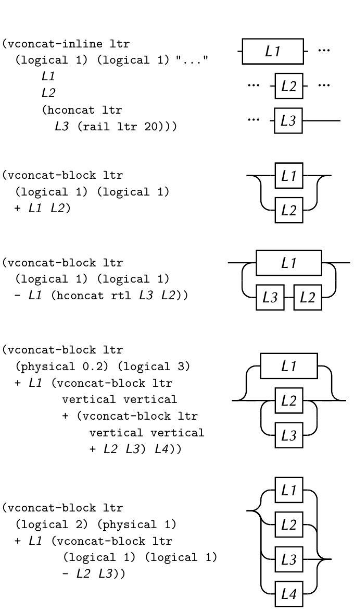
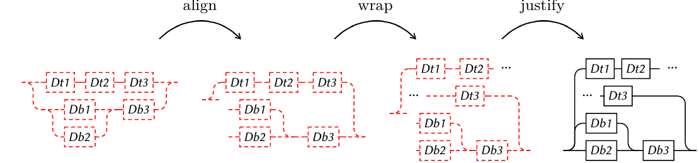

# Choice, cost and wrap: one mechanism for pretty printing, waffles, line breaking and axis labels

Status: proposal, not implemented. Advances #486 (choice operator), #122 (wrap operator) and #1194 (tick density, label angle and placement as one mechanism).

## Summary

- Add one operator, `choose`, which lists alternatives in order of preference. You can use it as a node over child subtrees, and you can also use it as the value of an option, e.g. `angle: choose([0, 45, 90])` or `cols: choose({ from: 4, to: 24 })`.
- Add a `Cost` strategy family that says how alternatives are ranked. By default `choose` takes the first alternative that fits. With `cost: [Cost.overflow(), Cost.lines()]` it takes the alternative with the lowest cost, compared term by term.
- Add a `wrap` option to `stack` and `spread`. It folds the operator's row of children into several rows. Each seam between two children is a `choose` between continuing on the current row and starting a new row, so the same ranking rule applies. By default the first fit at each seam gives greedy line breaking. `wrap: { cost: Cost.badness() }` gives Knuth-Plass.

Wrapping is about rows, and `stack` versus `spread` is about spaces, so the two are separate options. A `stack` glues its children's spaces into one space, and a `spread` keeps each child's space separate. Either one can wrap. The stacked waffle is a `stack` by species that wraps, and a facet grid is a `spread` by panel that wraps.

```js
// Stacked waffle: species glued into one count, folded into rows.
// The column count is the one whose square cells fill the box best.
chart(seafood)
  .flow(
    stack({
      by: "species",
      dir: "x",
      wrap: { cols: choose({ from: 4, to: 24 }, { cost: Cost.waste() }) },
    }),
    derive((d) => repeat(d, "count")),
    stack({ dir: "x" })
  )
  .mark(rect({ fill: "species" }));

// Paragraph: Knuth-Plass line breaking.
spread(
  { dir: "x", spacing: "0.5ch", w: 260, wrap: { cost: Cost.badness() } },
  words.map((w) => text({ text: w }))
);

// Axis labels: the first angle whose labels do not overlap.
chart(data, { axes: { x: { label: { angle: choose([0, 45, 90]) } } } });
```

One question stays open on purpose: whether wrapping names its rule with a `Break` family (`wrap: { break: Break.optimal() }`) or with a cost (`wrap: { cost: Cost.badness() }`). The section [Break or no Break](#break-or-no-break) shows every example both ways. We lean toward no `Break`.

## Terms

- **Alternative.** One of the layouts a `choose` node can pick. An alternative is a subtree, or a value for an option.
- **Fit.** An alternative fits when its layout stays inside the room its parent gives it and passes the operator's own test, e.g. axis labels that do not overlap.
- **Cost.** A number, or a list of numbers compared in order, that ranks alternatives. Lower is better. A list compared in order is called lexicographic. The second number only matters when the first numbers are equal.
- **Seam.** The place between two neighboring children of a `stack` or `spread`. Without `wrap`, every seam continues the row. With `wrap`, every seam is a choice between continuing and starting a new row.
- **Block.** A child that a wrapped row treats as one box. It moves to the next row as a whole.
- **Silhouette.** The summary of a child's shape that a parent uses when it joins children, e.g. a box, or a box plus the width of its last row. The term comes from `notes/design/silhouette-interface.md`. We use "silhouette" and not "measure" because `Measure`, `measureText` and `ref.measure()` already mean other things in GoFish.
- **Pareto frontier.** The set of alternatives that no other alternative beats on every count. A layout engine keeps this set and drops the rest, so it does not have to try every combination.

## The examples

The proposal has to handle these six cases. Each one is a real story or a request in an open issue.

1. **Pretty printing** (#40, #486). Lay out code or an S-expression within a width limit. The alternatives are structurally different layouts, e.g. an `if` on one line or broken over three lines. Composition needs more than a box, because the next item continues on the last row of the previous one.
2. **Waffle chart** (#122, #739, #1128, #663). Today the gallery waffle hard-codes `spread({ by: chunk(5) })`. The column count should follow from the room, so the cells are square and fill the box.
3. **Knuth-Plass line breaking** (new). Break a paragraph into lines so the right edge is as even as possible, using a cost over the whole paragraph instead of filling each line greedily.
4. **Axis label orientation** (#961, #1017, #1151). Today `label: { angle: "auto" }` lays out the whole chart once per candidate angle (0, 45, 90, then hidden) and keeps the first one whose labels do not collide.
5. **Continuous label angle** (#1194). Plotly tries a list of angles. A continuous choice would allow "the smallest angle between 0 and 90 that clears".
6. **Tick count** (#1063, #1194). Today the axis always asks d3 for about 10 ticks, so labels overlap on a narrow chart. The choice is the largest count whose labels do not overlap, possibly together with the angle.

## How it works today

- `src/ast/choice/choose.ts` has the whole-chart first-fit loop: `chooseFirstFit(candidates, run, score, fits)` returns the first candidate that fits, otherwise the one with the lowest `Score` (a `number[]` compared in order). Its header says the loop should be replaced by a node-local choice with a frontier (#486, #630).
- `src/ast/axes/autoLabelAngle.ts` is the only client. It tries `[0, 45, 90, "hidden"]` per label row and lays out the whole chart again for each candidate.
- `.label()` with `Place.around` has its own first-fit chooser (`labels/placeStep.ts`) that gives each label its first free position.
- There is no `wrap` operator. The old `wrap` (an enclosure) was deleted in #396. `chunk(n)` and `table({ numCols })` give fixed rows.
- The layout protocol returns one box per axis. The silhouette note (`notes/design/silhouette-interface.md`) already defines the richer summary and says it stays inside the operator that declares it. Only the box leaves.

## Prior work

| System                                                                    | What the user writes                                         | What the system decides                                 | Cost                                                                                                                                                                   |
| ------------------------------------------------------------------------- | ------------------------------------------------------------ | ------------------------------------------------------- | ---------------------------------------------------------------------------------------------------------------------------------------------------------------------- |
| Pretty expressive printer (Porncharoenwase, Pombrio, Torlak, OOPSLA 2023) | `text`, `nl`, `<>`, `nest`, `align`, `a <\|> b`, `cost n d`  | which branch of each `<\|>`                             | a user-supplied "cost factory": a totally ordered monoid with `text c len`, `newline i`, `combine`, `le`, `limit`. Default is (sum of squared overflow, newline count) |
| Bernardy, "A pretty but not greedy printer" (ICFP 2017)                   | `text`, `flush`, `<>`, `<\|>`                                | the layout with fewest lines that fits                  | the measure `(height, maxWidth, lastWidth)`, pruned to a Pareto frontier                                                                                               |
| Wadler, "A prettier printer"; Prettier                                    | `group`, `nest`, `line`, `conditionalGroup([...])`           | which groups are flattened                              | greedy: the first line must fit                                                                                                                                        |
| Knuth and Plass (1981); TeX; `tex-linebreak`                              | boxes, glue (width, stretch, shrink), penalties              | breakpoints                                             | sum of demerits from badness `100·\|r\|³`, dynamic programming over feasible breaks                                                                                    |
| CSS `text-wrap: pretty \| balance`; Typst `par(linebreaks: "optimized")`  | one keyword                                                  | breakpoints                                             | built in. Typst exposes weights: `text(costs: (runt: 100%, widow: 100%, ...))`                                                                                         |
| Observable Plot `waffleY`                                                 | `unit`, `multiple`, `gap`, `round`                           | `multiple` (cells per row)                              | none. A closed form: `multiple = floor(sqrt(bandwidth / scale))`, which makes cells square                                                                             |
| R `waffle`, pywaffle                                                      | `n_rows`, `rows` / `columns`                                 | the other dimension                                     | none                                                                                                                                                                   |
| Plotly                                                                    | `tickangle: "auto"`, `autotickangles: [0, 30, 90]`, `nticks` | the first angle that clears                             | first fit in list order                                                                                                                                                |
| Vega and Vega-Lite                                                        | `labelOverlap: "parity" \| "greedy"`, `labelAngle`           | which labels to hide                                    | a repair loop, the angle is never chosen                                                                                                                               |
| Talbot, Lin, Hanrahan (InfoVis 2010)                                      | data range, nice steps, target density, font size            | step, count, start, format, font size, orientation      | weighted sum `0.2·simplicity + 0.25·coverage + 0.5·density + 0.05·legibility`. Overlap is minus infinity                                                               |
| SwiftUI `ViewThatFits`                                                    | children in order of preference                              | the first child whose ideal size fits the proposed size | first fit                                                                                                                                                              |
| Draco                                                                     | ASP facts and soft constraints with weights                  | a whole chart spec                                      | weighted sum of soft constraint violations                                                                                                                             |
| SUPPLE (Gajos and Weld 2004)                                              | widget alternatives for each value                           | which widget                                            | branch and bound over a cost, under a screen size                                                                                                                      |
| Jacobs et al., adaptive grid layout (SIGGRAPH 2003)                       | page templates                                               | a template per page                                     | dynamic programming over a cost                                                                                                                                        |

Lessons for GoFish:

- Every system with real optimization has four parts. It has alternatives as a node, a summary of each layout that composes bottom up, a cost that is an ordered monoid, and a search that prunes dominated layouts. The pretty expressive printer states the laws the cost must follow, and the silhouette note already restates them for GoFish.
- First fit (`ViewThatFits`, Plotly, Prettier's `conditionalGroup`) is the case where the list order is the cost. It is cheap, and users can predict it. It covers label angle, tick count and most label placement.
- Plot's waffle rule is what a cost search returns when the answer has a closed form. GoFish can ship the general form and still compute the closed form as a fast path.
- Typst's `costs` and Talbot's weights are the precedent for exposing cost terms by name, with weights, instead of asking users to write a cost function.
- Draco and Penrose put the whole chart under one objective. That is the foil. GoFish keeps the choice local to one node so the user can see what is chosen and why.

Reference images are in `img/prior/`.

## Approaches

The design has four separate axes:

1. Where the choice appears in the spec.
2. How alternatives are ranked.
3. Where wrapping lives.
4. Whether wrapping names its rule with a `Break` family or with a cost.

We present the axes one at a time.

### Axis 1. Where the choice appears

#### Approach A. `choose` is a node over subtrees

`choose` takes a list of child subtrees, like `layer`. It is the pretty printer's `<|>`. To choose an option value, you write the subtree once per value.

```js
// waffle
choose(
  [4, 8, 12, 16, 24].map((cols) => stack({ dir: "x", wrap: { cols } }, cells)),
  { cost: Cost.waste() }
);

// axis label angle: the axis is chrome, so the choice has to repeat the whole chart
choose(
  [0, 45, 90].map((angle) =>
    chart(data, { axes: { x: { label: { angle } } } })
      .flow(spread({ by: "product", dir: "x" }))
      .mark(rect({ h: "sales" }))
  )
);
```

```python
choose(
    [stack(cells, dir="x", wrap={"cols": c}) for c in [4, 8, 12, 16, 24]],
    cost=Cost.waste(),
)
```

- It is the smallest addition. The pretty printer maps onto it one to one.
- Axis options are hard to reach. The axis is built by the engine, so the user has to repeat the whole chart per alternative. That is today's whole-chart loop, moved into user code.
- A continuous choice, e.g. an angle between 0 and 90, cannot be written as a finite list of subtrees.

#### Approach B. `choose` is a node, and also an option value (recommended)

The same `choose` works in two places. As a node it takes subtrees. As an option value it takes values, and the option takes the chosen value. The value form is sugar. It means "build this node once per value, then choose among those nodes", so it desugars to Approach A.

```js
// option value, discrete
chart(data, { axes: { x: { label: { angle: choose([0, 45, 90]) } } } });

// option value, a whole record per alternative (today's "auto" written out)
chart(data, {
  axes: {
    x: {
      label: choose([
        { angle: 0 },
        { angle: 45 },
        { angle: 90 },
        { hidden: true },
      ]),
    },
  },
});

// option value, an integer range with a cost
stack({
  dir: "x",
  wrap: { cols: choose({ from: 4, to: 24 }, { cost: Cost.waste() }) },
});

// option value, a continuous interval: the smallest angle that clears
chart(data, { axes: { x: { label: { angle: choose({ from: 0, to: 90 }) } } } });

// node form, for structurally different layouts
choose([flatIf, brokenIf]);
```

```python
chart(data, axes={"x": {"label": {"angle": choose([0, 45, 90])}}})
stack(dir="x", wrap={"cols": choose(start=4, stop=24, cost=Cost.waste())})
choose([flat_if, broken_if])
```

- One word covers every case in the examples list.
- The axis case no longer repeats the chart. The engine builds one axis node with a choice inside, and only that axis is laid out again per alternative.
- A range or interval is a lazy list. For a first-fit choice over an interval the engine can bisect, because overlap falls as the angle grows. This is the "pick a basin, then solve inside it" idea from #486.
- `"auto"` stays as named sugar. `angle: "auto"` is the same as `label: choose([{ angle: 0 }, { angle: 45 }, { angle: 90 }, { hidden: true }])`. The docs show the expansion, so the user can copy it and change the list.
- The user must learn which options accept `choose(...)`, and each such option says so in its type. We would start with a small set: `wrap.cols`, `label.angle`, `label` as a whole, `ticks.count`, and `axes.x` as a whole.

#### Approach C. No user-facing choice, only strategies

Each operator gets an `"auto"` value or a strategy, and the search stays inside the engine. This is CSS `text-wrap: pretty`, Plotly's `tickangle: "auto"` and Plot's waffle rule.

```js
stack({ dir: "x", wrap: { cols: "auto" } }); // square cells that fill the room
spread({ dir: "x", wrap: { break: Break.optimal() } }); // Knuth-Plass
chart(data, {
  axes: { x: { label: { angle: "auto" }, ticks: { count: "auto" } } },
});
```

- It is the simplest surface, and it is close to what GoFish ships today.
- The pretty printer cannot be written, because its alternatives are arbitrary user subtrees.
- Each `"auto"` is a hidden conditional. The user cannot change the candidate list or the order, which goes against the rule that a default should desugar to code the user could write.
- It is the runner-up, and it is also the first shipping step of Approach B. Every `"auto"` in this list is sugar for a `choose` that B makes writable.

#### Approach D. Free variables and an objective (foil)

The user names unknowns and one objective for the chart, in the style of Penrose and Draco.

```js
const cols = variable({ from: 4, to: 24, integer: true });
chart(data, { minimize: [overflow(), waste()] }).flow(
  stack({ dir: "x", wrap: { cols } })
);
```

- It can express everything, including choices that interact across the chart.
- The search is global, so the result is hard to predict and slow. The user cannot tell which variable moved a mark.
- A variable used in two places couples two parts of the tree, which breaks the rule that a choice stays inside one scale scope (#486).
- We list it to make the boundary clear. B can express the same examples without global variables.

### Axis 2. How alternatives are ranked

#### Ranking 1. Preference order with a fit test (default)

`choose` takes the first alternative that fits. If none fits, it takes the one that overflows least. This is `ViewThatFits`, Plotly and today's `chooseFirstFit`.

The fit test has two parts:

- The layout stays inside the room the parent gives. This connects to the proposal model in #1292, where a node with no own size uses the parent's proposal.
- The operator's own test passes, e.g. axis labels do not overlap, and a label does not cover an `avoiding` mark.

#### Ranking 2. A `Cost` list

`cost` replaces preference order with a list of named terms compared in order. Preference order is the last tie breaker.

```js
choose(alternatives, { cost: [Cost.overflow(), Cost.lines()] }); // the pretty printer default
stack({
  dir: "x",
  wrap: { cols: choose({ from: 4, to: 24 }, { cost: Cost.waste() }) },
});
spread({ dir: "x", wrap: { cost: Cost.badness() } }); // Knuth-Plass
```

A first set of terms:

| Term                     | Meaning                                                                               | Used by                                  |
| ------------------------ | ------------------------------------------------------------------------------------- | ---------------------------------------- |
| `Cost.overflow()`        | ink outside the room, squared and summed per row, as in the pretty expressive printer | pretty printing, wrapping                |
| `Cost.overlap()`         | total overlap area between labels or marks that should not touch                      | axis labels, tick count, label placement |
| `Cost.waste()`           | the fraction of the room left empty                                                   | waffle, treemap rows                     |
| `Cost.lines()`           | the number of rows                                                                    | pretty printing                          |
| `Cost.badness()`         | Knuth-Plass badness, `100 (slack/stretch)³` per row, last row free                    | paragraphs                               |
| `Cost.balance()`         | the largest difference between a row's length and the longest row                     | titles, short labels                     |
| `Cost.weighted({ ... })` | a weighted sum of other terms, in the style of Talbot and Typst                       | tick choice in the Talbot style          |

A function is the escape hatch, e.g. `cost: layout => number`. It waits for #1101, which decides how a family accepts user functions and how they cross to Python.

The cost terms must follow the laws in the silhouette note. Every join must be monotone in the cost, and the cost must be an ordered monoid. That is why `Cost.overflow` sums squared overflow and does not take a maximum. The pretty expressive paper shows that (max overflow, height) breaks monotonicity, so the engine could not prune with it.

#### Ranking 3. Penalties on alternatives

Knuth-Plass penalties and the pretty printer's `cost n d` attach a cost to one alternative. In GoFish this could be a method, e.g. `brokenIf.cost(2)`, or a weight per alternative in `choose`. We do not propose it now, because preference order covers the cases above. It is listed as a decision.

### Axis 3. Where wrapping lives

`stack` and `spread` differ in their spaces. A `stack` glues its children's spaces into one space, e.g. the species counts in a stacked bar add up along one value axis. A `spread` keeps each child's space separate, e.g. one band per lake. Wrapping is a different question. It asks whether the children stay on one row or fold into several rows. Any flow of children can fold, whether their spaces are glued or separate:

|             | glued spaces (`stack`) | separate spaces (`spread`)     |
| ----------- | ---------------------- | ------------------------------ |
| one row     | stacked bar            | grouped bars                   |
| folded rows | stacked waffle         | facet grid, paragraph of words |

#### Wrap 1. An option on `stack` and `spread` (recommended)

```js
stack({ by: "species", dir: "x", wrap: { cols: 10 } }); // stacked waffle, ten columns
spread({ by: "panel", dir: "x", wrap: { cols: 3 } }); // facet grid, three columns
spread({ dir: "x", spacing: "0.5ch", wrap: true }, words); // paragraph, greedy breaks in the room
```

```python
stack(by="species", dir="x", wrap={"cols": 10})
spread(by="panel", dir="x", wrap={"cols": 3})
spread(words, dir="x", spacing="0.5ch", wrap=True)
```

- `wrap: true` breaks rows to fit the room the parent gives. `wrap: { cols }` fixes the column count. `wrap: { cost }` ranks the breaks.
- `dir` is the direction of each row. Rows advance along the other axis, and `reverse` and `alignment` keep their meaning inside a row.
- The glued space of a wrapped `stack` stays one space. In a stacked waffle, trout starts at the cell where bass ended, so the species still add up to one count.
- It matches the rule that an option is a local adjective of its operator (`api-design.md`, "Calls, methods and options"). Wrapping changes how one operator places its own children, and nothing outside it.
- It adds one option to two operators and no new operator.

#### Wrap 2. A separate `wrap` operator

```js
wrap({ by: "species", cols: 10 });
wrap({ by: "panel", cols: 3 });
```

- It reads well for the waffle.
- It cannot say whether its children's spaces are glued or separate. A `wrap` by species has to glue, so trout continues bass's count, and a `wrap` by panel has to separate, so each panel keeps its own scales. The operator would need its own glue flag, which repeats the `stack` and `spread` distinction. Two operators would then overlap on most of their behavior, which is the kind of large partial overlap `api-design.md` warns about.

#### Nested flows

A stacked waffle has two levels. The outer `stack` splits by species, and the inner `stack` lays out one species' units. The inner units have to continue the outer rows, so trout's first cell goes right after bass's last cell, on the same row. One rule covers this case and the paragraph case:

- **A same-direction `stack` or `spread` without its own `wrap` continues its parent's rows.** Its seams join the parent's flow, so its children fill the current row and then the next one.
- **Any other child is a block.** That includes a child that sets its own `wrap`, a child that flows in the other direction, a mark, and a node from any other operator. A block moves to the next row as a whole.

The rule is the same as today's behavior without wrapping. Two nested same-direction stacks already lay out exactly like one flat stack, because gluing is associative. Wrapping folds that one flat row, so the nesting does not change the result.

```js
// stacked waffle: species glued, units continue the species rows
stack({ by: "species", dir: "x", wrap: { cols: 10 } }),
derive((d) => repeat(d, "count")),
stack({ dir: "x" }),

// grouped waffle: each species is its own wrapped block, side by side
spread({ by: "species", dir: "x" }),
derive((d) => repeat(d, "count")),
stack({ dir: "x", wrap: { cols: 5 } }),
```

The continuing case is the only place the engine needs more than a box. A child that continues the parent's rows reports its silhouette as row count, widest row and last-row width, so the next sibling knows where to start. A block reports only its box.

### Axis 4. Break or no Break

Wrapping can name its rule in two ways. With a `Break` family, each rule has a name. Without it, `wrap` takes the same `cost` option as `choose`, and the rule is the cost.

| Rule                         | With `Break`                                                          | Without `Break`                                  |
| ---------------------------- | --------------------------------------------------------------------- | ------------------------------------------------ |
| greedy (the default)         | `wrap: true`                                                          | `wrap: true`                                     |
| Knuth-Plass                  | `wrap: { break: Break.optimal() }`                                    | `wrap: { cost: Cost.badness() }`                 |
| Knuth-Plass with a tolerance | `wrap: { break: Break.optimal({ tolerance: 2 }) }`                    | `wrap: { cost: Cost.badness({ tolerance: 2 }) }` |
| balanced rows                | `wrap: { break: Break.balance() }`                                    | `wrap: { cost: Cost.balance() }`                 |
| fixed columns                | `wrap: { cols: 10 }`                                                  | `wrap: { cols: 10 }`                             |
| columns chosen by a cost     | `wrap: { cols: choose({ from: 4, to: 24 }, { cost: Cost.waste() }) }` | the same                                         |
| one row, or one item per row | `choose([spread(items), spread({ dir: "y" }, items)])`                | the same                                         |
| never break                  | no `wrap`                                                             | no `wrap`                                        |

The two spellings differ in three rows only. Everything else is the same, because `choose` over columns, all-or-nothing, and never breaking are not break rules.

Each `Break` rule desugars to a `choose` at every seam plus a ranking:

- `Break.greedy` is first fit at each seam. Each seam prefers "continue" over "new row". The first assignment in that order that fits continues whenever the current row still fits, because a later break is always possible. That is exactly the greedy rule.
- `Break.optimal()` is `cost: Cost.badness()`.
- `Break.balance()` is `cost: Cost.balance()`.

So `Break` is a set of names for costs.

**For `Break`:**

- Typst (`par(linebreaks: "optimized")`) and CSS (`text-wrap-style: pretty | balance`) name the rule, not the cost. A user setting a paragraph does not have to know what a cost is.
- `Break.optimal()` names the algorithm, so the engine can run the Knuth-Plass dynamic program instead of a general search. The engine could also do this when it sees `Cost.badness()`.

**Against `Break`:**

- Two families would say the same thing. `wrap: { break: Break.optimal() }` and `wrap: { cost: Cost.badness() }` would both have to work, or `wrap` would rank alternatives differently from `choose`.
- With only `cost`, there is one ranking rule for every choice in GoFish. A user who learns `cost` for the pretty printer can use the same word for paragraphs, and a cost list such as `[Cost.overflow(), Cost.badness()]` works without a new spelling.
- Every `Break` strategy would be a one-line alias, and the rule from `three-surfaces.md` is that an option with nothing to choose between gets no family.

We lean toward no `Break`, with the Typst and CSS words in the docs for `Cost.badness` and `Cost.balance`. The case for `Break` is that paragraph users never have to see the word "cost".

## The examples under the recommendation

### Waffle chart



The prototype fits 73 cells into a 300 by 200 box. The cost is the fraction of the box left empty, `1 − n s²/(W H)`, where `s` is the largest square cell that fits. Twelve columns win, with 25 px cells and a cost of 0.24. Four columns cost 0.87 and 24 columns cost 0.81.



Above is the gallery waffle today, with five columns of 8 px cells. In a 600 by 200 box it needs 28 rows and spills out of the top. Below, the same chart picks its column count by the same cost. All six lakes share eight columns of 11 px cells, and the tallest lake sets the row count.

Today:

```js
chart(seafood, { axes: { x: { side: "end" } } })
  .flow(
    spread({ by: "lake", spacing: 8, dir: "x", axes: false, alignment: "end" }),
    derive((d) => d.flatMap((d) => repeat(d, "count"))),
    spread({ by: chunk(5), spacing: 2, dir: "y", reverse: true }),
    spread({ spacing: 2, dir: "x" })
  )
  .mark(rect({ w: 8, h: 8, fill: "species" }))
  .render(container, {});
```

Proposed:

```js
chart(seafood, { axes: { x: { side: "end" } } })
  .flow(
    spread({ by: "lake", spacing: 8, dir: "x", axes: false, alignment: "end" }),
    stack({
      by: "species",
      dir: "x",
      spacing: 2,
      reverse: "rows",
      wrap: { cols: choose({ from: 4, to: 24 }, { cost: Cost.waste() }) },
    }),
    derive((d) => repeat(d, "count")),
    stack({ dir: "x" })
  )
  .mark(rect({ fill: "species" }))
  .render(container, { w: 600, h: 200 });
```

```python
(
    chart(seafood, axes={"x": {"side": "end"}})
    .flow(
        spread(by="lake", spacing=8, dir="x", axes=False, alignment="end"),
        stack(
            by="species",
            dir="x",
            spacing=2,
            reverse="rows",
            wrap={"cols": choose(start=4, stop=24, cost=Cost.waste())},
        ),
        derive(lambda d: repeat(d, "count")),
        stack(dir="x"),
    )
    .mark(rect(fill="species"))
)
```

- The rect has no size, so the wrapped `stack` divides its room into square cells. The cost picks the column count that wastes the least room.
- Plot's `floor(sqrt(bandwidth / scale))` is the closed form of the same rule. The engine can use it when the cost is exactly `Cost.waste()` and the cells are uniform. With uniform cells the silhouette is just a cell count, so trying 21 column counts means 21 formulas, not 21 layouts.
- `reverse: "rows"` puts the ragged last row at the top, which the gallery story does today with `reverse: true` on the row spread. How to spell "reverse the row order but not the order inside a row" is a decision.
- `stack` with `spacing: 2` leaves a gap between glued units. Today `stack` forces its spacing to 0, so this proposal also lets `stack` take `spacing`.

### Knuth-Plass



The prototype sets a 61 word paragraph at 256 px. Greedy first fit has a total badness of 0.99 and a worst line of 0.78. Knuth-Plass has a total of 0.41 and a worst line of 0.19, with the same number of lines. Word widths come from the text mark's own measurement.

Not possible today. The prototype computes the breaks in plain JavaScript and places each word by hand.

Proposed:

```js
spread(
  { dir: "x", spacing: "0.5ch", w: 260, wrap: { cost: Cost.badness() } },
  words.map((w) => text({ text: w }))
);

// the same, with Break
spread(
  { dir: "x", spacing: "0.5ch", w: 260, wrap: { break: Break.optimal() } },
  words.map((w) => text({ text: w }))
);
```

```python
spread(
    [text(text=w) for w in words],
    dir="x",
    spacing="0.5ch",
    w=260,
    wrap={"cost": Cost.badness()},
)
```

`text` can then take a width, e.g. `text({ text: para, w: 260, wrap: { cost: Cost.badness() } })`. It desugars to a wrapped `spread` over one `text` per word, so a label with several lines is not a new mark. A sentence with a bold word is a `spread` of runs, and each run is a `spread` of words. The inner spreads have no `wrap` of their own, so their words continue the paragraph's rows.

### Pretty printer



The prototype prints `(define (fold f acc xs) (if (null? xs) acc (fold f (f acc (car xs)) (cdr xs))))` with three alternatives per list (flat, hang and indent) and the cost (sum of squared overflow, newlines). At 80 columns it fits on one line. At 40 it takes 6 lines, and the rows are 23 columns at first, 34 at the widest and 29 at the end. At 24 it takes 8 lines. The blue boxes are the row boxes. The prototype searches all 1555 layouts. A real implementation would keep only the Pareto frontier. When two layouts tie on cost, the prototype keeps the earlier alternative, which is why the 40 column layout hangs the `if` after `(define ` instead of indenting it.

Not possible today. The prototype searches in plain JavaScript and places each line by hand.

Proposed:

```js
const row = (items) =>
  spread({ dir: "x", spacing: "1ch", alignment: "start" }, items);
const column = (items) => spread({ dir: "y", alignment: "start" }, items);
const glued = (items) => stack({ dir: "x", alignment: "start" }, items);
const word = (s) => text({ text: s, font: "mono" });

const sexp = (e) => {
  if (typeof e === "string") return word(e);
  const [head, ...args] = e.map(sexp);
  // "(" sticks to the head, and ")" sticks to the last argument
  const open = glued([word("("), head]);
  const rest = [...args.slice(0, -1), glued([args.at(-1), word(")")])];
  return choose(
    [
      // flat: everything on one row
      row([open, ...rest]),
      // hang: the head, then the arguments in a column that starts after it
      row([open, column(rest)]),
      // indent: the head alone, then the arguments indented by two columns
      column([open, offset({ x: "2ch" }, column(rest))]),
    ],
    { cost: [Cost.overflow(), Cost.lines()] }
  );
};

sexp(program).render(container, { w: 40 * CH });
```

```python
def row(items):
    return spread(items, dir="x", spacing="1ch", alignment="start")


def column(items):
    return spread(items, dir="y", alignment="start")


def glued(items):
    return stack(items, dir="x", alignment="start")


def word(s):
    return text(text=s, font="mono")


def sexp(e):
    if isinstance(e, str):
        return word(e)
    head, *args = [sexp(x) for x in e]
    open_ = glued([word("("), head])
    rest = [*args[:-1], glued([args[-1], word(")")])]
    return choose(
        [
            row([open_, *rest]),
            row([open_, column(rest)]),
            column([open_, offset(column(rest), x="2ch")]),
        ],
        cost=[Cost.overflow(), Cost.lines()],
    )
```

The mapping to the pretty expressive printer:

| Pretty expressive                  | GoFish                                                                   |
| ---------------------------------- | ------------------------------------------------------------------------ |
| `text s`                           | `text({ text: s })`                                                      |
| `a <+> b` (aligned concatenation)  | `spread({ dir: "x", alignment: "start" }, [a, b])`, where `b` is a block |
| `a <$> b` (newline)                | `spread({ dir: "y", alignment: "start" }, [a, b])`                       |
| `nest n d`                         | `offset({ x: n }, d)` inside a column                                    |
| `a <> b` (unaligned concatenation) | a same-direction `spread` without `wrap`, inside a wrapped `spread`      |
| `a <\|> b`                         | `choose([a, b])`                                                         |
| `group d`                          | `choose([row(items), column(items)])`                                    |
| cost factory                       | `cost: [Cost.overflow(), Cost.lines()]`, and later a function (#1101)    |
| page width                         | the room from `render(container, { w })`                                 |

This example uses only boxes. Every alternative is a row or a column of boxes. The parentheses are glued to the head and to the last argument, so nothing has to continue after a block. The union of row boxes shows up only as the outline of the result. The case that needs a silhouette is unaligned concatenation, where the next item continues on the last row of a flow and its later rows return to the left edge. In GoFish that is the nested-flow rule above, used by the stacked waffle and by runs of text.

### Axis label angle



At 400 px the product names collide at 0 degrees. At 45 degrees they clear, so first fit stops there. 90 degrees also clears but takes more height. Today's `"auto"` (bottom right) picks 45 degrees too, by laying out the whole chart once per angle.

Today:

```js
chart(regionProduct, { axes: { x: { label: { angle: "auto" } } } });
```

Proposed, with `"auto"` kept as the short spelling:

```js
chart(regionProduct, {
  axes: {
    x: {
      label: choose([
        { angle: 0 },
        { angle: 45 },
        { angle: 90 },
        { hidden: true },
      ]),
    },
  },
});

// or a continuous angle: the smallest angle from 0 to 90 that clears
chart(regionProduct, {
  axes: { x: { label: { angle: choose({ from: 0, to: 90 }) } } },
});
```

```python
chart(
    region_product,
    axes={
        "x": {
            "label": choose(
                [{"angle": 0}, {"angle": 45}, {"angle": 90}, {"hidden": True}]
            )
        }
    },
)
```

The axis is one node, so only its label row is laid out again per alternative. The engine no longer rebuilds the whole chart, which removes the rebuild hook in `runLayout` and the cost that keeps #1017 ("auto" as the default) from shipping.

### Tick count



A 200 px axis over 0 to 12,000, with ticks from d3's `ticks(0, 12000, count)`. Overlapping labels are drawn in orange. Asking for about 3 ticks gives 3 ticks with no overlap. About 5 gives 7 ticks with one overlapping pair, and about 10 gives 13 ticks with 12 overlapping pairs. The first-fit rule "the most ticks with no overlap" picks the first row.

Not possible today. The axis always asks d3 for about 10 ticks.

Proposed:

```js
// the most ticks whose labels do not overlap
chart(data, {
  axes: { x: { ticks: { count: choose([10, 8, 6, 5, 4, 3, 2]) } } },
});

// tick count and angle as one choice, which #1194 asks for
chart(data, {
  axes: {
    x: choose([
      { ticks: { count: 10 } },
      { ticks: { count: 5 } },
      { ticks: { count: 10 }, label: { angle: 45 } },
      { ticks: { count: 3 } },
    ]),
  },
});

// Talbot style, with weights
chart(data, {
  axes: {
    x: {
      ticks: {
        count: choose(
          { from: 2, to: 12 },
          {
            cost: Cost.weighted({
              overlap: Infinity,
              density: 0.5,
              simplicity: 0.2,
            }),
          }
        ),
      },
    },
  },
});
```

The third form needs `density` and `simplicity` terms that only make sense for ticks. We would add them only if a user asks, and we list it as a decision.

## How the geometry works inside

1. Each child of a wrapped `stack` or `spread` reports a silhouette. A block reports its box. A child that continues the parent's rows (the nested-flow rule) reports three numbers: row count, widest row and last-row width.
2. At each seam the engine joins the two neighbors' silhouettes once for "continue" and once for "new row". The join formulas use only `+` and `max`, and the silhouette note lists them.
3. The engine keeps a list of (silhouette, cost) pairs and drops any pair that another pair beats on every count. That list is the Pareto frontier.
4. When the parent gives room, the engine scores what is left, e.g. overflow past the room width. It commits one pair and places the children row by row.
5. Only the box leaves the wrapped operator. Its outline gets one part per row, so `enclose`, `.label()` and `ref` can follow the staircase shape.

A `choose` node works the same way over whole alternatives. Before the parent gives room, `choose` reports the smallest size among its alternatives, which is the `min` in #630. A wrapped flow whose width comes from the room needs its height as a function of its width, `h(w)`. That is stage 3 of the shipping order.

## Railroad diagrams

Chiplunkar and Pit-Claudel (ECOOP 2026, arXiv 2509.15834) give the first formal account of how to lay out a railroad diagram, also called a syntax diagram. They call it a 1.5-dimensional problem. The diagram has one reading order, like text, so it wraps to fit a width. Its parts also nest and split into tracks, like a graph. That puts it between the pretty printer in this proposal and the layered graph layout in the sankey proposal, so it is a good hard example for both.

Their layout has three steps. Alignment picks where each part's rail enters and leaves. Wrapping picks where each sequence breaks into rows. Justification spreads extra width across rails and parts so the diagram meets the target width exactly.





### How the paper maps onto this proposal

| Paper                                                                                                | Under this proposal                                                                                                                                     |
| ---------------------------------------------------------------------------------------------------- | ------------------------------------------------------------------------------------------------------------------------------------------------------- |
| Sequence, wrapped into rows (inline vertical concatenation)                                          | `spread({ dir: "x", wrap: {...} })`. Each wrapped row is a row of the silhouette.                                                                       |
| Choice (positive stack)                                                                              | `spread({ dir: "y" }, [top, bottom])`. Each branch is its own track, so this is a spread and not a stack.                                               |
| Loop (negative stack)                                                                                | The same spread. Its lower track reads right to left, which is `reverse: true`, an option `spread` has today.                                           |
| Collapse: `(+ (+ a b) c)` drawn as one three-way stack                                               | The nested-flow rule along y. Whether to collapse is a `choose`, because authors sometimes keep negative stacks apart on purpose.                       |
| Local wrapping: the first wrap, in order of preference, whose min-content width fits                 | First fit over an ordered `choose`, the default.                                                                                                        |
| Wrap cost `max(0, maxContent − w)² + 10 · Σ ℓ · 4^depth`, then the smallest max-content width        | `cost: [Cost.overflow(), Cost.weighted(Cost.lines(), 4 ** depth), Cost.balance()]`. The grammar function passes the depth, so no hidden rule is needed. |
| Objectives ranked lexicographically or by a linear combination                                       | The `cost: [...]` list is lexicographic, and `Cost.weighted` is the linear form.                                                                        |
| min-content and max-content widths                                                                   | `choose` reporting its smallest size (#630), and `h(w)` from stage 3 of the shipping order.                                                             |
| Justification: grow parts to max-content, then split the rest between gaps (`flex-absorb`) and parts | The layout engine's room and `fr` distribution (#1176). Even gaps are #1165.                                                                            |
| Rails                                                                                                | Connectors drawn after layout between anchors. They stretch when justification adds width.                                                              |

### Sketch: the JSON object grammar

Proposed syntax with no render yet. `token`, `nonterminal` and `rails` are templates. `alignment: "tip"` is new.

```js
// A sequence is a spread along x that may wrap onto more rows.
// The grammar function passes its nesting depth, so deeper wraps cost more.
const seq = (items, { depth = 0, reverse = false } = {}) =>
  spread(
    {
      dir: "x",
      spacing: "2ch",
      reverse,
      alignment: "tip",
      wrap: {
        cost: [
          Cost.overflow(),
          Cost.weighted(Cost.lines(), 4 ** depth),
          Cost.balance(),
        ],
      },
    },
    items
  );

// A choice is a spread along y: each branch is its own track.
const alt = (branches) => rails(spread({ dir: "y", spacing: 8 }, branches));

// A loop is the same, and its lower track runs right to left.
const loop = (body, back) =>
  rails(spread({ dir: "y", spacing: 8 }, [body, back]));

// JSON object: "{" (member ("," member)*)? "}"
const member = seq([nonterminal("string"), token(":"), nonterminal("value")], {
  depth: 1,
});
const object = seq([
  token("{"),
  alt([blank(), loop(member, seq([token(",")], { reverse: true }))]),
  token("}"),
]);
```

```python
def seq(items, depth=0, reverse=False):
    return spread(
        items,
        dir="x",
        spacing="2ch",
        reverse=reverse,
        alignment="tip",
        wrap={
            "cost": [
                Cost.overflow(),
                Cost.weighted(Cost.lines(), 4**depth),
                Cost.balance(),
            ]
        },
    )


def alt(branches):
    return rails(spread(branches, dir="y", spacing=8))


def loop(body, back):
    return rails(spread([body, back], dir="y", spacing=8))


member = seq([nonterminal("string"), token(":"), nonterminal("value")], depth=1)
obj = seq(
    [
        token("{"),
        alt([blank(), loop(member, seq([token(",")], reverse=True))]),
        token("}"),
    ]
)
```

### What is new

1. **Tips.** Each part must say where a rail enters on its left side and leaves on its right side, and the two heights can differ. A text baseline is the case where both are the same. The silhouette needs an entry anchor and an exit anchor in place of one baseline.
2. **Alignment between neighbors.** Each part's exit must line up with the next part's entry. Today `alignment` puts every child on one guide. This should generalize alignment to anchors, which may be the same idea as the sankey proposal's `alignment: "anchor"`.
3. **`rails` as a template.** The rails that split and merge around a stack are a `layer` of the spread and connectors between its children's tips, as long as a `ref` can reach a tip anchor.
4. **Collapse and the wrapper.** The nested-flow rule only sees a bare nested `spread`, so collapsing needs the unwrapped form below. This suggests the stack draws its own rails. That is open.

```js
// (a | b | c) written as two binary choices. The inner spread has the same
// direction and no options of its own, so it continues the outer tracks and
// draws as one three-way choice. choose decides whether to keep it separate.
const tracks = (branches) => spread({ dir: "y", spacing: 8 }, branches);
choose([
  rails(tracks([a, tracks([b, c])])), // collapsed: one set of brackets
  rails(tracks([a, rails(tracks([b, c]))])), // nested: two sets of brackets
]);
```

### How it relates to the sankey proposal

- Railroads need no layering or ordering step. The grammar's nesting fixes the layers and their order.
- Both proposals need anchor alignment, links drawn between anchors (a rail is a link with no width) and even gaps (#1165).
- Plain boxes are enough, because the paper requires the boxes of unrelated parts not to overlap. `Outline.contour()` is not needed.
- The diagrams the paper leaves out (its Fig. 5a and 5b) need general graph layout, which is the sankey side.
- The align, wrap and justify steps are one more data point for the deferred review of layout phases.

## How it composes

- **Layout engine.** A `choose` node lays out each alternative in the room its parent gives, and keeps the chosen one. When the parent asks for its size before giving room, `choose` reports the smallest size among its alternatives (#630). Monotone piecewise-linear claims stay invertible under `min`.
- **Scale scopes.** A choice must not change a scale domain (#486). Alternatives that would give different domains are an error. The search is bounded to the scope that holds the `choose`.
- **Spaces.** A wrapped `stack` keeps one glued space, and a wrapped `spread` keeps separate spaces. Wrapping changes rows, not spaces, so axes and scales come out the same as without `wrap`.
- **Coordinate transforms.** The choice is made in the layout space, before the coordinate transform. In polar coordinates `Cost.overflow` measures the box, not the arc. That is fine for labels and rows, which do not bend.
- **Animation.** A choice can change between frames. A tween between two alternatives moves shared marks by key. A choice that flips back and forth while a value changes is a known risk, and we would add hysteresis only if it shows up.
- **Data types.** Nothing new. Ranges in `choose({ from, to })` are plain numbers.
- **Python.** `choose` is a builtin construct with a list of children or values. Costs are strategies such as `Cost.overflow()` in the `STRATEGIES` table. A cost function crosses through the callback runner once #1101 decides its spelling.

## Overlap with existing operators

| Existing                                         | Relation                                                                                               | Regime                                                                            |
| ------------------------------------------------ | ------------------------------------------------------------------------------------------------------ | --------------------------------------------------------------------------------- |
| `angle: "auto"`, `chooseFirstFit`                | `"auto"` becomes named sugar for a written-out `choose`                                                | exact rewrite, and the special loop is deleted                                    |
| `.label({ position: Place.around })`             | each label's first free position is a `choose` over `Place.along` candidates, with an overlap fit test | exact rewrite, and the placer becomes a client of `choose`                        |
| `spread({ by: chunk(n) })`, `table({ numCols })` | `wrap: { cols: n }` is the same as nested spreads over chunks                                          | exact rewrite. We define `wrap: { cols }` by it, and `chunk` stays for other uses |
| `stack`, `spread`                                | `wrap` is an option on both                                                                            | no overlap. Wrapping is about rows, and glue is about spaces                      |
| `Overlap` family (`scatter`)                     | deterministic, with no alternatives                                                                    | none                                                                              |
| region `union` (shape compositing)               | the name is taken, so we do not call the row geometry a "union" in the API                             | none, naming only                                                                 |

## Trade-offs

- **Easy.** Every example above is a few lines. The default (first fit) is predictable. Costs are named terms that a user can read. Wrapping keeps the meaning of `stack` and `spread`.
- **Awkward.** Options have to declare that they accept `choose`. A cost over several terms is lexicographic, and users may expect a weighted sum. The nested-flow rule is one more thing to learn, though it changes nothing for charts that do not wrap.
- **New terms.** `choose`, `Cost` and the `wrap` option, and `Break` if you want it. "Silhouette" stays internal.
- **Extension cost.** New cost terms are new entries in the `Cost` family. User cost functions wait for #1101.

## Recommendation

Approach B with first fit by default and a `Cost` list when given, `wrap` as an option on `stack` and `spread`, and no `Break` family.

- **It desugars into the core.** The value form of `choose` desugars to the node form. Wrapping desugars to a `choose` at each seam plus a ranking. `"auto"` desugars to a written-out `choose`. The core grows by one operator, one option and one internal summary (`principles.md`, "Why keep the core small").
- **One concept is one operator.** Label angle, tick count, label placement, waffle columns, line breaks and pretty printing all use `choose`. Two existing first-fit loops (`chooseFirstFit` and the label placer) become clients of it (`api-design.md`, "One concept is one operator").
- **Overlaps stay at the edges.** Glue versus separate stays on `stack` versus `spread`, and wrapping is a separate option on both, so no two operators share half their behavior.
- **Names match precedent.** `wrap` is the CSS and Flutter word. `choose` is a plain verb, like most GoFish operators (`spread`, `stack`, `derive`, `filter`, `resolve`). It avoids the pretty printer's `group`, which already means something else in GoFish, and `alt`, which is jargon.
- **Closed kinds plus a function.** `Cost` is a closed family like the others, and the function escape hatch is #1101's question, not a new one.
- **Same shape in JS and Python.** `choose([...], cost=[Cost.overflow()])` in both.

The runner-up is Approach C. It is a subset of B, with the same engine and no user-facing `choose`. If you want to ship waffles and paragraphs before deciding on the value form, ship `wrap: { cols: "auto" }` and the cost first. Each `"auto"` is then a named `choose` that B makes writable later.

## Shipping order

1. `wrap: { cols }` and `wrap: true` on `stack` and `spread`, with greedy breaks and the nested-flow rule. This needs no choice machinery and works on today's engine (#122 comment, 07-12). `stack` also takes `spacing`.
2. `choose` with first fit as a node and as an option value. Port `angle: "auto"` and the label placer to it, and delete `chooseFirstFit`'s whole-chart loop.
3. `Cost` with a frontier inside wrapped flows and `choose`. This brings `Cost.badness`, `cols: choose(...)` with `Cost.waste()`, and pretty printing. This step needs the cross-axis claim `h(w)` for a wrapped flow whose width comes from the room (silhouette note §6).

## Decisions for Josh

1. Is the operator called `choose`? Other options are `choice`, `alt`, `oneOf` and `firstOf`. Parsec's `choice` tries alternatives in order, which is the best argument for `choice`.
2. Should `choose` also be an option value (B), or only a node (A)?
3. Is first fit in list order the default, with `cost` as the override? The other option is to always minimize a default cost.
4. Is `cost` a lexicographic list of `Cost` terms, with `Cost.weighted` for sums?
5. Is the range spelled `choose({ from: 4, to: 24 })`, with an integer step when both ends are integers? Python would use `choose(start=4, stop=24)`.
6. Is wrapping an option on `stack` and `spread` (`wrap: { cols }`), or its own operator?
7. Does wrapping name its rule with `Break` (`wrap: { break: Break.optimal() }`), or with a cost (`wrap: { cost: Cost.badness() }`)?
8. Is the nested-flow rule right? A same-direction `stack` or `spread` without its own `wrap` continues the parent's rows, and every other child is a block.
9. How is "reverse the row order but not the order inside a row" spelled for the waffle, e.g. `reverse: "rows"`?
10. Does `stack` take `spacing`, so glued units can have gaps?
11. Does `text` take `w` and `wrap` and desugar to a wrapped `spread` over words?
12. Does `"auto"` stay as named sugar, with the docs showing its expansion?
13. Do we want penalties on alternatives now (`node.cost(2)`), or later?
14. Do tick-only cost terms (`density`, `simplicity`) belong in `Cost`, or should tick count stay first fit only?
15. Railroad diagrams. Does every part expose an entry anchor and an exit anchor (tips), with a text baseline as the case where both are equal?
16. Railroad diagrams. Is lining up each part's exit with the next part's entry a new `alignment` value, or a general alignment on anchors shared with the sankey proposal?
17. Railroad diagrams. Does a stack draw its own rails on its children's tips, or does a `rails` template wrap it? Only the first lets nested choices collapse by the nested-flow rule.

## Syntax to review

```js
choose([a, b, c]);
choose([a, b], { cost: [Cost.overflow(), Cost.lines()] });
chart(data, { axes: { x: { label: { angle: choose([0, 45, 90]) } } } });
chart(data, {
  axes: {
    x: { label: choose([{ angle: 0 }, { angle: 45 }, { hidden: true }]) },
  },
});
chart(data, { axes: { x: { label: { angle: choose({ from: 0, to: 90 }) } } } });
chart(data, {
  axes: { x: { ticks: { count: choose([10, 8, 6, 5, 4, 3, 2]) } } },
});
stack({ by: "species", dir: "x", wrap: { cols: 10 } });
stack({
  dir: "x",
  wrap: { cols: choose({ from: 4, to: 24 }, { cost: Cost.waste() }) },
});
spread({ by: "panel", dir: "x", wrap: { cols: 3 } });
spread({ dir: "x", w: 260, wrap: true });
spread({ dir: "x", w: 260, wrap: { cost: Cost.badness() } }); // or { break: Break.optimal() }
text({ text: para, w: 260, wrap: { cost: Cost.badness() } });
```

## Related issues

- #486 Choice operator and cost-based selection that generalizes the pretty printer. The parent issue for this proposal.
- #122 Wrap operator for faceting, waffles and text. The 07-12 comment says wrap is `fill`, not `group`.
- #1194 Tick density, label angle and label placement as one composable mechanism.
- #1063 Ticks that account for their labels, in the style of Talbot et al.
- #630 Add `min` to the claim algebra, which is how a choice reports its size.
- #961 `labelAngle: "auto"`, the first choice client (merged).
- #1017 Make `"auto"` the default once it is cheap.
- #1151 Per-chart label angles.
- #40 Document pretty printing.
- #739 Grid and waffle reshape primitive.
- #1128 `chunk` with a size per group.
- #663 Atom unit grids with a unit size derived from the fit.
- #1153 Calendar heatmap with months in a wrapped grid.
- #290 `.stack()` as a mark method. The silhouette note says wrap dissolves it for waffles.
- #1292 A node with no own size uses its parent's proposal, in the style of SwiftUI.
- #1101 How a strategy family accepts a user function.
- #485 Relational core plus solver tactics for the cases a frontier cannot handle.
- #806 Draft design note on choice-based layout.
- #396 Removal of the old enclosure `wrap`, so the name is free.

## Sources

- Porncharoenwase, Pombrio, Torlak. A Pretty Expressive Printer. OOPSLA 2023. https://arxiv.org/abs/2310.01530, https://docs.racket-lang.org/pretty-expressive/
- Bernardy. A Pretty But Not Greedy Printer. ICFP 2017. https://jyp.github.io/pdf/Prettiest.pdf
- Wadler. A prettier printer. 2003.
- Knuth, Plass. Breaking Paragraphs into Lines. Software: Practice and Experience, 1981. https://github.com/robertknight/tex-linebreak
- Observable Plot waffle mark, `src/marks/waffle.js`. https://github.com/observablehq/plot
- Plotly `autotickangles`, `src/plots/cartesian/layout_attributes.js`. https://github.com/plotly/plotly.js
- Vega overlap transform, `packages/vega-view-transforms/src/Overlap.js`. https://github.com/vega/vega
- Talbot, Lin, Hanrahan. An Extension of Wilkinson's Algorithm for Positioning Tick Labels on Axes. InfoVis 2010. http://vis.stanford.edu/files/2010-TickLabels-InfoVis.pdf
- SwiftUI `ViewThatFits`. https://developer.apple.com/documentation/swiftui/viewthatfits
- WebKit, `text-wrap: pretty`. https://webkit.org/blog/16547/better-typography-with-text-wrap-pretty/
- Typst `par` and `text(costs:)`. https://typst.app/docs/reference/model/par/
- Draco 2. https://github.com/cmudig/draco2
- Jiang et al. ORC Layout. CHI 2019. https://arxiv.org/abs/1912.07827
- Gajos, Weld. SUPPLE. IUI 2004.
- Jacobs et al. Adaptive Grid-Based Document Layout. SIGGRAPH 2003.
- `notes/design/silhouette-interface.md` and `notes/design/modular-layout-algorithms.md` in this repo.
