# Croissant charts (#544, #1219)

**Summary.** A croissant chart (Fygenson, Bertini and Padilla, EuroVis 2026)
slices a density curve at its quantiles into equal-probability pieces, draws
each piece as its own outlined shape with a small gap, and puts one dot in
each piece. GoFish can fake the look today with `cut` over a picture of a bell
curve, but the slices come from hand-picked weights, have no real axis, cannot
be stroked, and have no dots.

**Recommendation.** Approach B, "partition, then intersect". A new
`Bin.quantiles(n)` makes equal-mass cells. The existing `partition` places
them on a real axis. In each cell, `intersect([ref("density"), region()])`
keeps the part of the density inside the cell, and `intersect` becomes a
vector operation when both sides have an outline, so the piece can be filled
and stroked. The dot is a `circle` at the median of the drawn density within the cell
(a weighted median over the density's grid rows; see "Rows or the drawn density?"). The gap is
`region({ inset })`, drawn in like `rect.inset`. No new operator.

Prototype stories: `packages/gofish-graphics/stories/_proposals/Croissant.stories.tsx`
(throwaway). Every "target render" below has its slice geometry computed by
hand in the story and drawn with the data-bound `polygon` mark, because vector
intersect does not exist yet. Images are in `img/`.

## Terms

- **Croissant chart**: the paper's name. A density curve cut into _n_ slices
  that each hold 1/_n_ of the probability, with gaps between slices and one dot
  per slice. "Croissant-10" has 10 slices, "Croissant-20" has 20.
- **Slice**: one drawn piece of the curve. In GoFish terms it is the
  intersection of the density's area with one cell.
- **Cell**: one interval of a binned field, `[start, end)`, as in
  `partition`. A cell has a place on the axis; a slice is what is drawn there.
- **Equal-mass binning** (also called quantile binning or equal-frequency
  binning): cell edges at the quantiles F⁻¹(k/n), so each cell holds the same
  share of the rows. Polars calls it `qcut`.
- **Vector compositing**: combining shapes by their outlines (path booleans),
  so the result is a new outline that can be filled, stroked, labeled and
  enclosed. **Pixel compositing**: combining what is painted, pixel by pixel
  (masks and blend modes). GoFish's `intersect`, `subtract`, `exclude`, `paint`
  and `mask` are pixel compositing today.
- **Conditional median**: the median of the values that fall in one cell. For a
  normal cut into n equal-mass cells it is F⁻¹((i − ½)/n). It is the rule
  quantile dotplots use to place their dots.
- **Ink versus box**: what a node draws versus the space it claims in layout.
  `rect.inset` changes the ink and keeps the box (#542).

## How close is GoFish today?

| What                                  | Today                                                                                         |
| ------------------------------------- | --------------------------------------------------------------------------------------------- |
| Density curve as an area              | Works: `ribbon` over density rows (as in the Ridgeline story)                                 |
| Slice a shape into strips             | Works only for `rect` and `image` with a fixed `w`/`h` (`cut`). Not a ribbon (#544, gap 1)    |
| Slice edges at quantiles              | No. `cut` takes flex weights; `Bin` has `step` and `thresholds`, no quantiles                 |
| Slices at their true place on an axis | No. A `stack` of masked slices has only a size space, so `axes` cannot draw one (#544, gap 2) |
| A gap that keeps each slice in place  | Spacer rects around each slice, because `cut`'s `inset` shrinks the box (#542)                |
| Each slice stroked on its own         | No. Compositing is a luminance mask on pixels; the result has no outline (#1219)              |
| One dot per slice at a data position  | No `median()` fold; a circle in a partition cell is centered in the cell                      |
| Cells with a real axis                | Works: `partition({ by: field(x).bin(...), dir: "x" })`                                       |
| Data-bound polygons on a real axis    | Works: `polygon({ points: "ring" })`. The target renders below use it                         |

**Today** (the gallery's `CroissantStack` story, zero library changes):

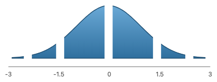

```js
const W = 400;
const inset = 16;
const weights = [1, 1.6, 2.4, 2.4, 1.6, 1]; // picked by hand
const slices = cut(image({ href: bellCurveSvg, w: W, h: 120 }), {
  dir: "x",
  size: weights.map((wt) => datum(wt)),
  inset,
});
const spacer = () => rect({ w: inset / 2, h: 0, fill: "none", stroke: "none" });
const padded = slices.map((slice) =>
  stack({ dir: "x" }, [spacer(), slice, spacer()])
);
const bands = stack({ dir: "x" }, padded).name("bands");
// ...plus about 30 lines that draw an axis by hand with Constraint
```

**Target** (Croissant-10 of a standard normal, target render, geometry computed
by hand in the story):

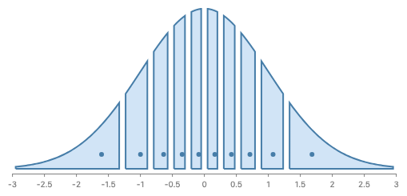

## Prior work

**The paper (Fygenson, Bertini, Padilla, "Croissant Charts: Modulating the
Performance of Normal Distribution Visualizations with Affordances", CGF /
EuroVis 2026, arXiv 2604.04432; code and stimuli on OSF, project txwj5).**

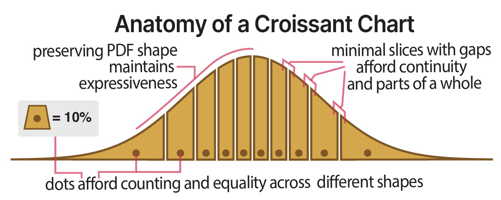

_Figure 4 of the paper, "Anatomy of a Croissant Chart". Credit: Fygenson,
Bertini, Padilla 2026._

- The normal PDF is cut at F⁻¹(k/n), n = 10 or 20. The two tail slices end at
  the edge of the plot window.
- "Modulating" means modulating task performance through affordances. The gaps
  encode nothing: they say "these are parts of one whole".
- The authors' D3 code drops 0.05 x-units on each side of every slice, so the
  gap is a fixed width in data units.
- Each slice is its own closed path with its own full stroke (fill `#D1E4F6`,
  stroke `#467DA8`, 2 px, round join). A clip path cannot do this, since it
  clips away half the stroke.
- One dot per slice, radius 3, all on one baseline row near the axis. The code
  puts each dot at the middle of its slice's x extent. In the published
  figures the two tail dots were moved by hand in Illustrator to about ±1.71σ.
- A legend, a trapezoid with a dot "= 10%", says what one slice is worth.

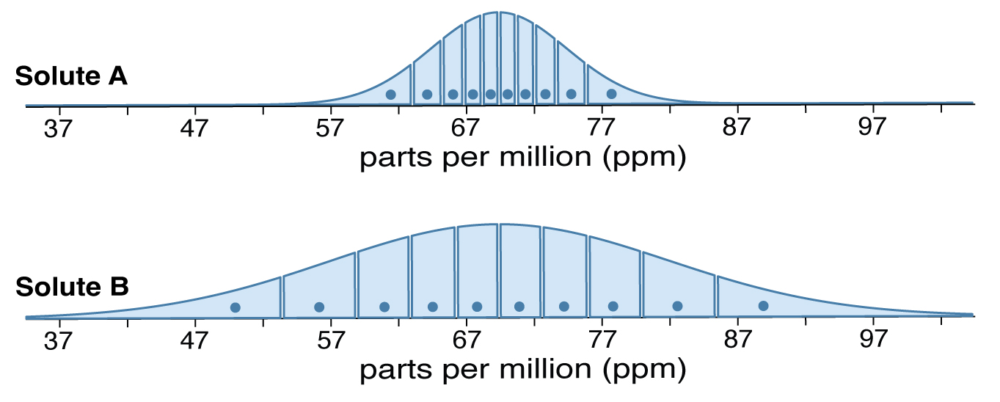

_An OSF study stimulus (equal-height Croissant-10s at two spreads). Credit:
Fygenson, Bertini, Padilla 2026, OSF txwj5._

| System                                   | Spelling                                                                 | Model                                                                                             |
| ---------------------------------------- | ------------------------------------------------------------------------ | ------------------------------------------------------------------------------------------------- |
| Polars                                   | `col("x").qcut(10)` or `qcut([0.1, 0.5, 0.9])`, `allow_duplicates`       | Equal-mass binning as a data operation: a count or a list of probabilities. Errors on tied edges. |
| pandas                                   | `pd.qcut(x, q=10)`                                                       | The same, `q` an int or a list.                                                                   |
| ggridges                                 | `stat_density_ridges(quantile_lines = TRUE, quantiles = 4)`              | Lines at quantiles over a density; `quantiles` a count or a vector of probabilities.              |
| ggdist                                   | `stat_slab(aes(fill = after_stat(level)))`; `stat_dots(quantiles = 20)`  | Slab filled by interval; quantile dotplot with layouts `bin`, `weave`, `hex`, `swarm`.            |
| d3                                       | `pie().padAngle(a)`, `treemap().paddingInner(p)`                         | The gap is padding of the partition, not part of the shapes.                                      |
| SVG                                      | `clipPath`, `mask`                                                       | Paint-time clipping. No new outline, stroke gets clipped.                                         |
| Paper.js                                 | `a.intersect(b)`, `unite`, `subtract`, `exclude`, `divide`               | Path booleans; results are paths you can stroke. `divide` returns all the pieces.                 |
| Illustrator / Figma                      | Pathfinder "Divide", Shape Builder; Figma boolean groups                 | Divide makes real pieces. Figma's boolean group strokes only the outer result.                    |
| Clipper2, polygon-clipping, Skia PathOps | `Intersect(subject, clip)`, `intersection(a, b)`, `Op(a, b, kIntersect)` | Polygon booleans as a library.                                                                    |
| shapely                                  | `split(polygon, line)`, `a.intersection(b)`                              | Split by a line, or intersect.                                                                    |
| polylabel                                | `polylabel(polygon)`                                                     | The point inside a polygon farthest from its edges (pole of inaccessibility).                     |

What fits GoFish: polars and ggridges agree on "a count or a list of
probabilities", which matches `Bin.thresholds(countOrEdges)`. Paper.js and
Illustrator show that the pieces must be real paths, not clips. d3 treats the
gap as padding of the partition, which matches "the gap encodes nothing".
ggdist's slab-by-level fill is a foil: it colors parts of one shape and never
makes pieces, so it cannot stroke each one.

## The independent choices

1. **Where the slice edges come from**: equal-mass cells of a field
   (`Bin.quantiles`).
2. **How the shape is divided**: widen `cut` (A), partition then intersect
   (B), or a new `divide` (C).
3. **Vector or pixel compositing**: what `intersect` does when both operands
   have an outline.
4. **Where the dot goes**: a data fold (median) or a geometric rule.
5. **The gap**: an ink-only inset, in pixels or data units.

Josh asked whether this is binning or partitioning. It is both, in two steps
that already exist for histograms: **binning** (`.bin(Bin.quantiles(10))`)
says which cells there are; **partitioning** (`partition`) places each cell at
its true place on the axis. The new part is the third step, cutting a shape by
the cells, which is compositing.

## Choice 1: `Bin.quantiles(n | [p...])` (new)

```js
field("x").bin(Bin.quantiles(10)); // 10 equal-mass cells
field("x").bin(Bin.quantiles([0.05, 0.25, 0.5, 0.75, 0.95])); // edges at these probabilities
```

```python
field("x").bin(Bin.quantiles(10))
field("x").bin(Bin.quantiles([0.05, 0.25, 0.5, 0.75, 0.95]))
```

- Shape: the same as `Bin.thresholds(countOrEdges)`, a count or a list. A list
  holds probabilities, not data values. Edges come from the field's values in
  the chart's data (type-7 quantiles, the numpy and d3 default). The outer
  edges are the domain's ends, as for `thresholds`.
- Precedent: polars `qcut`, pandas `qcut`, ggridges `quantiles`.
- Tied edges: data with many repeated values (Seattle highs are recorded to
  0.1 °C, with many ties) can give two equal edges, so an empty or very thin
  cell. Polars errors unless `allow_duplicates=True`. See decision 3 and the
  ridgeline render below.
- **The parametric case.** A croissant usually shows a distribution, not a
  sample. Two ways in, neither needing more API:
  - _Quantile rows_ (recommended): derive N rows at x = F⁻¹((i + ½)/N). Their
    sample quantiles fall on the distribution's quantiles to within 1/N, and
    the median of each cell is the conditional median. This is what quantile
    dotplots do. With N = 1000 the edges are off by less than 0.003σ.
  - _A large random sample_ works too but is noisier for the same N.
  - A weighted form, `Bin.quantiles(10, { weight: "pdf" })` over a grid of
    density rows, would make the grid table do both jobs. Left as a question
    (decision 2), since quantile rows already work.

## Approach A: `cut` takes any shape

Widen `cut` to sources that have an outline (a `ribbon`), and let its sizes
come from cells.

```js
chart(grid, { axes: { x: true, y: false } })
  .flow(scatter({ x: "x" }))
  .mark(
    ribbon({
      h: "pdf",
      fill: "#D1E4F6",
      stroke: "#467DA8",
      strokeWidth: 2,
    }).cut({
      dir: "x",
      by: field("x").bin(Bin.quantiles(10, { weight: "pdf" })), // NEW: cells, not weights
      inset: 6,
    })
  );
```

```python
(
    chart(grid, axes={"x": True, "y": False})
    .flow(scatter(x="x"))
    .mark(
        ribbon(h="pdf", fill="#D1E4F6", stroke="#467DA8", stroke_width=2).cut(
            dir="x",
            by=field("x").bin(Bin.quantiles(10, weight="pdf")),
            inset=6,
        )
    )
)
```

- New: `.cut` on a relational mark, `by` on `cut`, the weighted quantile form,
  and vector slicing inside `cut`.
- The ribbon's rows are the density grid, not the samples, so the cells must
  come from a weighted quantile of the grid. The samples cannot drive the cut.
- Axes: `cut` returns an array that a `stack` puts back together, which has
  only a size space. To get an axis, `cut` would need to keep the source's
  position space, which is what `partition` already does.
- Dots: no place for them. A slice is a piece of the shape, with no rows of
  its own, so "the median of the slice" has no meaning without going back to
  the samples.
- Overlap: large and partial with `partition`. Both would turn cells into
  places on an axis, by different routes. This is the regime the API rules ask
  us to avoid (api-design.md, "Overlap is fine at the edges, not in the
  middle").

## Approach B: partition, then intersect (recommended)

The cells come from a `partition` over the samples, so each cell has its rows
and its place on the axis. In each cell, the slice is the density's area
intersected with the cell's region.

```js
const grid = range(-3, 3.001, 0.02).map((x) => ({ x, pdf: normPdf(x) }));
const rows = range(0, 1000).map((i) => ({ x: normInv((i + 0.5) / 1000) })); // quantile rows

chart(grid, { axes: { x: true, y: false } })
  .flow(scatter({ x: "x" }))
  .mark(ribbon({ h: "pdf", fill: "none" }).name("density"))
  .layer(
    chart(rows)
      .flow(partition({ by: field("x").bin(Bin.quantiles(10)), dir: "x" })) // NEW: Bin.quantiles
      .mark(
        layer([
          intersect(
            { fill: "#D1E4F6", stroke: "#467DA8", strokeWidth: 2 }, // NEW: paint on the result
            [ref("density"), region({ inset: 3 })] // NEW: vector intersect; region inset
          ),
          circle({ cx: field("x").median(), cy: 6, r: 3, fill: "#467DA8" }), // NEW: median()
        ])
      )
  );
```

```python
grid = [{"x": x, "pdf": norm_pdf(x)} for x in frange(-3, 3.001, 0.02)]
rows = [{"x": norm_inv((i + 0.5) / 1000)} for i in range(1000)]

(
    chart(grid, axes={"x": True, "y": False})
    .flow(scatter(x="x"))
    .mark(ribbon(h="pdf", fill="none").name("density"))
    .layer(
        chart(rows)
        .flow(partition(by=field("x").bin(Bin.quantiles(10)), dir="x"))
        .mark(
            layer(
                [
                    intersect(
                        [ref("density"), region(inset=3)],
                        fill="#D1E4F6",
                        stroke="#467DA8",
                        stroke_width=2,
                    ),
                    circle(cx=field("x").median(), cy=6, r=3, fill="#467DA8"),
                ]
            )
        )
    )
)
```

| Croissant-10 (target render)        | Croissant-20 (target render)        |
| ----------------------------------- | ----------------------------------- |
|  | 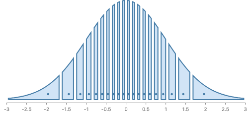 |

### Hard example: penguin body mass

A skewed, two-humped sample (Gentoo penguins are heavier). This is the paper's
own future work: croissants for distributions that are not normal. The data are
samples, so the cells and dots come straight from the rows.

```js
chart(densityOf(penguins, "Body Mass (g)"), { axes: { x: true, y: false } })
  .flow(scatter({ x: "x" }))
  .mark(ribbon({ h: "pdf", fill: "none" }).name("density"))
  .layer(
    chart(penguins)
      .flow(
        partition({
          by: field("Body Mass (g)").dropNulls().bin(Bin.quantiles(10)),
          dir: "x",
        })
      )
      .mark(
        layer([
          intersect({ fill: "#D1E4F6", stroke: "#467DA8", strokeWidth: 2 }, [
            ref("density"),
            region({ inset: 3 }),
          ]),
          circle({
            cx: field("Body Mass (g)").median(),
            cy: 6,
            r: 3,
            fill: "#467DA8",
          }),
        ])
      )
  );
```

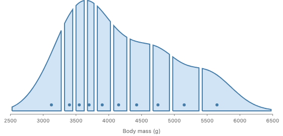

_Target render, geometry computed by hand in the story. The slices are narrow
under the Adelie and Chinstrap hump and wide in the Gentoo shoulder, and every
dot is the median of its cell's penguins._

`densityOf` stands for the user's KDE (the ViolinPlot story uses `fast-kde`'s
`density1d`). GoFish has no density transform, and this proposal does not add
one.

### Hard example: a ridgeline of croissants

One croissant per month of Seattle daily highs. The spelling adds one outer
`spread` to both layers, as in the Ridgeline story.

```js
chart(monthlyDensity, { axes: { x: true, y: false } })
  .flow(
    spread({
      by: field("month").sort(monthNames),
      dir: "y",
      anchor: "baseline",
      spacing: 24,
    }),
    scatter({ x: "temp_max", h: 40 })
  )
  .mark(ribbon({ h: "pdf", fill: "none" }).name("density"))
  .layer(
    chart(seattleWeather)
      .flow(
        spread({
          by: field("month").sort(monthNames),
          dir: "y",
          anchor: "baseline",
          spacing: 24,
        }),
        partition({ by: field("temp_max").bin(Bin.quantiles(10)), dir: "x" })
      )
      .mark(
        layer([
          intersect({ fill: "#D1E4F6", stroke: "#467DA8" }, [
            ref("density"),
            region({ inset: 2 }),
          ]),
          circle({
            cx: field("temp_max").median(),
            cy: 5,
            r: 2,
            fill: "#467DA8",
          }),
        ])
      )
  );
```

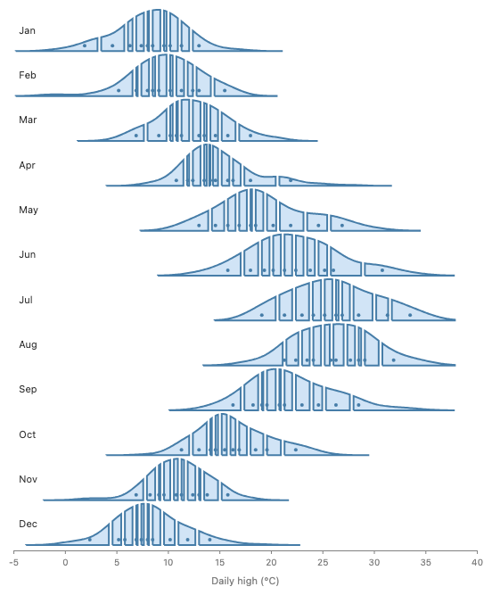

_Target render. Two things this example found: (1) `ref("density")` must mean
"this month's density", so the ref has to resolve inside the month's group,
not across the whole chart (decision 5); (2) Seattle highs have many ties, so
some quantile edges almost coincide and their slices shrink to slivers (April,
October). A data-unit gap swallows such a slice; a pixel inset does too once
the cell is narrower than the inset. This needs a rule (decision 3)._

### General use: the same pieces beyond croissants

A smoothed daily series cut into Calendar months (true month widths, so
February is narrower):

```js
chart(daily2012, { schema: { date: Unit.time() }, axes: { x: true, y: true } })
  .flow(scatter({ x: "date" }))
  .mark(ribbon({ h: "temp_smooth", fill: "none" }).name("temps"))
  .layer(
    chart(daily2012)
      .flow(
        partition({
          by: field("date").bin([Calendar.year, Calendar.month]),
          dir: "x",
        })
      )
      .mark(
        intersect({ fill: "#D1E4F6", stroke: "#467DA8", strokeWidth: 1.5 }, [
          ref("temps"),
          region({ inset: 2 }),
        ])
      )
  );
```

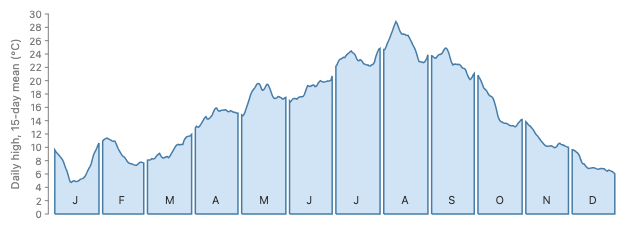

Hexagon cells clipped to a disc (a stand-in for a country outline, as in
#1064):

```js
chart(points)
  .flow(
    partition({ by: struct({ x: "x", y: "y" }).bin(Bin.hex({ radius: 1 })) })
  )
  .mark(
    intersect({ fill: "#D1E4F6", stroke: "#467DA8" }, [
      ref("outline"),
      region({ inset: 1 }),
    ])
  );
```

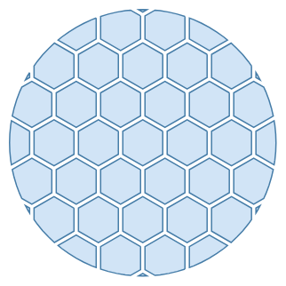

_Target renders, geometry computed by hand. The month render draws its axis
and month letters by hand; with `partition` on a time column the time axis
would come for free._

### What B needs

1. `Bin.quantiles(n | [p...])`. A new `Bin` member. Its cells are ordinary
   line cells, so `partition`, axes and `.format` work as for `thresholds`.
2. Vector `intersect`: when both operands have an outline, compute the path
   intersection and return a node whose outline is the result. Choice 3.
3. Paint options on `intersect` (`fill`, `stroke`, `strokeWidth`) for the
   result. Today `intersect` takes only `blendMode`, and its look comes from
   its operands.
4. `region({ inset })`: pixels drawn in from each side of the cell, ink only,
   as `rect.inset` already does. This is the gap.
5. `field(x).median()`: a new fold, beside `sum`, `mean`, `count`, `distinct`
   (polars `.median()`).
6. A circle with an `x` inside a partition cell sits at that x. Today a mark
   with a size of its own is centered in the cell. Whether `x` already wins
   needs checking; it is not verified.
7. `ref` to a named mark used as a combinator child inside a cell, with the
   source drawn `fill: "none"`. The ref spelling exists; scoping it per group
   (ridgeline) is decision 5.

### Composes with

- **Axes**: the slices live in the partition's cells, which sit on the real x
  scale, so `axes` work. This fixes #544 gap 2 with no new axis code.
- **Coordinate transforms**: outlines are traced in pixels after layout, so a
  partition in `Coord.polar()` gives wedge cells, and intersect cuts a polar
  area into wedges. That is #540's "angular cut" with no `cut` change.
- **Labels and enclose**: the result has an outline, so `.label()` with
  `Place.interior()`, `enclose` and `selectAll` all see the slice.
- **Animation**: each slice is an ordinary node keyed by its cell.
- **Data types**: the cells are `Bin` cells of the field's type; units carry
  through to the axis.

### Overlap check

- **`partition`**: used as is. No overlap.
- **`intersect`**: gains a vector meaning for operands with outlines. The
  pixel meaning stays for images. One operator, dispatching on operand kind
  (choice 3).
- **`cut`**: exact composition. A cut of a source into strips is a partition
  of the source's box into cells, each intersected with the source. So `cut`
  can be defined by that rewrite and keep its spelling for the cases it is good
  at: a fixed source with flex weights and no data (the wine bottle). Its
  `inset` keeps shrinking the box, as decided (#542 is parked). Croissants just
  stop using `cut`, and the spacer-rect recipe leaves the `cut` page.
- **`mask` and `paint`**: unchanged, still pixel operations.
- **`rect.inset`**: `region({ inset })` is the same option with the same
  meaning on the sibling mark. A shared degenerate case, by design.
- **`enclose`**: unrelated. `enclose` grows an outline around members; this
  cuts one.

### Trade-offs

- Easy: every piece is a real node with rows, a place on the axis and an
  outline. Non-croissant uses come for free (months, hexagons, maps).
- Awkward: two layers and a `ref` for one picture. A croissant is about 12
  lines, against about 50 today. A chart template (#35) could hide it later.
- The density is a separate table from the samples, and the user must make it
  (no KDE transform). The two must agree on the x field.
- New terms: none. `quantiles`, `median`, `inset` and `intersect` are all
  existing words.

## Approach C: a `divide` operator

Illustrator's Divide, Paper.js `divide`, shapely `split`: one call that cuts a
shape by a set of cells and returns all the pieces.

```js
chart(rows, { axes: { x: true, y: false } })
  .flow(partition({ by: field("x").bin(Bin.quantiles(10)), dir: "x" }))
  .mark(
    divide({ inset: 3, fill: "#D1E4F6", stroke: "#467DA8" }, [ref("density")])
  );
```

```python
(
    chart(rows, axes={"x": True, "y": False})
    .flow(partition(by=field("x").bin(Bin.quantiles(10)), dir="x"))
    .mark(divide([ref("density")], inset=3, fill="#D1E4F6", stroke="#467DA8"))
)
```

`divide(shape, cells)` is exactly `intersect([shape, region()])` in each cell,
so by the API rules it is at best sugar for B. It also reads oddly in a cell:
each cell divides the shape and keeps one piece, which is an intersect. The
place where `divide` reads well is the combinator form over an explicit list of
cutting shapes, with no partition: `divide([shape, ...cutters])`, Illustrator's
model. That form has no axis and no rows per piece, so it has the same holes as
A. Not recommended; noted as possible sugar if many examples want it.

## Choice 3: vector and pixel compositing in one `intersect`

```js
intersect([ribbonOrPolygonOrRegion, region()]); // both have outlines → path intersection, result has an outline
intersect([image(...), rect(...)]); // an image → pixel compositing, as today
```

- **Rule.** `intersect`, `subtract` and `exclude` compute a path boolean when
  every operand has an outline (`geometry().outline()` today), and return a
  node whose outline is the result. When an operand has no outline (an image),
  they composite pixels as now. This is one operator dispatching on what its
  operands are, the same move as dispatching on the kind of space instead of
  adding a parallel pass. Two operators (`intersect` and a `vectorIntersect`)
  would be a near-duplicate pair, which principles.md, "What follows from it",
  says to fold.
- **Why not clipPath.** A clip path keeps the original stroke and cuts it in
  half at the clip edge. The paper's slices each have a whole stroke, which
  only a new path can give.
- **Paint.** The result needs its own paint. Proposal: `intersect`'s own
  `fill`, `stroke`, `strokeWidth`; operands give shape only. Figma uses the
  bottom layer's style, which would make `fill: "none"` on the density turn
  every slice invisible. Decision 4.
- **What the result is.** A node with an outline, a box that is the outline's
  bounds, and no rows of its own (it sits in its cell, which has rows).
- **Multiple parts and holes.** Intersecting a two-humped area with a
  horizontal band gives two pieces; subtracting a disc from a square gives a
  hole. The `Outline` type is one ring today (#1201). Croissants never hit
  this (an area under a curve cut by a vertical strip is one piece), but the
  general operator does.
- **Dependency.** There is no platform standard for path booleans (`Path2D`
  and SVG have none). Candidates to compare: polygon-clipping (used by Turf),
  a Clipper2 port, Skia PathOps (CanvasKit, a large wasm download), and
  Paper.js (a whole framework). GoFish outlines are point lists in pixels, so
  a polygon library is enough.
- **Found while prototyping.** Every partition cell is convex (intervals,
  rectangles, hexagons, Voronoi cells). Cutting any polygon by a convex cell is
  Sutherland-Hodgman clipping, about 25 lines and no dependency; the hex and
  disc render uses exactly that. It is exact except that a result with several
  parts comes out joined by zero-width seams. So a first version could do
  "intersect with a convex operand" and defer the library. That would be a
  declared shortcut, with the right fix (a real polygon library, multi-part
  outlines) tracked under #1201.

## Choice 4: where the dot goes

Josh's hunch: "most of them seem centered but the ones at the extrema seem
closer to being optically centered? maybe they are at the horizontal centroid
or something?" Here is the same Croissant-10 with each rule, all dots on one
row at 10% of the peak height. The numbers are the right tail dot's x, in σ.

| Rule                                                       | Tail dot     | Render                                |
| ---------------------------------------------------------- | ------------ | ------------------------------------- |
| **Conditional median** (data: the cell's median row)       | 1.645        | 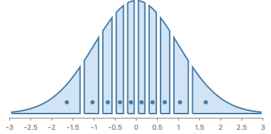    |
| Box midpoint (the authors' D3 code)                        | 2.141        | 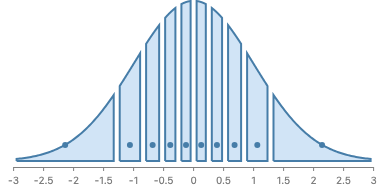      |
| Area centroid x (the conditional mean)                     | 1.771        | 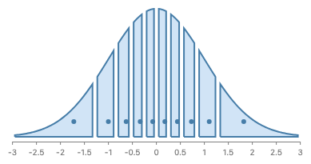  |
| Middle of the slice's chord at the dot's height            | 1.738        |      |
| Pole of inaccessibility (polylabel; like `Place.interior`) | 1.59, raised | 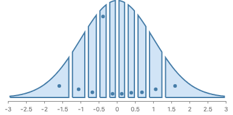 |

- **Box midpoint** puts the tail dots out in the thin tail, far from the ink.
  This is why the authors moved them by hand.
- **The hand placement (about ±1.71σ)** matches the chord rule best: the middle
  of the horizontal line through the slice at the dot's height. At 10% of the
  peak that is 1.74σ; it moves with the dot's height (1.80σ at 7.5%, 1.68σ at
  12.5%). So "optically centered" here means "centered in the ink at that
  height".
- **The area centroid** (Josh's "horizontal centroid") is 1.77σ, close to the
  hand placement too.
- **The conditional median** is 1.645σ, 0.07σ inside the hand placement (about
  4 px at 60 px per σ), and it matches the inner dots exactly. It is the
  quantile dotplot rule.
- **Polylabel** lifts dots off the baseline (they no longer form one row), and
  in tall thin slices its answer is anywhere along the middle line, so dots
  jump (see the fourth slice).

**Recommendation: the conditional median, as data.** `cx: field("x").median()`
is a fold over the cell's rows, so no geometry rule is needed, it is the same
for any distribution, and it says something true: half of the slice's mass is
on each side of the dot. For skewed data (penguins) the geometric rules and the
median disagree more, and the median is the one with a meaning. A user who
wants the hand look can still place a dot by geometry with `.label()` and a
`Place` strategy; no new dot family is needed.

### Rows or the drawn density?

The median of the cell's rows breaks on rounded data. Seattle highs are
recorded in steps, so most quantile edges land exactly on a temperature that
many days share. Those days all fall in the cell that starts there, and that
cell's median is the edge itself. The dot then sits in the gap: 65 of the
ridgeline's 120 dots are not fully inside their slice. Penguin masses are
recorded in 25 g steps and show the same effect more mildly (11 of the 31
birds in one cell weigh exactly 3700 g, so that dot sits a quarter of the
slice left of center).

The cause is a mismatch, not ties as such: the shape is drawn from a smoothed
density, but the edges and dots came from the raw rows. Taking both from the
density that is drawn fixes it. Every dot is then strictly inside its slice,
and no two edges can meet. It is also what the parametric case already does
(quantile rows from F⁻¹).

| From the rows (first version)                                     | From the drawn density                                      |
| ----------------------------------------------------------------- | ----------------------------------------------------------- |
|  65 of 120 dots outside | 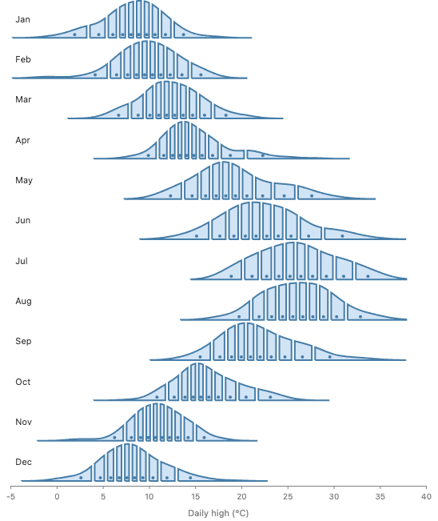 0 of 120 |
|                          |            |

Two spellings read the density (both new; the renders compute the same
numbers by hand):

```js
// (a) Weighted quantiles over the density's own grid rows: one dataset draws
//     the shape, makes the cells and places the dots.
chart(grid) // rows { x, pdf }
  .flow(partition({ by: field("x").bin(Bin.quantiles(10, { weight: "pdf" })) }))
  .mark(circle({ cx: field("x").median({ weight: "pdf" }), cy: 6, r: 3 }));

// (b) Derive quantile rows from the density first, then the unweighted forms.
chart(grid)
  .flow(
    derive((rows) => quantileRows(rows, { x: "x", weight: "pdf", n: 1000 }))
  )
  .flow(partition({ by: field("x").bin(Bin.quantiles(10)) }))
  .mark(circle({ cx: field("x").median(), cy: 6, r: 3 }));
```

**Recommendation: (a).** It keeps one dataset for shape, cells and dots, and a
weight says how much each grid row counts (numpy `quantile(weights=)`). It is
a shortcut: ggdist's `weight` aesthetic is for weighted samples, and with a
distribution object ggdist reads density and quantiles from the object, with
no weight. The clean spelling is a first-class distribution (#980, design note
#983); the weight stands in until then. The unweighted
`Bin.quantiles(n)` over rows stays for when the rows really are the thing
being cut. This folds the old decisions 2 (weighted quantiles) and 3 (ties)
into one question.

### Why the row median misses: one month up close

January only, one x scale. Each small dot is one day, stacked at its recorded
value.

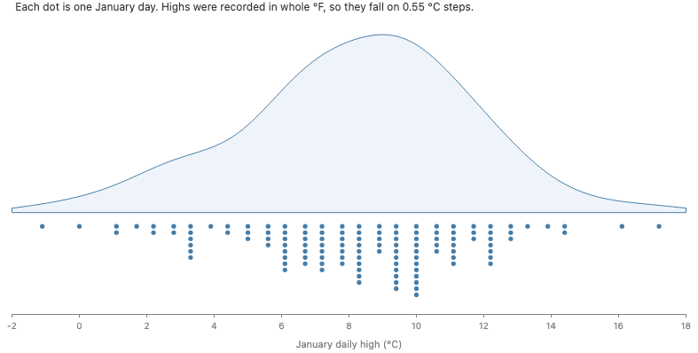

The data. Highs were recorded in whole °F, so in °C they land on steps 0.55°
apart. Many days share each step. The smoothed curve has no steps.

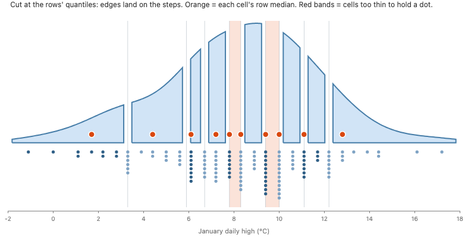

Cut at the rows' quantiles. Each edge lands exactly on a step, so a whole
column of days sits on the edge. Those days count toward the cell on the
right, so that cell's median (orange) is the edge itself, in the gap. Two
cells (red bands) are too thin to draw. In January, 6 of 10 medians miss.

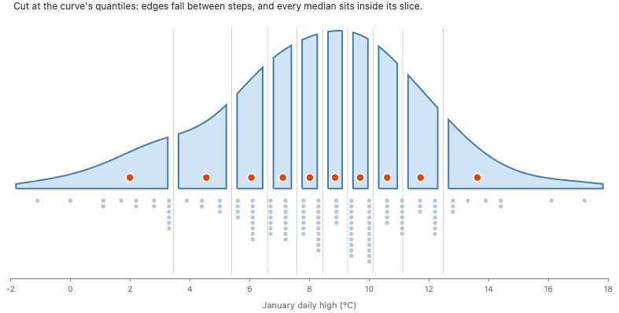

Cut at the curve's quantiles. Edges fall between steps, and every median sits
inside its slice.

| Rule for the dot    | Dots outside their slice (of 120) |
| ------------------- | --------------------------------- |
| Median of the rows  | 65                                |
| Mean of the rows    | 68                                |
| Median of the curve | 0                                 |

The mean does not help: any summary of the rows lands on or between a few
steps. Cut at the rows, 24 of 120 cells are narrower than gap + dot + gap. The
cause is stepped data, not the median. A first-class distribution (#980, #983)
would be the clean spelling of "cut the curve", but the fix does not need it.

## Choice 5: the gap

- **Ink only.** The gap encodes nothing, so it must not move the cells or
  change the axis. `region({ inset })` draws the region in from each side and
  keeps its box, as `rect.inset` does. So `partition` gets no `padding` (d3's
  `paddingInner` moves the cells, which is the wrong model here). This departs
  from the brief's "partition `padding`"; the reason is that ink-only is the
  existing rule for this exact job.
- **Units.** Pixels, as `rect.inset`. The paper uses data units (0.05σ), which
  is the same thing at a fixed scale. A data-unit gap would be the first
  data-unit inset in GoFish. Decision 6.
- **Thin cells.** When a cell is narrower than twice the inset, the slice
  vanishes. With ties (ridgeline) this happens. Options: let it vanish
  silently, clamp the inset, or error. Decision 3 covers the tie case that
  causes it.

## Recommendation

Approach B, with vector `intersect` (one operator, dispatching on operands),
`Bin.quantiles`, `region({ inset })` and `field(x).median()`.

- **It desugars into the core.** A croissant is a `partition`, a `layer` and an
  `intersect`, all existing node kinds. No croissant operator, no croissant
  mark (principles.md, "Why keep the core small", point 3: if a feature
  desugars into the core, it is sound).
- **One concept, one operator.** Path booleans are the compositing operators
  given a vector meaning, not a second family; `cut` becomes an exact
  composition of `partition` and `intersect` (api-design.md, "One concept is
  one operator" and "Overlap is fine at the edges, not in the middle").
- **Composition, not enumeration.** The same three pieces make month-cut areas
  and clipped hexagon maps, which a croissant chart type never would
  (composition-not-enumeration.md, "What GoFish does instead").
- **Meaning on the data.** The cells are a `Bin` value of the field, and the
  dot is a fold of the rows, not a geometric guess (api-design.md, "Meaning
  lives on the data type"; "Channels are chosen by how they aggregate").
- **Names from precedent.** `quantiles` (polars, pandas, ggridges), `median`
  (polars), `inset` (GoFish's own `rect.inset`), `intersect` (settled Figma
  names). No new terms.
- **Same shape in JS and Python.** Every piece is a mark, an operator or a
  `Bin` member that already crosses the bridge as IR.

**Runner-up: Approach A**, if Josh wants croissants as "a cut of a shape"
with the shape as the subject. What would change the pick: if the dots and
the axis turn out not to matter (a decorative croissant), A is fewer lines.
Both still need vector slicing, so choice 3 stands either way.

## Related issues

- #544: croissant charts as a first-class example; `cut` takes only rect and
  image, and the result has no axis.
- #1219: vector region compositing, "to make croissant chart for real".
- #208, #404: the `cut` operator (merged); the syntax revisit is pending.
- #542: ink versus logical box; `cut`'s inset shrinks the box, spacer rects
  stand in (parked).
- #540: `cut` along an angle or radius should be one polymorphic cut; B gets
  it from `partition` in polar coordinates.
- #754: `offset` silently does nothing outside `mask` or `cut`.
- #1209: clipping; "a clip to a box is intersect with a rectangle", the same
  rule as choice 3.
- #48, #305: partition cells (signed off: `.bin` yields cells, `partition`
  requires them).
- #1064: pack inside hexagon cells; cells clipped to a map region is the
  same intersect.
- #974: a geometry boundary query on every node (now `outline`); vector
  intersect reads it.
- #800: `feImage` banned, masks and blend modes instead; the pixel path stays
  on that design.
- #196: Figma names for the compositing operators.
- #1201: outlines lack holes and multiple loops; the general vector boolean
  needs them.
- #35: chart templates, where a one-call croissant could live.

## Decisions for Josh

1. **Vector intersect.** Should `intersect`, `subtract` and `exclude` compute
   path booleans whenever every operand has an outline, and keep pixel
   compositing only for images?
2. **Quantiles of what?** Should a croissant take its edges and dots from the
   drawn density (`Bin.quantiles(n, { weight: "pdf" })` and
   `median({ weight: "pdf" })` over the density's grid rows), as the
   renders now do? Rows give dots in the gaps on rounded data (65 of 120 in
   the ridgeline).
3. **Ties over rows.** When `Bin.quantiles(n)` runs over rows and edges
   coincide: error (polars' default), merge the cells, or keep an empty cell?
4. **Paint of a composite.** Does the result of `intersect` take its own
   `fill` and `stroke`, with operands giving shape only?
5. **Ref scope in groups.** In the ridgeline, should `ref("density")` inside a
   month's cell resolve to that month's density (the nearest one in the same
   group), or do we need an explicit spelling?
6. **Gap units.** `region({ inset })` in pixels like `rect.inset`, or in data
   units like the paper?
7. **First version.** Ship intersect for a convex operand first (no
   dependency, every partition cell qualifies) and add a polygon library with
   #1201, or pick the library now?

## User-facing syntax changes to review

```js
Bin.quantiles(10); // new Bin member
Bin.quantiles([0.05, 0.25, 0.5, 0.75, 0.95]);
field("x").median(); // new fold
region({ inset: 3 }); // new option, same meaning as rect.inset
intersect({ fill, stroke, strokeWidth }, [a, b]); // new paint options; vector when a and b have outlines
circle({ cx: field("x").median() }); // center at the cell median
```

```python
Bin.quantiles(10)
Bin.quantiles([0.05, 0.25, 0.5, 0.75, 0.95])
field("x").median()
region(inset=3)
intersect([a, b], fill=..., stroke=..., stroke_width=...)
```

## Found along the way

- The `cut` docs' "Croissant charts" section and the `CroissantStack` gallery
  story teach the spacer-rect workaround and a hand-drawn axis. Once B lands,
  both should move to the new spelling.
- `polygon` has no `strokeLinejoin`, so the paper's round joins cannot be
  matched; the target renders use miter joins.
- The legend ("trapezoid with a dot = 10%") is a unit legend for a
  part-of-whole encoding. GoFish has no such legend; worth an issue if
  croissants become a gallery example.
- Pixel-space prototype detail: the target renders draw each slice with the
  data-bound `polygon` mark, which already lands on a real axis. That is a
  cheap way to prototype any vector-geometry proposal.
- The dot spelling is `circle({ cx, cy })`, not `circle({ x, y })`. `x` and
  `y` place a circle's left and bottom edge, like `rect`; `cx` and `cy` place
  its center (#1099 made `cx` work). The first renders used `x` and every dot
  sat one radius to the right of its median. A dot read as a point probably
  wants its center by default; that question belongs to #542 (point geometry
  in the box model), not to this proposal.
