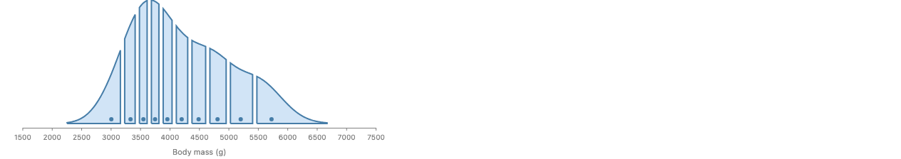
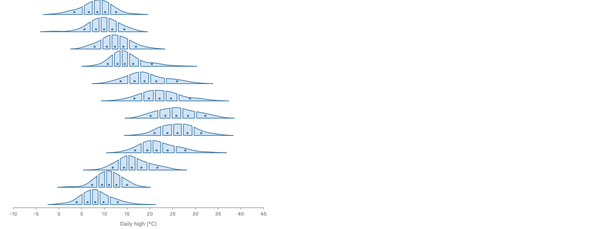

# Croissant Sampling: removing the hand-sampled grids (#1332)

- The croissant stories sample a function by hand (`gridOf`, a hand-rolled `kde`, `quantileRows` over 1000 rows), with grid ranges and sizes picked per story.
- Proposed: the data holds a Dist, as #980 already decided; the cuts and dots read the Dist's quantile function exactly; the curve comes from #980's `densityCurve` helper, whose `n` and range default from the Dist.
- No new mark and no screen-aware sampling yet: at chart sizes a fixed 512 points matches adaptive sampling, and the screen-aware form (a curve in a channel, sampled at layout) is the runner-up for zoom.

## Recommendation

Approach A. The wart is two problems tied together. The cuts were only as good as the grid, and the grid was picked by hand. Reading the cuts from the Dist unties them: the grid then only draws the curve, so a default (512 points over the Dist's own range) is enough, and every default can be written out. Screen-aware sampling (approach B) draws the same pictures for these stories, so it waits for a case that needs it, such as zooming.

## Relation to #980

This is #980's slab path applied to the croissant, not a rival design. #980 (first-class distributions: the data holds a Dist, draws and quantile levels are rows, slab and interval are user code, not marks) already writes a slab as `densityCurve` + `scatter` + `ribbon` and already says a Dist key binned by `Bin.quantiles` is cut at its quantiles. This proposal adds three things #980 left open: the defaults of `densityCurve` (`n: 512`, `range: x.range()`), the croissant as the first story that needs a Dist cut, which deletes `quantileRows` (#1231), and the screen-aware path as an answer to #980's open question of curve summaries in channels. Nothing here adds a mark or reopens a #980 decision.

Artifact: https://claude.ai/artifact/Fh12g89z1cChzAqpQZ8mGH. The #980 proposal is at https://claude.ai/artifact/QKR9jSHs1LWCtjp25bFuBq.

## Rules

1. The function lives in the data as a Dist: `dist.normal({ mean, sd })` over parameter columns, or a smoothed sample `field(x).kde()` per group (#980). User code holds no grid.
2. Cuts and dots read the Dist exactly. `x.bin(Bin.quantiles(n))` cuts a Dist at its quantile function, and a cell's `x.median()` is the quantile at the middle of the cell's probability. `quantileRows` is deleted (#1231).
3. The curve is a data step: `derive((rows) => densityCurve(rows, x))` then `scatter` + `ribbon`, as #980 writes a slab. Its defaults are sugar: `{ n: 512, range: x.range() }`. A normal's range is its 0.001 to 0.999 quantiles; a smoothed sample's is its data plus 3 bandwidths each side.
4. No new mark. The "area that combines scatter and ribbon" is a three-line user function, as #980 decided for the slab.
5. Screen-aware sampling needs the pixel scale, which exists only at layout, after every data step has run. So it can only live in a mark, as a curve in a channel (approach B). It is the runner-up.

## Examples

All renders are real GoFish renders of throwaway prototype stories (`stories/proposals/CroissantSampling.stories.tsx`). The prototype stands in a plain object for the Dist and emulates an exact Dist cut with 2000 of its exact quantiles.

### Croissant of the standard normal


The front-page chart. The grid and its comment about [-3, 3] are gone: the cells end at the normal's quintiles and the dots sit at its 0.1, 0.3, 0.5, 0.7 and 0.9 quantiles, read from the Dist.

Proposed:

```js
const params = [{ mean: 0, sd: 1 }];
const x = dist.normal({ mean: "mean", sd: "sd" });

croissant(params, x, { n: 5, fill: PAPER_FILL, stroke: PAPER_STROKE }).render(
  container,
  {
    w: 480,
    h: 200,
    axes: { x: true, y: false },
  }
);
```

Today:

```js
// The standard normal on [-4, 4]: wide enough that the outer quantile rows
// are accurate (on [-3, 3] the missing tails move the outer cells' medians).
const normalGrid = gridOf((x) => normPdf(x), -4, 4, 401);

croissant(normalGrid, { n: 5, fill: PAPER_FILL, stroke: PAPER_STROKE }).render(
  container,
  {
    w: 480,
    h: 200,
    axes: { x: true, y: false },
  }
);
```

### Penguin body mass, a kernel density estimate



`field(x).kde()` is #980's smoothed sample: one Dist from the rows, with Silverman's bandwidth unless `smoothing` is given. Its cdf is exact (a sum of normal cdfs), so the ten cuts need no grid either.

Proposed:

```js
croissant(penguins, field("Body Mass (g)").kde()).render(container, {
  w: 520,
  h: 220,
  axes: { x: { title: "Body mass (g)" }, y: false },
});
```

Today:

```js
const masses = penguins.map((p) => p["Body Mass (g)"]).filter((v) => v != null);
const massGrid = gridOf(kde(masses).f, 2200, 6800, 461);

croissant(massGrid).render(container, {
  w: 520,
  h: 220,
  axes: { x: { title: "Body mass (g)" }, y: false },
});
```

### Ridgeline of Seattle highs by month



The per-month `flatMap` that built 12 grids by hand is gone. `temp` is one Dist per month, because `kde()` folds the rows of the group it runs in. The chart reads plain weather rows with a `month` column.

Proposed:

```js
const temp = field("temp_max").kde(); // one smoothed Dist per month, from its days

chart(weather, { w: 520, axes: { x: { title: "Daily high (°C)" }, y: false } })
  .flow(
    spread({
      by: field("month").sort(months),
      dir: "y",
      anchor: "baseline",
      spacing: 36,
    })
  )
  .mark(
    layer({ h: 34 }, [
      chart()
        .flow(
          derive((rows) => densityCurve(rows, temp)),
          scatter({ x: "v" })
        )
        .mark(ribbon({ h: "density" }).name("density").hidden()),
    ]).relate(({ density }) => [
      chart()
        .flow(partition({ by: temp.bin(Bin.quantiles(5)), dir: "x" }))
        .mark(
          layer([
            intersect({ fill: FILL, stroke: STROKE, strokeWidth: 1.5 }, [
              density,
              region({ inset: 2 }),
            ]),
            circle({ cx: temp.median(), cy: 5, r: 2.25, fill: STROKE }),
          ])
        ),
    ])
  )
  .render(container);
```

Today:

```js
// One density per month of Seattle's daily highs, each on its own grid from
// three bandwidths below the month's lowest high to three above its highest.
const monthlyDensity = months.flatMap((month, m) => {
  const highs = seattleWeather
    .filter((d) => new Date(d.date).getUTCMonth() === m)
    .map((d) => d.temp_max);
  const { f, bw } = kde(highs);
  const lo = Math.min(...highs) - 3 * bw;
  const hi = Math.max(...highs) + 3 * bw;
  return gridOf(f, lo, hi, 161).map(({ x, pdf }) => ({
    month,
    temp_max: x,
    pdf,
  }));
});

chart(monthlyDensity, {
  w: 520,
  axes: { x: { title: "Daily high (°C)" }, y: false },
})
  .flow(
    spread({
      by: field("month").sort(months),
      dir: "y",
      anchor: "baseline",
      spacing: 36,
    })
  )
  .mark(
    layer({ h: 34 }, [
      chart()
        .flow(scatter({ x: "temp_max" }))
        .mark(ribbon({ h: "pdf" }).name("density").hidden()),
    ]).relate(({ density }) => [
      chart()
        .flow(
          derive((rows) =>
            quantileRows(rows, { x: "temp_max", density: "pdf", n: 1000 })
          ),
          partition({ by: field("temp_max").bin(Bin.quantiles(5)), dir: "x" })
        )
        .mark(
          layer([
            intersect({ fill: FILL, stroke: STROKE, strokeWidth: 1.5 }, [
              density,
              region({ inset: 2 }),
            ]),
            circle({
              cx: field("temp_max").median(),
              cy: 5,
              r: 2.25,
              fill: STROKE,
            }),
          ])
        ),
    ])
  )
  .render(container);
```

### The croissant helper all three stories share

The helper takes the rows and the Dist. The grid, `normPdf`, `kde` and the `quantileRows` step leave user code.

Proposed:

```js
// The croissant of a Dist x over the rows of data: the curve, unseen, then in each of its
// n equal-probability cells the curve's area cut to the cell, and a dot at the cell's median.
const croissant = (data, x, { n = 10, fill = FILL, stroke = STROKE } = {}) =>
  layer([
    chart(data)
      .flow(
        derive((rows) => densityCurve(rows, x)),
        scatter({ x: "v" })
      )
      .mark(ribbon({ h: "density" }).name("density").hidden()),
  ]).relate(({ density }) => [
    chart(data)
      .flow(partition({ by: x.bin(Bin.quantiles(n)), dir: "x" }))
      .mark(
        layer([
          intersect({ fill, stroke, strokeWidth: 2 }, [
            density,
            region({ inset: 3 }),
          ]),
          circle({ cx: x.median(), cy: 6, r: 3, fill: stroke }),
        ])
      ),
  ]);
```

Python:

```python
def croissant(data, x, n=10, fill=FILL, stroke=STROKE):
    return layer(
        [
            chart(data)
            .flow(derive(lambda rows: density_curve(rows, x)), scatter(x="v"))
            .mark(ribbon(h="density").name("density").hidden())
        ]
    ).relate(
        lambda density: [
            chart(data)
            .flow(partition(by=x.bin(Bin.quantiles(n)), dir="x"))
            .mark(
                layer(
                    [
                        intersect(
                            [density, region(inset=3)],
                            fill=fill,
                            stroke=stroke,
                            stroke_width=2,
                        ),
                        circle(cx=x.median(), cy=6, r=3, fill=stroke),
                    ]
                )
            )
        ]
    )


x = dist.normal(mean="mean", sd="sd")
croissant([{"mean": 0, "sd": 1}], x, n=5, fill=PAPER_FILL, stroke=PAPER_STROKE)

croissant(penguins, field("Body Mass (g)").kde())
```

Today:

```js
const normPdf = (x, mu = 0, sd = 1) =>
  Math.exp(-0.5 * ((x - mu) / sd) ** 2) / (sd * Math.sqrt(2 * Math.PI));

// n evenly spaced grid rows { x, pdf } of f over [lo, hi].
const gridOf = (f, lo, hi, n) =>
  Array.from({ length: n }, (_, i) => {
    const x = lo + ((hi - lo) * i) / (n - 1);
    return { x, pdf: f(x) };
  });

// A Gaussian kernel density estimate of values, with Silverman's bandwidth.
const kde = (values) => {
  const n = values.length;
  const mean = values.reduce((s, v) => s + v, 0) / n;
  const sd = Math.sqrt(
    values.reduce((s, v) => s + (v - mean) ** 2, 0) / (n - 1)
  );
  const bw = 1.06 * sd * n ** -0.2;
  return {
    bw,
    f: (x) => values.reduce((s, v) => s + normPdf(x, v, bw), 0) / n,
  };
};

const croissant = (grid, { n = 10, fill = FILL, stroke = STROKE } = {}) =>
  layer([
    chart(grid)
      .flow(scatter({ x: "x" }))
      .mark(ribbon({ h: "pdf" }).name("density").hidden()),
  ]).relate(({ density }) => [
    chart(grid)
      .flow(
        derive((rows) =>
          quantileRows(rows, { x: "x", density: "pdf", n: 1000 })
        ),
        partition({ by: field("x").bin(Bin.quantiles(n)), dir: "x" })
      )
      .mark(
        layer([
          intersect({ fill, stroke, strokeWidth: 2 }, [
            density,
            region({ inset: 3 }),
          ]),
          circle({ cx: field("x").median(), cy: 6, r: 3, fill: stroke }),
        ])
      ),
  ]);
```

### Why the cuts must come from the Dist


Today's spelling over a short grid, [-2.2, 2.2]. Brown dots are today's medians from `quantileRows`; red dots are the exact ones. The outer brown dots sit at ±1.22, not ±1.28, because the cut-off tails are missing from the area. The story's [-3, 3] warning is the same error, smaller (±1.275); [-4, 4] gets ±1.2815. A grid sets both how the curve looks and where the cuts fall, so a user who picks a range for looks moves the cuts without knowing it.

Proposed:

```js
// Proposed: the cuts and dots come from the Dist, so no grid can move them.
croissant(params, dist.normal({ mean: "mean", sd: "sd" }), { n: 5 });
// cells end at x.quantile(0.2), x.quantile(0.4), ...; dots at x.quantile(0.1), x.quantile(0.3), ...
```

Today:

```js
// Today: the cuts and dots come from the grid, so a short grid moves them.
const grid = gridOf((x) => normPdf(x), -2.2, 2.2, 45);
croissant(grid, { n: 5, fill: PAPER_FILL, stroke: PAPER_STROKE });
```

### Does sampling need the screen?


A deliberately narrow kernel (25 g) to stress sampling. Top: 101 evenly spaced points, ggplot2's default, blunts the peaks near 3,800 g. Middle: 512 points, the proposed default. Bottom: adaptive on the screen to half a pixel (emulated with the chart's size), which needs 207 points. Middle and bottom match at this size. Screen-aware sampling saves points but does not change the picture until the view is zoomed.

Proposed:

```js
const mass = field("Body Mass (g)").kde({ smoothing: 25 });

// Top and middle: approach A, a fixed number of evenly spaced points
chart(penguins)
  .flow(
    derive((rows) => densityCurve(rows, mass, { n: 101 })),
    scatter({ x: "v" })
  )
  .mark(ribbon({ h: "density" }));
chart(penguins)
  .flow(
    derive((rows) => densityCurve(rows, mass)),
    scatter({ x: "v" })
  ) // n: 512
  .mark(ribbon({ h: "density" }));

// Bottom: approach B, sampled at layout until within half a pixel
chart(penguins).mark(ribbon({ h: mass.density() }));
```

## Approaches

### A. Sample in a data step, defaults from the Dist (recommended)

```js
// A. Sample in a data step; n and range come from defaults you can write out
chart(data)
  .flow(
    derive((rows) => densityCurve(rows, x)),
    scatter({ x: "v" })
  )
  .mark(ribbon({ h: "density" }));

// written out:
densityCurve(rows, x, { n: 512, range: x.range() });
```

The curve is rows, so every operator, `selectAll` and hover can read it. Range and `n` are written defaults on the helper #980 already has. Not screen-aware: the data step runs before the pixel scale exists.

### B. A curve in a channel, sampled at layout

```js
// B. A curve in a channel, sampled at layout on the screen
chart(data).mark(ribbon({ h: x.density() }));

// written out: the tolerance is in pixels
ribbon({ h: x.density({ tolerance: 0.5 }) });
```

`x.density()` is a curve-valued summary. A path mark given one runs along the curve's range (known in the domain pass) and picks its points at layout, when the pixel scale is solved, with the half-pixel rule `adaptive-resampling.ts` already uses for coordinate transforms. Range is a data question and resolution a screen question, and B puts each where it belongs. Costs: a new kind of channel value, a sampling path in `line` and `ribbon`, and curve points that no other chart can select. It must not be spelled `ribbon({ x })`: a bare Dist in a position channel already means its blurred limit in #980.

### C. An area mark that combines scatter and ribbon

```js
// C. A library mark that combines scatter and ribbon
chart(data).mark(area({ x }));

// It is the user function the #980 grammar already writes, so it needs no library mark:
const area = ({ x, ...paint }) =>
  chart()
    .flow(
      derive((rows) => densityCurve(rows, x)),
      scatter({ x: "v" })
    )
    .mark(ribbon({ h: "density", ...paint }));
```

Josh's idea in the issue. As a library mark it repeats the slab mark #980 decided against on 11-04 (slab and interval are user code). As user code it is approach A with a name, so it survives only as a helper in a story or a how-to page.

## Precedent

| System                  | What the user writes                                   | Range                                                     | Resolution                                                          | Screen-aware                                   |
| ----------------------- | ------------------------------------------------------ | --------------------------------------------------------- | ------------------------------------------------------------------- | ---------------------------------------------- |
| matplotlib              | `ax.plot(xs, f(xs))` over `np.linspace(lo, hi, n)`     | user                                                      | user                                                                | no                                             |
| seaborn `kdeplot`       | `kdeplot(x=...)`                                       | data extent ± `cut=3` bandwidths, `clip`                  | `gridsize=200`                                                      | no                                             |
| ggplot2 `geom_function` | `geom_function(fun = dnorm)`                           | the scale's range (`xlim` overrides)                      | `n = 101`                                                           | no                                             |
| ggdist `stat_slab`      | `aes(xdist = dist_normal(0, 1))`                       | 0.001 to 0.999 quantiles for unbounded dists (`p_limits`) | `n = 501`                                                           | no; quantiles exact from the dist object       |
| Vega-Lite `density`     | `{ density: "x", extent, steps }`                      | data extent, or `extent`                                  | adaptive between `minsteps: 25` and `maxsteps: 200`, unless `steps` | partly: adapts in the curve's own box          |
| Observable Plot         | no function mark; `Plot.line(d3.range(...), { y: f })` | user                                                      | user                                                                | no                                             |
| Mathematica `Plot`      | `Plot[f[x], {x, lo, hi}]`                              | user                                                      | `PlotPoints`, then `MaxRecursion` refinement                        | partly: adapts in the plot's scaled box        |
| d3-geo resample         | `projection.precision(√0.5)`                           | n/a                                                       | adaptive to a pixel tolerance                                       | yes; GoFish's `adaptive-resampling.ts` is this |
| Desmos, function-plot   | `{ fn: "x^2" }`                                        | the viewport                                              | about one sample per pixel, redone on zoom                          | yes                                            |

Every statistics library samples in a data step with a fixed `n` (101 to 512) and a range from the data or the distribution; none is screen-aware. The screen-aware systems (d3-geo, Desmos, function-plot) are the ones built for zoom or projection. ggdist is the closest model: it takes the range from the distribution's quantiles and reads intervals from the distribution, not the grid, which is rule 2 here.

## Similar warts

- `stories/forwardsyntax/Croissant.stories.tsx`: three stories with `gridOf`, `kde` and `quantileRows`, and the Python port `tests/python-stories/forward-syntax/test_croissant.py` (`_grid_of`, `_kde`, `quantile_rows`).
- `stories/lowlevel/NameScope.stories.tsx`: `NestedCallout` and `MedianTrend` sample normal pdfs on hand-written 81-point grids. They become `dist.normal` + `densityCurve`.
- `stories/lowlevel/ViolinPlot.stories.tsx` (gallery) uses `fast-kde`'s `density1d`, and its Python port uses `scipy.stats.gaussian_kde`, so the two curves differ. A library `kde()` fixes that parity gap too.
- `apps/docs/docs/{js,python}/api/operators/derive.md` list `quantileRows` / `quantile_rows`; both entries go with #1231.
- Not this wart: `RidgelineChart.stories.tsx` bins counts by hand (a histogram, not a function), and the `Math.sin` generators in Time, Bin and NestedCharts stories are made-up datasets, not plotted functions.

## Issues cited

- #1332: this issue: remove the `gridOf` sampling wart from the croissant
- #980: distributions as first-class data; this proposal fits its design
- #1231: replace `quantileRows` with first-class distributions
- #544: croissant charts, merged in #1229
- #830: interaction as data; zoom is where approach B pays off

## Open decisions

1. Is a fixed `n: 512` an acceptable default now, with screen-aware sampling (B) left until zoom or pan exists?
2. Default range of an unbounded Dist: its 0.001 to 0.999 quantiles (ggdist), the chart's axis range (ggplot2), or the union of the two?
3. Default range of a smoothed sample: its data plus 3 bandwidths each side (seaborn's `cut`), or cut at the data's ends (ggdist's bounded density)?
4. Spelling of the range method: `x.range()`, or another word? (`support` is wrong: a normal's support is infinite.)
5. An outer cell runs to minus or plus infinity. Should its region stop at the chart's x domain (as the prototype does), or is an infinite cell an error?
