# Croissant Sampling: removing the hand-sampled grids (#1332)

- Today the croissant stories sample a function by hand (`gridOf`, a hand-written `kde`, `quantileRows`), and every line or area chart needs a `scatter` before its `line` or `ribbon`.
- Proposed, part 1: `line` and `ribbon` take their position, `line({ x: "date", y: "price" })`. On a mark that draws one shape through many rows, the position picks the vertices. It rewrites to a `scatter` right before the mark.
- Proposed, part 2: a stacked area is one area of the total, divided by series, as Mascot builds it. GoFish already has Mascot's divide: `cut`. `ribbon({ x, h }).cut({ by: "c", dir: "y" })` divides the area at each x; `cut({ dir: "x" })` at a Dist's quantiles is the croissant. It reads only the mark's own rows, so it is local, and its rewrite is a stack inside each x slice.
- Proposed, part 3: the flow `stack` stays local. It stacks whole children, so a stack of whole ribbons whose height varies is a loud error that points at `cut` and at `spread`.
- Proposed, part 4: `sweep({ v: [a, b] })` makes a row for every v in an interval, so a density draws with no grid.
- Found along the way: GoFish divides a box by weight in three operators (`stack` with `size`, `treemap` with `Tile.slice`/`Tile.dice`, `cut`), and by scale cells in a fourth (`partition`). Drafted as its own issue.

## Recommendation

On hold (round 8): read the Constraints section first; it maps the design space and does not recommend. Round 7's recommendation follows. Divide wins, and it replaces this round's first recommendation, a `.stack()` modifier. The lead: `chart(params).flow(sweep({ v: [-4, 4] })).mark(ribbon({ x: "v", h: x.density("v"), fill: "series" }).cut({ by: "series", dir: "y" }))`. Josh's objection to round 6 stands: a flow `stack` that reaches into each ribbon's x positions is not local. A `.stack()` modifier on each series' ribbon says that it is not local, but it still reaches across marks. Divide does not reach across anything: the ribbon is one area of the total at each x (its `h` adds, as sizes do), and `cut` divides that one mark by its own rows. This is how Mascot draws its stacked area and streamgraph (densify, then divide), and GoFish already took the operator from Mascot as `cut`, with a function twin (`cut(image(), opts)`) as api-design.md asks of a one-child method. The same `cut` along x is the croissant. The reasons GoFish gave against divide were about where it lives (a mark, not an operator) and what it returns (many pieces); `cut` settled both. The `.stack()` modifier is the runner-up: it reads better for stacked lines, which have no extent to divide. The wall from earlier rounds stays: under `sweep` the slices are laid out on demand, and no prototype does that yet.

## Relation to #980

This applies #980 to the croissant; it does not compete with it. #980 (first-class distributions: the data holds a Dist; draws and quantile levels are rows made by `repeat(n, ...)`; slab and interval are user code, not marks) already says that binning a Dist key by `Bin.quantiles` cuts it at its quantiles. `sweep` is the continuous counterpart of #980's `repeat`, and it takes #980's intervals as arguments (`sweep({ v: x.interval(0.95) })`). B answers #980's open question of curve summaries in channels, as the short form of C. A is #980's `densityCurve` helper, which is C over a finite grid. Nothing adds a mark or reopens a #980 decision, and all three delete `quantileRows` (#1231). The continuous-type section ties into #980's scales tab, which says a density's "per" must name the field it is spread over.

Artifact: https://claude.ai/artifact/Fh12g89z1cChzAqpQZ8mGH. The #980 proposal: https://claude.ai/artifact/QKR9jSHs1LWCtjp25bFuBq.

## Constraints: the design space, step by step

This section steps back. It does not recommend a design. It lays out hard examples, spells each one under five ways of factoring the operators, and lists what every design has to satisfy. The rounds below it stay as they were; their recommendation (divide with `cut`) is on hold until this map is read.

The five factorings, the columns of the grid:

- **F1, flow `stack`**: The operator stays local. It lays whole children end to end and adds their sizes. A child with no single size is an error.
- **F2, `.stack()` modifier**: A method on a collective mark (`ribbon`, `line`) that stacks the mark's rows at each position. It rewrites to F5.
- **F3, `cut` on the shape**: Divide one shape you already have into pieces: by weight, by cells, or (proposed) by a group at each vertex of an area.
- **F4, regions plus intersect (Josh)**: No `cut` modes. `stack` and `partition` make regions, which are pieces of space. A shape is divided by intersecting it with those regions, using the region operators that exist today: `intersect`, `atop`, `subtract`, `union`, `exclude` (`graphicalOperators/porterDuff.tsx`).
- **F5, pieces then connect**: Make the pieces at each position with the ordinary flow (`scatter` then `stack`), then join the pieces that share a key with a ribbon. This is what today's stacked area already is: the fused ribbon threads invisible anchors.

| Example | F1 flow stack | F2 .stack() | F3 cut | F4 regions + intersect | F5 pieces then connect |
| --- | --- | --- | --- | --- | --- |
| Stacked area | **can't**: a whole ribbon has no single height | **works**: its rewrite is F5 | **works**: its rewrite is F5 | **awkward**: the regions are the bands, so making them is the whole job; intersecting them with the total area adds nothing | **works**: today (render) |
| Streamgraph | **can't**: as above | **awkward**: no clear place for the centering | **works**: centering on the outer `spread` | **awkward**: as above | **works**: today, the gallery Streamgraph |
| Croissant (quantile cuts of a density) | **can't**: the cells are places on x; nothing adds up | **can't**: as F1 | **works**: but only as a second mode: cells, not weights | **works**: today: `partition` cells intersected with the density | **awkward**: one ribbon per cell from its own rows; neighbors must share their boundary vertex or a sliver opens |
| 100% bar | **works**: `stack` with `size: field(...).normalize()` | **awkward**: the same as F1 on a rect: a second route | **works**: a fixed rect cut by weight (today's pieces draw black) | **works**: the regions are F1's; intersect matters only when the shape is not a rect (PiCCL's alcohol bottle) | **works**: it is F1; there is nothing to connect |
| Stacked bars | **works**: today | **awkward**: a second route to F1 | **awkward**: the total rect must be built first (`h` = the sum), then cut: a second route | **works**: the regions are the bars themselves | **works**: it is F1 |
| Stacked area, each band its own texture | **can't**: as for the stacked area | **awkward**: works only if each series' piece can be an operand of `atop`; untested | **can't**: a cut piece is a clipped copy of the one source's paint; a different image per piece is not in the source | **works**: the band is a region and the texture goes `atop` it (render, emulated) | **works**: F5 makes the bands; F4 fills them (render) |
| Bottle fill (an image masked by a data rect) | **can't**: nothing to stack | **can't**: nothing to stack | **awkward**: the fill is not a division of the bottle: `cut` gives two pieces and one must be blank | **works**: today: `atop([image, rect({ h: "amount" })])` | **can't**: nothing to connect |
| Pie made by dividing a circle | **works**: today: `stack` in clock coordinates | **awkward**: a second route to F1 | **works**: PiCCL's `divide(circle, "angular")`; in GoFish, a cut of the clock-space box, untested | **works**: wedges as regions; PiCCL's pie intersects a picture with each arc | **works**: it is F1 |
| Sankey link divided into strands (#47) | **can't**: the strands run along a curve; no child has one size | **can't**: the link is one ribbon; there is nothing to stack across | **works**: cut the link across its width at each vertex | **awkward**: the regions would be the strands themselves | **works**: #47 anchors: slots on each node side, then connect (render, emulated) |
| Waffle chart | **works**: today it is a `spread` of unit squares, not a stack | **can't**: nothing is continuous | **awkward**: divide a rect into unit cells: the whole is not given, the count is | **works**: each unit is a region, so a texture per unit works | **works**: it is a spread |
| Ribbon chart (Power BI): bars re-sorted by rank at each x, ribbons crossing | **awkward**: draws the sorted bars (`stack` sorted by count inside each x), but not the ribbons | **awkward**: its rewrite is F5, so with a sort inside each x it draws this; but one ribbon with `.stack()` hides that the order changes at each x | **can't**: crossing ribbons overlap between the bars, so they are not a division of one shape | **can't**: as F3: intersected regions are disjoint | **works**: today (render): sorted bars, then a ribbon per species through its pieces |

**What the ribbon chart shows.** A divide (F3, F4) gives disjoint pieces that tile one shape, in one order at every position. In a ribbon chart the pieces swap order between neighboring bars, so the ribbons cross and overlap between the bars. No division of one shape can do that. Pieces-then-connect (F5) can, at the cost of a connection step. So the stacked area is the special case where the order never changes, and that is the only reason it can be read as one divided shape.

**Where F4 meets a wall.** Regions plus intersect removes the `cut` modes for weights (the regions are `stack({ size })`'s) and for cells (the regions are `partition`'s; the croissant does exactly this today). For a stacked area it does not: the regions are the bands, and the bands need a stack at each x (F5) to exist. That is a constraint, not a failure of F4. F4 tells us how to fill, clip and texture a piece; it does not tell us how to make a band.

**Each mode of cut, against F4.** Today's `cut` is `intersect([regionRect.hidden(), offset(source)])` per piece, with the region rects made by a flexbox-style split of the box (`graphicalOperators/cut.tsx`). So: by weight = regions from a weighted split of a box, which is `stack({ size })`; by cells = regions from `partition` (not a `cut` mode today; the croissant spells it with `partition` and `intersect`); by group on an area (proposed) = regions that are the bands, which need F5. One thing `cut` does that F4 does not: it moves each piece away from its source (`offset`, then a `spread` or `stack` lays the pieces out with gaps, as in the bottle stories). Intersect in place cannot explode a shape.

### Stacked area


Render: F5, today's code.

```js
// F1: an error. Each ribbon is a whole child with no single height
chart(rows)
  .flow(stack({ by: "c", dir: "y" }))
  .mark(ribbon({ x: "x", h: "y", fill: "c" }));

// F2: a modifier; rewrites to F5
chart(rows).mark(
  ribbon({ x: "x", h: "y", fill: "c" }).stack({ by: "c", dir: "y" })
);

// F3: cut the total area by c at each x; rewrites to F5
chart(rows).mark(
  ribbon({ x: "x", h: "y", fill: "c" }).cut({ by: "c", dir: "y" })
);

// F4: the regions are the bands, so F5 must make them first
// F5 (today)
chart(rows)
  .flow(scatter({ by: "x", x: "x" }), stack({ by: "c", dir: "y" }))
  .mark(ribbon({ h: "y", fill: "c" }));
```

### Streamgraph

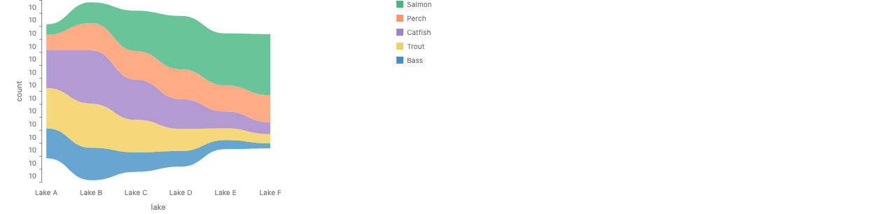

Render: F5, today's gallery Streamgraph (its y labels all read 10, a bug in today's story).

```js
// F3
chart(seafood)
  .flow(spread({ by: "lake", dir: "x", alignment: "middle" }))
  .mark(
    ribbon({ h: "count", fill: "species" }).cut({ by: "species", dir: "y" })
  );

// F5 (today)
chart(seafood)
  .flow(
    spread({ by: "lake", dir: "x", alignment: "middle" }),
    stack({ by: "species", dir: "y" })
  )
  .mark(ribbon({ h: "count", fill: "species" }));
```

### Croissant


Render: F4, the shape of today's croissant code (partition cells intersected with the density).

```js
// F3: a cut by cells, a second mode of cut
chart(days).mark(
  ribbon({ x: "v", h: x.density("v") }).cut({
    by: x.bin(Bin.quantiles(10)),
    dir: "x",
  })
);

// F4 (today's structure): partition makes the cells, intersect divides the density
chart(days)
  .mark(
    ribbon({ x: "v", h: x.density("v") })
      .name("density")
      .hidden()
  )
  .layer(
    chart(days)
      .flow(partition({ by: x.bin(Bin.quantiles(10)) }))
      .mark(intersect([ref("density"), region({ inset: 3 })]))
  );
```

### 100% bar (mosaic)

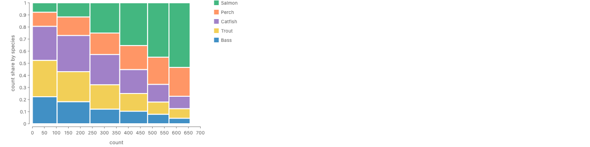

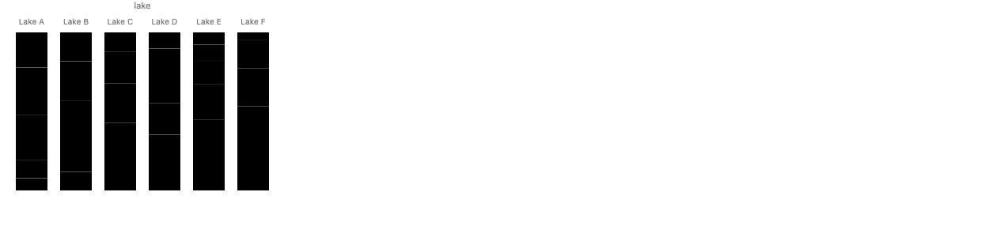

Renders: F1 (`stack` with a normalized `size`), and F3, today's `cut` on a fixed rect, whose pieces do not read `fill`.

```js
// F1 (today): the box is given, the parts are shares
chart(seafood)
  .flow(
    stack({ by: "lake", dir: "x", size: "count" }),
    stack({ by: "species", dir: "y", size: field("count").normalize() })
  )
  .mark(rect({ fill: "species" }));

// F3 (today's cut; the pieces need a stack above them)
chart(seafood)
  .flow(spread({ by: "lake", dir: "x" }), stack({ dir: "y" }))
  .mark(
    rect({ w: 40, h: 200, fill: "species" }).cut({ dir: "y", size: "count" })
  );

// F4: F1's regions, intersected with a shape that is not a rect (PiCCL's alcohol bottle)
chart(seafood)
  .flow(stack({ by: "species", dir: "y", size: field("count").normalize() }))
  .mark(intersect([image({ href: bottle }), region()]));
```

### Stacked bars

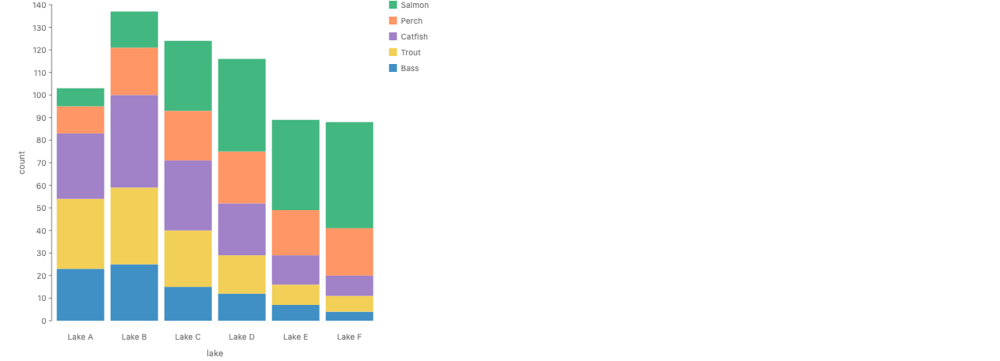

Render: F1, the gallery Stacked Bar Chart.

```js
// F1 = F4 = F5 (today)
chart(seafood)
  .flow(spread({ by: "lake", dir: "x" }), stack({ by: "species", dir: "y" }))
  .mark(rect({ h: "count", fill: "species" }));

// F3: the total bar first, then cut it
chart(seafood)
  .flow(spread({ by: "lake", dir: "x" }))
  .mark(rect({ h: "count", fill: "species" }).cut({ by: "species", dir: "y" }));
```

### Stacked area, each band its own texture

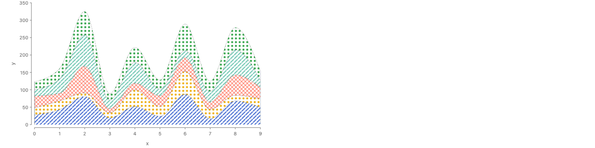

Render: F5 makes the bands, F4 fills each with `atop([ribbon(), image])`. Emulated in one respect: `image`'s `href` is not a channel, so the render draws one layer per band, each filtered to its series. With an `href` channel it is the one layer shown first below.

```js
// F5 then F4, with an href channel (one layer)
chart(rows)
  .flow(scatter({ by: "x", x: "x" }), stack({ by: "c", dir: "y" }))
  .mark(blank({ h: "y" }).name("pts"))
  .layer(
    chart(selectAll("pts"))
      .flow(group({ by: "c" }))
      .mark(atop([ribbon(), image({ href: "texture" })]))
  );

// The render (runs today): one layer per band, since href is not a channel
let c = chart(rows)
  .flow(scatter({ by: "x", x: "x" }), stack({ by: "c", dir: "y" }))
  .mark(rect({ w: 0.1, h: "y" }).name("pts"));
for (let i = 0; i < 10; i++)
  c = c.layer(
    chart(selectAll("pts"))
      .flow(
        filter((p) => project(p, "c") === i),
        group({ by: "c" })
      )
      .mark(
        atop([
          ribbon({ fill: "black" }),
          image({ href: texture(i), w: 480, h: 260 }),
        ])
      )
  );
```

### Bottle fill

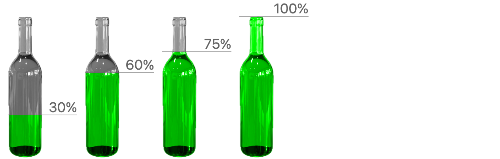

Render: F4, the gallery Bottle Fill Chart (from PiCCL).

```js
// F4 (today): the data rect masks the image
chart(data)
  .flow(spread({ by: "category", dir: "x" }))
  .mark(
    atop({ blendMode: "color" }, [
      image({ href: bottlePng, h: v(100), filter: Filter.grayscale }),
      rect({ h: "amount", w: 175, fill: "#00ff00" }),
    ])
  );

// F3: two pieces, one left blank
chart(data)
  .flow(spread({ by: "category", dir: "x" }))
  .mark(
    image({ href: bottlePng, h: 600 }).cut({
      dir: "y",
      size: ["amount", "rest"],
    })
  );
```

### Pie

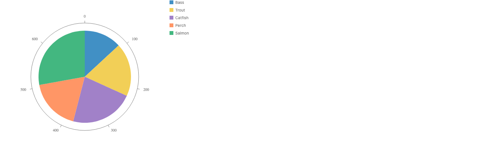

Render: F1, the gallery Pie Chart. A texture per wedge is F4, as in PiCCL's pie example (not rendered: per-piece paint is not a channel, see below).

```js
// F1 (today)
chart(seafood, { coord: Coord.clock() })
  .flow(stack({ by: "species", dir: "x" }))
  .mark(rect({ w: "count", fill: "species" }));

// F4: a picture per wedge (PiCCL's pie), with an href channel
chart(seafood, { coord: Coord.clock() })
  .flow(stack({ by: "species", dir: "x" }))
  .mark(atop([rect({ w: "count" }), image({ href: "picture" })]));

// PiCCL, pie.txt (verbatim, trimmed)
const [pieChart, arc] = PICCL.divide(circle, "angular", {
  key: "type",
  sizeEncode: "amount",
});
const fruit = new PICCL.Picture().mapValue("url", "url");
const pie = PICCL.intersect(fruit, arc);
```

### Sankey link divided into strands

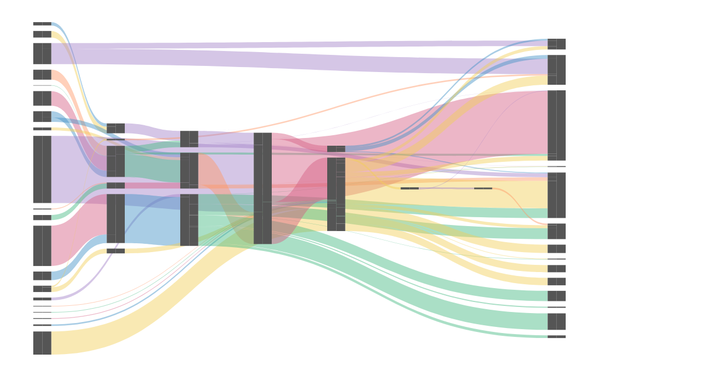

Render: F5 with #47's anchors, emulated on the #47 branch.

```js
// F3: one link, cut across its width into strands
chart(links).mark(
  ribbon({ from: "source", to: "target", h: "value" }).cut({ by: "fuel" })
);

// F5: slots on each node side, then connect (#47's anchors)
chart(flows)
  .flow(resolve(["source", "target"], { from: selectAll("nodes") }))
  .mark(ribbon({ h: "value", fill: "fuel" }));
```

### Waffle chart

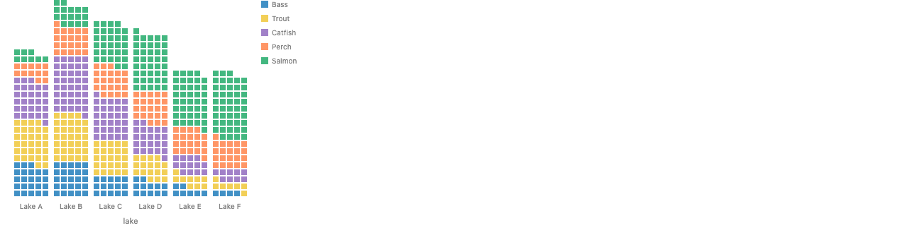

Render: the gallery Waffle Chart, a `spread` of unit squares. It stresses one new thing: the pieces are counted units, so the whole is not given and nothing is divided.

```js
// Today: one square per unit, in rows of five
chart(seafood)
  .flow(
    spread({ by: "lake", dir: "x", spacing: 8, alignment: "end" }),
    derive((d) => d.flatMap((d) => repeat(d, "count"))),
    spread({ by: chunk(5), dir: "y", spacing: 2, reverse: true }),
    spread({ dir: "x", spacing: 2 })
  )
  .mark(rect({ w: 8, h: 8, fill: "species" }));
```

### Ribbon chart

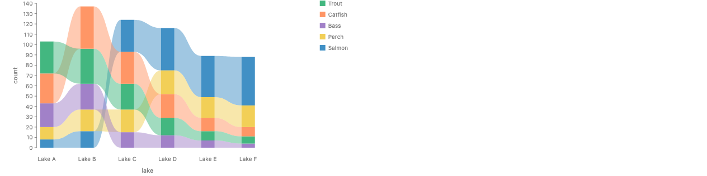

Render: F5, real, today. At each lake the bars are stacked in order of count, so the order changes from lake to lake, and a ribbon per species joins its pieces. The ribbons cross where ranks swap.

```js
// F5 (today): sorted pieces at each lake, then a ribbon per species
chart(seafood)
  .flow(
    spread({ by: "lake", dir: "x", spacing: 48 }),
    stack({ by: field("species").sort("count"), dir: "y" })
  )
  .mark(rect({ w: 24, h: "count", fill: "species" }).name("bars"))
  .layer(
    chart(selectAll("bars"))
      .flow(group({ by: "species" }))
      .mark(ribbon({ fill: "species", opacity: 0.5 }))
  );

// F2: the rewrite is F5, but one ribbon with .stack() hides the reordering
chart(seafood).mark(
  ribbon({ x: "lake", h: "count", fill: "species" }).stack({
    by: field("species").sort("count"),
    dir: "y",
  })
);

// F3, F4: can't. Crossing ribbons are not a division of one shape
```

### Textures per region

- **A band is a region today**: Each operand of `atop` gives its region by its alpha. In the render above, a selection groups the stacked anchors by series and draws `atop([ribbon(), image(...)])`, so the ribbon's band clips the texture. No new operator is needed.
- **What blocks it**: Three gaps. (1) `image`'s `href` is not a channel: a function or a field throws (`href.startsWith is not a function`), so a texture per piece needs one layer per value. PiCCL maps it per piece (`Picture().mapValue("url", "url")`). (2) The fused stacked ribbon cannot be named and read one band at a time: `ref("bands")` is the whole collection, and `bands[i]` gives `atop` one operand. The selection (`selectAll` then `group`) works. (3) A per-piece paint chosen by a function is put through the color scale even when it returns `literal("none")`, so "draw only this piece" cannot be emulated that way (tried for the pie and bars; not kept).
- **Under F3**: A cut piece is a clipped copy of one source. A different image per piece would need `cut` to read paint per piece, which makes it F4 under another name.

### Precedent, as read

- **PiCCL (read: piccl.github.io example specs `pie.txt`, `alcohol.txt`, `cucumber.txt`, `bicycle.txt`, fetched 11-06; and the #47 notes in `proposals/stacked-ribbons/research/piccl-specs.md`)**: `PICCL.divide(object, direction, { key, sizeEncode, gap })` splits a rect or picture along x or y, or a circle or arc by angle or radius, and returns `[collection, part]`. It has both of Josh's factorings. `cucumber.txt` divides a picture directly (GoFish's `image().cut()`). `alcohol.txt` divides a plain rect by `consumption2`, then `PICCL.intersect(bottleShape, collection)`: regions first, then intersect with the picture. `pie.txt` divides a circle into arcs and fills each with its own picture, `PICCL.intersect(fruit, arc)` with `new PICCL.Picture().mapValue("url", "url")`: a texture per piece, by regions plus intersect, with the image's URL as a per-piece channel. Links attach by `linkId`, and their slots on a node's edge are implicit.
- **Mascot (read: `docs/demos/static/stackedAreaChart.js`, `streamGraph.js`; `content/docs/marks/image.md`)**: Per-piece paint after `divide` is an encoding on the piece: `msc.encode(area, "fillColor", "industry", { mapping })`. An image is its own mark (`src`, `x`, `y`, `width`, `height`). A code search of the repository for pattern fills found none.
- **ggpattern (read: the README)**: "Custom ggplot2 geoms which support filled areas with geometric and image-based patterns." There is a pattern twin of each filled geom (`geom_area_pattern`, `geom_ribbon_pattern`, `geom_density_pattern`, `geom_col_pattern`, ...), and the pattern is an aesthetic (`pattern = 'stripe'`, or an image). So in R a texture is a channel of the piece, and a textured stacked area comes free because `position_stack` stacks at each x.
- **Data Illustrator, Charticulator, ggtextures**: Not read this round.

### What type does each operator have?

Terms. A **unit** is what a column's values are measured in (counts, USD, days). A **trait** is something a unit's values can do. The one that matters here is **CanSum**: the amounts add up, so a sum of them means something (money, counts, lengths, but not temperatures or prices). It is declared with `Unit("USD", { traits: [Trait.summable()] })` (`families/trait.ts`). A column with no declared unit passes every check (gradual typing, `addsUp` in `measure.ts`).

Each continuous axis of a node has an extent with an **origin state** (`underlyingSpace.ts`, the essay *Underlying Space*): **pinned** means it is placed at a data position (a scatter's x over [30, 50]); **free** means it is an amount hanging from a baseline nothing has placed yet (a bar of 30 is [0, 30]); **none** means only its width means anything (a centered streamgraph). A **ratio** here is a share of a given whole: weight divided by the total.

| Operator | Takes | Gives | Sums? | Checked today |
| --- | --- | --- | --- | --- |
| stack | children, each with a free extent along `dir` in a unit with CanSum | one space whose extent is the sum; each part is pinned at the running sum of the parts before it | yes | yes: `distribute.ts` calls `currentUnits().sum(q, "stack")` for each free part. A pinned part is not summed; only its width is added. |
| stack with `size` | a size per child: a field in a unit with CanSum, or `field(x).normalize()` | each child wrapped in a box of that size, then a stack. With `normalize`, the sizes are shares that sum to 1, so the whole is the box it is given | yes; with `normalize`, a ratio | yes for a field name (`inferEntrySize` calls `checkSummable`). `normalize` makes a unit with CanSum (`fieldExpr.ts`). |
| spread | any children | separate spaces side by side with gaps; an ordinal axis over the keys | no | nothing to check |
| partition | a key with a region: `field(x).bin(...)` on a continuous column, or `struct({ x, y }).bin(...)` | one cell per bin, pinned at its true place on one continuous scale; a cell's width is a difference of positions | no | the key must make cells; no trait is checked |
| bin | a continuous column | a key whose values are cells | no (quantile bins count rows) | n/a |
| treemap | a size per child, in a unit with CanSum | tiles of a given box, each with area equal to its share of the total | yes, a ratio | yes: `treemap.tsx` calls `checkSummable` |
| cut (a), at positions or cells | a shape on a pinned continuous axis, and cell boundaries | the parts of the shape inside each cell | no; it needs positions whose differences mean something, not sums | not a mode of `cut` today; the croissant spells it as `partition` plus `intersect` |
| cut (b), by weight (`size`) | a box with explicit `w` and `h`, and a weight per piece | pieces whose extents are their shares of the box (raw numbers are absolute pixels) | yes, and it divides by the total: a ratio | a field name, yes (through `inferEntrySize`). The combinator form's `datum()` weights, no: `resolveExtents` sums them with no CanSum check |
| cut (c), by bin cells | as (a) | as (a) | no | not implemented |
| cut (d), an area by a group (proposed) | a ribbon whose `h` at each vertex is the sum of the group's `h` there | one band per group: a stack at each vertex | yes, at each vertex | not implemented; would be `stack`'s check at each vertex |

- **Does cutting imply summability?** By weight, yes, and it needs more than `stack` does. `stack` needs CanSum: the whole is whatever the parts add to. A cut by weight has the whole given and makes each part its share, weight divided by the total. That needs CanSum (for the total) and a total that is not 0, and the result is a ratio, a unitless share. `stack({ size: field(x).normalize() })` and `treemap` already have exactly this type. At positions or cells, no: the cut needs a positioned axis whose differences mean something (a cell's width), and nothing is added. By a group on an area, yes, at each vertex, which is `stack`'s type applied at every x.
- **Is arbitrary cutting a different type from content cutting?** Yes. A geometric cut (at positions or cells) has `partition`'s type: a positioned space in, cells out, no sums. A content cut (by weight or group) has `stack`'s type: amounts with CanSum in, parts end to end out; with the whole given, it is `stack`'s `size` mode or `treemap`. So the two kinds of cutting coincide with operators that exist: the geometric kind with `partition`, the content kind with `stack({ size })`. That is evidence for F4: the regions come from `partition` or `stack`, and intersect does the cutting. One `cut` with both modes would be one name over two types.
- **Is the cut-by-weight property stronger than stack's?** Yes. It is the ratio form: `stack` with a whole given. `stack` with no size has a weaker type (the whole is the sum). The stacked-area cut (d) has `stack`'s weaker type at each vertex: the ribbon's `h` is the sum, so no ratio is needed.

#### Where the code does not check what the types say

- `cut`'s combinator form sums its `datum()` weights with no CanSum check (`resolveExtents` in `cut.tsx`).
- `cut.tsx`'s header says it throws when weights "carry incompatible measure tags", but `resolveExtents` does not check tags.
- All-zero weights pass silently: `weightTotal` falls back to 1, so every piece has size 0. A ratio needs a total that is not 0; this should be an error.
- A sum taken while a chart is built (a size channel, `.sum()`, `treemap`, `cut`, `normalize`) cannot see a unit definition in another chart (`TODO(#1197 follow-up)` in `schema.ts`).
- `partition` checks no trait of its key's unit. A cell's width is a difference of positions, which needs an axis with meaningful differences; there is no check that would catch a key whose differences mean nothing.

### Names: one reading each

- **`.stack()` on a ribbon admits several readings**: Stack the whole ribbons (a ridgeline, which is what the flow `stack` does to whole children today); stack the series at each x in a fixed order (a stacked area); or stack them re-sorted by rank at each x (a ribbon chart).
- **`.cut()` admits one**: Divide the shape you already have. Josh: "ribbon().stack() could wrongly suggest a kind of stacked ribbon chart shape whereas ribbon().cut() doesn't suggest that to me b/c cut implies cutting into stuff whereas there are a few ways you could stack things." This counts for `cut` in the comparison.

### What we know

Every factoring must satisfy these.

1. Stacking must be local: an operator reads only its own children.
2. A band of a stacked area must be usable as a region, for textures, clipping and labels. Today it is, through a selection.
3. Making the bands of a stacked area needs a stack at each x. Regions plus intersect does not remove that step; it only says how to use the bands once they exist.
4. A divide gives disjoint pieces that tile one shape, in one order at every position. Anything whose order changes per position (a ribbon chart) or whose pieces cross must be built as pieces, then connected.
5. Connecting pieces across positions is its own step: a ribbon through the pieces that share a key today, and #47's anchors for slots on a node's side.
6. Per-piece paint (a color, an image, a pattern) must be a channel of the piece. Today `fill` is; `href` is not.
7. A divide by weight needs CanSum and a given whole (a ratio). A divide at positions needs a positioned axis and no sum. They are two types.
8. Pieces may need to move away from their source (an exploded cut with gaps). Intersect in place does not do that; a layout step does.
9. The name should admit one reading.

### What is still open

1. Should `cut` stay as a name, as sugar for regions plus intersect, and if so for which type: weight, cells, or both?
2. Where is the stack at each x written: in the flow inside a `scatter` (today), as a modifier, or as a cut of the total?
3. Should `image` get an `href` channel, so a texture per piece is one mark?
4. How does a spec name one band of a collective mark (`bands[i]` fails today)?
5. Should a ribbon chart have a short form, or is pieces-then-connect its spelling?
6. Data Illustrator, Charticulator and ggtextures are not read yet.

Renders are real GoFish renders. B uses a throwaway prototype node, `packages/gofish-graphics/src/ast/shapes/_prototypeFnCurve.tsx`, which `stories/proposals/CroissantSamplingB.stories.tsx` drives. `fnCurve({ f, range })` stands in for `ribbon({ h: x.density() })`. In both approaches the cut layer emulates an exact Dist cut with 2000 exact quantile rows.

## Streamgraph by scatter, and where centering lives

Josh asked: what about a streamgraph that uses `scatter` (a continuous x) instead of `spread`, and where does the centering go in the short form, where the ribbon does the scattering? The renders below are real GoFish renders on `streamgraphData` (x from 0 to 9, five series c). The stories are in `stories/proposals/StreamgraphScatter.stories.tsx`.

Terms. **Silhouette** (d3's name; Vega-Lite and Plot call it *center*) puts the middle of each x's stack at 0, so the shape is mirror symmetric. **Wiggle** (Byron and Wattenberg 2008) moves the baseline at each x to make the bands as flat as it can. Wiggle is not middle: its baseline at one x depends on every x before it, so no rule that looks at one x at a time can make it.

### The explicit form: `scatter` with `alignment: "middle"`

**Fails today: the alignment is silently dropped.**


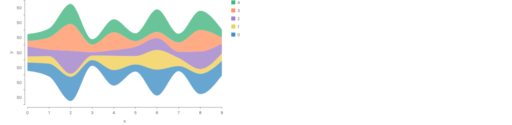

Top: today. The render is the same as with no alignment, and so is `alignment: "end"`. Bottom: the same spec with a prototype fix in the engine (not committed). Each x slice is centered, and the shape is the silhouette streamgraph. Its y labels all read 50, the same label bug as today's gallery Streamgraph (labels on an axis with no origin).

Why it fails. `scatter` places each slice with a point position on x and an align on y (`scatter.tsx`). The layer composes the align into a type with no origin only when the layer holds nothing but aligns, distributes and interval positions; a point position anywhere sends the whole layer to the default union (`planConstraintComposition` in `constraints/compose.ts`: "A *point* position pin ... puts the layer in a different regime"). So the scatter's y stays pinned, each stack counts as placed by its own data (`placedByOwnData`), and the align skips every child without a warning (`lowerAlignPlacement` in `constraints/align.ts`). The spread version works because a spread has no point position. The prototype fix makes the check per axis: a point position on x does not stop the fold on y. With it, the same flow with rects centers each bar too. `"end"` still draws the stacked area, by design: an align by an end or a baseline leaves a child where its data puts it.

```js
chart(streamgraphData)
  .flow(
    scatter({ by: "x", x: "x", alignment: "middle" }),
    stack({ by: "c", dir: "y" })
  )
  .mark(ribbon({ h: "y", fill: "c" }));
```

### No alignment: a stacked area

**Works today.**

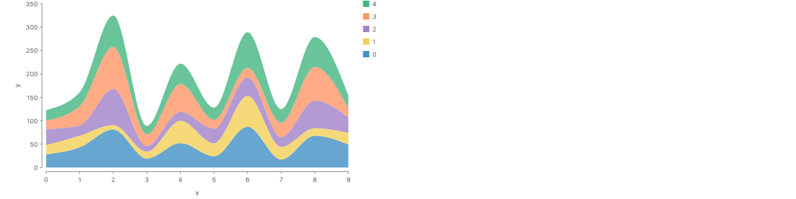

`scatter`'s default alignment is `"baseline"`, so each slice's stack starts at 0.

```js
chart(streamgraphData)
  .flow(scatter({ by: "x", x: "x" }), stack({ by: "c", dir: "y" }))
  .mark(ribbon({ h: "y", fill: "c" }));
```

### (c) A position for each slice: `y: 0`

**Works today.**

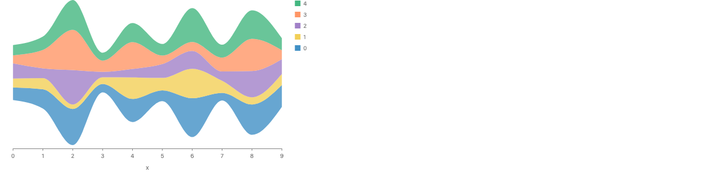

A point position on y centers its child on the datum, so `y: 0` puts the middle of every slice's stack at 0. This is the silhouette, today, with no engine change and no alignment. It loses the y axis: a literal position names no field, so no axis is drawn.

```js
// Runs today
chart(streamgraphData)
  .flow(scatter({ by: "x", x: "x", y: 0 }), stack({ by: "c", dir: "y" }))
  .mark(ribbon({ h: "y", fill: "c" }));

// Proposed short form (c): the whole ribbon is centered at 0, then cut
chart(streamgraphData).mark(
  ribbon({ x: "x", cy: 0, h: "y", fill: "c" }).cut({ by: "c", dir: "y" })
);
```

### Silhouette, computed in `derive`

**Works today.**

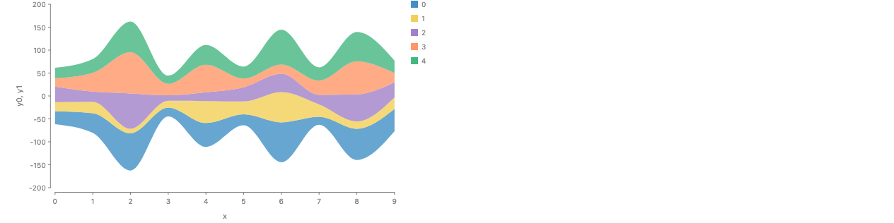

Each band's interval `[y0, y1]` is computed in data, as d3's `stackOffsetSilhouette` does, and a second `scatter` places each piece by `yMin`/`yMax`. No stack and no alignment. The shape is the same as the two renders above, and the y axis is right. `offsetRows` and `silhouette` are 20 lines in the story file.

```js
chart(streamgraphData)
  .flow(
    derive((rows) => offsetRows(rows, silhouette)), // adds y0, y1 to each row
    scatter({ by: "x", x: "x" }),
    scatter({ by: "c", yMin: "y0", yMax: "y1" })
  )
  .mark(ribbon({ fill: "c" }));
```

### Wiggle, computed in `derive`

**Works today (emulated in data).**

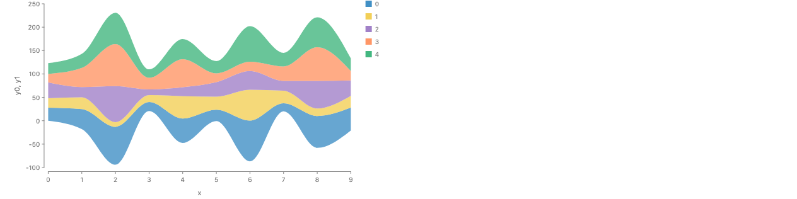

The same, with `wiggle`, a port of d3's `stackOffsetWiggle`. The bands are flatter than the silhouette's, and the shape is no longer symmetric. Only a step that sees every x can draw this: `derive` here, or a `cut` of the whole ribbon (below).

```js
chart(streamgraphData)
  .flow(
    derive((rows) => offsetRows(rows, wiggle)),
    scatter({ by: "x", x: "x" }),
    scatter({ by: "c", yMin: "y0", yMax: "y1" })
  )
  .mark(ribbon({ fill: "c" }));

// If wiggle becomes an option: a strategy on the cut, which sees every x
chart(streamgraphData).mark(
  ribbon({ x: "x", h: "y", fill: "c" }).cut({
    by: "c",
    dir: "y",
    offset: Offset.wiggle(),
  })
);
```

### Where centering could live

- **(a) No sugar for options**: The short form covers the default (a stacked area); to center, you write the `scatter` out with `alignment: "middle"`. Every default desugars to code you can write, as the repo asks. It needs the engine fix above first. It does not compose with `cut`: you leave the short form to center.
- **(b) An option on the ribbon, passed through**: `ribbon({ x, h, alignment: "middle" })` rewrites to `scatter({ by: x, x, alignment: "middle" })`. It would draw the fixed render above. It is a scatter option leaking into a mark: `alignment` means nothing to a ribbon drawn by hand. Observable Plot does exactly this (`Plot.areaY(data, { x, y, offset: "wiggle" })`, because `areaY` applies `stackY` for you), so it has precedent. But it duplicates (c), which needs no new option.
- **(c) A position for the whole ribbon**: Centering is a y position for the band: at each vertex the interval is `[-h/2, h/2]`. Rule 1 already says a ribbon's position channels pick its vertices, and the rewrite already makes a point `y` center each slice (the `y: 0` render). One wrinkle: on a rect, `y` is the start edge and `cy` the center (`boxDims` in `descriptors.ts`). To match rect, the ribbon should spell the center `cy`: `ribbon({ x, cy: 0, h })` is the silhouette, `y: 0` (or nothing) is the stacked area, and `y2: 0` hangs from the top. So scatter's three alignments become rect's three edges, and no option is added. It composes with `cut`: `cy` places the whole ribbon, then `cut` divides it, and the pieces keep the whole's place. It cannot express wiggle.
- **(d) An offset strategy on the stack**: In d3, Vega-Lite and Plot the offset is an option of the stack transform, which sees the whole table. In GoFish the flow `stack` sits inside one x slice and sees only that slice. So `stack({ offset: "center" })` would only center one slice, which is (c) under another name, and wiggle cannot live there: it needs the slices before it. The one GoFish step that sees every vertex and every piece of the ribbon is the `cut`, which reads the mark's own rows. So an offset strategy fits on the cut: `ribbon({ x, h }).cut({ by, dir: "y", offset: Offset.wiggle() })` (a family, as the repo names strategies). Or it stays a data helper in `derive`, as rendered above.

### Precedent

| System | Center | Wiggle | Where the option lives |
| --- | --- | --- | --- |
| d3-shape (read: d3js.org/d3-shape/stack) | `stackOffsetSilhouette`: "Shifts the baseline down such that the center of the streamgraph is always at zero." | `stackOffsetWiggle`, "recommended for streamgraphs in conjunction with the inside-out order" | The stack generator, a data transform: `d3.stack().offset(d3.stackOffsetWiggle)` |
| Vega-Lite (read: vega.github.io/vega-lite/docs/stack.html) | `stack: "center"` ("Stacks around a center baseline, which produces a streamgraph") | none | The position channel, `encoding.y.stack`; or `offset: "center"` in a `stack` transform |
| Observable Plot (read: `src/transforms/stack.js`, `src/marks/area.js`, 0.6.17) | `offset: "center"` (alias `"silhouette"`) | `offset: "wiggle"`; the default order becomes inside-out | The `stackY` transform. `areaY` applies `stackY` itself, so the option is written in the mark's options |
| ggplot2 / ggstream (read: the ggstream README) | core: none (`position_stack`, `position_fill`). ggstream: `geom_stream(type = "mirror")`, "a symmetrical area chart around the x axis" | none | An argument of the geom: `type = "mirror" | "ridge" | "proportional"` |
| Mascot (as read in round 7) | `vertCellAlignment: "middle"` on the layout of the divided pieces | not found | The layout, after the divide |

Every system puts the offset on the stacking step, not on the mark. Plot looks like the exception, but only because its area mark carries an implicit stack transform; the option still belongs to that transform. Wiggle appears only where the stacking step sees the whole table (d3, Plot).

### Recommendation

1. Fix the bug either way. `scatter({ alignment })` on the free axis must not be dropped when the other axis has a point position, and when an align does skip every child, the skip should not be silent. The prototype fix (one check in `planConstraintComposition`, made per axis) draws the silhouette. This should be its own issue.
2. Centering is a position: (c). `ribbon({ x: "x", cy: 0, h: "y", fill: "c" }).cut({ by: "c", dir: "y" })` is the centered streamgraph. It adds no option, reuses rect's `y`/`cy`/`y2`, rewrites to a flow that runs today (`scatter({ by: "x", x: "x", y: 0 })`, then the stack), and centers the whole before the cut, so the pieces keep the whole's place. The explicit form (a) stays available once the bug is fixed.
3. Wiggle is not a position. It needs a step that sees every x. Until someone asks for it, it is a data helper in `derive` (rendered above). If it becomes an option, it belongs on the `cut` as an `Offset` strategy, because the cut is the one local step that sees every vertex of the ribbon. That is an argument for `cut` over the `.stack()` modifier and over the flow `stack`.
4. Reject (b): it moves a scatter option onto a mark and duplicates (c).

### Open

1. `cy` on a ribbon for the band's center, matching rect, or `y` meaning the center as scatter's point `y` does today?
2. Should wiggle be in GoFish at all, and if so, as an `Offset` strategy on `cut`, or as a `derive` helper?
3. A literal `cy: 0` draws no y axis. Should a literal position on an axis with a scale still draw the axis?

## Rules

1. A mark draws one shape per flow cell, as today. A rect, circle or text is one shape with one position, so its channels are values of the cell's rows (a position is their mean today). A line or ribbon is one shape through many points, so its position channels `x`, `y` and `along` are its vertices: one vertex per `along` value (`x` by default). `.mark(R({ x, y, along, ...rest }))` is `.flow(..., scatter({ by: along ?? x, x, y })).mark(R(rest))`.
2. Which rows join: the rows of one flow cell, as #786 decided. In what order: the `along` key's order.
3. The flow `stack` is local: it lays its children end to end and adds their sizes. Each child must have one size along `dir` that can be added (CanSum, #1311). A child with no single size (a ribbon over many x positions, a `spread` of bars) is an error whose message names the child, `cut` and `spread`.
4. `cut` divides one mark by its own rows (Mascot's divide). By weight: `cut({ by, dir, size })`, the pieces share the mark's extent. By cells: `cut({ by: x.bin(...), dir })`, the pieces are the mark's parts inside each cell. On a ribbon or line, a cut across the path divides the extent at each vertex, and rewrites to `stack({ by })` inside each vertex slice.
5. A cut mark's paint channels are read per piece, so `ribbon({ fill: "c" }).cut({ by: "c" })` gives each piece its color. (Today a paint field that varies inside one ribbon is an error, and today's cut slices do not read paint.)
6. `sweep({ v: [a, b] })` replaces each row with a continuum of rows over [a, b]; `repeat(n)` stays discrete (#980). After `sweep`, `spread`, `sort`, `count` and a mark per row are errors, and `line` or `ribbon` sample the continuum to half a pixel.
7. A channel reads a Dist at the index: `x.density("v")`, `x.cdf("v")`, as #980's `x.quantile("p")` reads a level. `ribbon({ h: x.density() })` with no x is short for the whole spec over `x.range()` (approach B). Dots read the Dist exactly: `x.median()`.

## Line and ribbon take their position

One rewrite, written out. The renders run it: `xy()` in `stories/proposals/LineRibbonXY.stories.tsx` builds the flow the rewrite gives.

```js
// 1. Position on a line or ribbon (R) picks its vertices: one per `along` value (x by default)
chart(data)
  .flow(...ops)
  .mark(R({ x, y, along, ...rest }));
chart(data)
  .flow(...ops, scatter({ by: along ?? x, x, y }))
  .mark(R(rest));

// 2. cut on a ribbon divides its extent at each vertex: a stack inside each vertex slice
chart(data)
  .flow(...ops)
  .mark(ribbon({ x, h, ...rest }).cut({ by: k, dir: "y" }));
chart(data)
  .flow(...ops, scatter({ by: x, x }), stack({ by: k, dir: "y" }))
  .mark(ribbon({ h, ...rest }));
```

### Line chart

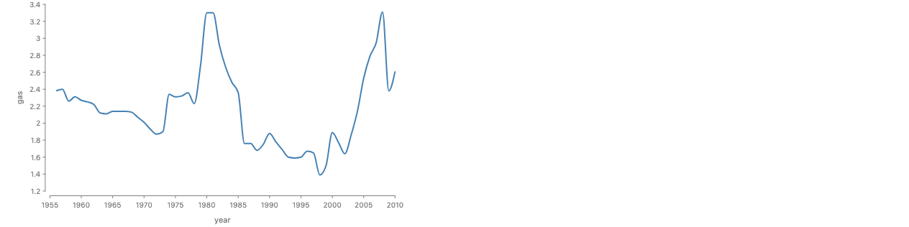

One line through all the rows, in year order. The gallery Line Chart today.

```js
chart(drivingShifts).mark(line({ x: "year", y: "gas", stroke: "steelblue" }));
```

Python:

```python
chart(driving_shifts).mark(line(x="year", y="gas", stroke="steelblue"))
```

Today:

```js
chart(drivingShifts)
  .flow(scatter({ by: "year", x: "year", y: "gas" }))
  .mark(line({ stroke: "steelblue" }));
```

### One line per stock

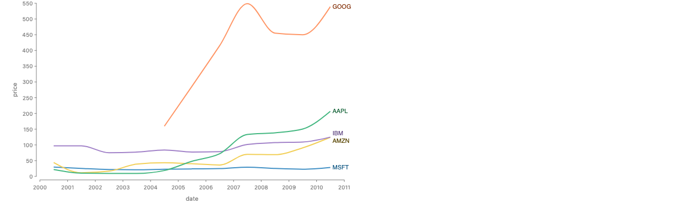

The grouping stays in the flow, so the rule for which rows join is the one #786 shipped. Only the `scatter` goes. (The gallery Line Chart with End Labels today.)

```js
chart(stocks, { schema: { date: Unit.time() } })
  .flow(group({ by: "symbol" }))
  .mark(
    line({ x: "date", y: "price", stroke: "symbol" }).label("symbol", {
      position: Place.end(),
    })
  );
```

Python:

```python
(
    chart(stocks, schema={"date": Unit.time()})
    .flow(group(by="symbol"))
    .mark(line(x="date", y="price", stroke="symbol").label("symbol", position=Place.end()))
)
```

Today:

```js
chart(stocks, { schema: { date: Unit.time() } })
  .flow(group({ by: "symbol" }), scatter({ by: "date", x: "date", y: "price" }))
  .mark(
    line({ stroke: "symbol" }).label("symbol", {
      position: Place.end(),
    })
  );
```

### Area chart

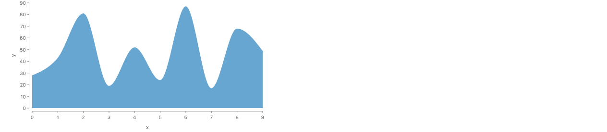

`ribbon` with `x` and `h`. The ribbon's `h` already goes to an invisible anchor today (#748); `x` joins it.

```js
chart(rows).mark(ribbon({ x: "x", h: "y" }));
```

Today:

```js
chart(rows)
  .flow(scatter({ by: "x", x: "x" }))
  .mark(ribbon({ h: "y" }));
```

### Stacked area chart: one area, divided


Without the `cut`, `ribbon({ x, h })` is the total area: one vertex per x, its `h` the sum of the series there. `cut` divides it by c at each x. The render runs the rewrite, a `scatter` by x and a stack inside each slice. The second spelling is the runner-up, a stack modifier on the series ribbons.

```js
// One area of the total at each x, divided by series
chart(rows).mark(
  ribbon({ x: "x", h: "y", fill: "c" }).cut({ by: "c", dir: "y" })
);

// Runner-up: a stack modifier on the series ribbons
chart(rows).mark(
  ribbon({ x: "x", h: "y", fill: "c" }).stack({ by: "c", dir: "y" })
);
```

Python:

```python
chart(rows).mark(ribbon(x="x", h="y", fill="c").cut(by="c", dir="y"))
```

Today:

```js
chart(rows)
  .flow(scatter({ by: "x", x: "x" }), stack({ by: "c", dir: "y" }))
  .mark(ribbon({ h: "y", fill: "c" }));
```

### Streamgraph


The lakes are a `spread` centered on the baseline (`alignment: "middle"`, as Mascot's `vertCellAlignment: "middle"`). The ribbon is each lake's total, divided by species. The rewrite is today's gallery Streamgraph, and the render is it. (The y labels all read 10 here, a bug in today's story.)

```js
chart(seafood)
  .flow(spread({ by: "lake", dir: "x", spacing: 64, alignment: "middle" }))
  .mark(
    ribbon({ h: "count", fill: "species" }).cut({ by: "species", dir: "y" })
  );
```

Today:

```js
chart(seafood)
  .flow(
    spread({ by: "lake", dir: "x", spacing: 64, alignment: "middle" }),
    stack({ by: "species", dir: "y" })
  )
  .mark(ribbon({ h: "count", fill: "species" }));
```

### Stacked lines: where divide falls short

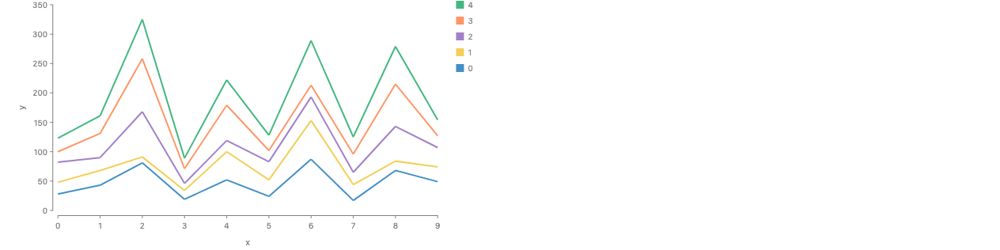

A line has no extent, so there is nothing to divide. As a cut, stacked lines are the top edges of the divided area, which needs an edge-only paint GoFish does not have. The stack modifier spells it directly. Today it needs `h` on the line's invisible anchors and `source`/`target` pinned to their tops (render).

```js
// Runner-up only: cut divides an extent, and a line has none
chart(rows).mark(
  line({ x: "x", y: "y", stroke: "c" }).stack({ by: "c", dir: "y" })
);

// With cut, the lines are the top edges of the divided area: a gap (no edge-only paint today)
chart(rows).mark(
  ribbon({ x: "x", h: "y", stroke: "c", fill: "none" }).cut({
    by: "c",
    dir: "y",
  })
);
```

Today:

```js
// Today: line runs through the tops of stacked invisible anchors
chart(rows)
  .flow(scatter({ by: "x", x: "x" }), stack({ by: "c", dir: "y" }))
  .mark(
    line({ h: "y", stroke: "c", source: { y: "end" }, target: { y: "end" } })
  );
```

### Error: the stack written in the flow

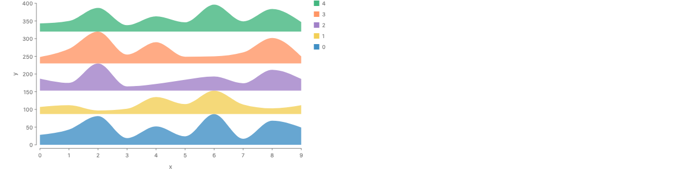

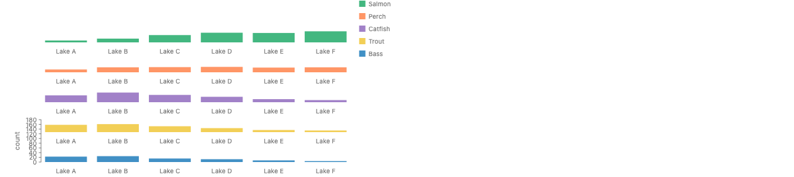

The flow `stack` stacks whole children, and a whole ribbon has no single height, so this spec is an error. The renders show what today's engine draws instead: each series as one box as tall as its peak, and for bars, whole rows of bars piled up. No story or test writes `stack` before a `spread`, `scatter` or `group` (combinator forms not searched).

```js
chart(rows)
  .flow(stack({ by: "c", dir: "y" }))
  .mark(ribbon({ x: "x", h: "y", fill: "c" }));

// Error: stack({ by: "c", dir: "y" }) adds the heights of its children, but
// child c = 0 has no single height: it is a ribbon over 10 x positions, with
// a different height at each. To divide the area at each x by c, cut the mark:
//   ribbon({ x: "x", h: "y", fill: "c" }).cut({ by: "c", dir: "y" })
// To give each series its own baseline (a ridgeline), use spread:
//   spread({ by: "c", dir: "y", anchor: "baseline" })
```

```js
chart(seafood)
  .flow(stack({ by: "species", dir: "y" }), spread({ by: "lake", dir: "x" }))
  .mark(rect({ h: "count", fill: "species" }));

// Error: stack({ by: "species", dir: "y" }) adds the heights of its children,
// but child species = "Bass" has no single height: it is a spread of 6 lakes.
// To stack the species in each lake, put the stack after the spread:
//   spread({ by: "lake", dir: "x" }), stack({ by: "species", dir: "y" })
```

### Ridgeline: a spread

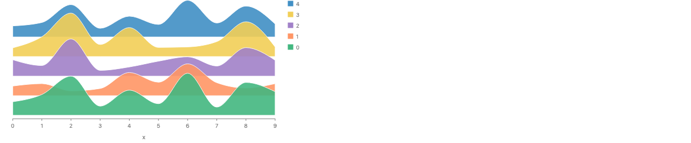

Each series keeps its own baseline space, so the ridges overlap where a row is taller than the pitch. Same structure as the gallery Ridgeline Chart (`spread` with `anchor: "baseline"`).

```js
chart(rows)
  .flow(spread({ by: "c", dir: "y", anchor: "baseline", spacing: 36 }))
  .mark(ribbon({ x: "x", h: "y", fill: "c" }));
```

Today:

```js
// the gallery Ridgeline Chart, same structure
chart(rows)
  .flow(
    spread({ by: "c", dir: "y", anchor: "baseline", spacing: 36 }),
    scatter({ by: "x", x: "x", h: 80 })
  )
  .mark(ribbon({ h: "y", fill: "c" }));
```

### History: how line, ribbon and stack got here

- **#511 / #519 (merged)**: Added `.connect(line())` as builder sugar for connecting a chart's marks.
- **#745 (merged)**: Deleted `.connect()` in favor of `.layer()` with relational marks. Rejected: inferring which marks a connector joins from intent. Josh: intent-detection rules "feel spooky". Kept: `by` on the mark, paint under its operands.
- **#748 (merged)**: Fusion sugar: `.mark(R(opts))` is `.mark(blank(anchor(opts))).layer(R(rest))`. The anchor takes only `w`, `h`, `emX`, `emY`; all paint goes to the connector. Stacked area and streamgraph stayed in the two-tier form in the gallery, because the fused "spread + stack then ribbon" was hard to read.
- **#786 (merged)**: A fused connector takes its grouping from the flow: the path tier threads as one path, every other tier splits. `along` names the path tier. `by` was removed from `line` and `ribbon`; an array `along` and `by: null` were rejected. A paint field that varies inside one path is a loud error.
- **#290 (open)**: Stack as a mark method. Josh's 07-10 note: for connectors a mark-side `.stack()` can only mean stacking the rows (stacking whole ribbons draws a ridgeline), so it is a spelling of the flow `stack`, not a new operation; ggplot's position adjustments mark the boundary of what could go mark-side. The waffle case was later solved by `wrap`, so `stack` keeps one meaning, a hard seam, at every level.
- **#47 (open)**: Stacked ribbons. Its approach C, `ribbon().stack()` (including `ribbon({ h }).stack({ by: "series" })` for a stacked area), was rejected as a second route to the flow `stack`. Its current direction is anchors: `.anchor({ name, position: "x-max", slots: data().flow(stack(...)) })`, a flow along a mark's side, with ribbon widths from the slot sizes and references like `nodes.out`.
- **Josh, 11-06**: A ridgeline is not a stack, because the subregions do not add up. `stack` glues spaces into one by adding them (CanSum, #1197 and #1311); `spread` keeps them separate.
- **Josh, 11-06, on round 6**: A flow `stack` that draws a stacked area "just doesn't work like any other operator"; a stack modifier says it "does something non-operator-like the same way labels do", something "not completely local". And: `stack` "fights the typical hierarchy" and overlaps with spread, partition and treemap.
- **api-design.md**: A method chain reads or branches on the caller's state; an option is a local adjective. A method has a function twin only for a one-child operator. `stack` and `spread` differ in spaces (stack glues children into one space), not in spacing.
- **memory note**: `.connect()` as the canonical line form is out of date: #745 deleted it. The canonical form today is a `scatter` in the flow and a fused `line` in `.mark()`.

### Does this answer the past objections?

- **"Which rows join" (#745, #786)**: Unchanged: rows join within one flow cell. A divided ribbon's pieces join by the cut's `by` key, which is written.
- **"In what order"**: The `along` key's order, `x` when `along` is absent. Sorting by x (ggplot's `geom_line`) is a decision.
- **"Spooky action" in fusion (#748)**: `x`, `y` and `along` become a `scatter`, the same kind of written rewrite #748 already does for `h`.
- **Josh on round 6: not local**: Answered by divide: `cut` reads only its own mark's rows. Round 7's first answer, a `.stack()` modifier, made the non-locality visible; divide removes it.
- **Stack as a mark method (#290)**: Not needed. #290's note said a mark-side stack on a connector can only mean stacking the rows; the divide does that work from the parent's side.
- **#47, approach C**: C was `ribbon().stack()`, rejected as a second route to the flow `stack`. The lead no longer uses it, so #47's decision stands; picking the runner-up would reverse it. `ribbon().cut()` divides one ribbon, and that fits #47's title, "Stacked/Divided Ribbons": a sankey link divided lengthwise into strands is the same `cut`.
- **The methods rule (api-design.md)**: `cut` is the rule's own example of a method with a function twin: `image(...).cut(opts)` is `cut(image(...), opts)`. On a ribbon it is still one child.
- **`ChartBuilder.stack()`**: `chart(d).stack(s)` is sugar for `.flow(stack(s))`, the local operator, so `chart(d).stack(s).mark(ribbon({ x, h }))` is the error case. Keep it or remove it is a decision.

### Why line and ribbon, but not rect

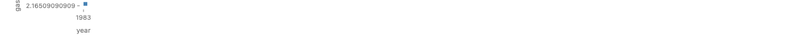

```js
// Today: one rect for the whole chart, at the mean year and mean gas
chart(drivingShifts).mark(rect({ x: "year", y: "gas", w: 6, h: 6 }));

// One rect per year needs the flow to make one cell per year
chart(drivingShifts)
  .flow(scatter({ by: "year", x: "year", y: "gas" }))
  .mark(rect({ w: 6, h: 6 }));

// One line for the whole chart; x and y are its vertices
chart(drivingShifts).mark(line({ x: "year", y: "gas" }));
```

Today `chart(drivingShifts).mark(rect({ x: "year", y: "gas" }))` draws one rect, at the mean year and mean gas (render). A rect is one shape with one position, so its position channel aggregates its cell's rows (positions average, sizes add, #1197). To get one rect per year, the flow makes one cell per year. Which cells, and how they are arranged (`scatter`, `spread`, `stack`), is a real choice, and it belongs in the flow.

A line or ribbon is one shape with many positions. Its `x` cannot be one mean value; the only reading is a list, one vertex per row group. So the sugar adds no choice: the cells of a path are always one per `along` value, placed at x, which is `scatter`. The rule a user can predict: a mark's channels describe one shape per cell; for a shape with one position they are values of the cell, for a shape through many points they are its vertices.

The same split explains the divide. A rect's `h` over its rows is their sum, so a rect with a `cut` is a bar divided. A ribbon's `h` at each vertex is the sum of that vertex's rows, so a ribbon with a `cut` is an area divided at each x. Where it stops: a line through the tops of a bar chart's bars has no data x, so it keeps the flow form.


### A twin mark (`area`, `path`) instead?

```js
// A twin mark (not recommended): stacking would live in the mark
chart(rows).mark(area({ x: "x", y: "y", fill: "c" })); // stacks by fill
chart(rows).mark(ribbon({ x: "x", h: "y", fill: "c" })); // does not

// and the line would need one too, for its order
chart(rows).mark(line({ x: "x", y: "y" })); // sorted by x
chart(rows).mark(path({ x: "x", y: "y" })); // data order
```

An `area` mark with stacking built in would be `ribbon` plus a default division. Two names for one shape that differ only in a default is the overlap the repo rules forbid (one concept, one operator; consolidate on the current name). ggplot's `geom_area` is a `geom_ribbon` with a default position, and GoFish has no default positions. Josh's point holds too: `line` would need a twin, and no name tells them apart.

The line twin is about order, not stacking. ggplot's `path` is the precedent name, and clearer than `link`. But the difference is one choice, sort or keep data order, which fits an option of `line` better than a second mark.

- **ggplot2**: `geom_area` stacks by default (`position = "stack"`); `geom_ribbon` does not and takes `ymin`/`ymax`. `geom_line` sorts by x; `geom_path` keeps data order.
- **Vega-Lite**: `area` stacks by default when a non-position channel maps a field; `line` connects in x order unless an `order` channel is given; `trail` is a separate mark.
- **Observable Plot**: `areaY` does not stack by itself; a `stackY` transform does it. `line` keeps data order (from memory).

## What is stack?


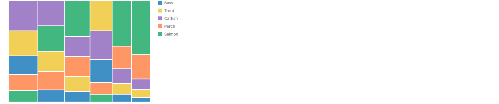

```js
// stack with `size`: the box is given, and the children divide it by weight
chart(seafood)
  .flow(
    stack({ by: "lake", dir: "x", size: "count" }),
    stack({ by: "species", dir: "y", size: field("count").normalize() })
  )
  .mark(rect({ fill: "species" }));

// treemap with Tile.dice, then Tile.slice: the same division
chart(seafood)
  .flow(
    treemap({ by: "lake", size: "count", tile: Tile.dice }),
    treemap({ by: "species", size: "count", tile: Tile.slice })
  )
  .mark(rect({ fill: "species" }));
```

- **Two jobs share one name: yes**: (a) Lay whole children end to end so their sizes add up to the whole (bars, a mosaic's segments). Local, and it needs CanSum. (b) A running sum per position for a collective mark: at each x, the heights of the series below. (b) is a computation across marks along a key, which is why it fights the mark hierarchy when it is spelled on the series.
- **Two directions, one rule**: The rule: the whole's size is the sum of its parts along one axis. Bottom-up, the parts are given and the whole is their sum: `stack`. Top-down, the whole is given and the parts divide it: by weight (`stack` with `size`, `treemap` with `Tile.slice` or `Tile.dice`, `cut` with `size`), or by cells of a scale (`partition`, `cut` by a binned key). Job (b) read top-down is a divide of the total, which is local. That is why divide fits it.
- **Is `partition` the twin of `stack`? No**: `partition` places each group in the cell of a binned key at its true place on one continuous scale (descriptors.ts). Its sizes come from the scale, not from siblings. The weight-divider is `stack`'s own `size` mode.
- **Overlap regime: a large partial overlap**: Dividing a box by weight along one axis is spelled three ways: `stack({ size })`, `treemap({ tile: Tile.slice })` and `cut({ size })`. The mosaic renders show the first two drawing the same picture (treemap also sorts by size). That is a design smell, separate from this proposal; drafted as `issues/stack-divide-family.md`. `stack`'s descriptor doc also still says "`spread({ glue: true })`", the framing Josh rejected on 11-05.
- **(b) as a data transform?**: d3.stack and the Vega-Lite stack transform write the offsets into the rows (`y0`, `y1`), and the mark places each vertex by its span (code below). Nothing reaches across marks, and the offsets are visible columns. But it repeats the summing next to the layout `stack` (a partial overlap), and loses px sizes, CanSum checks and centered stacks. Divide gets the same locality with no second sum. The transform is third.
- **Where `spread` sits**: `spread` keeps each child's space separate, with gaps: a ridgeline, small multiples. Nothing adds up, so it is outside the rule.
- **Recommendation**: `stack` stays an operator for job (a). Job (b) is a divide of the total, spelled `cut` on the collective mark. The family overlap goes to its own issue.

```js
// Job (b) as a data transform (d3.stack, the Vega-Lite stack transform):
// write the offsets into the rows, then place each vertex by its span
chart(rows)
  .flow(
    derive(stackOffsets({ by: "c", along: "x", value: "y" })), // adds y0, y1
    group({ by: "c" }),
    scatter({ by: "x", x: "x", yMin: "y0", yMax: "y1" })
  )
  .mark(ribbon({ fill: "c" }));
```

## Divide: Mascot's operator, GoFish's cut

```js
// Mascot.js, docs/demos/static/stackedAreaChart.js (verbatim, trimmed)
let rect = scene.mark("rect", { top: 60, left: 100, width: 800, height: 450 });
let anyArea = msc.densify(rect, data, {
  orientation: "horizontal",
  attribute: "date",
});
let { newMark: area, collection: areas } = msc.divide(anyArea, data, {
  orientation: "vertical",
  attribute: "industry",
});
msc.update(areas.layout, { vertCellAlignment: "bottom" }); // "middle" in streamGraph.js
msc.encode(area, "height", "unemployments");
msc.encode(area.anyVertex, "x", "date");
```

- **What Mascot has**: Six generative operations that join graphics with data (Liu et al., MSC, VIS 2024, section 4.2): repeat, divide, densify, classify, repopulate and stratify. Divide "splits a mark into a collection of smaller marks": a rect into rects (horizontal or vertical), a circle into a pie or rings, a line into lines, a pie or ring into arcs. Densify "transforms a rectangle into an area mark, a circle into a polygon, and a line into a polyline" by adding one vertex per value. Stratify layers a mark by a tree (icicle, sunburst). Both divide and densify give each new mark or vertex the rows that share a value as its data scope.
- **How Mascot draws a stacked area**: `stackedAreaChart.js` in the Mascot gallery: densify a rect by date (one area with a vertex per date), then divide that area by industry, then set the collection layout's `vertCellAlignment` to `bottom`. `streamGraph.js` is the same with `middle`. A stacked bar is repeat then divide (paper, section 4.6). So in Mascot a stacked area is literally a divided area, and the parent area exists before its pieces.
- **Is a croissant a divided density?**: Yes: the density area divided across x at its quantiles. That is a divide by cells, not by weight.
- **Is divide partition applied to one mark?**: Half of it. Divide by cells (the croissant) is `partition` applied to one mark: the cells come from a binned key on the mark's scale. Divide by weight (the stacked area, the 100% bar) is `stack`'s top-down mode (`size`) applied to one mark.

### The croissant: a density divided along x


The same `cut`, across x and by cells: the pieces are the parts of the density inside each quantile cell, with a gap. Today the croissant hides a density layer and intersects it with one region per cell; `cut` is defined as exactly that (`mask(window, source)`, #404).

```js
// The croissant: a density divided along x at its quantiles (absolute cells)
chart(days).mark(
  ribbon({ x: "v", h: x.density("v") }).cut({
    by: x.bin(Bin.quantiles(10)),
    dir: "x",
    inset: 2,
  })
);
```

Today:

```js
// Today: a hidden density layer, a grid, and an intersect layer per cell
chart(densityCurve(d))
  .flow(scatter({ x: "v" }))
  .mark(ribbon({ h: "density" }).name("density").hidden())
  .layer(
    chart(quantileRows(d, 10))
      .flow(partition({ by: field("v").bin(Bin.quantiles(10)) }))
      .mark(intersect([region(), ref("density")]))
  );
```

### 100% bars: a rect divided by weight


Today's `cut` already divides each lake's fixed-height rect by species weight (render). Two gaps show: the slices do not read `fill` per piece (they render black), and today the pieces are laid out by a `stack` in the flow above the mark, which is the hierarchy fight in another form.

```js
// 100% bars: a fixed-height rect per lake, divided by species weight
chart(seafood)
  .flow(spread({ by: "lake", dir: "x" }))
  .mark(
    rect({ w: 40, h: 200, fill: "species" }).cut({
      by: "species",
      dir: "y",
      size: "count",
    })
  );
```

Today:

```js
// Today (render): cut returns one slice per row, and a stack lays them out.
// The slices do not read fill per piece yet (they render black).
chart(seafood)
  .flow(spread({ by: "lake", dir: "x" }), stack({ dir: "y" }))
  .mark(
    rect({ w: 40, h: 200, fill: "species" }).cut({ dir: "y", size: "count" })
  );

// Today, with stack's top-down mode
chart(seafood)
  .flow(
    spread({ by: "lake", dir: "x" }),
    stack({ by: "species", dir: "y", size: field("count").normalize() })
  )
  .mark(rect({ fill: "species" }));
```

### Why GoFish set divide aside, and whether the reasons hold

- **"Coupled to marks in those systems, whereas I think they should be pure operators" (#48)**: Not a good reason any more. Dividing empty space does want an operator (`partition`, `bin`). But when the pieces take their shape from a mark (an image, an area, a circle into a pie), the coupling is the point. GoFish conceded this in #208 ("probably best exposed as a modifier", goal syntax `image().cut()`) and shipped `cut` that way in #404.
- **"It returns an array of children; operators return one element" (#208)**: Was a real constraint, now solved: `cut` is an expand mark. What is left is its syntax, which Josh wanted to revisit (#404): today a flow operator above the mark lays out the pieces. For a divided area the pieces would stay inside the cut mark, which is cleaner.
- **A second route to stacked bars**: Real, but at the edge. `spread, stack, rect` and `spread, rect.cut(...)` draw the same stacked bar. Overlap at a degenerate case (a rect divided is rects stacked) is allowed if `cut` on a rect is defined by that rewrite, `stack({ size })` inside the rect's box. The bigger overlap is in the family below.
- **Mascot links attach at a node's middle (#47)**: A criticism of Mascot's sankey links, not of divide.
- **Sizes are relative in cut, absolute in stack (#47 anchors notes)**: Still true and still matters for sankey slots, which need absolute sizes and slack. For a divided area it does not matter: the parent's `h` is the sum, so relative and absolute agree.

## Relation to stacked ribbons (#47)

### Parallel sets: positions are axes

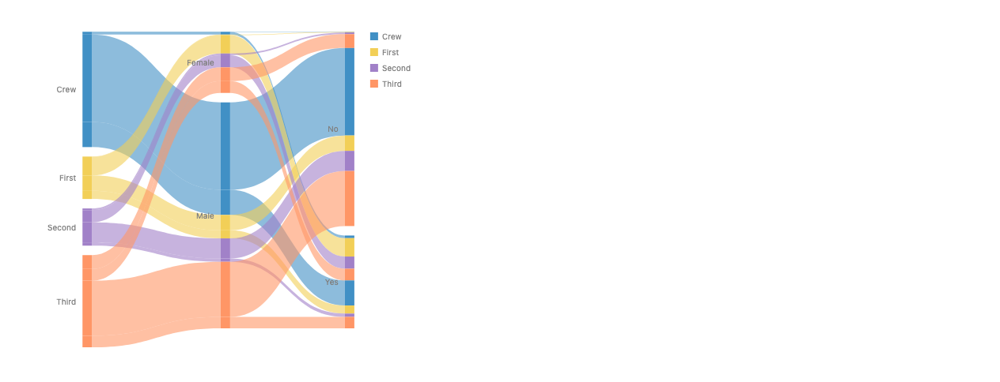

#47's prototype render, today's engine. The structure of a stacked area: positions along x, ends stacked at each, ribbons threading a key (`path`). The categories are separated with `spread`, so the ends inside a category stack and the categories keep gaps.

```js
// #47 (today's working form): axes are positions, ends stack inside categories
chart(ends) // one row per (cohort, axis)
  .flow(
    spread({ by: "axis", dir: "x", spacing: 120 }),
    spread({ by: "category", dir: "y", spacing: 12 }),
    spread({ by: "rank", dir: "y", spacing: 0 }) // a stack; spacing 0 works around a stack scale bug
  )
  .mark(rect({ w: 12, h: "value", fill: "class" }).name("ends"))
  .layer(
    chart(selectAll("ends"))
      .flow(group({ by: "path" }))
      .mark(ribbon())
  );
```

```js
// the stacked area in the same shape: x positions, series ends stacked in each
chart(rows)
  .flow(scatter({ by: "x", x: "x" }), stack({ by: "c", dir: "y" }))
  .mark(ribbon({ h: "y", fill: "c" }));
```

### Sankey: the slots live on a placed node


#47's anchor prototype render (emulated anchors). The same `stack` runs on each node's sides. What the stacked area does not need: a node size with slack, two sides with their own order, and links joined by name.

```js
// #47 (anchors): the slots live on a placed node's side
chart(nodes)
  .flow(spread({ by: "depth", dir: "x" }), spread({ by: "name", dir: "y" }))
  .mark(
    rect({ w: 12, h: "value" })
      .anchor({ name: "in", position: "x-min", slots: data().flow(stack()) })
      .anchor({ name: "out", position: "x-max", slots: data().flow(stack()) })
      .name("nodes")
  )
  .layer(ribbon({ from: "nodes.out", to: "nodes.in" }));
```

- **Is a stacked area the same idea?**: Same structure, different place. #47's own summary: "a sankey is a stacked area chart whose stacks are nodes". In a stacked area each x is a position, the series ends stack at it, and a ribbon threads the ends that share a key. Parallel sets are the same structure with discrete axes (render). The divided ribbon's rewrite builds exactly that: an invisible anchor per (x, series), stacked inside each x slice.
- **Where they differ**: Where the 1D space comes from. A stacked area's slices are positions the flow made, with no mark of their own: no size, no slack, no second side, and the end order is the series key's order. A sankey's ends live on a side of a placed node, which brings node size and slack, in and out sides with their own orders, ends ordered by the far node, and links joined by row or by name (`nodes.out`).
- **Anchors are a divide of a side**: An anchor's slots divide one part of a mark (its side) into intervals. That is Mascot's divide applied to a part, with absolute sizes and slack. So the family is: `cut` divides a mark's extent, `.anchor()` divides a part of its outline, and both are local to their host mark.
- **No reversal of #47**: An earlier draft of this round brought back `ribbon().stack()` and reversed #47's approach C. With divide as the lead, that reversal is withdrawn: #47's decision stands. It comes back only if Josh picks the runner-up.
- **Other #47 decisions**: "Ribbon width from anchor sizes" agrees: the fused `h` goes to an invisible anchor (#748). References by anchor name do not come up. #47's open item about moving the join to `resolve` is not touched.

| System | Stacking and grouping | Checked |
| --- | --- | --- |
| ggplot2 | `geom_area(position = "stack")`; `geom_density(position = "stack")` stacks densities on a shared grid. The stack is an option of the layer, computed on the rows. `geom_line` connects in x order; `geom_path` in data order. `group` defaults to the interaction of the discrete variables. | verified (aes_group_order, geom_path pages) |
| Vega-Lite | `stack` is a property of the x or y encoding (`zero`, `normalize`, `center`, `null`), on by default for bar, area and arc when a non-position channel maps another field. Non-position channels set the series; the `order` channel sets the stack order. | verified (stack page) |
| Observable Plot | `Plot.areaY(data, Plot.stackY({ x, y, fill }))`: the stack is a transform on the mark's options; `z`, `fill` or `stroke` set the series. | from memory: the docs page refused the fetch (HTTP 429) |
| matplotlib | `ax.stackplot(x, y1, y2, ...)`: a separate function over shared x. | from memory |

## Rows over a continuous index

Renders use the real `scatter`, `stack`, `ribbon` and `line` on an emulated continuum (`continuumIndex` in `stories/proposals/croissantDist.ts` picks the v values adaptively before layout).

### Normal croissant, curve from a continuum

**Works: rendered with the real ribbon.**


The curve layer: one ribbon over the continuum. The cuts and dots still come from the Dist, as in every approach. B, at the bottom of the code, is shorter still.

```js
chart(params)
  .flow(sweep({ v: x.range() }))
  .mark(
    ribbon({ x: "v", h: x.density("v") })
      .name("density")
      .hidden()
  );

// B is short for exactly that
chart(params).mark(ribbon({ h: x.density() }).name("density").hidden());
```

Rewrites to (runs today):

```js
// What it rewrites to: the mark's x is a scatter right before the mark
chart(params)
  .flow(sweep({ v: x.range() }), scatter({ by: "v", x: "v" }))
  .mark(
    ribbon({ h: x.density("v") })
      .name("density")
      .hidden()
  );
```

Python:

```python
(
    chart(params)
    .flow(sweep(v=x.range()))
    .mark(ribbon(x="v", h=x.density("v")).name("density").hidden())
)
```

### Two densities, stacked at each x

**Works: the stack runs inside each slice.**

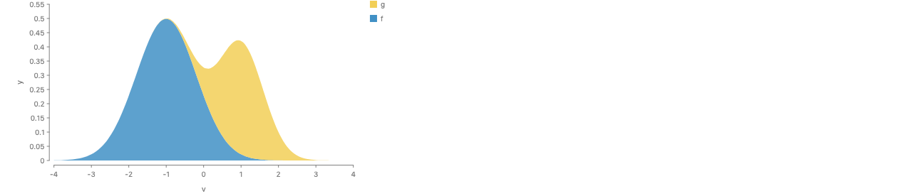

Josh's picture, divided. `sweep` crosses each params row (one per series) with v. The ribbon is the total density at each v (sizes add), and `cut` divides it by series, so g sits on f at every v. The rewrite is a stack inside each v slice, which the render runs on an emulated continuum. In the render g is scaled by 0.6.

```js
// one row per curve: { series, mean, sd }; x = dist.normal({ mean: "mean", sd: "sd" })
// The ribbon is the total density at each v; cut divides it by series
chart(params)
  .flow(sweep({ v: [-4, 4] }))
  .mark(
    ribbon({ x: "v", h: x.density("v"), fill: "series" }).cut({
      by: "series",
      dir: "y",
    })
  );
```

Rewrites to (runs today):

```js
// What it rewrites to: x is a scatter by v, and the division is a stack inside each v slice
chart(params)
  .flow(
    sweep({ v: [-4, 4] }),
    scatter({ by: "v", x: "v" }),
    stack({ by: "series", dir: "y" })
  )
  .mark(ribbon({ h: x.density("v"), fill: "series" }));
```

Python:

```python
(
    chart(params)
    .flow(sweep(v=[-4, 4]))
    .mark(ribbon(x="v", h=x.density("v"), fill="series").cut(by="series", dir="y"))
)
```

### A plain function

**Works.**

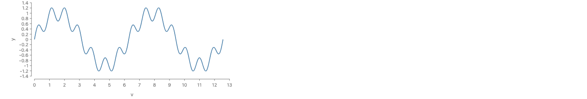

No Dist, so the interval is written as a pair. The row accessor `(d) => wave(d.v)` is a tentative spelling; in Python a lambda over a row needs the callback bridge.

```js
const wave = (v) => Math.sin(v) + 0.3 * Math.sin(7 * v);

chart([{}])
  .flow(sweep({ v: [0, 4 * Math.PI] }))
  .mark(line({ x: "v", y: (d) => wave(d.v) }));
```

Rewrites to (runs today):

```js
// What it rewrites to
chart([{}])
  .flow(
    sweep({ v: [0, 4 * Math.PI] }),
    scatter({ by: "v", x: "v", y: (d) => wave(d.v) })
  )
  .mark(line());
```

Python:

```python
def wave(v):
    return math.sin(v) + 0.3 * math.sin(7 * v)


chart([{}]).flow(sweep(v=[0, 4 * math.pi])).mark(line(x="v", y=lambda d: wave(d["v"])))
```

### A parametric curve

**Works.**

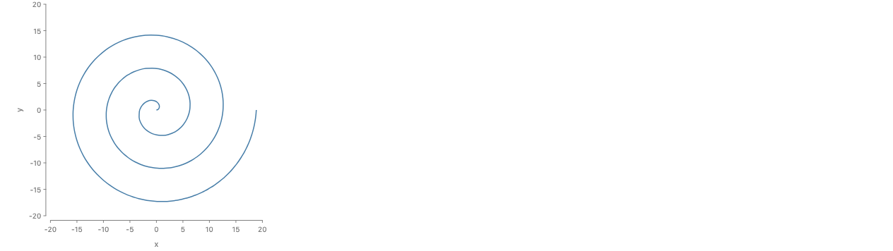

The index t is neither x nor y, so the path names it with `along: "t"`, the option #786 added. A continuous `scatter`, which uses its index set as the x axis, has no spelling for this curve.

```js
// The path follows t; x and y are both functions of it
chart([{}])
  .flow(sweep({ t: [0, 6 * Math.PI] }))
  .mark(
    line({
      along: "t",
      x: (d) => d.t * Math.cos(d.t),
      y: (d) => d.t * Math.sin(d.t),
    })
  );
```

Rewrites to (runs today):

```js
// What it rewrites to
chart([{}])
  .flow(
    sweep({ t: [0, 6 * Math.PI] }),
    scatter({
      by: "t",
      x: (d) => d.t * Math.cos(d.t),
      y: (d) => d.t * Math.sin(d.t),
    })
  )
  .mark(line());
```

Python:

```python
(
    chart([{}])
    .flow(sweep(t=[0, 6 * math.pi]))
    .mark(
        line(
            along="t",
            x=lambda d: d["t"] * math.cos(d["t"]),
            y=lambda d: d["t"] * math.sin(d["t"]),
        )
    )
)
```

### Which operator makes the continuum

- **A new operator, `sweep({ v: [a, b] })` (recommended)**: A count and an interval make rows of different types. After `repeat(n)`, `spread`, `sort`, counting and a mark per row are legal. After `sweep`, they are errors, and a connector samples the rows instead. So the two differ in what may follow them, not just in their argument. Two operators is the honest factoring, and they share no case worth building through one mechanism: a zero-width interval is one point, which nobody would write as a sweep.
- **Extend `repeat`: `repeat(interval, "v")` (runner-up)**: One name and Mathematica's precedent: `Table[expr, {i, imin, imax}]` steps by 1, and `Plot[f, {x, xmin, xmax}]` samples the same iterator form continuously. But then the type of what `repeat` returns depends on its argument, and an error after it (a `spread` after a continuum) points at a later step. `repeat` should feel discrete.
- **Continuous `scatter`: `scatter({ x: interval })` (rejected)**: Makes the rows and places them in one step. `scatter` today only places rows it is given. So the continuous form would overlap `sweep` + `scatter` over most of its range, which api-design.md calls the wrong factoring. It also cannot spell a parametric curve, and its stack needs an implicit `by`.

```js
// Rejected: a continuous scatter makes rows and places them in one step
chart(params)
  .flow(scatter({ x: x.range() }))
  .mark(ribbon({ h: x.density() }));

// Runner-up: one operator, repeat, over a count or an interval
derive(repeat(1000, "draw")); // rows 0 to 999
derive(repeat(interval(0, 1), "p")); // a row for every p in [0, 1]

// Recommended: two operators, because their outputs allow different operators after them
derive(repeat(1000, "draw")); // a list: spread, sort, count, per-row marks are legal
sweep({ p: [0, 1] }); // a continuum: those are errors; connectors sample it
```

```js
// The same step under each candidate name
sweep({ v: x.range() }); // recommended
continuum({ v: x.range() }); // runner-up name
interval({ v: x.range() }); // clashes with #980's interval
domain({ v: x.range() }); // clashes with Domain and every scale domain
span({ v: x.range() }); // clashes with a channel's { min, max } span

// It reads well with #980's own interval: sweep the central 95%
sweep({ v: x.interval(0.95) });
```

| Name | What it is | Note |
| --- | --- | --- |
| `sweep` (recommended) | No GoFish export or option uses it, on main or on the #980 branch. It appears only as local variables in arc code and in prose: `centralAngle` is the polar "total angular sweep", and the animation clock input documents "one sweep of the domain", the same meaning. A verb that says the index moves over the whole interval. Python: `sweep(v=[a, b])`. | no clash; no visualization precedent checked |
| `continuum` | Free everywhere. A noun, and long; it names the result, not the step. | no clash; runner-up name |
| `interval` (Josh's suggestion) | Clashes in the uncertainty vocabulary. On the #980 branch `x.interval(0.95)` is a central interval of a Dist (25 uses in its proposal docs and stories), `interval({ x, levels })` is the user function that draws one, after ggdist's interval geom, and `centralIntervals` is a helper. Main already calls a `dims` entry `{ min, max }` an interval. The operator could take the value constructor's place (`interval({ v: [0, 2 * Math.PI] })`), but then `interval(...)` would make rows in a flow and a span everywhere else. Better: interval is the type of `sweep`'s argument, so `sweep({ v: x.interval(0.95) })` reads well. | serious clash |
| `domain` | TikZ's `domain=a:b` and Mathematica's `{x, a, b}` iterator are the precedent. But GoFish already has the `Domain` family (`Domain.discrete(levels)`, with `Domain.continuous` planned as the type of an interval of numbers), plus every scale domain and the domain-inference pass. | serious clash |
| `span` | Main uses span for a channel's `{ min, max }` extent (`xMin`/`xMax` in scatter's `dims`). | clash |
| `sample`, `range`, `along` | Taken: #980's `value.sample`, `x.range()`, and the `along` option of `line` and `ribbon`. | rule out |
| Precedent for a continuous index step | Mathematica's `{x, xmin, xmax}` iterator. TikZ `domain` (initially -5:5) with `samples` (initially 25). Vega-Lite `sequence` (`step` defaults to 1, `stop` exclusive) and polars `linear_space` (requires `num_samples`) are discrete. Wilkinson's GPL puts a density in a channel instead: `line(position(density.normal(x)))`. | verified |

## The croissants in the short form (B)

### Croissant of the standard normal

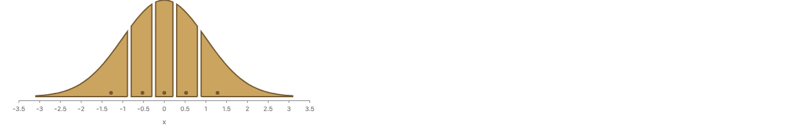

The front-page chart under B. There is no grid and no comment about [-3, 3]. The curve comes from `x.density()`, drawn while laying out. The cells end at the normal's quintiles, and the dots sit at its 0.1, 0.3, 0.5, 0.7 and 0.9 quantiles.

```js
const params = [{ mean: 0, sd: 1 }];
const x = dist.normal({ mean: "mean", sd: "sd" });

croissant(params, x, { n: 5, fill: PAPER_FILL, stroke: PAPER_STROKE }).render(
  container,
  {
    w: 480,
    h: 200,
    axes: { x: true, y: false },
  }
);
```

Today:

```js
// The standard normal on [-4, 4]: wide enough that the outer quantile rows
// are accurate (on [-3, 3] the missing tails move the outer cells' medians).
const normalGrid = gridOf((x) => normPdf(x), -4, 4, 401);

croissant(normalGrid, { n: 5, fill: PAPER_FILL, stroke: PAPER_STROKE }).render(
  container,
  {
    w: 480,
    h: 200,
    axes: { x: true, y: false },
  }
);
```

### Penguin body mass, a kernel density estimate

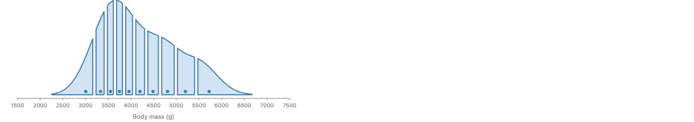

`field(x).kde()` is #980's smoothed sample: one Dist from the group's rows. Its cdf is exact (a sum of normal cdfs), so the ten cuts need no grid either.

```js
croissant(penguins, field("Body Mass (g)").kde()).render(container, {
  w: 520,
  h: 220,
  axes: { x: { title: "Body mass (g)" }, y: false },
});
```

Today:

```js
const masses = penguins.map((p) => p["Body Mass (g)"]).filter((v) => v != null);
const massGrid = gridOf(kde(masses).f, 2200, 6800, 461);

croissant(massGrid).render(container, {
  w: 520,
  h: 220,
  axes: { x: { title: "Body mass (g)" }, y: false },
});
```

### Ridgeline of Seattle highs by month

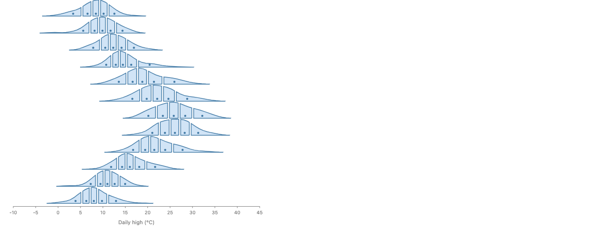

The `flatMap` that built 12 grids by hand is gone. `temp` is one smoothed Dist per month, because `kde()` folds the rows of the group it runs in. Each month's curve is drawn from its own Dist.

```js
const temp = field("temp_max").kde(); // one smoothed Dist per month, from its days

chart(weather, { w: 520, axes: { x: { title: "Daily high (°C)" }, y: false } })
  .flow(
    spread({
      by: field("month").sort(months),
      dir: "y",
      anchor: "baseline",
      spacing: 36,
    })
  )
  .mark(
    layer({ h: 34 }, [
      chart().mark(ribbon({ h: temp.density() }).name("density").hidden()),
    ]).relate(({ density }) => [
      chart()
        .flow(partition({ by: temp.bin(Bin.quantiles(5)), dir: "x" }))
        .mark(
          layer([
            intersect({ fill: FILL, stroke: STROKE, strokeWidth: 1.5 }, [
              density,
              region({ inset: 2 }),
            ]),
            circle({ cx: temp.median(), cy: 5, r: 2.25, fill: STROKE }),
          ])
        ),
    ])
  )
  .render(container);
```

Today:

```js
// One density per month of Seattle's daily highs, each on its own grid from
// three bandwidths below the month's lowest high to three above its highest.
const monthlyDensity = months.flatMap((month, m) => {
  const highs = seattleWeather
    .filter((d) => new Date(d.date).getUTCMonth() === m)
    .map((d) => d.temp_max);
  const { f, bw } = kde(highs);
  const lo = Math.min(...highs) - 3 * bw;
  const hi = Math.max(...highs) + 3 * bw;
  return gridOf(f, lo, hi, 161).map(({ x, pdf }) => ({
    month,
    temp_max: x,
    pdf,
  }));
});

chart(monthlyDensity, {
  w: 520,
  axes: { x: { title: "Daily high (°C)" }, y: false },
})
  .flow(
    spread({
      by: field("month").sort(months),
      dir: "y",
      anchor: "baseline",
      spacing: 36,
    })
  )
  .mark(
    layer({ h: 34 }, [
      chart()
        .flow(scatter({ x: "temp_max" }))
        .mark(ribbon({ h: "pdf" }).name("density").hidden()),
    ]).relate(({ density }) => [
      chart()
        .flow(
          derive((rows) =>
            quantileRows(rows, { x: "temp_max", density: "pdf", n: 1000 })
          ),
          partition({ by: field("temp_max").bin(Bin.quantiles(5)), dir: "x" })
        )
        .mark(
          layer([
            intersect({ fill: FILL, stroke: STROKE, strokeWidth: 1.5 }, [
              density,
              region({ inset: 2 }),
            ]),
            circle({
              cx: field("temp_max").median(),
              cy: 5,
              r: 2.25,
              fill: STROKE,
            }),
          ])
        ),
    ])
  )
  .render(container);
```

### The croissant helper the three stories share

The helper takes the rows and the Dist. The grid, `normPdf`, `kde`, `quantileRows` and the `scatter` that placed grid rows all leave user code.

```js
// The croissant of a Dist x over the rows of data: the density, unseen, then in each of its
// n equal-probability cells the density's area cut to the cell, and a dot at the cell's median.
const croissant = (data, x, { n = 10, fill = FILL, stroke = STROKE } = {}) =>
  layer([
    chart(data).mark(ribbon({ h: x.density() }).name("density").hidden()),
  ]).relate(({ density }) => [
    chart(data)
      .flow(partition({ by: x.bin(Bin.quantiles(n)), dir: "x" }))
      .mark(
        layer([
          intersect({ fill, stroke, strokeWidth: 2 }, [
            density,
            region({ inset: 3 }),
          ]),
          circle({ cx: x.median(), cy: 6, r: 3, fill: stroke }),
        ])
      ),
  ]);
```

Python:

```python
def croissant(data, x, n=10, fill=FILL, stroke=STROKE):
    return layer([chart(data).mark(ribbon(h=x.density()).name("density").hidden())]).relate(
        lambda density: [
            chart(data)
            .flow(partition(by=x.bin(Bin.quantiles(n)), dir="x"))
            .mark(
                layer(
                    [
                        intersect([density, region(inset=3)], fill=fill, stroke=stroke, stroke_width=2),
                        circle(cx=x.median(), cy=6, r=3, fill=stroke),
                    ]
                )
            )
        ]
    )


x = dist.normal(mean="mean", sd="sd")
croissant([{"mean": 0, "sd": 1}], x, n=5, fill=PAPER_FILL, stroke=PAPER_STROKE)

croissant(penguins, field("Body Mass (g)").kde())
```

Today:

```js
const normPdf = (x, mu = 0, sd = 1) =>
  Math.exp(-0.5 * ((x - mu) / sd) ** 2) / (sd * Math.sqrt(2 * Math.PI));

// n evenly spaced grid rows { x, pdf } of f over [lo, hi].
const gridOf = (f, lo, hi, n) =>
  Array.from({ length: n }, (_, i) => {
    const x = lo + ((hi - lo) * i) / (n - 1);
    return { x, pdf: f(x) };
  });

// A Gaussian kernel density estimate of values, with Silverman's bandwidth.
const kde = (values) => {
  const n = values.length;
  const mean = values.reduce((s, v) => s + v, 0) / n;
  const sd = Math.sqrt(
    values.reduce((s, v) => s + (v - mean) ** 2, 0) / (n - 1)
  );
  const bw = 1.06 * sd * n ** -0.2;
  return {
    bw,
    f: (x) => values.reduce((s, v) => s + normPdf(x, v, bw), 0) / n,
  };
};

const croissant = (grid, { n = 10, fill = FILL, stroke = STROKE } = {}) =>
  layer([
    chart(grid)
      .flow(scatter({ x: "x" }))
      .mark(ribbon({ h: "pdf" }).name("density").hidden()),
  ]).relate(({ density }) => [
    chart(grid)
      .flow(
        derive((rows) =>
          quantileRows(rows, { x: "x", density: "pdf", n: 1000 })
        ),
        partition({ by: field("x").bin(Bin.quantiles(n)), dir: "x" })
      )
      .mark(
        layer([
          intersect({ fill, stroke, strokeWidth: 2 }, [
            density,
            region({ inset: 3 }),
          ]),
          circle({ cx: field("x").median(), cy: 6, r: 3, fill: stroke }),
        ])
      ),
  ]);
```

## Stress tests for the short form

### Coordinates: a density in polar

**Works in B.**

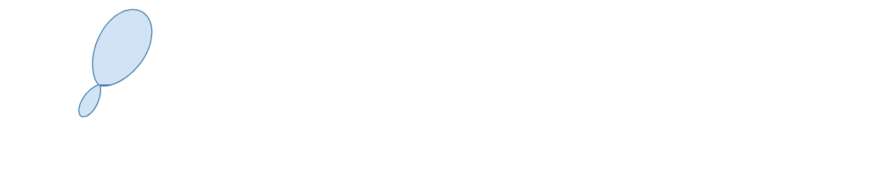

The same single pass maps x ↦ (x, f(x)), then the coordinate transform, so the curve bends with no extra code. The prototype draws a sum of two von Mises bumps. It found one bug in the existing resampler: like d3's, it never splits a segment whose two ends land on the same pixel, and a closed curve from 0 to 2π starts and ends at the same point. Starting from 16 segments instead of 1 fixes it.

```js
// Wind directions as a density in polar: the same resampler bends it.
const direction = dist.mixture(
  [
    dist.vonMises({ mu: Math.PI / 3, kappa: 4 }),
    dist.vonMises({ mu: (4 * Math.PI) / 3, kappa: 8 }),
  ],
  { weights: [0.7, 0.3] }
);

chart([{}], { coord: Coord.polar(), w: 300, h: 300 }).mark(
  ribbon({ h: direction.density(), fill: FILL, stroke: STROKE })
);
```

### A plain function over a given domain

**Works in B.**

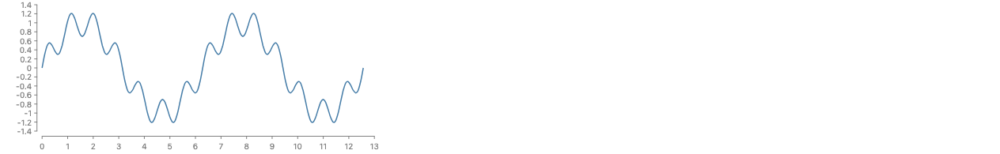

No Dist, so no default range: `fn` takes its domain. The y domain (−1.3 to 1.3) is found before layout by sampling in data space, invisibly.

```js
// A plain function: no Dist, so its domain is given.
const wave = fn((x) => Math.sin(x) + 0.3 * Math.sin(7 * x), {
  x: [0, 4 * Math.PI],
});

chart([{}], { w: 420, h: 160 }).mark(line({ y: wave }));
```

### A parametric curve

**Works in B.**

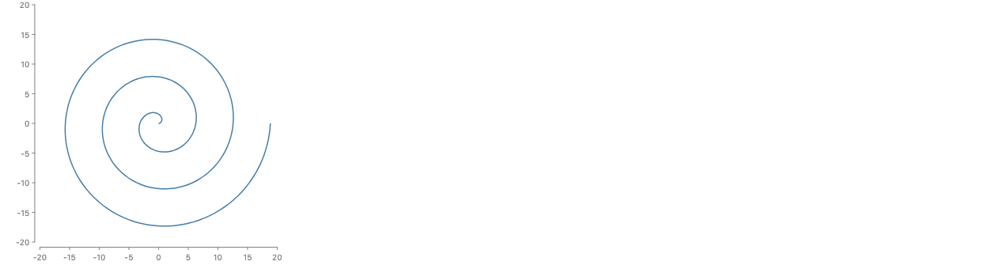

A graph is the special case x(t) = t, so the prototype is written for t ↦ (x(t), y(t)) and draws a spiral with the same resampler. The spelling, one `fn` read by two channels, is tentative.

```js
// A parametric curve: one function of t gives both channels.
const spiral = fn((t) => ({ x: t * Math.cos(t), y: t * Math.sin(t) }), {
  t: [0, 6 * Math.PI],
});

chart([{}], { w: 300, h: 300 }).mark(line({ x: spiral.x, y: spiral.y }));
```

### A narrow kernel, where sampling shows

**Works in B.**

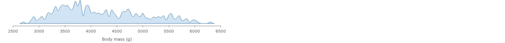

A 25 g bandwidth. B picks about 250 points along the curve, packed where it bends. A fixed 101 points (ggplot2's default) visibly flattens these peaks; 512 matches B (see approach A below).

```js
const mass = field("Body Mass (g)").kde({ smoothing: 25 });

chart(penguins, { w: 520, h: 60 }).mark(ribbon({ h: mass.density() }));
```

### Stacking two curves

**B alone: wall; as C: works.**

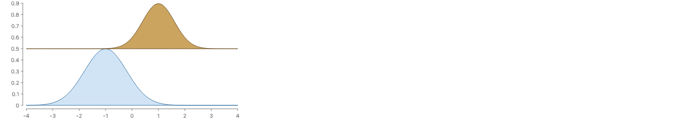


Top: B alone under `stack`, with a function node per curve. `stack` moves each child's whole box, so the second curve sits on the first one's baseline, not on its curve. Bottom: the same two curves as rows, stacked at each x. C keeps the rows, so its stacked card above works. B is safe as the short form of C, not as a separate node.

```js
// B: stack moves whole boxes, so g sits on f's box, not on f's curve
stack({ dir: "y" }, [ribbon({ h: f.density() }), ribbon({ h: g.density() })]);
```

```js
// Rows (approach A): stack adds at each x
chart(rows) // { x, series, y }: f and g sampled on one grid
  .flow(scatter({ by: "x", x: "x" }), stack({ by: "series", dir: "y" }))
  .mark(ribbon({ h: "y", fill: "series" }));
```

## Answers for the short form

**Spelling.** `ribbon({ h: x.density() })` for an area, `line({ y: x.cdf() })` for a CDF, and `line({ y: fn(f, { x: [lo, hi] }) })` for a plain function. A function in one channel sets the mark's extent on the other axis. It sits beside #980's rule because `x.density()` is a function, not a Dist. A bare `x` in a position channel still means the blurred limit.

**Extent.** With no rows, the function's own domain sets the x span: a Dist's default range (the 0.001 to 0.999 quantiles of a normal, as ggdist; a smoothed sample's data plus 3 bandwidths, as seaborn), or `fn`'s given domain. The prototype uses this. ggplot2 uses the axis range instead, which can only work when another layer sets the axis first. Whether to union the two, and whether any override is needed, are open decisions.

**Domain before pixels.** The y scale needs the curve's maximum before layout knows pixels. Where the Dist knows its mode (a normal's peak is at its mean), it is exact. Otherwise the prototype samples 512 points in data space and refines the best one by golden-section search. This is invisible. A spike narrower than 1/512 of the range could be missed. The mark sees the true peak while drawing, so it could warn instead of drawing past the axis.

**The resampler claim.** It holds, with three caveats. `adaptiveResamplePath` takes any `{ transform }`, so x ↦ coord(scale(x, f(x))) is just a composed transform. (1) Its source must be in pixels, since it forces a split above 10 source units. The prototype passes the curve's parameter scaled to its length on screen. (2) It never splits a segment whose ends coincide, so a closed curve must start as several segments (fixed, see the polar card). (3) It tests one midpoint per segment, so a feature narrower than about 10 px can fall between samples, as in d3. For `intersect`, the mark also needs its outline before coordinates, so the prototype samples once for the outline and once, composed with the coordinates, for paint. In linear coordinates the two passes are the same.

**What is lost without rows.** The hover datum is the mark's own row (the Dist's parameters), not a sample point. `selectAll` finds one curve, not its sample points, which are only how it was drawn. Operators that need rows (`stack`, a label at the peak) have nothing to read. Under C the rows are back. Hover is the slice at the pointer. `selectAll` finds the curve, which is the continuum's connector. `stack` works inside each slice. `partition` cuts the index interval into sub-intervals. A cell's median follows the half-weight rule, given a weight (see the decisions).

## A: a finite grid

### A: the same spec over a finite grid


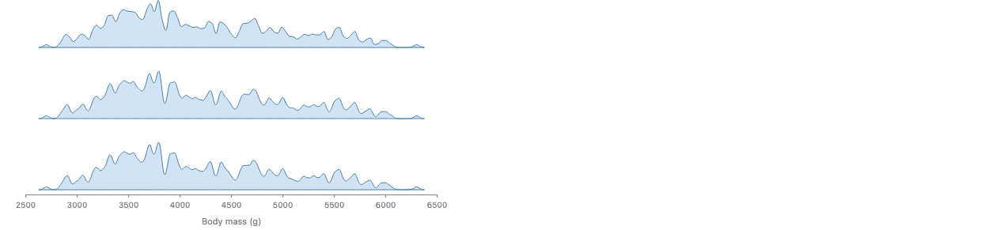

Same picture, from #980's `densityCurve` helper with written-out defaults (`n: 512`, `range: x.range()`). Rows keep every row operator working, `stack` included. But a data step runs before the pixel scale exists, so it cannot be screen-aware, and `n` and `range` are part of the spec. This is the general pattern for sampling a function in a data step: a parameter grid plus an expression (matplotlib's `linspace`, ggplot2's `stat_function`, pgfplots' `domain`/`samples`, #980's `repeat(n, { level: "p" })` + `value.quantile("p")`). Under C, A is just `repeat` over a finite grid, so it needs no helper of its own.

A's resolution on the narrow kernel: 101 evenly spaced points (top), 512 (middle), and screen-adaptive (bottom).

```js
// A: the density as rows, made by #980's data helper; n and range default from the Dist
chart(data)
  .flow(
    derive((rows) => densityCurve(rows, x)),
    scatter({ x: "v" })
  )
  .mark(ribbon({ h: "density" }).name("density").hidden());

// written out
densityCurve(rows, x, { n: 512, range: x.range() });
```

### Why the cuts must come from the Dist (both approaches)

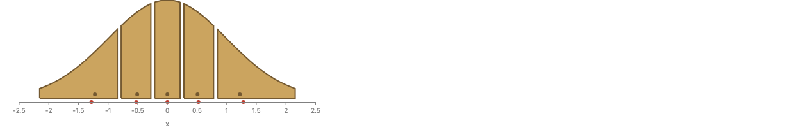

Today's spelling over a short grid, [-2.2, 2.2]. The brown dots are today's medians from `quantileRows`; the red dots are the exact ones. The outer brown dots sit at ±1.22, not ±1.28, because the cut-off tails are missing. The story's [-3, 3] warning is the same error, smaller (±1.275). A grid sets both the look and the cuts, so picking a range for looks moves the cuts.

```js
// Proposed: the cuts and dots come from the Dist, so no grid can move them.
croissant(params, dist.normal({ mean: "mean", sd: "sd" }), { n: 5 });
// cells end at x.quantile(0.2), x.quantile(0.4), ...; dots at x.quantile(0.1), x.quantile(0.3), ...
```

Today:

```js
// Today: the cuts and dots come from the grid, so a short grid moves them.
const grid = gridOf((x) => normPdf(x), -2.2, 2.2, 45);
croissant(grid, { n: 5, fill: PAPER_FILL, stroke: PAPER_STROKE });
```

## A continuous value type?

C is rows over a continuous type: a continuum is the interval with uniform weight, rows are point masses, and a Dist is a weight that totals 1. Everything B loses without rows is an ordinary operation on a continuous value. chebfun ("computing with functions") is the closest precedent: it stores a function adaptively, to about machine precision, and overloads MATLAB's vector commands, so `sum` is a definite integral and `max`, `roots` and `cumsum` work on the function. GoFish would need far less, only what the table below lists.

| Lost without rows | Operation | Field | Measure | Rows |
| --- | --- | --- | --- | --- |
| Hover datum | evaluate at a point | f(x₀) | density and cdf at x₀ | the row at x₀ |
| `selectAll` | the value itself | one curve | one Dist | the rows |
| `partition` | restrict to an interval | f on [a, b] | the measure cut to [a, b] (mass = its probability) | the rows in the cell |
| `stack` | pointwise add | f + g (same unit) | the sum of the measures (a weighted mixture) | add per x |
| sum | integrate | ∫f dx, in a new unit (degree-days) | the total weight (1 for a Dist) | Σ weights |
| median | where half the weight is | not defined: a field has no weight | the 0.5 quantile | the median row |
| y domain | max | max f | max density | max value |

```js
const mass = field("Body Mass (g)").kde(); // a measure: weight spread over x
const pdf = mass.density(); // a function of x: probability per gram

pdf.at(4200); // evaluate: the hover datum at the pointer
mass.bin(Bin.quantiles(5)); // restrict: partition cuts it into five measures
mass.median(); // half the weight
mass.total(); // integrate: 1 for a Dist, the count for rows
pdf.max(); // the y domain
pdf.plus(otherPdf); // pointwise add: what stack needs
```

Two kinds of continuous value behave differently. A **field** has a value at each x: temperature over a day, `sin`, or a pdf drawn as a height. It adds pointwise, and its median means nothing. A **measure** is an amount spread over x: a Dist, a population density. Its sum is an integral, and its median is where half the weight lies. Rows of plain numbers are a discrete measure, a point mass of weight 1 at each value. That is the "weight spread over x" rule for medians from the chat, so rows and continuous values can share `partition`, sum and median. A Dist is a measure whose total is 1. (Field here is the GIS sense of the word. GoFish's `field()` is the column accessor, so the API would need another name.)

One type or two? Probably one: a function of x whose unit decides. A density's unit is "per unit of x" (probability per gram), so integrating it over x gives an amount, and sum and median are legal. A field's unit has no "per x", so its median is an error and its integral changes unit. This is #980's scales tab again: "per" must name the field the amount is spread over, and the same unit tells a warp to scale a density by the inverse slope. The CF conventions for climate data draw the same line with their `cell_methods`. `point` is the default for an intensive quantity and `sum` for an extensive one. A measure is the density of a field times dx, so one representation carries both, and the unit says which.

Precedent:

- **chebfun**: Adaptive Chebyshev approximation of a function, to about machine precision. Overloads MATLAB's vector commands: `sum` is a definite integral, plus `max`, `roots`, `cumsum`, `mean` (checked on the chebfun site).
- **Mathematica `InterpolatingFunction`**: What `NDSolve` returns: a function object that is evaluated, differentiated and integrated like a formula (from memory; not re-checked for this page).
- **GIS: field and object views**: Rasters model a field (a value everywhere), and vector features model objects. The two have different operations, as field and measure do here (from memory; not re-checked for this page).
- **CF conventions, `cell_methods`**: Each value says what it stands for over its cell: `point` (the default for an intensive quantity), `sum` (for an extensive one), `mean`, `maximum`, `median` and more (checked in Appendix E).
- **sympy `Piecewise`**: A symbolic piecewise function, which `integrate` handles piece by piece: the restricted pieces a partition would make (from memory; not re-checked for this page).

## Precedent: a function as a mark input

| System | What the user writes | Range | Resolution | Screen-aware | Checked |
| --- | --- | --- | --- | --- | --- |
| Mathematica `Plot` | `Plot[f[x], {x, lo, hi}]` | user | `PlotPoints` (initial even samples) then up to `MaxRecursion` adaptive subdivisions; both `Automatic` by default | no: adapts in its own space | verified, reference page |
| Plots.jl | `plot(f, xmin, xmax)` | user | `PlotUtils.adapted_grid`: 31 even points, refined up to 7 times where curvature is large; applied after the axis scale functions | no: data space | verified, source |
| Makie | `lines(0..10, sin)` | the interval | `convert_arguments(::AbstractInterval, ::Function)` calls the same `adapted_grid` | no: data space | verified, source |
| ggplot2 `geom_function` | `geom_function(fun = dnorm)` | the scale (`xlim` to override) | `n = 101`, even | no | verified, reference page |
| function-plot | `{ fn: "x^2" }` | the viewport | interval arithmetic picks where to sample; re-evaluated whenever the scale changes | yes | verified, docs page |
| d3-geo resample | `projection.precision(...)` | n/a | adaptive to a pixel tolerance; the model for `adaptive-resampling.ts` | yes | GoFish source |
| seaborn `kdeplot` | `kdeplot(x=...)` | data ± `cut=3` bandwidths | `gridsize=200` | no | round 1 survey |
| ggdist `stat_slab` | `aes(xdist = dist_normal(0, 1))` | 0.001 to 0.999 quantiles (`p_limits`) | `n = 501` | no; intervals exact from the dist | round 1 survey |
| Vega-Lite `density` | `{ density: "x", extent, steps }` | data extent, or `extent` | adaptive, 25 to 200 steps | partly | round 1 survey |
| Desmos | type `y = sin(x)` | the viewport | adaptive, redone on pan and zoom | yes | not verified: no public docs |

Taking a function as a mark input is common (Mathematica, Plots.jl, Makie), and all of them sample adaptively without a knob in the usual case. But they adapt in data space at conversion time. Only the viewport systems (function-plot, Desmos) and d3-geo adapt on the screen. B does both: the function is in the spec, and it is sampled in pixels through the coordinate transform.

## Similar warts

- `stories/forwardsyntax/Croissant.stories.tsx`: three stories with `gridOf`, `kde` and `quantileRows`, and the Python port `tests/python-stories/forward-syntax/test_croissant.py`.
- `stories/lowlevel/NameScope.stories.tsx`: `NestedCallout` and `MedianTrend` sample normal pdfs on hand-written 81-point grids.
- `stories/lowlevel/ViolinPlot.stories.tsx` (gallery) uses `fast-kde`, and its Python port uses `scipy.stats.gaussian_kde`, so the two curves differ. A library `kde()` fixes that parity gap too.
- `apps/docs/docs/{js,python}/api/operators/derive.md` list `quantileRows`; both go with #1231.
- Not this wart: `RidgelineChart.stories.tsx` bins counts by hand (a histogram), and the `Math.sin` generators in other stories are made-up datasets.

## Issues cited

- #1332: this issue: remove the `gridOf` sampling wart from the croissant
- #980: distributions as first-class data; this proposal fits its design
- #1231: replace `quantileRows` with first-class distributions
- #544: croissant charts, merged in #1229
- #830: interaction as data: hover and zoom, where evaluating a function matters

## Open decisions

1. Divide or modifier: `ribbon({ x, h }).cut({ by: "c", dir: "y" })` (the lead), or `ribbon(...).stack({ by: "c" })` on the series ribbons (runner-up)?
2. Is the name `cut` right for dividing an area, or should `cut` be renamed `divide` (Mascot's word), with the image story as one use?
3. Should a divided ribbon's pieces stay inside the cut mark, so no flow operator lays them out? (Today's cut needs a `stack` above it, the syntax #404 left to revisit.)
4. Stacked lines have no extent to divide. Accept the flow `stack` inside a `scatter` for them, or add an edge-only paint so they are a cut's top edges?
5. Should `line` and `ribbon` take `x`, `y` and `along`, as sugar for a `scatter` right before the mark?
6. Is the error text for a flow `stack` of whole ribbons right, and should it name both `cut` and `spread`?
7. Keep `ChartBuilder.stack()` (sugar for the local flow `stack`), or remove it?
8. Streamgraph centering: keep `alignment: "middle"` on the outer `spread`, or put it on the cut?
9. In a divided ribbon, is a series missing at one x a 0 or an error?
10. Should a cut mark read `fill` and `stroke` per piece?
11. Should `line({ x })` sort by x, or keep data order?
12. #47 approach C stays rejected (no reversal). Agree?
13. File `issues/stack-divide-family.md` (stack with `size`, treemap slice/dice and cut all divide a box by weight)?
14. Name of the continuous operator: `sweep`, `continuum`, or `interval`? Which operators may run one slice at a time on it?
15. Keep B, `ribbon({ h: x.density() })`, as the shortest form?
16. The earlier open items stand: stack extent over Dists, cell weight, ridgeline quantiles, field vs measure, default range, infinite cells, peak warning.
