# Declarative dragging in GoFish

**Summary.** Build the ideas of Dragology (Declarative Dragging, Horowitz, Blinn and Heer, UIST 2026) into GoFish instead of using the library. A mark says which field a drag edits: `rect(...).drag(Drag.edit("room"))`. GoFish derives the states the drag can reach from the spec, lays each one out, and blends between the layouts as the pointer moves.

**Recommendation.** A `.drag(...)` method on marks that takes a strategy from a new `Drag` family: `Drag.edit(...fields)`, `Drag.reorder()`, and `Drag.states(fn)` as the escape hatch that lists states by hand, which is what Dragology asks of every author. The data is a `signal`, and a drop writes the edited rows back to it.

**Status.** Six prototypes run on a small native engine (about 1,200 lines of story-level code, no `dragology` or React dependency). The only library change is metadata: a label's display item names the mark it is attached to. Syntax is not signed off. Nothing here is implemented in the library.

Prototype code: `packages/gofish-graphics/stories/drag/` (stories "Drag/Reorder Bars", "Drag/Reorder Stack", "Drag/Scheduler", "Drag/Treemap Reparent"). Measurements and walls: `research/prototype-findings.md`.

## Terms

- **State.** In Dragology, the app's model object. In GoFish, the data rows and the order of the domains the spec declares.
- **Reachable state.** The rows, or a domain order, after one edit that a drag could make.
- **Target.** The place where the dragged mark sits in the layout of a reachable state.
- **Key.** What makes a row the same row in two states. GoFish matches marks across states by key (the key join from the animation grammar work).
- **Feel.** How the picture follows the pointer between targets. Dragology's two main feels are `closest` (snap to the nearest target) and `between` (blend the pictures of the nearby targets).

## Why not the library itself

Read from Dragology's source (v0.2.0):

- Its view tree is React elements. React is a hard dependency even if GoFish did the painting.
- Its render function must be synchronous and is called once per reachable state when the pointer goes down, and up to about 200 times per frame for a continuous drag. GoFish layout is async because it waits for fonts.
- It finds elements only from `transform` strings on elements with ids. GoFish paints marks at absolute `x` and `y`.
- For continuous drags it runs an optimizer (COBYLA) over the render function, because it cannot see inside the render. GoFish has the scale and can invert it.

The paper itself says Dragology "is not concerned with the layout of graphical elements" and calls GoFish complementary. Its authors already bridge Bluefish this way in their repo, by re-parsing its SVG output. A bridge is possible, but every step of it works around something GoFish already knows.

## How the ideas map

| Dragology                                                                                                                   | GoFish                                                                                                                                              |
| --------------------------------------------------------------------------------------------------------------------------- | --------------------------------------------------------------------------------------------------------------------------------------------------- |
| The author lists reachable states by hand. The study found this the hardest part ("a sharp cliff at the reorderable list"). | Derived from the spec. An edited field's values come from its domain. A reorder is every index of the split's domain.                               |
| Render every reachable state, find the dragged element in each.                                                             | Lay out every reachable state. Layout does not touch the DOM. Measured 10 to 20 ms per layout, 4 to 8 states per drag, 17 to 52 ms at pointer down. |
| Match elements across states by global id.                                                                                  | Key join over rows.                                                                                                                                 |
| `between`: blend the renders by pointer position.                                                                           | A `transition` between laid-out states with the pointer in place of the clock. Blend and paint measured 0.5 to 1.5 ms per frame.                    |
| `vary`: optimizer over continuous parameters.                                                                               | Invert the scale. The prototype blends two cached layouts and matches a real layout of the dropped rows to 0 px.                                    |
| Drop: ease from the preview to the new state.                                                                               | The same key join tweens to the new layout.                                                                                                         |

## Examples

Each example shows the proposed syntax, then what the prototype runs today.

### 1. Reorder bars

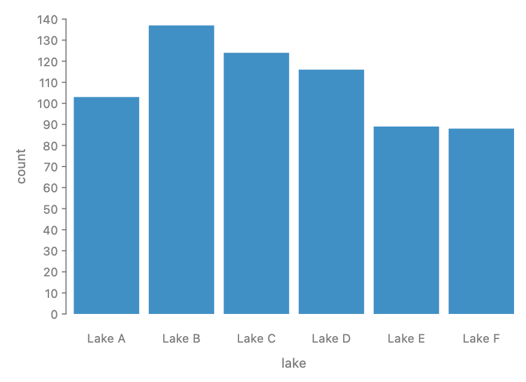 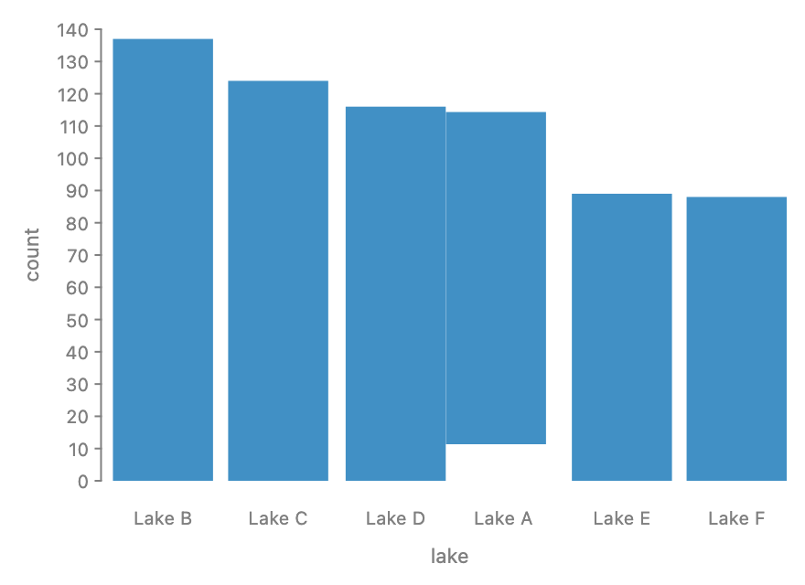 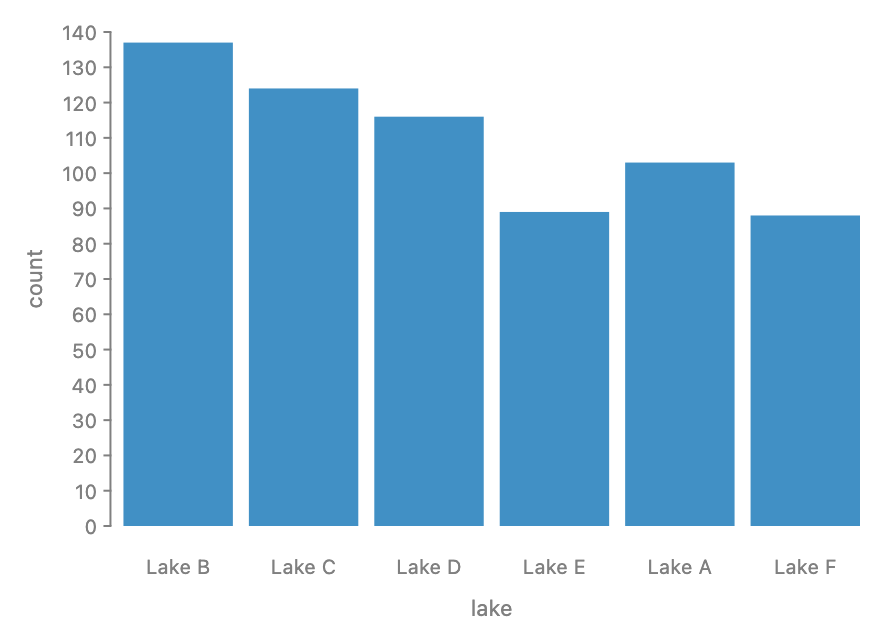

```js
const catches = signal(seafood);

chart(catches)
  .flow(spread({ by: "lake", dir: "x" }))
  .mark(rect({ h: "count" }).drag(Drag.reorder()))
  .render(container, { w: 420, h: 300 });
```

`Drag.reorder()` reorders the split that holds the mark. Here that split is `spread({ by: "lake" })`, so the drag edits the order of the lake domain. The rows do not change. The axis labels travel with the bars because they are part of each layout.

### 2. Reorder a stack

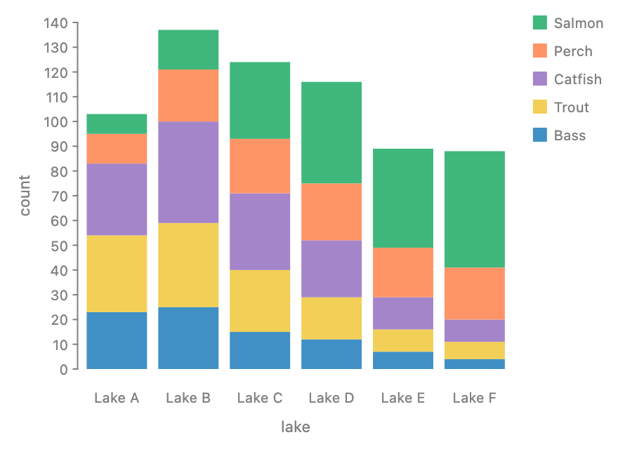 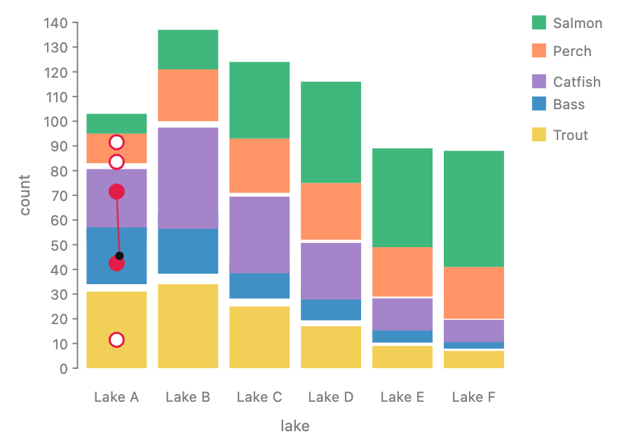 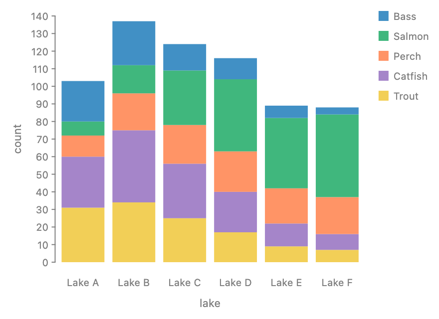

```js
chart(catches)
  .flow(spread({ by: "lake", dir: "x" }), stack({ by: "species", dir: "y" }))
  .mark(rect({ h: "count", fill: "species" }).drag(Drag.reorder()))
  .render(container, { w: 420, h: 300 });
```

`Drag.reorder()` reorders the split that holds the mark. Here that split is `stack({ by: "species" })`, so the drag edits the order of the species domain, not the rows. Every stack and the legend reorder together. In the first example the same call reorders the lake domain.

The targets are one place per index in the stack, and they lie on one vertical line, so the segment blends along that line (middle frame, with targets shown). The prototype keeps each species' color with a palette. Without it, colors follow the domain order too, and a reorder would recolor the species.

### 3. Scheduler (the paper's example)

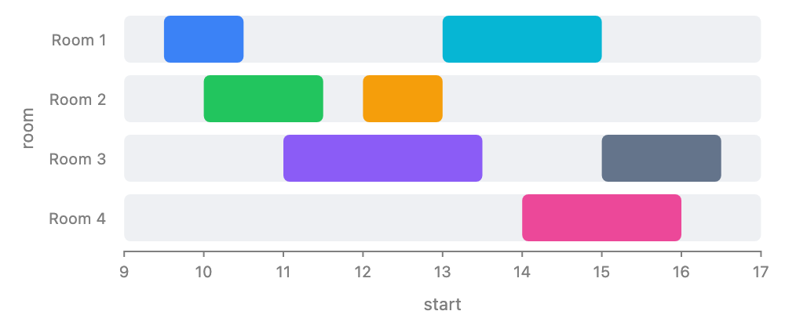 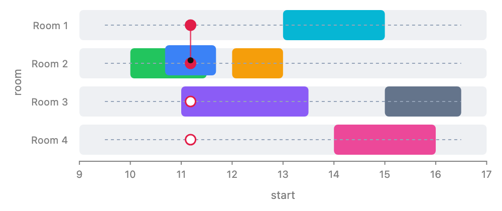 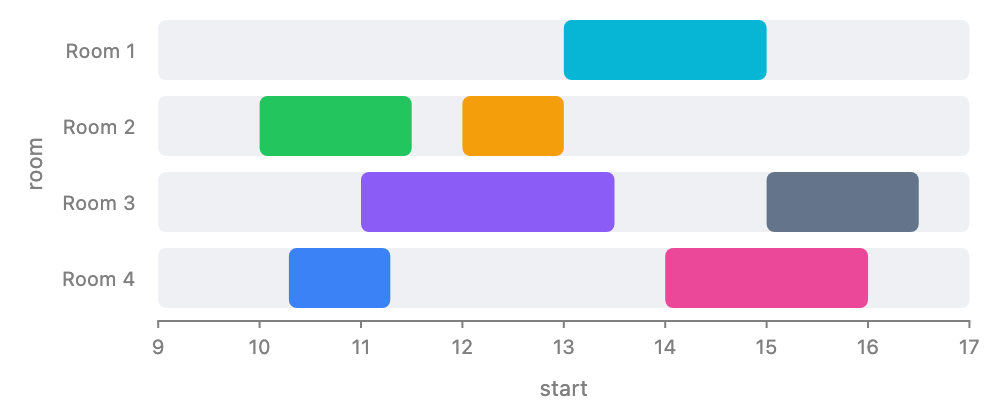

```js
chart(meetings)
  .flow(spread({ by: "room", dir: "y", spacing: 8 }))
  .mark(
    rect({ x: "start", w: "length", h: 30, fill: "color" }).drag(
      Drag.edit("room", "start")
    )
  )
  .render(container, { w: 480, h: 200 });
```

Two fields. `room` is ordinal, so the bar jumps between rooms. `start` is continuous, so the bar slides, and the value comes from the inverse of the time scale. The same rule from #830 (the interaction grammar issue) applies: the kind of space the field lives in picks the behavior.

The middle frame shows the debugging overlay, borrowed from Dragology: one ring per room target and a line from the pointer to the chosen one.

Dragology's own scheduler needs 53 comparable lines without data. The prototype's needs 29. Theirs also has edge resizing and a conflict graph, which the prototype does not.

The time axis must not rescale while a bar is dragged along it. The proposal pins every axis domain to its value at pointer down and lets it settle at the drop. The prototype gets the same effect with a fixed 9 to 17 domain.

### 4. Reparent a treemap leaf

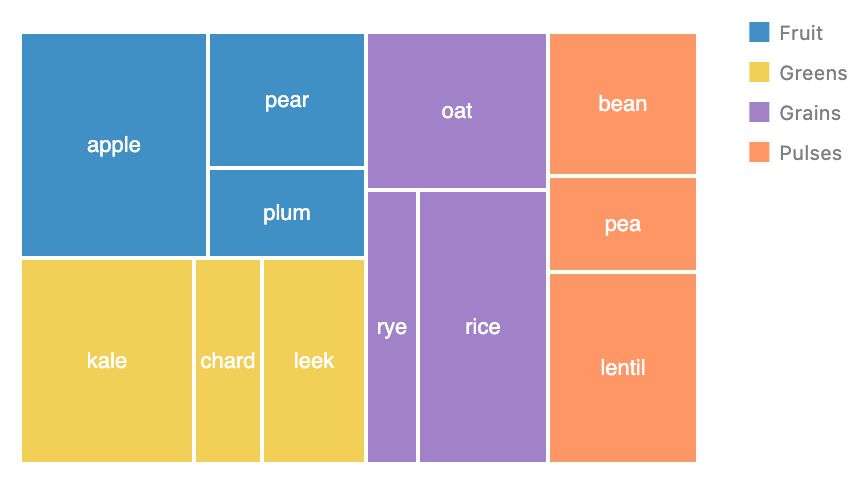 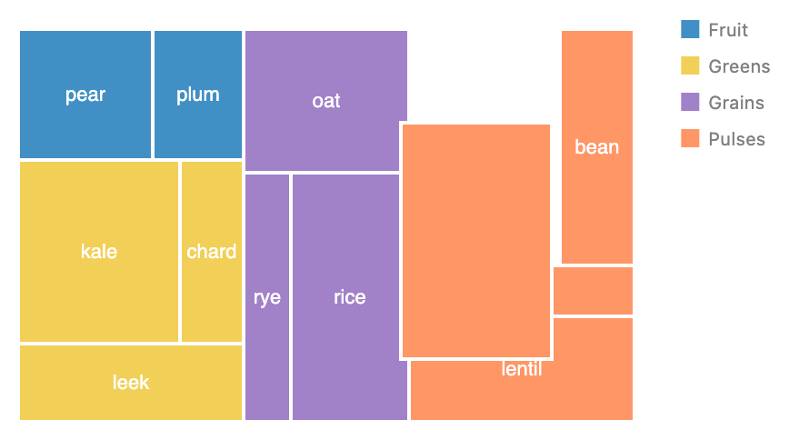 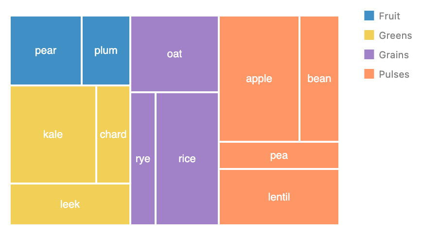

```js
chart(leaves)
  .flow(
    treemap({ by: "group", size: "size", tile: Tile.squarify() }),
    treemap({ by: "id", size: "size", tile: Tile.squarify() })
  )
  .mark(rect({ fill: "group" }).label("id").drag(Drag.edit("group")))
  .render(container, { w: 420, h: 300 });
```

This is the case for layout. A Dragology author would have to write squarify. Here the tiles re-tile because each reachable state goes through the same layout.

The dragged tile follows the pointer anywhere and is drawn on top. The rest of the picture snaps to the state whose target is nearest the tile, with a 150 ms tween, and the tile's size eases to its size in that state (middle frame). On release the tile tweens into its slot. The tile's label travels with the tile, because the label's display item names the mark it is attached to.

The rule for the default feel: positions on an axis blend along their track. Layouts with no axis (treemap, pack, tree) use free dragging, with the rest snapping to the nearest state.

### 5. Escape hatch: list the states

Not prototyped as a separate story. The prototype's treemap uses this path.

```js
rect(...).drag(
  Drag.states((row, rows) =>
    parentsOf(rows)
      .filter((p) => !isDescendant(p, row))
      .map((p) => rows.map((r) => (r === row ? { ...r, parent: p.id } : r)))
  )
)
```

`Drag.edit` is defined by rewriting into `Drag.states`. Anything the derived strategies cannot say (a tree drop that must not create a cycle) is written this way.

### Python

```python
chart(meetings).flow(spread(by="room", dir="y", spacing=8)).mark(
    rect(x="start", w="length", h=30, fill="color").drag(Drag.edit("room", "start"))
)
```

`Drag.edit` and `Drag.reorder` are plain data and cross the bridge like the other strategy families. `Drag.states` takes a function and uses the same callback route as `derive`.

## Dragging to edit the spec: annotations

In these two prototypes the drag edits the spec, not the data. The state is a small object (the notes, the lines), the spec is a function of it, and each reachable state is laid out by GoFish like the others. This section proposes no new annotation syntax. An annotation is a selection, a subject mark and a label, written with the API on main. Leader lines are not implemented.

### 6. Add a note to a bar

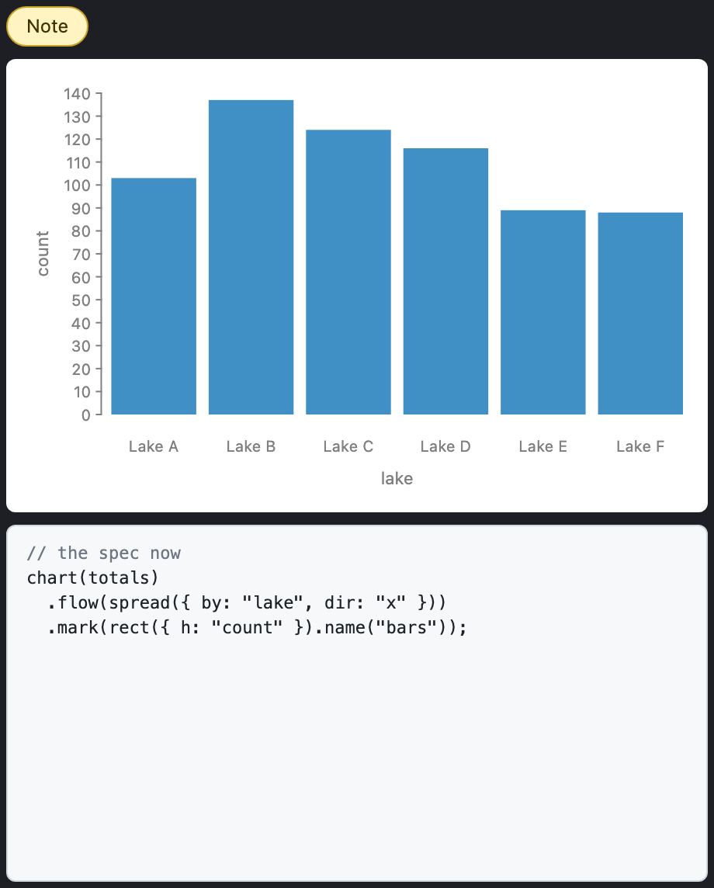   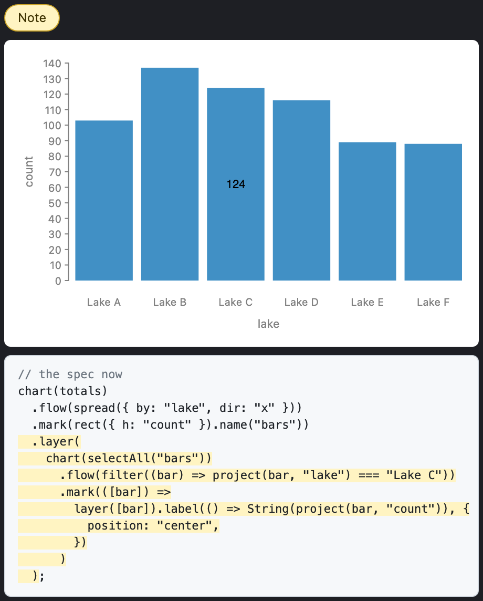

Dropping the Note chip on Lake C writes:

```js
chart(totals)
  .flow(spread({ by: "lake", dir: "x" }))
  .mark(rect({ h: "count" }).name("bars"))
  .layer(
    chart(selectAll("bars"))
      .flow(filter((bar) => project(bar, "lake") === "Lake C"))
      .mark(([bar]) =>
        layer([bar]).label(() => String(project(bar, "count")), {
          position: "outset-top",
        })
      )
  );
```

The chip can reach one state per bar without a note, and the preview is the state whose note is nearest the pointer. A note can reach the four label positions of its bar (outset-top, inset-top, center, inset-bottom) and the same position on each free bar. Outside the plot the preview is the chart without the note, so a drop there removes it (or, from the chip, adds nothing).

A spec panel under the chart prints the state as code. The demo builds the same code next to the printer.

### 7. Pull a reference line out of the axis

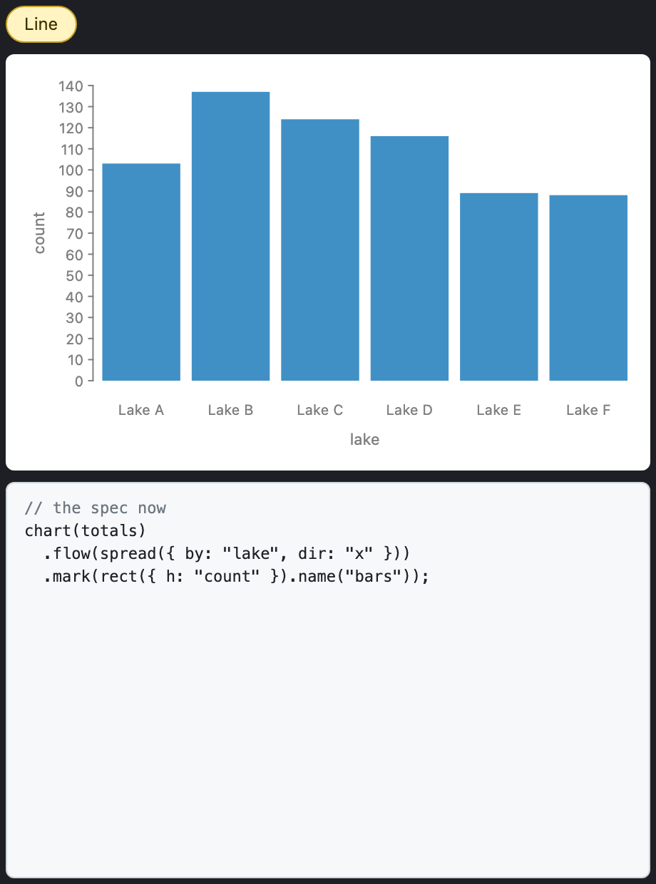 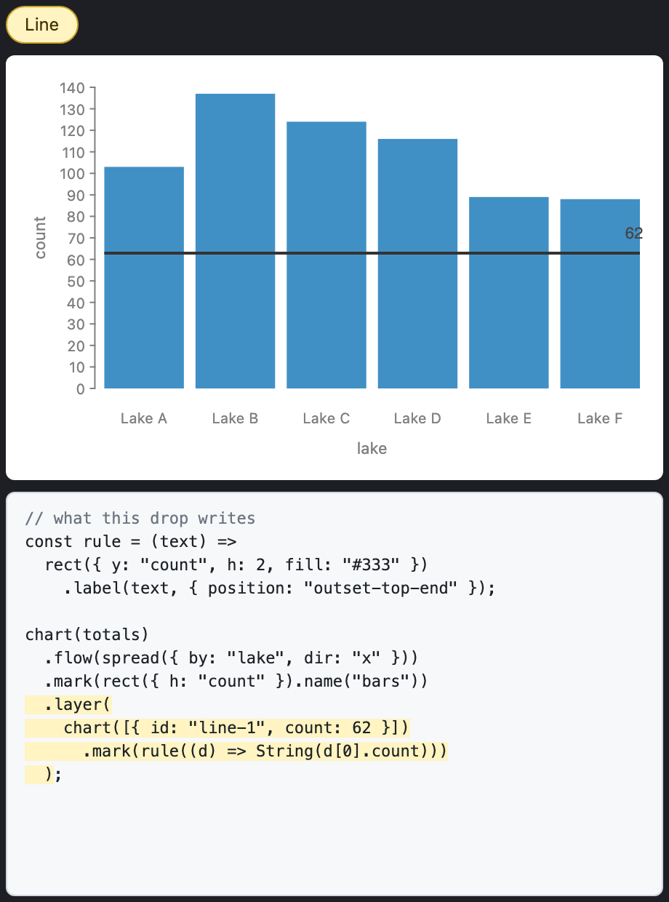 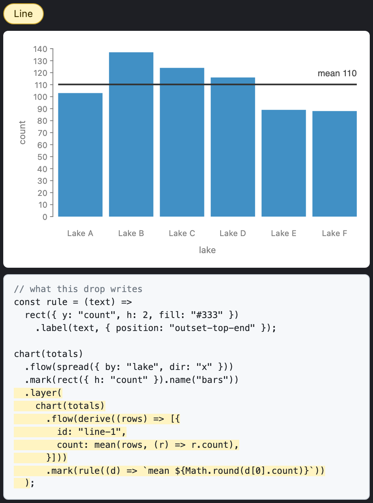 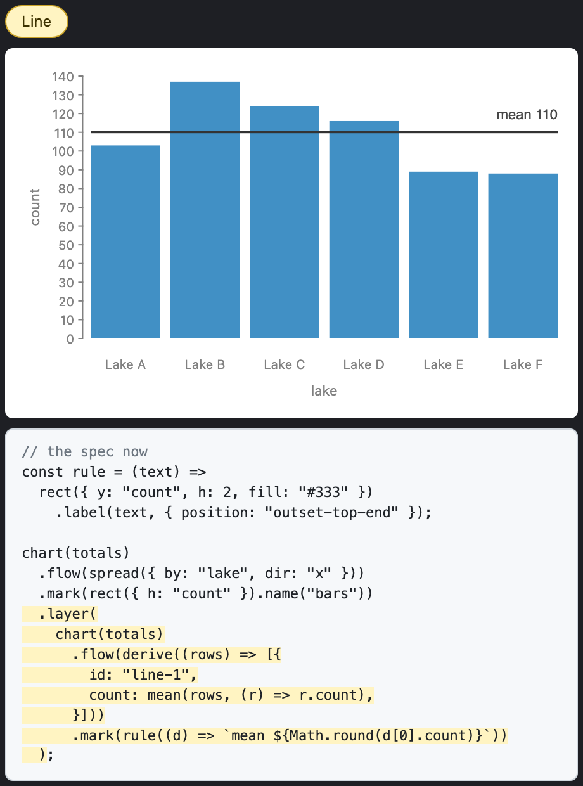

A free line is a literal row. A line snapped to the mean is a `derive` over the same data, so it follows the data:

```js
const rule = (text) =>
  rect({ y: "count", h: 2, fill: "#333" })
    .label(text, { position: "outset-top-end" });

// released at 62
.layer(
  chart([{ id: "line-1", count: 62 }])
    .mark(rule((d) => String(d[0].count)))
)

// snapped to the mean
.layer(
  chart(totals)
    .flow(derive((rows) => [{
      id: "line-1",
      count: mean(rows, (r) => r.count),
    }]))
    .mark(rule((d) => `mean ${Math.round(d[0].count)}`))
)
```

A drag starts on the y axis or on the Line chip. The value is continuous: two layouts (the line at 0 and at 96) give the pixel map. A target within 8 px wins: the mean, the max, and each bar's top (the median equals the mean here). The label then names it. Dragging a line back to the axis or out of the plot removes it.

The axis is pinned while dragging, so a line above the tallest bar goes past the top tick. On drop the real layout grows the axis from 140 to 160, and the drop tween settles it.

What the annotation API on main could not express is listed in the findings file: a ref has no `.label`, a layer over a ref has no datum for a field-name label, and marks over a selection do not sit on the selected mark.

## Approaches

Three independent questions.

### Where the reachable states come from

- **Listed by hand** (Dragology). Fully general. The paper's study shows authors struggle with it, and it repeats what the spec already says.
- **Derived from the spec** (recommended). The mark names the field. The operator that reads that field knows its values and where each one lands. Three rules cover the prototypes: an ordinal field gives one state per value in its domain, a continuous field gives the scale inverse, and a reorder gives one state per index. A drag edits either rows (`Drag.edit`) or the order of a domain (`Drag.reorder`). A drag that would produce a wrong chart, such as moving a stacked segment to another lake, is not offered. The hand-written list stays as `Drag.states`.

### Where the declaration sits

- **A method on the mark** (recommended): `rect(...).drag(Drag.edit("room"))`. It says which marks can be grabbed and what a grab edits, next to the channels that read the same fields. It matches `.transition(...)` and `.label(...)`.
- **A method on the input**, in the style of #830: `drag().pick(selectAll("meetings")).edit("room")`. This keeps all pointer work on one object, but a declarative drag is not a stream of pointer rows. It is a set of data edits. The raw `drag()` input stays for free gestures such as brushing and drawing, which the paper says declarative dragging does not cover. The overlap between the two is small: both start on pointer down over a mark.
- **A bridge package around the library.** Set aside for the reasons above.

### Where the edit goes

The data is a `signal`. A drop calls `set` with the edited rows, and the chart rerenders. A drag edits either rows (`Drag.edit`) or the order of a domain (`Drag.reorder`). A reorder writes the new order to the domain the split reads, and the chart rerenders the same way. A `.drag` on a chart whose data is a plain array is a loud error that names the fix. The alternative is a hidden copy of the data inside the chart, which no other code could read.

## What GoFish needs first

From the prototype's walls. None of these is drag-specific.

1. **A keyed join between one render and the next** (#914, noted as a declared shortcut in the build-in animation code). The drag blend and the drop tween both need it, and so does every animated update. The row key join on the animation grammar branch works on nodes and gives chrome no identity. The prototype keys ticks and legend swatches by their nearest label, which is a guess.
2. **Stable keys on display items.** Labels are done in the prototype: a label's display item now carries `attachedTo`, the id of the mark it labels, so a label moves with its mark. What remains: marks are still keyed by their rows through a user key function, and ticks, swatches and axis lines have no identity of their own.
3. **Pinned ordinal order during a drag.** Categories are ordered by first appearance, so editing a row's field can move its category in every reachable state. The prototype declares the domains by hand.
4. **A public way to paint a display list and to read item boxes and pixel maps from it.** The prototype imports the painter by path.
5. **A bug found on the way.** The color scale follows the declared levels of a `Unit` only when the same field also splits the marks. Stacked by row id, `fill: "species"` ignores the declared species levels and falls back to first appearance (`src/ast/_node.ts` near lines 1234 to 1258). Not filed yet.

## What the prototype leaves out

Dragology features not reproduced: natural neighbor blending, `whenFar`, snap radius, chained drags, constraints on continuous drags, drop targets by bounds, and control of z order. Each of these is a possible later member or option of the `Drag` family and none changes the call shape.

## Two users of the same engine

The engine is separate from the `.drag(Drag.…)` syntax. It derives the states a drag can reach from the spec, lays each one out, and blends between them under the pointer.

A GUI editor for GoFish needs the engine and none of the syntax. There every mark is draggable without being told, and a drag edits the spec: a domain's order, or which field a channel reads. The stack reorder already works this way. The editor is the first user.

The `.drag()` syntax is for authors who want dragging in a published chart. Its spelling stays open until someone needs it.

## Precedent

- **Dragology.** States listed by hand, feel chosen by combinators (`closest`, `between`, `whenFar`, `withFloating`, `withSnapRadius`). The source of the engine design and of the debugging views.
- **SwiftUI.** `ForEach(...).onMove` derives reorder targets from the list. This is the closest precedent for `Drag.reorder()`.
- **dnd-kit and SortableJS.** Sortable presets over DOM lists. Reorder is named, but layout is the browser's.
- **Figma auto layout.** Dragging a child of a frame reorders it, and the targets come from the layout. The same idea as deriving targets from `spread`.
- **Meros** (#830, #667). `bind` ties a shape to pointer values. Covers free gestures. Does not model reachable states.
- **D3 drag, Vega-Lite parameters, Observable Plot pointer.** Events or selections. None edits data from a drag without handler code.
- **mafs.** A movable point with a `constrain` function. Good for one free point, which is the raw `drag()` case.

## Related issues

- #1294: this topic. Records how GoFish's structure could derive drag targets.
- #830: the interaction grammar. Inputs are datasets, and behavior is picked by the kind of space.
- #697: the animation grammar. `transition` between scenes, which a drag reuses with the pointer as the clock.
- #914: keyed join against the previous render.
- #673: a name to items index in the published frame.
- #667 and #671: the Meros prototype and the reactive layer that came out of it.
- #941: the LLM authoring benchmark. Dragology's one-shot comparison method could be reused there.
