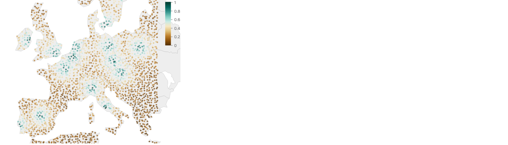
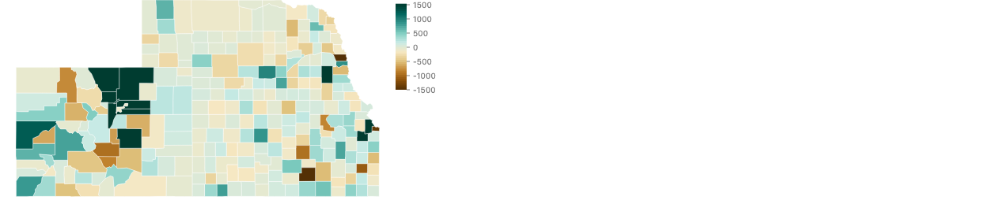
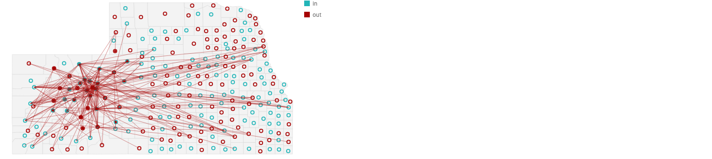
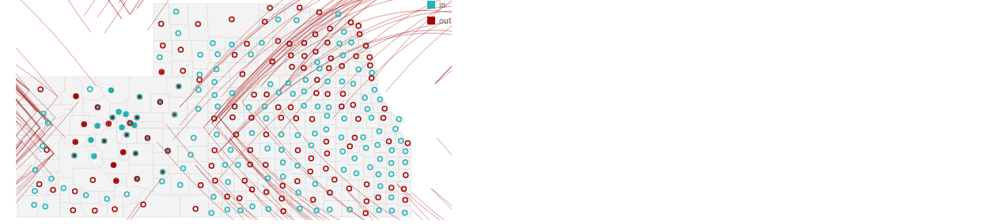
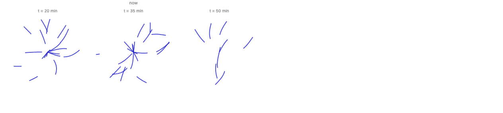
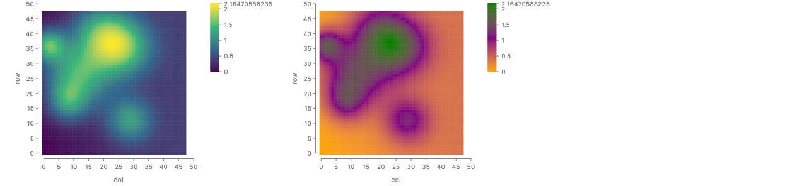
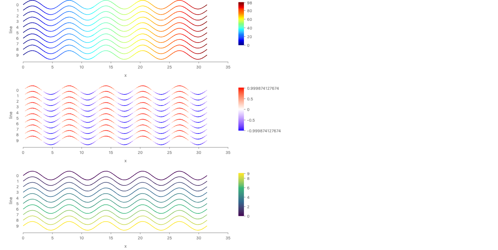
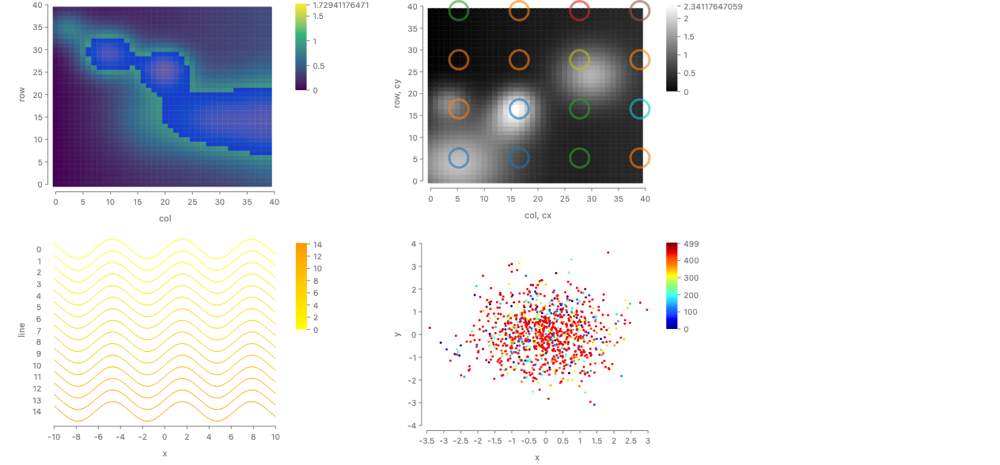
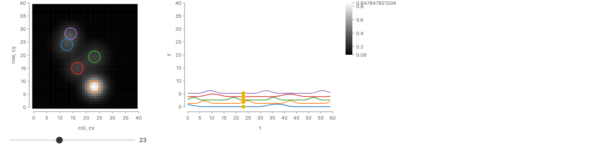
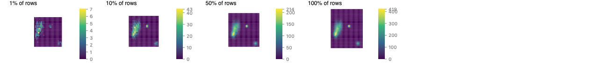

# Extension architecture: the example corpus

This page tests one requirement: a lonboard or fastplotlib program should be
writable in GoFish style, with the same `chart(...).flow(...).mark(...)`,
`layer`, `spread`, color and legend machinery, and with the domain package
adding only what is truly about its domain. Each section has the original
program (copied from the library's own examples, with its URL), the
GoFish-style program in Python and JS as a user of a future extension
package would write it, a render of the nearest honest thing GoFish draws
today, a table of who owns what, and the gaps.

Conventions used below:

- `gofish_geo` / `@gofish/geo`, `gofish_fpl` / `@gofish/fpl` and
  `gofish_progressive` / `@gofish/progressive` are placeholder package names.
- Every name that does not exist in GoFish today is marked `# NEW:` or
  `// NEW:`. A name marked `# PLANNED:` is one the docs already announce but
  that is not built (`Domain.continuous`).
- The renders are the stories in
  `packages/gofish-graphics/stories/_proposals/ExtensionArchitecture.stories.tsx`,
  drawn with `pnpm capture-one "extension architecture"` and copied to
  `img/ex-<id>.png`. They use only public exports of `src/lib.ts` and small
  data. Where a render needed a workaround, the story says so in a comment
  that starts with "Workaround, declared", and the gaps list repeats it.
- Data: L2 and L3 use real county geometry and migration flows (a Kansas,
  Nebraska and Colorado subset of deck.gl's `counties.json`, the data of
  lonboard's migration notebook). L1, L4, all of F and P1 use synthetic data,
  labeled as such in the data files and the stories.

The rules the rewrites follow: a coord appears only at a `chart()` or `layer`
boundary; one `by` key; options nest instead of taking prefixes; Python
passes children positionally and options as snake_case keywords; strategies
are `Family.member()`; `.name()` appears only when something selects it.

Contents: [L1](#l1-points-colored-by-a-continuous-value-lonboard-internet-speeds),
[L2](#l2-choropleth-lonboard-kontur-population),
[L3](#l3-multi-layer-map-with-brushing-lonboard-migration),
[L4](#l4-trips-over-time-lonboard-air-traffic-control),
[F1](#f1-image-and-colormap-fastplotlib-image_cmap),
[F2](#f2-line-stack-fastplotlib-line_stack),
[F3](#f3-grid-figure-fastplotlib-multigraphic_gridplot),
[F4](#f4-movie-with-a-time-slider-and-a-selector-driving-other-plots-fastplotlib-imagewidget-and-linearregionselector),
[P1](#p1-progressive-2d-histogram-progressivis-nyc-taxi),
[invented names](#invented-names), [walls](#walls-most-serious-first).

## The forks, in one place

These spellings had a real fork. Each is argued where it bites; this is the
index.

| Fork                                | Where it bites | Lean                                                                                                                                                                         |
| ----------------------------------- | -------------- | ---------------------------------------------------------------------------------------------------------------------------------------------------------------------------- |
| Where the painter is chosen         | L1             | A `.render(painter=Painter.deckgl())` option, default SVG. The spec does not change.                                                                                         |
| How a basemap enters                | L1, L3         | A mark in the layer (`basemap("carto-positron")`), first in paint order. Not a coord property.                                                                               |
| How a projection or CRS is spelled  | L1, L2         | Keep `Coord.geo(projection, { lon, lat })`. The geo package widens what `projection` accepts (an EPSG code) and the geometry type carries the data's CRS. No new coord name. |
| How a point-valued column is placed | L1, L3, F2     | `scatter({ at: "geometry" })`, one new option, also for fastplotlib's `(n, 2)` arrays. The other spelling is two field methods.                                              |
| How a color varies along one line   | L3, F2         | A stroke that varies within a line's group draws per segment (Observable Plot's rule). Today it is an error-free silent first-row read.                                      |
| How an array becomes rows           | F1, F4         | `array(movie, { dims: ["t", "y", "x"] })` is a table with one row per element. An image is a grid of data-unit rects; the painter, not a new mark, turns it into a texture.  |
| How an input enters                 | L3, F4         | The input is a dataset or a signal read in `filter`; no `bind` or `when`. A window function is `filter(between(...))` plus `group` plus `.mean()`.                           |
| How a progressive source differs    | P1             | Only in the data argument. Marks are the same; stability comes from fixed bins and a declared domain.                                                                        |

## L1. Points colored by a continuous value (lonboard internet-speeds)

Source: <https://github.com/developmentseed/lonboard/blob/main/examples/internet-speeds.ipynb>
(code cells, in order; the `# /// script` header is omitted).

```python
from pathlib import Path

import geopandas as gpd
import pandas as pd
import shapely
from palettable.colorbrewer.diverging import BrBG_10
from sidecar import Sidecar

from lonboard import Map, ScatterplotLayer
from lonboard.colormap import apply_continuous_cmap

url = "https://ookla-open-data.s3.us-west-2.amazonaws.com/parquet/performance/type=mobile/year=2019/quarter=1/2019-01-01_performance_mobile_tiles.parquet"

local_path = Path("internet-speeds.parquet")
if local_path.exists():
    gdf = gpd.read_parquet(local_path)
else:
    columns = ["avg_d_kbps", "tile"]
    df = pd.read_parquet(url, columns=columns)

    tile_geometries = shapely.from_wkt(df["tile"])
    tile_centroids = shapely.centroid(tile_geometries)
    gdf = gpd.GeoDataFrame(df[["avg_d_kbps"]], geometry=tile_centroids, crs="EPSG:4326")
    gdf.to_parquet(local_path)

gdf.head()

gdf = gdf.cx[-11.83:25.5, 34.9:59]

gdf

sidecar = Sidecar(anchor="split-right")

layer = ScatterplotLayer.from_geopandas(gdf)
m = Map(layer, height=800)
with sidecar:
    display(m)

layer.get_fill_color = [0, 0, 200, 200]

min_bound = 5000
max_bound = 50000
download_speed = gdf["avg_d_kbps"]
normalized_download_speed = (download_speed - min_bound) / (max_bound - min_bound)

normalized_download_speed

BrBG_10.mpl_colormap

layer.get_fill_color = apply_continuous_cmap(
    normalized_download_speed,
    BrBG_10,
    alpha=0.7,
)

layer.get_radius = normalized_download_speed * 200
layer.radius_units = "meters"
layer.radius_min_pixels = 0.5
```

### GoFish style, Python

```python
import geopandas as gpd
from palettable.colorbrewer.diverging import BrBG_10
from gofish import chart, layer, scatter, circle, Color, Coord, Unit, Domain
from gofish_geo import basemap          # NEW: a mark that draws map tiles
from gofish_geo import Painter          # NEW: family; Painter.deckgl comes from the geo package

gdf = gpd.read_parquet("internet-speeds.parquet").cx[-11.83:25.5, 34.9:59]

layer(
    [
        basemap("carto-positron"),       # NEW
        chart(gdf, schema={"avg_d_kbps": Unit(domain=Domain.continuous(5000, 50000))})  # PLANNED: Domain.continuous
        .flow(scatter(at="geometry"))    # NEW option: place by a point-valued column
        .mark(circle(area="avg_d_kbps", fill="avg_d_kbps", opacity=0.7)),
    ],
    coord=Coord.geo("mercator"),
    color=Color.gradient(BrBG_10.hex_colors),
).render(h=800, painter=Painter.deckgl())  # NEW option + family member
```

### GoFish style, JS

```js
import {
  chart,
  layer,
  scatter,
  circle,
  Color,
  Coord,
  Unit,
  Domain,
} from "gofish-graphics";
import { basemap, Painter } from "@gofish/geo"; // NEW: basemap (mark), Painter (family)
import { readParquet } from "@gofish/geo"; // NEW: a GeoArrow table source

const tiles = await readParquet("internet-speeds.parquet");

layer(
  [
    basemap("carto-positron"), // NEW
    chart(tiles, {
      schema: { avg_d_kbps: Unit({ domain: Domain.continuous(5000, 50000) }) },
    }) // PLANNED
      .flow(scatter({ at: "geometry" })) // NEW option
      .mark(circle({ area: "avg_d_kbps", fill: "avg_d_kbps", opacity: 0.7 })),
  ],
  { coord: Coord.geo("mercator"), color: Color.gradient(BrBG_10) }
).render(container, { h: 800, painter: Painter.deckgl() }); // NEW
```

What changed against lonboard: the normalization to `[5000, 50000]` and the
colormap call become one declaration on the data (the unit's domain) and one
color scale, and the legend follows from them. `radius_units = "meters"` and
`radius_min_pixels` become `circle({ area })`, so the size is a value with a
size legend rather than a distance on the ground. If a user really wants a
ground distance, the spelling is a length unit on the column, which the geo
coord would turn into pixels (`Unit("m")`); that is a gap, below.

**Fork: where the painter is chosen.**
(a) An option of `.render(...)`: `painter: Painter.deckgl()`. The spec is the
same object whether it is drawn as SVG in the docs or by deck.gl in a
notebook, and Python and JS take the same option. Cost: the user has to know
a painter exists when the data is large. (b) Inferred: the engine picks
WebGL above some row count. Cost: a heuristic users have to model, which the
project has ruled out (an explicit default plus an override is the rule).
(c) A property of a mark (`circle(...).painter(...)`). Cost: two painters in
one picture must agree on the canvas, z-order and hit testing, and the spec
now says how, not what. Lean (a), with SVG as the written default, and with
the painter free to hand items it cannot draw (text, for example) to SVG
above it. The measured numbers from the scaling proposal make the case:
1e6 circles take 9.3 s in GoFish's SVG painter and 35 ms in WebGL.

**Fork: how a basemap enters.**
(a) A mark in the layer, first in paint order: `basemap("carto-positron")`.
It needs the final window and zoom, so it elaborates late, like an axis: it
desugars to an `image` per tile whose rows come from a tile source that reads
the view. It can be reordered (lonboard's interleaved-labels example puts
labels above data), hidden, or left out. (b) A property of the coord
(`Coord.geo("mercator", { basemap })`). Cost: a coord is a transform, and
this makes it draw; it also cannot put labels above data. (c) A render
option. Cost: the same, plus it does not round-trip with the spec. Lean (a).

**Fork: projection and CRS.** `Coord.geo` exists and takes a projection
name or a function. The geo package adds only values: an EPSG code
(`Coord.geo("EPSG:3857")`, through proj4 / pyproj), and it reads the data's
own CRS from the geometry column's type, so a GeoDataFrame in EPSG:4326 and
one in a UTM zone both land in the same map without a `to_crs` call. No new
coord name. Lonboard's maps are always Web Mercator, which is
`Coord.geo("mercator")` today.

**Fork: a point-valued column.** (a) `scatter({ at: "geometry" })`: one new
option, a channel whose value is a point, which the same option also serves
for fastplotlib's `(n, 2)` arrays (F2). Precedent: deck.gl's `getPosition`,
Observable Plot's `geo` mark and `centroid` transform. (b) Two field
methods, `scatter({ x: field("geometry").x(), y: field("geometry").y() })`,
which fit the rule that a method reads the caller's type and can fail
loudly on a non-point type. Cost: longer, and it splits one value into two
channels. Lean (a).

### Render today



Story `L1_SpeedPoints`. 2,082 SYNTHETIC points on land in the notebook's
window (fast near fifteen capitals), the clamp done in a `derive`, BrBG
stops written out as a list, the basemap drawn as world110m country
polygons. The colorbar comes for free. The radius is a constant 2 px: a
radius from data under `Coord.geo` timed out (30 s) at this size, and at 1 px
size it drew boxes, not circles (see walls).

### Who owns what

| The geo package still owns                                          | GoFish gives it                                                |
| ------------------------------------------------------------------- | -------------------------------------------------------------- |
| Reading GeoParquet / GeoArrow, the geometry column type and its CRS | The color scale, the colorbar legend, a size legend for `area` |
| Tile basemaps (`basemap`, the tile source behind it)                | The projection fit to the box, the window, aspect ratio        |
| The deck.gl painter for 1e6 points                                  | Layering with any other GoFish visualization, axes when wanted |
| Lengths on the ground (meters) under a projection                   | `selectAll` over the points, labels, Python/JS parity          |

### Gaps

- No tile basemap. Missing: a `basemap` mark over a tile source that reads
  the view. Slots: source and mark. The render uses world110m polygons.
- 1e6 points is out of reach for the SVG painter. Slot: painter.
- A data-valued radius under `Coord.geo` is slow (timeout at 2,082 points)
  and draws boxes, because the size is projected as a data-space box. Slot:
  coord (the geo coord must map a length at a point, and keep a circle round).
- No continuous domain to clamp a color scale to. `Domain.continuous` is
  announced in the `Domain` family but not built. Slot: data type.
- Polygons that cross the window's edge are not clipped (Spain and Russia
  spill out to the right, under the legend). Slot: core (a coord window
  should clip), not the extension.
- Point geometry is two columns today (`lon`, `lat`). Slot: data type plus
  the `at` option.

## L2. Choropleth (lonboard kontur population)

Source: <https://github.com/developmentseed/lonboard/blob/main/examples/kontur_pop.ipynb>

```python
import warnings

import geopandas as gpd
from matplotlib.colors import LogNorm
from palettable.colorbrewer.diverging import BrBG_10
from sidecar import Sidecar

from lonboard import H3HexagonLayer, Map
from lonboard.colormap import apply_continuous_cmap

url = "https://geodata-eu-central-1-kontur-public.s3.eu-central-1.amazonaws.com/kontur_datasets/kontur_population_20231101_r4.gpkg.gz"

# Wrap with GDAL's virtual file prefixes
vsipath = f"/vsigzip//vsicurl/{url}"

with warnings.catch_warnings():
    warnings.filterwarnings(
        "ignore",
        message="HTTP response code",
        category=RuntimeWarning,
    )
    gdf = gpd.read_file(vsipath, use_arrow=True)

df = gdf[["h3", "population"]]

pop = df["population"]
min_bound = pop.min()
max_bound = pop.max()
normalizer = LogNorm(min_bound, max_bound, clip=True)
normalized = normalizer(pop)

sidecar = Sidecar(anchor="split-right")

layer = H3HexagonLayer.from_pandas(
    df,
    get_hexagon=df["h3"],
    get_fill_color=apply_continuous_cmap(normalized, BrBG_10, alpha=0.7),
)
m = Map(layer)
with sidecar:
    display(m)
```

### GoFish style, Python

```python
from gofish import chart, polygon, Color, Coord
from gofish_geo import H3          # NEW: data type, an H3 cell
# The log mapping (LogNorm) has no spelling yet; see the note below.

(
    chart(df, schema={"h3": H3()}, coord=Coord.geo("mercator"),
          color=Color.gradient(BrBG_10.hex_colors))
    .mark(polygon(points="h3", fill="population", opacity=0.7))
)
```

### GoFish style, JS

```js
import { chart, polygon, Color, Coord } from "gofish-graphics";
import { H3 } from "@gofish/geo"; // NEW: data type

chart(df, {
  schema: { h3: H3() },
  coord: Coord.geo("mercator"),
  color: Color.gradient(BrBG_10),
})
  .mark(polygon({ points: "h3", fill: "population", opacity: 0.7 }))
  .render(container);
```

The H3 cell is the clearest case of what a domain package should add: a
column type. `polygon({ points })` already reads a ring per row (the world
basemap stories use it). An `H3` type says "this string is a hexagon",
gives `polygon` its boundary ring, gives `scatter({ at })` its center, and
could give `Bin` a member (`Bin.h3({ resolution })`) so raw points can be
binned into H3 cells by the same `partition` the 2D histogram uses (P1).
The log color mapping is `LogNorm`. GoFish has no log color scale today; the
scale-transforms proposal moves transforms onto coords and a `Transform`
family, which is not built. With no transform, the spelling today is a
`derive` that takes the log.

### Render today



Story `L2_Choropleth`. GoFish has no H3 type, so this is the nearest honest
choropleth: real county polygons (Kansas, Nebraska, Colorado) filled by
real net migration from the same data as L3, with BrBG clipped to ±1,500 in
a `derive` so the gradient's middle falls on 0. The colorbar comes for free.

### Who owns what

| The geo package still owns                             | GoFish gives it                                             |
| ------------------------------------------------------ | ----------------------------------------------------------- |
| The `H3` column type: boundary, center, binning member | `polygon`, the gradient, the colorbar legend                |
| Reading GeoPackage over HTTP                           | The projection fit, layering with a basemap or other layers |
| (Large cell counts: the painter)                       | Hover and selection over the cells (`selectAll`)            |

### Gaps

- No H3 (or any discrete global grid) cell type. Slot: data type.
- No log color mapping and no gradient midpoint (`Trait.diverging` centers a
  stack, not a color scale). Slot: core (scale transforms), not the
  extension.
- No hole support in `polygon` (world110m notes this shortcut too). Slot:
  core mark.

## L3. Multi-layer map with brushing (lonboard migration)

Source: <https://github.com/developmentseed/lonboard/blob/main/examples/migration.ipynb>
(polygons are not in this notebook; it layers points, rings and arcs. The
GoFish version adds the county polygons as its basemap, which makes it
polygons + paths + points.)

```python
import geopandas as gpd
import numpy as np
import pandas as pd
import pyarrow as pa
import requests
import shapely
from matplotlib.colors import Normalize

from lonboard import ArcLayer, Map, ScatterplotLayer
from lonboard.layer_extension import BrushingExtension

url = "https://raw.githubusercontent.com/visgl/deck.gl-data/master/examples/arc/counties.json"
r = requests.get(url)
source_data = r.json()

arcs = []
targets = []
sources = []
pairs = {}

features = source_data["features"]
for i, county in enumerate(features):
    flows = county["properties"]["flows"]
    target_centroid = county["properties"]["centroid"]
    total_value = {
        "gain": 0,
        "loss": 0,
    }

    for to_id, value in flows.items():
        if value > 0:
            total_value["gain"] += value
        else:
            total_value["loss"] += value

        # If number is too small, ignore it
        if abs(value) < 50:
            continue

        pair_key = "-".join(map(str, sorted([i, int(to_id)])))
        source_centroid = features[int(to_id)]["properties"]["centroid"]
        gain = np.sign(value)

        # add point at arc source
        sources.append(
            {
                "position": source_centroid,
                "target": target_centroid,
                "name": features[int(to_id)]["properties"]["name"],
                "radius": 3,
                "gain": -gain,
            },
        )
        # eliminate duplicate arcs
        if pair_key in pairs:
            continue

        pairs[pair_key] = True

        if gain > 0:
            arcs.append(
                {
                    "target": target_centroid,
                    "source": source_centroid,
                    "value": value,
                },
            )
        else:
            arcs.append(
                {
                    "target": source_centroid,
                    "source": target_centroid,
                    "value": value,
                },
            )

    # add point at arc target
    targets.append(
        {
            **total_value,
            "position": [target_centroid[0], target_centroid[1], 10],
            "net": total_value["gain"] + total_value["loss"],
            "name": county["properties"]["name"],
        },
    )

# sort targets by radius large -> small
targets = sorted(targets, key=lambda d: abs(d["net"]), reverse=True)
normalizer = Normalize(0, abs(targets[0]["net"]))

# migrate out
SOURCE_COLOR = [166, 3, 3]
# migrate in
TARGET_COLOR = [35, 181, 184]
# Combine into a single arr to use as a lookup table
COLORS = np.vstack(
    [np.array(SOURCE_COLOR, dtype=np.uint8), np.array(TARGET_COLOR, dtype=np.uint8)],
)
SOURCE_LOOKUP = 0
TARGET_LOOKUP = 1

brushing_extension = BrushingExtension()
brushing_radius = 200000

source_arr = np.array([source["position"] for source in sources])
source_positions = shapely.points(source_arr[:, 0], source_arr[:, 1])
source_gdf = gpd.GeoDataFrame(
    pd.DataFrame.from_records(sources)[["name", "radius", "gain"]],
    geometry=source_positions,
    crs="EPSG:4326",
)
# We use a lookup table (`COLORS`) to apply either the target color or the source color
# to the array
source_colors_lookup = np.where(source_gdf["gain"] > 0, TARGET_LOOKUP, SOURCE_LOOKUP)
source_fill_colors = COLORS[source_colors_lookup]

source_layer = ScatterplotLayer.from_geopandas(
    source_gdf,
    get_fill_color=source_fill_colors,
    radius_scale=3000,
    pickable=False,
    extensions=[brushing_extension],
    brushing_radius=brushing_radius,
)

targets_arr = np.array([target["position"] for target in targets])
target_positions = shapely.points(targets_arr[:, 0], targets_arr[:, 1])
target_gdf = gpd.GeoDataFrame(
    pd.DataFrame.from_records(targets)[["name", "gain", "loss", "net"]],
    geometry=target_positions,
    crs="EPSG:4326",
)
# We use a lookup table (`COLORS`) to apply either the target color or the source color
# to the array
target_line_colors_lookup = np.where(
    target_gdf["net"] > 0,
    TARGET_LOOKUP,
    SOURCE_LOOKUP,
)
target_line_colors = COLORS[target_line_colors_lookup]

target_ring_layer = ScatterplotLayer.from_geopandas(
    target_gdf,
    get_line_color=target_line_colors,
    radius_scale=4000,
    pickable=True,
    stroked=True,
    filled=False,
    line_width_min_pixels=2,
    extensions=[brushing_extension],
    brushing_radius=brushing_radius,
)

value = np.array([arc["value"] for arc in arcs])
get_source_position = np.array([arc["source"] for arc in arcs])
get_target_position = np.array([arc["target"] for arc in arcs])
table = pa.table({"value": value})

arc_layer = ArcLayer(
    table=table,
    get_source_position=get_source_position,
    get_target_position=get_target_position,
    get_source_color=SOURCE_COLOR,
    get_target_color=TARGET_COLOR,
    get_width=1,
    opacity=0.4,
    pickable=False,
    extensions=[brushing_extension],
    brushing_radius=brushing_radius,
)

map_ = Map([source_layer, target_ring_layer, arc_layer], picking_radius=10)
map_
```

### GoFish style, Python

The arc-building loop above is data preparation and stays as plain Python
(it builds `arcs`, `sources` and `targets`; GoFish does not want to own it).
What changes is everything after it. Python has no interaction today, so the
brush is a fixed one-row dataset here.

```python
from gofish import chart, scatter, circle, line, polygon, resolve, select_all, filter, Color, Coord, Curve
from gofish_geo import within_km          # NEW: data helper, a distance predicate on point columns

brush = [{"geometry": Point(-104.99, 39.74)}]   # the pointer, frozen

(
    chart(counties_gdf, coord=Coord.geo("mercator"),
          color=Color.palette({"out": "rgb(166,3,3)", "in": "rgb(35,181,184)"}))
    .mark(polygon(points="geometry", fill="#f3f3f3", stroke="#d0d0d0"))
    .layer(
        chart(target_gdf)
        .flow(scatter(by="name", at="geometry"))                    # NEW option at
        .mark(circle(r=3, fill="none", stroke="direction").name("counties"))
    )
    .layer(
        chart(source_gdf)
        .flow(filter(within_km("geometry", brush, 200)), scatter(at="geometry"))
        .mark(circle(r=2, fill="direction"))
    )
    .layer(
        chart(arcs_df)
        .flow(filter(within_km(["source", "target"], brush, 200)),
              resolve(["source", "target"], from_=select_all("counties")))
        .mark(line(from_="source", to="target", stroke="direction", opacity=0.4,
                   curve=Curve.geodesic()))                         # NEW member
    )
)
```

### GoFish style, JS (with a live brush)

```js
import {
  chart,
  scatter,
  circle,
  line,
  polygon,
  resolve,
  selectAll,
  filter,
  pointer,
  Color,
  Coord,
  Curve,
} from "gofish-graphics";
import { withinKm } from "@gofish/geo"; // NEW: data helper

const p = pointer(); // exists: an input; under the interaction-as-data design it is a dataset

gofish(
  container,
  { w: 960, h: 600 },
  () =>
    chart(counties, {
      coord: Coord.geo("mercator"),
      color: Color.palette({ out: SOURCE, in: TARGET }),
    })
      .mark(polygon({ points: "geometry", fill: "#f3f3f3", stroke: "#d0d0d0" }))
      .layer(
        chart(targets)
          .flow(scatter({ by: "name", at: "geometry" })) // NEW: at
          .mark(
            circle({ r: 3, fill: "none", stroke: "direction" }).name("counties")
          )
      )
      .layer(
        chart(sources)
          .flow(
            filter(withinKm("geometry", [p()], 200)),
            scatter({ at: "geometry" })
          )
          .mark(circle({ r: 2, fill: "direction" }))
      )
      .layer(
        chart(arcs)
          .flow(
            filter(withinKm(["source", "target"], [p()], 200)),
            resolve(["source", "target"], { from: selectAll("counties") })
          )
          .mark(
            line({
              from: "source",
              to: "target",
              stroke: "direction",
              opacity: 0.4,
              curve: Curve.geodesic(),
            })
          )
      ) // NEW member
);
```

Here `.name("counties")` is used: the arcs `resolve` their ends against it.
The brushing extension, which in deck.gl is a GPU shader option on three
layers, is an ordinary `filter` with the pointer as data, applied to each
layer that should respond. The source-to-target color gradient on each arc
is the per-segment stroke fork, below.

**Fork: a color that varies along one line.** deck.gl's `ArcLayer` blends
`get_source_color` into `get_target_color`, and fastplotlib colors lines per
vertex (F2). In GoFish a mark's color reads its first row (colors aggregate
by "first"), so a stroke field that varies inside a line's group is silently
one color. (a) Observable Plot's rule: when the stroke varies within a
series, draw the line as segments, each with its own color; no new name.
Cost: the "colors read the first row" rule gets an exception for
relational marks, which must be written down as a channel kind ("along").
(b) Keep the rule and make the user cut lines into segments (today's ugly
version, shown in F2). Lean (a), as a new channel kind rather than a
special case.

### Render today



Story `L3_MultiLayer`, real data. County polygons as the basemap, a ring per
county colored by the sign of its net migration, filled source points and
arcs inside 200 km of a brush frozen at Denver. The legend for `in` / `out`
comes for free. Arcs are straight, one color, built as two endpoint rows
per arc threaded with `group` + `scatter` + `line` (the Bird Migration
idiom). The spelling above, `resolve` + `line({ from, to })` against the
named rings, draws its lines in the wrong place under `Coord.geo`:



### Who owns what

| The geo package still owns                                    | GoFish gives it                                                   |
| ------------------------------------------------------------- | ----------------------------------------------------------------- |
| Geodesic arcs (`Curve.geodesic`), distances in km on a sphere | `line` between named marks, the palette and its legend            |
| Point / polygon geometry columns                              | Layering four layers in one space, `filter`, the input as data    |
| The painter, for many arcs                                    | Selection: the same brush could filter a bar chart beside the map |

### Gaps

- `resolve` + `line({ from, to })` lines are misplaced under `Coord.geo`.
  Slot: core (ref positions do not go through the coord), not the extension.
- No color along a line (source to target). Slot: core channel kind.
- No arc height or great-circle path. Slot: coord-aware curve (geo package).
- No interaction in Python; the brush is frozen in both renders. Slot:
  interaction (the bridge does not carry signals).
- Distance in km is hand-written (`inBrush` in the story). Slot: data helper
  in the geo package.

## L4. Trips over time (lonboard air-traffic-control)

Source: <https://github.com/developmentseed/lonboard/blob/main/examples/air-traffic-control.ipynb>

```python
from datetime import timedelta
from io import BytesIO

import requests
from arro3.io import read_parquet

from lonboard import Map, TripsLayer

# Fetch the Parquet file and parse to an Arrow table
url = "https://github.com/kylebarron/adsb-extract/releases/download/v0.1/2024-10-03_traces.parquet"
r = requests.get(url)
table = read_parquet(BytesIO(r.content)).read_all()

layer = TripsLayer(
    table=table,
    get_timestamps=table["timestamp"],
    width_min_pixels=2,
    get_color=[30, 30, 200, 200],
    trail_length=200,
    # Turn off tooltip data selection for better performance
    pickable=False,
)

m = Map(
    layer,
    view_state={
        "longitude": -73.8,
        "latitude": 40.6,
        "zoom": 9.5,
        "pitch": 50.6,
        "bearing": 8.24,
    },
    # Increase height of generated map
    height=800,
)
m

layer.animate(step=timedelta(minutes=1), fps=50)

layer.stop_animation()
```

### GoFish style, JS

A trip is a line through the rows of one flight in time order, and the
trail is a window on time. The clock is an input, and the window is a
`filter` with `between`, which exists. The animation is GoFish's own
`time.sequence`, which is JS-only today.

```js
import {
  chart,
  group,
  scatter,
  line,
  filter,
  between,
  field,
  time,
  Coord,
} from "gofish-graphics";
import { basemap, readParquet, Painter } from "@gofish/geo"; // NEW: basemap, readParquet, Painter

const traces = await readParquet(url); // one row per position: flight, timestamp, geometry
const TRAIL = 200; // seconds, as trail_length

chart(traces, {
  coord: Coord.geo("mercator", { lon: [-74.4, -73.2], lat: [40.3, 40.9] }),
})
  .mark(basemap("carto-positron")) // NEW
  .layer(
    chart(traces)
      .flow(
        time.sequence({ by: "now", every: 60 }), // NEW option `every` (see note)
        filter(
          between(field("timestamp"), field("now").minus(TRAIL), field("now"))
        ), // NEW: .minus
        group({ by: "flight" }),
        scatter({ by: "timestamp", at: "geometry" }) // NEW: at
      )
      .mark(line({ stroke: "rgb(30,30,200)", strokeWidth: 2, opacity: 0.8 }))
  )
  .render(container, { h: 800, painter: Painter.deckgl() });
```

The honest part: `time.sequence({ by })` plays the groups of an existing
column. A clock that steps through a continuous `timestamp` every 60 s, and
a window that reads the current step, do not have a spelling yet; `every`
and `.minus` above are placeholders for that missing piece, and the clean
answer probably comes from the animation-grammar work (time as an axis),
not from the geo package. Lonboard's `pitch` and `bearing` (a 3D camera)
have no GoFish counterpart at all.

### GoFish style, Python

```python
from gofish import chart, group, scatter, spread, line, filter, between, field, Coord
from gofish_geo import read_parquet           # NEW: source

traces = read_parquet(url)
frames = traces.with_columns(now=...)         # a filmstrip: one copy of the rows per moment
(
    chart(frames)
    .flow(spread(by="now", dir="x"))
    .mark(
        chart(coord=Coord.geo("mercator"))
        .flow(filter(between(field("timestamp"), field("now") - 200, field("now"))),
              group(by="flight"), scatter(by="timestamp", at="geometry"))
        .mark(line(stroke="rgb(30,30,200)", stroke_width=2, opacity=0.8))
    )
)
```

Python has no clock, so the Python program draws the moments side by side,
which is what the render below does in JS.

### Render today



Story `L4_TripsFilmstrip`. SYNTHETIC tracks around JFK, three moments, each
a chart in `Coord.geo` nested in a `spread` over `now` (the frames are
data). Tracks near the window edge draw past it into the next frame,
because the window does not clip.

### Who owns what

| The geo package still owns                   | GoFish gives it                                                           |
| -------------------------------------------- | ------------------------------------------------------------------------- |
| Reading ADS-B traces (Arrow), point geometry | `group` + `scatter` + `line` for a path, `filter`/`between` for the trail |
| The basemap, the 3D camera (pitch, bearing)  | The clock and the filmstrip (time as data), composition with a time chart |
| The painter for 1e5 trails                   | Legend, selection of one flight with `selectAll`                          |

### Gaps

- No stepping clock over a continuous time column, and no way to read the
  current time inside a window filter. Slot: core (time), not the extension.
- No clipping to the coord window. Slot: core.
- No 3D camera. Slot: painter (deck.gl), and a GoFish view model that does
  not exist.
- No basemap. Slot: source and mark.

## F1. Image and colormap (fastplotlib image_cmap)

Source: <https://github.com/fastplotlib/fastplotlib/blob/main/examples/image/image_cmap.py>

```python
"""
Image Colormap
==============

Example showing simple plot creation and subsequent cmap change with a standard image from imageio.
"""

# test_example = true
# sphinx_gallery_pygfx_docs = 'screenshot'

import imageio.v3 as iio

import fastplotlib as fpl
import cmap as cmap_lib

im = iio.imread("imageio:camera.png")

figure = fpl.Figure(size=(700, 560))

# plot the image data
image = figure[0, 0].add_image(data=im, name="random-image")

figure.show()

image.cmap = "viridis"

# create your own colormap using the cmap lib
image.cmap = cmap_lib.Colormap(["orange", "purple", "green"])

# NOTE: fpl.loop.run() should not be used for interactive sessions
# See the "JupyterLab and IPython" section in the user guide
if __name__ == "__main__":
    print(__doc__)
    fpl.loop.run()
```

### GoFish style, Python

```python
import imageio.v3 as iio
from gofish import chart, scatter, rect, datum, Color
from gofish_fpl import array, Painter     # NEW: array (source), Painter.pygfx (family member)

im = array(iio.imread("imageio:camera.png"), dims=("y", "x"), name="v")   # NEW

def view(cmap):
    return (
        chart(im, color=Color.gradient(cmap))
        .flow(scatter(x="x", y="y"))
        .mark(rect(w=datum(1), h=datum(1), fill="v"))
    )

view("viridis").render(w=700, h=560, painter=Painter.pygfx())             # NEW
view(["orange", "purple", "green"]).render(w=700, h=560, painter=Painter.pygfx())
```

### GoFish style, JS

```js
import { chart, scatter, rect, datum, Color } from "gofish-graphics";
import { array } from "@gofish/fpl"; // NEW: source

const im = array(pixels, { dims: ["y", "x"], name: "v", shape: [512, 512] }); // NEW

const view = (cmap) =>
  chart(im, { color: Color.gradient(cmap) })
    .flow(scatter({ x: "x", y: "y" }))
    .mark(rect({ w: datum(1), h: datum(1), fill: "v" }));

view("viridis").render(container, { w: 700, h: 560 });
```

fastplotlib changes the colormap of a live graphic (`image.cmap = ...`).
GoFish rebuilds the spec with a new color scale; with the reactive layer
the `cmap` could be a signal, and only paint changes.

**Fork: how an array becomes chart data.** (a) An array source,
`array(data, { dims })`, that is a table with one row per element and one
column per dim plus the value: `(y, x, v)`. The image is then a grid of
data-unit rects, an ordinary mark, so anything else in the same data space
(ROI contours in F4, circles in F3) lines up with it, and the color scale,
colorbar and selection are the usual ones. The painter sees a regular grid
of unit rects with one fill channel and draws one texture: that is a
reduction at drawing time, in line with the decision that `selectAll` is a
logical selection over the marks the spec defines, not the drawn ones. The
dim names come from xarray (`dims`), which scientists already use. (b) A
dedicated raster mark that takes a 2D array per row (`raster({ values })`).
Cost: a second way to draw a grid, which does not compose with `partition`,
`table` or the 2D histogram in P1, and a second color path. Lean (a). The
cost of (a) is the verbose mark, `rect({ w: datum(1), h: datum(1) })`; a
`table({ by: { x, y }, spacing: 0 })` spelling is shorter but puts the image
in band space, where a continuous overlay cannot follow.

### Render today



Story `F1_ImageCmap`. A SYNTHETIC 48 x 48 image (Gaussian blobs), as 2,304
rects, under viridis and under the custom orange-purple-green stops. The
colorbars come for free. The two panels are two renders: in one render,
sibling charts share the first chart's color scale (see walls).

### Who owns what

| The fpl package still owns                                | GoFish gives it                                         |
| --------------------------------------------------------- | ------------------------------------------------------- |
| The array source (numpy, xarray, zarr, lazy slices)       | Color scales, colorbar, axes in pixel units             |
| The pygfx painter (texture for a rect grid, GPU colormap) | Overlays in the same data space, composition, selection |

### Gaps

- 512 x 512 = 262,144 rects is past what the SVG painter can draw. Slot:
  painter (a texture reduction).
- Thin seams between cells (anti-aliasing); a texture painter would not
  have them. The story strokes each cell in its own color to hide them.
  Slot: painter.
- Sibling charts in one render share one color scale. Slot: core.
- No array source; the story builds rows by hand. Slot: source.

## F2. Line stack (fastplotlib line_stack)

Source: <https://github.com/fastplotlib/fastplotlib/blob/main/examples/line_collection/line_stack.py>

```python
"""
Line Stack
==========

Example showing how to plot a stack of lines
"""

# test_example = true
# sphinx_gallery_pygfx_docs = 'screenshot'

import numpy as np
import fastplotlib as fpl
import cmap as cmap_lib
from itertools import repeat


xs = np.linspace(0, np.pi * 10, 100)
# sine wave
ys = np.sin(xs)

data = np.column_stack([xs, ys])
multi_data = np.stack([data] * 10)

figure = fpl.Figure(
    shape=(3, 1),
    size=(700, 1200),
)

# colormap per-line
line_stack = figure[0, 0].add_line_stack(
    multi_data,  # shape: (10, 100, 2), i.e. [n_lines, n_points, xy]
    cmap=["jet"] * 10,
    separation=(0, 0, 0),  # spacing between lines along each axis (x, y, z)
    separation_axis="y",
)

# colormap per-line with per-line transform
line_stack2 = figure[1, 0].add_line_stack(
    multi_data,  # shape: (10, 100, 2), i.e. [n_lines, n_points, xy]
    cmap=["bwr"] * 10,
    cmap_transform=np.broadcast_to(ys, (10, ys.size)),
    separation=(0, 0, 0),  # spacing between lines along each axis (x, y, z)
    separation_axis="y",
)

# colormap across-lines
line_stack3 = figure[2, 0].add_line_stack(
    multi_data,  # shape: (10, 100, 2), i.e. [n_lines, n_points, xy]
    cmap="viridis",
    separation=(0, 0, 0),  # spacing between lines along each axis (x, y, z)
    separation_axis="y",
)


figure.show(maintain_aspect=False)


# NOTE: fpl.loop.run() should not be used for interactive sessions
# See the "JupyterLab and IPython" section in the user guide
if __name__ == "__main__":
    print(__doc__)
    fpl.loop.run()
```

(The example passes `separation=(0, 0, 0)`; the render below uses a nonzero
separation so the stack is visible.)

### GoFish style, Python

```python
import numpy as np
from gofish import chart, spread, scatter, line, Color, Spacing
from gofish_fpl import array          # NEW: source

lines = array(multi_data, dims=("line", "i", "xy"), name="v").pivot("xy", ["x", "y"])  # NEW: .pivot

def stack(**stroke):
    return (chart(lines, **stroke)
            .flow(spread(by="line", dir="y", spacing=Spacing.pitch(1)),   # separation, in y units
                  scatter(by="i", x="x", y="y")))

stack(color=Color.gradient("jet")).mark(line(stroke="i"))     # jet along each line
stack(color=Color.gradient("bwr")).mark(line(stroke="y"))     # bwr along each line, by y
stack(color=Color.gradient("viridis")).mark(line(stroke="line"))   # viridis across lines
```

### GoFish style, JS

```js
const lines = array(multiData, { dims: ["line", "i", "xy"], name: "v" }).pivot(
  "xy",
  ["x", "y"]
); // NEW
const stack = (opts) =>
  chart(lines, opts).flow(
    spread({ by: "line", dir: "y", spacing: Spacing.pitch(1) }),
    scatter({ by: "i", x: "x", y: "y" })
  );
stack({ color: Color.gradient("jet") }).mark(line({ stroke: "i" }));
stack({ color: Color.gradient("bwr") }).mark(line({ stroke: "y" }));
stack({ color: Color.gradient("viridis") }).mark(line({ stroke: "line" }));
```

fastplotlib's `separation` is a distance between the same point on each
line, which is exactly `Spacing.pitch(distance)` (GoFish's word for a fixed
distance between repeated items). The trailing `xy` axis of an `(n, 100, 2)`
array is a pair of columns, not a dim; `.pivot` (polars' name) turns it into
`x` and `y`, or `scatter({ at: "v" })` reads the pair as a point (the same
`at` option as L1). The first two panels need the per-segment stroke from
the L3 fork: `line({ stroke: "i" })` where `i` varies inside each line.

### Render today



Story `F2_LineStack`, three renders. Panels 1 and 2 are the ugly version
that works today: each line cut into 99 two-point segments in a `derive`,
then `group({ by: "seg" })`, so each segment takes one color. Panel 3 is
direct. The stack offset is `spacing: -8` px (a negative box spacing that
overlaps the bands), not a pitch in y units.

### Who owns what

| The fpl package still owns                   | GoFish gives it                                         |
| -------------------------------------------- | ------------------------------------------------------- |
| The `(lines, points, xy)` array as rows      | `spread` for the stack, `scatter` + `line`, colorbar    |
| The pygfx painter for 1e3 lines x 1e4 points | Axes with the line index as labels, selection of a line |

### Gaps

- No color along a line; segments by hand. Slot: core channel kind.
- `Spacing.pitch` is in pixels; a separation in data units has no
  spelling. Slot: core.
- No array source or `.pivot`. Slot: source.

## F3. Grid figure (fastplotlib multigraphic_gridplot)

Source: <https://github.com/fastplotlib/fastplotlib/blob/main/examples/gridplot/multigraphic_gridplot.py>

```python
"""
Multi-Graphic Grid layout
=========================

A Figure with multiple subplots and multiple graphic types.
"""

# test_example = false
# sphinx_gallery_pygfx_docs = 'screenshot'

import fastplotlib as fpl
import numpy as np
import imageio.v3 as iio
from itertools import product

# define figure
figure = fpl.Figure(
    shape=(2, 2),
    names=[["image-overlay", "circles"], ["line-stack", "scatter"]],
    size=(700, 560),
)

img = iio.imread("imageio:coffee.png")

# add image to subplot
figure["image-overlay"].add_image(data=img)

# generate overlay

# empty array for overlay, shape is [nrows, ncols, RGBA]
overlay = np.zeros(shape=(*img.shape[:2], 4), dtype=np.float32)

# set the blue values of some pixels with an alpha > 1
overlay[img[:, :, -1] > 200] = np.array([0.0, 0.0, 1.0, 0.6]).astype(np.float32)

# add overlay to image
figure["image-overlay"].add_image(data=overlay)


# generate some circles
def make_circle(center, radius: float, n_points: int = 75) -> np.ndarray:
    theta = np.linspace(0, 2 * np.pi, n_points)
    xs = radius * np.sin(theta)
    ys = radius * np.cos(theta)

    return np.column_stack([xs, ys]) + center


spatial_dims = (50, 50)

# this makes 16 circles, so we can create 16 cmap values, so it will use these values to set the
# color of the line based by using the cmap as a LUT with the corresponding cmap_transform
circles = list()
for center in product(range(0, spatial_dims[0], 15), range(0, spatial_dims[1], 15)):
    circles.append(make_circle(center, 5, n_points=75))

# things like class labels, cluster labels, etc.
cmap_transform = [
    [0, 1, 1, 2],
    [0, 0, 1, 1],
    [2, 2, 8, 3],
    [1, 9, 1, 5],
]

# add an image to overlay the circles on
img2 = iio.imread("imageio:coins.png")[10::5, 5::5]

figure["circles"].add_image(data=img2, cmap="gray")

# add the circles to the figure
figure["circles"].add_line_collection(
    circles,
    cmap="tab10",
    cmap_transform=np.asarray(cmap_transform).ravel(),
    thickness=3,
    alpha=0.5,
    name="circles-graphic",
)

# move the circles graphic so that it is centered over the image
figure["circles"]["circles-graphic"].offset = np.array([7, 7, 2])

# generate some sine data
# linspace, create 100 evenly spaced x values from -10 to 10
xs = np.linspace(-10, 10, 100)
# sine wave
ys = np.sin(xs)
sine = np.column_stack([xs, ys])

# make 10 identical waves
sine_waves = 15 * [sine]

# add the line stack to the figure
figure["line-stack"].add_line_stack(data=sine_waves, cmap="Wistia", separation=(0, 1, 0))

figure["line-stack"].auto_scale(maintain_aspect=False)

# generate some scatter data
# create a gaussian cloud of 500 points
n_points = 500

mean = [0, 0]  # mean of the Gaussian distribution
covariance = [[1, 0], [0, 1]]  # covariance matrix

gaussian_cloud = np.random.multivariate_normal(mean, covariance, n_points)
gaussian_cloud2 = np.random.multivariate_normal(mean, covariance, n_points)

# add the scatter graphics to the figure
figure["scatter"].add_scatter(data=gaussian_cloud, sizes=2, cmap="jet")
figure["scatter"].add_scatter(data=gaussian_cloud2, colors="r", sizes=2)

figure.show()

# NOTE: fpl.loop.run() should not be used for interactive sessions
# See the "JupyterLab and IPython" section in the user guide
if __name__ == "__main__":
    print(__doc__)
    fpl.loop.run()
```

### GoFish style, Python

```python
from gofish import chart, spread, scatter, filter, field, rect, circle, line, datum, Color, Spacing
from gofish_fpl import array                                   # NEW: source

img = array(coffee_gray, dims=("y", "x"), name="v")            # NEW
coins = array(img2, dims=("y", "x"), name="v")

def image(a, cmap):
    return chart(a, color=Color.gradient(cmap)).flow(scatter(x="x", y="y")) \
        .mark(rect(w=datum(1), h=datum(1), fill="v"))

image_overlay = image(img, "viridis").layer(
    chart(img).flow(filter(field("v") > 200), scatter(x="x", y="y"))
    .mark(rect(w=datum(1), h=datum(1), fill="blue", opacity=0.6)))
circles = image(coins, "gray").layer(
    chart(centers, color=Color.palette("tableau10"))           # one row per circle, label column
    .flow(scatter(x="cx", y="cy"))
    .mark(circle(r=datum(5), fill="none", stroke="label", stroke_width=3, opacity=0.5)))
line_stack = chart(sines, color=Color.gradient("Wistia")) \
    .flow(spread(by="line", dir="y", spacing=Spacing.pitch(1)), scatter(by="i", x="x", y="y")) \
    .mark(line(stroke="line"))
clouds = chart(cloud_a, color=Color.gradient("jet")).flow(scatter(x="x", y="y")) \
    .mark(circle(r=2, fill="i")) \
    .layer(chart(cloud_b).flow(scatter(x="x", y="y")).mark(circle(r=2, fill="red")))

spread([spread([image_overlay, circles], dir="x"),
        spread([line_stack, clouds], dir="x")], dir="y").render(w=700, h=560)
```

The JS program is the same with object options. The grid is two nested
`spread`s (or `table`), which already exist. What fastplotlib does with
`graphic.offset = [7, 7, 2]` (move the circles to sit on the image) is not
needed: the circles are in the image's data space because they are a
`.layer()` of the image chart. The overlay that fastplotlib builds as a
second RGBA image is a `filter` plus a second rect layer. `Wistia` is not a
built-in scheme; it would be a list of stops.

### Render today



Story `F3_Grid`, four renders in a CSS grid (one render each, because of
the shared color scale), SYNTHETIC images in place of coffee.png and
coins.png. Overlays are `.layer()` on the image chart and line up with it.
Two workarounds are visible: the tab10 circle colors are looked up by hand
(with `stroke: "label"` the circles drew nothing, because the render's one
color scale is the image's gradient), and the overlay is blue rects, not an
RGBA image. A first try with `layer([imageChart, overlayChart])` instead of
`.layer()` put the overlay in its own space, with its own axes, offset from
the image.

### Who owns what

| The fpl package still owns         | GoFish gives it                                           |
| ---------------------------------- | --------------------------------------------------------- |
| Arrays and RGBA images as data     | The grid (`spread` / `table`), overlays in one data space |
| The painter (textures, 1e6 points) | Legends per panel, axes, selection across panels          |

### Gaps

- One color scale per render: two colormaps, or a gradient plus a palette,
  cannot share a render. Slot: core. This is the most common wall in the
  corpus.
- `layer([a, b])` of two charts does not share a data space; `.layer()` on
  the builder does. Two spellings with different spaces is a trap. Slot:
  core.
- RGB(A) images have no color-channel story: a pixel's color is the data.
  Slot: data type (an RGB value type that the fill reads raw).

## F4. Movie with a time slider and a selector driving other plots (fastplotlib ImageWidget and LinearRegionSelector)

Source: <https://github.com/fastplotlib/fastplotlib/blob/main/examples/image_widget/image_widget_single_video.py>,
with the selector from
<https://github.com/fastplotlib/fastplotlib/blob/main/examples/selection_tools/linear_region_line_collection.py>.

```python
"""
Image widget Video
==================

Example showing how to scroll through one or more videos using the ImageWidget
"""

# test_example = true
# sphinx_gallery_pygfx_docs = 'animate 6s 20fps'

import fastplotlib as fpl
import imageio.v3 as iio
import numpy as np


movie = iio.imread("imageio:cockatoo.mp4")

# Ignore and do not use the next 2 lines
# for the purposes of docs gallery generation we subsample and only use 15 frames
movie_sub = movie[:15, ::12, ::12].copy()
del movie

iw = fpl.ImageWidget(movie_sub, rgb=True, figure_kwargs={"size": (700, 560)})

# ImageWidget supports setting window functions the `time` "t" or `volume` "z" dimension
# These can also be given as kwargs to `ImageWidget` during instantiation
# to set a window function, give a dict in the form of {dim: (func, window_size)}
iw.window_funcs = {"t": (np.mean, 5)}

# change the window size
iw.window_funcs = {"t": (np.mean, 2)}

# change the function
iw.window_funcs = {"t": (np.max, 2)}

# or reset it
iw.window_funcs = None

iw.show()

figure = iw.figure

# NOTE: fpl.loop.run() should not be used for interactive sessions
# See the "JupyterLab and IPython" section in the user guide
if __name__ == "__main__":
    print(__doc__)
    fpl.loop.run()
```

The combined program this example stands for is the common neuroscience
view: a calcium-imaging movie with a time slider, regions of interest (ROIs)
drawn on the frame, one fluorescence trace per ROI beside it, and a marker
on each trace at the current time.

### GoFish style, Python

```python
from gofish import chart, spread, scatter, group, filter, between, field, rect, circle, line, datum, Color
from gofish import slider                                      # NEW (Python): input as dataset
from gofish_fpl import array                                   # NEW: source

movie = array(frames, dims=("t", "y", "x"), name="v")          # NEW: one row per element
t = slider(domain=(0, 59), step=1, value=23)                   # NEW (Python): a one-row dataset

frame = chart(movie, color=Color.gradient("gray")) \
    .flow(filter(field("t") == t.value),                       # window: between(t.value - 2, t.value + 2)
          group(by=("x", "y")), scatter(x="x", y="y")) \
    .mark(rect(w=datum(1), h=datum(1), fill=field("v").mean())) \
    .layer(chart(rois, color=Color.palette("tableau10"))
           .flow(scatter(x="cx", y="cy"))
           .mark(circle(r=datum(3), fill="none", stroke="roi", stroke_width=2)))

traces_view = chart(traces, color=Color.palette("tableau10")) \
    .flow(spread(by="roi", dir="y"), scatter(by="t", x="t", y="f")) \
    .mark(line(stroke="roi")) \
    .layer(chart(traces)
           .flow(filter(field("t") == t.value), spread(by="roi", dir="y"), scatter(x="t", y="f"))
           .mark(circle(r=4, fill="#f0b400")))

spread(spread(frame, traces_view, dir="x"), t, dir="y").render(w=820, h=300)
```

### GoFish style, JS

```js
import {
  chart,
  spread,
  scatter,
  group,
  filter,
  field,
  rect,
  circle,
  line,
  datum,
  Color,
  signal,
  slider,
  gofish,
} from "gofish-graphics";
import { array } from "@gofish/fpl"; // NEW: source

const movie = array(frames, { dims: ["t", "y", "x"], name: "v" }); // NEW
const t = signal(23);

gofish(container, { w: 820, h: 300 }, () =>
  spread({ dir: "y" }, [
    spread({ dir: "x" }, [
      chart(movie, { color: Color.gradient("gray") })
        .flow(filter(field("t").eq(t())), scatter({ x: "x", y: "y" }))
        .mark(rect({ w: datum(1), h: datum(1), fill: "v" }))
        .layer(
          chart(rois, { color: Color.palette("tableau10") })
            .flow(scatter({ x: "cx", y: "cy" }))
            .mark(circle({ r: datum(3), fill: "none", stroke: "roi" }))
        ),
      chart(traces, { color: Color.palette("tableau10") })
        .flow(
          spread({ by: "roi", dir: "y" }),
          scatter({ by: "t", x: "t", y: "f" })
        )
        .mark(line({ stroke: "roi" }))
        .layer(
          chart(traces)
            .flow(
              filter(field("t").eq(t())),
              spread({ by: "roi", dir: "y" }),
              scatter({ x: "t", y: "f" })
            )
            .mark(circle({ r: 4, fill: "#f0b400" }))
        ),
    ]),
    slider({ value: t, onInput: (v) => t.set(v), domain: [0, 59], step: 1 }),
  ])
);
```

The window function (`window_funcs = {"t": (np.mean, 5)}`) is not a new
option: it is `filter(between(t - 2, t + 2))`, then `group` by pixel, then
`.mean()` on the fill. The `LinearRegionSelector` from the second source is
the same pattern: the selection is a two-row dataset (or a signal pair) that
other views read in a `filter`. No `bind` or `when` is needed.

### Render today



Story `F4_MovieTracesSlider`. The slider works and drives both the frame and
the time markers on the traces. The data is SYNTHETIC: a 40 by 40, 60-frame
movie with five ROIs, and the frame is a grid of rects, not a texture. Three
workarounds and one fault are visible:

- The ROI colors are looked up by hand from a tab10 list, because the
  render's one color scale is the frame's gray gradient.
- The trace offsets are computed by hand (`y = f + 1.3 * roi`).
  With `spread({ by: "roi" })` in both the traces and the marker layer,
  the two spreads did not line up, and the panel overflowed its box.
- A first version drew the current time as a fixed 220 px rect in the
  traces layer. A fixed pixel size in a layered visualization pushed the
  layout to 440 px tall, so the markers are dots instead.
- Fault, not fixed: the traces panel's y axis runs 0 to 40, the image's
  range. The sibling charts under one `spread` share the y domain as well
  as the color scale, so the traces are squashed into the bottom eighth.

### Who owns what

| The fpl package still owns                   | GoFish gives it                                           |
| -------------------------------------------- | --------------------------------------------------------- |
| Reading movies and ndarrays with named dims  | The slider as an input, and filters that read it          |
| The painter: a texture per frame, frame rate | Window functions as `filter` + `group` + `.mean()`        |
| Video decoding and caching frames            | Linked views: frame, ROIs, traces and markers in one spec |

### Gaps

- Sibling charts in one `spread` share scales: color for sure, and here the
  y domain too. Slot: core. Same wall as F1, F2, F3 and P1.
- Two `spread({ by })` in a chart and its `.layer()` do not line up.
  Slot: core.
- A fixed pixel size inside a layer breaks the layout. Slot: core.
- Python has no inputs or reactivity: `slider` and signals exist only in
  JS. Slot: Python bridge.
- A whole movie as rect rows is far too slow in SVG (40x40x60 = 96 000
  rows here; a real movie has 1e8). Needs the painter slot and a source
  that only materializes the filtered frame. Slot: painter, source.

## P1. Progressive 2D histogram (ProgressiVis, NYC taxi)

Source: <https://progressivis.readthedocs.io/en/latest/userguide2.html>

```python
from progressivis import CSVLoader, Histogram2D, ConstDict, Heatmap, PDict
from dataclasses import dataclass


LARGE_TAXI_FILE = "https://www.aviz.fr/nyc-taxi/yellow_tripdata_2015-01.csv.bz2"
RESOLUTION=512

@dataclass
class Bounds:
    top: float = 40.92
    bottom: float = 40.49
    left: float = -74.27
    right: float = -73.68

bounds = Bounds()
col_x = "pickup_longitude"
col_y = "pickup_latitude"


csv = CSVLoader(LARGE_TAXI_FILE,
                index_col=False,
                usecols=[col_x, col_y])

min = ConstDict(PDict({col_x: bounds.left, col_y: bounds.bottom}))
max = ConstDict(PDict({col_x: bounds.right, col_y: bounds.top}))

histogram2d = Histogram2D(col_x, col_y,
                          xbins=RESOLUTION, ybins=RESOLUTION)
histogram2d.input.table = csv.output.result
histogram2d.input.min = min.output.result
histogram2d.input.max = max.output.result

heatmap = Heatmap()
heatmap.input.array = histogram2d.output.result
...
```

ProgressiVis is a dataflow of modules. Each module runs on the next chunk of
rows and pushes a partial result downstream, so the heatmap fills in while
the 2 GB file is still loading.

### GoFish style, Python

```python
from gofish import chart, partition, region, field, text, Bin, Coord, Color, Domain   # Domain.continuous: PLANNED
from gofish_progressive import csv                             # NEW: source

taxi = csv(LARGE_TAXI_FILE, columns=["pickup_longitude", "pickup_latitude"])   # NEW

chart(taxi,
      coord=Coord.geo("mercator", lon=(-74.27, -73.68), lat=(40.49, 40.92)),
      color=Color.gradient("viridis", domain=Domain.continuous(0, 400))) \
    .flow(partition(by={"x": field("pickup_longitude").bin(Bin.thresholds(512)),
                        "y": field("pickup_latitude").bin(Bin.thresholds(512))})) \
    .mark(region(fill=field("pickup_longitude").count())) \
    .layer(chart(taxi.progress).mark(text(text="fraction")))   # NEW: a one-row dataset
```

### GoFish style, JS

```js
import {
  chart,
  partition,
  region,
  field,
  text,
  Bin,
  Coord,
  Color,
  Domain,
} from "gofish-graphics"; // Domain: PLANNED
import { csv } from "@gofish/progressive"; // NEW: source

const taxi = csv(LARGE_TAXI_FILE, {
  columns: ["pickup_longitude", "pickup_latitude"],
}); // NEW

chart(taxi, {
  coord: Coord.geo("mercator", { lon: [-74.27, -73.68], lat: [40.49, 40.92] }),
  color: Color.gradient("viridis", { domain: Domain.continuous(0, 400) }),
})
  .flow(
    partition({
      by: {
        x: field("pickup_longitude").bin(Bin.thresholds(512)),
        y: field("pickup_latitude").bin(Bin.thresholds(512)),
      },
    })
  )
  .mark(region({ fill: field("pickup_longitude").count() }))
  .layer(chart(taxi.progress).mark(text({ text: "fraction" }))) // NEW
  .render(container, { w: 400, h: 400 });
```

The spec is the same as for an array of rows. Only the data argument
differs. The notebook's `ConstDict` bounds are the coord's `lon` and `lat`
window, and `Histogram2D` is `partition` with binned fields and a `count`
fill. The progress readout is a dataset the source exposes, drawn like any
other data.

### Render today



Story `P1_ProgressiveHeatmap`: the same spec at 1%, 10%, 50% and 100% of
20 000 SYNTHETIC pickups, one render each, with `Bin.step(0.01)` (about 60
by 40 cells) since SVG cannot draw 512 by 512 cells quickly. The caption is
HTML, not GoFish. Two faults are visible, and both are the stability
questions a progressive system has to answer:

- The color domain changes every frame (max count 7, 43, 214, 419), so a
  cell's color does not mean the same thing from one frame to the next.
  `Domain.continuous` would fix it, but it is announced in the docs and not
  built.
- The cells cover only the extent of the data seen so far, not the coord's
  window. At 1% the grid is smaller and sits in a different place than at
  100%. The bins should start from the window, as `Histogram2D` does with
  its `min` and `max` inputs.

### Who owns what

| The progressive package owns                       | GoFish gives it                                      |
| -------------------------------------------------- | ---------------------------------------------------- |
| Chunked reading, the scheduler, partial aggregates | The binning and the count as a spec it can plan from |
| Incremental re-run on each chunk                   | Color legend, map window, layering with other data   |
| The progress dataset                               | A progress readout drawn as ordinary data            |

### Gaps

- No declared continuous domain for a color scale. Slot: core (planned as
  `Domain.continuous`).
- Bins follow the data's extent, not the window. Slot: core.
- No progressive source, no progress dataset, no incremental re-run: today
  the whole spec runs again on all rows. Slot: source, and a core hook that
  lets an aggregate be updated by a chunk.
- 512 by 512 cells needs the painter slot (an image, measured at 1e7 cells
  in 380 ms). Slot: painter.

## Invented names

Every name below is marked `NEW` in the code above. A domain package means
one of the extension packages the proposal sketches (`gofish_geo`,
`gofish_fpl`, `gofish_progressive`); core means `gofish-graphics` itself.

| Name                                                 | Kind                                     | Where                              | Examples       | Nearest existing spelling                                                                   |
| ---------------------------------------------------- | ---------------------------------------- | ---------------------------------- | -------------- | ------------------------------------------------------------------------------------------- |
| `basemap(style)`                                     | mark                                     | geo package                        | L1, L4         | none; `polygon` over a hand-loaded ring table (what the stories do)                         |
| `scatter({ at })`                                    | option                                   | core                               | L1, L3, L4     | `scatter({ x: "lon", y: "lat" })` on exploded columns                                       |
| `Painter` with `.svg()`, `.deckgl()`, `.pygfx()`     | strategy family, render option `painter` | core family, members from packages | L1, F1         | none; the renderer is fixed to SVG                                                          |
| `readParquet` / `read_parquet`                       | source (GeoArrow table)                  | geo package                        | L1, L4         | a JS array of rows                                                                          |
| `H3`                                                 | data type (a hexagon cell id)            | geo package                        | L2             | `polygon({ points })` on precomputed rings                                                  |
| EPSG codes in `Coord.geo`                            | new accepted value, not a new name       | geo package                        | L1, L2         | `Coord.geo("mercator")`, a d3 projection name                                               |
| `withinKm` / `within_km`                             | data helper (distance predicate)         | geo package                        | L3             | a hand-written `filter` with a haversine function                                           |
| `Curve.geodesic()`                                   | family member                            | geo package                        | L3             | `Curve.arc`, `Curve.perfectArrows`                                                          |
| `field(...).minus(...)`                              | field method                             | core                               | L4             | a precomputed column in `derive`                                                            |
| `time.sequence({ every })`                           | option                                   | core                               | L4             | `time.sequence({ by })` (JS only)                                                           |
| `array(nd, { dims, name })` and `.pivot`             | source                                   | fpl package                        | F1, F2, F3, F4 | an array of `{ x, y, v }` rows built by hand                                                |
| `slider` in Python                                   | input as a dataset                       | Python bridge                      | F4             | JS `signal` + `slider`                                                                      |
| `csv(url, { columns })`                              | progressive source                       | progressive package                | P1             | an array of rows                                                                            |
| `source.progress`                                    | one-row dataset                          | progressive package                | P1             | none; an HTML caption in the story                                                          |
| `Domain.continuous(lo, hi)`                          | family member, PLANNED                   | core                               | L1, L2, P1     | `Domain.discrete(levels)`                                                                   |
| A stroke that varies within a line draws per segment | rule change, no new name                 | core                               | L3, F2         | today the line reads its first row; the stories split lines into two-point segments by hand |

Nine of the sixteen live in a domain package, and one in the Python bridge.
The core additions are `scatter({ at })`, the `Painter` slot, `field().minus`, the
`every` option, and the planned `Domain.continuous`; the along-line color
rule changes meaning but adds no name.

## Walls, most serious first

Each wall is something the stories hit today with public names only. None
was patched in library source; the workaround each story uses is declared in
its comments and in its section above.

1. **One set of scales per render.** Sibling charts under one combinator
   share the first chart's color scale (F1, F2, F3, P1) and, in F4, the y
   domain too. A categorical stroke under a render whose color scale is a
   gradient draws nothing (F3, F4). Workaround: one render per panel in a
   CSS grid, and hand lookups into a tab10 list. This bites every example
   with more than one panel, so it comes first.
2. **No painter slot.** Every render is SVG. One million points takes
   9.3 s in SVG, against 35 ms in WebGL; a 512 by 512 heatmap or a real
   movie cannot be drawn as rects, and a rect-grid image shows seams (F1,
   F3, F4). The stories use small SYNTHETIC data to stay under the 30 s
   capture limit.
3. **Data-unit lengths under `Coord.geo` are wrong and slow.** A circle
   radius given in data units (meters in lonboard) draws as a stretched box
   and timed out (L1). Workaround: a fixed pixel radius.
4. **`layer([chartA, chartB])` does not share a data space**, while
   `chartA.layer(chartB)` does (L3, F3). Two spellings that look the same
   give different positions. Workaround: always use the builder method.
5. **`resolve` + `line({ from, to })` is misplaced under `Coord.geo`** (L3,
   evidence in `img/ex-L3-wall-ref-lines.png`). Workaround: endpoint rows,
   `group` by arc, `scatter` the two ends, draw a `line`.
6. **No color that varies along one line**, neither per vertex (F2) nor
   source to target (L3). Workaround: split each line into two-point
   segments by hand.
7. **No map tiles and no clipping to the geo window.** There is no basemap
   source or mark, and polygons outside the window spill past it; the legend
   can overlap the map (L1, L3).
8. **No declared continuous domain, and bins follow the data's extent.**
   Colors change meaning between frames of a progressive render, and the
   cell grid moves (P1); a clamp for outliers is a hand `derive` (L1, L2).
   `Domain.continuous` is announced but not built.
9. **No geometry, H3 or CRS types.** Lon and lat must be exploded into
   columns, and hexagons into polygon rings, before GoFish sees them (L1,
   L2, L3).
10. **Python has no reactivity.** `signal`, `slider` and `time` are JS only,
    so the F4 and L4 interactions have no Python spelling today.
11. **No progressive source**, no progress readout, no incremental re-run
    (P1).
12. **A fixed pixel size inside a layer breaks the layout.** A 220 px time
    cursor in a 220 px chart made the layout 440 px tall (F4). Workaround:
    dots at the current time.
13. **Two `spread({ by })` in a chart and its `.layer()` do not line up**
    (F4). Workaround: the stack offset computed by hand.
14. **A data-sized image needs `datum(1)` on both `w` and `h`**, which is
    verbose for the most common array view (F1 to F4).
15. **`Curve.arc` draws semicircles that are too big** for flow arcs on a
    map (L3). Minor.
