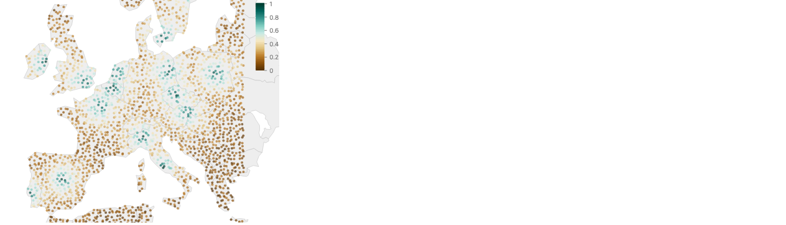
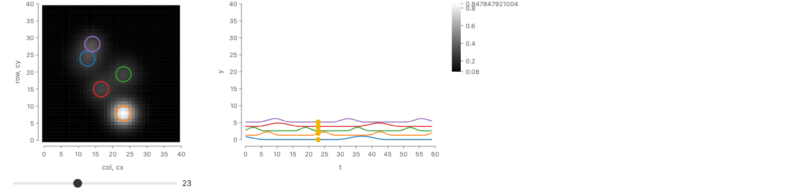
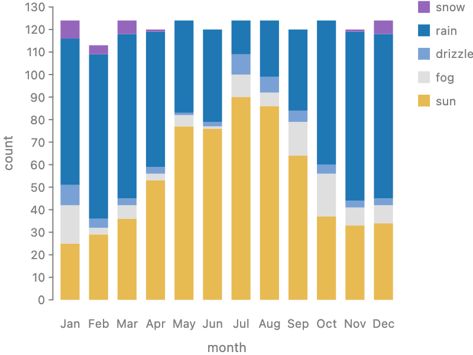
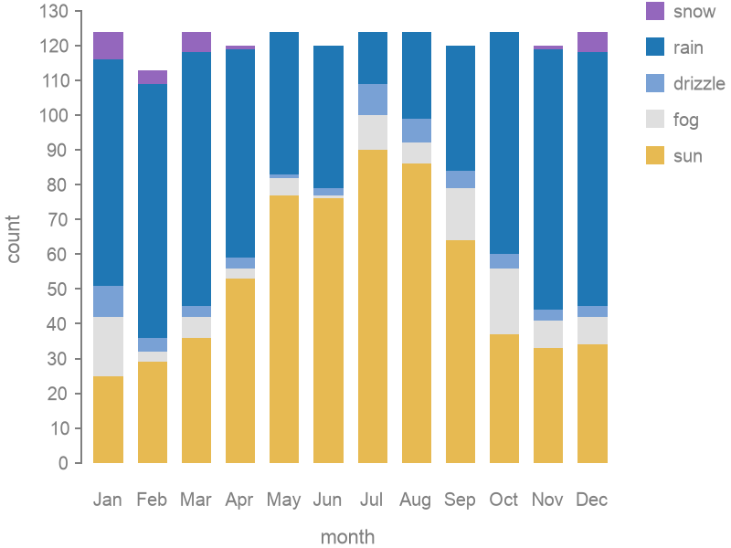
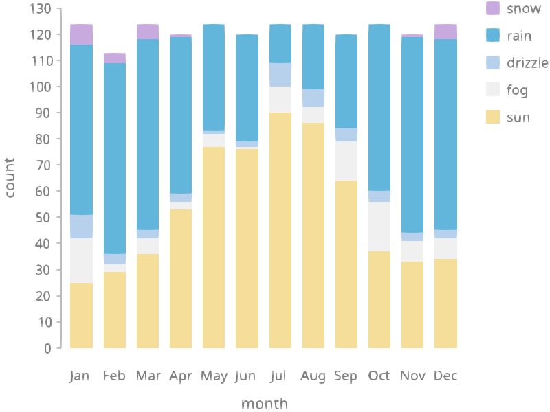
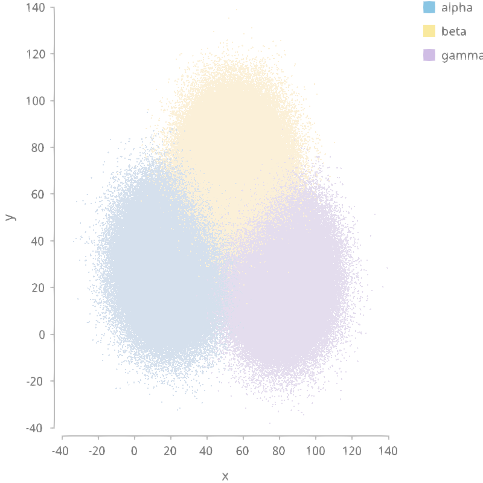
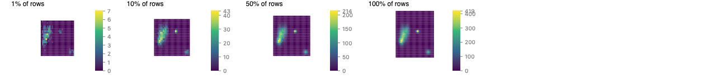

# Extension architecture: own the middle, open both ends

**Summary.** GoFish should own the middle of the pipeline (data types, composition, the scale and layout solve, and the display list) and let other libraries own the two ends: where data comes from and what draws the picture. A lonboard or fastplotlib program can then be written in GoFish style, with the domain package adding only what belongs to its domain.

**Recommendation.** Do two small things now, both on the display list that already exists: (1) make the engine a pure function with text measurement passed in, and (2) run that engine inside Python through an embedded JavaScript runtime. Both worked as throwaway prototypes. Hold the larger pieces (columns in the display list, open coords, registration of extension constructs) until the three forks below are settled. The two steps help GoFish's own Python users whether or not any other library ever builds on GoFish. Before building anything for a partner, fix the wall where one render has one set of scales, and build one visualization that crosses domains and that no single library can draw.

**Status.** Exploratory. Nothing here is signed off. The evidence is real: nine example programs rendered with today's GoFish, and a spike that ran the engine in Node and in Python and drew the result with matplotlib and pygfx.

Companion files: [`examples.md`](examples.md) (the nine programs in full) and `spike/` (the prototype code).

## Terms

- **Engine.** The part of GoFish that turns a spec into a display list: build, resolve, the scale and layout solve, and lowering. It is the "middle".
- **Display list.** The picture as plain data: a list of rects, ellipses, paths, text, images, groups and composites in pixels. It exists today (`toDisplayList`) and is the only render path.
- **Painter.** Code that draws a display list. Today there is one in use, the SolidJS SVG painter.
- **Host.** The program the engine runs in. It answers the questions the engine cannot answer alone: how wide is this text, how big is this image, what does this Python callback return. Today the only real host is a browser.
- **Source.** The data argument of `chart(...)`. Today it is always rows in memory.
- **Extension package.** A package that adds constructs to GoFish: a data type, a source, a coord, a mark, a strategy, or a painter.

## What the examples show

Nine real programs from lonboard, fastplotlib and ProgressiVis were rewritten in GoFish style and rendered with today's GoFish (small data, SVG). The full set is in [`examples.md`](examples.md). Two of them:

### Points on a basemap (lonboard `internet-speeds`)



lonboard today:

```python
layer = ScatterplotLayer.from_geopandas(gdf)
m = Map(layer, height=800)

min_bound = 5000
max_bound = 50000
download_speed = gdf["avg_d_kbps"]
normalized_download_speed = (download_speed - min_bound) / (max_bound - min_bound)

layer.get_fill_color = apply_continuous_cmap(normalized_download_speed, BrBG_10, alpha=0.7)
layer.get_radius = normalized_download_speed * 200
layer.radius_units = "meters"
layer.radius_min_pixels = 0.5
```

GoFish style (names marked NEW do not exist yet):

```python
from gofish_geo import basemap, Painter   # NEW

layer(
    [
        basemap("carto-positron"),                       # NEW: a mark that draws map tiles
        chart(gdf, schema={"avg_d_kbps": Unit(domain=Domain.continuous(5000, 50000))})
        .flow(scatter(at="geometry"))                    # NEW option: place by a point column
        .mark(circle(area="avg_d_kbps", fill="avg_d_kbps", opacity=0.7)),
    ],
    coord=Coord.geo("mercator"),
    color=Color.gradient(BrBG_10.hex_colors),
).render(h=800, painter=Painter.deckgl())                # NEW: painter chosen at render
```

The hand normalization and the colormap call become one declared domain and one color scale, and the colorbar follows from them. lonboard has no legend at all (lonboard issue 492: its author does not want to provide an on-map colormap legend).

### Movie, regions of interest, and traces with a time slider (fastplotlib `ImageWidget`)



fastplotlib today:

```python
iw = fpl.ImageWidget(movie_sub, rgb=True, figure_kwargs={"size": (700, 560)})
iw.window_funcs = {"t": (np.mean, 5)}
iw.show()
```

GoFish style:

```python
from gofish_fpl import array                                   # NEW: an array as a table

movie = array(frames, dims=("t", "y", "x"), name="v")          # one row per element
t = slider(domain=(0, 59), step=1, value=23)                   # NEW in Python: an input as data

frame = (
    chart(movie, color=Color.gradient("gray"))
    .flow(filter(field("t") == t.value), scatter(x="x", y="y"))
    .mark(rect(w=datum(1), h=datum(1), fill="v"))
    .layer(
        chart(rois, color=Color.palette("tableau10"))
        .flow(scatter(x="cx", y="cy"))
        .mark(circle(r=datum(3), fill="none", stroke="roi", stroke_width=2))
    )
)
```

The image is a grid of data-unit rects, an ordinary mark, so the region circles line up with it because they are a `.layer()` in the same data space. fastplotlib needs `graphic.offset` for that. The window function is `filter(between(...))` plus `group` plus `.mean()`, not a new option. A pygfx painter would draw the rect grid as one texture.

### What the corpus says overall

|                                 | Count                                                                                                                                                                                                              |
| ------------------------------- | ------------------------------------------------------------------------------------------------------------------------------------------------------------------------------------------------------------------ |
| Programs rewritten and rendered | 9 (4 lonboard, 4 fastplotlib, 1 progressive)                                                                                                                                                                       |
| Names that do not exist today   | 16                                                                                                                                                                                                                 |
| Of those, in a domain package   | 9: `basemap`, `readParquet`, `H3`, EPSG codes in `Coord.geo`, `withinKm`, `Curve.geodesic()`, `array` and `.pivot`, `csv`, `source.progress`                                                                       |
| Of those, in core               | 7: `scatter({ at })`, the `Painter` family and `.render({ painter })`, `Domain.continuous` (announced, not built), `field().minus`, `time.sequence({ every })`, `slider` in Python, color that varies along a line |

Two findings matter more than the count.

**The spec does not change with the painter or the source.** In all nine rewrites the marks are the ones GoFish has. The domain package adds a column type, a source, a strategy member, or a painter. A progressive source differs from a static one only in the data argument.

**The worst walls are in core, not in the extension slots.** The most common wall is that one render has one set of scales: sibling panels share the first panel's color scale, and in the movie example the traces panel also took the image's y range, so the traces are squashed. Five of nine examples hit it. An extension architecture does not fix this; it has to be fixed for "fastplotlib programs in GoFish style" to be true. The full list of fifteen walls is at the end of `examples.md`.

## What is already true in the code

The survey of the engine found that much of step 1 exists.

- The display list is the only render path, and `toDisplayList` is public. The old per-node SVG render was deleted.
- The engine runs in plain Node with no DOM. Five specs ran with no source change (bars, a 1,000-point scatter, lines with a legend, a polar chart, a geo map).
- A painter with no DOM exists: `displayListToSVG` in `gofish-ir` returns an SVG string.
- Only 5 of 165 engine files import SolidJS.
- The engine already asks its host questions through one interface, `DeriveBridge.call(lambdaId, rows, refs)`. Python callbacks use it.

What is not true yet:

- **Text is guessed without a browser.** With no canvas, width is 0.6 em per character. Nothing reports this, so a headless layout is silently different.
- **Text items do not record the size layout assumed.** A painter with another font draws text that disagrees with its box.
- **Image natural size is read from the DOM.**
- **Ids come from a global counter**, so two renders of one spec give different ids.
- **The display list is pixels.** Coords are already baked into paths, colors are resolved, and there is one item per mark. No columns, no transforms.
- **Coords are a closed set.** There is no inverse, and code tests `type === "linear"` in six files. `Coord.geo` could live in another package in JS but could not cross to Python.
- **Python cannot run the engine.** `to_svg()` and `save()` need a widget that has been displayed in a notebook.

## Step 1: the engine as a pure function

The engine becomes `(spec, size, host answers) -> display list`, with nothing read from the environment behind its back.

### What changes for a user

Nothing in a browser. In Node:

```js
import { chart, spread, rect } from "gofish-graphics";
import { displayListToSVG } from "gofish-ir";

const doc = await chart(data)
  .flow(spread({ by: "month", dir: "x" }))
  .mark(rect({ h: "count", fill: "weather" }))
  .toDisplayList({ w: 640, h: 400, fonts: [interRegular] }); // NEW option

const svg = displayListToSVG(doc);
```

And a painter becomes a render option, with SVG as the written default:

```js
chart(data).flow(...).mark(...).render(container, { w: 640, h: 400, painter: Painter.svg() }); // NEW
```

### The pieces

1. **Text measurement is passed in.** All measuring already goes through one function, `estimateTextDimensions`. The spike's patch is 7 lines. The proper version is a per-render option, not a global.
   Two spellings are possible. A function, `measureText(text, font) -> { width, ascent, descent }`, is the smallest interface and what a host implements. A list of font files, `fonts`, is what a user of a headless host wants to say, and it is what Satori, resvg and vl-convert take. I lean to both at their own level: the engine takes the function, and the Node and Python hosts take `fonts` and build the function.
2. **Headless hosts ship one default font.** The current default family is `system-ui`, which has no fixed meaning outside a browser. On macOS it is a variable font that resvg cannot draw at all. vl-convert bundles Liberation Sans for this reason.
3. **No silent guess.** Without a measurer, the engine should fail loudly or use a named estimate the user chose. Today it guesses and says nothing.
4. **Text items record `width`, `ascent` and `descent`.** A painter then knows the box layout assumed, whatever font it draws with.
5. **Image size is a host answer** of the same kind as text size.
6. **Ids are stable**, made from the mark's key path, not a counter. A painter that updates a picture in place, and a progressive source that sends many answers, both need this.
7. **The engine can be imported without SolidJS.** Move `gofish()`, `render` and the DOM export code out of `gofish.tsx` into the SVG painter, and remove the JSX type from the render options.
8. **A painter draws a closed set of item kinds.** The display list has seven: rect, ellipse, path, text, image, group, composite. Makie has kept its backend contract at 11 primitive plot types for about six years, adding one. The lesson is to keep this set small and closed, and to add marks above it.

### Evidence from the spike

| Spec                  | Time in Node | Display list size | Pixels that differ from the browser, with a fontkit measurer |
| --------------------- | ------------ | ----------------- | ------------------------------------------------------------ |
| Stacked bars          | 55 ms        | 184 KiB           | 1.3%                                                         |
| Scatter, 1,000 points | 105 ms       | 274 KiB           | 0.5%                                                         |
| Lines with a legend   | 25 ms        | 21 KiB            | 0.4%                                                         |
| Polar                 | 6 ms         | 19 KiB            | 1.5%                                                         |
| Geo map               | 1.9 s        | 5 MB              | 0%                                                           |

Browser render and Node render of the same spec:




Text width is the whole difference. opentype.js reads the macOS system font 5 to 15% narrow, because Chrome applies the font's optical-size axis and opentype.js does not. fontkit with that axis set matches Chrome at 12 px. This is the reason for piece 2: a bundled, non-variable default font removes the question.

The geo map is slow and large because every coastline becomes a long path string. That is a cost of the pixel display list, discussed in fork 1.

## Step 2: the engine inside Python

The Python package runs the same engine in the kernel process, so a plain script can make a picture and a painter that lives in Python can draw it.

### What changes for a user

```python
c = chart(df).flow(spread(by="month", dir="x")).mark(rect(h="count", fill="weather"))

c.save("bars.svg")                 # works in a plain script; today it needs a displayed widget
c.save("bars.png")                 # NEW
doc = c.to_display_list(w=640, h=400)   # NEW: the display list as Python data

from gofish_fpl import Painter     # NEW: a painter that lives in the kernel
c.render(painter=Painter.pygfx())
```

In a notebook, `c` alone still shows the widget, drawn in the browser as today.

### Evidence from the spike

- The engine bundles to one file of 892 KiB (323 KiB gzipped).
- An embedded V8 (the `mini-racer` package) ran all five specs with the engine unmodified. Cold start is about 0.6 s. Warm runs take 5 to 350 ms, except the geo map at 3 to 5 s.
- A column of one million float64 values crosses into V8 in about 50 ms as raw bytes, against about 0.6 s as JSON.
- matplotlib drew all five display lists.



- pygfx drew the bars and the scatter offscreen. Layout, axes and legend match the browser. The fills are visibly lighter, probably a color space difference the spike did not fix. Filled paths are not handled, so the polar chart and the map were not tried.



### What did not work honestly

A million points worked only through a stand-in. The engine has no way to return a scale, so the spike laid out a four-row chart at the column's extents and recovered the data-to-pixel transform from where those four rows landed. pygfx then drew a million points from numpy in 3.2 s.



The picture is right, and it is the picture we want: the axes and legend are GoFish's, and the points never left numpy. But the method is a trick that breaks for any coord that is not affine. Doing it properly is fork 1.

### A bug found on the way

`Serialize.toJSON` writes `Coord.geo` as `{ dataWindow, domain }`, not `{ projection, lon, lat }`, so a geo spec does not survive a round trip through the IR. The spike rewrote it by hand. Not yet filed.

## The extension slots

How each kind of extension is spelled, and what it needs from GoFish. The rule for syntactic sharing is that an extension adds values to things GoFish already has. It never adds a new way to write a visualization.

| Slot            | What a user writes                 | Example from the corpus                                   | What GoFish must add                                                              |
| --------------- | ---------------------------------- | --------------------------------------------------------- | --------------------------------------------------------------------------------- |
| Data type       | a `schema` entry                   | `H3()`, a geometry column with its CRS                    | Types that carry geometry: a point for `scatter({ at })`, a ring for `polygon`    |
| Source          | the data argument of `chart`       | `array(movie, dims=...)`, `csv(url)`, `read_parquet(...)` | A source interface. Today data is rows in memory                                  |
| Coord           | `coord=` at a `chart` or `layer`   | EPSG codes in `Coord.geo`                                 | Declared properties in place of `type === "linear"`, an inverse, registration     |
| Strategy member | `Family.member()`                  | `Curve.geodesic()`, `Bin.h3()`                            | Function strategies (#1101, one extension model for strategy families)            |
| Mark            | a call inside `.mark()` or `layer` | `basemap("carto-positron")`                               | Nothing in JS: a mark that composes existing marks already works, as GoTree shows |
| Painter         | a `.render(...)` option            | `Painter.deckgl()`, `Painter.pygfx()`                     | Step 1                                                                            |

Three points about this table.

**Most extensions should be compositions, not new primitives.** GoTree is the precedent: it adds no node kind and no IR entry, only functions that return GoFish. The principles page says a feature that cannot desugar into the core should be rethought. So this proposal does not offer a public way to write a new layout or lowering kind. ggplot2 shows the cost of the other choice: extensions subclass its internal objects, and its 4.0.0 release broke 77 Bioconductor packages.

**A domain package must add a thing once, not once per painter.** GeoViews re-subclasses every plot class for each backend, so it maintains a grid of elements by backends. Because every GoFish mark lowers to the same seven item kinds, a new mark works with every painter for free. This is the main reason to keep the painter contract closed.

**The split with a geo library follows sf and ggplot2.** sf does the coordinate reference system work, the graticules and the geometry. ggplot2 keeps scales, guides and layout. A GoFish geo package would keep GeoArrow, projections, tiles and the deck.gl painter. GoFish supplies the color scale, the legend, layering, selection, and composition with other visualizations.

## Three forks

These are the places where I do not think the answer is clear. Each is shown at the example where it bites.

### Fork 1. What the display list carries for large data

It bites at the million-point scatter above and at the movie example (40 x 40 x 60 = 96,000 rect rows for a tiny movie; a real one has 1e8).

Today the display list is one item per mark, in pixels. That cannot carry a million points, and the engine cannot build them anyway.

- **(a) Leave it.** Painters draw what the engine can lay out, which is browser-sized data. A pygfx or deck.gl painter then gives a domain library GoFish's layout, axes and legends, but none of its own speed. Cost: nothing to build. It does not make the partner's case.
- **(b) Record each chart's box and its data-to-pixel transform in the display list.** A painter can then draw its own arrays into the plot box, as the spike did by hand. Cost: small (the affine version exists inside the interaction code already). It is a shortcut: it only works for affine coords, and the points are outside the display list, so `selectAll`, labels and hit testing cannot see them.
- **(c) A column item.** One display item stands for many marks: a shape kind, references to columns for each channel, and a declared transform. This is the mark table from the scaling proposal, surfaced in the display list. A painter that cannot draw it asks the core to expand it into plain items, so the SVG painter needs no change and the item is sugar over what exists. deck.gl's binary attributes and Makie's primitives both work this way. Cost: it depends on the column engine in the scaling proposal, which is unsigned and large, and on coords that can describe themselves (for a GPU painter, a coord given only as a JavaScript function cannot run in a shader).

My lean: (c) is the destination, and steps 1 and 2 do not depend on it. Take (b) only if a partner wants to start building before (c) exists, and declare it as a shortcut.

### Fork 2. Which JavaScript runtime the Python package embeds

It bites at `c.save("bars.png")` in a plain script.

| Runtime                                        | Ran                       | Cold start   | Size                                | Note                                                          |
| ---------------------------------------------- | ------------------------- | ------------ | ----------------------------------- | ------------------------------------------------------------- |
| mini-racer (V8)                                | 5 of 5, engine unmodified | 0.6 s        | 61 MB installed (wheel about 20 MB) | Works today from PyPI                                         |
| QuickJS                                        | 3 of 5, with polyfills    | not measured | 2.3 MB                              | No `Intl`, which time axes need. Ran out of memory on the map |
| Node subprocess                                | 5 of 5                    | 0.12 s       | none                                | The user must have `node` installed                           |
| Our own wheel with Deno (what vl-convert does) | not tried                 | not measured | about 30 MB                         | We would build and ship wheels per platform                   |

My lean: mini-racer, as an optional extra (`pip install "gofish-graphics[headless]"`), so the notebook path stays light. A Node subprocess is what issue #577 (headless SVG rendering in Node) proposed. It is faster to start, but "install Node first" is a poor answer for the Python scientists who are the 1.0 audience. I would not build our own wheel until mini-racer fails us.

### Fork 3. How an extension's constructs reach Python

It bites at `from gofish_geo import basemap`.

In JavaScript an extension is easy: a function that returns GoFish. In Python it is not. GoTree's Python side is a second implementation of 490 lines, marked as a shortcut for #1163 (how an extension package crosses to Python), with 40 parity stories to stop the two from drifting.

- **(a) Write each extension twice**, as GoTree does. Cost: every domain package pays this, and it is the opposite of sharing work.
- **(b) Registration.** The package declares its constructs in a descriptor, as core constructs are declared today, and registers a JavaScript factory under a name. The Python wrapper is generated from the descriptor. The IR carries the construct by name, and the JavaScript side expands it. Step 2 makes this practical: the kernel can load the package's JavaScript into the embedded runtime, and the widget can load the same file. Cost: a registration API in two packages, a generator that runs per package, and a rule for versions.
- **(c) Python-first extensions.** A Python package composes Python combinators and never ships JavaScript. Cost: nothing new to build, but the extension does not exist for JavaScript users, and anything that needs code in the engine (a projection, a tile source) cannot be written this way.

My lean: (b). It is #1163 and #692 (public `defineMark` and `defineOperator` with registration) answered together, and it is the piece that decides whether lonboard's author, who works in Python and Rust, could ship one package.

## What the three consumers would own

|                           | Keeps                                                                    | Gets from GoFish                                                                                       | Needs beyond steps 1 and 2                                                        |
| ------------------------- | ------------------------------------------------------------------------ | ------------------------------------------------------------------------------------------------------ | --------------------------------------------------------------------------------- |
| **lonboard**              | GeoArrow and GeoParquet, CRS, projections, tiles, the deck.gl painter    | Color scales and legends, linked views without hand-written observers, a map beside a histogram        | Fork 1 (c) for its speed, open coords, registration                               |
| **fastplotlib**           | Arrays with named dims, video decoding, the pygfx painter, GPU colormaps | A declarative front end, legends (its issue 403 is open), layout of panels, overlays in one data space | Fork 1 for its speed, Python inputs, the scale-sharing wall fixed                 |
| **A progressive library** | Chunk order, estimators, error bounds, the scheduler                     | Every GoFish visualization, not a few bespoke ones                                                     | A source that answers more than once, stable ids, fixed bins and declared domains |

On progressive sources: the ProVega paper (arXiv 2604.02096, a Vega-Lite extension for progressive loading) says "ProgressiVis has no knowledge of marks or encodings". A GoFish spec's data part (the `by` keys, the bins, the channel aggregates) is what such a library could run in pieces. The example render shows what must be declared for the picture to stay still while it fills in: the color domain moved from 7 to 419 across frames, and the bins followed the data seen so far.



## Precedent

| System              | What an extension author writes                                 | What the core keeps                                      | Lesson                                                                                             |
| ------------------- | --------------------------------------------------------------- | -------------------------------------------------------- | -------------------------------------------------------------------------------------------------- |
| Makie               | A recipe that calls other plots, or a conversion of a data type | 11 primitive plot types that each of four backends draws | A small closed painter contract lasts. Makie also paid for a breaking rewrite to make updates lazy |
| ggplot2             | A subclass of an internal Stat, Geom or Coord                   | Scales, guides, layout, one renderer                     | Do not expose internals. Its own guide calls the object system a "historical accident"             |
| ggplot2 with sf     | sf does CRS, graticules, geometry                               | ggplot2 keeps the rest                                   | The split to copy for geo                                                                          |
| HoloViews, GeoViews | A plot class per element per backend                            | Elements as data containers                              | The grid to avoid                                                                                  |
| vl-convert          | Nothing; it runs Vega unchanged in an embedded Deno             | Its own text shaping and fonts in version 2              | Text measurement belongs to the core, not to the painter                                           |
| deck.gl             | A layer with accessors, or binary column attributes             | The GPU pipeline                                         | Columns go by reference, never as per-row objects                                                  |
| Observable Plot     | A mark, with a note on whether it handles projections           | Scales and projection                                    | Each mark says whether a projection bends it or only moves it                                      |

## Who benefits

The rewritten programs are about as long as the originals. Line count is not the benefit. The benefit is in what the originals cannot do at all, and it falls unevenly.

### Who gains

| Who                                  | What they gain                                                                                                                                   | What it depends on                                             |
| ------------------------------------ | ------------------------------------------------------------------------------------------------------------------------------------------------ | -------------------------------------------------------------- |
| GoFish's own Python users            | A plain script can save an SVG or a PNG, with no notebook. This is already on the 1.0 list                                                       | Step 2 only. No partner, no fork                               |
| People whose work crosses domains    | One grammar for views that today come from three libraries. The views share scales and legends, and they link with a `filter`                    | The scale wall fixed, then the painter slot                    |
| Authors of new domain libraries      | They do not build legends, axes, layout, widgets or export. They write the column types, sources and painter for their domain                    | Registration (fork 3)                                          |
| Authors of existing domain libraries | The parts they have not built. Neither lonboard nor fastplotlib has legends, and linking two lonboard maps takes hand-written observer callbacks | Fork 1 for their speed, and their own wish to depend on GoFish |
| Progressive libraries                | Every GoFish visualization, in place of a few views written by hand. ProgressiVis computes but knows nothing about marks                         | A source that answers more than once                           |

The second row is the strongest case in the long run. A neuroscientist with a movie, traces, a histogram and a brain map uses several libraries today, each with its own colormap, its own legend and its own idea of selection. The movie example in the corpus is this case in small: the frame, the regions, the traces and the time markers are one spec, and one slider drives all of them.

New libraries gain more than existing ones. lonboard and fastplotlib have already paid for most of what GoFish would supply. Someone starting a genomics library today has not.

### Who does not gain

- **A user who wants one map quickly.** `viz(gdf)` is shorter than any GoFish spec, and it stays that way.
- **Anyone who needs the domain library's speed today.** Until fork 1 is done, a GoFish painter draws browser-sized data only.
- **Anyone who needs what GoFish has no model for.** A 3D camera with pitch and bearing, or changing GPU buffers at frame rate, are two examples from the corpus.

### Two weak points in the case

**The benefit across domains depends on core work, not on extensions.** Five of the nine examples hit the wall where one render has one set of scales. Until that is fixed, the composed version looks worse than the separate libraries do: in the movie example the traces are squashed, because their panel took the image's y range.

**The benefit to partners is a guess.** Neither author has asked for this. Depending on a young library is a real cost to them, and the design assumes they would accept it.

So the work is ordered by who is sure to benefit.

## Order of work

1. **Step 1.** Text measurer as a render option, text metrics on text items, image size as a host answer, stable ids, an engine import with no SolidJS, the geo `toJSON` fix. This closes most of #577 and #814 (export a text measurement utility) and prepares #1337 (one SVG backend).
2. **Step 2.** The Python headless host: `save` and `to_svg` in plain scripts, `to_display_list`, and a painter protocol in Python with matplotlib as the reference painter. This closes the rest of #577 and #578 (PNG export). Steps 1 and 2 serve GoFish's own users and need no partner.
3. **Fix the scale wall.** Sibling panels in one render need their own color scale and their own position domains when their data differs.
4. **Build one visualization that crosses domains.** A map linked to a histogram, with shared legends, is a good first one. No single library can draw it today. This is what to show the lonboard and fastplotlib authors, before building anything for them.
5. **Ask the authors.** Would they build on this, and what would they refuse to give up?
6. **Investigate the rest in parallel.**
   - Run `capture-diff` over the whole gallery with the bundled-font measurer against the browser, to learn how far headless layouts move.
   - Prototype fork 1 (c) on one mark: a scatter as a column item, drawn by deck.gl's binary attributes.
   - Check that mini-racer wheels and every engine dependency work on Windows and Linux.

## Related issues

- #42: multiple rendering backends (canvas and WebGL through an extensible rendering API).
- #577: headless SVG rendering in Node, with injectable text measurement named as the keystone.
- #578: PNG and standalone HTML export.
- #814: export a text measurement utility.
- #1337: one SVG backend in place of three near copies.
- #1279: an audit of what is closed to extension (marks, operators, strategies, axes, legends, registration).
- #1101: one extension model for strategy families, a function beside the declared kinds.
- #1163: how an extension package (GoTree, chart templates) crosses to Python.
- #692: public `defineMark` and `defineOperator` with registration.
- #834: declare what a node can do, in place of tests on `node.type`.
- #850: data positions cannot be inverted through a coord that is not affine.
- #41 and #1009: large data, and columnar marks.
- #638 and #1394: map tiles, and warping images under a projection.
