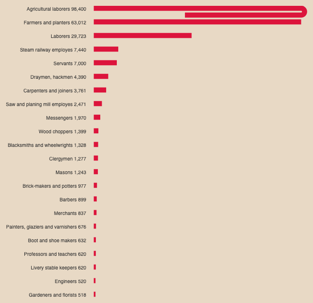
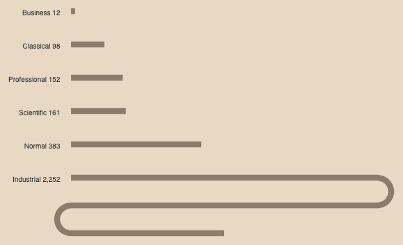
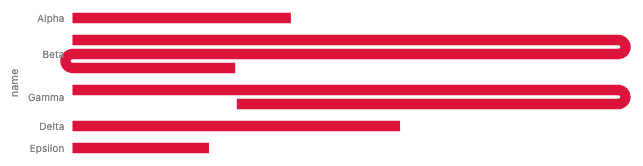
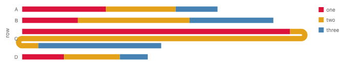
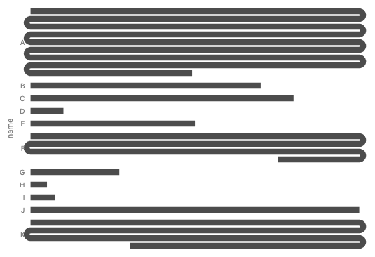
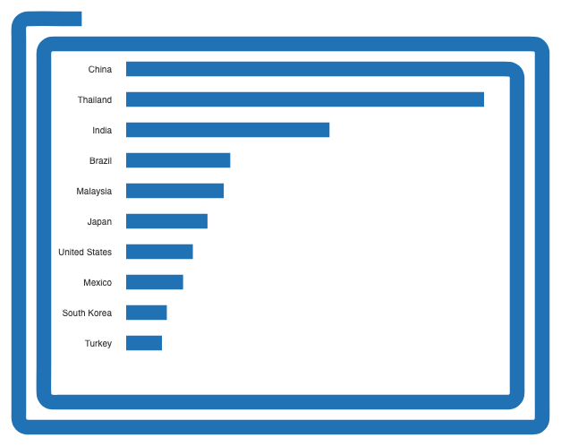
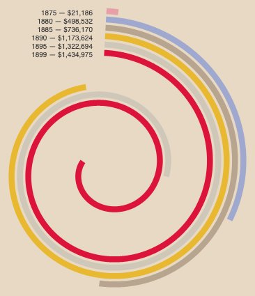

# Folded bars

**Summary.** A bar that is too long for the plot can fold back on itself (W. E. B. Du Bois, 1900) or leave the plot and run around the page (the 2025 air conditioner chart). These are two different pictures. In the first, each bar turns about its own row and the row grows to hold the extra lanes, so it is a layout question. In the second, the whole value axis follows one path, so it is a coordinate transform.

**Recommendation.** Add nothing that is only for folded bars. The Du Bois fold is the `wrap` option already proposed for `stack` (#122, the open issue for line wrapping), with one new rule: a wrapped `stack` cuts through its parts and joins its lanes with turns, because a stack is one glued space. The around-the-page bar and Du Bois's spirals are a plain bar chart under `Coord.along(path)`, already proposed for the spiral periodic tables (#1347). Do not add a `Coord.fold`.

Everything rendered below is a prototype built from story-level helpers. Neither `wrap` nor `Coord.along` exists on main, and neither has been signed off.

## Terms

- **Fold.** A bar runs to a limit, turns 180 degrees, and continues in the opposite direction beside itself. Karduni et al. (CHI 2020) call the chart a "Du Bois wrapped bar chart".
- **Lane.** One straight run of a folded bar. A bar with two turns has three lanes.
- **Turn.** The half ring that joins two lanes.
- **Wrap.** A layout breaks one long row into several rows that fit the room, as text wraps into lines. CSS calls the pieces fragments.
- **Path coordinate.** A coordinate transform where x runs along a given path by arc length and y is the distance to the side of it. This is `Coord.along(path)` from the periodic table proposal.

## The rules

1. `stack({ dir, wrap: { at } })` folds the stack's axis every `at` data units. The first lane is the ordinary bar, so the x axis runs from 0 to `at` and every lane can be read on it.
2. A wrapped `stack` is still one space. The fold falls wherever the axis reaches `at`, also in the middle of a part, and the lanes are joined by turns. A wrapped `spread` keeps its children whole and its rows separate. This is the stack and spread difference (one glued space, or separate spaces) applied to rows.
3. A row with a folded stack is as tall as its lanes, so its neighbors move down, as a paragraph grows when its text wraps.
4. Turns are drawn and do not count toward length. The value is the sum of the lanes (the rule in Karduni et al.).
5. A bar that follows one path around the page, or a spiral, is not a wrap. It is a bar chart with `coord: Coord.along(path)`: every row is a lane beside the same path.

## Examples

### 1. Occupations (Du Bois): one bar folds once



Reference: `img/ref-dubois-occupations.png` (Library of Congress, item 2013650447).

```js
chart(occupations)
  .flow(
    spread({ by: "name", dir: "y" }),
    stack({ dir: "x", wrap: { at: 63012 } })
  )
  .mark(rect({ w: "value", h: 10, fill: "#dc143c" }))
  .render(container, { w: 640, h: 620 });
```

```python
(
    chart(occupations)
    .flow(spread(by="name", dir="y"), stack(dir="x", wrap={"at": 63012}))
    .mark(rect(w="value", h=10, fill="#dc143c"))
    .render(w=640, h=620)
)
```

Today (public API only, `img/today-occupations.png`): every bar becomes a table of path vertices from a hand-written `foldTable` helper, drawn as a thick `line`. Turns are square because `line` has no join option.

```js
chart(foldTable(occupations, 63012), { w: 480, h: 600, axes: false })
  .flow(group({ by: "name" }))
  .mark(
    chart()
      .flow(scatter({ by: "j", x: "x", y: "y" }))
      .mark(blank().label("label", { position: "outset-left", fontSize: 10 }))
      .layer(
        line({ stroke: "#dc143c", strokeWidth: 10, curve: Curve.linear() })
      )
  );
```

### 2. Courses of study (Du Bois): three lanes



Reference: `img/ref-dubois-courses.png` (Library of Congress, item 2013650436).

```js
chart(courses)
  .flow(
    spread({ by: "name", dir: "y" }),
    stack({ dir: "x", wrap: { at: 900, spacing: 32 } })
  )
  .mark(rect({ w: "value", h: 8, fill: "#8e7b68" }));
```

`spacing` is the gap between lanes, the same word `spread` uses for the gap between children.

**Fork: are a wrapped stack's lanes joined?** I chose joined, with no option, by rule 2. The other picture is separate lanes that all start at the left, as text does (`img/wrap-courses.png`). It reads as three bars, not one. If it is wanted, it is a `spread` of pieces, which is how that picture was drawn.

**Fork: does a turn count toward length?** I chose no (`img/turns-free.png`): the three lanes are 900, 900 and 452 units, and each can be read on the axis. If turns count (`img/turns-count.png`), the last lane is about 196 units and the lanes no longer add up to the value. Du Bois's own plates are not exact enough to tell which he meant.

### 3. Two bars fold in neighboring rows



```js
chart(data)
  .flow(
    spread({ by: "name", dir: "y" }),
    stack({ dir: "x", wrap: { at: 100 } })
  )
  .mark(rect({ w: "value", h: 10 }));
```

**Fork: wrap or coordinate transform?** This example decides it. The same chart with the fold as one coordinate transform on the whole chart (`img/coord-two-long.png`) puts Beta's lanes on top of Gamma, because a coordinate transform bends the picture after layout and cannot ask a row for room. With one bar folding, the two designs draw the same picture (example 1), and the coordinate version is one option on `chart`. I chose wrap because the form in the literature (example 5) has many bars folding.

### 4. A stacked bar folds



```js
chart(stacked, { color: palette })
  .flow(
    spread({ by: "row", dir: "y" }),
    stack({ by: "part", dir: "x", wrap: { at: 100 } })
  )
  .mark(rect({ w: "value", h: 10, fill: "part" }));
```

The fold is on the stack, so a part can straddle a turn, and part boundaries are cut square to the bar.

### 5. The wrapped bar chart of Karduni et al.



Reference: `img/ref-karduni-fig3.png` (Karduni, Wesslen, Cho and Dou, CHI 2020, figure 3, where the bars are vertical).

```js
chart(data)
  .flow(
    spread({ by: "name", dir: "y" }),
    stack({ dir: "x", wrap: { at: 1000 } })
  )
  .mark(rect({ w: "value", h: 8 }));
```

### 6. Air conditioners: the bar runs around the page



Reference: `img/ref-air-conditioners.png` (source not found).

```js
chart(airConditioners, { coord: Coord.along(aroundTheFrame, { at: 22 }) })
  .flow(spread({ by: "country", dir: "y" }))
  .mark(rect({ w: "units", h: 16, fill: "#2171b5" }));
```

`aroundTheFrame` is a list of points: the top row's baseline, then a rounded rectangle that spirals outward. `at: 22` says that 22 data units reach the end of the path's first straight run, so the other bars are an ordinary bar chart. The option name is a placeholder. The prototype gives the path in pixels by hand. A path that names the chart's own frame is the missing piece, and it belongs in #1347.

### 7. Furniture (Du Bois): bars wound into a spiral



Reference: `img/ref-dubois-furniture.jpg` (Library of Congress, item 2013650445).

```js
chart(furniture, {
  coord: Coord.along(spiral, { at: 1_800_000 }),
  color: years,
})
  .flow(spread({ by: "year", dir: "y" }))
  .mark(rect({ w: "value", h: 8, fill: "year" }));
```

Each year is a lane beside one inward spiral. `Coord.spiral` from #1347 should say the same without a hand-made path. That was not checked here.

Not rendered: Du Bois's "City and rural population" plate (`img/ref-dubois-city-rural.jpg`), one path with a sharp corner at each category and a spiral at the end. In this design it is a `stack({ by: "category" })` under `Coord.along` of that zigzag path.

## Precedent

| System                                             | What the user writes                                              | What the system decides                                                | Names                 |
| -------------------------------------------------- | ----------------------------------------------------------------- | ---------------------------------------------------------------------- | --------------------- |
| Karduni et al., CHI 2020                           | A threshold `t1` on the value axis                                | Lanes, turns, and that a wrapped bar takes several category slots      | wrap, number of wraps |
| ggdubois (R, unfinished)                           | `geom_wrappedbar(max_height)`                                     | Default threshold 1.1 times the second largest value                   | wrapped bar           |
| #DuBoisChallenge recreations (decksh, ggplot2, D3) | Hand-placed lines and arcs, or a hand-computed path stroked thick | Nothing                                                                |                       |
| ggbreak `scale_wrap(n)`                            | A row count                                                       | Cuts the whole axis into n stacked panels                              | wrap                  |
| Horizon charts (Heer et al., CHI 2009)             | `bands`, `mode: offset or mirror`                                 | Folds the value axis into bands that overlap, with band shown by color | band, step            |
| CSS flex and fragmentation                         | `flex-wrap: wrap`, `box-decoration-break: slice or clone`         | Line breaks; whether each fragment gets its own caps                   | fragment, wrap        |
| Office SmartArt snake layout                       | `contDir: sameDir or revDir`, `bkpt`, `sp`                        | Rows that alternate direction                                          | snake                 |
| D3 spiral histogram (condegram)                    | A scale whose range is the path's length, `getPointAtLength`      | Nothing                                                                | along the path        |
| Illustrator art brush                              | A straight artwork and a path                                     | Stretches the artwork along the path                                   | brush                 |

No grammar has a fold. Every recreation computes the path by hand. The other answers to "one value is far too big" are a log scale, an axis break (ggbreak, matplotlib `brokenaxes`), a clipped bar with a label, and two charts. Karduni et al. found the fold more accurate than a plain bar chart for reading small values and ratios, slower by a few seconds, and tiring past a few wraps. They did not compare against log scales or axis breaks.

## The three approaches

### A. The fold is a coordinate transform (`Coord.fold({ at, pitch })`)

One option on the chart, and the best-reading spec for the three reference images. It fails when two rows fold (example 3) and it cannot make room at all: a coordinate transform starts its own space, so it cannot share a value axis with bars outside it, and it has no axes or labels inside. One coordinate per row fixes the room but needs a mark function and a hand-passed bar length for each row. Overlap check: `Coord.fold` would be `Coord.along` of a zigzag path, an exact composition, and a large partial overlap with `wrap`. That is why it is not proposed.

### B. The fold is a wrap on `stack` (recommended)

Rows grow, the value axis is shared, and stacked bars work. It needs the `wrap` option, which is proposed (#122, #486) and not built, plus the new cut-and-join rule for stacks. Overlap check: a wrapped stack of one bar under one fold equals approach A's picture, a small degenerate case. A wrapped `spread` of unit squares is a waffle chart, the same option on the sibling operator.

### C. Today's API

Works now for every picture, as hand-built geometry: the user computes vertices, guesses the aspect ratio for vertical runs, and gets square corners. A `join` option on `line` would round the corners and is worth adding on its own.

**What would change the pick.** If only one bar ever folds in the charts we care about, `Coord.along` with a zigzag path draws the Du Bois plates without `wrap`, and it is the smaller step since #1347 needs `Coord.along` anyway.

## What the prototypes found

- A bar in a bent space is drawn as its midline stroked at the bar's thickness (`rect.tsx:361-415`), so a turn is a true half ring. This only holds when `h` is a literal number.
- A coordinate transform is one continuous map, so it cannot draw a turn that takes no length: the bar's midline is sampled by its own length and would jump straight between lanes. The prototype gives each free turn half a pixel of length, which shortens the later lanes by half a pixel per turn. A layout `wrap` draws lanes and turns as pieces and has no such sliver.
- A fitted coordinate transform rejects ordinal content, culls marks that start outside its window, and draws labels unbent (#952) or drops them. The prototypes draw labels as a second chart beside the bars.
- There is no way to set an axis domain, so a bar cannot be longer than its plot today.
- `line` has no join or cap option, and its `x`, `y` form sorts by x, so a U-turn needs the `scatter` and `.layer(line())` form.
- The choice proposal's `wrap` moves every mark to the next row whole. Rule 2 changes that for `stack` only.

## Related issues

- #122: a wrap operator for facets, waffles and text. This proposal uses its `wrap` option.
- #486: the choice operator, whose proposal moved `wrap` onto `stack` and `spread`.
- #1347: spiral and snail periodic tables. Proposed `Coord.along` and `Coord.spiral`.
- #1284: bend and envelope coordinates, where the path coordinate started.
- #1078: Du Bois data portraits. Lists the furniture and city and rural spirals as targets.
- #952: text and labels ignore the coordinate transform.
- #1158: bring back the arc-length polar coordinate, which was removed for drawing NaN paths.
- #1101: one model for custom strategies, needed before a user-defined path family.

## Smaller choices (record)

- `at` is in data units, after Karduni's "where on the axis to wrap". No default: ggdubois's 1.1 times the second largest value is a heuristic a user would have to model.
- A wrapped stack always alternates direction. Same-direction lanes are a `spread` of pieces.
- Karduni's second threshold (shorter return lanes) is left out.
- Horizon charts fold the same axis by overlap. They are not part of this proposal.
- Python: `stack(dir="x", wrap={"at": 63012})`, the same shape as `axes={"x": {...}}`.
