# Labels for points, lines and areas

**Summary.** Keep one `.label()`. Give its `position` option a strategy family,
`Place`, whose members read the labeled mark's geometry (a point, a path, or a
region) and propose candidate spots. One shared step then picks, for each label,
the first spot that is free of other labels and of anything listed in `avoiding`.

**Recommendation.** Approach A below: `.label(accessor, { position: Place.end(), avoiding })`.
Each `Place` member is defined by a rewrite into today's elaborated shape
(`layer([ref(target), text])` plus a placement), so the core grows by two geometry
queries (#974's `boundary` and a new `path`) and one search step, the same kind of
step as scatter's `overlap`. The runner-up is a public `label(...)` tier for
`.layer()`/`.relate()` (Approach C), which A desugars into anyway.

**Taxonomy answer.** A label is not a fifth kind of construct. It is the "mixed
row" of the operand-kind table in
[Operators over placed nodes](../../apps/docs/docs/internals/design/operators-over-placed-nodes.md):
it reads a placed operand (the target) and places a fresh one (the text). Marks,
relational marks, constraints and labels are clusters of three per-operand facts,
plus one fact about how coordinates get written. See §2.

---

## 1. Terms

- **Target.** The mark a label describes. It is already placed when the label is placed.
- **Label.** A fresh mark, usually text, placed relative to the target.
- **Geometry kind.** What shape the target offers for labeling: a **point** (a dot, or
  any mark read as its box or enclosing circle), a **path** (an open curve with a start,
  an end and a direction: a line, an edge, an arrow), or a **region** (a closed area: an
  area band, a polygon, a treemap cell). Cartography uses the same three: point, line and
  polygon features.
- **Candidate.** One possible spot for a label, in priority order.
- **Placement strategy.** A rule that turns a target's geometry into candidates. These form
  the `Place` family.
- **Obstacle.** Something a label must not cover: other labels, the targets, or marks named
  in `avoiding`.
- **Chooser.** The shared step that takes each label's candidates in order and keeps the
  first one that does not hit an obstacle. A label with no free candidate is hidden. This is
  the greedy first-fit rule of Imhof's cartographic placement, Mapbox's
  `text-variable-anchor`, CSS `position-try-fallbacks`, and Vega's `label` transform.

## 2. Where labels fit: marks, relational marks, constraints

Josh asked whether a label is a new kind of thing beside marks, relational marks, relations
and constraints, or whether those categories come from something more basic. The internals
essay
[Operators over placed nodes](../../apps/docs/docs/internals/design/operators-over-placed-nodes.md)
(#707) already answers half of this. Its table indexes arrangements by **operand kind**:

| operands             | today's name         | places whom         | reports upward |
| -------------------- | -------------------- | ------------------- | -------------- |
| all fresh            | operator (`spread`)  | all children        | the children   |
| mixed refs + fresh   | _(unnamed idiom)_    | fresh children only | fresh only     |
| all refs, no ink     | constraint (`align`) | pins or moves refs  | nothing        |
| all refs + drawn ink | connector (`line`)   | nothing, reads      | the drawn ink  |

The unnamed row is the label. `BarWithLabels` writes it by hand as
`spread({ dir: "y" }, [d[0], text(...)])`, and #766 made `.label()` elaborate into exactly
that shape: `Layer[ref(target), Text]` plus align and distribute constraints. Josh's
`labelLayout([ref(labeledMark), labelText])` is the same picture.

The categories fall out of three facts about each operand, plus one about how positions are
written:

1. **Binding.** Does the construct place this operand (fresh), or only read it (placed, a ref)?
2. **Ink.** Does the construct draw, and if so is the ink's shape its own (text has an
   intrinsic size) or derived from the operands (a line's path, an enclosure's outline)?
3. **Reads.** Which geometry does it read from placed operands: a box, a point, a path, a
   region outline?
4. **Writer.** Are positions written by equations (align and distribute, the difference
   constraints the solver handles) or by a search over candidates (scatter's
   `overlap: Overlap.separate()`, the `choose` operator from #486, and labels that avoid
   things)?

| construct                                      | operands                                     | ink     | reads                  | writer               |
| ---------------------------------------------- | -------------------------------------------- | ------- | ---------------------- | -------------------- |
| mark (`rect`)                                  | none                                         | own     | none                   | parent               |
| operator (`spread`)                            | fresh                                        | none    | boxes                  | equations            |
| constraint (`align`)                           | fresh or placed                              | none    | boxes                  | equations            |
| relational mark (`line`, `ribbon`, `enclose`)  | placed                                       | derived | boxes (paths later)    | none (nothing moves) |
| label, fixed spot (today)                      | placed target + fresh text                   | own     | box                    | equations            |
| label, with candidates                         | placed target + fresh text, placed obstacles | own     | point, path, region    | search               |
| `enclose({ shape: Shape.blob({ avoiding }) })` | placed members, placed obstacles             | derived | discs, segments, boxes | none                 |

So the difference Josh felt between a label and the relational marks is fact 2. A relational
mark's ink is computed from its operands (a line is the path through them), while a label's
ink has its own shape and only its position comes from the target. Avoidance adds a third
operand role, the **obstacle**, which is read but neither placed nor drawn. `enclose`'s
`avoiding` in #1152 already has this role. A label with several candidates also changes fact 4:
"pick a spot that misses everything" is not a difference constraint, so it is a search step
that runs after the solve that places its targets, as `overlap` does today
(`constraints/overlap.ts`).

The categories are clusters in this four-fact space, not a list to extend. That is why they
"are not exactly perfectly orthogonal": a relational mark and a label differ in one fact, and a
constraint and an operator differ in one fact. Nothing in this proposal needs a fifth
category. It needs two more answers to fact 3 (path and region) and one more answer to fact 4
(search) for labels.

## 3. What exists today

- **`.label(accessor, options)`** on marks and on operators (#750, #766). Options: `position`
  (`"center"`, `"outset"`, `"outset-top"`, `"inset-top-start"`, …), `offset`, `fontSize`,
  `color`, `rotate`, `fontFamily`, `fontWeight`, `fontStyle`. It elaborates into
  `Layer[content, ref(target), Text]` with align and distribute constraints, at the target's
  parent, so labels never push marks apart. Only boxes are read.
- **Relational marks** (`line`, `ribbon`) accept `.label()` but read the connector's box, so a
  line label lands at the box's top edge, not on the line.
- **Geometry.** `node.geometry()` exists (#968) with one query, `enclosingCircle`. The line and
  area paths exist in `connect`'s `renderData.paths`, and a polygon's ring exists in a closure,
  but nothing exposes them. #974 proposes the `boundary` query and names labels as one of its two
  first users.
- **Avoidance precedent.** #1152 (draft) gives `Shape.blob` an `avoiding` option that takes a
  list of refs or one `selectAll(...)`, sent over the wire as `NodeSelectionIR`, and reads
  each obstacle through a private reader (circle → disc, line → segments, else box) that it
  calls "the first private step toward #974".
- **Search precedent.** `scatter`'s `overlap: Overlap.separate()` is a placement step after the
  constraint solve that reads `geometry()` and moves children (#969).

### Related issues and PRs

- **#43** Stronger labeling support: point, line and area labels, state-of-the-art algorithms.
- **#409** Labeling strategies: one per shape kind, defaulting from the mark, with overrides.
- **#204** Area and ribbon labeling: d3-area-label, polylabel.
- **#405** (draft PR, May 2026) Labels and annotation design note plus prototype. It split each
  strategy into anchor, candidate generator and acceptor, and had five strategies (box, point,
  area, ribbon, path). It was built on the overlay renderer #766 deleted. This proposal keeps
  its split and moves it onto the elaboration path.
- **#136** Bar chart with labels on every bar, as a two-layer chart.
- **#707** Operators over placed nodes: the operand-kind table (§2).
- **#803** Lower `.label()` onto the public `selectAll` path so it has a printable expansion.
- **#974** Geometry: a `boundary` query, for hull enclosures and labels that avoid marks.
- **#975** Geometry: a ray-hit query, so connectors end on outlines.
- **#1167** Extensible enclosure shapes on #974, shared with labels.
- **#1152** (draft PR) `enclose` with `Shape.*` and `avoiding`.
- **#1101** One extensibility model for strategy families, with a custom function.
- **#486** Choice operator with cost-based layout; its first use is the auto label angle (#961).
- **#1063** Axis ticks that account for their labels and avoid overlap.
- **#952**, **#817** Labels and text ignore polar coordinates; `.label()` inside a polar
  boundary throws.
- **#801** `.label()` on a mosaic throws a measure error.
- **#920**, **#887**, **#893**, **#894**, **#909** Label animation snags.
- **#947** `label: false` on an operator is a silent no-op.
- **#796** Group callouts anchored to data extremes.
- **#1109** Tutorial on annotating visualizations; depends on all of the above.

## 4. Prior work

The full survey with sources is in [research/prior-work.md](research/prior-work.md). In short:

| system                                                                   | spelling                                                                                      | model                                                                                        | what fits                                                                                       | what doesn't                               |
| ------------------------------------------------------------------------ | --------------------------------------------------------------------------------------------- | -------------------------------------------------------------------------------------------- | ----------------------------------------------------------------------------------------------- | ------------------------------------------ |
| Vega `label` transform; Vega-Lite `encoding.label` (unreleased PR #7378) | `{anchor: [...], offset, avoidMarks: ["trend"], lineAnchor: "end", method: "reduced-search"}` | ordered candidates by base-mark geometry; greedy first fit against a bitmap; hide on failure | one construct for point, bar, line, area; avoid set named by mark or by scope (`{ancestor: n}`) | no along-path text; strings for methods    |
| ggrepel                                                                  | `geom_text_repel(box.padding, direction = "y", max.overlaps)`                                 | force simulation, leader lines                                                               | leaders, one-axis movement, drop if hopeless                                                    | random without `seed`                      |
| directlabels                                                             | `direct.label(p, "last.qp")`                                                                  | a method is a list of steps: pick a spot on the series, then resolve collisions              | two-part strategy: where on the series, how collisions resolve                                  | string method names mixing both parts      |
| geomtextpath                                                             | `geom_textline(hjust = 0.5, vjust = -0.5)`                                                    | text along the path at an arc-length fraction                                                | `hjust` as arc-length fraction, `vjust` across the path                                         | fused into the line geom                   |
| Observable Plot                                                          | `Plot.text(d, Plot.selectLast({z, text}))`, `Plot.centroid`                                   | label = text mark + a selection transform                                                    | compositional, close to GoFish                                                                  | no avoidance (issue #27 open since 2020)   |
| d3fc-label-layout                                                        | `layoutLabel(layoutRemoveOverlaps(layoutGreedy()))`                                           | strategy objects that wrap strategies                                                        | strategy family with combinators                                                                | DOM measurement                            |
| d3-area-label                                                            | `d3.areaLabel(area)`                                                                          | largest label-shaped rectangle in a band, by bisection                                       | consumes the area's own shape                                                                   | areas only                                 |
| Mapbox / MapLibre                                                        | `symbol-placement: point \| line \| line-center`, `text-variable-anchor`                      | one layer for all three geometries; polygon → pole of inaccessibility                        | candidate list; along-line placement                                                            | style-spec strings                         |
| QGIS                                                                     | Cartographic / Parallel / Curved / Horizontal-in-polygon …                                    | placement mode list depends on geometry type                                                 | the most complete point/line/area taxonomy                                                      | GUI only                                   |
| TikZ                                                                     | `node[pos=0.5, sloped, above]`, `label=above right:q`, `pin=`                                 | fixed spot on a path or around a node                                                        | `pos`, `sloped`, `auto` — the best line-label words                                             | no avoidance                               |
| Bluefish                                                                 | `<StackV><Text/><Ref select="mercury"/></StackV>`                                             | label = text + ref + relation                                                                | same model as GoFish                                                                            | avoidance and curves are open in its paper |
| Penrose                                                                  | `ensure disjoint(label, shape)`, `encourage near(label, point)`                               | constraints + objectives, numeric solver                                                     | hard vs soft                                                                                    | slow, nondeterministic                     |
| CSS anchor positioning, Floating UI                                      | `position-try-fallbacks: flip-block`; `[offset(), flip(), shift(), hide()]`                   | ordered fallbacks; a pipeline of steps                                                       | candidate list in UI vocabulary                                                                 | avoids only the container                  |

Three things recur. First, the target's geometry decides how candidates are made, and the
collision test is shared (Vega's thesis says the chart types "only differ in (1) the marks to
be avoided and (2) the candidate positions"). Second, the strategy is a family, often with
combinators. Third, the avoid set is named, by reference or by scope, and labels avoid each
other by default.

## 5. Approaches

Three approaches differ in **where the user writes a label**. Two choices are shared by all
three and are presented once, as separate axes: the `Place` strategy values (§5.4) and the
geometry queries (§5.5).

### 5.1 Approach A — `.label()` with a `Place` strategy (recommended)

The label stays a modifier on the mark (or operator) it describes. `position` takes a `Place`
strategy, and an `avoiding` option names extra obstacles.

```js
// Point labels on a scatter
chart(countries)
  .flow(scatter({ x: "gdp", y: "lifeExpectancy" }))
  .mark(circle({ r: 3 }).label("name", { position: Place.around() }));

// End-of-line labels on a multi-series line chart
chart(stocks)
  .flow(group({ by: "symbol" }))
  .mark(
    line({ x: "date", y: "price", stroke: "symbol" }).label("symbol", {
      position: Place.end(),
    })
  )

  // Inline labels along the line
  .mark(
    line({ x: "date", y: "price", stroke: "symbol" }).label("symbol", {
      position: Place.along({ at: 0.6, sloped: true }),
    })
  );

// Streamgraph band labels
chart(streams)
  .flow(
    spread({ by: "x", dir: "x" }),
    stack({ by: "series", dir: "y", alignment: "middle" })
  )
  .mark(blank({ h: "value" }))
  .layer(
    ribbon({ by: "series", fill: "series" }).label("series", {
      position: Place.interior(),
    })
  )

  // Labels that also stay off a trend line
  .mark(
    circle({ r: 3 }).label("name", {
      position: Place.around(),
      avoiding: selectAll("trend"),
    })
  );
```

```python
chart(stocks).flow(group(by="symbol")).mark(
    line(x="date", y="price", stroke="symbol").label("symbol", position=Place.end())
)
line(...).label("symbol", position=Place.along(at=0.6, sloped=True))
circle(r=3).label("name", position=Place.around(), avoiding=select_all("trend"))
```

Pictures, today's real render first, then the proposed placement:

|         | today                                                            | proposed                                                                                             |
| ------- | ---------------------------------------------------------------- | ---------------------------------------------------------------------------------------------------- |
| points  | 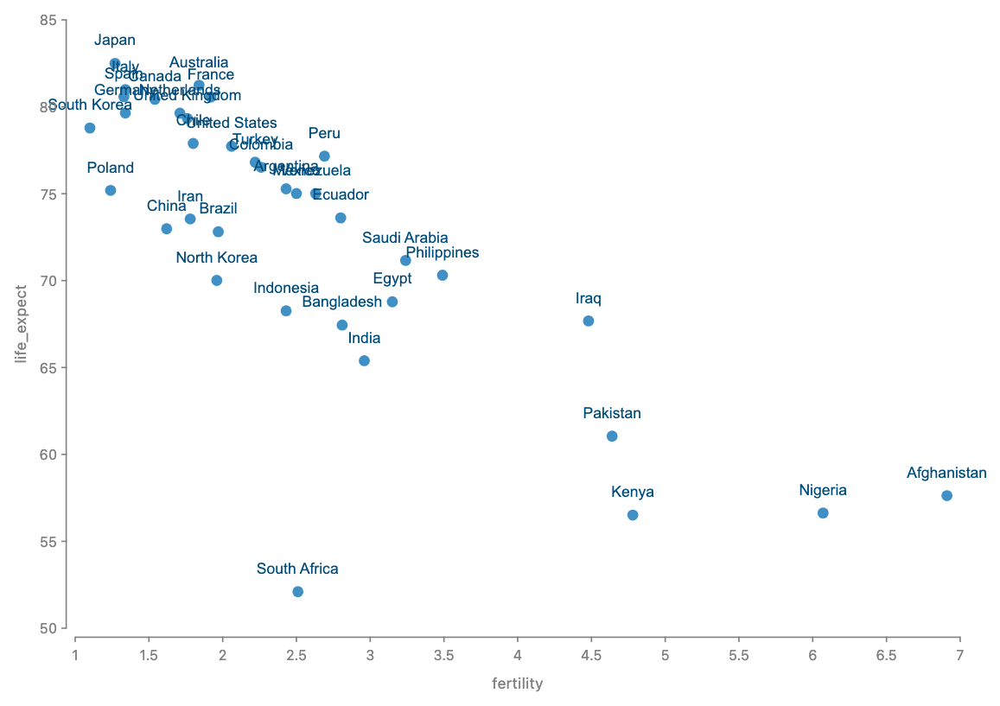 `.label("country")`                     | 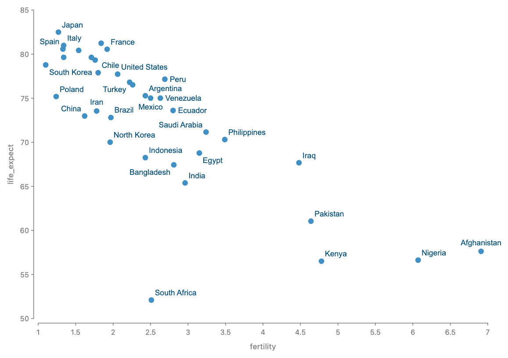 `Place.around()`                                                           |
| lines   | 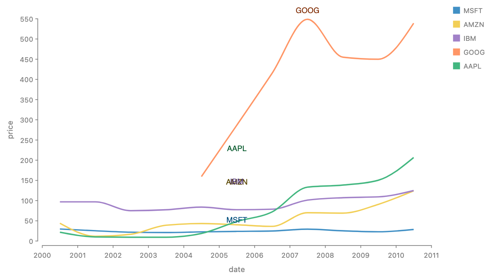 `.label("symbol")` reads the line's box  | 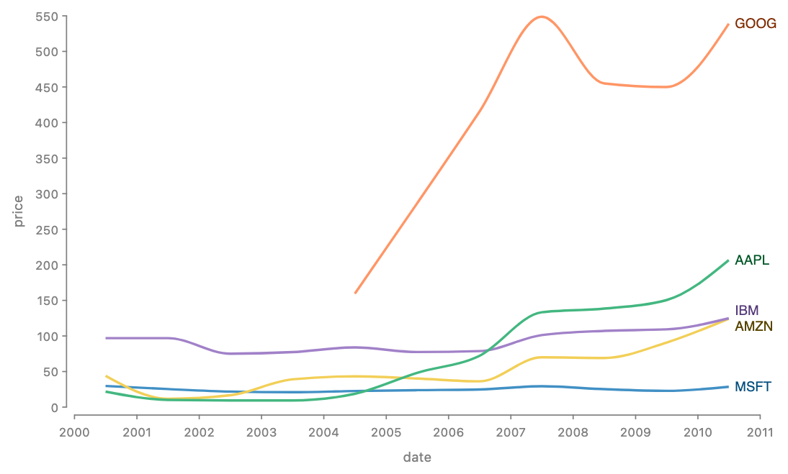 `Place.end()` 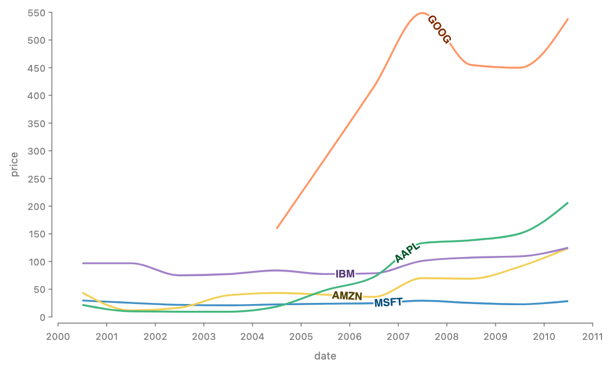 `Place.along({ at: 0.6, sloped: true })` |
| areas   | 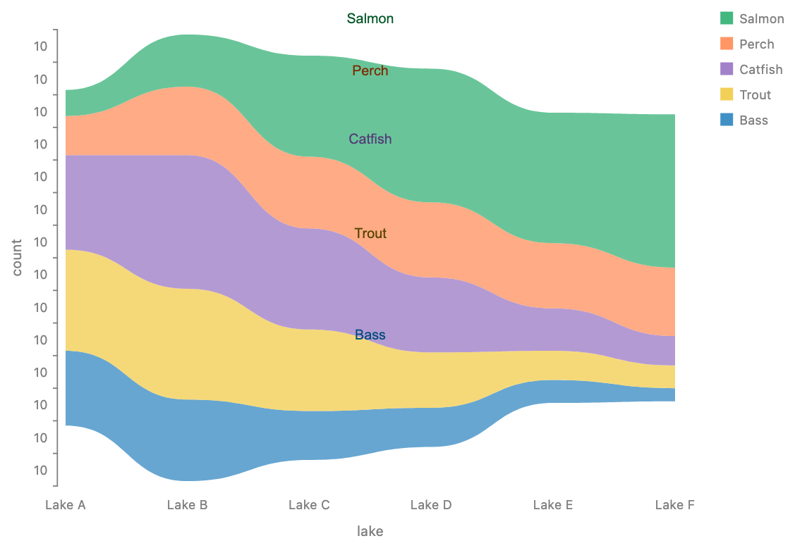 `.label("species")` reads the band's box | 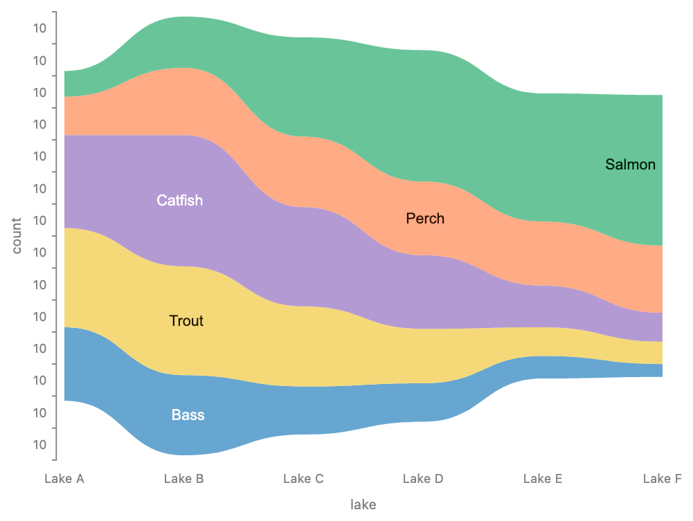 `Place.interior()`                                                        |
| regions | 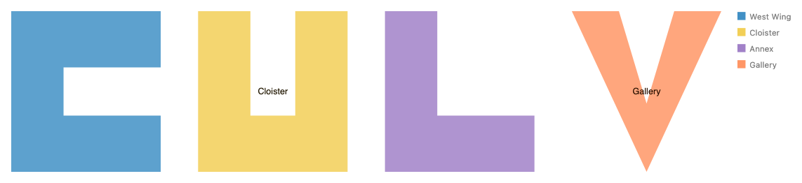 `position: "center"`                  | 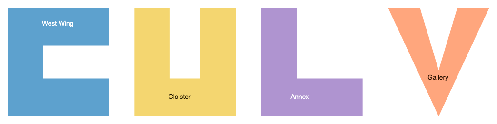 `Place.interior()`                                                 |
| avoid   | 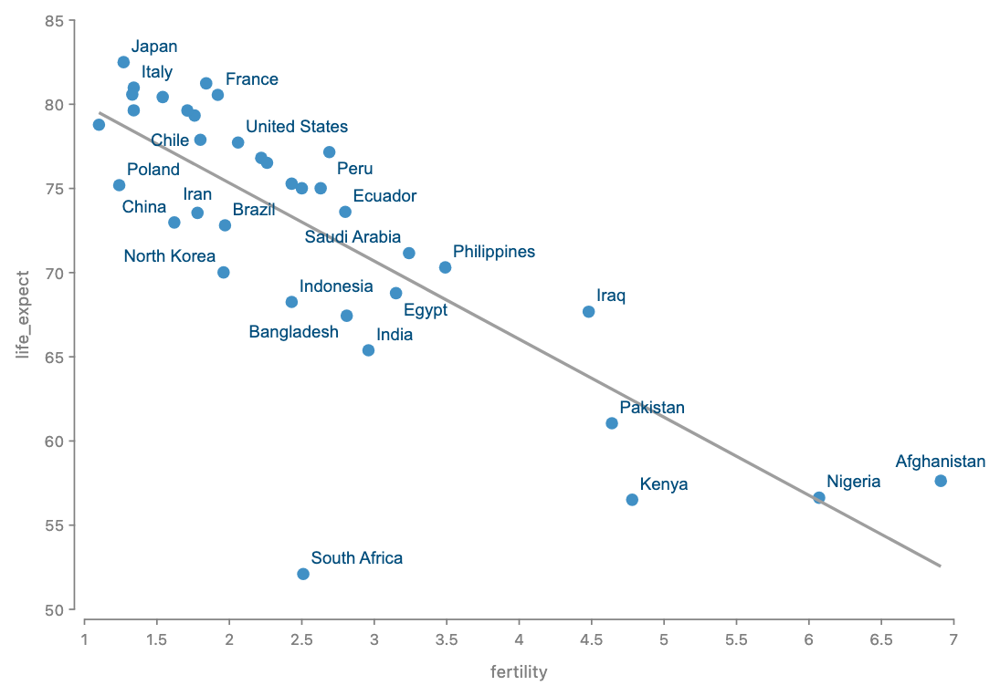                                     | 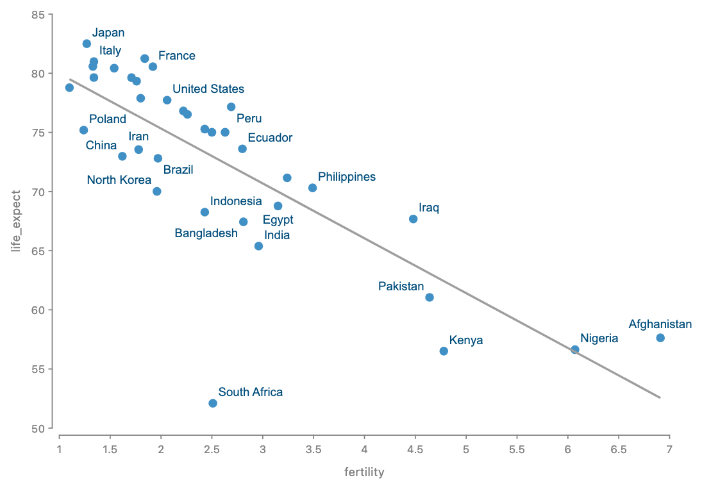 `avoiding: selectAll("trend")`                                           |

_How the proposed pictures were made:_ the real chart is drawn by GoFish; a prototype
(`packages/gofish-graphics/stories/_proposals/labels/place.ts`) reads the drawn geometry from
the SVG, runs the strategy and the chooser, and adds the labels on top. Approximations are in
that folder's `NOTES.md`.

**What it desugars into.** For each target `t`, `.label(acc, { position: P, avoiding: O })`
elaborates, as today, at `t`'s parent into `layer([ref(t), text(acc(t))])`. What changes is
who writes the text's position. A one-candidate strategy writes it with today's align and
distribute constraints, so every existing `position` string means what it means now. A
strategy with several candidates hands all labels from one `.label()` call to the chooser,
which runs after the solve that places the targets and reads the targets, the labels placed so
far and `O` as obstacles. The labels' boxes join the parent's box, as #707's box equation
requires, and never touch a scale's domain.

**Composes with.** Operators: an operator `.label()` labels each group, as today. Coordinate
transforms: a label is screen-space text (a label is not warped), so a path or region strategy
must read the target's geometry after the coordinate transform; today that geometry only exists
at lowering (§7, open question 1). Animation: the label is attached to its target as today, so
it tweens; a chooser that flips a label to another candidate between frames would jump, which
is open question 3. Python: the same shape, with `Place` a family module like `Curve`.

**Trade-offs.** Easy: the common case is one word on the mark you already wrote; defaults per
geometry kind make `.label("symbol")` on a line do the right thing. Awkward: labeling marks of
_another_ chart, or a subset of a layer, still needs the hand-written tier. New terms: `Place`,
`avoiding` (shared with #1152), and the member names.

### 5.2 Approach B — geometric anchors on refs, labels are plain constraints

No new labeling construct. Refs gain anchors computed from geometry, and a label is a text
aligned to an anchor with the existing constraints. This is the TikZ and Bluefish model.

```js
layer([graph]).relate(({ edges }) =>
  edges.each((e) =>
    Constraint.align({ x: "middle", y: "middle", rotate: "tangent" }, [
      e.at(Anchor.along(0.5)),
      text({ text: e.datum("weight") }),
    ])
  )
);

layer([lines]).relate(({ lines }) =>
  lines.each((l) =>
    Constraint.distribute({ dir: "x", spacing: 4 }, [
      l.at(Anchor.end()),
      text({ text: l.datum("symbol") }),
    ])
  )
);
```

Picture: 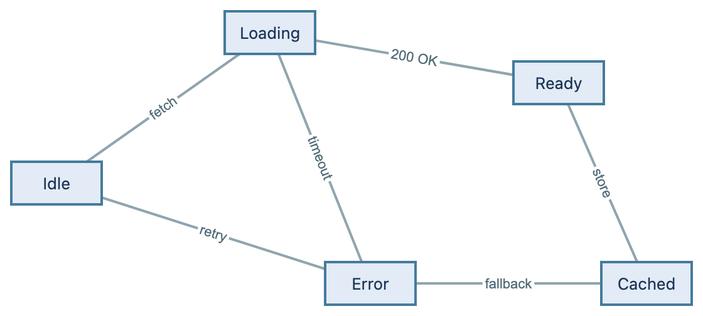

**Desugars into** align and distribute, with anchors as new readable points on a ref.
**Strength:** exact and general for diagrams; every anchor is reusable by arrows and
connectors (#975 wants a ray-hit anchor for the same reason). **Weakness:** no avoidance —
choosing among spots is a search, and constraints are equations. It needs `.each()`, which is
still open (#929). It is verbose for charts, where `.label("symbol")` is the whole intent.
**Overlap:** it is the mechanism under A's one-candidate strategies, so A can expose these
anchors later without conflict.

### 5.3 Approach C — a `label` tier

A label is its own relational construct in `.layer()` or `.relate()`, reading the previous
tier's marks the way `line` and `ribbon` do. This is Vega's `label` transform on a text mark
and Josh's `labelLayout([ref(mark), text])`. `.label()` becomes sugar for it, as
`.mark(line())` is sugar for `.mark(blank()).layer(line())` (#748).

```js
chart(stocks)
  .flow(group({ by: "symbol" }))
  .mark(line({ x: "date", y: "price", stroke: "symbol" }))
  .layer(label("symbol", { position: Place.end() }));

// Label marks of another chart
chart(selectAll("hubs")).mark(
  label("name", { position: Place.around(), avoiding: selectAll("routes") })
);
```

**Strength:** the joint placement is visible: one tier owns a set of labels that avoid each
other, and it can label marks from anywhere by name, which #803 asks for. **Weakness:** a
second spelling of the same idea, and its ink paints _above_ its operands while every other
relational mark paints below (#745's default), so it is the one relational construct that
needs the opposite paint rule. **Overlap:** exact — A is defined as fusion into C, so the two
cannot drift.

### 5.4 Shared axis: the `Place` family

Each member turns one geometry kind into ordered candidates. A member that needs geometry the
target does not have is a loud error naming the missing capability, for example
`Place.along needs a path; rect has none`.

| member                                          | reads                           | candidates                                                                                              | precedent                                                                  |
| ----------------------------------------------- | ------------------------------- | ------------------------------------------------------------------------------------------------------- | -------------------------------------------------------------------------- |
| `"outset-top"`, `"center"`, … (today's strings) | box                             | one                                                                                                     | today; Vega anchors                                                        |
| `Place.around({ candidates? })`                 | point (enclosing circle) or box | 8 compass spots, upper right first; or a given list, e.g. `["outset-top", "inset-top"]` for bars        | Imhof, Christensen et al., Vega-Lite defaults, CSS fallbacks               |
| `Place.start()`, `Place.end()`                  | path                            | the path's first or last point, sliding along y to clear neighbors                                      | directlabels `first.qp`/`last.qp`, Plot `selectLast`, Vega `lineAnchor`    |
| `Place.along({ at, sloped })`                   | path                            | the point at fraction `at` of the arc length, then nearby fractions; rotated to the tangent if `sloped` | TikZ `pos`/`sloped`, geomtextpath `hjust`, Mapbox `symbol-placement: line` |
| `Place.interior()`                              | region                          | the spot where the label's own box can grow largest; hide if it does not fit                            | d3-area-label, Vega `reduced-search`; not polylabel (below)                |

Defaults come from the geometry kind, so the meaning lives on the target's type: box marks keep
`"outset"`, dot marks get `Place.around()`, paths get `Place.end()`, regions get
`Place.interior()`. Custom strategies use #1101's function hatch: a function from geometry to
candidates.

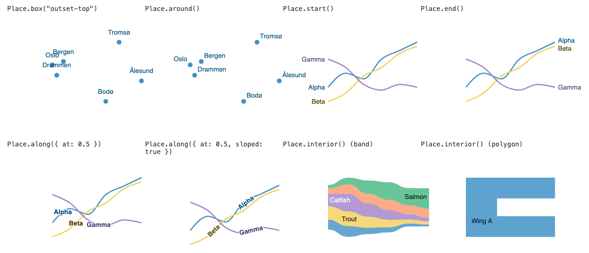

(The first panel is titled `Place.box("outset-top")`; under decision 2's recommendation it is
spelled `position: "outset-top"`, as today.)

**What the prototypes taught.**

- **One interior rule, not polylabel.** Polylabel finds the point farthest from every edge,
  which is the center of the largest _circle_. Text is wide, so in C, U and L shapes it sends
  labels into the corner where two arms meet
  (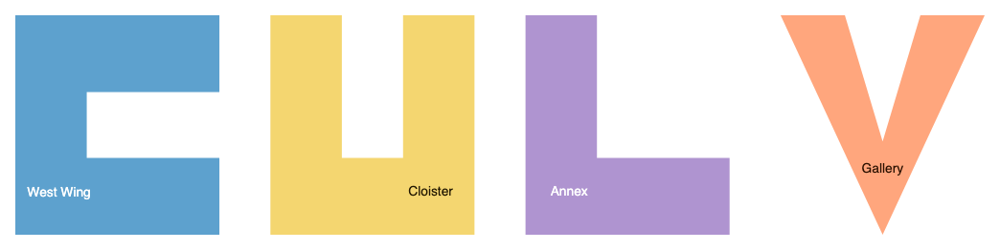). Searching for the spot where the label's own box grows
  largest puts them in the middle of an arm (), and it is the
  same rule d3-area-label uses for streamgraph bands. So `interior()` is one rule for bands and
  polygons.
- **Sloped inline labels need a smooth line.** On raw monthly stock prices, the only stretches
  straight enough for a sloped label are the steep ones, and one label has nowhere to go
  (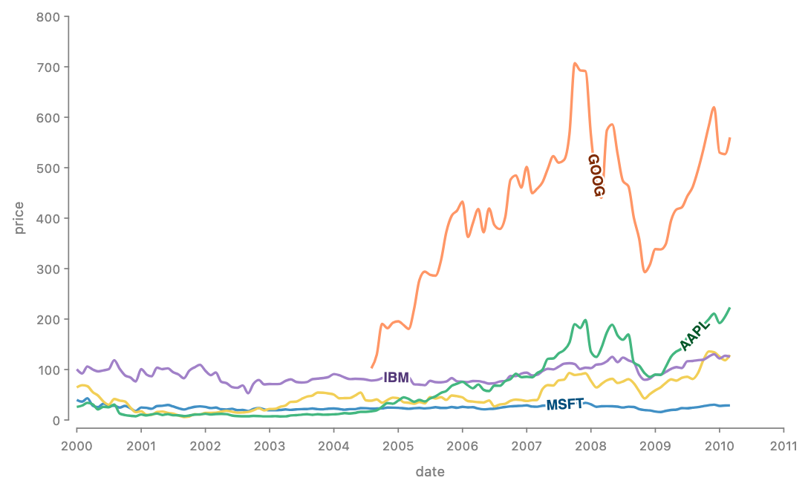). On smoothed data it works well. The member's docs should
  say so; `Place.end()` is the safer default for lines.
- **Along-line labels need a background.** A halo works on charts; a small filled box reads
  better on diagram edges (). This is a styling option of the
  label, decision 8.
- **Today's `"center"` can make a label vanish.** When a shape's box center falls outside the
  shape (the C and the L), the label is colored for the inside (white) but drawn on the white
  background. This is a bug today, independent of this proposal.
- **Today's line and area labels read the box.** `.label()` on a `line` or `ribbon` runs, but
  every label sits on its connector's bounding box, far from the line and overlapping.

### 5.5 Shared axis: geometry queries

The strategies need two queries beyond `enclosingCircle`, each added with its first consumer
as `shape-geometry.md` decided:

- **`boundary`** (#974): the closed outline of a region, sampled. Read by `Place.interior()`
  and by the chooser for obstacles. `enclose`'s private member reader becomes this query
  (#1167).
- **`path`** (new, `HasPath`): an open polyline with arc length and tangent, in the node's
  local frame. Read by `start`, `end` and `along`. `line`, `arrow` and edges implement it;
  `ribbon` and `area` implement both (`boundary` for the band, `path` for the centerline).

The chooser tests a label's box against obstacle geometry: discs for circles, segments for
paths, outlines for regions, boxes for the rest, through a uniform grid like `overlap`'s.

## 6. Recommendation

**Approach A, defined by rewrite into C, with B's anchors kept internal.**

- **It desugars into the core.** A one-candidate label is today's elaboration unchanged; a
  many-candidate label adds one search step of a kind the engine already has (`overlap`). The
  new surface is one strategy family and one option. ([Principles: why keep the core small](../../apps/docs/docs/internals/design/principles.md))
- **One concept is one operator.** The `api-design` page records that the earlier label design
  dropped a separate `annotate()` for options on `label`. Point, line and area labels are one
  concept to the user, and every precedent that unifies them (Vega, Mapbox, QGIS, Highcharts)
  does it with one construct and a geometry-driven strategy.
- **Meaning lives on the type.** The default placement comes from the target's geometry kind,
  and a mismatch is a loud capability error, as `api-design` asks for data types.
- **A closed family plus a function hatch**, like `Curve`, `Overlap` and `Shape`, spelled the
  same in JS and Python.
- **Overlaps are degenerate or exact.** Today's strings are the one-candidate case. `avoiding`
  is #1152's option with the same value type. The chooser and `Overlap.separate()` share the
  obstacle reader and the grid, through #974.

**Runner-up: C.** If labeling marks from another chart, or a selected subset of a layer
(`label-syntax.md`'s last section, #803), turns out to be common, expose the `label` tier
publicly. Nothing in A blocks that, since A is defined as fusion into it.

**Out of scope here:** leader lines and force-based repel (a later `Place.repel()` member that
draws an `arrow`), labels outside a region with a connector (ggforce), and font size chosen to
fit a region.

## 7. Decisions for Josh

1. Is the family name `Place` (`Place.end()`), or something else (`Placement`, `Label`)?
2. Do today's position strings stay as the one-candidate members (`position: "outset-top"`),
   or move into the family (`Place.box("outset-top")`)? I recommend they stay: a closed enum
   may be a string under the family rules.
3. Is `around` the right name for the candidate-list member, including the bar case
   `Place.around({ candidates: ["outset-top", "inset-top"] })`?
4. Defaults by geometry kind: dots → `Place.around()`, paths → `Place.end()`, regions →
   `Place.interior()`, boxes → `"outset"` as today. This changes scatter renders that use
   `.label()` today. OK?
5. A label with no free spot is hidden. Silently, with a console note, or an error?
6. `avoiding` is the same option name and value as #1152's (a list of refs or one
   `selectAll`), and labels from one `.label()` call always avoid each other and their own
   targets. OK?
7. Should the `label` tier (Approach C) be public now, or wait for a real example?
8. How is a label's backdrop spelled: a halo (ggrepel `bg.color`, labellines `outline_color`)
   and a filled box (ggplot `geom_label`)? Nesting suggests `background: { fill, padding }` and
   `halo: { color, width }` as label options.

**Open questions (not for sign-off):**

1. Path and region strategies in polar or other coordinates need geometry after the coordinate
   transform, which today exists only at lowering (#952, #817). Do they read screen-space
   geometry, or move the transform earlier?
2. Should the chooser use per-label greedy first-fit, or the `choose` operator's cost search
   (#486), and does axis tick-label avoidance (#1063) share it?
3. Animation: should a label keep its candidate across frames to avoid jumps?
4. Priority order: data order for now, with a later `priority` option (Mapbox
   `symbol-sort-key`, Vega `sort`)?
