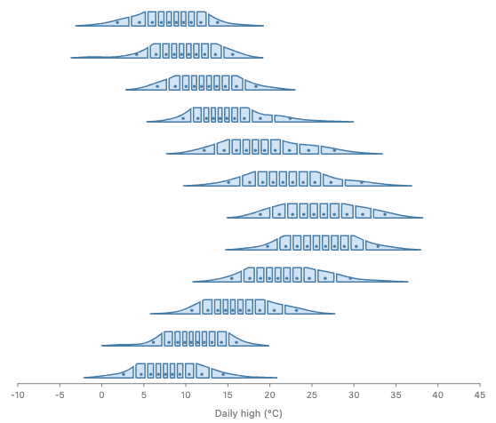
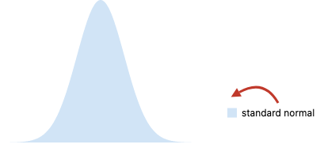
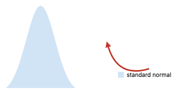
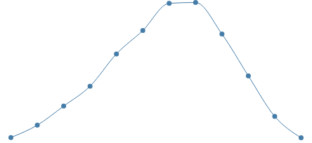
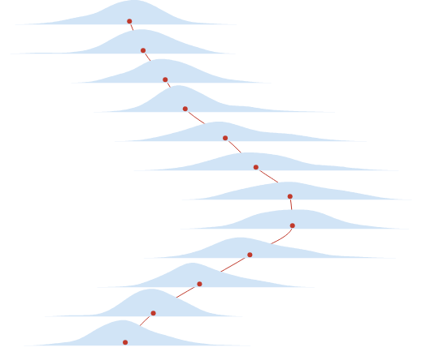

# Naming semantics: a proposal (#1236)

Review page: https://claude.ai/artifact/QHdgcQbRoEqAyFa4Zz1pPF

**Summary.** A GoFish name is a label placed inside a picture while it is built, and `ref`, `selectAll` and `.relate()` read labeled parts back out of the finished picture. In programming language terms, `.name` is an export and `.relate()` is a local open (`let open M in ...` in OCaml), so the "dual of `let`" has a standard name and a standard hygiene repair. Three bugs on `main` come from one cause: a `.relate()` operand forgets which `.relate()` bound it.

**Recommendation.** Make a `.relate()` operand a name plus the scope of the `.relate()` call that bound it, keep each layer's clause list on the layer, run clauses in the layer's own environment, and give `selectAll` the same lookup rule as `ref`. No spelling changes. Programs that throw or draw the wrong thing today start to draw what they say. Prototypes of all of this render the three hard examples below.

This proposal builds on the design note in this PR,
[`internals/design/naming-semantics.md`](../../apps/docs/docs/internals/design/naming-semantics.md),
which states the current rules with file and line citations, maps them onto theory, and gives runnable repros for the three bugs. It does not repeat that material. It adds the answer to the theory question, real examples in JS and Python with renders, a precedent grid, and a sharper recommendation. It changes the note's recommendation in one place (section 2).

## Terms

The design note defines binder, reference, scope, shadowing, capture, hygiene, introduction form and elimination form. This proposal adds these.

- **Export.** A name that a finished structure makes available to code outside it. A module's top-level `let x = ...` exports `x`.
- **Local open.** A construct that brings every name a structure exports into scope for one expression. OCaml writes `let open M in e`.
- **Scope id.** A fresh, unique tag for one scope. Racket's macro expander gives each binding form and each macro use a fresh scope id, and each identifier carries the set of scope ids it was written under.
- **Clause.** One item in the list a `.relate()` callback returns. A constraint clause places nodes. A drawing clause draws something, such as an arrow, over nodes.
- **Operand.** A variable the `.relate()` callback receives, such as `density` in `({ density }) => [...]`.
- **Registry.** The table from name to nodes that `selectAll` reads. Each `layer([...])` makes a fresh one.

## 1. The question: is there theory for "the opposite of `let`"?

Josh asked whether there is programming language theory for selecting named bits of a structure to use later, which looks like the opposite of `let`, and is like selections in CSS, Typst and D3.

Yes. The two halves have standard names.

|                        | `let`                             | GoFish `.name` and `.relate()`              |
| ---------------------- | --------------------------------- | ------------------------------------------- |
| What comes first       | the name                          | the value                                   |
| Where the name lives   | outside the value, above its uses | inside the value, on one of its parts       |
| Which way scope flows  | down, to the body                 | up, to whoever reads the value              |
| Attribute grammar term | inherited attribute               | synthesized attribute                       |
| Module language term   | a binding in an expression        | an **export** of a structure                |
| How it is used         | by spelling the name              | by a **local open** or a projection (`M.x`) |

So `.name("density")` exports `density` from the picture being built, and `layer([...]).relate(({ density }) => ...)` opens that layer's exports for its clauses. `ref("x")` is a projection of one export, and `selectAll("x")` gathers every export with that name.

Three features make GoFish exports different from module exports, and each one has its own theory.

1. **A label may sit at any depth.** A module exports only its top level, but a GoFish name can sit deep inside a child. Finding it is a search, as with the CSS descendant combinator (`.card h2`), XPath's `//`, and the Haskell `lens` traversal `cosmos`, which visits every descendant.
2. **A label under repetition becomes a list.** A name inside a `spread` is held by one node per group. CDuce's sequence capture `x::R` binds `x` to the list of every match, which is `selectAll`. Requiring exactly one match is a lens, which is `ref`.
3. **The opening happens once per instance.** A `.relate()` inside a mark runs once per group of rows, as a functor is applied once per argument. Each run opens that instance's exports and no other.

The hygiene problem Josh pointed at is the known hazard of `open`. A local open brings in names you did not write, and an inner open can then shadow a name you meant from an outer one. OCaml warns about this (warnings 44 and 45, "this open statement shadows ..."). In GoFish the shadowing is silent, which is bug (c) in the design note. The standard repair is Flatt's sets of scopes: each binding form gets a fresh scope id, and an identifier keeps the scope ids it was written under, so it cannot be captured by a later binder of the same spelling. `createMark` is already a sealed module (nothing inside escapes), and `createName` is already `gensym` (a fresh name that cannot collide).

## 2. What this proposal changes in the design note

The note recommends approach A: a `.relate()` operand is the node itself. Two things found while prototyping move the recommendation to a name plus a scope id.

- **Both draw the same pictures.** I prototyped both on the branch of #1229. For the nested callout and the ridgeline below, the normalized output of the two prototypes is byte for byte the same.
- **The scope-id form needs no new identity channel, and it crosses to Python.** A node captured when `.relate()` runs can later be wrapped by axis elaboration, so approach A needs a forwarding link from the node to its wrapper. A name plus scope id is looked up again at layout, from the scope that bound it, and the wrapper already carries the name. Python never holds a JS node. Its operand is a name that crosses the wire. With a scope id added, the Python operand and the JS operand are the same value, `{ name, scope }`.

The note's approach C (one lookup rule) is split out as its own axis here, because a real example needs it (example 3b).

## 3. The design space

Four independent axes. Every approach below is a choice on each.

| Axis                                 | Choices                                                                                                                                                                                                                                  | Today                        |
| ------------------------------------ | ---------------------------------------------------------------------------------------------------------------------------------------------------------------------------------------------------------------------------------------- | ---------------------------- |
| **1. What an operand is**            | (a) a name, looked up again where it is used. (b) the node it named when `.relate()` ran. (c) a name plus the scope id of the `.relate()` call that bound it.                                                                            | (a)                          |
| **2. How a layer knows its clauses** | (a) a flag on each clause node. (b) a list on the layer. (c) no difference: clauses are ordinary children under one scheduler.                                                                                                           | (a)                          |
| **3. What a clause can see**         | (a) an empty registry. (b) the layer's own environment: its rows, its registry and its names.                                                                                                                                            | rows only (#1229 added rows) |
| **4. How `selectAll` finds names**   | (a) a flat registry per `layer([...])` combinator. (b) the same rule as `ref`: start where it is used, widen one level at a time, stop at the first level with a match, never cross `createMark`. Every match at that level is returned. | (a)                          |

Axis 3 is not really a choice. Every approach takes (b), because a clause is a child of the layer and should see what the layer's other children see. Axis 2(c) is item 1 of #935, which is parked, so no approach depends on it.

The three approaches:

|                                      | Axis 1           | Axis 2   | Axis 3 | Axis 4    |
| ------------------------------------ | ---------------- | -------- | ------ | --------- |
| **A. Node operands** (the note's A)  | (b) node         | (b) list | (b)    | (a) flat  |
| **B. Scoped-name operands**          | (c) name + scope | (b) list | (b)    | (a) flat  |
| **C. One lookup rule** (recommended) | (c) name + scope | (b) list | (b)    | (b) widen |

## 4. Examples

The syntax is the same in every approach. What differs is what each program draws. Each example shows today's result next to the proposed one. All renders come from throwaway prototype stories (see "How the renders were made").

### Example 1. The croissant ridgeline (#1229)

Each month's layer names its density curve `density`, and its `.relate()` cuts that curve into ten equal-probability slices. The operand is used inside a `partition`, so every one of the ten cells refers to the same curve, and the `.relate()` runs once per month, so each month refers to its own curve.



```js
chart(monthlyDensity, { axes: { x: { title: "Daily high (°C)" }, y: false } })
  .flow(
    spread({
      by: field("month").sort(months),
      dir: "y",
      anchor: "baseline",
      spacing: 36,
    })
  )
  .mark(
    layer([
      chart()
        .flow(scatter({ x: "temp_max", h: 34 }))
        .mark(ribbon({ h: "pdf", fill: "none" }).name("density")),
    ]).relate(({ density }) => [
      chart()
        .flow(
          derive((rows) =>
            quantileRows(rows, { x: "temp_max", density: "pdf", n: 1000 })
          ),
          partition({ by: field("temp_max").bin(Bin.quantiles(10)), dir: "x" })
        )
        .mark(
          layer([
            intersect({ fill: FILL, stroke: STROKE }, [
              density,
              region({ inset: 1.5 }),
            ]),
            circle({
              cx: field("temp_max").median(),
              cy: 4,
              r: 1.75,
              fill: STROKE,
            }),
          ])
        ),
    ])
  );
```

```python
(
    chart(monthly_density, axes={"x": {"title": "Daily high (°C)"}, "y": False})
    .flow(
        spread(by=field("month").sort(months), dir="y", anchor="baseline", spacing=36)
    )
    .mark(
        layer(
            [
                chart()
                .flow(scatter(x="temp_max", h=34))
                .mark(ribbon(h="pdf", fill="none").name("density"))
            ]
        ).relate(
            lambda density: [
                chart()
                .flow(
                    derive(
                        lambda rows: quantile_rows(
                            rows, x="temp_max", density="pdf", n=1000
                        )
                    ),
                    partition(by=field("temp_max").bin(Bin.quantiles(10)), dir="x"),
                )
                .mark(
                    layer(
                        [
                            intersect(
                                [density, region(inset=1.5)], fill=FILL, stroke=STROKE
                            ),
                            circle(
                                cx=field("temp_max").median(), cy=4, r=1.75, fill=STROKE
                            ),
                        ]
                    )
                )
            ]
        )
    )
)
```

|        | Today            | A            | B            | C            |
| ------ | ---------------- | ------------ | ------------ | ------------ |
| Result | draws (on #1229) | same picture | same picture | same picture |

This is the regression check. All four renders are identical. In B and C the scope of `density` is that month's layer instance, so a cell can only reach its own month's curve. In A the operand is that month's node. Either way the per-instance opening in section 1 holds.

### Example 2. A nested `.relate()` that points outward

A callout is drawn inside the outer `.relate()`. The callout is its own layer with its own `.relate()`, and it happens to name its legend swatch `density` too, which is likely when the callout comes from a helper. Its arrow should point from the note to the outer curve.

```js
layer([
  chart(normalGrid)
    .flow(scatter({ x: "x" }))
    .mark(ribbon({ h: "pdf" }).name("density")),
]).relate(({ density }) => [
  // A callout, built by a helper that happens to name its swatch "density" too.
  position({ x: 280, y: 30 }, [
    layer([
      spread({ dir: "x", spacing: 6, alignment: "middle" }, [
        rect({ w: 12, h: 12 }).name("density"),
        text({ text: "standard normal" }).name("note"),
      ]),
    ]).relate(({ note }) => [arrow({ stroke: RED }, [note, density])]),
  ]),
]);
```

```python
layer(
    [
        chart(normal_grid).flow(scatter(x="x")).mark(ribbon(h="pdf").name("density")),
    ]
).relate(
    lambda density: [
        # A callout, built by a helper that happens to name its swatch "density" too.
        position(
            [
                layer(
                    [
                        spread(
                            [
                                rect(w=12, h=12).name("density"),
                                text(text="standard normal").name("note"),
                            ],
                            dir="x",
                            spacing=6,
                            alignment="middle",
                        ),
                    ]
                ).relate(lambda note: [arrow([note, density], stroke=RED)]),
            ],
            x=280,
            y=30,
        ),
    ]
)
```

| Today: the arrow is captured by the swatch | A, B and C: the arrow reaches the curve |
| ------------------------------------------ | --------------------------------------- |
|                  |         |

Today the outer `density` turns into the string `"density"` inside the inner clause, and the inner layer's own swatch captures it. No error is raised. If the helper did not name a swatch `density`, the same program throws "names a node outside the relating layer" instead. A, B and C all draw the arrow to the curve. (The arrow ends at the curve's bounding box, which is how `arrow` reads any node.)

On the wire, the arrow's two operands differ only in their scope id. This is the whole change Python needs:

```json
{
  "today": {
    "type": "arrow",
    "children": [
      { "type": "ref", "selection": "note" },
      { "type": "ref", "selection": "density" }
    ]
  },
  "proposed": {
    "type": "arrow",
    "children": [
      { "type": "ref", "selection": "note", "scope": "relate#2" },
      { "type": "ref", "selection": "density", "scope": "relate#1" }
    ]
  }
}
```

### Example 3a. `selectAll` inside a clause

A line through monthly mean highs, drawn as a clause. The same line as a plain child of the layer works today.

```js
const means = chart(monthlyMean)
  .flow(scatter({ x: "month", y: "mean" }))
  .mark(circle({ r: 3.5 }).name("means"));

layer([means]).relate(() => [chart(selectAll("means")).mark(line())]);
```

```python
means = (
    chart(monthly_mean)
    .flow(scatter(x="month", y="mean"))
    .mark(circle(r=3.5).name("means"))
)

layer([means]).relate(lambda: [chart(select_all("means")).mark(line())])
```

Today:

```text
Error: Layer "means" not found. Make sure to call .name("means") on the mark first.
```

A, B and C:



The clause is resolved with an empty registry (axis 3a). Giving it the layer's registry (axis 3b) is enough.

### Example 3b. `selectAll` across a spread

Each month's median dot is named `median` inside that month's layer. From outside the spread, one line should run through all twelve.

```js
const ridges = chart(monthlyDensity)
  .flow(
    spread({
      by: field("month").sort(months),
      dir: "y",
      anchor: "baseline",
      spacing: 36,
    })
  )
  .mark(
    layer([
      chart()
        .flow(scatter({ x: "temp_max", h: 34 }))
        .mark(ribbon({ h: "pdf" })),
      chart()
        .flow(
          derive((rows) =>
            quantileRows(rows, { x: "temp_max", density: "pdf", n: 1000 })
          )
        )
        .mark(
          circle({ cx: field("temp_max").median(), cy: 4, r: 3 }).name("median")
        ),
    ])
  );

// From outside the spread: one line through all twelve medians.
layer([ridges, chart(selectAll("median")).mark(line())]);
```

```python
ridges = (
    chart(monthly_density)
    .flow(
        spread(by=field("month").sort(months), dir="y", anchor="baseline", spacing=36)
    )
    .mark(
        layer(
            [
                chart().flow(scatter(x="temp_max", h=34)).mark(ribbon(h="pdf")),
                chart()
                .flow(
                    derive(
                        lambda rows: quantile_rows(
                            rows, x="temp_max", density="pdf", n=1000
                        )
                    )
                )
                .mark(circle(cx=field("temp_max").median(), cy=4, r=3).name("median")),
            ]
        )
    )
)

# From outside the spread: one line through all twelve medians.
layer([ridges, chart(select_all("median")).mark(line())])
```

Today, and in A and B, as a plain child or as a clause:

```text
Error: Layer "median" not found. Make sure to call .name("median") on the mark first.
```

C:



This is the example that separates C from A and B. The `median` names live in twelve per-month registries, one per `layer([...])`, and the outer layer's registry never sees them. `ref("median")` from the outer layer would find all twelve at the same depth and call them ambiguous, which is the right answer for a singular lookup. `selectAll` should return those same twelve. That is axis 4(b): one rule, where `ref` is `selectAll` plus a demand for exactly one match.

## 5. Precedent

Each card is one system's answer to the same task: label a part of a structure, then find it later. "You write" is what the user says, and "it decides" is what the system works out for them.

| System             | Label                                                 | Find one                                                    | Find all                                                    | You write                                   | It decides                                                                                                     | Fit for GoFish                                                                                                                                                                                                                                                                                            |
| ------------------ | ----------------------------------------------------- | ----------------------------------------------------------- | ----------------------------------------------------------- | ------------------------------------------- | -------------------------------------------------------------------------------------------------------------- | --------------------------------------------------------------------------------------------------------------------------------------------------------------------------------------------------------------------------------------------------------------------------------------------------------- |
| **CSS**            | `class="title"`, `part="title"`                       | `querySelector(".card .title")` (first match)               | `querySelectorAll(...)`                                     | a selector path                             | every match, in document order; an empty result is fine                                                        | Shadow DOM is a sealed boundary like `createMark`, and `part` with `exportparts` is a name deliberately exported through it, like `createName`. `@scope (.card) to (.content)` limits a rule to a region and stops at an inner boundary, and the nearer scope root wins, which is GoFish's widening rule. |
| **D3**             | `.attr("class", "dot")`                               | `select(".dot")` (first)                                    | `selectAll(".dot")`                                         | a selector, scoped under a parent selection | the matches, and how data joins to them                                                                        | GoFish took `selectAll` from here on purpose. D3's `select` silently takes the first match; GoFish's `ref` refuses two, which is safer.                                                                                                                                                                   |
| **Typst**          | `<results>` after an element                          | `@results` (exactly one; a duplicate label is an error)     | `query(<results>)`                                          | the label                                   | where each labeled element ended up, by repeating layout until it settles (gives up after 5 rounds)            | Same singular and plural split as `ref` and `selectAll`. GoFish orders the work instead of repeating layout.                                                                                                                                                                                              |
| **LaTeX**          | `\label{fig:a}`                                       | `\ref{fig:a}`                                               | none                                                        | the key                                     | the number, read from the previous run's `.aux` file                                                           | Shows the cost of reading a label before it exists. A duplicate label is only a warning.                                                                                                                                                                                                                  |
| **Bluefish**       | `const box = createName("box")`, then `name={box}`    | `<Ref select={box} />`, or a path `select={[box, "label"]}` | none                                                        | a token per name                            | the node, through per-component scope tables                                                                   | Every name is a token, which is fully hygienic but verbose. GoFish relaxed this to strings inside a component (decided Sept 25) and kept tokens for crossing.                                                                                                                                             |
| **Racket macros**  | `(define-syntax-rule (swap a b) (let ([tmp a]) ...))` | a binder                                                    | none                                                        | ordinary names                              | which binder each identifier means, from its set of scope ids; a macro's `tmp` cannot capture the user's `tmp` | The repair proposed here. `datum->syntax` is the deliberate escape, as a string `ref` is in GoFish.                                                                                                                                                                                                       |
| **OCaml modules**  | `module M = struct let x = 1 end`                     | `M.x`                                                       | none                                                        | the export                                  | which `x` an unqualified use means after `let open M in`; warns when an open shadows                           | The direct analog of `.relate()`. Warnings 44 and 45 are the error bug (c) should have raised.                                                                                                                                                                                                            |
| **Haskell `lens`** | record fields, `makeLenses`                           | `s ^. title` (a lens, exactly one)                          | `s ^.. traverse . title`, `s ^.. cosmos` (every descendant) | a composed path                             | the focus, in order                                                                                            | `ref` is a lens and `selectAll` is a traversal. `^?` (zero or one) is a third shape GoFish does not have.                                                                                                                                                                                                 |
| **CDuce**          | a pattern variable                                    | `x` in `<card>[ <title>x _* ]`                              | `x::R` binds the list of all matches                        | a tree pattern                              | the bindings, in document order, checked by types                                                              | A name under a split is a capture under repetition, so it is a list. CDuce checks at compile time what GoFish checks at render time.                                                                                                                                                                      |

What GoFish should take: the singular and plural split (Typst, lens, CDuce), a sealed boundary with explicit exports (Shadow DOM, Bluefish, OCaml signatures), nearest-scope-wins (CSS `@scope`, the current `ref` rule), and scope ids for hygiene (Racket). What it should not take: D3's silent first match, CSS's silent empty result, and Typst's fixed-point layout. GoFish already chose loud errors for missing and ambiguous names, and an ordered schedule for `.relate()`.

None of these renders a picture for this task, so the grid has no images.

## 6. How it composes, and the overlap check

**What it desugars into.** Nothing new is added to the core. In C, an operand is a `ref` with a recorded scope, which is the object #935 item 5 asked for ("hand out real refs, not a `RelateOperand` class"). A clause is a child of its layer, recorded in the layer's list. `selectAll` and `ref` become one lookup with two result shapes.

**Coordinate transforms, animation and layout.** None of the axes touches placement. A scope id names a layer instance, so it is stable under a coordinate transform. Under animation, each frame builds its layers again and looks each operand up again from its scope, so an operand follows its node across frames. The layout order of clauses is unchanged.

**Data types.** Unaffected. Names are not data.

| Pair                          | Regime                                                 | Why                                                                                                                                                                                                 |
| ----------------------------- | ------------------------------------------------------ | --------------------------------------------------------------------------------------------------------------------------------------------------------------------------------------------------- |
| `ref` and `selectAll`         | today: large partial overlap. In C: exact composition. | Today they find named nodes by two different rules, which is why example 3b fails. In C, `ref(x)` is `selectAll(x)` plus a demand for exactly one, as a lens is a traversal with exactly one focus. |
| `.relate()` operand and `ref` | today: partial overlap. In B and C: exact.             | An operand is a `ref` whose scope is the `.relate()` that bound it.                                                                                                                                 |
| token and string name         | small shared degenerate case                           | A token is a name whose scope is its own fresh id, visible everywhere. A string's scope is where it was declared, bounded by `createMark`.                                                          |
| `createMark` and `layer`      | none                                                   | `createMark` is the only boundary. A layer is a scope but not a boundary.                                                                                                                           |

## 7. Trade-offs

|                           | A. Node operands                                                                       | B. Scoped-name operands                                                                                                         | C. One lookup rule                                                                                                                                                  |
| ------------------------- | -------------------------------------------------------------------------------------- | ------------------------------------------------------------------------------------------------------------------------------- | ------------------------------------------------------------------------------------------------------------------------------------------------------------------- |
| Fixes bug (a), #1235      | yes (clause list)                                                                      | yes (clause list)                                                                                                               | yes (clause list)                                                                                                                                                   |
| Fixes bug (b), example 3a | yes                                                                                    | yes                                                                                                                             | yes                                                                                                                                                                 |
| Fixes bug (c), example 2  | yes                                                                                    | yes                                                                                                                             | yes                                                                                                                                                                 |
| Example 3b                | no                                                                                     | no                                                                                                                              | yes                                                                                                                                                                 |
| New mechanism             | a forwarding link from a node to its wrapper, a second identity channel beside `_name` | a scope id on each `.relate()` call and operand                                                                                 | B, plus one lookup replacing the registry                                                                                                                           |
| Python                    | needs an id on the wire anyway, so it becomes B there                                  | same value in JS and Python                                                                                                     | same as B                                                                                                                                                           |
| Lookups                   | once, when `.relate()` runs                                                            | twice, but the second starts from the bound scope, so a tree change between them cannot change the answer to a different binder | same as B                                                                                                                                                           |
| Risk                      | wrappers that forget the link                                                          | low                                                                                                                             | `selectAll` behaves differently where a name sits at two depths of one layer (today both are returned; in C the nearer wins). Not yet measured on the story corpus. |
| New user-facing terms     | none                                                                                   | none                                                                                                                            | none                                                                                                                                                                |

## 8. Recommendation

**C, built in two commits on one PR.** The first commit is B (scoped-name operands, a clause list on the layer, clauses in the layer's environment). It fixes all three bugs and changes nothing that works today. The second commit replaces the registry with the `ref` lookup for `selectAll`, which makes example 3b draw.

The arguments, against the project's principles:

- **It desugars into the core.** An operand becomes an ordinary `ref`, and the two lookups become one. Nothing new is added to the composition mechanisms ([principles](../../apps/docs/docs/internals/design/principles.md), "Why keep the core small").
- **One concept, one mechanism.** Today `ref` and `selectAll` overlap partially, which [api-design](../../apps/docs/docs/internals/design/api-design.md) treats as a sign the factoring is wrong. In C the overlap is an exact composition.
- **No new terms or spellings.** Every name stays. The singular and plural split matches Typst, `lens` and CDuce, and the naming decision recorded for `ref` and `selectAll` ("one hygienic component-boundary scoping rule").
- **The same shape in JS and Python.** An operand is `{ name, scope }` in both.
- **It follows the theory.** Each `.relate()` call is a binding form with a fresh scope id, which is the sets-of-scopes model, and an operand cannot be captured by an inner binder.
- **Loud over silent.** Bug (c) today draws a wrong arrow without an error. After the change it draws the right one.

**Runner-up: B alone**, without the `selectAll` change. Pick it if the capture diff of the second commit moves stories in ways that are hard to justify, and keep 4(b) for later. The design note's A is third. It fixes the same bugs as B, but its forwarding link is a second identity channel, and Python would need B's representation anyway.

**What would change my pick.** If a real program needs an operand to keep meaning one node after the tree is rebuilt in a way that renames it, A's node identity would be needed. I have not found such a program. If `selectAll` users rely on the flat registry gathering a name from two depths at once, C needs an explicit way to ask for that, such as a deeper selector, which would reopen the reserved `select` question (#517).

## 9. Decisions for Josh

1. Should a `.relate()` operand be a name plus the `.relate()` that bound it (recommended), or the node itself (the design note's A)?
2. May a drawing clause in an inner `.relate()` point at a node an outer `.relate()` bound, as the callout in example 2 does? Recommended: yes. A constraint still places only nodes inside its own layer.
3. Should `selectAll` find names by the same rule as `ref`, so a line can reach every month's median from outside the spread (example 3b)? Recommended: yes.
4. When `selectAll` finds a name at two depths, should the nearer depth win, as it does for `ref`? Recommended: yes.
5. Should a token on a mark that a split repeats be a plural name (`selectAll(token)` gathers the copies, `ref(token)` demands one), or an error? Recommended: plural.

**User-facing changes to review.** None of the spellings change. Three programs change behavior: example 2 draws its arrow to the outer curve instead of the swatch, and examples 3a and 3b draw instead of throwing. On the wire, a `ref` that came from a `.relate()` operand gains a `scope` field.

## How the renders were made

The croissant work (#1229) is not on `main`, so the prototypes sit on a local branch made from #1229's branch. They are throwaway and not pushed. The changes are in [`prototype.diff`](prototype.diff) and the stories in [`prototype.stories.tsx.txt`](prototype.stories.tsx.txt). Global flags switch them on per story.

- **A**: an operand holds the node found when `.relate()` runs, and a drawing clause turns it into a node `ref`.
- **B**: an operand holds the layer `.relate()` was called on, and a drawing clause turns it into a string `ref` that is looked up from that layer.
- **A and B**: a drawing clause is resolved with the layer's registry instead of an empty one.
- **C**: A, plus each `layer([...])` copies its registry entries into the enclosing registry, so an outer `selectAll` sees every copy. This is a stand-in for the real widening rule. It does not implement nearest-depth shadowing.

Each picture was rendered with `pnpm capture-one`. The A and B renders of examples 1, 2 and 3a have identical normalized output.

**Not rendered or not verified.** Bug (a), #1235, was not prototyped here. The design note checked both halves of it with throwaway edits. The prototypes change only drawing-clause operands, not constraint operands. The Python snippets were formatted with black but not run, because the Python side has no scope id yet. C's effect on the whole story corpus was not measured: it needs a `pnpm capture-diff` run on a real implementation of 4(b).

## Related issues

- [#1236](https://github.com/gofish-graphics/gofish-graphics/issues/1236): tracking issue for naming semantics and the hygienic `.relate()`.
- [#1235](https://github.com/gofish-graphics/gofish-graphics/issues/1235): `.relate()` drops other layers' clauses, so default axes break it (bug (a)).
- [#1229](https://github.com/gofish-graphics/gofish-graphics/pull/1229): croissant charts, where relate clauses started binding the layer's rows. Example 1 comes from it.
- [#935](https://github.com/gofish-graphics/gofish-graphics/issues/935): six parked `.relate()` questions. This proposal subsumes item 5 (one kind of operand) and does not depend on the others.
- [#930](https://github.com/gofish-graphics/gofish-graphics/pull/930): renamed `.constrain()` to `.relate()` and made a string `ref` legal only inside a clause.
- [#819](https://github.com/gofish-graphics/gofish-graphics/issues/819): a constraint whose operands resolve to nothing errors loudly instead of doing nothing.
- [#724](https://github.com/gofish-graphics/gofish-graphics/issues/724): constraint operands were not found inside non-layer combinators, one of the mismatches that led to the `createMark` boundary.
- [#517](https://github.com/gofish-graphics/gofish-graphics/issues/517): singular `select` is reserved for a query plus an exactly-one demand.
- [#510](https://github.com/gofish-graphics/gofish-graphics/issues/510): unified the old `ref` and `select`, which ended as `ref` (singular) and `selectAll` (plural).
- [#474](https://github.com/gofish-graphics/gofish-graphics/issues/474): whether string names should be global again, as in Bluefish specs without components.
