# Optical spacing: measuring gaps so they look equal

## What we know so far

1. Contact spacing (the smallest gap between facing outlines) and optical spacing serve different goals. Contact packs as tightly as possible without overlap, which tidy trees and ridgelines want. It does not make gaps look even: a wedge of white next to a square, or a circle next to a tip, reads wider than a parallel strip at the same minimum. So the open question is which model covers looking even, not whether contact should be replaced.
2. The fillet area (the white a disc of radius 2 × the target cannot reach between two shapes) evens Josh's square, A, V, A row at loose spacing: 30, 30, 30 px.
3. Nothing tried fixes the circle and tip row. The circle stays 13 px or more farther out than the target under every model.
4. At tight spacing the floor is the limit: with the floor at 0 the base corners touch and the square still reads wider than the triangles.
5. For centering, the ink's center of mass wins on Josh's reading of the play button; the box and the blurred outline both leave it looking off center.

## Open questions

1. Which measure covers the "look even" goal for gaps between siblings: an area model, a pair measure such as fillet area or pair white area, or a softened outline (opening, blur)? Use the interactive below to compare against your own eye.
2. How does a user choose between the two goals: two `Spacing` strategies, contact for packing and another for looking even?
3. Is a measure that compares pairs acceptable, since it gives up measuring each shape on its own?
4. Is the same rule used for padding to a container's wall (the airplane in a pill)?
5. Is there one "how this shape is measured" setting that spread, stack, alignment and padding all read?
6. How do two neighbors' per-side margins combine, by sum or by max?

This question is unresolved. It was split from the stack profiles proposal (`proposals/stack-profile/` on branch `api-proposal-stack-profile`), where a profile, the list of slices, was one way a spread could measure shapes.

The review page is `page.html` beside this file.

## Terms

| Term                    | Meaning                                                                                                                                                                                                                                                               |
| ----------------------- | --------------------------------------------------------------------------------------------------------------------------------------------------------------------------------------------------------------------------------------------------------------------- |
| Slice                   | A thin box of a shape at one position u along the cross axis: how far the shape reaches below and above its baseline there.                                                                                                                                           |
| Profile                 | A shape's list of slices, or in the limit the function from u to its reach below and above its baseline. A box is one slice that does not change. Precedents: a tidy tree's contour, a skyline in computational geometry, and the calculus region between two graphs. |
| Box gap and contact gap | Two ways to measure the space between neighbors. A box gap is between bounding boxes, as `spread` does today. A contact gap is the smallest gap between facing outlines, measured slice by slice.                                                                     |

## Two goals: packing and looking even

Tidy tree layouts already space shapes by their outlines (Reingold and Tilford, 1981; `d3.tree`; d3-flextree). Each subtree reports its leftmost and rightmost x at each depth level, its **contour**. Sibling subtrees slide together until the closest shared level reaches the minimum separation. The contour is a profile whose slices are the depth levels (see [Stack profiles](https://claude.ai/artifact/SjYWQhuLNWW4zkJULuK4Me)), and the rule is contact.

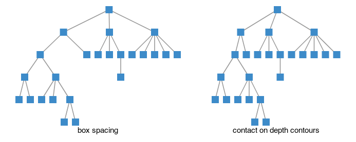

_Emulated: a small file tree laid out with each subtree as one block (box spacing), and with contact on its depth contours, where subtrees interlock. Main has no contour code, so the layout is computed in a throwaway story._

Contact and optical spacing serve different goals, so neither replaces the other.

- **Packing.** Contact packs shapes as tightly as possible without overlap. Tidy trees and ridgelines want this, and readers expect it there.

- **Looking even.** Optical spacing makes the gaps look equal. Rows of letter-like shapes, icons, and padding inside a container want this.

So the `Spacing` family likely needs both, chosen by what the visualization is for. A tidy tree in GoFish would be `spread` with `Spacing.contour(n)` over subtree profiles, which makes it a test case for both pages.

## Set it yourself

The page has an interactive here: eight widgets (shapes, a notch, Georgia letters, an icon in a pill, stacked densities) where you drag one shape to where the gaps look even and see which spacing model is closest, per widget and averaged over all the widgets you set.

## Josh's test rows and candidates (a) to (f)

Josh picked three rows from the shapes renders further down as the test. On "square, A, V, A" he wrote, "the triangles look nice but the square is too far away": the gap from the square to the first triangle should look the same as the gaps between the triangles. On "triangle, circle, V, square" he saw a "similar issue here imo but smaller", between the V and the square. On "circle, left triangle, square": "the circle is too far away... maybe b/c the tip of the triangle gets really small?" The goal for every model below is that every gap in a row looks the same.

**Contact is not buggy.** It measures the gap along the spacing axis, on each horizontal line, and keeps the smallest one at the target. At a 10 px target the square sits exactly 10 px from the A's base corner, the same horizontal gap as between the A and the V. What differs is the white between them. The A to V gap is a parallel strip, 10 px on every line. The square to A gap is a wedge that opens toward the apex, 24 px on average. The circle to tip gap is 10 px at the tip and 44 px on average, because only the tip is near the circle and both shapes bend away from it. Tim Ahrens (Kern On) describes perceived distance as closer to the average distance, or the white area, than to the minimum, which fits all three of Josh's readings. A second, smaller effect: contact measures horizontally, and these triangle sides slope at 63°, so the A to V strip is only 8.9 px measured straight across.

The candidates, each emulated on all three rows:

- **(a) Contact, straight-line.** The gap is the shortest distance between the outlines, not the horizontal one.

- **(b) Area model, sum.** HT Letterspacer style margins (explained below): each side gets the flat-side margin minus its mean clamped depth, and two sides add. Contact at 3 px is the floor.

- **(c) Area model, max.** The same margins, combined by the larger one.

- **(d) Pair white area.** Move the pair until the white between the two facing sides, capped on each line, equals what a parallel strip of the target width has. This depends on the pair, so it is closer to kerning than to spacing. Floor 3 px.

- **(e) Opened outline.** Contact on each shape after removing parts thinner than a width. It is (g) below, done with exact distances, so it is shown there.

- **(f) Blurred outline.** Josh's suggestion: blur each shape's ink with a Gaussian of width σ, take the 0.5 level as a softer outline, and apply contact to that. Tips and sharp corners retract because little ink surrounds them, and a shape's own hollows fill in. A lower level grows the outline and a higher one shrinks it. Because each shape is blurred alone, the wedge between two shapes does not fill; here the triangles are convex, so only the corner retraction acts.

Every model uses the same target in each setting: 30 px for the loose setting, which no pair's floor reaches, and 10 px for the tight one, with a 3 px floor for the models that have one.

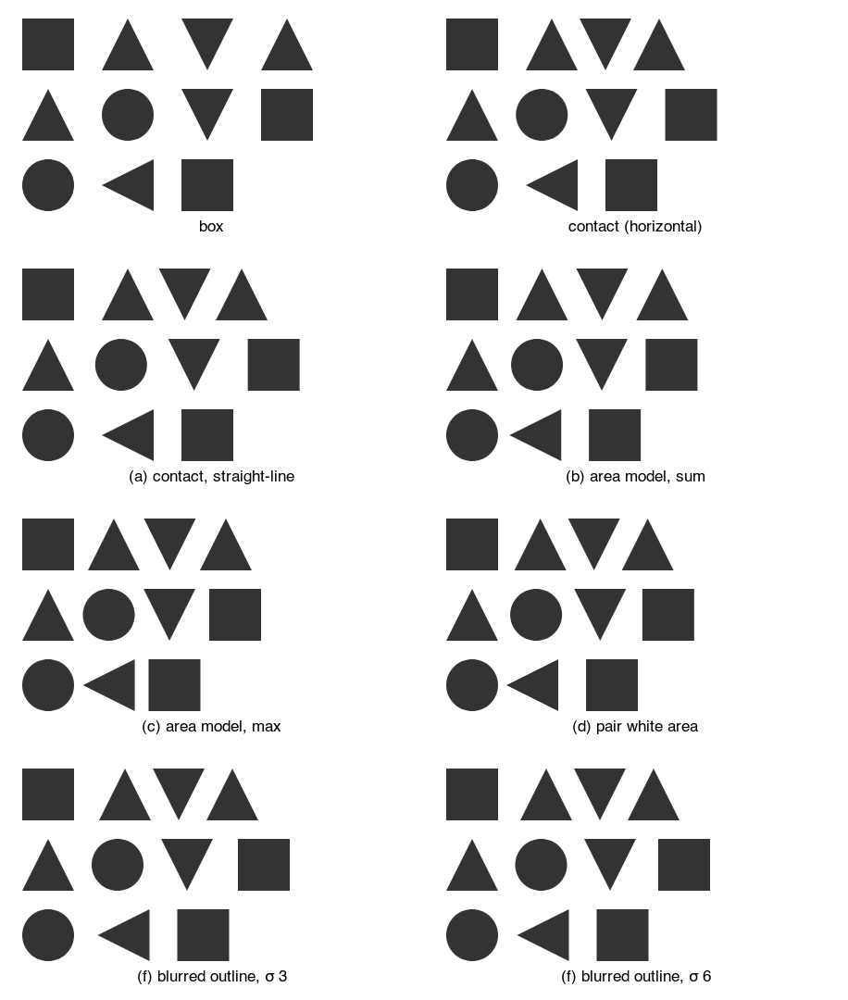

_Loose, target 30 px. No pair hits the floor in any model._

<p>Mean horizontal gap in px over the lines both shapes share, per pair, at the loose target. It stands in for "looks the same"; it is not the judgment itself.</p><div class="table-wrap"><table><tr><th>model</th><th>□ △ ▽ △</th><th>△ ○ ▽ □</th><th>○ ◁ □</th></tr><tr><td>box</td><td>44, 58, 58</td><td>50, 50, 44</td><td>64, 30</td></tr><tr><td>contact</td><td>44, 30, 30</td><td>39, 39, 44</td><td>64, 30</td></tr><tr><td>(a) contact, straight-line</td><td>44, 34, 34</td><td>43, 43, 44</td><td>64, 30</td></tr><tr><td>(b) area model, sum</td><td>33, 37, 37</td><td>34, 34, 33</td><td>46, 30</td></tr><tr><td>(c) area model, max</td><td>29, 33, 33</td><td>30, 30, 29</td><td>44, 15</td></tr><tr><td>(d) pair white area</td><td>32, 30, 30</td><td>33, 33, 32</td><td>43, 30</td></tr><tr><td>(f) blurred outline, σ 6</td><td>38, 30, 30</td><td>39, 39, 38</td><td>55, 30</td></tr></table></div>

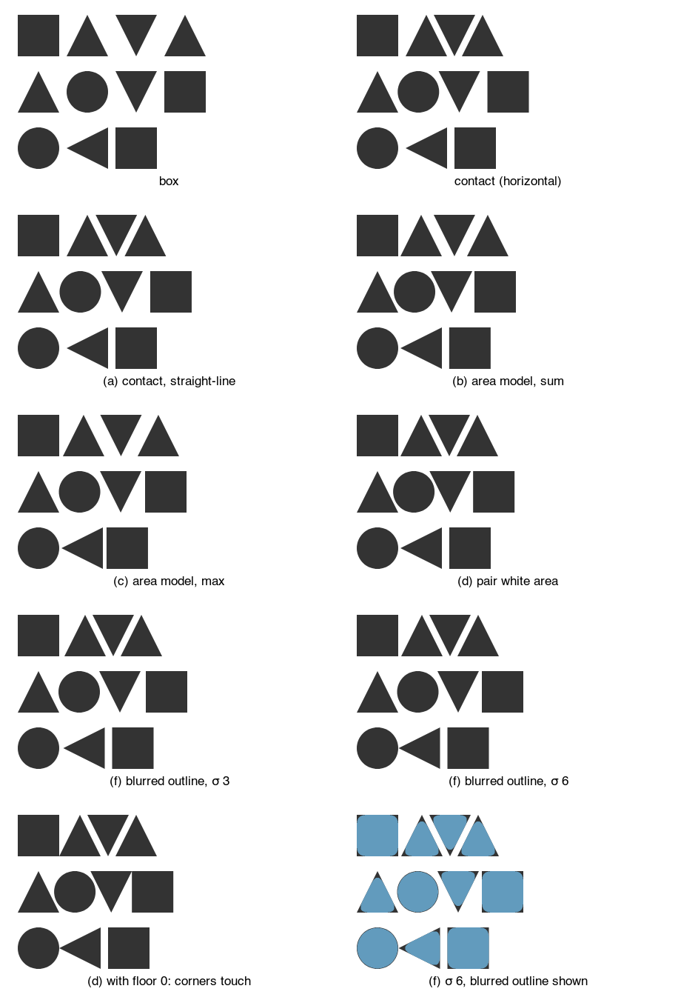

_Tight, target 10 px, floor 3 px. The last two panels show (d) with the floor at 0, and (f) with its blurred outline drawn in blue over the ink: the dark corners and tips are what the blur retracts._

<p>The same measure at the tight target. Bold marks a pair whose position the 3 px floor set.</p><div class="table-wrap"><table><tr><th>model</th><th>□ △ ▽ △</th><th>△ ○ ▽ □</th><th>○ ◁ □</th></tr><tr><td>box</td><td>24, 38, 38</td><td>30, 30, 24</td><td>44, 10</td></tr><tr><td>contact</td><td>24, 10, 10</td><td>19, 19, 24</td><td>44, 10</td></tr><tr><td>(a) contact, straight-line</td><td>24, 11, 11</td><td>21, 21, 24</td><td>44, 10</td></tr><tr><td>(b) area model, sum</td><td><b>17</b>, 17, 17</td><td>14, 14, <b>17</b></td><td><b>37</b>, 10</td></tr><tr><td>(c) area model, max</td><td>19, 23, 23</td><td>20, 20, 19</td><td><b>37</b>, 5</td></tr><tr><td>(d) pair white area</td><td><b>17</b>, 10, 10</td><td>13, 13, <b>17</b></td><td><b>37</b>, 10</td></tr><tr><td>(d) with floor 0</td><td>14, 10, 10</td><td>13, 13, 14</td><td>34, 10</td></tr><tr><td>(f) blurred outline, σ 6</td><td>18, 10, 10</td><td>19, 19, 18</td><td>35, 10</td></tr></table></div>
<p><b>What the test shows.</b></p>
<ul>
<li>At the loose target, <b>(d) pair white area</b> evens rows one and two best (all gaps within 3 px), and <b>(b) sum</b> is close but pushes the triangles apart to 37 px. Neither closes the circle row: the circle stays at 43 to 46 px, because each line's white is capped and the circle bends away for most of the band.</li>
<li><b>(c) max</b> looks even on rows one and two, but only because it is calibrated like sum, with a flat side carrying half the target: two flat sides then end at half the target (the triangle to square pair at 15 px). Calibrated as a minimum, with a flat side carrying the whole target, max puts the square at its box gap, the same as contact. So max does not help here.</li>
<li><b>(a)</b> moves the triangles about 2 px apart, which helps a little in the wrong place.</li>
<li><b>(f)</b>, like (g) below, moves only pairs that meet at a corner or a tip, by roughly σ, and leave parallel strips alone. It moves every row in the right direction and do not disturb the A to V gap, but not far: the square comes from 44 to 38 px against a target of 30. A larger σ moves more but also rounds every corner.</li>
<li>At the tight target the floor is the limit, as Josh expected. With the floor at 0 the base corners touch and the square is still at 14 px against 10, so <b>no model makes the square look like the triangles without the corners colliding</b>. A smaller floor would tighten the A to V gap too only in the models that use the floor everywhere; in (d) it moves just the floored pairs. (f) is the only model here that lets the tip pass the floor: at σ 6 the circle comes within 0.5 px of the tip.</li>
</ul>
<p>A combination that was not rendered: (d) or (b) measured on the blurred outline, with the floor on the blurred outline too, so tips may pass and wedges still count.</p>

## Candidates (g) to (j): signed distance fields

A **signed distance field** (SDF) gives, for any point, its distance to a shape's outline, negative inside. `enclose` already has exact ones: these renders reuse its `grownPrim` and `primD` (`enclose/prims.ts`) for the circle, a disc, and the square, a box. The triangles use Quilez's exact polygon distance, written for the prototype, since `prims.ts` has no polygon. Growing and shrinking by a disc are done on a 0.5 px raster: the exact distance in each cell, then a Euclidean distance transform. Four candidates:

- **(g) SDF opening.** Shrink each shape by r, grow it back by r, and use contact on the result, with the 3 px floor on the real shapes. Parts thinner than 2r, such as a tip, drop out. It matches (e) within half a pixel on every pair, so (e) is dropped. It keeps locality: each shape is measured alone.

- **(h) SDF closing.** Grow by r, shrink by r: this fills notches inside one shape. None of the test shapes has one, and the gaps move by half a pixel, which is the raster step. It would matter for a "c" or an "E", not here.

- **(i) Fillet area.** For neighbors A and B, take the closing of A ∪ B by a disc of radius R: the points that no disc of radius R missing both shapes can reach. This is the region `Shape.fillet()` draws around the two with no padding ("the padded members, closed by a disc"). It is computed here from the exact distances, not with `enclose`'s outline code, which builds an outline from discs, boxes and segments rather than measuring an area. The area it adds beyond A and B, divided by the shapes' height, is a mean gap. Each pair moves out from the floor until that mean gap reaches the target. The fillet fills only where the gap is narrower than 2R, so a pair may reach its largest fillet before the target; it then stays there (italic in the tables).

- **(j) Smooth union.** The same, with the region where Quilez's polynomial smooth minimum of the two distances, radius k, is below 0. It does not agree with (i). The smooth minimum also fattens both shapes' outer sides wherever the two are near, so at k = 4 × target its bridge passes the target while the shapes are still at the floor (bold), and at k = target or 2 × target its area peaks before the target on most pairs. As a spacing measure it does not work without cutting the bridge to the gap.

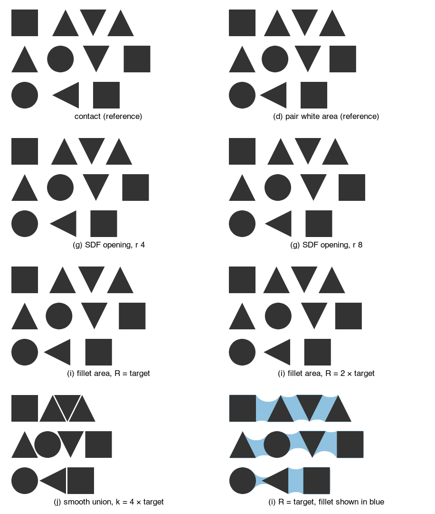

_Loose, target 30 px, floor 3 px. Contact and pair white area are the reference panels. The last panel draws the fillet of (i) in blue: the area being measured._

<p>Mean horizontal gap in px per pair, as above. Bold: the floor set the pair. Italic: the fillet area peaked before the target.</p><div class="table-wrap"><table><tr><th>model</th><th>□ △ ▽ △</th><th>△ ○ ▽ □</th><th>○ ◁ □</th></tr><tr><td>contact</td><td>44, 30, 30</td><td>39, 39, 44</td><td>64, 30</td></tr><tr><td>(d) pair white area</td><td>32, 30, 30</td><td>33, 33, 32</td><td>43, 30</td></tr><tr><td>(g) SDF opening, r 4</td><td>42, 30, 30</td><td>39, 39, 42</td><td>59, 30</td></tr><tr><td>(g) SDF opening, r 8</td><td>39, 30, 30</td><td>39, 39, 39</td><td>54, 30</td></tr><tr><td>(h) SDF closing, r 8</td><td>45, 31, 31</td><td>40, 40, 45</td><td>65, 31</td></tr><tr><td>(i) fillet area, R = target</td><td>38, 33, 33</td><td><i>36</i>, <i>38</i>, 38</td><td><i>46</i>, 32</td></tr><tr><td>(i) fillet area, R = 2 × target</td><td>30, 30, 30</td><td>40, 40, 30</td><td><i>51</i>, 30</td></tr><tr><td>(j) smooth union, k = 4 × target</td><td><b>17</b>, <b>3</b>, <b>3</b></td><td><b>12</b>, <b>12</b>, <b>17</b></td><td><b>37</b>, <b>3</b></td></tr></table></div>

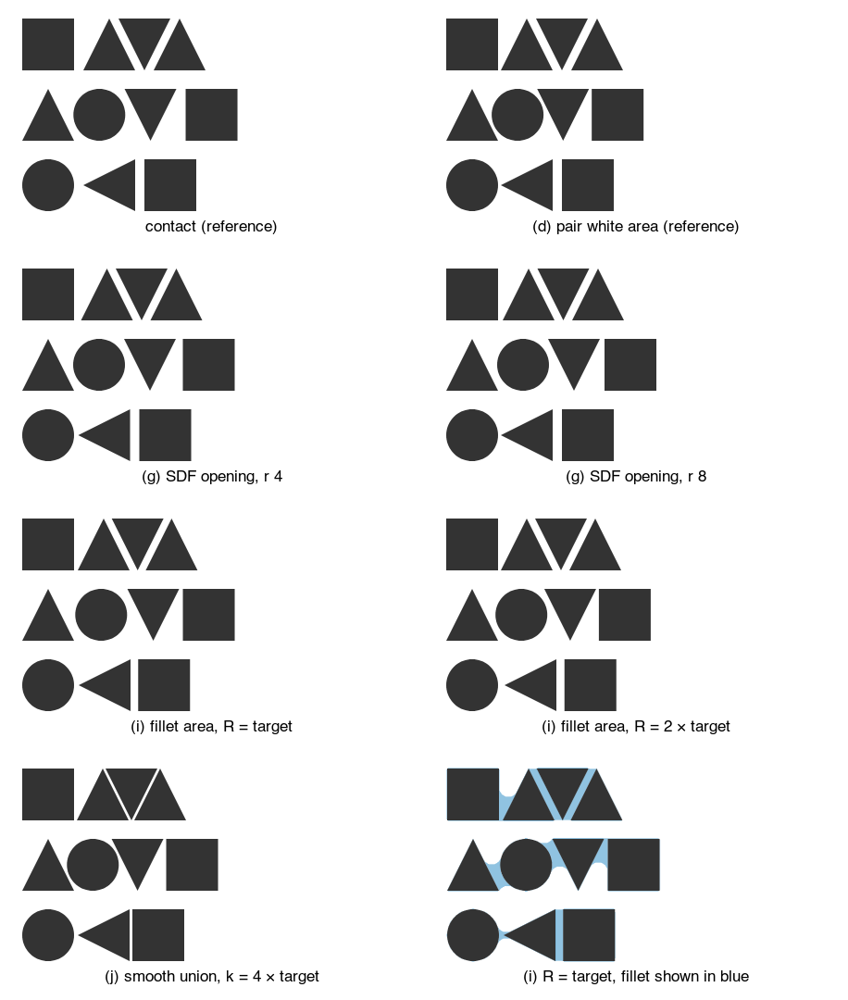

_Tight, target 10 px, floor 3 px._

<div class="table-wrap"><table><tr><th>model</th><th>□ △ ▽ △</th><th>△ ○ ▽ □</th><th>○ ◁ □</th></tr><tr><td>contact</td><td>24, 10, 10</td><td>19, 19, 24</td><td>44, 10</td></tr><tr><td>(d) pair white area</td><td><b>17</b>, 10, 10</td><td>13, 13, <b>17</b></td><td><b>37</b>, 10</td></tr><tr><td>(g) SDF opening, r 4</td><td>22, 10, 10</td><td>19, 19, 22</td><td>39, 10</td></tr><tr><td>(g) SDF opening, r 8</td><td>19, 10, 10</td><td>19, 19, 19</td><td><b>37</b>, 10</td></tr><tr><td>(h) SDF closing, r 8</td><td>25, 11, 11</td><td>20, 20, 25</td><td>45, 11</td></tr><tr><td>(i) fillet area, R = target</td><td><i>18</i>, 9, 9</td><td><i>21</i>, <i>20</i>, <i>18</i></td><td><i>39</i>, 8</td></tr><tr><td>(i) fillet area, R = 2 × target</td><td><b>17</b>, 9, 9</td><td>17, 17, <b>17</b></td><td><i>41</i>, 9</td></tr><tr><td>(j) smooth union, k = 4 × target</td><td><b>17</b>, <b>3</b>, <b>3</b></td><td><b>12</b>, <b>12</b>, <b>17</b></td><td><i>38</i>, <b>3</b></td></tr></table></div>
<p><b>What the SDF candidates show.</b></p>
<ul>
<li><b>(i) with R = 2 × target fixes Josh's main row</b> at the loose target: square, A, V, A all sit at a mean gap of 30 px, and the V to square pair on the second row comes in to 30 too. The circle pairs on that row stay at 40 px.</li>
<li><b>(i) does not fix the circle row.</b> Next to a tip only a small region is narrower than 2R, so the fillet area peaks at a mean gap of 51 px (46 with R = target) and never reaches the target. The circle comes in from 64 px, but not to 30.</li>
<li>R matters: with R = target, the triangle pairs on row one end at 33 px and the square at 38. A default of R = 2 × target worked on these rows; this is untested on glyphs.</li>
<li>At the tight target the floor still sets the square pairs, so (i) cannot do better than the other models there.</li>
<li><b>(g)</b> moves only corners and tips, by a few pixels, and is local; <b>(i)</b> compares pairs, so it gives up per-shape locality, the property that made the area model fit spread. (i) is closer to kerning than to spacing.</li>
</ul>

## Box gap, contact gap and pitch

When shapes are irregular, the space between neighbors can be measured two ways. A **box gap** is the gap between bounding boxes, which is today's `spread`. A **contact gap** is the smallest gap between the facing outlines, measured slice by slice: the shapes slide together until the closest slice reaches the gap. Both renders in each pair use the same gap. The offsets are computed by hand (a throwaway helper, `spacingModels.ts`) and drawn with today's engine. The glyphs are traced from Georgia (serif) and Arial (sans) with fontTools.

Proposed: how the gap is measured is the value of spacing:

```js
spread({ by: "month", dir: "y", spacing: 4 }); // sugar for Spacing.box(4)
spread({
  by: "month",
  dir: "y",
  spacing: Spacing.pitch(70, { at: "baseline" }),
}); // today's anchor
spread({ by: "month", dir: "y", spacing: Spacing.contour(4) });
```

```python
spread(by="month", dir="y", spacing=4)
spread(by="month", dir="y", spacing=Spacing.pitch(70, at="baseline"))
spread(by="month", dir="y", spacing=Spacing.contour(4))
```

Today (box gap, or a pitch with anchor):

```js
spread({ by: "month", dir: "y", spacing: 4 });
spread({ by: "month", dir: "y", spacing: 70, anchor: "baseline" });
```

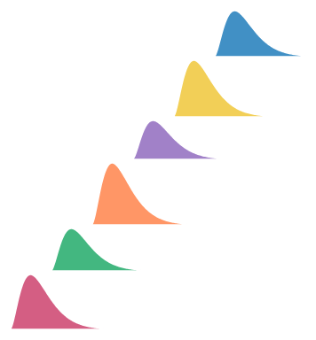

_Ridgeline, box gap 4 px: each ridge starts above the previous one's box._

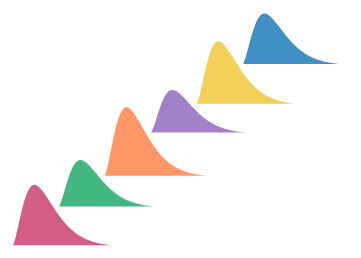

_Ridgeline, contact gap 4 px: each ridge drops until its base would touch a ridge below, so it tucks over the long tails._

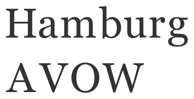

_Georgia, box gap 6 px._

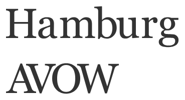

_Georgia, contact gap 6 px._


_Arial, box gap 6 px._


_Arial, contact gap 6 px._

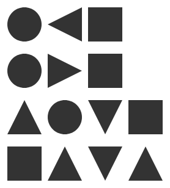

_Circles, triangles and squares, box gap 10 px. Rows: circle, left-pointing triangle, square; circle, right-pointing triangle, square; up, circle, down, square; square, up, down, up._

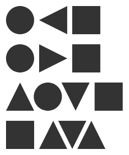

_The same rows, contact gap 10 px._

#### What the renders show

- **Ridgeline.** Contact does what it promises. Each ridge sits as low as it can without touching, and the column is shorter.

- **Serif, "Hamburg".** Contact changes almost nothing, in either font. Stems, serifs and round sides reach the bounding box, so the closest slice is at the box edge. In Georgia the serifs set the closest point, so the white between two stems is the gap plus two serifs, wider than between Arial's stems, as expected. But every stem pair gets the same serifs, so the word still looks even.

- **"AVOW".** Contact pulls A into V and V into O until their diagonals are 6 px apart, so AVOW sets much tighter than Hamburg in both fonts, and in Georgia the serifs of A and V interleave. The same smallest distance is not the same white: two parallel diagonals 6 px apart leave a thin strip, while a stem beside a bowl leaves wedges of white above and below its closest point.

- **Shapes.** In the first two rows contact and box are the same, because the closest points lie on the box edges (a point meeting the widest part of a circle, a flat side meeting a point). The circle and the triangle that points at it touch at one point, so that gap still looks larger than a flat-to-flat gap of the same 10 px. In the last two rows contact slides the triangles under the circle and between each other, so up, down, up closes into an even band, while the gap beside the square stays wide. A row with nested and un-nested pairs looks less even under contact than under box gaps.

So contact guarantees a minimum gap and nothing more. That is what tree layouts, sankey node columns and the ridgeline need. It is not a model of looking even, and on glyphs and mixed shapes it looks uneven.

## How type tools space letters: the area model

Type tools space each glyph on its own, one side at a time, never by pairs. Each side gets a **sidebearing**, its margin of white. The gap between two letters is the right sidebearing of the first plus the left sidebearing of the second. Kerning is a separate step afterwards that fixes a few bad pairs by hand. Kern On and Adobe's optical kerning work on related ideas, but their methods are not published.

HT Letterspacer (Huerta Tipográfica) computes one side like this:

- Pick a band of heights: baseline to x-height for lowercase, baseline to cap height for capitals. Anything outside it is ignored. The README calls the glyph that sets this zone the **reference** (when it is empty, each glyph uses its own height).

- On horizontal lines through the band, record how far in the glyph's edge is. This is the profile on that side.

- Cap the depth: clamp the profile at a fixed depth from the glyph's outermost point. The parameter is **depth**, a percentage of the x-height, so a hollow such as the inside of a "c" or the space under a "T" counts only down to the cap.

- Measure the white area between the clamped profile and the glyph's outermost point.

- Choose the sidebearing so that this white area plus sidebearing times band height equals one target, the parameter **area**, shared by all glyphs. The target is tuned so a straight stem ("n", "H") gets the margin the designer wants.

The README also lists **overshoot** (`paramOver`) without defining it, and a measuring step (`paramFreq`, default 5 font units). The names are from the README at github.com/huertatipografica/HTLetterspacer; it states no default for area, depth or overshoot. Put plainly: the sidebearing is the flat-stem margin minus the side's mean clamped depth.

<svg viewBox="0 0 750 246" role="img" aria-label="Three glyph sides with their counted white area, depth cap and sidebearing" style="width:100%;max-width:760px;height:auto;display:block;margin:8px 0;font-family:Inter,system-ui,sans-serif"><defs><marker id="sb-arrow" viewBox="0 0 8 8" refX="7" refY="4" markerWidth="7" markerHeight="7" orient="auto"><path d="M0 0 L8 4 L0 8 z" fill="var(--hn)"/></marker><marker id="sb-arrow-s" viewBox="0 0 8 8" refX="1" refY="4" markerWidth="7" markerHeight="7" orient="auto"><path d="M8 0 L0 4 L8 8 z" fill="var(--hn)"/></marker></defs><g transform="translate(0,0)"><rect x="50" y="30" width="80" height="160" fill="var(--fg)"/><line x1="94" y1="22" x2="94" y2="198" stroke="var(--accent)" stroke-dasharray="4 3"/><line x1="130" y1="22" x2="130" y2="198" stroke="var(--muted)"/><line x1="20" y1="30" x2="240" y2="30" stroke="var(--muted)" stroke-dasharray="2 3" stroke-width="0.8"/><line x1="20" y1="190" x2="240" y2="190" stroke="var(--muted)" stroke-dasharray="2 3" stroke-width="0.8"/><rect x="130" y="30" width="48.0" height="160" fill="var(--hn)" fill-opacity="0.25"/><line x1="130" y1="110.0" x2="178.0" y2="110.0" stroke="var(--hn)" stroke-width="2" marker-end="url(#sb-arrow)" marker-start="url(#sb-arrow-s)"/><text x="154.0" y="102.0" text-anchor="middle" font-size="12" fill="var(--fg)">48</text><text x="130.0" y="218" text-anchor="middle" font-size="13" fill="var(--fg)">flat stem</text><text x="130.0" y="235" text-anchor="middle" font-size="12" fill="var(--muted)">counted white 0, sidebearing 48</text></g><g transform="translate(250,0)"><polygon points="40,30 130,30 90,190 40,190" fill="var(--fg)"/><polygon points="130,30 130.0,30.0 129.9,30.5 129.8,31.0 129.6,31.5 129.5,32.0 129.4,32.5 129.2,33.0 129.1,33.5 129.0,34.0 128.9,34.5 128.8,35.0 128.6,35.5 128.5,36.0 128.4,36.5 128.2,37.0 128.1,37.5 128.0,38.0 127.9,38.5 127.8,39.0 127.6,39.5 127.5,40.0 127.4,40.5 127.2,41.0 127.1,41.5 127.0,42.0 126.9,42.5 126.8,43.0 126.6,43.5 126.5,44.0 126.4,44.5 126.2,45.0 126.1,45.5 126.0,46.0 125.9,46.5 125.8,47.0 125.6,47.5 125.5,48.0 125.4,48.5 125.2,49.0 125.1,49.5 125.0,50.0 124.9,50.5 124.8,51.0 124.6,51.5 124.5,52.0 124.4,52.5 124.2,53.0 124.1,53.5 124.0,54.0 123.9,54.5 123.8,55.0 123.6,55.5 123.5,56.0 123.4,56.5 123.2,57.0 123.1,57.5 123.0,58.0 122.9,58.5 122.8,59.0 122.6,59.5 122.5,60.0 122.4,60.5 122.2,61.0 122.1,61.5 122.0,62.0 121.9,62.5 121.8,63.0 121.6,63.5 121.5,64.0 121.4,64.5 121.2,65.0 121.1,65.5 121.0,66.0 120.9,66.5 120.8,67.0 120.6,67.5 120.5,68.0 120.4,68.5 120.2,69.0 120.1,69.5 120.0,70.0 119.9,70.5 119.8,71.0 119.6,71.5 119.5,72.0 119.4,72.5 119.2,73.0 119.1,73.5 119.0,74.0 118.9,74.5 118.8,75.0 118.6,75.5 118.5,76.0 118.4,76.5 118.2,77.0 118.1,77.5 118.0,78.0 117.9,78.5 117.8,79.0 117.6,79.5 117.5,80.0 117.4,80.5 117.2,81.0 117.1,81.5 117.0,82.0 116.9,82.5 116.8,83.0 116.6,83.5 116.5,84.0 116.4,84.5 116.2,85.0 116.1,85.5 116.0,86.0 115.9,86.5 115.8,87.0 115.6,87.5 115.5,88.0 115.4,88.5 115.2,89.0 115.1,89.5 115.0,90.0 114.9,90.5 114.8,91.0 114.6,91.5 114.5,92.0 114.4,92.5 114.2,93.0 114.1,93.5 114.0,94.0 113.9,94.5 113.8,95.0 113.6,95.5 113.5,96.0 113.4,96.5 113.2,97.0 113.1,97.5 113.0,98.0 112.9,98.5 112.8,99.0 112.6,99.5 112.5,100.0 112.4,100.5 112.2,101.0 112.1,101.5 112.0,102.0 111.9,102.5 111.8,103.0 111.6,103.5 111.5,104.0 111.4,104.5 111.2,105.0 111.1,105.5 111.0,106.0 110.9,106.5 110.8,107.0 110.6,107.5 110.5,108.0 110.4,108.5 110.2,109.0 110.1,109.5 110.0,110.0 109.9,110.5 109.8,111.0 109.6,111.5 109.5,112.0 109.4,112.5 109.2,113.0 109.1,113.5 109.0,114.0 108.9,114.5 108.8,115.0 108.6,115.5 108.5,116.0 108.4,116.5 108.2,117.0 108.1,117.5 108.0,118.0 107.9,118.5 107.8,119.0 107.6,119.5 107.5,120.0 107.4,120.5 107.2,121.0 107.1,121.5 107.0,122.0 106.9,122.5 106.8,123.0 106.6,123.5 106.5,124.0 106.4,124.5 106.2,125.0 106.1,125.5 106.0,126.0 105.9,126.5 105.8,127.0 105.6,127.5 105.5,128.0 105.4,128.5 105.2,129.0 105.1,129.5 105.0,130.0 104.9,130.5 104.8,131.0 104.6,131.5 104.5,132.0 104.4,132.5 104.2,133.0 104.1,133.5 104.0,134.0 103.9,134.5 103.8,135.0 103.6,135.5 103.5,136.0 103.4,136.5 103.2,137.0 103.1,137.5 103.0,138.0 102.9,138.5 102.8,139.0 102.6,139.5 102.5,140.0 102.4,140.5 102.2,141.0 102.1,141.5 102.0,142.0 101.9,142.5 101.8,143.0 101.6,143.5 101.5,144.0 101.4,144.5 101.2,145.0 101.1,145.5 101.0,146.0 100.9,146.5 100.8,147.0 100.6,147.5 100.5,148.0 100.4,148.5 100.2,149.0 100.1,149.5 100.0,150.0 99.9,150.5 99.8,151.0 99.6,151.5 99.5,152.0 99.4,152.5 99.2,153.0 99.1,153.5 99.0,154.0 98.9,154.5 98.8,155.0 98.6,155.5 98.5,156.0 98.4,156.5 98.2,157.0 98.1,157.5 98.0,158.0 97.9,158.5 97.8,159.0 97.6,159.5 97.5,160.0 97.4,160.5 97.2,161.0 97.1,161.5 97.0,162.0 96.9,162.5 96.8,163.0 96.6,163.5 96.5,164.0 96.4,164.5 96.2,165.0 96.1,165.5 96.0,166.0 95.9,166.5 95.8,167.0 95.6,167.5 95.5,168.0 95.4,168.5 95.2,169.0 95.1,169.5 95.0,170.0 94.9,170.5 94.8,171.0 94.6,171.5 94.5,172.0 94.4,172.5 94.2,173.0 94.1,173.5 94.0,174.0 94.0,174.5 94.0,175.0 94.0,175.5 94.0,176.0 94.0,176.5 94.0,177.0 94.0,177.5 94.0,178.0 94.0,178.5 94.0,179.0 94.0,179.5 94.0,180.0 94.0,180.5 94.0,181.0 94.0,181.5 94.0,182.0 94.0,182.5 94.0,183.0 94.0,183.5 94.0,184.0 94.0,184.5 94.0,185.0 94.0,185.5 94.0,186.0 94.0,186.5 94.0,187.0 94.0,187.5 94.0,188.0 94.0,188.5 94.0,189.0 94.0,189.5 94.0,190.0 130,190" fill="var(--accent)" fill-opacity="0.35"/><line x1="94" y1="22" x2="94" y2="198" stroke="var(--accent)" stroke-dasharray="4 3"/><line x1="130" y1="22" x2="130" y2="198" stroke="var(--muted)"/><line x1="20" y1="30" x2="240" y2="30" stroke="var(--muted)" stroke-dasharray="2 3" stroke-width="0.8"/><line x1="20" y1="190" x2="240" y2="190" stroke="var(--muted)" stroke-dasharray="2 3" stroke-width="0.8"/><rect x="130" y="30" width="28.2" height="160" fill="var(--hn)" fill-opacity="0.25"/><line x1="130" y1="110.0" x2="158.2" y2="110.0" stroke="var(--hn)" stroke-width="2" marker-end="url(#sb-arrow)" marker-start="url(#sb-arrow-s)"/><text x="144.1" y="102.0" text-anchor="middle" font-size="12" fill="var(--fg)">28</text><text x="130.0" y="218" text-anchor="middle" font-size="13" fill="var(--fg)">slanted side (V)</text><text x="130.0" y="235" text-anchor="middle" font-size="12" fill="var(--muted)">counted white 3167, sidebearing 28</text></g><g transform="translate(500,0)"><path d="M 130.0 58.6 A 80 80 0 1 0 130.0 161.4 L 107.0 142.1 A 50 50 0 1 1 107.0 77.9 Z" fill="var(--fg)"/><polygon points="130,30 94.0,30.0 94.0,30.5 94.0,31.0 94.0,31.5 94.0,32.0 94.0,32.5 94.0,33.0 94.0,33.5 94.0,34.0 95.0,34.5 96.5,35.0 97.5,35.5 99.0,36.0 100.0,36.5 101.0,37.0 102.5,37.5 103.5,38.0 104.5,38.5 105.5,39.0 106.5,39.5 107.0,40.0 108.0,40.5 109.0,41.0 110.0,41.5 110.5,42.0 111.5,42.5 112.0,43.0 113.0,43.5 113.5,44.0 114.5,44.5 115.0,45.0 116.0,45.5 116.5,46.0 117.0,46.5 118.0,47.0 118.5,47.5 119.0,48.0 119.5,48.5 120.0,49.0 121.0,49.5 121.5,50.0 122.0,50.5 122.5,51.0 123.0,51.5 123.5,52.0 124.0,52.5 124.5,53.0 125.0,53.5 125.5,54.0 126.0,54.5 126.5,55.0 127.0,55.5 127.5,56.0 128.0,56.5 128.5,57.0 129.0,57.5 129.5,58.0 129.5,58.5 129.0,59.0 128.5,59.5 128.0,60.0 127.5,60.5 127.0,61.0 126.5,61.5 125.5,62.0 125.0,62.5 124.5,63.0 124.0,63.5 123.5,64.0 122.5,64.5 122.0,65.0 121.5,65.5 121.0,66.0 120.5,66.5 119.5,67.0 119.0,67.5 118.5,68.0 118.0,68.5 117.5,69.0 116.5,69.5 116.0,70.0 115.5,70.5 115.0,71.0 114.5,71.5 114.0,72.0 113.0,72.5 112.5,73.0 112.0,73.5 111.5,74.0 111.0,74.5 110.0,75.0 109.5,75.5 109.0,76.0 108.5,76.5 108.0,77.0 107.0,77.5 94.0,78.0 94.0,78.5 94.0,79.0 94.0,79.5 94.0,80.0 94.0,80.5 94.0,81.0 94.0,81.5 94.0,82.0 94.0,82.5 94.0,83.0 94.0,83.5 94.0,84.0 94.0,84.5 94.0,85.0 94.0,85.5 94.0,86.0 94.0,86.5 94.0,87.0 94.0,87.5 94.0,88.0 94.0,88.5 94.0,89.0 94.0,89.5 94.0,90.0 94.0,90.5 94.0,91.0 94.0,91.5 94.0,92.0 94.0,92.5 94.0,93.0 94.0,93.5 94.0,94.0 94.0,94.5 94.0,95.0 94.0,95.5 94.0,96.0 94.0,96.5 94.0,97.0 94.0,97.5 94.0,98.0 94.0,98.5 94.0,99.0 94.0,99.5 94.0,100.0 94.0,100.5 94.0,101.0 94.0,101.5 94.0,102.0 94.0,102.5 94.0,103.0 94.0,103.5 94.0,104.0 94.0,104.5 94.0,105.0 94.0,105.5 94.0,106.0 94.0,106.5 94.0,107.0 94.0,107.5 94.0,108.0 94.0,108.5 94.0,109.0 94.0,109.5 94.0,110.0 94.0,110.5 94.0,111.0 94.0,111.5 94.0,112.0 94.0,112.5 94.0,113.0 94.0,113.5 94.0,114.0 94.0,114.5 94.0,115.0 94.0,115.5 94.0,116.0 94.0,116.5 94.0,117.0 94.0,117.5 94.0,118.0 94.0,118.5 94.0,119.0 94.0,119.5 94.0,120.0 94.0,120.5 94.0,121.0 94.0,121.5 94.0,122.0 94.0,122.5 94.0,123.0 94.0,123.5 94.0,124.0 94.0,124.5 94.0,125.0 94.0,125.5 94.0,126.0 94.0,126.5 94.0,127.0 94.0,127.5 94.0,128.0 94.0,128.5 94.0,129.0 94.0,129.5 94.0,130.0 94.0,130.5 94.0,131.0 94.0,131.5 94.0,132.0 94.0,132.5 94.0,133.0 94.0,133.5 94.0,134.0 94.0,134.5 94.0,135.0 94.0,135.5 94.0,136.0 94.0,136.5 94.0,137.0 94.0,137.5 94.0,138.0 94.0,138.5 94.0,139.0 94.0,139.5 94.0,140.0 94.0,140.5 94.0,141.0 94.0,141.5 94.0,142.0 107.0,142.5 108.0,143.0 108.5,143.5 109.0,144.0 109.5,144.5 110.0,145.0 111.0,145.5 111.5,146.0 112.0,146.5 112.5,147.0 113.0,147.5 114.0,148.0 114.5,148.5 115.0,149.0 115.5,149.5 116.0,150.0 116.5,150.5 117.5,151.0 118.0,151.5 118.5,152.0 119.0,152.5 119.5,153.0 120.5,153.5 121.0,154.0 121.5,154.5 122.0,155.0 122.5,155.5 123.5,156.0 124.0,156.5 124.5,157.0 125.0,157.5 125.5,158.0 126.5,158.5 127.0,159.0 127.5,159.5 128.0,160.0 128.5,160.5 129.0,161.0 129.5,161.5 129.5,162.0 129.0,162.5 128.5,163.0 128.0,163.5 127.5,164.0 127.0,164.5 126.5,165.0 126.0,165.5 125.5,166.0 125.0,166.5 124.5,167.0 124.0,167.5 123.5,168.0 123.0,168.5 122.5,169.0 122.0,169.5 121.5,170.0 121.0,170.5 120.0,171.0 119.5,171.5 119.0,172.0 118.5,172.5 118.0,173.0 117.0,173.5 116.5,174.0 116.0,174.5 115.0,175.0 114.5,175.5 113.5,176.0 113.0,176.5 112.0,177.0 111.5,177.5 110.5,178.0 110.0,178.5 109.0,179.0 108.0,179.5 107.0,180.0 106.5,180.5 105.5,181.0 104.5,181.5 103.5,182.0 102.5,182.5 101.0,183.0 100.0,183.5 99.0,184.0 97.5,184.5 96.5,185.0 95.0,185.5 94.0,186.0 94.0,186.5 94.0,187.0 94.0,187.5 94.0,188.0 94.0,188.5 94.0,189.0 94.0,189.5 94.0,190.0 130,190" fill="var(--accent)" fill-opacity="0.35"/><line x1="94" y1="22" x2="94" y2="198" stroke="var(--accent)" stroke-dasharray="4 3"/><line x1="130" y1="22" x2="130" y2="198" stroke="var(--muted)"/><line x1="20" y1="30" x2="240" y2="30" stroke="var(--muted)" stroke-dasharray="2 3" stroke-width="0.8"/><line x1="20" y1="190" x2="240" y2="190" stroke="var(--muted)" stroke-dasharray="2 3" stroke-width="0.8"/><rect x="130" y="30" width="24.3" height="160" fill="var(--hn)" fill-opacity="0.25"/><line x1="130" y1="110.0" x2="154.3" y2="110.0" stroke="var(--hn)" stroke-width="2" marker-end="url(#sb-arrow)" marker-start="url(#sb-arrow-s)"/><text x="142.2" y="102.0" text-anchor="middle" font-size="12" fill="var(--fg)">24</text><text x="130.0" y="218" text-anchor="middle" font-size="13" fill="var(--fg)">round side with a hollow (c)</text><text x="130.0" y="235" text-anchor="middle" font-size="12" fill="var(--muted)">counted white 3788, sidebearing 24</text></g></svg>

<p class="note">The three sides with the same depth cap (dashed blue) and target. The shaded white is what is counted; the orange band is the sidebearing that results. A flat side gets the full margin; the slanted and round sides get less, because their own white already counts toward the target.


_Contact gap 10 px (as above)._

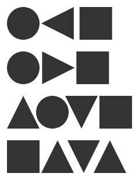

_Area model, emulated: margin 5 px a flat side, depth a quarter of the shape's height, band the shape's height, with a contact floor of 3 px._


_Georgia, contact gap 6 px (as above)._

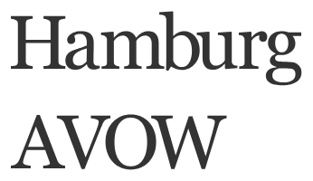

_Georgia, area model, emulated: margin 3 px a flat side, depth 20% of the x-height, band to the cap height or x-height, contact floor 2 px._

#### What it means for GoFish

**It fits the locality rule better than contact.** Contact compares two neighbors' outlines, so it is a property of a pair. The area model gives each shape one number per side, from that shape alone, and the spread combines them.

**It evens out some of the gaps Josh saw.** In the emulation the round and pointed sides get smaller margins than the square's flat side, so the wedge beside the square shrinks, and AVOW opens up relative to contact. It does not stop collisions, because each side ignores its neighbor: two pointed sides can both get small or negative margins. So contact stays as a floor, "never closer than a minimum gap", and the emulation needs it for the up, down, up triangles.

**It adds parameters** (band, depth, target area) that type designers tune per typeface. GoFish would need defaults that work across shapes and sizes, and the emulation shows the cost: Georgia's "Hamburg" sets tighter than under contact, because its serifs fall inside the depth and lower every stem's margin.

**Our earlier "optical" emulation did not follow this model.** It compared pairs and used a far too deep cap, which is why it looked worse than contact.

**Layout precedent.** SwiftUI, already GoFish's precedent for alignment guides, gives every view a `ViewSpacing`: independent preferences for its top, bottom, leading and trailing edges. A stack with default spacing (`HStack(spacing: nil)`) asks `a.distance(to: b, along:)`, which takes the facing edges' preferences "and returns the greater of the two values", in Apple's words "the smallest value that provides enough space to satisfy the preferences of both views" (developer.apple.com/documentation/swiftui/viewspacing). So each edge states a minimum gap, and they combine by max. The values are system defaults by kind of view; users cannot set them, and a custom `Layout` only reports the spacing around itself with `spacing(subviews:cache:)`, usually the union of its children's edges. A preference can also differ by the kind of neighbor (text next to other views), so it is not purely per side. CSS margins are per side too: horizontal margins add, and vertical margins between blocks collapse to the larger one. GoFish would differ from both in where the per-side numbers come from: the shape's outline, with the rule chosen by `Spacing.*`.

**Sum or max.** The precedents disagree about what a side's number means. In SwiftUI and CSS vertical margins each side states the minimum gap it needs, and the gap is the larger of the two. In HT Letterspacer and CSS horizontal margins each side contributes its own white, and the gap is the total. For margins measured from an outline, sum is the natural reading; for a declared minimum such as contact padding, max is. This is a decision.

## Blurred outlines, optical centering and insets

#### Blurred outlines: who does this

Peter Wiegel proposed it for type in 2012, on the FontForge and FreeType lists ("Peter Wiegel's auto spacing idea"): blur a pixel copy of each letter, turn the gray pixels black, and push letters together until the new outlines touch. Werner Lemberg replied that for horizontal spacing the blurred bitmaps can be shifted directly, without tracing them. In the same thread Behdad Esfahbod proposed a pair version: convolve each glyph with a Gaussian, then set two glyphs so the integral of their shifted, multiplied Gaussians equals a constant. That version does respond to the wedge between two shapes. Sebastian Kosch's "Towards an attention-based letterfitting model" (2019) also starts with a Gaussian low-pass filter. Kernagic (Øyvind Kolås) finds stems and aligns them, following Frank Blokland's research, according to Kosch's survey; we found no blur in it, but did not read its source.

The same blurred outline serves alignment, not just spacing. Josh saw it used on Twitter to center an airplane icon in the Dynamic Island's rounded rectangle. `alignment: "middle"` could center a child's blurred outline instead of its box. The classic case is a play triangle in a circle: centered by its box it looks shifted left, so designers nudge it right. Blurring does not move the center of mass, so centering the blurred ink's center of mass is the same as centering the ink's own.

<svg viewBox="0 0 360 146" role="img" aria-label="A play triangle centered in a circle three ways" style="width:100%;max-width:420px;height:auto;display:block;margin:8px 0;font-family:Inter,system-ui,sans-serif"><circle cx="60.0" cy="58" r="44" fill="none" stroke="var(--fg)" stroke-width="2"/><polygon points="40.0,35.0 80.0,58.0 40.0,81.0" fill="var(--fg)"/><line x1="60.0" y1="10" x2="60.0" y2="106" stroke="var(--muted)" stroke-dasharray="2 3"/><text x="60.0" y="124" text-anchor="middle" font-size="12" fill="var(--fg)">box center</text><text x="60.0" y="139" text-anchor="middle" font-size="11" fill="var(--muted)">shift +0.0 px</text><circle cx="180.0" cy="58" r="44" fill="none" stroke="var(--fg)" stroke-width="2"/><polygon points="166.0,39.1 164.5,40.1 163.8,41.1 163.5,42.1 163.2,43.1 163.0,44.1 163.0,45.1 162.8,46.1 162.8,47.1 162.8,48.1 162.8,49.1 162.8,50.1 162.8,51.1 162.8,52.1 162.8,53.1 162.8,54.1 162.8,55.1 162.8,56.1 162.8,57.1 162.8,58.1 162.8,59.1 162.8,60.1 162.8,61.1 162.8,62.1 162.8,63.1 162.8,64.1 162.8,65.1 162.8,66.1 162.8,67.1 162.8,68.1 162.8,69.1 162.8,70.1 163.0,71.1 163.0,72.1 163.2,73.1 163.5,74.1 164.0,75.1 164.8,76.1 168.5,76.9 171.2,75.9 173.0,74.9 175.0,73.9 176.8,72.9 178.2,71.9 180.0,70.9 181.8,69.9 183.5,68.9 185.2,67.9 187.0,66.9 188.8,65.9 190.5,64.9 192.2,63.9 193.8,62.9 195.0,61.9 196.0,60.9 196.8,59.9 197.2,58.9 197.2,57.9 197.2,56.9 196.8,55.9 196.0,54.9 194.8,53.9 193.5,52.9 191.8,51.9 190.0,50.9 188.2,49.9 186.8,48.9 185.0,47.9 183.2,46.9 181.5,45.9 179.8,44.9 178.0,43.9 176.2,42.9 174.5,41.9 172.8,40.9 170.5,39.9" fill="var(--accent)" fill-opacity="0.3"/><polygon points="162.6,35.0 202.6,58.0 162.6,81.0" fill="var(--fg)"/><line x1="180.0" y1="10" x2="180.0" y2="106" stroke="var(--muted)" stroke-dasharray="2 3"/><text x="180.0" y="124" text-anchor="middle" font-size="12" fill="var(--fg)">blurred outline</text><text x="180.0" y="139" text-anchor="middle" font-size="11" fill="var(--muted)">shift +2.6 px</text><circle cx="300.0" cy="58" r="44" fill="none" stroke="var(--fg)" stroke-width="2"/><polygon points="286.7,35.0 326.7,58.0 286.7,81.0" fill="var(--fg)"/><line x1="300.0" y1="10" x2="300.0" y2="106" stroke="var(--muted)" stroke-dasharray="2 3"/><text x="300.0" y="124" text-anchor="middle" font-size="12" fill="var(--fg)">ink center of mass</text><text x="300.0" y="139" text-anchor="middle" font-size="11" fill="var(--muted)">shift +6.7 px</text></svg>

<p class="note">A play triangle centered three ways. The blurred outline (σ 4, light blue) retracts at the tip, which moves the triangle 2.6 px right; the center of mass moves it 6.7 px.

**Josh's judgment: the ink center of mass looks centered; the box and the blurred outline both leave the triangle looking left.** The center of mass is a per-shape measure, so it keeps locality, and blurring does not move it. It is the leading candidate for how `alignment: "middle"` could center optically.

The airplane Josh saw on Twitter (the Dynamic Island) is a different problem: the plane sits at the left end of a pill, and its inset from the left wall has to look equal to its insets above and below. That is spacing again, with the container's wall as the neighbor. Below, the plane is inset 12 px from the left (the same as above and below) three ways, emulated: by its box, by contact with the curved wall, and by white area (the mean white between the plane and the wall, capped on each line, as in (d)).

<svg viewBox="0 0 630 114.0" role="img" aria-label="An airplane icon inset in a pill three ways" style="width:100%;max-width:640px;height:auto;display:block;margin:8px 0;font-family:Inter,system-ui,sans-serif"><rect x="10" y="6" width="190" height="68.0" rx="34.0" fill="var(--code-bg)" stroke="var(--line)"/><polygon points="70.0,40.0 67.0,37.0 50.0,37.0 40.0,18.0 35.0,18.0 39.0,37.0 29.0,37.0 25.0,29.0 22.0,29.0 24.0,37.0 24.0,43.0 22.0,51.0 25.0,51.0 29.0,43.0 39.0,43.0 35.0,62.0 40.0,62.0 50.0,43.0 67.0,43.0" fill="var(--fg)"/><line x1="22" y1="3" x2="22" y2="77.0" stroke="var(--muted)" stroke-dasharray="2 3"/><text x="105.0" y="94.0" text-anchor="middle" font-size="13" fill="var(--fg)">box inset 12</text><text x="105.0" y="110.0" text-anchor="middle" font-size="12" fill="var(--muted)">+0.0 px from box</text><rect x="220" y="6" width="190" height="68.0" rx="34.0" fill="var(--code-bg)" stroke="var(--line)"/><polygon points="281.8,40.0 278.8,37.0 261.8,37.0 251.8,18.0 246.8,18.0 250.8,37.0 240.8,37.0 236.8,29.0 233.8,29.0 235.8,37.0 235.8,43.0 233.8,51.0 236.8,51.0 240.8,43.0 250.8,43.0 246.8,62.0 251.8,62.0 261.8,43.0 278.8,43.0" fill="var(--fg)"/><line x1="232" y1="3" x2="232" y2="77.0" stroke="var(--muted)" stroke-dasharray="2 3"/><text x="315.0" y="94.0" text-anchor="middle" font-size="13" fill="var(--fg)">contact inset 12</text><text x="315.0" y="110.0" text-anchor="middle" font-size="12" fill="var(--muted)">+1.8 px from box</text><rect x="430" y="6" width="190" height="68.0" rx="34.0" fill="var(--code-bg)" stroke="var(--line)"/><polygon points="485.1,40.0 482.1,37.0 465.1,37.0 455.1,18.0 450.1,18.0 454.1,37.0 444.1,37.0 440.1,29.0 437.1,29.0 439.1,37.0 439.1,43.0 437.1,51.0 440.1,51.0 444.1,43.0 454.1,43.0 450.1,62.0 455.1,62.0 465.1,43.0 482.1,43.0" fill="var(--fg)"/><line x1="442" y1="3" x2="442" y2="77.0" stroke="var(--muted)" stroke-dasharray="2 3"/><text x="525.0" y="94.0" text-anchor="middle" font-size="13" fill="var(--fg)">white area inset 12</text><text x="525.0" y="110.0" text-anchor="middle" font-size="12" fill="var(--muted)">-4.9 px from box</text></svg>

<p class="note">Emulated. The narrow tail leaves white beside it, so white area moves the plane 4.9 px left of the box inset; contact with the curved wall moves it 1.8 px right. This generalizes the spacing strategy to padding: the same rule could set gaps between siblings and gaps to a container's wall.

**Open question.** Should there be one "how this shape is measured" setting (box, outline, blurred outline) that spread, stack, alignment and contact all read, instead of a blur option on each operator? The same `Spacing.*` value could then also set padding inside a container, such as `enclose`'s. It would fit the profile idea, where a shape reports a summary and its parent reads it. This page does not recommend it.

## The choices and the naming

<h4>The choices</h4>
<ol>
<li><b>Keep <code>Spacing.contour(n)</code> with a known limit.</b> Its docs say it guarantees a minimum gap, not an even look.</li>
<li><b>Keep <code>Spacing.contour(n)</code> as the floor, and add the area model later</b> as one more <code>Spacing</code> strategy that uses contact as its floor. The option does not change. Optical spacing is still not recommended now.</li>
<li><b>Park contour spacing</b> until an example needs it, and ship <code>Spacing.box</code> and <code>Spacing.pitch</code> only.</li>
</ol>
<div class="table-wrap"><table>
<tr><th>Model</th><th>Rule</th><th>Where it is used</th></tr>
<tr><td>Box gap</td><td>the gap between bounding boxes along the axis</td><td>today's <code>spread</code>; Graphviz <code>nodesep</code>; d3-sankey <code>nodePadding</code></td></tr>
<tr><td>Pitch</td><td>a fixed distance between a named point on each child</td><td>today's <code>anchor: "baseline"</code>; ggridges' <code>scale</code></td></tr>
<tr><td>Contact</td><td>the smallest gap between facing outlines, slice by slice, equals the gap</td><td>tidy trees (Reingold and Tilford, 1981, compare contours level by level), <code>d3.tree</code>, d3-flextree (van der Ploeg, 2014, for nodes of different sizes), GoTree; skyline packing</td></tr>
</table></div>
<p><b>Naming.</b> How the gap is measured becomes the value of <code>spacing</code>, a strategy family (<code>Spacing</code>, uppercase, as the API rules ask for a choice among strategies). A plain number stays as sugar for <code>Spacing.box(n)</code>. <code>Spacing.pitch(70, { at: "baseline" })</code> replaces spread's <code>anchor</code> option, which about 28 story, test and docs files use today, each a mechanical change.</p>

## Open decisions

1. Keep `Spacing.contour(n)` for packing (tidy trees, ridgelines), and add a separate `Spacing` strategy for looking even, chosen by what the visualization is for? Contact would also stay as the floor under the looking-even strategy.
2. Optical centering for `alignment: "middle"`: center the ink's center of mass (Josh's pick on the play button; per shape, unchanged by blur), the blurred outline's box, or keep the box?
3. If the fillet area model is kept: `Spacing.fillet(n, { radius })`, its own strategy, or `Spacing.contour(n, { fill: radius })`, an option of contact? It compares pairs, so it gives up per-shape locality; the SDF opening (g) keeps it but moves less. A default radius of 2n worked on the test rows.
4. If the blurred outline is kept, is it an option of contact, `Spacing.contour(n, { blur: 6 })`, or its own strategy, `Spacing.blurred(n, 6)`?
5. Is there one "how this shape is measured" setting (box, outline, blurred outline) that spread, stack, alignment and contact all read, instead of an option on each?
6. If per-side margins come, do two neighbors' margins combine by sum (HT Letterspacer, CSS horizontal margins: each side's own white) or by max (SwiftUI `ViewSpacing`, CSS vertical margins: each side's minimum)?
7. `spacing` takes a number (sugar for `Spacing.box(n)`) or a `Spacing` strategy, and `Spacing.pitch(n, { at })` replaces spread's `anchor` option?
