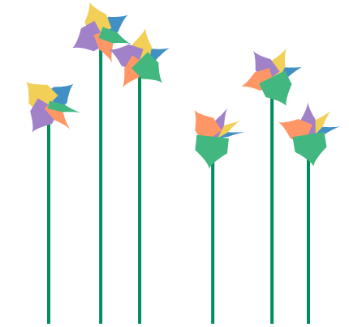
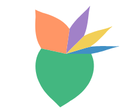
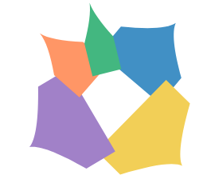
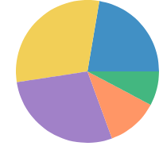

# Petal in user space (#1331)

**Summary.** `polygon` gains a rect's `w` and `h` and takes its outline as an SVG path, `d`. The outline is stretched into the slot box, and under a polar coord the whole outline, curves included, is bent by the coord, the way a pie slice's arc is. The flower chart's petal is then a polygon and needs no mark of its own.
**Recommendation:** approach B with Josh's petal, `polygon({ w: "count", d: "M0 0 L0 .468 Q.451 .809 .5 1 Q.549 .809 1 .468 L1 0 Z" })`, then delete `petal` from JS, the IR, Python and the docs. A shape that must stay flat (a marker, an arrowhead) gets a separate mark, `glyph` (C), tracked in #1339.

Issue #1331 asks whether the flower chart's petal can be drawn from general GoFish pieces, now that the flower chart is on the front page.
Prototype stories: `packages/gofish-graphics/stories/proposals/PetalUserSpace.stories.tsx` (throwaway). Prototype marks, on this branch only and marked `PROTOTYPE (#1331)`: `polygon({ w, h, d })` in `src/ast/shapes/polygon.tsx`, and `glyph` in `src/ast/shapes/glyph.tsx`.

## Terms

- **Slot**: the box a mark gets from its parent operator. Under `stack({ dir: "x" })` in polar, a slot is an angle range (the species' share of the circle) by a radius range (0 to `h`).
- **Bent**: drawn through the coord, so a straight edge in (angle, radius) becomes a curve on screen. A rect in a polar slot bends into a wedge.
- **Flat frame**: a frame the coord moves, turns and scales, but does not bend. A shape drawn in it keeps its own curves.

## What the petal is today

`src/ast/shapes/petal.tsx` builds a path in pixels pointing along +x, then turns it to the slot's middle angle. It goes from the center out to the slot's two side edges at half the radius, then along two quadratic Béziers to a tip at the full radius. It is a port of herrstucki's d3 bl.ock (pie layout plus a `rotate` transform).

Today's petal is a mix of the two rules. Its two corners sit on the slot's side edges at half the radius: points the coord places, as B would. Its curves are drawn flat, as C would. So neither B nor C reproduces it on wide slots, and matching it is not the goal.

## Approaches

### A. Data-space ring, writable today (no library change)

 

```js
// The petal in its slot: u across, v out from the center.
const PETAL = [
  [0, 0],
  [0, 0.5],
  [0.5, 1],
  [1, 0.5],
  [1, 0],
];

// Stack by hand: each ring in data space (angle in counts, radius 0..1).
const flower = chart(rows, { coord: Coord.polar(), axes: false })
  .flow(
    derive((rows) => {
      let at = 0;
      return rows.map((d) => {
        const start = at;
        at += d.count;
        const ring = PETAL.map(([u, v]) => [start + u * d.count, v]);
        return { ...d, ring };
      });
    })
  )
  .mark(polygon({ points: "ring", fill: "species" }));
```

- Works today: `polygon({ points: "ring" })` reads data-space rings and warps them. Same petal shapes, but the head is smaller (the radius comes from the r scale, not 90 px), so outlines sit 14 to 24 px from today's.
- The user re-implements `stack` with a running sum, and the radius is a data value, so the fixed 40 px head radius of the flower chart has no direct spelling. This is the large partial overlap with `stack` that api-design.md warns about. Good as a stopgap, not as the answer.

### B. Polygon with a box, bent by the coord (recommended)

```js
const PETAL = "M0 0 L0 .468 Q.451 .809 .5 1 Q.549 .809 1 .468 L1 0 Z";

const flower = chart({ coord: Coord.polar(), axes: false })
  .flow(stack({ by: "species", dir: "x", h: 40 }))
  .mark(polygon({ w: "count", d: PETAL, fill: "species" }));
```

```python
PETAL = "M0 0 L0 .468 Q.451 .809 .5 1 Q.549 .809 1 .468 L1 0 Z"

flower = (
    chart(coord=Coord.polar(), axes=False)
    .flow(stack(by="species", dir="x", h=40))
    .mark(polygon(w="count", d=PETAL, fill="species"))
)
```

- The change: `polygon` gains the `w` / `h` size channels a rect has, and takes its outline as `points` (straight edges) or `d` (an SVG path with `M`, `L`, `Q`, `C`, `Z`). The outline is stretched from its own bounding box into the `w` by `h` box. Left out, `w` and `h` default to the outline's own extent, so every existing literal polygon draws as before.
- The rule (decided): the outline lives in the coord's space. Straight edges and curves are both resampled through the coord by the adaptive resampler that already draws `line` and polygon edges. No polar special case.
- It lays out like a rect of the same size, so the flower chart keeps today's layout.
- It works under every coord. Under the donut clock the petals start at the hole; today's petal ignores the hole (bug, below). A box outline, `M0 0 L0 1 L1 1 L1 0 Z`, draws a true pie.
- Josh's petal tapers to its tip. It is not today's leaf, and is not meant to be.

### C. Glyph in a flat frame (a separate mark, #1339)

```js
// Today's leaf as a glyph.
const LEAF = "M.5 0 L0 .5 Q0 .75 .5 1 Q1 .75 1 .5 Z";

const flower = chart({ coord: Coord.polar(), axes: false })
  .flow(stack({ by: "species", dir: "x", h: 40 }))
  .mark(glyph({ w: "count", d: LEAF, fill: "species" }));
```

- A separate mark, not a polygon mode. Its outline is drawn in a flat frame that the coord places, turns and sizes but never bends. Curves stay screen curves.
- The prototype's frame, read off the coord at the slot with no polar special case: origin at the slot's base point (the coord at the middle of the slot, inner side), v axis from there to the middle of the outer side, u axis the slot's chord at middle height. A unit point (u, v) goes to `base + (u - 0.5) * chord + v * axis`. I chose the chord at middle height because today's petal is exactly that wide at its corners. With no coord the frame is the slot box.
- It is the right mark for point glyphs (markers, arrowheads), per the "circles in polar are points" rule.
- It does not reproduce today's petal on wide slots. Largest gap from today's leaf as a glyph to today's `petal`, at R = 40 px, measured on the rendered SVG (`MeasureToday`, `MeasureLeafGlyph`; `tests/tmp/petal-snips/pairwise.mjs`):

| slot       | 16°  | 42°  | 90°  | 108° | 127° | 162°  | 192°  |
| ---------- | ---- | ---- | ---- | ---- | ---- | ----- | ----- |
| leaf glyph | 0.21 | 0.45 | 3.38 | 5.19 | 7.39 | 11.86 | 15.58 |

Within 1 px only up to about 45°. Today's corners sit on the slot's side edges, which pull toward the center as the slot widens (half the radius times the cosine of half the slot angle). A glyph's corners stay at a fixed spot in its frame, so on wide slots the glyph's petal turns into a diamond and neighbors leave gaps.

- Josh's petal as a glyph is worse: its base corners `(0, 0)` and `(1, 0)` become a flat edge one chord wide through the center, so neighboring petals overlap. An outline meant to fill its slot belongs to B.

### Renders

Front-page flower chart. Today, C with today's leaf, B with Josh's petal, C with Josh's petal:

   

Widest slot (Lake F, R = 90 px, green slot 192°), same order:

   

Donut clock (`Coord.clock({ innerRadius: 0.4 })`), same order. B and C start at the hole; today's petal does not.

   

No coord (a stacked bar, `h: 100`): C with today's leaf, B with Josh's petal, C with Josh's petal. Today's `petal` draws nothing without a polar coord.


B with a box outline, `M0 0 L0 1 L1 1 L1 0 Z`, draws a true pie:



## Precedent

- **herrstucki's bl.ock (d3, 2013)**: `d3.layout.pie` gives start and end angles, a `petalPath` builds the shape along +x with two quadratics, and `rotate(angle)` turns it. GoFish's petal is a port.
- **ggplot2**: `geom_polygon` under `coord_polar` bends the data-space polygon (`coord_munch` resamples edges) (A, B). `geom_point` shapes (codes 0 to 25) are placed but not bent (C).
- **Vega-Lite**: the `point` mark's `shape` takes an SVG path string in a [-1, 1] box, sized by `size` (area) and turned by `angle` (C).
- **D3 / Observable Plot**: `d3.symbol(type, size)` and Plot's `symbol` option draw a symbol in a local frame around a point, sized by area or `r`, turned by `rotate` (C).
- **matplotlib**: `marker=` takes a `Path` or vertices normalized to a unit box (C).
- **SVG `<marker>`**: a local `viewBox` drawn at path vertices and turned by `orient="auto"` (C).
- **GoFish**: rect in a polar slot is a bent box; polygon already bends literal and data rings. B is the rect rule applied to polygon.

Point-glyph libraries draw custom shapes flat because their marks are points. ggplot bends polygons because its polar marks sweep. A petal sweeps its slot, so it is B. C is for real point glyphs.

## Name for C

`glyph`. GoFish already calls a box placed by its center a glyph (`glyphAxis` in `ellipse.tsx`, and the #972 glyph rule per axis, from the area-circles work). `symbol` follows D3 and Plot, where it means an area-sized marker from a fixed set. `shape` is taken by the `Shape` enclose family.

## Deleting `petal` (B)

- JS: `src/ast/shapes/petal.tsx`, its export in `src/lib.ts`, `src/serialize/registry.ts`, `src/ast/markChannels.generated.ts` (regenerated), `src/ast/marks/chartBuilder.typetest.ts`, comments in `underlyingSpace.ts`, `coord.tsx`, `lowerHelpers.ts`.
- Old test charts: `src/tests/petalChart.ts`, `scatterPetal.ts`, `scatterFlower.ts`, `scatterPie2.ts`, `scatterBalloon.ts`, `scatterBalloon2.ts` (port or delete).
- Stories: `stories/forwardsyntax/FlowerChart.stories.tsx` (the front-page gallery story).
- IR: `packages/gofish-ir/src/frontend/descriptors.ts` (`petal` entry, plus `w`/`h` on `polygon`), `schema.ts`, display-list examples and schema test.
- Python: `gofish/_generated.py` (regenerated), `__init__.py`, `ast.py`, `tests/test_ast.py`, `tests/test_generated_factories.py`, `tests/python-stories/forward-syntax/test_flower_chart.py`.
- Docs: `js/api/marks/petal.md` and `python/api/marks/petal.md` (delete), mentions in `rect.md`, `core/chart.md`, `python/api/core/mark.md`, and several internals essays.

## Found along the way

- **Today's petal ignores `innerRadius`.** Under `Coord.clock({ innerRadius: 0.4 })` it draws from the center through the hole. B fixes it.
- **Today's petal draws nothing without a polar coord.** `petal.tsx` returns no items unless the coord is polar (see the bar renders).
- **#1111 part 1 is already fixed.** #1111 (petals draw nothing under `clock()`, and no fluent way to lighten field colors) says petal skips `clock()`. It now checks `coordinateTransform.polar`, and the clock render works. Part 2 (lightening) is still open and is unrelated.
- **A literal polygon's y runs opposite ways in Cartesian and polar.** In the bar renders, B's petals point down (v follows pixel y) while C's point up. In polar both point outward. This is #1038 (inside a coord, y direction should be measured from the nearest frame, not the canvas), and it decides which way B's unit box runs.

## Decided

- **A polygon's outline lives in the coord's space.** Every point of it, curves included, goes through the coord, the same as `line` under polar and a pie slice's arc. Warping only the curves' control points and drawing the curves on screen is not polygon's behavior.
- **A shape that must stay flat is a separate mark (C), not a polygon mode.** Filed as #1339.

## Open decisions

1. Approve B with Josh's petal in the flower story, and delete `petal`?
2. Which way does B's unit box run in Cartesian: v up from the baseline (as the glyph does) or y down (pixel order, as literal polygon points are today)? This ties to #1038.
