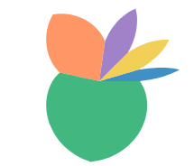
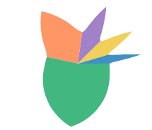
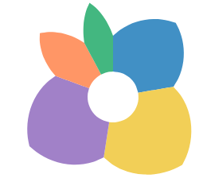
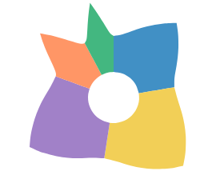

# Petal in user space (#1331)

**Summary.** `polygon` gains a rect's `w` and `h` and takes its outline as an SVG path, `d`. The outline is stretched into the slot box, and under a polar coord the whole outline, curves included, is drawn through the coord, the same way `line` and a pie slice's arc are. Then the petal is a polygon and needs no mark of its own.
**Recommendation:** approach B, `polygon({ w: "count", d: PETAL })`, with one of the two petal shapes below, then delete `petal` from JS, the IR, Python and the docs.

Issue #1331 asks whether the flower chart's petal can be drawn from general GoFish pieces, now that the flower chart is on the front page.
Prototype stories: `packages/gofish-graphics/stories/proposals/PetalUserSpace.stories.tsx` (throwaway).

## Terms

- **Slot**: the box a mark gets from its parent operator. Under `stack({ dir: "x" })` in polar, a slot is an angle range (the species' share of the circle) by a radius range (0 to `h`).
- **Warp**: drawing a shape through the coord, so a straight edge in (angle, radius) becomes a curve on screen. A rect in a polar slot warps into a wedge. Polygon edges are resampled (`adaptive-resampling.ts`) so the curve is smooth.
- **Tangent frame**: the coord's best straight-line approximation at the middle of the slot. A shape drawn in it is moved, scaled and turned by the coord, but its own curves stay as drawn.

## What the petal is today

`src/ast/shapes/petal.tsx` builds a path in pixels pointing along +x, then turns it to the slot's middle angle. The path goes from the center out to the slot's two side edges at half the radius (two straight lines along those edges), then two quadratic Béziers to a tip at the full radius. It is a local-frame glyph, ported from herrstucki's d3 bl.ock (pie layout plus a `rotate` transform).

The two straight lines are rays from the center, which polar draws straight anyway. The two curves are drawn on screen, so no outline that bends through polar matches today's exactly, and matching it is not the goal. The rule for polygon is decided: its outline lives in the coord's space, and every point of it, curves included, goes through the coord.

## Approaches

### A. Data-space ring, writable today (no library change)

 

```js
// The petal in its slot: u across, v out from the center.
const PETAL = [
  [0, 0],
  [0, 0.5],
  [0.5, 1],
  [1, 0.5],
  [1, 0],
];

// Stack by hand: each ring in data space (angle in counts, radius 0..1).
const flower = chart(rows, { coord: Coord.polar(), axes: false })
  .flow(
    derive((rows) => {
      let at = 0;
      return rows.map((d) => {
        const start = at;
        at += d.count;
        const ring = PETAL.map(([u, v]) => [start + u * d.count, v]);
        return { ...d, ring };
      });
    })
  )
  .mark(polygon({ points: "ring", fill: "species" }));
```

- Works today: `polygon({ points: "ring" })` reads data-space rings and warps them. Same petal shapes, but the head is smaller (the radius comes from the r scale, not 90 px), so outlines sit 14 to 24 px from today's.
- The user re-implements `stack` with a running sum, and the radius is a data value, so the fixed 40 px head radius of the flower chart has no direct spelling. This is the large partial overlap with `stack` that api-design.md warns about. Good as a stopgap, not as the answer.

### B. Box-relative polygon, bent by the coord (recommended)

```js
// Shape 1: rounder than today's petal.
const SHAPE_1 = "M0 0 L0 .5 Q.31 .871 .5 1 Q.69 .871 1 .5 L1 0 Z";
// Closest: the shape closest to today's petal.
const CLOSEST = "M0 0 L0 .5 Q.18 .5 .5 1 Q.82 .5 1 .5 L1 0 Z";

const flower = chart({ coord: Coord.polar(), axes: false })
  .flow(stack({ by: "species", dir: "x", h: 40 }))
  .mark(polygon({ w: "count", d: SHAPE_1, fill: "species" }));
```

```python
SHAPE_1 = "M0 0 L0 .5 Q.31 .871 .5 1 Q.69 .871 1 .5 L1 0 Z"

flower = (
    chart(coord=Coord.polar(), axes=False)
    .flow(stack(by="species", dir="x", h=40))
    .mark(polygon(w="count", d=SHAPE_1, fill="species"))
)
```

Front-page flower chart: today, Shape 1, Closest.

  

Widest slot (Lake F, R = 90 px, green slot 192°): today, Shape 1, Closest.

  

Donut clock (`Coord.clock({ innerRadius: 0.4 })`): today, Shape 1, Closest. B petals start at the hole.

  

A box outline, `M0 0 L0 1 L1 1 L1 0 Z`, draws a true pie:


- The change: `polygon` gains the `w` / `h` size channels a rect has, and takes its outline as `points` (straight edges) or `d` (an SVG path with `M`, `L`, `Q`, `C`, `Z`). The outline is stretched from its own bounding box into the `w` by `h` box. Left out, `w` and `h` default to the outline's own extent, so every existing literal polygon draws as before.
- The rule: the outline lives in the coord's space. Straight edges and Bézier curves are both resampled through the coord by the adaptive resampler that already draws `line` and polygon edges (`adaptive-resampling.ts` already takes Bézier segments). No polar special case and no slot-dependent shape.
- It lays out like a rect of the same size ("marks lay out alike"): the flower chart keeps today's layout.
- It works under every coord, because the resampling does. Under the donut clock the petals start at the hole; today's petal ignores the hole (bug, below).
- Shape 1 is rounder than today's petal, and its wide petals grow past today's (6.5 px at 192°). Closest stays within 2.2 px of today's at every slot, but it keeps today's sharp shoulders, and in wide slots its sides bow in a little.

Largest outline gap to today's petal at the front page's 40 px radius, one head per slot angle. "Real" is measured on the rendered SVG paths (`MeasureToday`, `MeasureShape1`, `MeasureClosest` stories; `tests/tmp/petal-snips/pairwise.mjs`). "Editor" is the shape editor's emulation, 48 samples per quadratic, each warped through polar (`emulate.py`).

| shape           | 16°  | 42°  | 90°  | 108° | 127° | 162° | 192° |
| --------------- | ---- | ---- | ---- | ---- | ---- | ---- | ---- |
| Shape 1, real   | 0.29 | 0.67 | 1.32 | 1.69 | 2.37 | 4.15 | 6.50 |
| Shape 1, editor | 0.34 | 0.70 | 1.35 | 1.75 | 2.37 | 4.17 | 6.50 |
| Closest, real   | 0.68 | 1.59 | 2.24 | 2.11 | 1.70 | 0.42 | 2.20 |
| Closest, editor | 0.69 | 1.54 | 2.18 | 2.04 | 1.64 | 0.81 | 2.19 |

The real resampler and the editor agree within 0.1 px, except Closest at 162° (0.4 px apart, both under 1 px). So the editor's previews are what GoFish draws.

The prototype is on this branch only, marked `PROTOTYPE (#1331)`: `polygon.tsx` parses `d`, takes `w` / `h` as size channels and stretches the outline into its box; `lowerHelpers.ts` gets `outlineItem`, which is `ringItem` for a path with curves (`ringItem` now calls it). Lowering needed no new mechanism: `transformPath(..., { resample: true })` already resamples Bézier segments.

### C. Local-frame glyph in the slot's tangent frame

 

```js
// An SVG path in the unit box, drawn in the slot's tangent frame.
const PETAL = "M.5 0 L0 .5 Q0 .75 .5 1 Q1 .75 1 .5 Z";

const flower = chart({ coord: Coord.polar(), axes: false })
  .flow(stack({ by: "species", dir: "x", h: 40 }))
  .mark(glyph({ w: "count", d: PETAL, fill: "species" }));
```

- A new mark that takes a path in the unit box and maps it through the coord's linearization at the slot's middle. Béziers stay exact. This is how d3 symbols, Plot's `symbol`, Vega's custom `shape` paths and matplotlib's `Path` markers work, and how today's petal works.
- It does not fill its slot: wide slots leave gaps and overlaps between neighbors, because a tangent frame has straight sides. Measured against today's Lake A head: 0.5 to 0.7 px on the narrow slots, 4 to 8.7 px on the 80° to 108° slots.
- The name `path` is taken (`lib.ts` exports the path-segment helpers), so it needs a new name.
- It is the right tool for a different job: point glyphs placed by a coord (markers, arrowheads), per the "points stay points in polar" rule. The petal is not a point; it sweeps its slot.

Cartesian, B then C:

 

## Precedent

- **herrstucki's bl.ock (d3, 2013)**: `d3.layout.pie` gives start and end angles, a `petalPath` builds the shape along +x with two quadratics, and `rotate(angle)` turns it. A local-frame glyph (C). GoFish's petal is a port.
- **d3 / Observable Plot**: custom symbols are objects with `draw(context, size)`, drawn in a local frame around a point and turned by a `rotate` channel (C).
- **Vega / Vega-Lite**: the `shape` channel takes an SVG path string in a [-1, 1] box, scaled by `size` and turned by `angle` (C, unit box).
- **ggplot2**: `geom_polygon` under `coord_polar` warps the data-space polygon (`coord_munch` resamples edges) (A). A rose or petal is a polygon in data space.
- **GoFish**: rect in a polar slot is a warped box; polygon already warps literal and data rings. B is the rect rule applied to polygon.

Glyph libraries put custom shapes in a local frame because their marks are points. ggplot puts them in data space because its polar marks sweep. A petal sweeps its slot, so the GoFish analogue of ggplot (B) fits, and the point-glyph route (C) stays for real point glyphs.

## Deleting `petal` (B)

- JS: `src/ast/shapes/petal.tsx`, its export in `src/lib.ts`, `src/serialize/registry.ts`, `src/ast/markChannels.generated.ts` (regenerated), `src/ast/marks/chartBuilder.typetest.ts`, comments in `underlyingSpace.ts`, `coord.tsx`, `lowerHelpers.ts`.
- Old test charts: `src/tests/petalChart.ts`, `scatterPetal.ts`, `scatterFlower.ts`, `scatterPie2.ts`, `scatterBalloon.ts`, `scatterBalloon2.ts` (port or delete).
- Stories: `stories/forwardsyntax/FlowerChart.stories.tsx` (the front-page gallery story).
- IR: `packages/gofish-ir/src/frontend/descriptors.ts` (`petal` entry, plus `w`/`h` on `polygon`), `schema.ts`, display-list examples and schema test.
- Python: `gofish/_generated.py` (regenerated), `__init__.py`, `ast.py`, `tests/test_ast.py`, `tests/test_generated_factories.py`, `tests/python-stories/forward-syntax/test_flower_chart.py`.
- Docs: `js/api/marks/petal.md` and `python/api/marks/petal.md` (delete), mentions in `rect.md`, `core/chart.md`, `python/api/core/mark.md`, and several internals essays.

## Found along the way

- **Today's petal ignores `innerRadius`.** Under `Coord.clock({ innerRadius: 0.4 })` it draws from the center through the hole (see the donut renders). B fixes it for free.
- **#1111 part 1 is already fixed.** #1111 (petals draw nothing under `clock()`, and no fluent way to lighten field colors) says petal skips `clock()`. It now checks `coordinateTransform.polar`, and the clock render works. Part 2 (lightening) is still open and is unrelated.
- **A literal polygon's y runs opposite ways in Cartesian and polar.** The same points `[[0,0],…,[.5,1]]` point down in Cartesian (pixels, y down) and outward in polar. This is #1038 (inside a coord, y direction should be measured from the nearest frame, not the canvas). It decides which way B's unit box runs.

## Decided

- **Polygon's outline lives in the coord's space.** Every point of it, curves included, goes through the coord, the same as `line` under polar and a pie slice's arc. Warping only the curves' control points and drawing the curves on screen is not polygon's behavior. A shape drawn in a local frame belongs to a separate mark (C).

## Open decisions

1. Which petal shape goes in the flower story: Shape 1 (rounder, wide petals grow) or Closest (within 2.2 px of today's)?
2. Keep C, a unit-box glyph mark in the slot's tangent frame for point glyphs (markers, arrowheads), as a separate future issue, or drop it?
