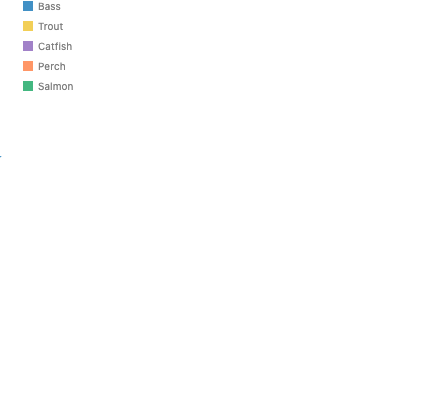
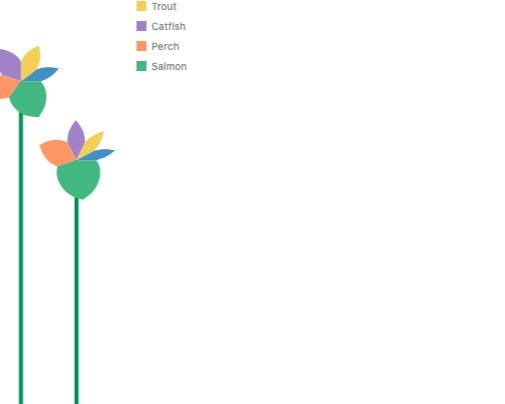

# Petal in user space (#1331)

**Summary.** Today's `petal` mark is, to within a pixel, the polar image of a five-point polygon that fills the petal's slot.
So the petal does not need its own mark: `polygon` only needs `w` and `h`, which stretch its points into the box the layout gives it, like a rect.
**Recommendation:** approach B, `polygon({ w: "count", points: PETAL })`, then delete `petal` from JS, the IR, Python and the docs.

Issue #1331 asks whether the flower chart's petal can be drawn from general GoFish pieces, now that the flower chart is on the front page.
Prototype stories: `packages/gofish-graphics/stories/proposals/PetalUserSpace.stories.tsx` (throwaway).

## Terms

- **Slot**: the box a mark gets from its parent operator. Under `stack({ dir: "x" })` in polar, a slot is an angle range (the species' share of the circle) by a radius range (0 to `h`).
- **Warp**: drawing a shape through the coord, so a straight edge in (angle, radius) becomes a curve on screen. A rect in a polar slot warps into a wedge. Polygon edges are resampled (`adaptive-resampling.ts`) so the curve is smooth.
- **Tangent frame**: the coord's best straight-line approximation at the middle of the slot. A shape drawn in it is moved, scaled and turned by the coord, but its own curves stay as drawn.

## What the petal is today

`src/ast/shapes/petal.tsx` builds a path in pixels pointing along +x, then turns it to the slot's middle angle. The path goes from the center out to the slot's two side edges at half the radius (two straight lines along those edges), then two quadratic Béziers to a tip at the full radius. It is a local-frame glyph, ported from herrstucki's d3 bl.ock (pie layout plus a `rotate` transform).

The surprise: the two straight lines are rays from the center, which polar draws straight anyway, and the two quadratics are within a pixel of what polar does to a straight line from (edge angle, r/2) to (middle angle, r). Measured gap between the quadratic and the warped line, at R = 90 px:

| slot angle   | 20°  | 40°  | 60°  | 90°  | 120° | 180° |
| ------------ | ---- | ---- | ---- | ---- | ---- | ---- |
| max gap (px) | 0.06 | 0.09 | 0.26 | 0.98 | 2.6  | 9.9  |

So the petal is the pentagon `[[0,0],[0,.5],[.5,1],[1,.5],[1,0]]` in its slot (u across the slot, v out from the center), warped by polar.

## Approaches

### A. Data-space ring, writable today (no library change)

 

```js
// The petal in its slot: u across, v out from the center.
const PETAL = [
  [0, 0],
  [0, 0.5],
  [0.5, 1],
  [1, 0.5],
  [1, 0],
];

// Stack by hand: each ring in data space (angle in counts, radius 0..1).
const flower = chart(rows, { coord: Coord.polar(), axes: false })
  .flow(
    derive((rows) => {
      let at = 0;
      return rows.map((d) => {
        const start = at;
        at += d.count;
        const ring = PETAL.map(([u, v]) => [start + u * d.count, v]);
        return { ...d, ring };
      });
    })
  )
  .mark(polygon({ points: "ring", fill: "species" }));
```

- Works today: `polygon({ points: "ring" })` reads data-space rings and warps them.
- The user re-implements `stack` with a running sum, and the radius is a data value, so the fixed 40 px head radius of the flower chart has no direct spelling. This is the large partial overlap with `stack` that api-design.md warns about. Good as a stopgap, not as the answer.

### B. Box-relative polygon, warped by the coord (recommended)

 

```js
// A petal is a pentagon in its slot. Polar bends the two slanted edges.
const PETAL = [
  [0, 0],
  [0, 0.5],
  [0.5, 1],
  [1, 0.5],
  [1, 0],
];

const flower = chart({ coord: Coord.polar(), axes: false })
  .flow(stack({ by: "species", dir: "x", h: 40 }))
  .mark(polygon({ w: "count", points: PETAL, fill: "species" }));
```

```python
PETAL = [(0, 0), (0, 0.5), (0.5, 1), (1, 0.5), (1, 0)]

flower = (
    chart(coord=Coord.polar(), axes=False)
    .flow(stack(by="species", dir="x", h=40))
    .mark(polygon(w="count", points=PETAL, fill="species"))
)
```

- The change: `polygon` gains the `w` / `h` size channels a rect has. Its literal points are stretched from their own bounding box into the `w` by `h` box. Left out, `w` and `h` default to the points' own extent, so every existing literal polygon draws as before (the default is a value the user can write).
- It lays out like a rect of the same size ("marks lay out alike"), and it lowers through the existing `ringItem` warp. No new lowering code, no polar special case.
- It works under every coord, because the warp does. Under `Coord.clock({ innerRadius: 0.4 })` the B petals start at the donut hole; today's petal ignores the hole and draws from the center (bug, below).
- In Cartesian the same mark is a pentagon "flag" bar. The petal's curves come from the polar warp, not from the shape.

Front-page flower chart, today and with B:

 

The petals match. The B chart is wider, most likely because the prototype is a literal polygon with an undefined underlying space, where `petal` declares a magnitude like a rect, so the nested chart measures the head differently. The real B would declare the rect's space and lay out like `petal`; this is not checked yet.

Donut clock, today and with B:

 

### C. Local-frame glyph in the slot's tangent frame

 

```js
// An SVG path in the unit box, drawn in the slot's tangent frame.
const PETAL = "M.5 0 L0 .5 Q0 .75 .5 1 Q1 .75 1 .5 Z";

const flower = chart({ coord: Coord.polar(), axes: false })
  .flow(stack({ by: "species", dir: "x", h: 40 }))
  .mark(glyph({ w: "count", d: PETAL, fill: "species" }));
```

- A new mark that takes a path in the unit box and maps it through the coord's linearization at the slot's middle. Béziers stay exact. This is how d3 symbols, Plot's `symbol`, Vega's custom `shape` paths and matplotlib's `Path` markers work, and how today's petal works.
- It does not fill its slot: wide slots leave gaps and overlaps between neighbors, because a tangent frame has straight sides. Matching today's petal needs the angle-dependent corrections the petal hard-codes.
- The name `path` is taken (`lib.ts` exports the path-segment helpers), so it needs a new name.
- It is the right tool for a different job: point glyphs placed by a coord (markers, arrowheads), per the "points stay points in polar" rule. The petal is not a point; it sweeps its slot.

Cartesian, B then C:

 

## Precedent

- **herrstucki's bl.ock (d3, 2013)**: `d3.layout.pie` gives start and end angles, a `petalPath` builds the shape along +x with two quadratics, and `rotate(angle)` turns it. A local-frame glyph (C). GoFish's petal is a port.
- **d3 / Observable Plot**: custom symbols are objects with `draw(context, size)`, drawn in a local frame around a point and turned by a `rotate` channel (C).
- **Vega / Vega-Lite**: the `shape` channel takes an SVG path string in a [-1, 1] box, scaled by `size` and turned by `angle` (C, unit box).
- **ggplot2**: `geom_polygon` under `coord_polar` warps the data-space polygon (`coord_munch` resamples edges) (A). A rose or petal is a polygon in data space.
- **GoFish**: rect in a polar slot is a warped box; polygon already warps literal and data rings. B is the rect rule applied to polygon.

Glyph libraries put custom shapes in a local frame because their marks are points. ggplot puts them in data space because its polar marks sweep. A petal sweeps its slot, so the GoFish analogue of ggplot (B) fits, and the point-glyph route (C) stays for real point glyphs.

## Deleting `petal` (B)

- JS: `src/ast/shapes/petal.tsx`, its export in `src/lib.ts`, `src/serialize/registry.ts`, `src/ast/markChannels.generated.ts` (regenerated), `src/ast/marks/chartBuilder.typetest.ts`, comments in `underlyingSpace.ts`, `coord.tsx`, `lowerHelpers.ts`.
- Old test charts: `src/tests/petalChart.ts`, `scatterPetal.ts`, `scatterFlower.ts`, `scatterPie2.ts`, `scatterBalloon.ts`, `scatterBalloon2.ts` (port or delete).
- Stories: `stories/forwardsyntax/FlowerChart.stories.tsx` (the front-page gallery story).
- IR: `packages/gofish-ir/src/frontend/descriptors.ts` (`petal` entry, plus `w`/`h` on `polygon`), `schema.ts`, display-list examples and schema test.
- Python: `gofish/_generated.py` (regenerated), `__init__.py`, `ast.py`, `tests/test_ast.py`, `tests/test_generated_factories.py`, `tests/python-stories/forward-syntax/test_flower_chart.py`.
- Docs: `js/api/marks/petal.md` and `python/api/marks/petal.md` (delete), mentions in `rect.md`, `core/chart.md`, `python/api/core/mark.md`, and several internals essays.

## Found along the way

- **Today's petal ignores `innerRadius`.** Under `Coord.clock({ innerRadius: 0.4 })` it draws from the center through the hole (see the donut renders). B fixes it for free.
- **#1111 part 1 is already fixed.** #1111 (petals draw nothing under `clock()`, and no fluent way to lighten field colors) says petal skips `clock()`. It now checks `coordinateTransform.polar`, and the clock render works. Part 2 (lightening) is still open and is unrelated.
- **A literal polygon's y runs opposite ways in Cartesian and polar.** The same points `[[0,0],…,[.5,1]]` point down in Cartesian (pixels, y down) and outward in polar. This is #1038 (inside a coord, y direction should be measured from the nearest frame, not the canvas). It decides which way B's unit box runs.

## Open decisions

1. Approve B: `polygon` takes `w` / `h`, its literal points stretch into that box, and `petal` is deleted?
2. Which way does the unit box run: v up from the baseline (data order, so a petal points up in Cartesian and outward in polar) or y down (pixel order, as literal polygon points are today)? This ties to #1038.
3. Should the flower chart keep the five-point outline (sub-pixel match up to 60° slots) or add a `curve` option on polygon for smoother wide petals? (The prototype says the outline alone is enough.)
4. Ship A in the flower story now as a stopgap, or wait for B?
5. Keep C (a unit-box glyph mark for point glyphs) as a separate future issue, or drop it?
