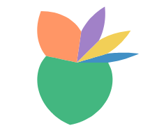
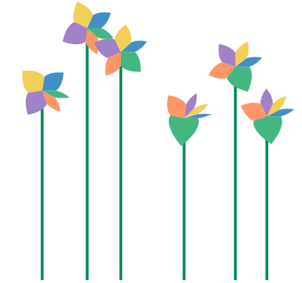

# Petal in user space (#1331)

**Summary.** Today's `petal` is two straight edges and two quadratic curves in its slot. Warp the curves' control points through polar, draw the curves on screen, and one fixed unit-box outline reproduces it (within 1.1 px up to 108° slots, 2.1 px at 192°, at the front page's 40 px radius).
So the petal does not need its own mark: `polygon` needs `w` and `h` (like a rect) and a curved outline, `d`.
**Recommendation:** approach B, `polygon({ w: "count", d: "M.5 0 L0 .5 Q.167 .75 .5 1 Q.833 .75 1 .5 Z" })`, then delete `petal` from JS, the IR, Python and the docs.

Issue #1331 asks whether the flower chart's petal can be drawn from general GoFish pieces, now that the flower chart is on the front page.
Prototype stories: `packages/gofish-graphics/stories/proposals/PetalUserSpace.stories.tsx` (throwaway).

## Terms

- **Slot**: the box a mark gets from its parent operator. Under `stack({ dir: "x" })` in polar, a slot is an angle range (the species' share of the circle) by a radius range (0 to `h`).
- **Warp**: drawing a shape through the coord, so a straight edge in (angle, radius) becomes a curve on screen. A rect in a polar slot warps into a wedge. Polygon edges are resampled (`adaptive-resampling.ts`) so the curve is smooth.
- **Tangent frame**: the coord's best straight-line approximation at the middle of the slot. A shape drawn in it is moved, scaled and turned by the coord, but its own curves stay as drawn.

## What the petal is today

`src/ast/shapes/petal.tsx` builds a path in pixels pointing along +x, then turns it to the slot's middle angle. The path goes from the center out to the slot's two side edges at half the radius (two straight lines along those edges), then two quadratic Béziers to a tip at the full radius. It is a local-frame glyph, ported from herrstucki's d3 bl.ock (pie layout plus a `rotate` transform).

The two straight lines are rays from the center, which polar draws straight anyway. Each quadratic's control point sits at 3/4 of the radius, at the same pixel distance from the petal's axis as the half-radius corner. Because that distance is in pixels, its angle shrinks with the slot in a way no fixed point in (angle, radius) reproduces. Warping the control point from the fixed unit-box spot (1/6, 3/4) (today's control in the narrow-slot limit) and drawing the curve on screen matches best.

Largest outline gap to today's petal at the front page's 40 px radius, computed over the flower chart's own slot angles (`tests/tmp/petal-snips/search*.py`; sampled outlines, about 0.3 px floor). The fixed fits minimize the worst gap over all slots:

| outline                            | 16°  | 42°  | 73°  | 90°  | 108° | 127° | 162° | 192° |
| ---------------------------------- | ---- | ---- | ---- | ---- | ---- | ---- | ---- | ---- |
| curved, control points warped (B)  | 0.07 | 0.23 | 0.53 | 0.80 | 1.13 | 1.46 | 1.92 | 2.07 |
| five points                        | 0.35 | 0.41 | 0.52 | 0.62 | 0.94 | 1.49 | 3.17 | 5.48 |
| nine points, best fixed fit        | 0.68 | 1.53 | 2.12 | 2.25 | 2.19 | 1.90 | 0.72 | 2.24 |
| seven points, best fixed fit       | 0.82 | 1.90 | 2.65 | 2.78 | 2.68 | 2.33 | 0.97 | 2.72 |
| five points + `Curve.catmullRom()` | 0.60 | 1.06 | 1.48 | 1.61 | 1.69 | 1.74 | 2.31 | 2.78 |

Rendered checks at R = 90 px agree after scaling by 90/40. Lake F head (slots 16°, 29°, 37°, 86°, 192°), measured on the SVG paths: curved 0.15 / 0.26 / 0.30 / 1.62 / 4.56 px; five points 0.45 / 0.45 / 0.45 / 0.88 / 12.3 px; nine points 1.52 / 2.55 / 3.16 / 5.23 / 4.92 px. The nine-point outline also shows visible kinks.

## Approaches

### A. Data-space ring, writable today (no library change)

 

```js
// The petal in its slot: u across, v out from the center.
const PETAL = [
  [0, 0],
  [0, 0.5],
  [0.5, 1],
  [1, 0.5],
  [1, 0],
];

// Stack by hand: each ring in data space (angle in counts, radius 0..1).
const flower = chart(rows, { coord: Coord.polar(), axes: false })
  .flow(
    derive((rows) => {
      let at = 0;
      return rows.map((d) => {
        const start = at;
        at += d.count;
        const ring = PETAL.map(([u, v]) => [start + u * d.count, v]);
        return { ...d, ring };
      });
    })
  )
  .mark(polygon({ points: "ring", fill: "species" }));
```

- Works today: `polygon({ points: "ring" })` reads data-space rings and warps them. Same petal shapes, but the head is smaller (the radius comes from the r scale, not 90 px), so outlines sit 14 to 24 px from today's.
- The user re-implements `stack` with a running sum, and the radius is a data value, so the fixed 40 px head radius of the flower chart has no direct spelling. This is the large partial overlap with `stack` that api-design.md warns about. Good as a stopgap, not as the answer.

### B. Box-relative polygon with a curved outline (recommended)

Widest slot (Lake F, R = 90 px, green slot 192°): today, B curved, five points only.

  

```js
// Two straight edges out from the center, then two quadratic curves to the
// tip. Their control points go through polar like the vertices do.
const PETAL = "M.5 0 L0 .5 Q.167 .75 .5 1 Q.833 .75 1 .5 Z";

const flower = chart({ coord: Coord.polar(), axes: false })
  .flow(stack({ by: "species", dir: "x", h: 40 }))
  .mark(polygon({ w: "count", d: PETAL, fill: "species" }));
```

```python
PETAL = "M.5 0 L0 .5 Q.167 .75 .5 1 Q.833 .75 1 .5 Z"

flower = (
    chart(coord=Coord.polar(), axes=False)
    .flow(stack(by="species", dir="x", h=40))
    .mark(polygon(w="count", d=PETAL, fill="species"))
)
```

- The change: `polygon` gains the `w` / `h` size channels a rect has, and takes its outline as `points` (straight edges) or `d` (an SVG path, for curves). The outline is stretched from its own bounding box into the `w` by `h` box. Left out, `w` and `h` default to the outline's own extent, so every existing literal polygon draws as before (the default is a value the user can write).
- The rule for curves: every point, vertex or Bézier control point, goes through the coord. Straight edges follow the coord, as polygon edges do today; curves are drawn on screen between the warped points, the rule `Curve` already uses for `line`. No polar special case and no slot-dependent shape.
- It lays out like a rect of the same size ("marks lay out alike"). The curved prototype (a throwaway node that declares a rect-like size) lays out exactly like today's chart.
- It works under every coord, because the warp does. Under `Coord.clock({ innerRadius: 0.4 })` the five-point B petals start at the donut hole; today's petal ignores the hole and draws from the center (bug, below). The curved outline warps its points the same way (not rendered).
- With only `points`, the five-point pentagon `[[0,0],[0,.5],[.5,1],[1,.5],[1,0]]` already matches narrow slots, but its straight edges warp into spirals that keep the full slot angle until near the tip, so wide petals bulge (5.5 px at 192°, R = 40). No fixed point set fixes that without hurting narrow slots (table above).

Front-page flower chart: today, B curved, five points only.

  

The five-point prototype chart is wider because it is a literal polygon with no declared size space; the curved prototype declares a rect-like one and lays out like today.

Donut clock (five-point outline), today and with B:

 

### C. Local-frame glyph in the slot's tangent frame

 

```js
// An SVG path in the unit box, drawn in the slot's tangent frame.
const PETAL = "M.5 0 L0 .5 Q0 .75 .5 1 Q1 .75 1 .5 Z";

const flower = chart({ coord: Coord.polar(), axes: false })
  .flow(stack({ by: "species", dir: "x", h: 40 }))
  .mark(glyph({ w: "count", d: PETAL, fill: "species" }));
```

- A new mark that takes a path in the unit box and maps it through the coord's linearization at the slot's middle. Béziers stay exact. This is how d3 symbols, Plot's `symbol`, Vega's custom `shape` paths and matplotlib's `Path` markers work, and how today's petal works.
- It does not fill its slot: wide slots leave gaps and overlaps between neighbors, because a tangent frame has straight sides. Measured against today's Lake A head: 0.5 to 0.7 px on the narrow slots, 4 to 8.7 px on the 80° to 108° slots.
- The name `path` is taken (`lib.ts` exports the path-segment helpers), so it needs a new name.
- It is the right tool for a different job: point glyphs placed by a coord (markers, arrowheads), per the "points stay points in polar" rule. The petal is not a point; it sweeps its slot.

Cartesian, B then C:

 

## Precedent

- **herrstucki's bl.ock (d3, 2013)**: `d3.layout.pie` gives start and end angles, a `petalPath` builds the shape along +x with two quadratics, and `rotate(angle)` turns it. A local-frame glyph (C). GoFish's petal is a port.
- **d3 / Observable Plot**: custom symbols are objects with `draw(context, size)`, drawn in a local frame around a point and turned by a `rotate` channel (C).
- **Vega / Vega-Lite**: the `shape` channel takes an SVG path string in a [-1, 1] box, scaled by `size` and turned by `angle` (C, unit box).
- **ggplot2**: `geom_polygon` under `coord_polar` warps the data-space polygon (`coord_munch` resamples edges) (A). A rose or petal is a polygon in data space.
- **GoFish**: rect in a polar slot is a warped box; polygon already warps literal and data rings. B is the rect rule applied to polygon.

Glyph libraries put custom shapes in a local frame because their marks are points. ggplot puts them in data space because its polar marks sweep. A petal sweeps its slot, so the GoFish analogue of ggplot (B) fits, and the point-glyph route (C) stays for real point glyphs.

## Deleting `petal` (B)

- JS: `src/ast/shapes/petal.tsx`, its export in `src/lib.ts`, `src/serialize/registry.ts`, `src/ast/markChannels.generated.ts` (regenerated), `src/ast/marks/chartBuilder.typetest.ts`, comments in `underlyingSpace.ts`, `coord.tsx`, `lowerHelpers.ts`.
- Old test charts: `src/tests/petalChart.ts`, `scatterPetal.ts`, `scatterFlower.ts`, `scatterPie2.ts`, `scatterBalloon.ts`, `scatterBalloon2.ts` (port or delete).
- Stories: `stories/forwardsyntax/FlowerChart.stories.tsx` (the front-page gallery story).
- IR: `packages/gofish-ir/src/frontend/descriptors.ts` (`petal` entry, plus `w`/`h` on `polygon`), `schema.ts`, display-list examples and schema test.
- Python: `gofish/_generated.py` (regenerated), `__init__.py`, `ast.py`, `tests/test_ast.py`, `tests/test_generated_factories.py`, `tests/python-stories/forward-syntax/test_flower_chart.py`.
- Docs: `js/api/marks/petal.md` and `python/api/marks/petal.md` (delete), mentions in `rect.md`, `core/chart.md`, `python/api/core/mark.md`, and several internals essays.

## Found along the way

- **Today's petal ignores `innerRadius`.** Under `Coord.clock({ innerRadius: 0.4 })` it draws from the center through the hole (see the donut renders). B fixes it for free.
- **#1111 part 1 is already fixed.** #1111 (petals draw nothing under `clock()`, and no fluent way to lighten field colors) says petal skips `clock()`. It now checks `coordinateTransform.polar`, and the clock render works. Part 2 (lightening) is still open and is unrelated.
- **A literal polygon's y runs opposite ways in Cartesian and polar.** The same points `[[0,0],…,[.5,1]]` point down in Cartesian (pixels, y down) and outward in polar. This is #1038 (inside a coord, y direction should be measured from the nearest frame, not the canvas). It decides which way B's unit box runs.

## Open decisions

1. Approve B: `polygon` takes `w` / `h`, its outline stretches into that box, curve control points warp like vertices, and `petal` is deleted?
2. Which way does the unit box run: v up from the baseline (data order, so a petal points up in Cartesian and outward in polar) or y down (pixel order, as literal polygon points are today)? This ties to #1038.
3. Curved outlines: spell them as an SVG path, `d` on `polygon` (SVG and Vega precedent), or as points plus a new `Curve` member that reads every other point as a control point (TrueType outlines mark off-curve points the same way)? Or keep five points and accept bulging wide petals?
4. Ship A in the flower story now as a stopgap, or wait for B?
5. Keep C (a unit-box glyph mark for point glyphs) as a separate future issue, or drop it?
