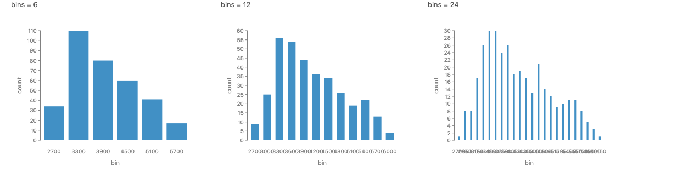
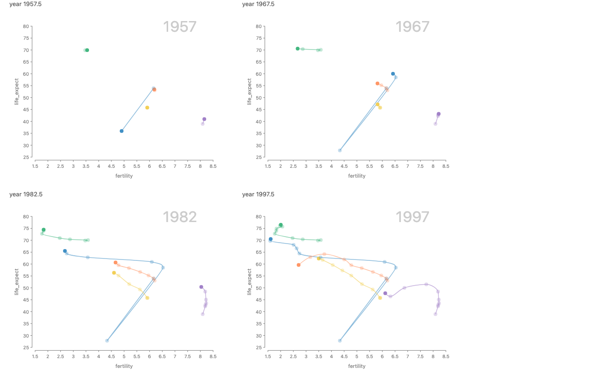
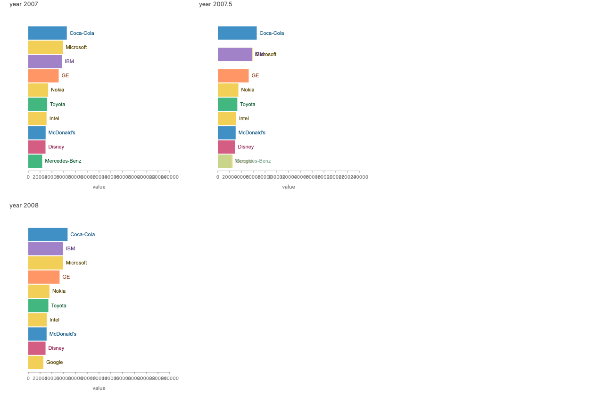
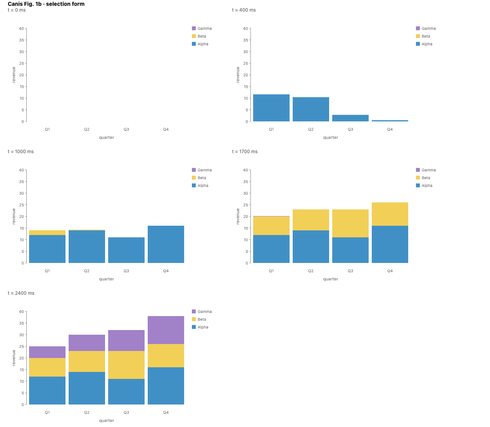
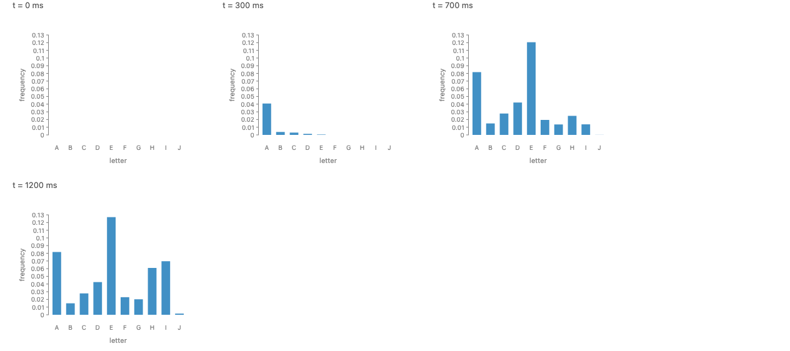
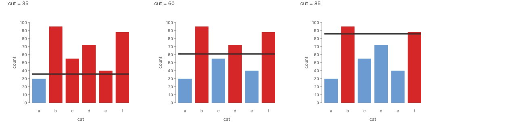
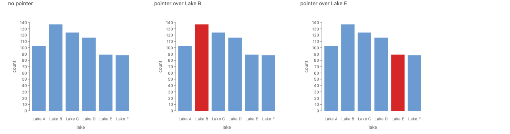
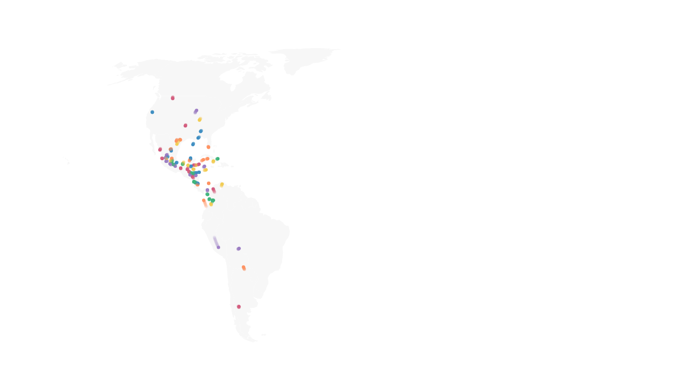

# Python animation and interaction: sources, expressions, and a clock the browser owns

**Summary.**

1. Every clock and input becomes a **source**: a small declaration (`timer(...)`, `drag()`, `wheel(...)`, `signal(...)`) that the spec names and the browser runs. Python declares it; the widget owns it. The document ships sources in a table beside its data tables, by id.
2. Reads of a source cross the bridge in two ways. In the browser, through a small **expression language** (polars style: `when(...).then(...).otherwise(...)`, comparisons, `clip`, `fill_null`) that JS evaluates per frame inside `live()` or per re-layout outside it. In the kernel, through a Python `derive` callback that calls the source (`bins()`) and gets the value shipped with the call.
3. The animation surface on main (`time.*`, `Animation.*`, `.transition()`) has no reads at all, so it crosses as plain declarations. A paused clock (`playing=False, at=...`) or an input at rest draws a fixed first frame, so 41 of the 76 exempt story exports in this corpus can be ported with byte parity in the first step. Most of the rest are HTML pages of several charts.

**Recommendation: Approach B**, "sources plus expressions", with the derive tier from Approach A included. Runner-up: Approach C, inputs as datasets (#830), which B is designed to grow into.

**Scope.** This targets the time surface on `main` (`time.sequence/history/transition/stagger/parallel`, `Animation.*`, `.transition()`), as Josh decided. The unmerged timeline grammar on `worktree-animation-grammar-proposal` is out of scope for the syntax, but the IR and clock design below are checked against it in [Growth path to the timeline grammar](#growth-path-to-the-timeline-grammar).

**Prototype.** `packages/gofish-graphics/stories/proposals/python-anim-interaction/PythonAnimInteraction.stories.tsx` (Storybook: "Proposals/Python Anim Interaction"). It is throwaway review material, exempt from parity. Every picture below is rendered by today's JS library from that file or from an existing story. All Python code in this document is **proposed** and does not run yet.

---

## Terms

- **Source.** Anything whose value changes after the chart is drawn: a clock (`timer`), a piece of state (`signal`), or an input (`pointer`, `drag`, `wheel`, `click`). Today JS calls these "inputs" and "signals"; "source" is the one word for all of them, after the Vega and Observable usage of a data source that changes over time.
- **Clock.** A source whose value is a playhead in some field's units (a year, a day, or milliseconds into a build). `timer()` is a clock. A `time.sequence` builds one unless it is handed one with `on`.
- **Paint tier** and **pipeline tier.** The two places JS reads a source today (#671). A read inside `live()` patches one attribute of a mark that is already drawn; nothing is laid out again. A read anywhere else in the spec makes the source a dependency of the pipeline, so a change re-runs domain inference, layout and paint.
- **Kernel tier.** A read inside a Python callback (a `derive`). The value is shipped to the Python kernel with the call, and the answer comes back over the bridge. It is the pipeline tier with a round trip added.
- **Expression.** A value built from field reads, source reads, literals and a fixed set of operations, written as data instead of as a function, so it can cross to JS and run there. `field("count")` is already a one-step expression.
- **Round trip.** One request from the browser to the Python kernel and its reply, over the anywidget traits. A few milliseconds on a local kernel, much more on a remote one, and only one at a time per widget.
- **Byte parity.** The Python port of a story renders a DOM identical to the JS story's, after normalization. Exempt stories skip this check.
- **Build-in.** Marks entering over time, one after another (`time.stagger` with `Animation.grow`), as opposed to keyframes of data time (`time.sequence`).

## Related issues

- **#1022** No IR or Python form for any animation construct; the `timer()` clock is the blocker. The task this proposal answers.
- **#774** Port the reactive layer (`live`, `pointer`, `drag`, `wheel`, `timer`, `signal`) to Python; the main decision is the `live()` tier. The other task this proposal answers.
- **#1191** Charts rendering at the same time register their inputs with each other's runtime, through a module-level "ambient registrar". A prerequisite here (see [#1191](#the-ambient-registrar-race-1191)).
- **#671** (merged) The reactive layer itself: `live()` channels and the input library, with the two tiers.
- **#705** Converge gofish `signal()` and raw Solid `createSignal()`; a raw Solid signal is invisible to the pipeline.
- **#672** Scripted interaction states for the capture harness, so a story can be captured after a wheel tick or a hover.
- **#830** Interaction as data: an input is a dataset (`chart(drag())`), and projections `.within/.snap/.lock/.offset` are methods on the input expression. Unsigned off, Josh's preferred direction.
- **#898** (closed) A duplicate of #774.
- **#888** Offline versus streaming animation: the same spelling should one day accept data that arrives over time.
- **#881** The spelling of `.layer(time.transition())`; the chained `.transition()` came out of it.
- **#697** The animation grammar design (scenes, segues, reveals); its 2026-10-04 comment proposed `timeline().relate()`.
- **#831** An update is a connector on the time axis, so it is named `transition`.
- **#901**, **#892**, **#902**, **#886** (merged) The animation surface on main: build-ins with `time.stagger` and `Animation.*`, the bar chart race with enter and exit fades, the connected scatterplot with `time.history`, and `time.sequence` plus `time.transition`.
- **#318** Tracking issue for Python parity. **#1177**, **#1189** (merged) Earlier parity steps: exempt stories ported, callable marks, charts that compose across the bridge.
- **#695**, **#700** (closed) Field expressions: `field("x").sort(...)`, `.normalize()`, aggregates. The base this proposal extends.
- **#1013** (closed) Strategy families as uppercase namespaces (`Curve.monotone()`, `Animation.grow()`).
- **#1008** (closed) Python is snake_case; the wire stays camelCase.
- **#1101** One extension model for strategy families (custom curves and the like).
- **#673** Stable identity across re-resolves, from spec position and data keys.
- **#674** Incremental layout; **#848** per-frame cost of animated charts.
- **#854** `filter()` before domain inference rescales axes every frame.
- **#577**, **#578** Headless SVG export and PNG/HTML export from Python.
- **#667** The Meros prototype on GoFish, whose critique fed #830.

## What exists today

**JS.** `src/ast/marks/time.ts` defines `time.sequence`, `time.history` and `time.transition`; `src/animation/timeArrangements.ts` defines `time.stagger` and `time.parallel`; `src/families/animation.ts` is the `Animation` family (`grow`, `shrink`, `fadeIn`, `fadeOut`, `appear`, `wipe`, `tween`). `src/interaction/` holds the sources (`timer`, `signal`, `pointer`, `drag`, `click`, `wheel`), `live()`, and the widgets `slider` and `button`. All of it is JS only (`lib.ts` says so in comments).

**What the time surface reads.** Very little. A `time.sequence` builds its own clock from `duration`, `loop`, `playing` and `at`, or takes one with `on`. A build-in's clock is built per chart by `installBuildIn`, held by the render options `{ playing, at }`. Every effect, arrangement and transition is a declaration with numbers and names. The only closures anywhere in the surface are a function `ease` (named eases exist) and the `on` clock itself. So the time surface is blocked on one thing: a way to name a clock.

**What the stories read.** The readouts (`live(() => String(Math.floor(year())))`), the hover fills (`live((d) => d === p.datum() ? red : blue)`), the threshold rule (`y: () => cut()`), and the semantic zoom (`derive((rows) => binRows(rows, bins()))`). Some of these are closures over a source in the paint tier, some in the pipeline tier, and one is real Python-worthy data work in the pipeline tier.

**Python.** A Python callable crosses as a lambda id. `_Payload` collects data tables and callbacks while the IR is written; the widget (`gofish/widget.py`, `widget-src/index.ts`) answers JS's one call, `call_request = {request_id, lambda_id, rows_b64}`, with the callback's reply. Calls are serialized: one in flight per widget, because the comm coalesces trait writes made in one tick. The same deserializer (`Serialize.renderIR`) serves the widget and the parity harness.

## The example corpus

The exempt stories (`tests/.python-sync-exempt`, interaction block and the animated Vega-Lite block) are the corpus. The hard ones used below:

| Example                               | What makes it hard                                                                                                                    |
| ------------------------------------- | ------------------------------------------------------------------------------------------------------------------------------------- |
| Gapminder trails                      | A shared clock (`on`) read by four things: the sequence, the history window, the chained tween, and a year readout in the paint tier. |
| Bar chart race, top 10                | Enter and exit fades as brands drop in and out; labels ride their bars; a readout.                                                    |
| Canis Fig. 1b build-in                | A selection-form build-in with two nested `time.stagger`s and `Animation.wipe(from: "bottom")`.                                       |
| Draggable threshold                   | One state read in both tiers (rule position re-lays-out, bar fill patches paint), written by a drag, clamped.                         |
| Semantic zoom histogram               | A wheel read inside real data work (re-binning), which a Python user wants to write in Python.                                        |
| Hover highlight, bird migration hover | A per-mark predicate on the pointer, read at pointer-move rate.                                                                       |

## Precedent

| System                                       | What the user writes                                                                                                                                                                                         | Where it runs                                           | Fits GoFish?                                                                                                                                                                                                                                                                                                      |
| -------------------------------------------- | ------------------------------------------------------------------------------------------------------------------------------------------------------------------------------------------------------------ | ------------------------------------------------------- | ----------------------------------------------------------------------------------------------------------------------------------------------------------------------------------------------------------------------------------------------------------------------------------------------------------------- |
| **Vega-Lite / Altair** params and selections | `alt.param(value=60, bind=alt.binding_range(...))`, `alt.selection_point(on="pointerover", fields=["lake"])`, `alt.when(hover).then(alt.value("red")).otherwise(alt.value("gray"))`, `alt.datum.count > cut` | Browser (Vega expressions); Python only builds the spec | The closest model. A param is a source, a selection is a predicate, and the condition is an expression built by operator overloading. Altair 5.4's `alt.when` copied polars. Weak spot: the expression language is a string language underneath (`alt.expr("...")`), so it is untyped and its errors arrive late. |
| **Altair `JupyterChart`**                    | `jchart.params.cutoff`, `jchart.selections.brush` as traitlets                                                                                                                                               | Browser, mirrored to the kernel                         | A source's current value observable and settable from Python, by name. Good precedent for kernel access (decision 5).                                                                                                                                                                                             |
| **Animated Vega-Lite**                       | `time: { field, key, rescale }`, a timer-driven point selection                                                                                                                                              | Browser                                                 | The data model GoFish already follows (`time.sequence` is AVL's `time` encoding); the clock is a browser event stream.                                                                                                                                                                                            |
| **ipywidgets / anywidget**                   | traitlets, `observe`, `link` (through the kernel) and `jslink` (browser only), the `Play` widget                                                                                                             | Both                                                    | `Play` is exactly "a clock declared in Python and run in the browser". `link` versus `jslink` is the kernel tier versus the browser tiers, made explicit by name.                                                                                                                                                 |
| **marimo**                                   | `mo.ui.slider(...)`; reading `.value` in another cell re-runs it; `mo.ui.altair_chart(...)` returns the selection as a dataframe                                                                             | Kernel, reactive by read location                       | Reactivity by read location, like GoFish's tier rule. A selection returned as rows is #830's "inputs are data".                                                                                                                                                                                                   |
| **Bokeh**                                    | `CustomJS(args=dict(...), code="...")`, `js_on_change`; `on_change` and `add_periodic_callback` need a Bokeh server                                                                                          | Both                                                    | Two tiers again. The browser tier is JS in a string: the foil for an expression language.                                                                                                                                                                                                                         |
| **Plotly**                                   | `px.scatter(..., animation_frame="year", animation_group="country")`, `go.Frame`, `updatemenus` play buttons                                                                                                 | Frames computed in Python, tweened in the browser       | `animation_group` is a key. Precomputed frames are Approach D, the foil. Plotly's own "redraw" flags show the cost: the layout per frame lives in Python.                                                                                                                                                         |
| **HoloViews / Panel**                        | `streams.PointerXY()`, `hv.DynamicMap(fn, streams=[...])`; `pn.bind`; `.jslink`/`.jscallback`                                                                                                                | Kernel per event, or browser by `jslink`                | A pointer stream feeding a Python function is the kernel tier at pointer rate, which HoloViews documents as slow over a remote kernel.                                                                                                                                                                            |
| **Dash / Shiny**                             | server callbacks; Dash `clientside_callback` with a JS string                                                                                                                                                | Server, or browser by string                            | Same split as Bokeh.                                                                                                                                                                                                                                                                                              |
| **polars**                                   | `pl.when(c).then(a).otherwise(b)`, `.clip(lo, hi)`, `.fill_null(v)`, `pl.concat_str`, `pl.col("x") > 5`; nodejs-polars spells `.gt()`                                                                        | Engine                                                  | The vocabulary for the expression language: typed, chained, no strings. api-design.md says data transformations look to polars first.                                                                                                                                                                             |
| **gganimate**                                | `transition_time(year)`, `shadow_wake()`, `enter_grow()`, `ease_aes()`                                                                                                                                       | Offline, renders frames                                 | Same declarations as `time.*`/`Animation.*`; renders frames, so it has no interaction.                                                                                                                                                                                                                            |
| **manim**                                    | `self.play(Create(x), run_time=2)`, `AnimationGroup(lag_ratio=...)`, `ValueTracker` with `add_updater`                                                                                                       | Offline, Python per frame                               | `ValueTracker` plus updaters is the paint tier written in Python, affordable only because it renders offline.                                                                                                                                                                                                     |

Two lessons. Every Python system that is interactive at pointer rate either runs a browser-side language (Vega expressions, `jslink`, `CustomJS`, clientside callbacks) or accepts a round trip per event and says so (HoloViews, Shiny). And the best of the browser-side languages are typed builders over a small fixed vocabulary (Altair's `alt.when`, polars), not strings.

## The design space

Three questions are independent, so they are laid out separately.

### Axis 1: where the clock lives

- **1a. The browser owns every clock; the spec declares it.** A `timer(...)` in Python is a declaration. The widget builds the real `timer()` from it, runs it, and holds it. A sequence's own clock and a build-in's clock stay internal, as now. This is ipywidgets `Play` and Animated Vega-Lite.
- **1b. Python owns time.** Python computes the frames (or the per-frame specs) and the widget flips through them, like Plotly frames, gganimate or manim.

1b gives up what makes GoFish animation cheap (a chart is laid out once and the clock is read at paint, js/animation.md "What a frame costs"), duplicates the time surface in Python, and has no story for a clock that a drag or a slider also writes. It is Approach D below and is rejected. Every other approach uses 1a.

### Axis 2: how a source is read from Python

- **2a. Kernel only.** Python reads a source only inside a `derive` callback. (Approach A.)
- **2b. Browser expressions plus kernel.** A serializable expression evaluates in JS in either tier; Python callbacks remain for real data work. (Approach B.)
- **2c. Sources as datasets.** A source is read only by making it a chart's data, `chart(drag())`, with projections as methods (#830). (Approach C.)

### Axis 3: what a capture draws

Every source has a declared state at rest: a clock's `at` and `playing`, a signal's initial value, a wheel's `initial`, a pointer that is off the chart. A capture draws that state. This is the same in every approach, so it gets its own section ([Static export and parity](#static-export-and-parity)).

## Approach A: kernel tier only

Animation crosses as declarations. Sources cross as declarations. Python reads a source only by calling it inside a `derive`, and every read is a round trip. There is no `live()` in Python.

**Semantic zoom (works well).**

```python
bins = wheel(range=[3, 40], initial=12, round=True)

(
    chart(penguins)
    .flow(derive(lambda rows: bin_rows(rows, bins())), spread(by="bin", dir="x"))
    .mark(rect(h="count"))
    .render(w=500, h=300)
)
```



_Rendered: the semantic zoom histogram held at 6, 12 and 24 bins (`SemanticZoomStates`). Each panel is one run of the `derive` callback._

**Draggable threshold (works, but every drag frame is a round trip).** The rule's position and the fills have to come out of Python too:

```python
dr = drag()

def rule_row(_rows):
    y = dr()["y"] if dr() is not None else 60   # one round trip per drag frame
    return [{"y": min(95, max(0, y))}]

(
    chart(bars)
    .flow(spread(by="cat", dir="x"))
    .mark(rect(h="count", fill=lambda d: RED if d["count"] > rule_row(None)[0]["y"] else BLUE))
    .layer(chart(bars).flow(derive(rule_row)).mark(rect(y="y", h=3, w=500, fill="#333")))
)
```

The fill is a Python accessor, so it is a round trip too. A drag at 60 Hz becomes 60 calls a second, each followed by a full re-layout, on a channel that only allows one call in flight.

**Hover highlight and readouts (not expressible at a usable rate).** A `live()` readout of a year needs a round trip per animation frame; a hover fill needs one per pointer move. Approach A has to leave both out, which leaves the Gapminder and race readouts out, and the bird migration hover panel.

**Trade-offs.** Smallest new surface: sources and the animation declarations, no expression language. But the paint tier, which is most of what makes interaction feel live, does not exist in Python. And kernel latency becomes visible exactly where users notice it most.

## Approach B: sources plus expressions (recommended)

Approach A's kernel tier stays. Added to it: an expression language that JS evaluates, so a Python spec can say "this fill depends on the pointer" without a Python function.

### The surface

Sources are the JS sources, with the same names and options in snake_case:

```python
from gofish import timer, signal, pointer, drag, wheel, click
```

A source is an expression of its current value. A record-valued source exposes its current row's fields as properties; this is the row shape #830 proposes for an input:

| Source                                                                     | Expression                                                      | Value                                                              |
| -------------------------------------------------------------------------- | --------------------------------------------------------------- | ------------------------------------------------------------------ |
| `timer(domain=..., duration=..., step=..., loop=..., playing=..., at=...)` | `year`                                                          | the playhead, in the domain's units                                |
| `signal(60)`                                                               | `cut`                                                           | the state                                                          |
| `wheel(range=..., initial=..., round=...)`                                 | `bins`                                                          | the mapped wheel position                                          |
| `drag()`                                                                   | `dr.x`, `dr.y`, `dr.x0`, `dr.y0`, `dr.dx`, `dr.dy`, `dr.active` | the drag's current row, in data units (null before the first drag) |
| `pointer()`                                                                | `hover.over`                                                    | true on the mark under the pointer                                 |
|                                                                            | `hover.field("species")`                                        | that field of the mark under the pointer (null when none)          |

The operations, all from polars:

| Operation  | Python                                          | JS                               |
| ---------- | ----------------------------------------------- | -------------------------------- |
| compare    | `a > b`, `a == b`, ...                          | `a.gt(b)`, `a.eq(b)`, ...        |
| arithmetic | `a + b`, `a * 2`                                | `a.add(b)`, `a.mul(2)`           |
| boolean    | `a & b`, `a \| b`, `~a`                         | `a.and(b)`, `a.or(b)`, `a.not()` |
| choose     | `when(c).then(x).when(c2).then(y).otherwise(z)` | the same                         |
| clamp      | `a.clip(lo, hi)`                                | the same                         |
| default    | `a.fill_null(v)`                                | `a.fillNull(v)`                  |
| round      | `a.floor()`, `a.round()`                        | the same                         |
| join text  | `concat_str("bins: ", bins)`                    | `concatStr("bins: ", bins)`      |

The leaves are `field(name)` (with its existing aggregates, so `field("count").sum()` is a bar's total), literals, and sources. `live(expr)` marks an expression for the paint tier, exactly as `live(fn)` does in JS. An expression anywhere else is a pipeline read: JS lays the chart out again when the source changes, and the kernel is not involved.

In JS, an expression is also a function of the datum, so it is a valid accessor everywhere an accessor is valid today. JS evaluates it through the paths it already has. The closure form (`live((d) => ...)`) stays as JS's escape hatch, the way `fill: (d) => ...` sits beside `fill: "species"`.

Reading a source in Python, `bins()`, is allowed only inside a callback that JS calls. Outside one (while the spec is being built) it raises: "`bins()` was read while building the spec, so the chart would never see it change. Pass `bins` itself as the value, or read it inside a `derive`."

### Example 1: Gapminder trails with a readout



_Rendered: the `Trails` spec held at 1957.5, 1967.5, 1982.5 and 1997.5 on a paused `timer` (`GapminderTrailsStrip`). The year readout is the `live` text._

JS today:

```ts
const year = timer({ domain: [1955, 2005], duration: 10000 });

chart(fiveCountries, { legend: false })
  .flow(
    time.sequence({ by: "year", on: year }),
    scatter({ by: "country", x: "fertility", y: "life_expect" })
  )
  .mark(
    layer([
      time.history([circle({ r: 4, fill: "country", opacity: 0.3 })]),
      circle({ r: 4, fill: "country" }).transition({
        update: Animation.tween({ curve: Curve.monotone() }),
      }),
    ])
  )
  .layer(
    line({ along: "year", stroke: "country", strokeWidth: 1.5, opacity: 0.6 })
  )
  .layer(
    chart([{ fertility: 7.5, life_expect: 83 }])
      .flow(scatter({ x: "fertility", y: "life_expect" }))
      .mark(
        text({
          text: live(() => String(Math.floor(year()))),
          fontSize: 48,
          fill: "#ccc",
        }).zOrder(-1)
      )
  )
  .render(container, { w: 500, h: 400, axes: true });
```

Python, proposed:

```python
from gofish import Animation, Curve, chart, circle, layer, line, live, scatter, text, time, timer

year = timer(domain=[1955, 2005], duration=10_000)

(
    chart(five_countries, legend=False)
    .flow(
        time.sequence(by="year", on=year),
        scatter(by="country", x="fertility", y="life_expect"),
    )
    .mark(
        layer([
            time.history([circle(r=4, fill="country", opacity=0.3)]),
            circle(r=4, fill="country").transition(
                update=Animation.tween(curve=Curve.monotone())
            ),
        ])
    )
    .layer(line(along="year", stroke="country", stroke_width=1.5, opacity=0.6))
    .layer(
        chart([{"fertility": 7.5, "life_expect": 83}])
        .flow(scatter(x="fertility", y="life_expect"))
        .mark(text(text=live(year.floor()), font_size=48, fill="#ccc").z_order(-1))
    )
    .render(w=500, h=400, axes=True)
)
```

The only change from JS is the readout: `live(year.floor())` instead of a closure. For the paused capture, the clock is `timer(domain=[1955, 2005], duration=10_000, playing=False, at=1997.5)`. JS needs the same `at` option on `timer` (today the stories call `.set(at)` on a paused timer, in `pausedClock.ts`).

### Example 2: the top-10 bar chart race



_Rendered: the top-10 race at 2007, 2007.5 and 2008 (`RaceTop10Strip`). At 2007.5, Mercedes-Benz is half faded out and Google half faded in, at the bottom._

```python
year = timer(domain=[2000, 2019], duration=20_000)

(
    chart(top10, legend=False)
    .flow(
        time.sequence(by="year", on=year),
        spread(by=field("name").sort("value", "desc"), dir="y", spacing=2),
    )
    .mark(rect(w="value", fill="category").label("name", position="outset-right"))
    .layer(time.transition(curve=Curve.linear()))
    .layer(
        chart([{"value": 210_000}])
        .flow(scatter(x="value"))
        .mark(text(text=live(year.floor()), font_size=48, fill="#ccc", y=470).z_order(-1))
    )
    .render(w=600, h=600, axes={"x": True, "y": False})
)
```

`top10` is computed in plain Python before the chart is built. Nothing here reads a source except the readout.

### Example 3: a build-in, Canis Fig. 1b



_Rendered: the existing `Build-in Prototype / Canis1bSelection` filmstrip, at 0, 400, 1000, 1700 and 2400 ms._

```python
(
    chart(sales)
    .flow(spread(by="quarter", dir="x"), stack(by="product", dir="y"))
    .mark(rect(h="revenue", fill="product").name("bars"))
    .layer(
        chart(select_all("bars"))
        .flow(
            time.stagger(by="product", spacing=0),
            time.stagger(by="quarter", lag=100),
        )
        .mark(time.transition(enter=Animation.wipe(from_="bottom")))
    )
    .render(w=400, h=240)
)
```

And the chained form of a simpler build-in:

```python
(
    chart(alphabet)
    .flow(spread(by="letter", dir="x").transition(enter=time.stagger(lag=60)))
    .mark(rect(h="frequency").transition(enter=Animation.grow(duration=600)))
    .render(w=480, h=220, playing=False, at=700)
)
```



_Rendered: that chained build-in at 0, 300, 700 and 1200 ms (`BuildInStaggerStrip`)._

No source appears in either. A build-in's clock is the chart's, held by the render options `playing` and `at`, which become two more widget traits. `from` is a Python keyword, so the generator's existing rule makes it `from_`.

### Example 4: the draggable threshold



_Rendered: the threshold at `cut` = 35, 60 and 85 (`ThresholdStates`). The rule moves (pipeline tier) and the bars above it turn red (paint tier)._

JS today wires the drag to a signal with a `createEffect`, and reads `dr.isActive()` inside the fill only so that the drag gets attached to the chart. Proposed, in both languages, `cut` is an expression over the drag:

```python
dr = drag()
cut = dr.y.clip(0, 95).fill_null(60)

(
    chart(bars)
    .flow(spread(by="cat", dir="x"))
    .mark(
        rect(
            h="count",
            fill=live(when(field("count").sum() > cut).then("#d62728").otherwise("#6b9bd1")),
        )
    )
    .layer(rect(y=cut, h=3, w=500, fill="#333"))
    .render(w=500, h=360)
)
```

```ts
const dr = drag();
const cut = dr.y.clip(0, 95).fillNull(60);

chart(bars)
  .flow(spread({ by: "cat", dir: "x" }))
  .mark(
    rect({
      h: "count",
      fill: live(
        when(field("count").sum().gt(cut)).then("#d62728").otherwise("#6b9bd1")
      ),
    })
  )
  .layer(rect({ y: cut, h: 3, w: 500, fill: "#333" }))
  .render(container, { w: 500, h: 360 });
```

The clamp that the JS story does by hand, to stop the rule from stretching the y domain under the drag, is `.clip(0, 95)`. Under #830 it would become `.within(ref("plot"))`, a method on the same expression. Neither tier involves the kernel.

### Example 5: hover



_Rendered: the hover highlight with no pointer, the pointer over Lake B, and over Lake E (`HoverStates`)._

```python
hover = pointer()

(
    chart(seafood)
    .flow(spread(by="lake", dir="x"))
    .mark(rect(h="count", fill=live(when(hover.over).then("#d62728").otherwise("#6b9bd1"))))
    .render(w=400, h=400)
)
```

The bird migration hover panel is the same predicate on a line plus a readout:

```python
line(
    stroke="species",
    stroke_width=live(when(hover.over).then(3).otherwise(0.1)),
    opacity=live(when(hover.over).then(1).otherwise(0.5)),
)
# ...
text(text=live(hover.field("species").fill_null("")), font_size=14, fill="#333")
```

`hover.over` replaces JS's `d === p.datum()` identity test. `hover.field("species")` reads the hovered mark's rows on one field, with the same collapse every field read on a group gets (the rows of one species' line all agree on `species`).

### Example 6: the semantic zoom, mixed tiers

```python
bins = wheel(range=[3, 40], initial=12, round=True)

(
    chart(penguins)
    .flow(derive(lambda rows: bin_rows(rows, bins())), spread(by="bin", dir="x"))
    .mark(rect(h="count"))
    .layer(text(x=20, y=290, text=live(concat_str("bins: ", bins, " (scroll to re-bin)")), fill="#333"))
    .render(w=500, h=300)
)
```

The binning stays Python, because it is real data work a Python user wants to write in numpy or polars; the wheel is read in the kernel tier. The caption is an expression, so it never waits for the kernel.

### The IR

**Sources table.** The document gains `sources` beside `tables`. Each Python source object is written once, keyed by object identity, the way `_Payload.table` keys data:

```json
{
  "root": { "...": "..." },
  "tables": { "t0": "..." },
  "sources": {
    "s0": {
      "kind": "timer",
      "domain": [1955, 2005],
      "duration": 10000,
      "loop": true,
      "playing": false,
      "at": 1997.5
    },
    "s1": { "kind": "drag" },
    "s2": { "kind": "wheel", "range": [3, 40], "initial": 12, "round": true },
    "s3": { "kind": "pointer" },
    "s4": { "kind": "signal", "init": 60 }
  }
}
```

Source kinds get descriptor entries like any construct (`descriptors.ts`), so the validator, the JSON Schema and the Python generator read them from one table.

**Expressions.** One new IR union, `ExprIR`, whose leaves include the existing `FieldAccessor`:

```json
{ "type": "source", "id": "s0" }
{ "type": "source", "id": "s1", "field": "y" }
{ "type": "over", "source": "s3" }
{ "type": "field", "name": "count", "ops": [{ "op": "sum" }] }
{ "type": "op", "op": "gt", "args": [<Expr>, <Expr>] }
{ "type": "op", "op": "clip", "args": [<Expr>, 0, 95] }
{ "type": "when", "branches": [[<Expr>, <Expr>]], "otherwise": <Expr> }
{ "type": "live", "value": <Expr> }
```

A channel value may be an `ExprIR`. So may a `time.sequence`'s `on` and a `time.transition`'s `at` (a source ref), and a `filter`'s predicate (bird migration panel C: `filter(field("day") == day)`).

**Animation constructs.** Ordinary descriptor entries, no new mechanism: `time.sequence`, `time.history` (dual form), `time.transition` (a relational mark), `time.stagger` and `time.parallel` (operators whose value is also an arrangement), and the `Animation` family as a `STRATEGIES` family (`{ kind: "grow", duration, ease }`, with `ease` a name; a function ease is JS only). `.transition({ enter, update, exit })` is a field on the mark and operator IR, the way `.label()` is. `duration: "days"` (a field name) already crosses as a string.

**Render options.** `playing` and `at` join `w`, `h`, `axes`, `legend` and `padding` as widget traits and as `RenderIROptions`.

**The bridge call.** `call_request` gains the current values of the sources (`{"s2": 12}`), and the reply gains the ids the callback read (`"reads": ["s2"]`). `answer` sets the values in a `contextvars` context while the callback runs, so `bins()` returns the shipped value and records the read. JS registers the derive as a reader of exactly those sources, which is the JS rule (a read outside `live()` is a pipeline dependency) applied to the kernel. A queued call that a newer change has made stale is dropped before it is sent (latest wins), so a fast wheel costs one round trip per settled position, not one per tick.

### How it composes

- **With the core.** An expression is an accessor, so it desugars into the accessor paths the passes already take; `live(expr)` is `live(fn)`. No pass learns a new node kind. Sources are the JS input objects, built by the deserializer.
- **With animation.** A clock read by a sequence and a readout is one source with two readers. A transition's `at` is a source ref.
- **With coordinate transforms.** Data-space source fields (`dr.y`) use the frame inversion the inputs already use, with the same per-axis limits (#671). Nothing new.
- **With data types.** `dr.y` is in the units of the axis it inverts through; comparing it to `field("count").sum()` compares counts with counts. When measures are typed (#955), a mismatch is a type error at the comparison.

### Overlap check

- `live(expr)` versus `live(fn)`: exact. The expression is a function; the IR names which one.
- `when/then/otherwise` versus `field().map(dict, default=...)` (the partial discrete mapping): small degenerate overlap. A `map` of literal keys is a `when` chain of equality tests. Keep both: `map` is the table form for many keys, `when` is the predicate form; define `map` by that rewrite.
- `clip` versus #830's `.within(ref)`: `within` is `clip` with bounds read off a ref's extent. Exact composition, once `within` exists.
- `filter(expr)` versus `filter(field(...).between(...))`: `between` is one expression. Exact.
- Expressions versus `derive`: no overlap in intent. An expression is per row and per frame, with a fixed vocabulary; `derive` is any function over the whole table. A value both could compute should be an expression, because it then runs in the browser.

### Trade-offs

Easy: every exempt interaction story except raw Solid signals and widget actions; readouts; hover at pointer rate; the animation surface whole. New terms: "source", and the expression vocabulary, all of which are polars words. Awkward: a second way to write a JS accessor (closure or expression), and Python `==` on fields is overloaded the way polars overloads it (so a `field(...)` cannot be a dict key). Cost to extend: an operation is one table entry evaluated in JS; a custom operation is a JS function, so it stays JS only, as with strategies (#1101).

## Approach C: sources as datasets (#830)

Python never writes `live()` or an expression in a channel. A source is read only by charting it, `chart(drag())`, whose rows are the input's samples; the projections `.within`, `.snap`, `.lock` and `.offset` are methods on the input. Clocks become one-row tables, so a counter is a chart.

```python
dr = drag().within(ref("plot")).lock("x")

(
    chart(bars)
    .flow(spread(by="cat", dir="x"))
    .mark(rect(h="count").name("bars"))
    .layer(chart(dr).mark(rect(y="y", h=3, w=500, fill="#333")))
)

year = timer(domain=[1955, 2005], duration=10_000)
readout = chart(year).flow(scatter(x=7.5, y=83)).mark(text(text="value", font_size=48))
```

**Where it is better.** One mechanism for reading inputs (data), and it is Josh's preferred direction. Trails and multi-brushes come free from input history. The threshold's domain feedback loop disappears into `.within`.

**Where it needs B anyway.** The bar fill still has to compare each bar to the drag: that is a predicate over two datasets, `when(field("count").sum() > dr.y)`, which is an expression. Hover is a predicate too. So C keeps B's expression language and removes only `live()`.

**Where it costs.** Without `live()`, the readout is a chart whose data changes every tick, so the whole chart is laid out again every frame. That breaks the property the animation design rests on (laid out once, clock read at paint). C would need the pipeline to infer that a chart over a source only changes paint, which is the "implicit paint" direction (#671, `incremental-layout.md`) and unbuilt. And none of #830 is built in JS; Python cannot lead JS.

**Trade-offs.** Cleanest model in the long run; blocked on #830's open decisions (input row shape, previous-frame semantics) and on paint-tier inference; cannot ship this step.

## Approach D: Python owns time (foil)

```python
chart(gapminder).animate(by="year", key="country", fps=30).render()
```

Python computes each year's spec (or each frame's), ships the list, and the widget plays it, as Plotly frames do. It needs no expression language and no sources. It is rejected: it lays the chart out once per frame instead of once, it cannot share a clock with a slider or a readout without a round trip, it re-implements `time.sequence`, `time.history` and the tweens in Python, and it cannot host interaction at all. It also cannot grow to the timeline grammar, whose transitions match marks across scenes in the browser.

## Static export and parity

**The rule.** A capture draws the declared state at rest. A clock at rest is at `at` (or its domain's start), paused or not; a signal is at its initial value; a wheel at `initial`; a pointer is off the chart; a drag has not started. Python declares all of these, so a Python spec's first frame is as deterministic as its JS twin's.

**Paused frames port now.** The "Paused" stories hold a clock still with `playing: false` and `at` (or `pausedClock`, which is `timer` plus `.set`). With `at` on `timer` and the sources table, they are pure specs and byte-portable.



_Rendered: the existing `Bird Migration / D_TrailsPausedDay5`, a cyclic `time.sequence` with a 20-day `time.history`, held on day 5 so the trails reach back across the new year. In Python it is `time.sequence(by="day", on=day, cyclic=True)` on `timer(domain=[1, 365], step=1, duration=10_000, playing=False, at=5)`, and a pure spec._

**Playing stories port too.** Their capture is the first frame, the same frame the JS visual harness already captures and baselines for the JS story. Whatever keeps the JS capture stable keeps the Python one stable, because both render through `Serialize.renderIR`'s runtime.

**Interactive stories port, held to their first frame.** The first frame of the hover story is the un-hovered chart, which is deterministic. So the port is byte-checked like any other, and the interacted states wait for #672 in both languages at once. This differs from the #774 expectation (keep them exempt, with the reason changed to "interactive capture"): an exemption would skip a check that can pass. See decision 4.

**Python export.** `widget.save("x.svg")` writes what the widget shows, so an animated chart saves its current frame. To save a chosen frame, render with `playing=False, at=...`. Headless export (#577) inherits the same rule.

**A later option for #672.** Because every input has a declared state, a scripted capture can set a source's value (`{"bins": 24}`) instead of synthesizing wheel events. That is deterministic and language-neutral. It does not cover the pointer (its state is a hit test), which still needs synthetic events.

### Which exempt stories become portable

Phase 1 is this proposal's first step; phase 2 needs the two open items in decision 6 (widget actions and spec thunks).

| Story (export)                                                                                                                          | Under B                            | Notes                                                                                                                                                                                        |
| --------------------------------------------------------------------------------------------------------------------------------------- | ---------------------------------- | -------------------------------------------------------------------------------------------------------------------------------------------------------------------------------------------- |
| interaction/HoverHighlight                                                                                                              | **port, phase 1**                  | `when(hover.over)`                                                                                                                                                                           |
| interaction/SemanticZoomHistogram                                                                                                       | **port, phase 1**                  | the required interactive widget example (derive tier)                                                                                                                                        |
| interaction/DraggableThreshold                                                                                                          | **port, phase 1**                  | `dr.y.clip(...).fill_null(...)`                                                                                                                                                              |
| interaction/TimerPulse (PaintOnly, GrowingData)                                                                                         | **port, phase 1**                  | GrowingData is a kernel-tier derive, at two calls a second                                                                                                                                   |
| interaction/ComponentPointer                                                                                                            | **port, phase 1**                  |                                                                                                                                                                                              |
| interaction/ComponentLayoutReactive                                                                                                     | port, phase 2                      | the spec is a thunk that reads a wheel; needs a Python thunk callback (a mark function with no rows)                                                                                         |
| interaction/Widgets (Default, Wrapping)                                                                                                 | port, phase 2                      | `onInput`/`onClick` writes and a `format` function; needs actions                                                                                                                            |
| interaction/ComponentPaintOnly                                                                                                          | **stays exempt**                   | new reason: a raw Solid `createSignal` driven by `setInterval`, JS only by design (#705)                                                                                                     |
| Bird Migration B, C, D, D_TrailsPaused, D_TrailsPausedDay5                                                                              | **port, phase 1**                  | C becomes `filter(field("day") == day)`                                                                                                                                                      |
| Bird Migration E_Controls                                                                                                               | port, phase 2                      | slider and play/pause button actions                                                                                                                                                         |
| Gapminder Animated, Paused1975, SequenceOnly, Curves, CurvesThree, CurvesPaused, Trails, TrailsPaused, TrailsCurves, TrailsCurvesPaused | **port, phase 1**                  | the `curvesRow` layouts are `spread`/`frame` combinators, which Python has                                                                                                                   |
| Gapminder CurvesKinematics, CurvesKinematicsPaused                                                                                      | **stays exempt**                   | new reason: sparklines built from internal spline helpers (`channelSpline`) and an internal coordinate import                                                                                |
| GapminderTower L0, L1, L2                                                                                                               | **port, phase 1**                  |                                                                                                                                                                                              |
| GapminderTower L3                                                                                                                       | **port, phase 1**, with a fallback | kernel-tier `derive` calling a Python `interpolate`; if its monotone spline does not match JS's to the byte, a per-export exemption for an algorithm divergence (the `ViolinPlot` precedent) |
| BarChartRace Animated, Paused2000, Paused2010, Paused2019, Paused2007_5, Top10, Top10Paused2007_5, Top10Paused2008                      | **port, phase 1**                  |                                                                                                                                                                                              |
| BarChartRace Top10FromBelow, Top10FromBelowPaused2007_5                                                                                 | **stays exempt**                   | new reason: clips the container with CSS `clipPath`, which is page markup, not the spec                                                                                                      |
| ConnectedScatterplot (all 8 exports)                                                                                                    | **port, phase 1**                  |                                                                                                                                                                                              |
| animation/BuildInPrototype (Gallery and 22 filmstrips)                                                                                  | **stays exempt**                   | new reason: HTML pages of several chart roots held at different clock times (one root has one build clock). Port each example as a new single-root paused story instead.                     |
| forwardsyntax/CurveLadder                                                                                                               | **stays exempt**                   | reason narrows to: an HTML grid of several roots                                                                                                                                             |

Counting story exports: 41 port in phase 1, 4 in phase 2 (the two Widgets exports, ComponentLayoutReactive, E_Controls), and 31 stay exempt with a new reason (ComponentPaintOnly, the two Kinematics exports, the two FromBelow exports, and the 23 BuildInPrototype and 3 CurveLadder exports, which are HTML pages).

## The ambient registrar race (#1191)

Today a source attaches to a chart when the chart's resolve reads it, through a module-level "current runtime" variable. Two charts resolving at once can attach each other's sources. A notebook makes this the common case: every widget on the page shares one copy of the ESM bundle, so several charts resolve concurrently through one module variable.

The sources table removes the need for the ambient read on the IR path: `renderIR` knows every source the document declares before it resolves, and can bind each to its own runtime explicitly. But the sources are real JS input objects, and the JS code that reads them (the sequence, `live`) still registers through the ambient path. So the right fix is #1191's own "pass it explicitly" direction, scoping the registrar to each resolve, done before this ships. Recommendation: make #1191 step 0 of the implementation, not a parallel patch in the deserializer.

## Growth path to the timeline grammar

The recommended IR keeps three things fixed: one clock per chart root owned by the browser, sources referenced by id, and animation constructs as ordinary descriptor entries. Each timeline construct fits as follows.

| Timeline construct                                                                     | How it fits                                                                                                                                                                                                          | What changes                                                                               |
| -------------------------------------------------------------------------------------- | -------------------------------------------------------------------------------------------------------------------------------------------------------------------------------------------------------------------- | ------------------------------------------------------------------------------------------ |
| `timeline([...]).relate(...)`                                                          | A combinator mark with children, like `layer`. Its clauses cross the way `layer(...).relate(...)` clauses do today: Python's `.relate(lambda ...)` runs at build time and writes constraint IR.                      | New combinator descriptor; temporal clause kinds join the constraint IR. No bridge change. |
| `time.after(a, b, gap=...)`, `time.align(t=...)`                                       | Constraint IR entries over refs, like `Constraint.distribute` and `Constraint.align`.                                                                                                                                | Two clause kinds.                                                                          |
| `time.transition(a, b)` as a relational mark spanning a gap                            | A relational mark over two refs in a clause, like `arrow([a, b])`. Its `curve`, `ease` and `key` are fields.                                                                                                         | The descriptor gains the two-operand form.                                                 |
| `.duration(ms \| datum(v))`                                                            | A modifier field on the mark envelope, like `name` and `zOrder`. `datum(v)` is already `DatumValue` IR.                                                                                                              | One envelope field.                                                                        |
| combinator `time.sequence(opts, [children])` with `gap` arrays and a fitted `duration` | The dual-form pattern `time.history` already uses: one descriptor, two call shapes. `gap` is `number \| number[]`, checked for length in JS. The duration fit runs in JS layout, so nothing crosses but the numbers. | New fields on the existing descriptor.                                                     |
| key joins for identity                                                                 | `key` is a field name or a `field()` expression; a function key is JS only.                                                                                                                                          | One field.                                                                                 |
| `playing`, `at` (in ms) on a timeline                                                  | The same root clock and the same widget traits as a build-in's.                                                                                                                                                      | Nothing.                                                                                   |
| a counter that reads the clock (the grammar's wall 8)                                  | `live(clock)` today; `chart(clock)` once #830 lands, as a source used as data.                                                                                                                                       | `DataIR` gains a source variant.                                                           |

Nothing in this list needs a new bridge mechanism or moves the clock, so the recommended design can carry the grammar without a redesign. Approach D could not: its scenes would be Python frames, and the grammar's transitions match marks across scenes in the browser. Approach A can carry the declarations but not the counters at frame rate.

Streaming data (#888) fits the same way: a source whose value is rows, read as data.

## Recommendation

**Approach B, with A's kernel tier inside it.**

- **It desugars into the existing core** (principles.md, "Why keep the core small"). An expression is an accessor, `live(expr)` is `live(fn)`, a source is the JS input object, and every animation construct is an existing JS factory behind a descriptor entry. The passes see nothing new.
- **One mechanism per job** (api-design.md, "One concept is one operator"). The clock is always the browser's; a read is always either an expression (browser) or a callback (kernel), told apart by what the user wrote, as ipywidgets tells `jslink` from `link`. Overlaps with `field().map`, `between` and #830's `within` are exact rewrites.
- **Names from precedent** (api-design.md, "Survey precedent first"). Every operation is a polars name, and Altair, the closest Python precedent, already copied `when/then/otherwise` from polars. "Source" is the only new word.
- **A closed vocabulary plus a function escape hatch**, matching the strategy families. JS keeps closures; Python gets the vocabulary, and a Python callback where real data work is wanted.
- **The same shape in JS and Python.** Every Python example above has a JS twin with the same structure, and the JS twin is a valid JS program, not a Python-only spelling.
- **Loud errors.** Reading a source while building the spec raises; a function `ease` in Python raises; a source ref to an unknown id fails validation.
- **It meets #774's acceptance**: a derive-tier Python API with an interactive widget example (the semantic zoom), and an explicit list of which exempt stories port.

**Runner-up: Approach C.** It is the better end state, and B is built to grow into it: B's expressions are #830's "methods on the input expression", and a source in the `sources` table can become chart data with one `DataIR` variant. What would change the pick: #830 signed off and built in JS, and paint-tier inference built, so that `chart(year)` as a readout costs a paint patch instead of a re-layout. Then `live()` could leave Python before it ships widely.

## Decisions for Josh

1. **One word for clocks, state and inputs.** Is "source" the right word (Vega and Observable usage), or keep JS's "inputs" and "signals" and call the table `inputs`?
2. **The expression vocabulary.** Is the polars set right (`when/then/otherwise`, comparisons, arithmetic, `clip`, `fill_null`, `floor`, `round`, `concat_str`), and is `when` acceptable as a top-level name in both languages?
3. **Pointer and drag reads.** `hover.over` and `hover.field("species")` for the pointer, and `dr.x`, `dr.y`, `dr.dx`, `dr.active` properties for the drag (the #830 row shape). Is that the spelling, given that JS also keeps its method readers (`p.datum()`, `dr.currentData()`) for closures?
4. **Interactive stories and parity.** Port them with byte parity on their first frame (this proposal), or keep them exempt with the reason "interactive capture" (the #774 expectation)?
5. **Kernel access to source values.** Should Python be able to read and set a source on a live widget (Altair `JupyterChart.params` style), and if so, addressed by the source object (`view.get(year)`) or by a name (`timer(..., name="year")`)?
6. **Phase 2 writes.** For widgets (`slider`, `button`) and play/pause: declared actions evaluated in JS (`on_click=day.toggle()`, a slider bound to a signal writes it by default), or Python callbacks through the kernel (clicks are rare, so a round trip is fine), or both?
7. **`at` on `timer()`.** Add `at` to `timer()` in both languages, so a paused clock is one declaration instead of `timer(...)` plus `.set(at)`?

## Syntax changes to review

- New in Python: `timer`, `signal`, `pointer`, `drag`, `wheel`, `click`, `live`, `when`, `concat_str`; `time.sequence`, `time.history`, `time.transition`, `time.stagger`, `time.parallel`; the `Animation` family; `.transition(enter=, update=, exit=)` on marks and operators; `render(playing=, at=)`.
- New in both languages: expression operations on fields and sources (`>`/`.gt`, `when(...)`, `.clip`, `.fill_null`, `.floor`, `.round`, `concat_str`/`concatStr`); `pointer().over` and `pointer().field(name)`; drag row properties `dr.x`, `dr.y`, `dr.x0`, `dr.y0`, `dr.dx`, `dr.dy`, `dr.active`; `timer({ at })`.
- Changed in JS: a source or an expression is accepted wherever an accessor is (timers, signals and wheels already are, since they are functions; pointers and drags are not); `filter` accepts an expression predicate.
- Python errors: reading a source outside a callback; a function `ease`; a function `key`.
- Python naming: `from gofish import time` shadows the standard library's `time` module in that namespace (also noted in #1022).

## Images

All in `img/`, rendered with `pnpm capture-one`:

- `gapminder-trails-strip.png`: Gapminder trails held at 1957.5, 1967.5, 1982.5 and 1997.5, with the live year readout.
- `race-top10-strip.png`: the top-10 bar chart race at 2007, 2007.5 and 2008, showing the enter and exit fades.
- `build-in-stagger-strip.png`: the chained staggered grow at 0, 300, 700 and 1200 ms.
- `canis1b-selection-strip.png`: the Canis Fig. 1b selection-form build-in at five times (existing story).
- `bird-migration-day5.png`: bird migration panel D held on day 5, the trail reaching back across the new year (existing story).
- `hover-states.png`: the hover highlight with no pointer, over Lake B, and over Lake E.
- `threshold-states.png`: the draggable threshold at `cut` = 35, 60 and 85.
- `semantic-zoom-states.png`: the semantic zoom histogram at 6, 12 and 24 bins.

The interaction panels are drawn by setting the state each input would produce (a fixed hovered lake, a fixed `cut`, a fixed bin count) with today's JS, since the capture harness cannot dispatch pointer events (#672).
