# React wrapper: where the pipeline goes in JSX

**Summary.** A React wrapper (`@gofish/react`, #1266) lets an MDX page write a GoFish visualization inline. The combinator form (`layer`, `stack`, `spread` over explicit children) maps one-to-one onto JSX. The pipeline form (`chart(data).flow(...).mark(...)`) can be nested into JSX too, and a prototype shows it draws the same pictures, but nesting makes one JSX tree mean two different charts.

**Recommendation.** Use JSX for combinators and keep the pipeline as a fluent value that JSX holds as a child (`<Layer>{chart(...).flow(...).mark(...)}</Layer>`, or `<GoFish spec={...} />` at the root). This is the rule GoFish already uses: a call joins independent parts, and a method chain is a sequence of steps that read the caller's state. JSX is a call syntax, so it fits the first and not the second. Nesting the pipeline is the runner-up.

**Status.** Proposal only. A throwaway prototype (`packages/gofish-react`, uncommitted design evidence) implements all four spellings below; every render here comes from it. Nothing is signed off.

## Terms

- **JSX**: the `<Tag prop={value}>children</Tag>` syntax. It compiles to function calls, `createElement(Tag, props, ...children)`.
- **MDX**: Markdown that can contain JSX. Docusaurus, Next.js, Nextra and Astro render it with React, usually to static HTML at build time.
- **Combinator form**: a GoFish operator applied to an explicit list of children, as in `stack({ dir: "y" }, [a, b])`.
- **Pipeline form**: `chart(data).flow(step, step).mark(template)`. Each flow step splits the data into groups, and the mark is a **template**: GoFish draws one copy of it per group.
- **Element walk**: reading a JSX tree as plain `{ type, props }` records, calling user function components to expand them, without rendering anything.
- **Reconciler**: React's machinery for keeping a tree of host objects in sync with JSX. A custom one (`react-reconciler`) is what react-three-fiber and modular-svg use.
- **Server rendering (SSR)**: producing the SVG as HTML on the server or at build time, so the page shows the picture before any JavaScript runs.

## The question, from the notes

Josh's notes (and #1266) raise these tensions. Each is answered below.

1. The low-level combinator syntax fits JSX; the pipeline does not. What do we do about the pipeline?
2. Is a custom reconciler needed, or does a component that takes a spec cover it?
3. JSX spelling: lowercase intrinsics (`<rect>`) clash with DOM SVG elements; capitalized components (`<Rect>`) clash with GoFish's rule that a capital letter means a class or a namespace.
4. Does nesting round-trip to the same frontend IR as the fluent chain?
5. Function-valued options (accessors, `derive`) must pass through.
6. How do events and animation fit React re-renders?

## What the prototype found

The prototype (`packages/gofish-react`) reads JSX by an element walk and turns it into the same builder calls the fluent chain makes, then draws the display list as React `<svg>` elements. 33 tests pass. Every example below draws the same display list from JSX as from the fluent chain.

**The pipeline is already a tree at runtime.** `.flow(a, b).mark(m)` appends to a list, and resolve folds the list from the right into `a(b(m))` (`chartBuilder.ts:983-985`). So the nested JSX `<A><B><M/></B></A>` is the shape the engine runs. The frontend IR stores it as a flat list (`{ data, operators: [...], mark }`), and the nested JSX flattens into exactly that list. For the stacked bar, ribbon chart, labeled stack, pie and bars-plus-line examples, the IR from nested JSX equals the IR from the chain.

**The JS frontend IR cannot carry everything.** The JS emitter has no tag for `arrow`, `.relate()` or `createMark` and throws "untagged mark" on them; only Python emits those. Function-valued options are dropped, and `derive(fn)` becomes an opaque `{ type: "derive" }`. So "JSX builds frontend IR", as #1266 proposes, does not work for diagrams or callbacks today. The prototype goes from JSX straight to builder calls instead. This is a divergence from the issue: the JSX surface is a JS spelling of the JS API, not a new IR frontend, and needs no lambda bridge.

**Server rendering works, with one caveat.** `toDisplayList` and the display-list renderer run in Node. Layout is async, so the root suspends; React 19's `prerender` waits for it, and `renderToString` does not. In Node, text width is estimated at 0.6em per character; in the browser it is measured with a canvas. The first bar of the stacked chart sits at x = 50 in Node and x = 51.72 in Chromium, so a server-rendered chart does not exactly match the browser layout when React hydrates it.

**Nesting the pipeline hits a wall.** In the fluent API, a step's children are either a template (`.flow(stack(o)).mark(m)`) or an explicit list (`stack(o, [a, b])`), and the code says which. In JSX every element has children, so that difference is gone. The prototype tells the two apart by position: inside `<Chart>`, an operator is a flow step; outside, it is a combinator. Here is one JSX tree whose two readings are both valid GoFish:

```jsx
<Chart data={seafood}>
  <Spread by="lake" dir="x">
    <Stack dir="y">
      <Rect h="count" fill="species" />
    </Stack>
  </Spread>
</Chart>
```

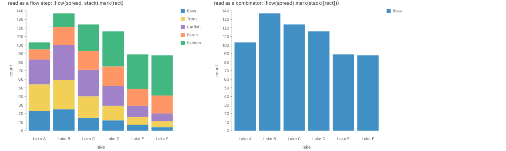

On the left, `<Stack>` is a flow step: with no `by`, each row is its own group (#998: a split with no `by` puts every item in its own group), so the rows stack. On the right, `<Stack>` is a combinator over its one explicit child, so each lake draws a single summed bar. Any rule that picks one reading (position, child count, presence of `by`) is a rule users have to keep in their heads.

The prototype hit three smaller walls too. A JSX prop named `label` is both the `.label()` modifier and a real option (`stack({ label: false })`, and a user component's own `label` prop), so `label` counts as a modifier only on leaf marks. Later children of `<Chart>` become `.layer()` tiers, which is a second position rule. And a user component that calls a React hook throws, because the element walk calls it outside React's render; allowing hooks is what a real reconciler buys.

## Precedent

No library I found turns a data-splitting pipeline into nested JSX. Chart libraries nest wrappers over children the user lists by hand (one per series), hide the pipeline inside a chart type, or hand each group to a function. Libraries with a real transform grammar keep it out of the markup. Full notes with sources: the survey file listed at the end.

| System                 | What the user writes                                                                                  | How data reaches children                  | Notes                                                                                                                  |
| ---------------------- | ----------------------------------------------------------------------------------------------------- | ------------------------------------------ | ---------------------------------------------------------------------------------------------------------------------- |
| Bluefish               | `<StackH spacing={50}><Circle .../></StackH>`, `<Arrow><Ref select="label"/>...</Arrow>`              | none; `<For>` by hand                      | GoFish's combinator ancestor. Capitalized components.                                                                  |
| Victory                | `<VictoryStack><VictoryArea data={a}/><VictoryArea data={b}/></VictoryStack>`                         | user splits data into one child per series | Parent inspects child types; users cannot wrap parts in their own components (issue #2342, open since 2022).           |
| Recharts               | `<BarChart data={d}><Bar dataKey="x" stackId="a"/>...</BarChart>`                                     | data on root, field names on leaves        | 3.x added a `<BarStack>` wrapper and moved to context registration to allow custom components.                         |
| visx                   | `<BarStack data keys x xScale yScale>{(stacks) => ... <rect/>}</BarStack>`                            | render prop gets computed geometry         | The only literal "template per group", but the user redraws everything.                                                |
| Vega-Lite / react-vega | `<VegaEmbed spec={spec}/>`                                                                            | the spec                                   | Spec as a prop. Stacking is implied by `color`.                                                                        |
| Observable Plot        | `Plot.plot({...options, document: new Document()}).toHyperScript()`                                   | the options object                         | Plot's authors chose spec-as-prop, not JSX marks, and get SSR by laying out against a virtual document.                |
| chart-parts (MSR)      | transforms in a fluent library: `stack('value').groupBy('key')`; JSX holds `<Rect table="data" .../>` | named tables                               | The closest precedent for the recommendation: the pipeline stays fluent, marks and composition go in JSX.              |
| react-three-fiber      | `<mesh><boxGeometry args={[1,1,1]}/></mesh>`                                                          | props, context, hooks                      | Custom reconciler; lowercase intrinsics generated from THREE. Works because THREE names don't clash with DOM names.    |
| react-pdf              | `<Document><Page><View><Text>`                                                                        | props                                      | Capitalized exports are string host types (`export const Rect = 'RECT'`), so `<Rect>` never clashes with DOM `<rect>`. |
| Remotion, React Router | `<Sequence from={30}>`, nested `<Route path>`                                                         | context                                    | Nesting a pipeline over time or paths. Neither splits data.                                                            |
| framer-motion, Mafs    | `<motion.div>`, `<Coordinates.Cartesian/>`                                                            | props, context                             | JSX member expressions: a namespace object keeps lowercase names legal in JSX.                                         |

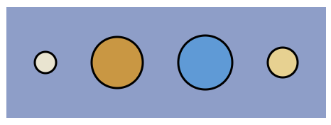
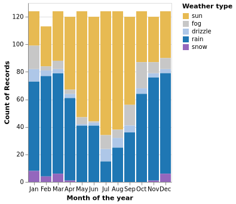
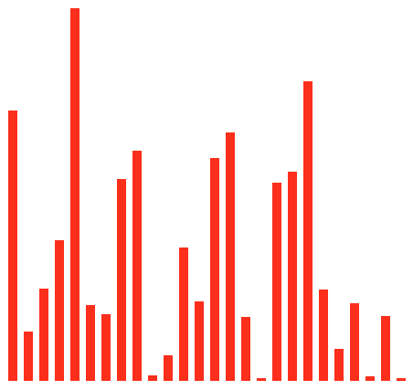
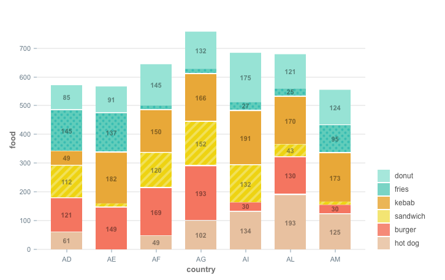
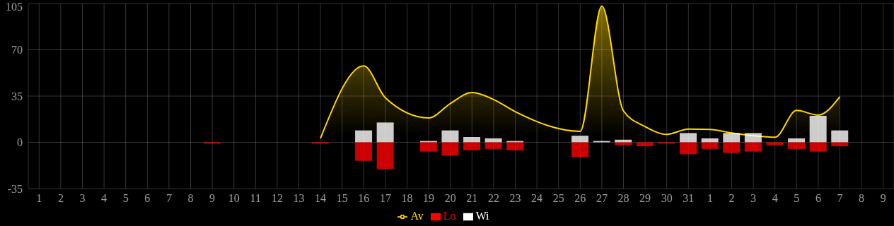

## Approaches

The space has three independent axes. The main one is where the pipeline goes. The other two are how components are named and what machinery reads the JSX. Each is laid out separately.

### Axis 1: where the pipeline goes

#### Approach A. Spec only

One component, no JSX vocabulary. The visualization is a fluent value.

```jsx
<GoFish
  w={400}
  h={400}
  spec={chart(seafood)
    .flow(spread({ by: "lake", dir: "x" }), stack({ by: "species", dir: "y" }))
    .mark(rect({ h: "count", fill: "species" }))}
/>
```

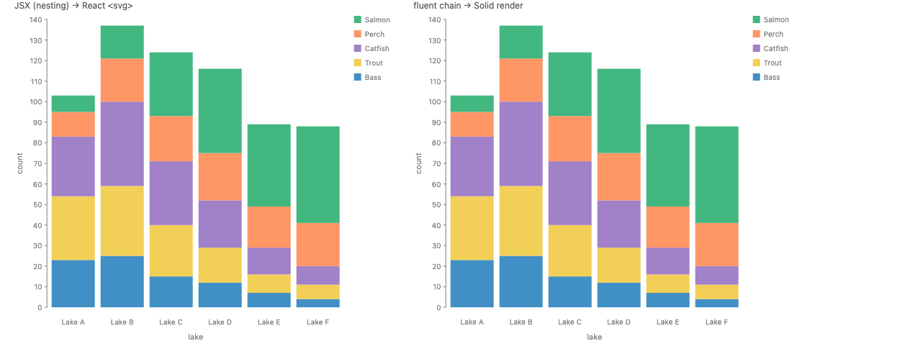

- **Desugars to:** `spec.render(...)`, nothing else.
- **Composes:** everything the fluent API does, unchanged.
- **Trade-offs:** cheapest, exact, and the form every ecosystem ships first. But a diagram is written with no JSX at all, and an MDX author gets no React composition.

#### Approach B. JSX for combinators, fluent values for pipelines (recommended)

JSX spells the combinator form. A pipeline stays a fluent value and appears wherever a child may: as a JSX child, or as `spec` on the root. Approach A is the special case with one child.

Bars plus a line over them, from a second chart over `selectAll("bars")`:

```jsx
<Layer>
  {chart(seafood, { w: 400, h: 300 })
    .flow(spread({ by: "lake", dir: "x", spacing: 20 }))
    .mark(rect({ h: "count", fill: "#9ecae1" }).name("bars"))}
  {chart(selectAll("bars")).mark(
    line({
      stroke: "#08519c",
      strokeWidth: 3,
      source: ["middle", "end"],
      target: ["middle", "end"],
    })
  )}
</Layer>
```

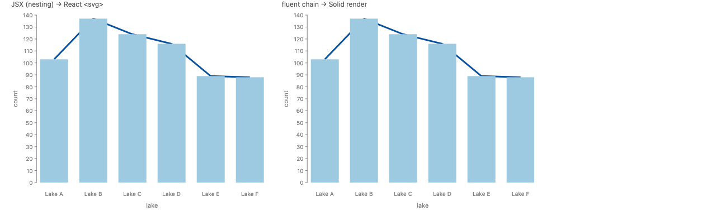

A node-link diagram, where a plain React function component plays the part of `createMark`:

```jsx
function Node({ label }) {
  return (
    <Layer
      w={76}
      h={40}
      relate={({ box, caption }) => [
        Constraint.align({ x: "middle", y: "middle" }, [box, caption]),
      ]}
    >
      <Rect
        w={76}
        h={40}
        rx={6}
        fill="#e2ebf6"
        stroke="#457b9d"
        strokeWidth={2}
        name="box"
      />
      <Text text={label} fontSize={14} fill="#1d3557" name="caption" />
    </Layer>
  );
}

<Layer x={20} y={20}>
  <Layer relate={nodeConstraints}>
    <Node label="A" name={A} />
    <Node label="B" name={B} />
    <Node label="C" name={C} />
    <Node label="D" name={D} />
  </Layer>
  <Line {...edge} {...across} zOrder={-1}>
    <Ref to={A} />
    <Ref to={B} />
  </Line>
  <Line {...edge} {...across} zOrder={-1}>
    <Ref to={B} />
    <Ref to={C} />
  </Line>
  <Line
    {...edge}
    source={["middle", "start"]}
    target={["middle", "end"]}
    zOrder={-1}
  >
    <Ref to={B} />
    <Ref to={D} />
  </Line>
</Layer>;
```

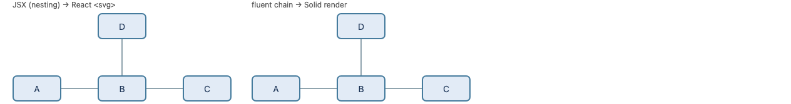

The hard case is a diagram whose relations name its parts, here the Bluefish planets. `.relate()` becomes a `relate` prop whose function returns JSX:

```jsx
<Layer
  relate={({ Mercury }) => [
    <Spread dir="y" spacing={60} alignment="middle">
      <Text text="Mercury" name="label" />
      {Mercury}
    </Spread>,
    <Arrow>
      <Ref to="label" />
      {Mercury}
    </Arrow>,
  ]}
>
  <Spread dir="x" spacing={50} alignment="middle">
    {planets.map((p) => (
      <Ellipse
        key={p.name}
        w={p.radius * 2}
        h={p.radius * 2}
        fill={p.color}
        stroke="#333"
        strokeWidth={3}
        name={p.name}
      />
    ))}
  </Spread>
</Layer>
```

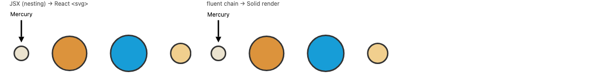

- **Desugars to:** an exact rewrite, one element per call. `<Stack dir="y">{a}{b}</Stack>` is `stack({ dir: "y" }, [a, b])`; `name`, `zOrder` and `relate` props are the `.name()`, `.zOrder()` and `.relate()` methods; a user function component is `createMark`. A fluent value as a child passes through untouched.
- **Composes:** the pipeline keeps every feature it has (`.layer`, `.label`, `selectAll`, `derive` with live functions, `Coord`, `.transition`) because it is the same value. Coordinate transforms are props (`coord={Coord.clock()}`).
- **Overlap:** none. Each JSX element is one existing combinator, with no new semantics.
- **Trade-offs:** one picture can mix two notations, JSX for the tree and a chain for the pipeline. That mix follows the existing rule for calls and methods. The JSX vocabulary can be generated from `descriptors.ts`, as the Python wrappers are (#685), so a new operator costs nothing here.

#### Approach C. Nesting: each flow step wraps the next (runner-up)

Inside `<Chart data>`, an operator element is a flow step, its one child is the template, and later children are `.layer()` tiers. Outside `<Chart>`, the same elements are combinators.

```jsx
<Chart data={seafood} w={400} h={400}>
  <Spread by="lake" dir="x">
    <Stack by="species" dir="y">
      <Rect h="count" fill="species" />
    </Stack>
  </Spread>
</Chart>
```


```jsx
<Chart data={seafood} h={400}>
  <Spread by="lake" dir="x" spacing={64}>
    <Stack by={field("species").sort("count")} dir="y">
      <Rect h="count" fill="species" />
    </Stack>
  </Spread>
  <Ribbon opacity={0.8} />
</Chart>
```

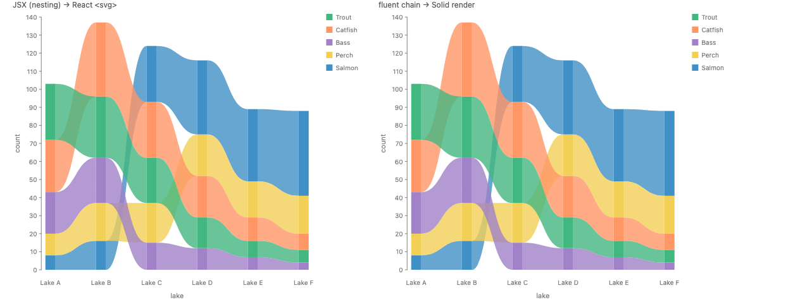

```jsx
<Chart data={seafood} w={440} h={400}>
  <Spread by="lake" dir="x">
    <Stack by="species" dir="y">
      <Rect h="count" fill="species">
        <Label field="species" position="center" color="white" fontSize={12} />
      </Rect>
    </Stack>
  </Spread>
</Chart>
```

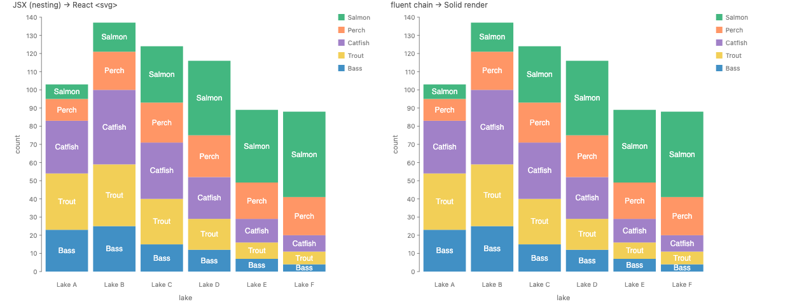

```jsx
<Chart data={seafood} coord={Coord.clock()} axes padding={80} w={400} h={400}>
  <Stack by="species" dir="x">
    <Rect w="count" fill="species" />
  </Stack>
</Chart>
```

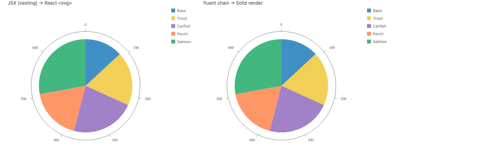

- **Desugars to:** the fluent chain. It round-trips to the same IR on five examples and the same display list on all seven.
- **Composes:** the same as B for combinators.
- **Overlap:** `<Stack>` inside and outside `<Chart>` is one name for two readings, which is fine in the fluent API, where the presence of children tells them apart, and ambiguous in JSX, where it cannot (the ambiguity render above).
- **Trade-offs:** reads beautifully for simple charts and reads in the forward order the pipeline syntax chose (`internals/frontend/pipeline-syntax.md`). It costs three position rules: flow step vs combinator, first child vs layer tiers, and `label` as modifier vs option. Labels need a `<Label>` child, a new spelling for a method.

#### Approach D. Pipeline as props on one element

```jsx
<Chart
  data={seafood}
  w={400}
  h={400}
  flow={[spread({ by: "lake", dir: "x" }), stack({ by: "species", dir: "y" })]}
  mark={rect({ h: "count", fill: "species" })}
/>
```

- **Desugars to:** the fluent chain, field by field. It renders the stacked bar above.
- **Trade-offs:** this is the single `chart({ data, flow, mark, ... })` config object that the pipeline-syntax notes already considered and dropped. It is A with the chain cut into props, and it still needs a prop for every builder method (`layer`, `label`, `transition`). Kept here as a foil.

### Axis 2: how JSX names are spelled

JSX reads a lowercase bare name as a DOM element and a capitalized one as a component, so GoFish's lowercase names cannot be used bare.

- **N1. Capitalized components** (`<Stack>`, `<Rect>`), exported as host types the way react-pdf does (`export const Rect = 'RECT'`). Bluefish, react-pdf, Victory, visx and Recharts all use capitals. This conflicts with GoFish's capital-letter rule (#416 removed the old capitalized aliases), but the capital is forced by JSX's own grammar, so it is a domain special case inside `@gofish/react` only, not a second spelling in `gofish-graphics`.
- **N2. Lowercase intrinsics** (`<stack>`, `<rect>`), like react-three-fiber. `rect`, `text`, `line`, `ellipse`, `polygon` and `image` collide with DOM SVG elements in both the types and the reader's head. Rejected.
- **N3. A lowercase namespace** (`import * as gf from "@gofish/react"`, then `<gf.stack>`, `<gf.rect>`), like framer-motion's `<motion.div>`. It keeps GoFish's exact names and its capital rule, at the cost of a prefix on every element.

Recommendation: N1, declared as a JSX-only special case. N3 is the choice if the capital rule should hold everywhere.

### Axis 3: what reads the JSX

- **Element walk (prototype).** Read the tree as records, calling user function components to expand them, so a user can wrap parts in a component (avoiding Victory #2342). Synchronous, so server rendering works. A component that calls a hook throws.
- **Custom reconciler + its-fine** (#1266's plan). User components inside a GoFish tree can use hooks, state and outer context. Costs a host config to maintain across `react-reconciler` versions (react-pdf vendors three).

Recommendation: the element walk for v1. Hooks belong in the outer React component that holds the visualization, which passes values down as props. Move to a reconciler only when a real example needs hooks inside the tree.

## How the recommendation composes

- **Python:** unchanged. Python has no JSX, and its combinator form (`stack([a, b], dir="y")`) is already the call shape the JSX desugars to. The JSX surface is JS-only, like `time`.
- **Data types, units, strategies:** untouched; props carry the same values (`Coord.clock()`, `Curve.monotone`, `field(...).bin(...)`).
- **Layout engine:** sees the same builder calls, so #1176's work applies as is.
- **Events:** the React `<svg>` output can attach `onClick` etc. to display-list items, keyed by mark name. Not prototyped.
- **Animation and reactive signals (#671):** a React prop change re-runs layout, as the existing "anything layout-affecting reruns the pipeline" rule does. `live()` paint patches and `time.*` need a decision on whether React or Solid owns the frame loop. Not prototyped.

## Why B over C

1. **It follows the call/method rule GoFish already has.** `api-design.md`, "Calls, methods and options": a call joins independent parts (`layer([a, b])`), and a method chain is steps that read the caller's state (`chart(...).flow(...).mark(...)`). JSX compiles to calls. The pipeline is a chain for a reason that does not go away in JSX. The difference you noticed between the two forms comes from that rule.
2. **No rule users must model.** Nesting needs a position rule to tell a flow step from a combinator, and the ambiguity render shows that the two readings draw different pictures. B keeps the difference where the fluent API already marks it, in the code.
3. **Exact desugaring, nothing new in the core.** Each element is one existing call (`principles.md`, "Why keep the core small"). No `<Label>` element, no tier-by-position rule.
4. **Precedent.** Every ecosystem ships spec-as-prop first. Observable Plot chose it over JSX marks, and chart-parts keeps transforms in a fluent library with marks in JSX. No library nests a data-splitting pipeline.
5. **Extensible at no cost.** A new operator or mark appears in JSX by generation from `descriptors.ts`; there is no per-construct position semantics to design.

**What would change my pick to C:** a single child rule with no position cases. For example, if every operator's children were always templates instantiated per group, with no-`by` meaning "one group" rather than "one group per item". That reverses #998 and would need its own design pass. Real MDX usage that is mostly simple charts would also make C's readability count for more.

## Decisions for Josh

1. Pipeline in JSX: keep it a fluent value (B), or nest it (C)?
2. Names: capitalized components in `@gofish/react` only (N1), or a lowercase namespace `<gf.stack>` (N3)?
3. A plain function component in JSX means `createMark`. Is that right?
4. Machinery for v1: element walk, with no hooks inside a GoFish tree, or a reconciler from the start?
5. Server rendering: text widths are estimated on the server and measured in the browser. Is a small shift when the client lays out again acceptable for v1, or must server and client agree (font metrics on the server)?
6. Package name `@gofish/react`?

## User-facing syntax to review

```jsx
// New: a root component for a fluent value
<GoFish w={400} h={300} spec={chart(data).flow(...).mark(...)} />

// New: combinators as JSX (one element per existing call)
<Layer>{a}{b}</Layer>                 // layer([a, b])
<Stack dir="y">{a}{b}</Stack>         // stack({ dir: "y" }, [a, b])
<Rect h={40} name="box" />            // rect({ h: 40 }).name("box")
<Layer relate={fn}>...</Layer>        // layer([...]).relate(fn)
<Line><Ref to="a" /><Ref to="b" /></Line>  // line({}, [ref("a"), ref("b")])
```

## Related issues

- #1266: the React wrapper itself (custom fiber via its-fine, frontend IR in, display list out).
- #685: generate the Python wrappers from `descriptors.ts`; the model for generating JSX components.
- #671: reactive signals and `live()`; how React re-renders meet paint patches.
- #963: `view.unmount()`, for effect cleanup on a client-only mount.
- #416: removed the capitalized aliases (`StackX`, `Frame`, `GoFish`), which set the capital-letter rule.
- #146: made the node-level operators internal, giving one lowercase surface.
- #998: a split with no `by` puts each item in its own group; why `<Stack dir="y">` inside a flow is not a combinator.
- #577: `.toSVG()` in Node; the prototype uses `toDisplayList` instead.

## Files

- Prototype: `packages/gofish-react/` (element walk, React port of the display-list renderer, 33 tests).
- Stories: `packages/gofish-graphics/stories/proposals/ReactWrapper.stories.tsx`.
- Renders: `proposals/react-wrapper/img/`.
- Prior-art survey with sources: `proposals/react-wrapper/prior-art.md`.
