# Sankey node layout

d3-sankey does two kinds of work. Discrete graph decisions (which column a node goes in, and the order inside each column) read the whole link table and produce fields. Continuous placement, given those fields, is already GoFish: a spread of columns, a gapped spread of nodes, and one shared scale that equals d3's.
What is left over is the coordinate phase (exact y once the order is fixed; d3 calls it relaxation) and virtual nodes. Both are global and iterative. The coordinate phase is not cosmetic: on the energy graph it cuts the area where ribbons cover each other from 25% to 4%, while the crossing count goes up.

**Recommendation: A now, C next.** Add the two graph decisions as `derive` helpers with strategy families (`Layering`, `Ordering`) that feed the existing `spread`. The coordinate phase and virtual nodes come next, in one operator over nodes and links, `ranked(...)` (working name, C), built on A's helpers and on `spread`. It is the next step, not a someday follow-up, because the coordinate phase decides most of the overlap on a large graph.

The review page is `index.html` in this folder. It has the same sections, with every render next to its code. Ribbons and link ends belong to the stacked-ribbons proposal ([proposal](https://claude.ai/artifact/QnDyewZaCKrvpFo9r8QYXE), [design space](https://claude.ai/artifact/2dHLhTeiQwpdHmkDjbw6oU)). All renders come from prototype stories in `packages/gofish-graphics/stories/_proposals/sankey-layout/` with no core changes.

## Rules

- **Columns and order are data.** They are fields (`layer`, `order`) that a helper computes or a user writes, like Lupton's editable ordering.
- **Geometry is composition.** Columns are `spread({ by: "layer", dir: "x" })`, nodes are a gapped `spread` on y, and the shared scale is the existing σ fit.
- **One phase, one strategy family.** `Layering.*` for columns and `Ordering.*` for crossing reduction, like `Tile.*` for treemaps.
- **Coordinate assignment is one family.** Place each node at a center of its neighbors in the next layer, then remove overlap inside the layer. Trees, sankeys and DAGs differ only in which center and which overlap removal.
- **Iteration never enters the layout engine.** Relaxation lives in a helper or a layout node that sees nodes and links.
- **Ribbons are not decided here.**
- **A template is sugar.** A `sankey()` template may expand into A. It cannot replace A.

## Terms

- **Layer (column):** the discrete x slot a node sits in.
- **Order:** a node's rank from the top inside its layer.
- **Layer assignment:** choosing each node's layer. d3 uses the longest path from any source, then a rule for where sources and sinks go (`nodeAlign`).
- **Crossing reduction:** choosing the order inside each layer so few links cross. The best order is NP-hard to find, so tools use heuristics.
- **Barycenter:** the weighted mean position of a node's neighbors. Sorting each layer by it, sweeping back and forth, is the classic heuristic.
- **Coordinate assignment:** given layers and orders, choosing exact y positions.
- **Relaxation:** d3's coordinate assignment. It moves each node part way toward the y that would level its links, pushes overlapping nodes apart, and repeats.
- **Virtual node:** a placeholder put in each layer a long edge skips, so the edge can bend around boxes and take part in ordering.
- **Sugiyama framework:** the standard four-phase layered graph layout: cycle removal, layer assignment, crossing reduction, coordinate assignment.
- **Overplot:** the share of ribbon area lying on top of other ribbons, sampled every pixel along x. Unlike a crossing count, it weighs a crossing by how much it covers.
- **Contour (outline):** a subtree's top and bottom in each layer. Spacing siblings by contours lets a short subtree tuck beside a deep one, like kerning.
- **Tidy tree:** the Reingold–Tilford layout (d3.tree): sibling subtrees as close as their contours allow, each parent centered on its first and last child.
- **Dendrogram (cluster):** a tree with every leaf in the last layer (d3.cluster); a parent sits at the mean of its children.
- **ky, σ:** pixels per data unit. d3 calls it `ky`. The GoFish layout engine calls it σ.

## d3-sankey, phase by phase

| Phase           | Math                                                | GoFish counterpart                              | Status           |
| --------------- | --------------------------------------------------- | ----------------------------------------------- | ---------------- |
| Link lists      | join links to nodes                                 | `resolve` / anchors                             | ribbons proposal |
| Node value      | max(Σ in, Σ out)                                    | taller port stack                               | ribbons proposal |
| Depth, height   | longest path (a fold over the whole graph)          | none                                            | A: `layers`      |
| Column rule     | `nodeAlign` left, right, center, justify            | none                                            | A: `Layering.*`  |
| Column x        | layer · (W − node width) / (n − 1)                  | `spread({ dir: "x", spacing: fr(1) })`, exact   | today            |
| Padding cap     | min(padding, H / (max column size − 1))             | keeps px gaps, warns                            | fine             |
| Shared scale    | ky = min over columns of (H − (n − 1)·py) / Σ value | σ fit over sibling columns, same number         | today            |
| Initial stack   | stack with gap py                                   | `spread({ dir: "y", spacing: 10 })`             | today            |
| Leftover height | spread evenly (space-evenly)                        | short column aligned as a block; `fr` gaps warn | gap, #1165       |
| Order           | re-sort by y after every move                       | `field("order").sort()`                         | A: `Ordering.*`  |
| Relaxation      | move toward neighbors, damped, 6 rounds             | none                                            | C follow-up      |
| Collisions      | push apart along y                                  | `Overlap` moves only the other axis             | C follow-up      |
| Link ends       | stack ends by far node's y                          | anchors                                         | ribbons proposal |

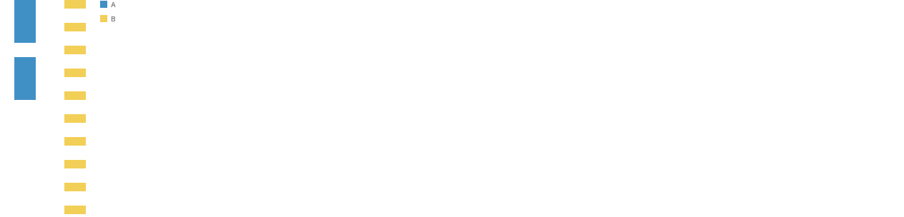

The probe: column A has 2 nodes of 50, column B has 10 nodes of 10, 20 px gaps, height 300. d3 gives ky = min(280/100, 120/100) = 1.2. GoFish draws B nodes 12.0 px tall spanning exactly 300, and A nodes 60.0 px.

## Strategy grid

Crossings count pairs of links between the same two columns whose ends swap order. Overplot is measured on the same order and y (`d3-reference/r2-metrics.ts`).

| Layout                             | Small flow: crossings, overplot | UK energy: crossings, overplot | Images                                        |
| ---------------------------------- | ------------------------------- | ------------------------------ | --------------------------------------------- |
| Data order, tight (A, no `order`)  | 5, 15.5%                        | 72, 25.0%                      | `a-small-input-order`, `a-energy-input-order` |
| `Ordering.barycenter()`, tight (A) | 1, 7.8% (2.2% centered)         | 17, 25.4% (21.3% centered)     | `a-small-barycenter`, `a-energy-tight`        |
| Relaxed (C, a port of d3's loop)   | 3, 8.5%                         | 26, 3.7%                       | `c-small-relax`, `c-energy-relax`             |
| d3-sankey reference                | 3, 8.5% (same y as the port)    | 27, ≈ 3.7% (port within 45 px) | `d3-small`, `d3-energy`                       |
| d3-sankey, `iterations(0)`         | 5, 14.1%                        | 72, 16.8%                      | `d3-small-no-relax`, `d3-energy-no-relax`     |

**Crossings undercount overlap.** Barycenter has the fewest crossings, yet on energy a quarter of its ribbon area lies under other ribbons, against 3.7% relaxed. d3 never counts crossings: it moves nodes toward level links, so thin links may cross to keep thick bands straight. On the small flow the two are close, and barycenter with centered columns wins. Even d3 with no relaxation, which only spreads leftover height evenly, beats the same order packed at the top (16.8% vs 25.0%). So ordering removes crossings and coordinate assignment removes overlap area; a large sankey needs both, which is why they are separate strategy slots.

## Column spacing

Josh's question: could the overlap go away if the columns were spaced differently, and how, given it depends on the curve?

- **Spacing cannot remove crossings.** In one gap every ribbon has the same x(t) and the same shape in y, so two ribbons cross exactly when the column orders say so.
- **Spacing cannot remove overlap.** Stretching a gap is an affine map, so overlap area grows with ribbon area. Moving width between gaps changed overplot by at most 7%.
- **Spacing changes slope.** Gaps in proportion to each gap's steepest link halve the worst slope on energy (5.58 to 2.70), at the cost of crowding other gaps (one shrinks from 101 to 61 px and its labels collide with ribbons).
- **It is a phase after y placement.** y never reads x, so the per-axis model holds; the x step needs the solved pixel y and the links.

| Curve                                                 | Steepest slope   | Gap for slope cap s    |
| ----------------------------------------------------- | ---------------- | ---------------------- |
| `Curve.linear()`                                      | abs(Δy)/g        | g ≥ max abs(Δy) / s    |
| `Curve.bezier()` (control points mid-gap, level ends) | 2·abs(Δy)/g      | g ≥ 2·max abs(Δy) / s  |
| `Curve.orthogonal()`                                  | vertical segment | lanes, not slope (ELK) |

Prior work: ELK Layered is the only tool found that sizes each gap from its edges (polyline: nodeNode + 0.4·min(1, edgeEdge/nodeNode)·maxVertDiff; splines: max(nodeNode, 2·edgeNode + (slots − 1)·edgeEdge)). Lupton's d3-sankey-diagram has a commented-out `minEdgeDx` per gap with leftover split evenly, CSS Grid's `minmax(min, 1fr)`. Every other sankey tool uses uniform columns; no paper was found.

| Even columns                                                             | Gaps from the steepest link                             |
| ------------------------------------------------------------------------ | ------------------------------------------------------- |
| 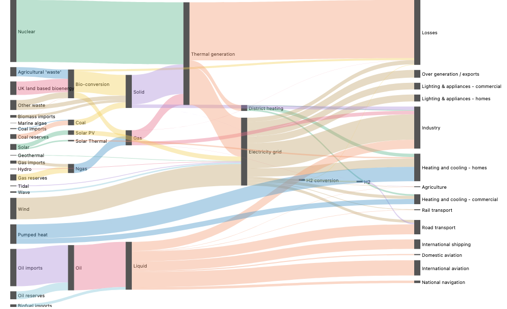 relaxed: 3.7%, max slope 5.58          | 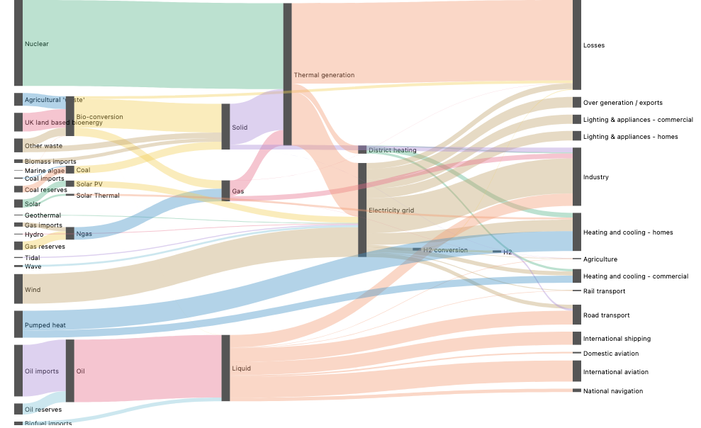 3.4%, 2.70       |
| 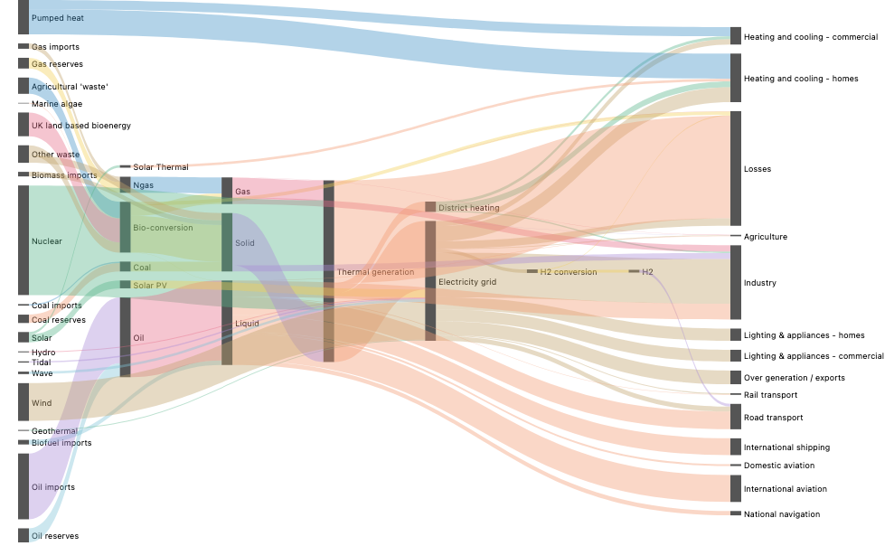 barycenter, centered: 21.3%, 3.67 | 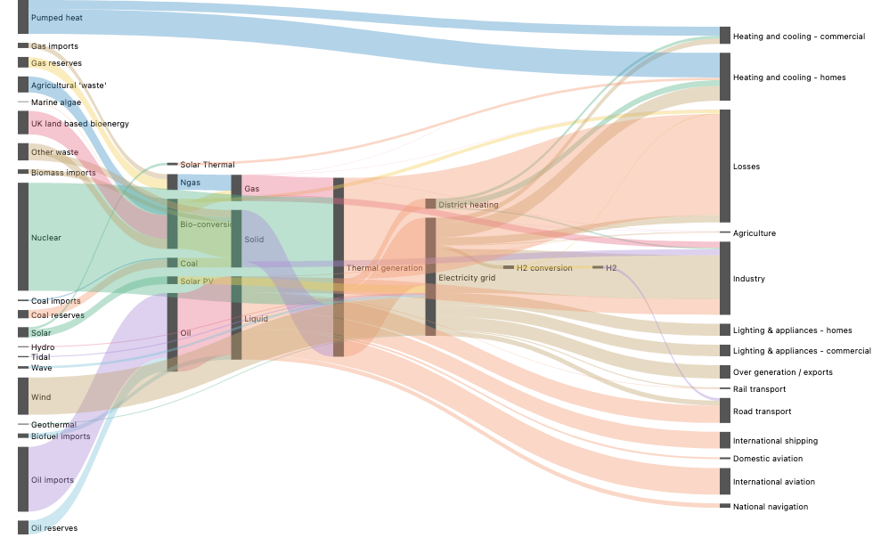 20.9%, 2.37 |
| 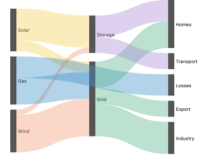 small, relaxed: 8.5%, 1.70              | 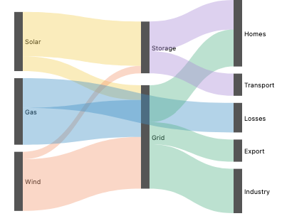 8.6%, 1.46        |

Spelling (placeholders). Picked: an option of `ranked`, because it already owns the links and the link curve:

```js
ranked({ ..., layerSpacing: Gaps.slope({ max: 1, min: 30 }) }, { nodes, links, node, link: ribbon({ curve: Curve.bezier() }) });
```

```python
ranked(..., layer_spacing=Gaps.slope(max=1, min=30), nodes=nodes, links=links, node=node, link=ribbon(curve=Curve.bezier()))
```

Considered: a spacing value on the column spread, `spacing: Gaps.slope(links, { max: 1, curve })`, which passes the links and curve a second time; and a minmax rule, `Gaps.minmax(links, { maxSlope: 1 })`, which becomes a second strategy of the same option. Because spacing only changes slope, it is lower priority than the coordinate phase.

## Approaches

## Approaches

### A. Graph phases as data helpers, placement by existing operators

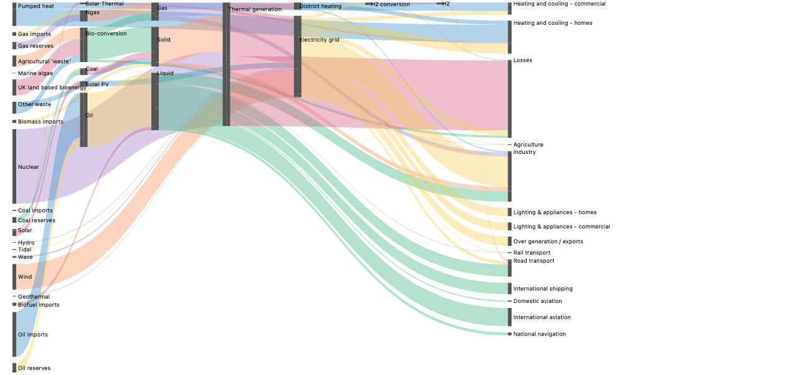

```js
chart(nodes)
  .flow(
    derive(layers(links, { key: "name", layering: Layering.justify() })),
    derive(
      order(links, {
        key: "name",
        by: "layer",
        ordering: Ordering.barycenter(),
      })
    ),
    spread({ by: "layer", dir: "x", spacing: fr(1) }),
    spread({ by: field("order").sort(), dir: "y", spacing: 10 })
  )
  .mark(rect({ w: 12, h: "value" }).name("nodes"));
```

```python
chart(nodes).flow(
    derive(layers(links, key="name", layering=Layering.justify())),
    derive(order(links, key="name", by="layer", ordering=Ordering.barycenter())),
    spread(by="layer", dir="x", spacing=fr(1)),
    spread(by=field("order").sort(), dir="y", spacing=10),
).mark(rect(w=12, h="value").name("nodes"))
```

Today the story computes `layers`, `barycenterOrder` and `linkEnds` in plain JS (`_proto.ts`) and sorts by a hand-built name list. The dependency graph (`img/a-dependencies.png`) uses the same two spreads with fixed-size boxes and arrows. Its two long edges run through boxes, which only virtual nodes fix.

- **Composes with:** any later flow tier, `Coord.polar()`, and the ribbons anchors. It desugars to `derive` plus `spread`.
- **Overlap check:** none, since A does no placement. `Ordering.*` reads the links table, so it is not a sort over the rows.
- **Trade-offs:** easy to explain and override. Two helpers and two families. No relaxed look, no bent edges. A helper over nodes takes a second table, which today's `derive` helpers do not do.

### B. Relaxed y as a precomputed field, placed by scatter

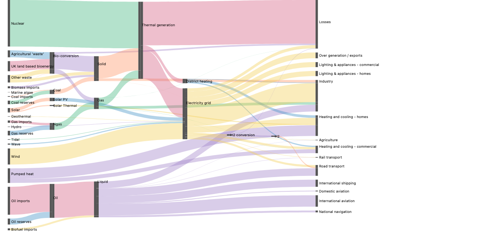

```js
chart(nodes)
  .flow(
    derive(layers(links, { key: "name", layering: Layering.justify() })),
    derive(
      relax(links, {
        key: "name",
        by: "layer",
        size: "value",
        padding: 10,
        height: 600,
      })
    ),
    spread({ by: "layer", dir: "x", spacing: fr(1) }),
    scatter({ by: "name", yMin: "yMin", yMax: "yMax" })
  )
  .mark(rect({ w: 12, h: "value" }));
```

Relaxation cannot be a strategy on a column's spread. It reads other columns, it is a fixed point, and it cannot be split: d3 removes overlaps inside every sweep. Relaxing first and removing overlaps once per column (`img/b-energy-relax-then-resolve.png`) raises the bands' total vertical travel by 13% (574,847 vs 509,045; d3 510,730). It also happens to cut crossings (17 vs 26), so it is a different layout, not uniformly worse. Even that one local step has no home: `Overlap` strategies move only the free axis.

- **Overlap check:** large partial overlap. The helper recomputes ky, padding and the height in pixels, which the spreads and the σ fit already own.
- **Trade-offs:** works today and matches d3, but duplicates the scale, breaks when resized or nested, and needs a y flip.

### C. One `ranked` operator, phases as strategies

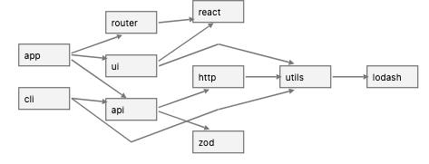

```js
ranked(
  {
    size: "value",
    spacing: 10,
    layering: Layering.justify(),
    ordering: Ordering.barycenter(),
    positioning: Positioning.relax({ iterations: 6 }), // or Positioning.stack()
    virtualNodes: true,
  },
  { nodes, links, node: rect({ w: 12 }), link: ribbon({ opacity: 0.4 }) }
);
```

The model is d3-dag's `sugiyama().layering().decross().coord()` and ELK Layered. Seeing edges lets it add virtual nodes and run relaxation. The prototype computes positions in JS and emits placed marks (`c-energy-relax`, `c-small-relax`, `c-small-stack`).

- **Overlap check:** large partial overlap unless built on A. `Positioning.stack()` is exactly A's two spreads (`img/c-small-stack.png`). C must desugar into A's helpers and `spread`, and add only virtual nodes and `Positioning.relax()`.
- **The coordinate phase is the reason C matters:** 25% vs 3.7% overplot on energy. `Positioning` is one family, a center rule plus an overlap rule (see Tidy trees).
- **Name:** `ranked` is a working name (Graphviz's word for a layer, directionless, covers trees); it is a decision below.
- **Trade-offs:** serves DAGs and flowcharts. Three families and one operator. Hides the flow tiers.

### D. A GoTree-style template


```js
sankey({ layering: Layering.justify(), spacing: 10 }, { nodes, links });
```

It expands into A's spec, and its render is byte-identical to A's. GoTree elaborates local relations (parent to child) into combinators because a tree's structure is the data's nesting. A sankey's missing pieces are whole-graph folds: longest paths and crossing sweeps. A template can only express those by calling A's helpers. So it is sugar over A, and the "geom_sankey" pattern GoFish avoids.

## Tidy trees

A tree is a layered graph with no crossings, so it tests the coordinate phase alone. Data: a 44-node flare subset (32 leaves, depth 3). 8 px nodes, 6 px gap, 128 px per layer; each image is as tall as its layout.

| Layout                                        | Height                            | Image                        |
| --------------------------------------------- | --------------------------------- | ---------------------------- |
| d3.tree reference                             | 386                               | 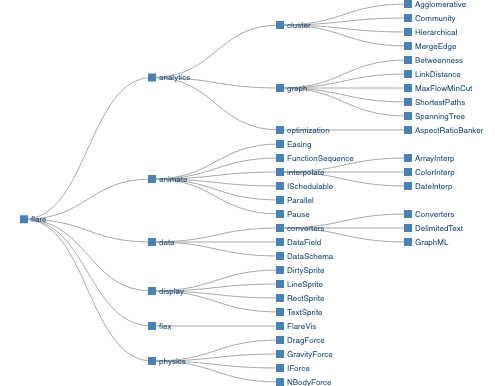      |
| d3.cluster reference                          | 442                               | 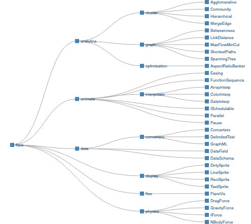   |
| A as is: one centered spread per column       | 288, parents far from children    | 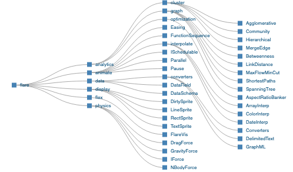  |
| Nested spreads by bounding box (GoTree today) | 442                               | 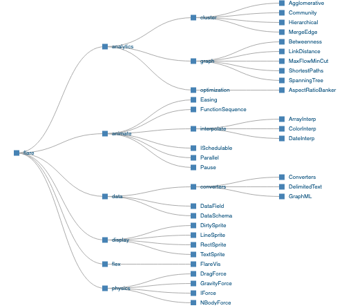  |
| Contour packing stand-in                      | 386, equals d3.tree to 0.00 px    | 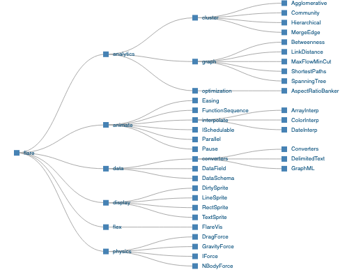 |
| Cluster rule stand-in                         | 442, equals d3.cluster to 0.00 px | 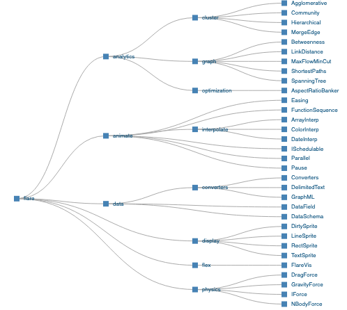 |

Proposed tidy tree (placeholders marked), against today's nested spreads with `alignment: "middle"` and box spacing:

```js
tree(
  {
    parentChild: distribute({ dir: "x", spacing: 120, alignment: "anchor" }), // placeholder
    sibling: distribute({ dir: "y", spacing: 6, measure: Outline.contour() }), // placeholder
  },
  flare
);
```

```python
tree(
    parent_child=distribute(dir="x", spacing=120, alignment="anchor"),
    sibling=distribute(dir="y", spacing=6, measure=Outline.contour()),
    data=flare,
)
```

Proposed cluster:

```js
ranked(
  {
    layering: Layering.longestPath({ from: "sinks" }),
    ordering: Ordering.input(),
    positioning: Positioning.center({ of: "out", rule: "mean" }),
  },
  {
    nodes,
    links,
    node: rect({ w: 8, h: 8 }),
    link: line({ curve: Curve.bezier() }),
  }
);
```

Today, the contour and cluster stories compute y in `_proto.ts` (`contourTree`, `clusterTree`) and place it with A's `spread` by layer plus `scatter({ by: "name", y: "y" })`.

Findings:

- **Layer and order carry over unchanged:** layer is depth (`Layering.longestPath()`), order is depth-first order.
- **The y placement does not.** A tree's y is a nesting (the GoTree factoring), not one spread per column. A tidy tree is nested spreads plus two spread changes: spacing measured on outlines instead of boxes (442 to 386 px; not tree-specific, it works like kerning), and the parent centered on its first and last child rather than the children's whole outline (`alignment: "middle"` moves 3 nodes by up to 26 px).
- **Cluster's layering is `Layering.longestPath({ from: "sinks" })`**, d3-sankey's `right`, not `justify` (justify differs at display, flex, physics; `img/r2-tree-cluster-justify.png`).
- **Contour spacing does not help the SankeyTree story:** every path has the same depth, so contours equal boxes (218 = 218 px). It helps only when stacked groups span different layer ranges.
- **Parent centering is the tree case of coordinate assignment:** one parent per node, so one bottom-up pass, no iteration.

| Layout       | Center of the neighbors               | Overlap removal in the layer | Passes         |
| ------------ | ------------------------------------- | ---------------------------- | -------------- |
| d3.cluster   | mean of the children                  | none needed                  | one            |
| Tidy tree    | midpoint of first and last child      | contours of rigid subtrees   | one            |
| Brandes–Köpf | median neighbor (vertical blocks)     | block compaction             | four, averaged |
| d3-sankey    | value-weighted barycenter, both sides | 1-D push in the column       | 6 alternating  |

## Phases as a DSL (deferred)

Deferred by agreement. Precedent: d3-dag (one slot per phase, nested operators), ELK (flat strategy options plus per-node constraints), WebCoLa (phases as constraint sets in one solve), Lupton (phase outputs as data, which A already follows), Penrose and Bluefish (no phases). Each one-sided coordinate sweep is an acyclic fold over the columns; only the repetition is a loop. Sketch (placeholder):

```js
positioning: [
  Positioning.stack(),
  Positioning.sweep("in"),
  Positioning.sweep("out"),
].repeat(6);
```

Cluster is the single step `Positioning.sweep("out", { rule: "mean" })`. A tidy tree does not fit: it moves whole subtrees.

## Prior work## Prior work

- **d3-sankey:** monolithic. Order falls out of relaxation. `sankey().nodeAlign(sankeyJustify).iterations(6)`.
- **d3-dag:** one builder slot per Sugiyama phase. The model for C.
- **ELK Layered:** every phase is a strategy option, and "keep the user's order" is one of them. The only tool found that sizes each gap from its edges.
- **dagre / Graphviz dot:** monolithic with knobs. dagre exposes `ranker`; dot takes constraints like `rank=same`.
- **Lupton, d3-sankey-diagram / floweaver:** order is data the user writes. When it is given, no algorithm runs. The model for A.
- **PiCCL:** the column is a data field, nodes and columns are stacks. A without helpers.
- **ggalluvial:** axes and stratum order come from factor levels. No crossing reduction.
- **Plotly / ECharts:** d3-sankey behind options (`arrangement`, `layoutIterations`, per-node `depth`).

## Gaps and bugs

| Item                                                                                                                                  | Kind                 |
| ------------------------------------------------------------------------------------------------------------------------------------- | -------------------- |
| A sibling label layer flips what `alignment` means on y (`Repro/AlignStartNoLabels` vs `AlignStartWithLabels`; `img/bug-align-*.png`) | bug to file          |
| The same repro without `axes: false` throws "axis 1 has a continuous type but no size claim"                                          | bug to file          |
| A `line` from a box ref hid that box's label (not reduced)                                                                            | bug                  |
| No spacing that has a pixel minimum and spreads leftover height (`Scale Probe/FlexibleGaps`)                                          | design, #1165        |
| Labeling a node when the flow's leaf is a port                                                                                        | design               |
| No 1D overlap removal along the placed axis                                                                                           | design, C follow-up  |
| Two y conventions: `rect({ y })` counts down, `scatter` y points up                                                                   | design               |
| Long right-column labels run past the canvas                                                                                          | design (chrome room) |

## Recommendation

**A now.** It desugars into the existing core: two `derive` helpers and the spread composition GoFish has, with the shared scale coming free. The families follow `Tile` and `Curve` and cross to Python as IR. A user can always replace a helper with their own field. It carries over to trees unchanged.

**C next, not later.** The coordinate phase takes energy's overplot from 25% to 3.7%, which no ordering or spacing can do. C should desugar into A's helpers and `spread` and add only `Positioning` (center plus overlap rule), virtual nodes, and later `layerSpacing`.

**Why not C now:** A ships on its own and C needs it either way, while C still has open questions: its name, the shape of `Positioning`, whether outline spacing and root alignment become spread options, and the deferred phase DSL.

**What would flip the pick to C now:** if the first sankey release must look like d3's on large graphs, or layered DAG diagrams with bent edges are wanted soon. Then C ships with `Positioning.relax()` only.

## Decisions for Josh

1. A now and C next, or C now?
2. Operator name: `ranked` (working name), `sugiyama`, `rank` (clashes with SQL/polars `rank()`), or the weaker `hierarchy`, `dag`, `flowchart`, `strata`? (`layered`, "tier" and `levels` are taken.)
3. Where do the graph phases live: `derive` helpers over nodes that take the links table, or a flow operator over the links?
4. Family names: `Layering`, `Ordering` and `Positioning`? (`Place`, `Coord` and `align` are taken.)
5. Default column rule: `justify` or `longestPath` (left)?
6. Column spacing: pursue it, given it only changes slope? If so, as a `ranked` option (picked) or a spacing value on the column spread?
7. Outline (contour) spacing as a spread option: part of this effort, or its own issue?
8. Root alignment: `alignment: "anchor"`, or a relation in GoTree?
9. Is fill-the-height spacing part of this effort, or does it stay with #1165?
10. Is a `sankey()` template wanted at all?

## Rationale and related issues

- Desugar into the core; no geom_sankey; no fixpoint iteration in the engine; overlap only at the edges; data flows as lists; accepting an order is the zero-engine path (`notes/design/modular-layout-algorithms.md`).
- Sources for spacing, naming and trees: `research-2.md`.
- Correction to earlier notes: d3 with a fixed `nodeSort` is closed-form only with `iterations(0)`.
- #47 stacked ribbons (the link-end half). #631 modular layout algorithms, and #701 its design note. #355 decompose treemap, tidy tree and Sugiyama into primitives. #485 solvers that emit discrete commitments. #610 a layout-program IR. #1165 fill the frame without pixel spacing. #1013 strategy family namespaces. #1003 scatter overlap strategies. #1163 extension packages crossing to Python. #738 hierarchy (tree) layouts. #966 shape geometry, the outlines outline spacing would measure. #46 composite examples, including a FrankenSankey.
