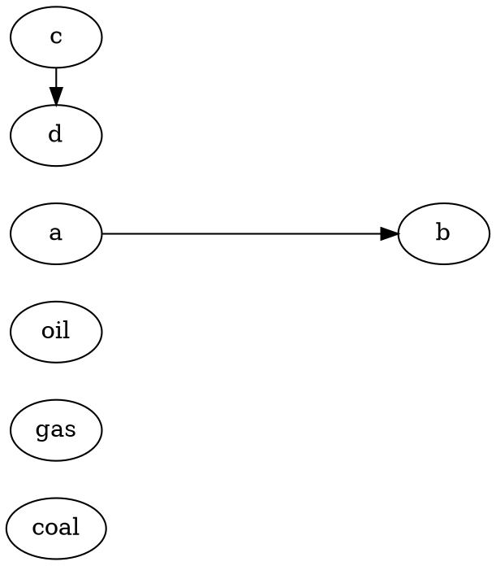

# Sankey node layout: research

Research half of the sankey layout proposal. Josh's question: how composable can the
node layout part of a sankey be, can the scaling and spread/stack-like steps inside
d3-sankey be factored out into a GoFish spec, and does it need an elaboration like
GoTree? He also asked to consider Sugiyama and other graph layouts.

The ribbon half (link ends stacked inside nodes) is covered by the stacked-ribbons
proposal (`origin/worktree-stacked-ribbons-proposal`, `proposals/stacked-ribbons/`),
whose agreed direction is `.anchor({ name, position: "x-max", slots: data(links, { on:
"source" }).flow(stack(...)) })` on nodes plus `ribbon({ from: "out", to: "in" })`. It put
node layout out of scope (#701, #631). This document is about where the nodes go.

## Terms

- **Node.** A bar whose length shows a total flow. **Link.** A weighted edge from a source
  node to a target node, drawn as a ribbon.
- **Column / layer / rank.** The discrete x slot a node sits in. Graph-layout papers call it
  a layer or rank; d3-sankey calls it `layer` and `depth`.
- **Depth / height.** In d3-sankey, a node's depth is the longest path from any source to
  it; its height is the longest path from it to any sink.
- **Breadth.** d3-sankey's word for the cross-axis (y) position of a node.
- **Barycenter.** A weighted mean of neighbor positions. Moving a node to the barycenter of
  its neighbors is the classic heuristic for straightening links and reducing crossings.
- **Relaxation.** Repeatedly moving each node part way (a damping factor `alpha`) toward a
  target computed from its neighbors.
- **Collision resolution.** In one dimension: given nodes in a column, sorted, push them apart
  so each pair keeps at least the padding between them, inside the extent.
- **Crossing minimization.** Choosing the order of nodes in each layer so that few links
  cross. NP-hard even for two layers.
- **Coordinate assignment.** Given layers and orders, choosing the exact cross-axis positions.
- **Dummy node.** A placeholder inserted where a long edge crosses a layer, so every edge in
  later phases joins adjacent layers only.
- **σ (scale factor).** GoFish's pixels per data unit on an axis
  (`apps/docs/docs/internals/design/size-claims.md`, "Terminology").
- **Claim.** What a GoFish node reports upward before layout: its extent as a
  piecewise-linear function of σ (`Pwl`).

---

## 1. d3-sankey, phase by phase, with the GoFish mapping

Source read: `d3-sankey/src/sankey.js` (369 lines) and `src/align.js` (23 lines),
https://github.com/d3/d3-sankey (fetched into `tests/tmp/sankey-proposal/src/`). Line
numbers below are from that file. Defaults: `nodeWidth` 24 (`dx`), `nodePadding` 8 (`dy`),
`nodeAlign` = `justify`, `iterations` 6, `nodeSort` and `linkSort` undefined, extent
`[[0,0],[1,1]]`.

The top-level function (lines 66-75) is a fixed composition:
`computeNodeLinks → computeNodeValues → computeNodeDepths → computeNodeHeights →
computeNodeBreadths (= computeNodeLayers, initializeNodeBreadths, relaxation) →
computeLinkBreadths`.

### Phases, exact math

**P1. computeNodeLinks (126-147).** Gives each node `index`, empty `sourceLinks` (out-links)
and `targetLinks` (in-links). Resolves `link.source`/`link.target` ids to node objects via
`nodeId` (default: index), throwing `missing: id` for an unknown id. Pushes each link onto its
source's `sourceLinks` and its target's `targetLinks`. If `linkSort` is non-null, sorts both
lists with it once.

**P2. computeNodeValues (149-155).** `node.value = fixedValue ?? max(Σ sourceLinks.value,
Σ targetLinks.value)`. Confirmed: the node is as tall as the larger of its in-sum and out-sum.
A user may pin a node's value with `fixedValue`.

**P3. computeNodeDepths (157-173).** Breadth-first frontier from all nodes at once:
`current = all nodes`, set `depth = x` for each node in `current`, `next = targets of their
out-links`, `x++`. A node reached again later gets a larger depth, so the final depth is the
**longest path from any source**. If `x > n` it throws `"circular link"` (there is no cycle
removal).

**P4. computeNodeHeights (175-191).** The mirror image over in-links: **longest path to any
sink**. Same cycle error.

**P5. computeNodeLayers (193-209), column assignment.** `x = max depth + 1` columns.
`kx = (x1 − x0 − dx) / (x − 1)`. For each node, `layer = clamp(floor(align(node, x)), 0,
x−1)`, `x0 = x0 + layer·kx`, `x1 = x0 + dx`. If `sort` is truthy, sort each column with it.
The align functions (`align.js`):

| `nodeAlign`           | column                                                                      |
| --------------------- | --------------------------------------------------------------------------- |
| `sankeyLeft`          | `depth`                                                                     |
| `sankeyRight`         | `n − 1 − height`                                                            |
| `sankeyJustify` (def) | `depth` if the node has out-links, else `n − 1` (sinks to the right)        |
| `sankeyCenter`        | `depth` if it has in-links; else (a source) `min(target depth) − 1`; else 0 |

So columns are evenly spaced across the width with the first column's left edge at `x0`
and the last column's right edge at `x1`.

**P6. Padding cap (235).** `py = min(dy, (y1 − y0) / (maxColumnLength − 1))`. The padding
shrinks if the busiest column cannot fit its gaps in the height.

**P7. initializeNodeBreadths (211-231), the shared scale and initial stacking.**

- `ky = min over columns c of (y1 − y0 − (|c| − 1)·py) / Σ_{n∈c} value(n)`. Confirmed: the one
  shared pixels-per-unit is set by the tightest column, gaps included.
- In each column, in its current order: `y0 = y`, `y1 = y + value·ky`, `y += value·ky + py`
  (a stack with gap `py` from the top). Every out-link gets `width = value·ky`.
- Then the column's leftover `L = y1 − y_end + py` is split into `|c| + 1` equal parts, and the
  i-th node (0-based) moves down by `(i + 1)·L/(|c| + 1)`. That is CSS
  `justify-content: space-evenly`: equal slack above the first node, between nodes and below
  the last, on top of the fixed `py` gaps. The tightest column has `L = 0`.
- `reorderLinks`: if `linkSort` is undefined, sort each node's out-links by target `y0` and
  in-links by source `y0`.

**P8. Relaxation (233-289).** For `i` in `0..iterations−1`: `alpha = 0.99^i`,
`beta = max(1 − alpha, (i + 1)/iterations)`; run `relaxRightToLeft` then `relaxLeftToRight`.

- `relaxLeftToRight` walks columns 1..n−1. For each node `t`, over its in-links `(s, value)`:
  weight `v = value · (t.layer − s.layer)` (longer links pull harder), target
  `y = Σ targetTop(s, t)·v / Σ v`, then `t.y0 += (y − t.y0)·alpha` (and `y1`). `targetTop(s, t)`
  (340-352) is the `t.y0` at which the link s→t would be horizontal: start at
  `s.y0 − (|s.out| − 1)·py/2`, add `width + py` for each of `s`'s out-links before this one,
  subtract the widths of `t`'s in-links before this one. (Note the `py` term: the ideal spreads
  a node's outgoing links apart by the padding.) After moving a node, `reorderNodeLinks`.
- `relaxRightToLeft` is the mirror over out-links using `sourceTop` (355-366), columns
  n−2..0.
- After each column: **if `sort === undefined`, re-sort the column by `y0`** (lines 263, 286).
  This is where d3-sankey decides the in-column order. With `nodeSort` set (a comparator, or
  `null` for input order) the order is frozen but **positions are still relaxed**.
- `resolveCollisions(column, beta)` (291-298): take the middle node `i = |c| >> 1`; push nodes
  above it up (`resolveCollisionsBottomToTop` from `subject.y0 − py`), push nodes below it down
  (`TopToBottom` from `subject.y1 + py`), then push everything up from the bottom edge `y1`, then
  down from the top edge `y0`. Each push moves a node by `overlap · beta` and only if the overlap
  is over `1e-6`. On the last iteration `beta = 1`, so the final pass removes every overlap and
  clamps to the extent (unless the column cannot fit, in which case the top-down pass wins).

**P9. computeLinkBreadths (39-52).** Per node, from `node.y0`: each out-link (in its sorted
order) gets `link.y0 = y + width/2`, `y += width`; each in-link likewise gets `link.y1`. Link
ends stack tightly inside the node, ordered by the far node's y (from `reorderLinks` /
`reorderNodeLinks`), or by `linkSort`.

### The mapping

| #     | Phase                                   | What it is                                | GoFish counterpart today                                                                                                                                                                                                                                                                                                                                                                                                 |
| ----- | --------------------------------------- | ----------------------------------------- | ------------------------------------------------------------------------------------------------------------------------------------------------------------------------------------------------------------------------------------------------------------------------------------------------------------------------------------------------------------------------------------------------------------------------ |
| P1    | link resolution, in/out lists           | relational join                           | `resolve(["source","target"], { from: selectAll("nodes") })`, or a nest join giving each node `in`/`out` list fields (stacked-ribbons round 2). **Covered by the ribbons proposal.**                                                                                                                                                                                                                                     |
| P2    | node value = max(Σin, Σout)             | aggregate per node                        | A `derive` today. Stacked-ribbons notes the node `h` would ideally be "the max of its anchors' lengths", which is a cycle if anchors lay out after the node (`NOTES-anchors.md` §1). Under the anchors design, a node whose size is its anchor stacks is `max` in the claim algebra (align fold), which exists.                                                                                                          |
| P3/P4 | depth, height (longest path)            | max-plus fold over a DAG                  | **No operator.** A `derive` with user JS (the prototype's `sankeyDepths`, `sankeyPrep.ts`). Global and graph-shaped: it reads every link, not one row.                                                                                                                                                                                                                                                                   |
| P5    | column from `nodeAlign`                 | policy over (depth, height)               | Policy = one-line data transform on depth/height. Placement = `spread({ by: "column", dir: "x", spacing: fr(1) })`: verified to give d3's `kx` exactly (columns at x = 0 and 288 in a 300 px box with 12 px nodes, `tests/tmp/sankey-proposal/scripts/ky3.test.ts`).                                                                                                                                                     |
| P6    | `py = min(dy, H/(maxN−1))`              | padding cap                               | No counterpart. GoFish keeps pixel spacing and, when fixed parts overfill the slot, solves σ from the rising part and warns `fixed-overflow` (`Pwl.fill`, `solver/pwl.ts:417`).                                                                                                                                                                                                                                          |
| P7a   | `ky` = min over columns                 | shared scale, gaps included               | **Exactly GoFish's σ solve.** See §5.2: verified numerically, σ = 9.6667 = d3's `ky`.                                                                                                                                                                                                                                                                                                                                    |
| P7b   | stack with gap `py`                     | spread with fixed spacing                 | `spread({ by: "node", dir: "y", spacing: py })` inside each column.                                                                                                                                                                                                                                                                                                                                                      |
| P7c   | leftover split `space-evenly`           | slack distribution                        | **Partial.** The outer x-spread's `alignment` places a short column's slack at start, middle or end (verified). Equal slack between nodes needs flexible gaps; `fr` spacing exists (`length.ts:72`) but in a data-scaled y it is a fraction of a data unit and warns (`stories/forwardsyntax/Lengths.stories.tsx`, `FrInDataScopeWarns`). This is the "fill-the-height gaps" problem the ribbons proposal sent to #1165. |
| P7d   | `reorderLinks`                          | link-end order = far node's y             | **Covered by the ribbons proposal** (far-position default slot order).                                                                                                                                                                                                                                                                                                                                                   |
| P8a   | in-column order (sort by y after moves) | crossing minimization, implicit           | **No GoFish counterpart.** Global, iterative, cross-sibling: a node's order depends on positions in other columns. Accepting the order from data (`field("node").sort(order)`) works today.                                                                                                                                                                                                                              |
| P8b   | barycenter pull toward `targetTop`      | coordinate assignment, iterative          | **No GoFish counterpart.** Reads positions of nodes in other subtrees (other columns) and moves the node; the engine is confluent, write-once, with "no fixpoint iteration anywhere" (`internals/design/constraints-as-core.md:387`).                                                                                                                                                                                    |
| P8c   | resolveCollisions                       | 1-D overlap removal along the placed axis | **Gap.** The `Overlap` family (`families/overlap.ts`) is close in spirit but its contract is the opposite axis: "a strategy moves only the free axis ... cannot touch the data axis" (`graphicalOperators/overlap.ts:6-21`). A sankey column needs nodes pushed along the same axis their target y is on. `spread` gives non-overlap but ignores targets.                                                                |
| P9    | link breadths                           | stack of link ends in each node           | **Covered by the ribbons proposal** (`anchor` slots = `stack`).                                                                                                                                                                                                                                                                                                                                                          |

### What the table says

1. Everything that is a scale, a stack or a spread (P5 placement, P7a, P7b, P9) is already
   GoFish, and the shared-scale part matches d3 to the digit.
2. What is not GoFish is three graph-shaped decisions: **columns** (P3-P5 policy, a fold over the
   graph), **order** within a column (P8a), and **exact y** given order (P8b + P8c, relaxation
   toward neighbors with overlap removal).
3. A correction to the in-repo survey (`notes/design/modular-layout-algorithms.md` §2.4, and the
   ribbons proposal's #701 summary): "with `nodeSort` and `linkSort` given, the entire layout is
   closed-form" is only true with `iterations(0)`. With a fixed order, d3 still relaxes y
   positions (P8b/P8c run regardless of `sort`; only the re-sort is skipped). A fixed-order,
   zero-iteration d3-sankey is: stack from the top with `py` gaps, then space-evenly slack. That
   is closed-form and is GoFish today, except the space-evenly slack.
4. `nodeAlign` in d3 is a **column** policy (x), while GoFish `alignment` is a cross-axis
   policy. Highcharts' `nodeAlignment` is the cross-axis one (top/center/bottom). Naming must
   not collide.

---

## 2. Sugiyama and graph-layout precedent

### The Sugiyama framework

Sugiyama, Tagawa and Toda, "Methods for Visual Understanding of Hierarchical System
Structures", IEEE Trans. SMC 11(2), 1981. Four phases, each with its own literature:

1. **Cycle removal.** Reverse a small set of edges so the graph is acyclic (minimum feedback arc
   set is NP-hard; greedy heuristic of Eades, Lin and Smyth 1993; DFS).
2. **Layer assignment.** Longest path (fast, wide); Coffman-Graham (bounded width); network
   simplex (Gansner, Koutsofios, North, Vo, "A Technique for Drawing Directed Graphs", IEEE TSE
   1993, the Graphviz `dot` paper), which minimizes total weighted edge length
   `Σ w·(rank(v) − rank(u))` subject to `rank(v) − rank(u) ≥ minlen`. Long edges get dummy nodes.
3. **Crossing minimization.** Layer-by-layer sweeps, each placing nodes by the barycenter
   (Sugiyama 1981) or median (Eades and Wormald 1994) of their neighbors in the fixed layer;
   exact ILP for small graphs.
4. **Coordinate assignment.** Sugiyama's own priority layout method (move nodes toward their
   barycenter in priority order, never past higher-priority nodes); Gansner et al.'s network
   simplex on an auxiliary graph; Brandes and Köpf, "Fast and Simple Horizontal Coordinate
   Assignment", Graph Drawing 2001 (four vertical alignments, compaction, average of the
   extremes), used by dagre and ELK.

d3-sankey is Sugiyama with (1) missing (cycles are an error), (2) = longest path plus an align
policy, no dummy nodes, (3) and (4) merged into one relaxation loop in which the order falls
out of the positions. The priority method is the closest classical relative of d3's
relaxation plus collision pass.

### Precedent cards

**Graphviz `dot`** (https://graphviz.org/docs/layouts/dot/). Monolithic; phases tuned by
attributes, constraints written into the graph.



Decides: ranks (network simplex), order (median sweeps), coordinates (network simplex on an
auxiliary graph), splines. User spells: `rankdir`, `ranksep`, `nodesep`, `rank=same|min|max|
source|sink`, `ordering=out|in`, `newrank`, edge `weight`, `minlen`, `constraint=false`,
node `group` (keep edges straight), limits `mclimit`, `nslimit`, `searchsize`.

**dagre** (https://github.com/dagrejs/dagre/wiki). Monolithic; one phase is a named strategy.

```js
g.setGraph({
  rankdir: "LR",
  ranker: "network-simplex",
  align: "UL",
  nodesep: 50,
  ranksep: 50,
  edgesep: 10,
  acyclicer: "greedy",
});
```

Decides everything. Strategy option: `ranker: "network-simplex" | "tight-tree" | "longest-path"`;
`acyclicer: "greedy"`; `align: "UL"|"UR"|"DL"|"DR"` picks one of Brandes-Köpf's four
alignments instead of the average. Edges: `minlen`, `weight`. Newer dagre versions accept
ordering constraints and a `customOrder` callback (per the d3-dag README).

**ELK Layered** (https://eclipse.dev/elk/reference/algorithms/org-eclipse-elk-layered.html).
**Each phase is a strategy option.**

```js
layoutOptions: {
  "elk.algorithm": "layered", "elk.direction": "RIGHT",
  "elk.layered.cycleBreaking.strategy": "GREEDY",
  "elk.layered.layering.strategy": "NETWORK_SIMPLEX",
  "elk.layered.crossingMinimization.strategy": "LAYER_SWEEP",
  "elk.layered.nodePlacement.strategy": "BRANDES_KOEPF",
  "elk.spacing.nodeNode": 20, "elk.layered.spacing.nodeNodeBetweenLayers": 20 }
```

Values (from the per-option reference pages): cycle breaking `GREEDY`, `DEPTH_FIRST`,
`INTERACTIVE`, `MODEL_ORDER`, `GREEDY_MODEL_ORDER`, `SCC_CONNECTIVITY`, `SCC_NODE_TYPE`,
`DFS_NODE_ORDER`, `BFS_NODE_ORDER`; layering `NETWORK_SIMPLEX` (default), `LONGEST_PATH`,
`LONGEST_PATH_SOURCE`, `COFFMAN_GRAHAM`, `INTERACTIVE`, `STRETCH_WIDTH`, `MIN_WIDTH`,
`BF_MODEL_ORDER`, `DF_MODEL_ORDER`; crossing minimization `LAYER_SWEEP` (default),
`MEDIAN_LAYER_SWEEP`, `INTERACTIVE`, `NONE`; node placement `SIMPLE`, `INTERACTIVE`,
`LINEAR_SEGMENTS`, `BRANDES_KOEPF` (default), `NETWORK_SIMPLEX`; edge routing `ORTHOGONAL`
(default), polyline, splines. Note `INTERACTIVE` (keep the user's existing positions) and
`NONE` for crossing minimization (keep model order): the "accept it from the user" choice is a
strategy, not a separate API. Also per-node layer constraints (`FIRST`, `LAST`, ...) and model
order options.

**d3-dag** (https://github.com/erikbrinkman/d3-dag, `src/sugiyama/index.ts`). **A builder with
one slot per phase, each filled by an operator.**

```js
const layout = sugiyama()
  .layering(layeringSimplex()) // layeringLongestPath, layeringTopological
  .decross(decrossTwoLayer().order(twolayerAgg(aggMedian()))) // decrossOpt, decrossDfs
  .coord(coordSimplex()) // coordQuad, coordGreedy, coordCenter, coordTopological
  .nodeSize([w, h])
  .gap([gx, gy]);
```

Slots on `SugiyamaOps`: `layering`, `decross`, `coord`, `nodeSize`, `tweaks` (plus `gap`).
Defaults: `layeringSimplex`, `decrossTwoLayer`, `coordSimplex`. Two-layer operators:
`twolayerAgg` (with `aggMean`, `aggMedian`, `aggWeightedMedian`), `twolayerGreedy`,
`twolayerOpt`. Tweaks: `tweakFlip`, `tweakShape`, `tweakSize`, `tweakDirection`, `tweakGrid`,
`tweakSugiyama`. Other layouts: `zherebko()` (linear topological), `grid()` (with `laneGreedy`,
`laneOpt`). Operators are immutable builders. The dagre-compatible facade adds
`quality: "fast" | "medium" | "slow"` presets that pick one operator per slot.

**Mermaid flowchart and sankey** (https://mermaid.js.org). Monolithic.

```
flowchart LR
  A --> B
```

Config: `flowchart.nodeSpacing`, `flowchart.rankSpacing`, `curve`; renderer dagre by default,
ELK as `layout: elk`. Mermaid also has `sankey-beta` (d3-sankey under the hood), configured
with `sankey.nodeAlignment: "justify" | "center" | "left" | "right"`, `linkColor`,
`showValues`, `width`, `height`. The user writes only `source,target,value` rows.

**Cytoscape.js + cytoscape-dagre** (https://github.com/cytoscape/cytoscape.js-dagre). dagre's
options renamed: `nodeSep`, `edgeSep`, `rankSep`, `rankDir`, `align`, `acyclicer`, `ranker`,
per-edge `minLen` and `edgeWeight` callbacks. A layout is one of many interchangeable layout
objects (`cy.layout({ name: "dagre", ... })`).

**Composable or monolithic?** d3-dag (builder slots) and ELK (one strategy option per phase)
expose phases as swappable strategies. dagre exposes one phase (`ranker`) and one
coordinate-assignment variant (`align`). Graphviz, Mermaid and Cytoscape are monolithic with
tuning knobs and graph-level constraints (`rank=same`, `minlen`, `weight`, `constraint=false`).

---

## 3. Sankey-tool precedent cards

**d3-sankey** (https://github.com/d3/d3-sankey). Phase detail in §1.

```js
sankey()
  .nodeId((d) => d.name)
  .nodeAlign(sankeyJustify)
  .nodeWidth(15)
  .nodePadding(10)
  .nodeSort(null)
  .linkSort(null)
  .iterations(6)
  .extent([
    [1, 1],
    [w - 1, h - 5],
  ]);
```

Decides columns, order, y, link ends. User options: `nodeAlign` (column policy, a function, so
user-extensible), `nodeSort` (`undefined` = automatic; `null` = input order; comparator),
`linkSort` (same), `iterations`, `nodePadding` (a maximum, see P6), `nodeWidth`, `extent`,
per-node `fixedValue`. Cycles are an error; `d3-sankey-circular` (Tom Shanley) is a fork that
routes cycles.

**d3-sankey-diagram / floweaver** (Rick Lupton; https://github.com/ricklupton/d3-sankey-diagram,
https://github.com/ricklupton/floweaver). **Separates order from geometry.**

```js
const layout = d3.sankey().extent([
  [100, 10],
  [840, 580],
]);
layout.ordering(energy.order); // [[["n1"], ["n2"]], [["n3"]], ...]
layout.rankSets([{ type: "same", nodes: ["a", "b"] }]);
diagram.scale(null).whitespace(0.5);
```

`ordering` is "a list of layers, each of which is a list of bands, each of which is a list of
node ids"; when given, "no rank assignment or ordering algorithm takes place". When null, rank
and order are computed. `rankSets` are constraints (`same` | `min`) on layers. `sortPorts`
orders link ends. `scale` is pixels per unit; when null it is computed "to achieve the desired
whitespace fraction" `whitespace`. `nodeBackwards` per node lets flows run right to left
(cycles are drawn, not errors). `nodePosition` bypasses the layout and still computes links.
This is the best match for a GoFish factoring: the ordering is a data structure a user can
write, edit or compute, and the geometry follows from it.

**ECharts sankey** (https://echarts.apache.org/en/option.html#series-sankey; source
`src/chart/sankey/SankeySeries.ts`, `sankeyLayout.ts`). d3-sankey's older algorithm.

```js
{ type: "sankey", orient: "horizontal", nodeAlign: "justify", nodeWidth: 20, nodeGap: 8,
  layoutIterations: 32, sort: "desc", draggable: true,
  levels: [{ depth: 0, itemStyle: {...} }], data: [{ name: "a", depth: 0 }], links: [...] }
```

`nodeAlign: "justify" | "left" | "right"`; `layoutIterations` default 32 ("Gauss-Seidel
iterations"); `sort: "desc" | null` ("Sorting method used when resolving node collisions within
each depth column. Set to null to preserve the original node order"); per-node `depth` pins
the column; `levels[i].depth` styles a column.

**Plotly sankey** (https://plotly.com/javascript/reference/sankey/).

```js
{ type: "sankey", arrangement: "snap", orientation: "h",
  node: { label, x: [0.1, 0.5], y: [0.2, 0.7], pad: 20, thickness: 20, align: "justify" },
  link: { source, target, value, sort: "auto" } }
```

`arrangement`: `snap` (default; drag assisted by snapping to keep `pad`), `perpendicular`
(nodes move only along the cross axis), `freeform`, `fixed`. `node.x`/`node.y` are normalized
positions the user may supply. `node.align: "justify" | "left" | "right" | "center"`.
`link.sort: "auto" | "input"`. The arrangement is an interaction mode as much as a layout mode.

**Highcharts sankey** (https://api.highcharts.com/highcharts/series.sankey). No relaxation
option exposed: nodes are stacked per column in data order and the column is aligned.

```js
{ type: "sankey", nodeWidth: 20, nodePadding: 10, nodeAlignment: "center",
  nodes: [{ id: "a", column: 2, offsetVertical: 10 }], keys: ["from", "to", "weight"] }
```

`nodes[i].column`: "An optional column index of where to place the node. The default behavior
is to place it next to the preceding node." `nodeAlignment` "Determines which side of the chart
the nodes are to be aligned to" (top / center / bottom; default null in the API listing).
Also `nodeDistance`, `minLinkWidth`, `centerInCategory`, `curveFactor`, `levels`, and per-node
offsets. Its `dependencywheel` series is the same model in polar.

**networkD3 `sankeyNetwork`** (R; https://christophergandrud.github.io/networkD3/). A wrapper
of an old d3-sankey: `sankeyNetwork(Links, Nodes, Source, Target, Value, NodeID, nodeWidth = 15,
nodePadding = 10, iterations = 32, sinksRight = TRUE)`. `iterations = 0` keeps input order.

**ggalluvial** (R; https://corybrunson.github.io/ggalluvial/). Not a graph layout. Axes are
discrete x positions in the data; strata (nodes) are stacked tightly on each axis in factor
order (`stat_stratum(decreasing = , reverse = )`); lodes (link ends) are ordered within strata
by `stat_alluvium(lode.guidance = "zigzag" | "frontback" | "backfront" | "forward" |
"backward" | "rightleft" | "leftright", aes.bind = "none" | "flows" | "alluvia")`.
`geom_alluvium` draws a ribbon per cohort across all axes; `geom_flow` per adjacent pair. The
user decides columns and order; the system only stacks.

```r
ggplot(df, aes(x = axis, stratum = stratum, alluvium = id, y = n)) +
  geom_flow() + geom_stratum()
```

**ggsankey** (R; https://github.com/davidsjoberg/ggsankey). `make_long()` reshapes wide to one
row per (x, node) pair, then `geom_sankey(type = "sankey" | "alluvial", space = , width = ,
smooth = )`. `space` is the gap between nodes in y data units; "sankey" centers each column,
"alluvial" stacks from a baseline. Column and order come from the data (factor levels).

**RAWGraphs** (https://github.com/rawgraphs/rawgraphs-charts). Sankey (`src/sankeydiagram`):
`nodesWidth`, `nodesPadding` labelled "Min. vertical padding" (d3's cap), `alignment` Left /
Right / Center / Justify, `iterations` "attempts to solve overlaps" (default 6). Alluvial
(`src/alluvialdiagram`): `sortNodesBy` Size (descending) / Size (ascending) / Name / **Minimize
Overlaps** (`auto`), `verticalAlignment` Top / Center / Bottom. So in RAWGraphs the alluvial is
"a sankey whose order is a sort", and relaxation is one choice of sort.

**SankeyMATIC** (https://sankeymatic.com; source `nowthis/sankeymatic/build/constants.js`,
`build/sankey.js`). Settings: `node_h` (%) and `node_spacing` (%), `layout_order: automatic |
exact`, `layout_justifyorigins`, `layout_justifyends`, `layout_reversegraph`,
`layout_attachincompletesto: leading | nearest | trailing`. The relative sizes are notable:
`node_h` splits the height between nodes and padding (`maximumNodeSpacing = (1 − node_h)·(H −
maxN)/(maxN − 1)`), `node_spacing` takes a fraction of that maximum, and then `ky = min over
stages of (H − (n − 1)·maximumNodeSpacing)/Σ value` (`sankey.js` 533-566). So gaps are sized
relative to the canvas, which is how SankeyMATIC fills the height without per-column slack.

**Vega.** No sankey transform. Community sankeys (e.g. the Kibana sankey) are built from
`stack` on slot rows, `lookup` of the target, and `linkpath`; column and order come from the
data (see stacked-ribbons proposal, "Prior work").

**Observable Plot.** No sankey mark. Observable examples compute `d3.sankey()` and draw the
result with Plot or raw SVG.

**PiCCL** (https://github.com/PiCCL/PiCCL_core, `src/examples/sankey/test.ts`). **No graph
layout: the user composes layouts, and columns come from a data field.**

```js
const glyph = pcg
  .union([rect, label])
  .pointSnap(label, rect, { anchor: [1, 0.5] });
const stack = pcg.replicate(glyph, "Name").stackLayout("y", 6); // nodes in a column
const collection = pcg
  .replicate(stack, "Kind")
  .stackLayout("x", 500) // columns
  .alignLayout("y", 0.5); // center columns
const link = pcg
  .link(collection, { linkByData: true, opacity: 0.5, shape: "bezier" })
  .mapValue("linkWidth", "Value");
```

The column is a precomputed `Kind` column; order is data order. This is the same shape as the
GoFish energy prototype (`spread` x by depth, `spread` y by node).

**Bluefish** (Pollock et al., UIST 2024). Relations (`Stack`, `Distribute`, `Align`, `Background`,
`Arrow`) with local propagation; no sankey or graph layout built in. A user would supply orders
and let relations place.

**Penrose** (Ye et al., SIGGRAPH 2020). The far end: all constraints and objectives (e.g.
`disjoint`, `encourage` closeness) solved by numerical optimization. A sankey would be
non-overlap constraints plus a link-straightness objective. No phases, no strategies.

---

## 4. Literature

- **Sugiyama, Tagawa, Toda 1981.** The four-phase framework (§2).
- **Gansner, Koutsofios, North, Vo 1993**, "A Technique for Drawing Directed Graphs", IEEE TSE
  19(3). Network simplex for ranks and for coordinates (same solver, two phases).
- **Brandes, Köpf 2001**, "Fast and Simple Horizontal Coordinate Assignment", GD 2001.
- **Riehmann, Hanfler, Froehlich 2005**, "Interactive Sankey Diagrams", InfoVis 2005, pp.
  233-240, doi:10.1109/INFVIS.2005.1532152. An interactive exploration tool for flow scenarios
  (energy flows of a city): overview plus detail, interactive manipulation of parameters. I did
  not get the full text; its layout algorithm is not described in the sources I could read.
- **Alemasoom, Samavati, Brosz, Layzell 2016**, "EnergyViz: an interactive system for
  visualization of energy systems", The Visual Computer 32:403-413. Layout criteria: "minimum edge
  intersection, short-as-possible edge lengths and straight edges"; method (as summarized by
  arXiv:1912.05339): barycenter ordering, then a linear program that minimizes weighted distances
  between connected nodes given that order. **Order first, then positions by optimization**, the
  same split as Sugiyama phases 3 and 4.
- **Zarate, Le Bodic, Dwyer, Gange, Stuckey 2018**, "Optimal Sankey Diagrams via Integer
  Programming", PacificVis 2018, pp. 135-139. The first practical ILP for sankey layout:
  minimize the sum of crossings weighted by link width, with dummy nodes so long links are chains
  of short links of the same thickness; measurably fewer crossings than heuristics. (The PDF was
  not fetchable; my recollection is that a second stage straightens links given the order, which
  should be checked before citing.)
- **Li et al., "Crossing Reduction of Sankey Diagram with Barycentre Ordering via Markov
  Chain"**, arXiv:1912.05339. Weighted crossing reduction: Markov-chain barycenter ordering, then
  partition refinement sweeps. Again an ordering-only method.
- **Lupton, Allwood 2017**, "Hybrid Sankey diagrams: Visual analysis of multidimensional data for
  understanding resource use", Resources, Conservation and Recycling 124:141-151. Introduces the
  _ordering_ (layers of bands of nodes) as the user-facing object, with automatic ranking and
  ordering only as a default; implemented in `d3-sankey-diagram` and `floweaver`. Also "Sankey
  definitions" that build the diagram from a dataset by grouping (partitions), close to GoFish's
  flow tiers.
- **Li, Tian, Xu, McGuffin, Yuan 2020**, "GoTree: A Grammar of Tree Visualizations", CHI 2020.
  A tree layout is a pair of per-axis relations (parent-child, sibling) each chosen from
  include / juxtapose / align / flatten; ported as `gofish-gotree` (§5.5).

The common thread: every optimizing method in the literature splits into **(a) a discrete
decision** (columns, order) and **(b) a continuous placement** given that decision. Only d3-sankey
merges (a) order and (b) placement into one loop.

---

## 5. GoFish codebase findings

### 5.1 Existing sankey-like stories and their workarounds

- `packages/gofish-graphics/stories/lowlevel/SankeyTree.stories.tsx` (181 lines, gallery "Sankey
  Tree"). The tree is hand-nested: `spreadX` of tiers, each a `stackY` of `rect`s named by compound
  strings (`${cls}-${sex}-src`), sized `sumBy("count")/10` (a hand-picked scale), with nested
  `spreadY` gaps of 2, 4 and 8 px per level. Ribbons are drawn in `.relate()` by looking up the
  names. Node layout is entirely manual nesting; no column or order computation is needed because
  a tree's order is its grouping order.
- `packages/gofish-graphics/src/tests/sankeyIcicle.ts` (411 lines). The same tree as an
  icicle/sankey hybrid with `frame` + `spread` + `stackY`, two variants (`testSankeyIcicle`,
  `testSankeyIcicleWithFor`). Same manual naming.
- `packages/gofish-graphics/src/tests/sankey.ts` (82 lines). Not a real sankey: categories A/B/C
  as y-spread rows of x-spread rects (fixed `w: d.value * 50`), with one `ribbon` per group across
  rows via `ref`. A bump/ribbon chart with hand scaling.
- `src/ast/marks/chart.ts:1088` only names sankeys in the `ribbon` comment.
- Stacked-ribbons branch `stories/_proposals/stacked-ribbons/sankeyPrep.ts`: the energy sankey
  (48 nodes, 69 links) with node layout in plain JS: `sankeyDepths` (Bellman-Ford-style longest
  path, then sinks to the last column = `sankeyJustify`), `orderColumns` (4 barycenter sweeps on
  ranks, value-weighted), `unpivotLinkEnds` (end rows keyed by the far node's rank). Then
  `spread(depth, x, 100)` and `spread(node, y, 10)` place nodes. Columns are top-aligned and the
  gaps do not fill the height.
- `NOTES-anchors.md` §1 (same branch): node `h` should be the max of its anchors, which it
  precomputes.

### 5.2 The shared-scale question: does GoFish's y scale fit the tallest column including gaps?

**Yes, and it is the same number as d3's `ky`.**

How: a node's claim is a piecewise-linear function of σ. A `spread` along y sums its children's
claims plus its spacing constants (`distribute` fold, `constraints/distribute.ts:313` for the
type; the claim is `Σ value_i·σ + (n − 1)·spacing`). An x-spread of columns hulls the columns'
y claims (`hullExtent` = `Pwl.envelope`, `ast/extent.ts:65-69`), giving the convex function
`max_c (S_c·σ + (n_c − 1)·p)`. The root scope fit solves `claim(σ) = canvas` (`Pwl.solve`,
`solver/pwl.ts:361`, via `Pwl.fill`, `pwl.ts:417`; described in
`apps/docs/docs/internals/layout/passes.md`, "Pass 8: Position Scale Computation",
`ScopeRegistry.fit` in `solver/scopes.ts:376`). The root of `max_c(S_c σ + k_c) = H` is
`min_c (H − k_c)/S_c`, which is d3's line 212. `size-claims.md` ("What the algebra is") calls
the algebra max-plus over monotone functions of σ; the in-repo survey already said "the σ solve
is d3-sankey's `ky`" (`notes/design/modular-layout-algorithms.md` §4).

Verified numerically (`tests/tmp/sankey-proposal/scripts/ky*.test.ts`, not committed): columns
A = [10, 20] and B = [5, 5, 5, 5], spacing 10, 300 × 300 box:

|        | a1 h   | a2 h    | b h    | d3 `ky` |
| ------ | ------ | ------- | ------ | ------- |
| GoFish | 96.667 | 193.333 | 48.333 | 9.6667  |
| d3     | 96.667 | 193.333 | 48.333 | 9.6667  |

Differences from d3:

- **Short-column slack.** With the outer x-spread's `alignment: "middle"`, column B (223.3 px)
  is centered (y from 38.33); d3 would spread its 76.67 px of slack as 15.33 px above each node
  and below the last (space-evenly). `alignment` on the inner y-spread is its cross axis (x) and
  does not move the column (verified). There is no "distribute the slack between children" mode;
  `fr` gaps are the candidate, but in a data-scaled axis `fr` means a fraction of a data unit.
- **Padding cap.** d3 shrinks `py` when gaps alone overfill; GoFish keeps px gaps, warns
  `fixed-overflow`, and solves σ from the rising part.
- **Columns.** `spread({ dir: "x", spacing: fr(1) })` with fixed-width nodes reproduces `kx`
  exactly (x = 0 and 288 for 12 px nodes in 300 px).

### 5.3 Operators that might express "near a target y, then remove 1-D overlap"

- **`scatter`** places each child at its field's position; `overlap` takes an `Overlap` strategy.
  But `Overlap.separate` (`families/overlap.ts`; Observable Plot's `dodge`, beeswarm) and `noise`
  move children along the **free** axis only; the contract forbids touching the data axis
  (`graphicalOperators/overlap.ts:6-21`; `constraints/overlap.ts:20-40`, an after-solve pass, not
  a difference constraint). A sankey column wants each node near its target y and pushed apart
  along y itself: a 1-D projection onto "sorted, gap ≥ p, inside [0, H]" (what VPSC / isotonic
  regression with gaps solves exactly, and what d3's collision pass approximates). The `Overlap`
  family is the natural home by name and shape (a strategy for removing overlap), but it needs a
  strategy that moves along the placed axis, which breaks the current contract. Label placement
  (`Place` family, `avoiding`) is candidate-based and hides labels with no spot, so it is not it.
- **`spread`** (`graphicalOperators/spread.tsx:56-58`, defaults `spacing = 8`,
  `alignment = "baseline"`, `anchor = "edge"`) gives non-overlap with gaps but ignores targets;
  `anchor` sets fixed pitch, `alignment` is the cross axis.
- **`stack`** = `spread({ glue: true })`, for link ends (ribbons proposal).
- **`derive`** can compute anything, including the whole d3 layout, but then GoFish only draws.
- **`resolve`, `group`, `partition`** cover the joins and groupings, not the graph folds.
- **`treemap` + `Tile`** (`families/tile.ts`) and **`pack`** are the precedent for an algorithm
  behind an operator: a "foreign layout" that runs d3, reads child geometry and `place()`s each
  child (`pack.tsx` header; `constraints-as-core.md` calls this the custom layout node). `Tile`
  is the strategy-family precedent: `treemap({ tile: Tile.squarify({ ratio }) })`, kinds
  declared once in gofish-ir's `STRATEGIES` table and crossing the Python bridge as IR. A layout
  phase as a strategy family (`Rank.longestPath()`, `Order.barycenter()`) would follow the same
  pattern (#1013 rules in CLAUDE.md).

### 5.4 Prior in-repo thinking

`notes/design/modular-layout-algorithms.md` (PR #701, issue #631) already reads sankey as
"discrete ordering decision → pure GoFish constraints", lists the passes a modular engine needs
(`layer(graph)` → ranks + dummies, `separate1D`, `relax`, `orderToMinimizeCrossings`), and puts
iteration "inside algorithm nodes or outside the engine (an optimizer that emits orders/pins),
never in the propagation core". Its option D, "ordering as a first-class decision", has a
zero-engine-work variant: accept orders from data or the user. The one correction is §1 point 3
above (fixed order does not make d3 closed-form unless `iterations` is 0).

### 5.5 GoTree: the "elaboration like GoTree" option

`packages/gofish-gotree/` is a separate workspace package (`gofish-gotree`, depends on
`gofish-graphics`). `tree(spec, data)` (`src/tree.tsx`) is plain JS that recursively builds a
GoFish combinator tree: each node is `parentChild([nodeMark, sibling(kids)])`, where the
combiners are `spread`, `distribute` (a `Constraint.distribute` plus optional `Constraint.align`
in a thin `layer`), `nest`, optionally per depth (`alternate`, `perDepth`); edges are
`.relate()` clauses over node names; a `coord` wraps it in `frame`. So it is **macro expansion
at the JS level**, not an IR construct: nothing gotree-specific crosses the wire. Python has its
own re-implementation (`packages/gofish-python/gofish/gotree/__init__.py`), declared as a
shortcut with `TODO(#1163)`: extension packages should cross to Python from one definition.
Docs: `apps/docs/docs/js/gotree.md`, `apps/docs/docs/python/gotree.md` (handwritten).

For sankeys the analogy holds for the parts that are composition (columns as an x-spread, nodes
as a y-spread, ends as stacks) but not for the graph folds: GoTree's input is already a tree, so
its structure is the data's nesting. A sankey's columns and order are computed from the graph,
which an elaboration can only do by running an algorithm on the data before emitting operators
(a `derive`-like step), exactly what `sankeyPrep.ts` does by hand.

### 5.6 Design rules that bear on this (from `principles.md`, `composition-not-enumeration.md`, `api-design.md`, `other-grammars.md`, `constraints-as-core.md`)

1. **Desugar into the existing core, or rethink.** "A proposed mark, operator, or piece of
   surface sugar earns its place only if it desugars into the existing core" (principles, "Why
   keep the core small"). Columns-as-spread and nodes-as-spread already do; the order and y
   relaxation do not.
2. **No geom_sankey.** "Adding `geom_sankey` to ggplot2 does not solve the deeper problem; it just
   installs one more tooth on a comb" (composition-not-enumeration). Precedent for a fixed chart
   type is a foil.
3. **Algorithms live in custom layout nodes, not in the propagation core.** "There is no fixpoint
   iteration anywhere"; "anything requiring ... global optimization stays a custom layout node"
   that plugs into the same fold/solve interface (constraints-as-core).
4. **One concept is one operator; variation goes in an option or a strategy family**
   (api-design), with strategy families as capitalized namespaces (`Tile.squarify()`), each a
   plain `{ kind, ...params }` object that crosses the bridge as IR.
5. **No large partial overlap.** A sankey node-layout operator must not re-implement `spread`'s
   gaps or the σ fit by another route (api-design, "Overlap is fine at the edges").
6. **Data always flows as lists; splits never inspect item shape** (api-design). A graph step
   must take rows (nodes, links), not a bespoke graph object.
7. **Sugar over internal conditionals; no heuristics users must model.** A default (like d3's
   automatic order) must desugar to something the user could write (memory notes; api-design
   "Prefer the simple general rule").
8. **Hard examples are central; show candidates rendered; sign off syntax before implementing**
   (api-design, "How a design gets decided"). Hard cases here: the 48-node energy sankey, cycles
   (d3-sankey-diagram's backwards flows), and a FrankenSankey.

---

## 6. Related issues

From all 1,319 issues and PRs (`gh api --paginate`), searched for sankey, alluvial, ribbon, dag,
graph layout, Sugiyama, dagre, node-link, flowchart, network, layered, crossing, and the given
numbers.

- **#47** (open) Stacked/Divided Ribbons. Sankeys need a stack of ribbons; "a join between source
  and target sets". The ribbons proposal advances it.
- **#46** (open) Composite visualization examples; FrankenSankey listed.
- **#631** (open) Modular layout algorithms: can the constraint engine host treemap / tree / pack
  / Sankey / graph layout? Thesis: named algorithms are pluggable-pass pipelines; recurring
  primitives include stack-proportional, DAG layering, barycenter relaxation, 1-D separation;
  three solver tiers.
- **#701** (closed PR) The design note `notes/design/modular-layout-algorithms.md`.
- **#630** (open) Add `min` to the size-claim algebra; first sub-step of #631.
- **#355** (open) Decompose complex layout algorithms (treemap, tidy tree, Sugiyama) into Gestalt
  grouping primitives; asks which Sugiyama phases are expressible.
- **#485** (open) Gestalt-relational core with user-space solvers as certificate-producing
  tactics; Sugiyama and force layout named as tactics that emit discrete commitments (layers,
  orders) for the core to realize.
- **#486** (open) A choice operator plus cost-based layout selection (pretty-printing).
- **#610** (open) Speculation: a layout-program IR above Core for inspectable algorithmic layouts
  (sankey routing, layered graph layout named).
- **#738** (open) Hierarchy/partition layouts in the pipeline (icicle, sankey tree, recursive
  trees).
- **#740** (open) Spike: does `group()`+`resolve()` cover the compound-key name + regroup +
  ribbon-over-refs pattern (SankeyTree listed).
- **#745** (closed PR) Delete `.connect()` in favor of `.layer()` with relational marks.
- **#786** (closed PR) Fused relational marks inherit the flow grouping; `along` names the path tier (ribbon grouping).
- **#1165** (open) Make polar visualizations fill their frame without hand-tuned pixel spacing;
  proposes sizes relative to the parent (`spacing: "5%"`). The ribbons proposal cites it for
  sankey fill-the-height gaps.
- **#1138** (open) Road to Beta; cites #631 and graph layout.
- **#1220** (closed PR) Layout engine upgrade, symbolic kernel; mentions sankey and #1165.
- **#1269** (open) Stories whose layout warnings point at a wrong spec (mentions a sankey story).
- **#1003** (closed PR) `scatter` overlap: `separate()` and `jitter()`; the `Overlap` family.
- **#1013** (closed) One namespace per strategy family (`Curve.monotone()`, `Overlap.separate()`).
- **#1163** (open) Extension packages (gotree, charts) that each cross to Python; GoTree's declared shortcut.
- **#811 / #792** (closed) GoTree Python bridge.
- **#574** (closed) Centered-origin roots double-count overhang when rendered unsized (icicle,
  sankey). **#277** (closed PR) `place()` semantics fix for icicle/sankey. **#170, #109** (closed)
  sankey tree render fixes.
- **#1091** (open) Lint rules for visualizations (crossings and node-link listed).
- **#955, #946** (open) LLM benchmark tasks that include alluvial diagrams.

None of the open issues proposes a sankey node-layout API; #631/#355/#485 are the research
umbrellas.

---

## 7. Summary of findings for the proposal

1. d3-sankey factors into: a join (ribbons proposal), an aggregate (max of in/out), two graph
   folds (depth, height), a column policy, a shared scale (= GoFish σ, verified), a gapped stack
   (= `spread`), a slack rule (space-evenly; GoFish lacks it), an order decision and a y
   relaxation with 1-D collision removal (no GoFish counterpart), and link-end stacks (ribbons
   proposal).
2. The parts with no counterpart are all graph-shaped: they read the whole link table and other
   columns' positions. They are exactly Sugiyama phases 2-4.
3. Precedent splits into monolithic (Graphviz, dagre, Mermaid, d3-sankey, ECharts, Plotly,
   Highcharts) and phase-as-strategy (d3-dag builder slots, ELK per-phase strategy options).
   Sankey tools that do not optimize at all (PiCCL, ggalluvial, ggsankey, Vega, Highcharts)
   take columns and order from the data, which GoFish already supports.
4. The cleanest factoring in the sankey world is Lupton's: an editable _ordering_ (layers of
   bands of nodes) plus rank constraints, with computed ordering as a default. In GoFish terms,
   columns and order are data (fields a `derive`-like graph step can compute), and geometry is the
   ordinary spread/stack composition.
5. The remaining gaps for a pure spec: (a) a graph step that outputs column and order fields
   (rank, order strategies; a custom layout node or a data transform, never core iteration);
   (b) a slack rule for gaps that fill the height (#1165, SankeyMATIC's relative spacing,
   d3-sankey-diagram's `whitespace`); (c) optionally, continuous y given order (a 1-D
   "near target, sorted, gapped" projection) if straight links matter more than stacked columns.
