# Scaling to large data (#41, #1009)

**Summary.** A GoFish spec already says how rows turn into marks. The `by`
keys say which rows belong together, and the kind of each channel says how to
combine them (sizes sum, positions average, colors read the first row). So the
data part of a spec is a group-by query whose result has one row per mark.
Today the engine does not use this. It walks row objects, and a stacked bar
over a million rows spends 94% of its time grouping rows that end up as 48
rectangles.

**Recommendation.** Approach A, "one plan, two places to run it". The engine
turns the data part of every chart into a small query plan before it runs
anything. A column engine inside GoFish runs the plan by default. When the
data lives in a database, the same plan is sent there as SQL and only the
rows for the marks come back. No operator, mark or option changes its
spelling. Mosaic is the piece that runs the SQL on the JS side, and the user
does not have to know it is there.

**What a user sees change.** A table in a database is accepted as chart data
(already true in Python, new in JS). `explain()` shows the plan. A function
stays the escape hatch: it runs on rows in the host, and it is a loud error
when that would pull too many rows out of a database.

Measurement scripts and raw results are in `tests/tmp/scaling/` (not
committed). Images are in `img/`.

## Terms

- **Data part of a spec**: the steps that decide which rows go into which
  mark and what value each channel gets. It is the `by` keys, bins, filters,
  joins and channel aggregation. The rest of the spec is layout and drawing.
- **Plan**: a description of the data part as a list of table operations
  (filter, group, aggregate, order), written down before anything runs.
- **Mark table**: the result of running a plan. It has one row per mark and
  one column per channel.
- **Column engine**: code that stores a table as one array per column and
  works on whole columns, in place of one object per row. "Vectorized" means
  the same thing here.
- **Pushdown**: running the plan where the data already is (a database, or
  the Python kernel) and moving only the result.
- **Relation**: a table that lives in a database and is named, not loaded.
  A DuckDB relation and a polars `LazyFrame` are relations.
- **Opaque function**: a JS or Python function in a spec. The engine can call
  it but cannot see what it does, so it cannot be turned into a query.
- **Reduction by pixel**: dropping rows that add little or nothing to the
  picture at the size it is drawn. M4 (Jugel et al., 2014) is the known
  method for lines. It keeps the first, last, lowest and highest point in
  each pixel column.

## What the measurements say

Charts fall into two groups, and they are slow for different reasons.
All times are from headless Chromium on an M1 Pro, median of 3 runs.

**Many rows, few marks.** The mark count is fixed by the groups, not the
rows. The time goes to the data part.

| Chart                       | Rows       | Today    | Data part run on columns, then drawn |
| --------------------------- | ---------- | -------- | ------------------------------------ |
| Stacked bars, 48 rectangles | 1,000,000  | 311 ms   | 12 ms                                |
| Stacked bars, 48 rectangles | 10,000,000 | 3,447 ms | 29 ms                                |
| Histogram, 40 bins          | 1,000,000  | 196 ms   | 11 ms                                |
| Histogram, 40 bins          | 10,000,000 | 1,644 ms | 20 ms                                |

Domain inference, layout and paint stay at about 10 ms from a thousand rows to
ten million. At a million rows, grouping takes about half the time, a scan of
every column (used or not) takes 16%, the channel sum takes 15% and garbage
collection takes 15%. GoFish's grouping is about 3 times slower than a plain
loop over the same row objects and about 250 times slower than a loop over
typed arrays.

**One mark per row.** There is nothing to aggregate. The time goes to layout
and to memory, and the cost is per node.

| Chart          | Rows      | Today                  |
| -------------- | --------- | ---------------------- |
| Scatter        | 10,000    | 544 ms                 |
| Scatter        | 100,000   | 8,048 ms               |
| Scatter        | 300,000   | fails (stack overflow) |
| Line, one path | 100,000   | 8,006 ms               |
| Line, one path | 1,000,000 | browser tab crashes    |

A line draws one path but builds two nodes per point, so it costs the same as
the scatter. A query cannot help these charts by itself, because the spec
asks for one mark per row. They need the column form of marks agreed in #1009
(the slow 10k-dot scatter) and reduction by pixel.

One more number shapes the design. Loading a million JS row objects into
DuckDB took 505 ms, which is slower than GoFish grouping them itself (293 ms).
A database only pays off when the data is already in it, or already in
columns.

## How a spec maps to a query

The mapping is direct, because the pieces of the data part were designed as
table operations already.

| In the spec                                                                           | In the plan                     | SQL                                                     |
| ------------------------------------------------------------------------------------- | ------------------------------- | ------------------------------------------------------- |
| `by: "lake"` on any split (`spread`, `stack`, `group`, `scatter`, `treemap`, `table`) | add a key                       | `GROUP BY lake`                                         |
| a split nested inside a split                                                         | append to the key path          | `GROUP BY lake, species`                                |
| size channel, `h: "count"`                                                            | sum                             | `sum(count)`                                            |
| position channel, `x: "weight"`                                                       | mean                            | `avg(weight)`                                           |
| color or text channel, `fill: "species"`                                              | first row                       | `arg_min(species, rownum)`                              |
| `field("x").sum()`, `.mean()`, `.median()`, `.count()`, `.distinct()`                 | that aggregate                  | `sum`, `avg`, `median`, `count`, `count(DISTINCT)`      |
| `partition({ by: field("x").bin(Bin.step(2.5)) })`                                    | key is the cell                 | `GROUP BY floor(x / 2.5)`                               |
| `filter(field("x").between(a, b))`                                                    | filter                          | `WHERE x BETWEEN a AND b`                               |
| `join(right, { on })`                                                                 | join                            | `JOIN ... USING (on)`                                   |
| `field("lake").sort("count")`                                                         | order by the group's sum        | `ORDER BY sum(count)`                                   |
| default group order (first appearance)                                                | order by first row              | `ORDER BY min(rownum)`                                  |
| a channel on an operator, e.g. `size` on `stack`                                      | the same aggregate one level up | `GROUP BY ROLLUP (lake, species)`                       |
| `field("count").normalize()`                                                          | share of the parent group       | `sum(count) / sum(sum(count)) OVER (PARTITION BY lake)` |
| axis and color domains                                                                | summary of a column             | `min`, `max`, `DISTINCT`                                |
| no `by` (a scatter of rows)                                                           | no grouping                     | `SELECT x, y`                                           |
| `derive(fn)`, a function accessor, a mark function                                    | cannot be planned               | rows are fetched                                        |

Three things stay in GoFish and are never part of a plan. Layout stays
(stack offsets, spread positions, treemap tiles, labels), and it runs on the
mark table. Empty cells of a `partition` stay, because the cells come from
the column's domain and not from the rows. Unit checks stay, and they move
earlier: a sum over a column that cannot be summed is an error when the plan
is made, before any row is read.

### Example 1, stacked bars

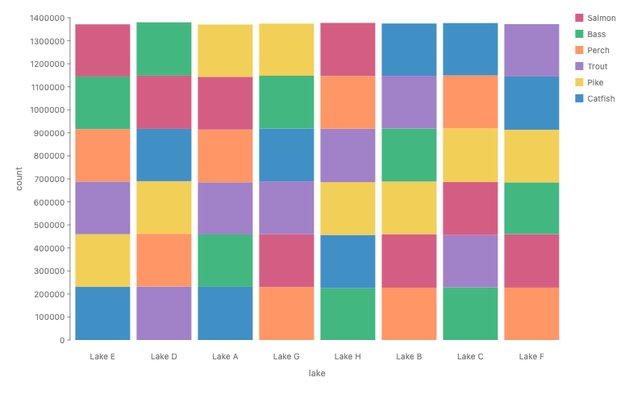

```js
chart(catchData, { w: 600, h: 400 })
  .flow(spread({ by: "lake", dir: "x" }), stack({ by: "species", dir: "y" }))
  .mark(rect({ h: "count", fill: "species" }));
```

```python
(
    chart(catch, w=600, h=400)
    .flow(spread(by="lake", dir="x"), stack(by="species", dir="y"))
    .mark(rect(h="count", fill="species"))
)
```

The plan the engine makes from it:

```text
source  catch
group   lake, species            from spread.by and stack.by
  h     = sum(count)             rect.h is a size channel
  fill  = first(species)         rect.fill is a color channel
order   first appearance
result  48 rows, one per rectangle
```

The same plan as SQL:

```sql
SELECT lake, species,
       sum(count)                  AS h,
       arg_min(species, rownum)    AS fill
FROM catch
GROUP BY lake, species
ORDER BY min(rownum);
```

The stack offsets and the y axis come from layout over these 48 rows, as they
do today over 48 nodes.

**Checked.** A prototype rendered this chart twice over 100,000 rows, once
from the rows and once from the 48 rows that DuckDB returned for the query.
The two pictures have 0 different pixels and the same SVG geometry.

| From the rows, as today      | From the query result           |
| ---------------------------- | ------------------------------- |
| 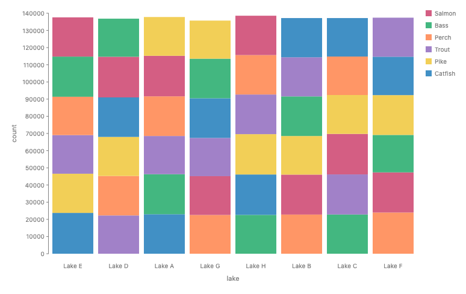 |  |

The same check passed with 0 different pixels for the histogram, the
histogram with a fill, the two-direction heatmap, a grouped mean, and bars
normalized to 100%. DuckDB's `avg` and the engine's mean gave the same bits.
A planner of 120 lines read the serialized chart and wrote these queries
itself (`tests/tmp/scaling/proto/planner.mjs`).

The check also showed which rules the query must keep.

- **Order by first appearance.** Without `ORDER BY min(rownum)` the bars, the
  stack order and the legend all change (picture below, 140,000 or more
  different pixels). That one clause fixes all three.
- **First row for a color.** A color that is not a key needs
  `arg_min(species, rownum)`. With `min(species)` the colors and the legend
  change.
- **Empty cells need nothing.** The query returns only the cells that have
  rows, and `partition` rebuilds the rest from the domain.

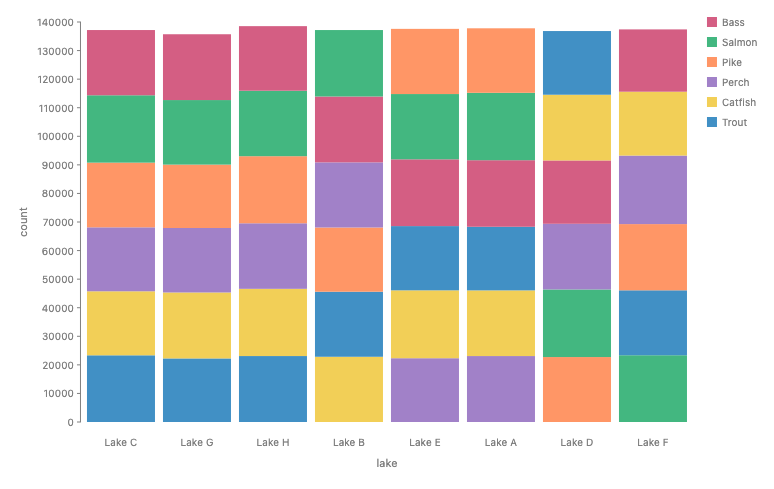

One case did not match, and it shapes the design. For a mean at an outer
level of a nested split, the prototype fed the inner groups' rows back
through the unchanged spec, and the outer level then took a mean of means
(7,603 different pixels). So the plan must compute each level's channels
from the rows, as its own level of the query (`ROLLUP`), and hand layout one
mark table per level. Feeding aggregated rows back in as if they were data is
not enough.

### Example 2, histogram

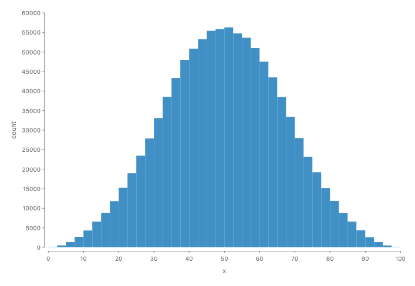

```js
chart(catchData, { w: 600, h: 400 })
  .flow(partition({ by: field("x").bin(Bin.step(2.5)), dir: "x" }))
  .mark(rect({ h: field("x").count() }));
```

```sql
SELECT floor(x / 2.5) AS cell, count(x) AS h
FROM catch
GROUP BY cell;
```

The cells come from the domain of `x`, which is two more numbers from the
database (`min(x)`, `max(x)`). A cell with no rows gets no row back and is
drawn empty, which is what `partition` does today.

### Example 3, a density of ten million points (the hard one)

The spec for a density is already in the grammar. It is a `partition` in two
directions with a count on the fill. Nothing about it is special to large
data.

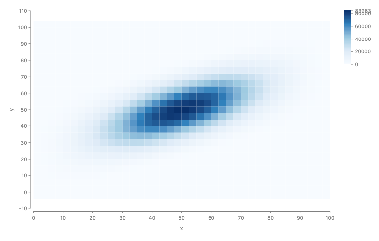

```js
chart(db.table("catch"), { w: 600, h: 400 })
  .flow(
    partition({
      by: { x: field("x").bin(Bin.step(2.5)), y: field("y").bin(Bin.step(4)) },
    })
  )
  .mark(region({ fill: field("x").count() }));
```

```sql
SELECT floor(x / 2.5) AS cx, floor(y / 4) AS cy, count(*) AS fill
FROM catch
GROUP BY cx, cy;
```

Over ten million rows the query took 41 ms and returned 627 rows, and GoFish
drew them in 60 ms.

This example is hard for a second reason. A fine grid has thousands of cells,
so the mark count is the limit again even though the data part is one query.

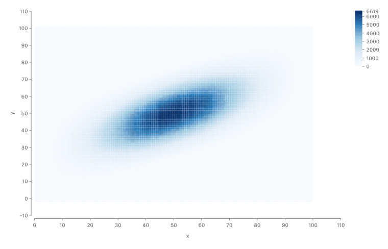

At 143 by 94 cells the query still took 23 ms, but drawing 13,517 rectangles
took 635 ms. The engine can draw a full grid of plain rectangles as one
image, because the mark table for it is a column of fills on a regular grid.
That is a drawing choice inside the engine, the same kind as the column form
of marks in #1009. The "Rendering" section has the numbers.

### Example 4, one mark per row

```js
chart(walk, { w: 600, h: 400 })
  .flow(scatter({ x: "t", y: "v" }))
  .mark(line());
```

There is no `by`, so the plan has no grouping and the mark table is the two
columns. A query cannot shrink it without changing what is drawn. Reduction
by pixel is the known answer, so the prototype tested whether it leaves the
picture alone. It does not, quite.

**The line.** M4 kept 2,313 of 100,000 points. The render went from about
8 seconds to about 170 ms.

| All 100,000 points    | 2,313 points kept by M4 |
| --------------------- | ----------------------- |
| 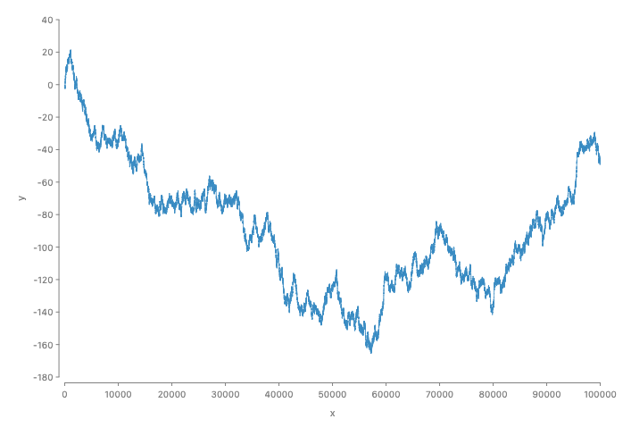 | 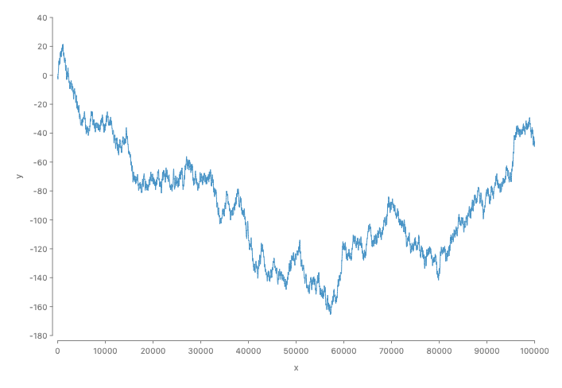    |

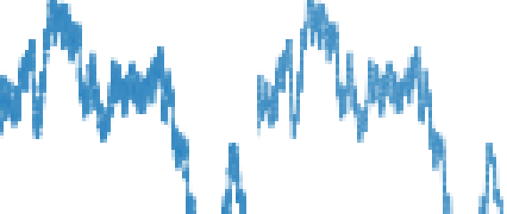

The two pictures differ in 9,568 pixels. Most differ by a small amount, and
319 differ by half the color range or more. The shape and every peak are
kept. What changes is how dark the soft edge of the stroke is where the line
doubles back on itself many times. Keeping every k-th point with the same
budget is much worse (1,696 pixels differ by half the range or more, and
peaks are lost). From ten million points, M4 took 39 ms in a typed-array
loop or 69 ms in DuckDB, and the line then drew in 113 ms.

**The scatter.** Keeping one dot per occupied pixel kept 49,863 of 100,000
dots.

| Dots                       | Kept   | Different pixels | How different                                 |
| -------------------------- | ------ | ---------------- | --------------------------------------------- |
| Solid, one per pixel       | 49,863 | 42,031           | almost all by less than 3% of the color range |
| Solid, one per half pixel  | 80,386 | 19,720           | almost all by less than 3%                    |
| 30% opacity, one per pixel | 49,863 | 70,465           | visibly lighter where dots are dense          |

| All 100,000 dots at 30% opacity | One per pixel                    |
| ------------------------------- | -------------------------------- |
|     | 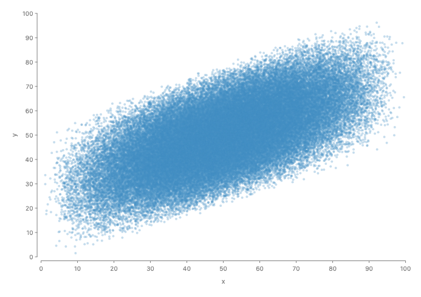 |

So reduction by pixel is close but it is not the same picture, and with
see-through dots it is plainly a different picture. It also only starts to
pay when there are many more rows than pixels. This decides how it is used.

- **A line is reduced with M4 when its data is a relation and there are more
  points than four per pixel column.** Mosaic does the same by default.
  `explain()` says so, and `exact: true` on the chart turns it off, which
  then fetches every point or hits the row limit.
- **A scatter is never thinned by the engine.** Above the row limit it is an
  error that points to the density spec in example 3. Thinning changes what
  overlapping dots mean, and the density is the honest picture of ten
  million points.
- **In-memory data is never reduced.** The column form of marks draws every
  row.

### Example 5, a second chart over `selectAll`

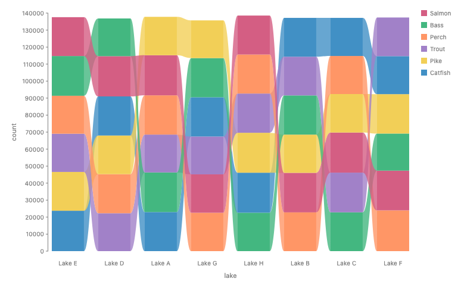

```js
chart(catchData, { w: 600, h: 400 })
  .flow(
    spread({ by: "lake", dir: "x", spacing: 24 }),
    stack({ by: "species", dir: "y" })
  )
  .mark(rect({ h: "count", fill: "species" }).name("bars"))
  .layer(
    chart(selectAll("bars"))
      .flow(group({ by: "species" }))
      .mark(ribbon({ opacity: 0.8 }))
  );
```

`selectAll("bars")` gives the second chart one item per named mark. The item
is a reference to the drawn bar. The spelling does not change, and the first
chart is planned as in example 1. What the second chart reads from each item
decides what it costs.

**Checked.** The chart above was rendered from 100,000 rows and from the 48
rows of the query result. The two pictures have 0 different pixels. The
ribbons read three things from each bar, which are its laid-out box, its
`species` key and its color. All three are in the mark table or come from
layout over it.

| What the second chart reads from a named mark                                  | Where it comes from                                          | Checked                   |
| ------------------------------------------------------------------------------ | ------------------------------------------------------------ | ------------------------- |
| Position and size (ribbons, lines, `enclose`, where a label sits)              | layout over the mark table                                   | 0 different pixels        |
| A key of the first chart (`group({ by: "species" })`)                          | a column of the mark table                                   | 0 different pixels        |
| The color of the mark                                                          | a column of the mark table                                   | 0 different pixels        |
| A sum of the summed column, in a function (`sumBy(d[0].datum, "count")`)       | a column of the mark table, because a sum of sums is the sum | 0 different pixels        |
| A count of the mark's rows, in a function (`d[0].datum.length`)                | the underlying rows                                          | wrong from the mark table |
| A column the first chart never used, in a function (`meanBy(d[0].datum, "x")`) | the underlying rows                                          | wrong from the mark table |

The last two rows are the hard part. Today a reference's `datum` is the
mark's rows, and a function in the second chart can do anything with them.
The test gave such a function the mark table's one row in place of the
mark's rows. The label that counts rows then says "1" where it should say
"2158", and nothing reports an error.

| Row count labels from the rows      | The same labels from the mark table    |
| ----------------------------------- | -------------------------------------- |
|  | 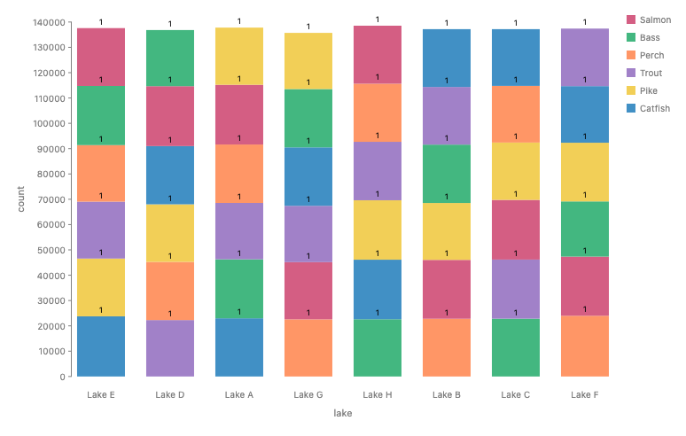 |

So the design keeps one rule. **A named mark's `datum` is always its
underlying rows, never its row of the mark table.**

- Over in-memory data, `datum` is a view into the columns for that group. It
  is built when a function reads it. The stories that label bars with
  `sumBy(d[0].datum, "count")` keep working and give the same answer.
- Over a database table, a function that takes named marks is handled like
  any other function (see "Escape hatches"). The rows of those marks are
  fetched for it, and above the row limit this is an error that names the
  function.
- The way to label bars over a large table without fetching rows is a channel
  the planner can read, e.g. `text({ text: field("count").sum() })` in the
  second chart. This does not work today. A channel over references reads
  the reference object and not the mark's rows, so this spec draws no labels
  at all. Making channels read through a reference is a small change with its
  own value, and after it the label is one more column of the first chart's
  mark table.

Two more facts from reading the code.

- **A reference points at a real node today.** Ribbons, `enclose`, `resolve`
  and paint order all walk from the reference to the node and its parents.
  For charts made of groups this costs nothing, because the 48 bars are
  nodes anyway. It only becomes a question for a named scatter of rows drawn
  from columns. What each of these readers needs is a box and the keys, which
  a row of a laid-out column has. Until references can point at such a row,
  a named scatter keeps a node per point and runs at today's speed.
- **The second chart's column domains are computed over the rows the
  references reach.** With the rule above this stays true. Over a database
  table it is one more small query with the first chart's filter.

## What this means for vectorizing the pipeline

`.flow(a, b)` is not a pipeline over data today. Each operator wraps the mark
below it. When the chart runs, the full row array is pushed down once, each
split makes a fresh array per group, and the mark is called once per group
with one promise per node. Three parts of that can run on whole columns.

1. **Nested splits become one grouping.** `spread({ by: "lake" })` then
   `stack({ by: "species" })` is one pass that gives every row a group number
   for the key path `lake, species`. The tree of groups is rebuilt from the
   distinct key paths, which is 48 entries and not a million.
2. **A mark's channels become column folds.** The mark is not called once per
   group. Each channel is one fold of one column over all groups at once, and
   the result is a column of the mark table. This is the data side of the
   column form of marks in #1009. A scatter with no `by` is the case where
   the fold does nothing and the mark table is the input columns.
3. **A data step after a split becomes one call.** A `derive` placed after a
   split runs once per group today, which is one bridge call per group in
   Python. With a plan, a declarative step after a split is one operation
   partitioned by the key path, e.g. `normalize` is a share within the parent
   group.

What stops this is always the same thing, an opaque function. The engine
cannot fold a column through a function it cannot read. The list in JS is
`derive(fn)`, a function predicate in `filter`, a function `by`, a function
channel accessor, `.label(fn)` and a mark function. Python already rejects a
function `by`.

## Getting the scatter and the line fast

A query does not help these two charts, so a second investigation profiled
them, tried fixes inside today's engine as throwaway patches, and built the
column version outside the engine to see how low the cost can go. The
patches and results are in `tests/tmp/scaling/perf/`. The machine was busy
during these runs, so the baseline here (6.8 s at 100,000 points) is lower
than the 8.0 s in the first table.

### Where the time and memory go

Every point is a full node, and the engine does the same work for each one.

- **Placement.** For each point and each axis, the layout solver builds about
  40 small formula nodes and about 12 lines, and makes about 10 passes over
  the point's position constraint. Every point has the same rule with
  different numbers. This is 3.9 of 10 seconds of busy time at 100,000
  points.
- **Walks that find nothing.** A render walks the whole tree about 12 times.
  For a plain scatter, the walks for color scales, names, references, labels
  and coordinate transforms visit every point and have nothing to do.
- **Memory.** Each point keeps about 14 KB and causes about 64 KB of
  allocation per render. Garbage collection is 21% to 27% of the time.
- **One term grows faster than the row count.** A step that finds the outer
  edge of all the lines sorts every line. This is the only such term that was
  measured.
- **The line.** It builds two nodes per point, an invisible anchor and a
  reference to it. The line reads one thing from each anchor, its center
  point. So 200,000 nodes exist to deliver 100,000 pairs of numbers.

### What fixes inside today's design give

| Fix                                                  | Scatter, 100,000 | Line, 100,000 | Effect                                                            |
| ---------------------------------------------------- | ---------------- | ------------- | ----------------------------------------------------------------- |
| Today                                                | 6,796 ms         | 6,880 ms      | Both fail at 300,000 with a stack overflow                        |
| Loops in place of spread calls                       | 6,829 ms         | 6,704 ms      | No time gain. 300,000 points no longer fail, but take 30 to 116 s |
| Drop lines that cannot be on the edge before sorting | not recorded     | 6,628 ms      | Removes the term that grows faster than the row count             |
| Paint the SVG as one string                          | 5,424 ms         | 6,423 ms      | Scatter paint goes from 779 ms to 77 ms                           |
| Fewer passes over the constraints                    | 6,398 ms         | 6,840 ms      | Nothing measurable                                                |

Each row adds to the ones above it. Every fix left the SVG at 10,000 points
identical. Together they make the scatter about 20% faster and do little for
the line. A million points crashes the browser tab with every fix applied.
So tuning the engine as it is does not reach large data. The first and third
fixes are still worth merging, because one removes a hard failure and the
other is a tenfold cut in paint time for no change in output.

### What the column form gives

The prototype computes what the engine computes for these charts, from
columns, outside the engine. Its circle positions match the engine's to
within 0.0000000000001 pixels at 10,000 points, and its line path matches to
the same order.

| Points     | Engine today | Columns: extents and positions | Then paint, SVG | Then paint, canvas |
| ---------- | ------------ | ------------------------------ | --------------- | ------------------ |
| 10,000     | 548 ms       | 0.4 ms                         | 17 ms           | 14 ms              |
| 100,000    | 6,796 ms     | 0.8 ms                         | 197 ms          | 121 ms             |
| 1,000,000  | crashes      | 6 ms                           | 2,517 ms        | 1,191 ms           |
| 10,000,000 | crashes      | 68 ms                          | fails           | 12,259 ms          |

The arithmetic for a scatter is one multiply and one add per point per axis.
At 100,000 points that is under a millisecond, against about 6 seconds in
the engine. What is left after that is the browser drawing the marks.

| Line points | Engine today | Columns, one SVG path | Columns, canvas stroke | Columns, M4 then SVG path |
| ----------- | ------------ | --------------------- | ---------------------- | ------------------------- |
| 100,000     | 6,880 ms     | 114 ms                | 22 ms                  | 18 ms                     |
| 1,000,000   | crashes      | 1,370 ms              | 190 ms                 | 18 ms                     |
| 10,000,000  | crashes      | fails                 | 910 ms                 | 205 ms                    |

These are floors, not promises. The engine version has to keep axes,
legends and everything else a chart has, and those cost about 10 ms.

### What to build

- **A scatter is one node that holds columns.** This is the direction agreed
  in #1009. Layout places the collection once, with one scale per axis. The
  engine makes a node per point only when something needs one (a name that
  `selectAll` reads, a label per mark, a `relate`, a mark function).
- **A line asks for points, not nodes.** The connector asks the operator that
  places its anchors for their center points. A scatter placed by data alone
  answers from its two columns and its scale, and no anchor nodes are made. A
  line over stacked or spread marks gets its points from the laid-out nodes,
  as it does today. This is one rule, and the column case is the one where
  the answer needs no layout.
- **The two fixes above** (loops, string paint) can merge now.

## Rendering: SVG, canvas, WebGL, WebGPU

This section answers three questions. Does the drawing backend need to be
part of this design? Can it be done separately? Does it help large
scatterplots and heatmaps?

**Terms.** The engine lowers a chart to a display list, which is a flat list
of positioned rectangles, ellipses, paths, text and images in final pixels
(#608). A painter is the code that draws a display list. Today there is one
painter, and it makes SVG elements.

### Drawing is not what is slow today

| Chart at 100,000 rows    | Total    | Lower and paint | Share |
| ------------------------ | -------- | --------------- | ----- |
| Scatter, 100,000 circles | 8,048 ms | 1,045 ms        | 13%   |
| Line, one path           | 8,006 ms | 171 ms          | 2%    |

The rest of the time is spent per node before anything is drawn. Layout is
63% of the scatter, and each point holds about 9 KB of memory. A faster
painter today would make the 8 second scatter take 7 seconds, and the chart
would still fail at 300,000 rows. So a new painter is not the first step for
any chart.

### It is a separate piece of work

A painter reads the display list and nothing else. The plan, the column
engine and layout all finish before the display list exists, so a canvas or
WebGL painter does not touch them and they do not touch it. #608 built the
display list for this purpose, and #42 is the open issue that asks for more
backends. The painter work can start at any time and merge in any order with
the rest of this proposal. It only pays off after step 4.

### Heatmaps need an image, not a new backend

A density grid is one image. The display list already has an image item, and
the SVG painter already draws it. Counting a million points into a 400 by 300
grid and drawing the grid took about 7 ms.

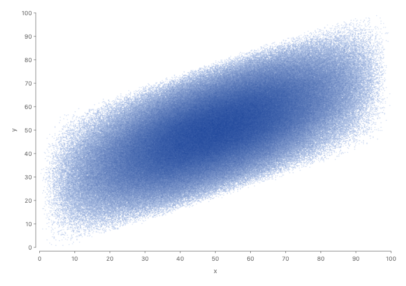

Two things are missing, and both are small.

- `image()` cannot be placed or sized in data space. `rect` can. The picture
  above uses a workaround (two invisible corner points set the axes, and the
  image is stretched over the plot).
- The engine has to notice that a mark table is a full regular grid of plain
  rectangles and lower it to one image item in place of one item per cell.
  The spec stays a `partition` with a `rect`.

A heatmap grid was painted eight ways from the same display list. All eight
give the same pixels at 150 by 100 cells.

| Cells      | SVG, GoFish painter today | Canvas, one `fillRect` per cell | One image |
| ---------- | ------------------------- | ------------------------------- | --------- |
| 10,000     | 100 ms                    | 33 ms                           | 33 ms     |
| 100,000    | 1,001 ms                  | 78 ms                           | 33 ms     |
| 1,000,000  | 11,772 ms                 | 551 ms                          | 52 ms     |
| 10,000,000 | crashes                   | 5,429 ms                        | 380 ms    |

Times are to the first painted frame, and 33 ms is the lowest the method can
measure. One image also pans at 60 frames a second up to ten million cells.

### Large scatterplots need a painter after marks are columns

Once marks are stored as columns (#1009), making the display list for a large
scatter is cheap, and the SVG painter is the next limit. SVG paint costs about
10 microseconds per element and grows in step with the count, so a million
circles is about 10 seconds of paint. That is the point where a canvas pays
off.

The same display list of circles was painted seven ways on the real GPU
(`tests/tmp/scaling/render/`). Times are to the first painted frame, then
the time per frame when every circle moves. The lowest values the method can
measure are 33 ms and 16.7 ms.

| Circles    | SVG, GoFish painter today | SVG, plain elements | Canvas 2D, one path | WebGL     | WebGPU    |
| ---------- | ------------------------- | ------------------- | ------------------- | --------- | --------- |
| 10,000     | 100 / 20                  | 34 / 20             | 33 / 17             | 33 / 17   | 34 / 17   |
| 100,000    | 884 / 196                 | 317 / 205           | 50 / 22             | 33 / 17   | 33 / 17   |
| 1,000,000  | 9,290 / 2,523             | 3,408 / 2,664       | 201 / 203           | 35 / 19   | 66 / 20   |
| 10,000,000 | crashes                   | did not finish      | 1,910 / timed out   | 236 / 288 | 292 / 271 |

What the numbers say:

- **Today's SVG painter costs much more than SVG has to.** It makes one
  SolidJS element per item. That is about 2.7 times slower than making plain
  elements, and it keeps about 2.2 KB of memory per item, which is 2.2 GB at
  a million items. Painting from one string, the fix tried in the scatter
  investigation, removes this.
- **SVG is fine to about 100,000 items for a first paint and about 10,000 for
  anything that moves.** A hover highlight on an SVG of 100,000 circles
  already drops frames (23 ms for one fill change).
- **Canvas 2D is about ten times faster than SVG to first paint** and reaches
  a million items in 0.2 to 0.8 seconds. Its redraw time still grows with
  the item count, so it holds 60 frames a second only to about 10,000 items.
- **WebGL draws a million circles in about 30 ms** and pans them at 60 frames
  a second. Its cost is not the GPU. It is JavaScript reading display list
  objects into arrays, so a display list stored as columns makes it cheaper
  again.
- **WebGPU is no faster than WebGL here.**
- **Finding the mark under the pointer does not need elements.** A grid index
  over a million points builds in 7 ms and answers in under a microsecond.

The order:

1. **Marks as columns.** No painter helps before this.
2. **One SVG painter that does not make a SolidJS element per item** (#1337).
   This is cheap and helps every chart today.
3. **A full grid of plain rectangles is painted as one image.** Any painter
   can do this, SVG included.
4. **A canvas 2D painter for the mark layer.** It draws every kind of item the
   display list has, with the same meaning as SVG, and it covers static
   charts up to about a million marks. Axes, labels and text stay SVG and
   sit on top, so text looks the same and can still be selected.
5. **A WebGL painter for collections of circles and rectangles**, when a chart
   with 100,000 or more marks has to pan, zoom or animate. It only has to
   handle the column form of a mark, which is the case it is good at.
6. **WebGPU**, not now. It measured the same as WebGL, and it would only help
   if the layout arithmetic itself moved to the GPU.

The painter only ever sees in-memory scatters, because a scatter over a
relation above the row limit is an error (example 4). So the sizes that
matter for a painter are the ones that fit in the browser, which is up to a
few million points.

### What a painter changes for the user

The engine picks the painter from the number of display items, which follows
the rule in #1009 that a user does not choose a fast path. A render option
forces one, e.g. `render(el, { painter: "svg" })`. Three behaviors are
different when the marks are on a canvas.

- **Hover and selection.** There is no element per mark, so finding the mark
  under the pointer uses an index built from the mark table.
- **Export.** An SVG file of the chart still has to be possible, so the SVG
  painter stays and the export path uses it.
- **Reaching into the DOM.** A user who styles or selects the SVG elements of
  the marks directly cannot do that on a canvas.

## Progressive visualization

A progressive visualization shows a first picture from part of the data and
improves it as more arrives, so the user does not wait for the whole run.
This proposal does not design it. This section says what it would need from
the design here, so that building it later does not mean redoing the plan.

**ProVega** (Filosa, Blasilli, Martino and Angelini, arXiv 2604.02096, April 2026) is the recent grammar for this. It is built on Vega-Lite.

- The marks and encodings of a spec do not change. The user adds one
  top-level `provega` block.
- The block says how data arrives: in chunks of rows (`chunking.type:
"data"`, with a chunk size, a frequency and a sequential or random reading
  order), as steps of a computation such as t-SNE (`"process"`), or both. A
  live feed is a WebSocket URL in `data`.
- The block also asks for controls (play, pause, step), a progress bar, time
  to completion, and a highlight on marks that changed.
- It runs in the browser. Each chunk is inserted into the Vega dataset and
  the whole chart is computed again.
- The paper does not say which aggregates can be updated from a chunk, how
  axes behave as data arrives, or how to show how sure an early picture is.
  It has no database backend.

Two things carry over. Progression is a property of how the data arrives and
not of the marks, which fits this proposal: it would be an option on the
source. And the three questions the paper leaves open are the ones a plan
can answer.

**What the plan already gives.** After a chunk arrives, the new mark table is
the old mark table combined with the aggregate of the chunk. That works for
exactly the aggregates that can be combined from parts, which are GoFish's
default channel rules (sum, count, and mean kept as a sum and a count). The
plan knows which aggregates a chart uses, so it knows whether a chart can be
progressive. A median or a distinct count cannot be combined this way and
needs either a sketch or a fresh run per update.

**Three choices to make now so this stays open.** None of them costs much,
and two of them are needed anyway.

1. **The mark table keeps the parts, not only the result.** A mean is stored
   as a sum and a count and divided at the end. This is what lets a chunk be
   merged in. It also fixes the nested mean that failed in example 1,
   because an outer level can then be combined from the inner level
   correctly. Mosaic's fast linked selections need the same thing.
2. **A mark is identified by its key path.** The bar for Lake A and Salmon is
   the same bar in every update. Incremental layout (#674) and stable
   identity keys (#673) already ask for this, and a transition between two
   updates is the update animation in #831.
3. **Running a plan gives a sequence of mark tables.** Today the sequence has
   one item. A progressive source gives several. The engine is already
   asynchronous at this point, so this is a choice of type, not new
   machinery.

**Two rules in today's engine that are unstable when data arrives in parts.**
These are the places progressive work would force a decision.

- **Group order is first appearance.** With chunks read in row order this is
  stable, because a group keeps its place once seen. With random reading a
  group's first row can turn up later, and the bars change places. A column
  with a declared order does not have this problem.
- **Axis domains come from the data.** A domain of a raw column is cheap to
  get up front as its own small query, so position axes can be right from
  the first frame. A domain of an aggregate, e.g. the height of the tallest
  bar, grows as rows arrive. The known answer (online aggregation,
  Hellerstein et al., 1999) is to scale each partial sum up to an estimate of
  the final value, so bars settle instead of growing. An estimate has an
  error, and showing it connects to the uncertainty work in #980.

Cells of a `partition` are already stable, because they are defined on the
space and not on the rows seen so far.

Drawing in parts is a separate thing with the same name. A canvas painter can
draw a large in-memory scatter over several frames. That belongs to the
painter and needs nothing from the plan.

## Prior work

| System                   | Does the user change the spec for large data?                  | Who decides what runs in the database                                                           | What happens to a function                                                  |
| ------------------------ | -------------------------------------------------------------- | ----------------------------------------------------------------------------------------------- | --------------------------------------------------------------------------- |
| VegaFusion               | No. One line turns it on.                                      | A planner. It sends the longest run of supported transforms to the server.                      | The split stops at the first unsupported transform.                         |
| VegaPlus (Yang et al.)   | No                                                             | A planner with a learned cost model                                                             | Runs in Vega                                                                |
| Polaris and Tableau      | No                                                             | The shelf spec is compiled to filter, partition and aggregate queries. Measures sum by default. | There are none                                                              |
| Mosaic and vgplot        | Mostly no, but channels use SQL helpers (`vg.bin`, `vg.count`) | The author of each mark writes its query by hand. The coordinator caches and merges queries.    | Never sent. JS works on the result.                                         |
| dbplyr                   | No. Same verbs on a lazy table.                                | Everything until `collect()`                                                                    | Passed to SQL as written, or an error in strict mode                        |
| polars                   | No. Lazy is the same API.                                      | The optimizer, until `collect()`                                                                | Runs as a black box. Polars warns when an expression would do.              |
| Arquero                  | No                                                             | Arquero parses the arrow function's source and compiles what it understands                     | Closures need `escape(fn)`, which cannot aggregate and cannot be serialized |
| ggplot2 on a lazy table  | No                                                             | Nothing is sent. It collects the whole table.                                                   | Not applicable                                                              |
| dbplot                   | Yes, `dbplot_histogram`, `dbplot_raster`                       | The user, by calling a different function                                                       | Not applicable                                                              |
| Swift Charts             | Yes, `PointPlot` in place of `PointMark`                       | The user                                                                                        | Not applicable                                                              |
| HoloViews and datashader | Yes, wrap in `rasterize(...)`                                  | The user opts in, then it is automatic per view                                                 | Not applicable                                                              |
| deck.gl                  | Yes, a separate aggregation layer                              | The user                                                                                        | Not applicable                                                              |

What to take from each:

- **VegaFusion** is the model for "no change to the grammar". Three of its
  planner steps apply directly. It splits at the first step it cannot run. It
  computes scale domains as their own small queries, so the full table never
  moves. It turns an aggregate inside a facet into one flat aggregate with
  the facet keys added, which is the nested split case above.
- **Polaris** gives the formal version of the mapping table above. It also
  separates "nest" (only the combinations that exist) from "cross" (every
  combination). A nested GoFish split is a nest.
- **Mosaic** is a place to run queries, not a planner. Each Mosaic client
  writes its own query. GoFish would make the query from the spec and hand it
  to Mosaic's coordinator, and in return gets caching, merging of queries in
  the same frame, DuckDB in the browser or on a server, and Arrow results.
- **Arquero** shows that a JS arrow function can stay the user's syntax and
  still be compiled, by reading its source. It only works for JS, and a
  Python lambda has no equal path (polars reads the bytecode and only warns).
- **Swift Charts, dbplot and deck.gl** are the foils. They make the user pick
  a second API for large data. #1009 already rejected this.
- **VegaPlus** measured that sending everything to the database can be slower,
  and that the client wins at about 50,000 to 100,000 rows. Our own numbers
  agree. This is why the default place to run a plan is the column engine,
  and the database is used when the data is already there.
- **Gray et al. (the data cube paper)** sorts aggregates into ones that can be
  combined from parts (count, sum, min, max, and mean as sum and count) and
  ones that cannot (median, distinct count). GoFish's default channel rules
  are all in the first group. Mosaic's fast linked selections need the same
  condition.
- **Kindlmann and Scheidegger** give the test for reduction by pixel. A
  reduction is safe when every change it hides in the data is one the picture
  could not show anyway.

DuckDB in the browser is about 36 MB, or 5 to 8 MB compressed. That is the
reason it stays out of the core bundle, as #41 (the Mosaic issue) says.

## The independent choices

**Where the plan runs.** In the column engine inside GoFish, in the host that
owns the data (the Python kernel), or in a database. These are not rival
designs. They are places to run the same plan, picked by where the data is.

**What happens at an opaque function.** Three options.

- Fetch rows at that point and run the function on them, with an error above a
  row limit. This is VegaFusion's rule and dbplyr's `collect()`.
- Parse the function's source, as Arquero does. This works in JS only.
- Refuse functions over a relation.

**What happens to one mark per row.** Three options, and they stack.

- Store the marks as columns (#1009). The picture and the spec are unchanged.
- Reduce by pixel before making marks, when that cannot change the picture.
- Leave it to the user to ask for a density with `partition`, which is the
  better picture for millions of points anyway.

**How a database table is named in a spec.** In Python the answer exists:
`chart(con.table("catch"))` is accepted today. JS needs a spelling.

## Approaches

### A. One plan, two places to run it (recommended)

The engine makes a plan for each chart at the point where the whole pipeline
is visible as a list (`ChartBuilder.resolveNamed`). The plan is part of the
serialized form, so Python gets it. A column engine in GoFish runs plans and
replaces the row arrays. A relation as chart data sends the plan to its
owner.

```js
// In memory. Nothing changes, and it runs on columns.
chart(catchData)
  .flow(spread({ by: "lake", dir: "x" }))
  .mark(rect({ h: "count" }));

// In a database. The source is the only new thing.
import { connect } from "gofish-graphics/duckdb";
const db = await connect(); // DuckDB in the browser, or connect({ url }) for a server
chart(db.table("catch"))
  .flow(spread({ by: "lake", dir: "x" }))
  .mark(rect({ h: "count" }));
```

```python
# Already valid today. The change is that the table stays in the kernel.
con = duckdb.connect("lakes.duckdb")
chart(con.table("catch")).flow(spread(by="lake", dir="x")).mark(rect(h="count"))
chart(pl.scan_parquet("catch/*.parquet")).flow(spread(by="lake", dir="x")).mark(rect(h="count"))
```

- **Composes with:** every operator, because the plan is made from the
  operators' own serialized form and layout still runs on the result. Nested
  charts and mark functions work, with a mark function being a point where
  rows are fetched for that group.
- **Desugars into:** the current meaning exactly. The check during the change
  is that every story produces the same display list.
- **Overlap:** none with existing operators. It adds no operator.
- **One engine:** the column engine is not a fast path beside the row path.
  It replaces it. A group's rows are a view over the columns, read only when
  something asks (a label function, a tooltip, `selectAll`).
- **Awkward:** reading a mark's rows is a fetch when the data is in a
  database, so a tooltip over a database chart is asynchronous.
- **New terms:** `connect`, `table`, `explain`. All three are the common
  names (ibis and DuckDB use `connect` and `table`, polars uses `explain`).

### B. Every chart is a Mosaic client

GoFish loads DuckDB and Mosaic always. In-memory arrays are loaded into
DuckDB, and every chart asks the coordinator for its mark table.

```js
chart(catchData)
  .flow(spread({ by: "lake", dir: "x" }))
  .mark(rect({ h: "count" }));
// same spec, but catchData is first copied into DuckDB
```

- **Easy:** one way to run plans. Linked selections across charts, and with
  vgplot charts on the same page, come with it.
- **Awkward:** a download of 5 to 8 MB before the first chart. Loading a
  million row objects costs 505 ms, which is more than grouping them in JS.
  Small charts, which are most charts, get slower. Diagrams with a few dozen
  rows gain nothing. #41 already asks that DuckDB not be bundled by default.

### C. Columns only, no database

Only the column engine. A relation is collected into Arrow and sent to JS,
as today.

- **Easy:** no new source and no connector. It is step 1 of approach A.
- **Awkward:** the data has to fit in the browser. From Python, a table of
  ten million rows still crosses the bridge whole to draw 48 rectangles.

### D. The user marks it (foil)

```js
chart(db.table("catch")).aggregate({
  by: ["lake", "species"],
  h: sum("count"),
}); // not proposed
chart(points)
  .flow(scatter({ x: "x", y: "y" }))
  .mark(rasterize(circle())); // not proposed
```

This is the Swift Charts and dbplot model. It repeats in a second place what
the spec already says, and #1009 rejected it.

## Recommendation

Approach A, built in this order.

1. **Column engine and the plan.** No API change. In-memory charts with
   grouping get about 25 times faster at a million rows, and Arrow from
   Python is used as columns and no longer turned into row objects.
2. **Run the plan in the Python kernel.** A dataframe or a relation stays in
   Python, and the mark table crosses the bridge. Python scientists are the
   audience for 1.0, and for them the cost today is moving the table.
3. **The JS connector on Mosaic.** `connect`, `db.table`, `explain`.
4. **One mark per row.** The mark table as the column form of marks (#1009),
   then reduction by pixel.
5. **Painters.** This is separate work that reads only the display list. A
   cheaper SVG painter can merge now. Canvas and WebGL painters pay off
   after step 4. See "Rendering".

Reasons, with the rule each one rests on:

- It desugars into the core. A plan means exactly what the row walk means
  ("if you can desugar it into Core, it must be sound", `principles.md`).
- It is one mechanism. The column engine replaces the row path, and the
  database is a second place to run the same plan, not a second pipeline
  (#1009, "one implementation, and the pipeline chooses").
- It adds almost no terms, and the three it adds match polars, ibis and
  DuckDB (`api-design.md`, naming precedent order).
- The aggregation meaning already lives on channel kinds and column types
  ("channels are chosen by how they aggregate", `api-design.md`), so the
  planner reads it and does not guess.
- It is the same in JS and Python, because the plan is made from the
  serialized form.

Approach A differs from #335, the earlier attempt to run all transforms in
Python that was dropped. #335 added a second form of the spec that carried a
tree of grouped data, so Python had to know how GoFish groups. Here JS
stays the only engine. It makes the plan and asks the host to run a plain
table query, the same way it asks the host to run a `derive` function today.

Approach B is the runner-up. It becomes the better pick if linked selections
across many charts turn out to be the main use, because then every chart
needs a coordinator anyway.

## Escape hatches

- **A function is the escape hatch.** `derive(fn)`, a function accessor and a
  mark function keep working. Over in-memory data they run on a row view of
  the columns. Over a relation they run on fetched rows.
- **A row limit on fetching.** Fetching more rows than the limit from a
  relation is an error that names the step and says what to do. It is never
  a silent slow chart.

  ```text
  [gofish] derive(fn) at flow step 2 needs every row of "catch"
  (10,000,000 rows, limit 100,000). A function cannot run in the database.
  Filter first, write the step with field expressions, or raise the limit
  with connect({ rowLimit }).
  ```

- **Raw SQL as a source.** `chart(db.sql("SELECT ... FROM catch WHERE ..."))`.
  Mosaic, dbplyr and ibis all have this.
- **`explain()`.** `chart(...).flow(...).mark(...).explain()` returns the plan
  and, for a relation, the SQL. It also says where rows are fetched and why.

## The three places where I could be wrong about what you want

**A function over a database table.** I chose "fetch rows, with a limit". The
other choice is to read the source of JS arrow functions the way Arquero does,
so `fill: (d) => d.survived === "No" ? gray : color[d.class]` could still be
planned. I did not choose it because Python has no equal path, and the
serializable expressions already being designed (#1192, the Python step 8
prototype, and #736, row-level computed channel values) cover the same cases
in both languages. This proposal does not design those expressions. It
depends on them, because without arithmetic expressions every computed
column is a function.

**A line and a scatter of ten million rows.** See example 4. The test showed
that reduction by pixel is close but not the same picture. I chose to reduce
a line over a relation by default, because the shape and the peaks are kept
and nothing else can draw it, and to never thin a scatter. The stricter
choice is that nothing is ever reduced unless the user asks, and both charts
are errors above the row limit.

**The JS spelling of a database source.** I chose `connect()` and
`db.table("catch")` from a `gofish-graphics/duckdb` subpath that is built on
Mosaic, so the user does not see Mosaic. A user who already has a Mosaic
coordinator passes it in, `connect({ coordinator })`, and the chart then
shares its cache and selections with vgplot charts on the page.

## Related issues

- **#41** Implement Mosaic for large datasets. One paragraph. Says the user
  should not have to know Mosaic exists and DuckDB should not be bundled by
  default. This proposal is the design for it.
- **#1009** A 10k-dot scatter takes about 600 ms. The agreed direction is
  marks stored as columns, chosen by the engine, with one implementation.
  Step 4 here, and the mark table is the data it needs.
- **#837, #584** Lists of suspected slow spots in the engine, per node.
- **#791** A Rust or WASM kernel for the numeric solve. Deferred. It notes
  that data transforms take callbacks and stay in the host.
- **#335** Run all transforms in Python (closed, not merged). See above.
- **#700, #709** Field expressions (`field(x).sum()`), the serialized
  aggregates the planner reads.
- **#736, #1192, #269** Row-level expressions and a `calculate` step. The
  planner needs these so that computed columns are not functions.
- **#853, #1093** `filter` with a serialized predicate.
- **#48, #1133** `partition` and `Bin`. Cells are defined on the space, which
  is the condition Mosaic needs to keep summaries valid while a selection
  changes.
- **#785** Dataframe input through narwhals. Lazy frames and DuckDB relations
  are collected today.
- **#1080, #1093** Python accessors are batched, one bridge call per accessor.
- **#1102** Timestamps are parsed one value at a time on every render.
- **#830** Interaction as data. A brush is a dataset, so a selection is a
  filter in the plan.
- **#674, #673** Memoized layout queries and stable identity keys.
- **#888** Offline and online animation, and streaming data. It asks whether
  the same spelling can take a live source. See "Progressive visualization".
- **#831, #980** The update animation, and uncertainty. Both are where
  progressive updates would connect.
- **#608, #42** The display list, and other drawing backends.
- **#1337** One SVG backend for the display list. Today a SolidJS painter and
  a string painter repeat each other. A canvas painter is easier to add after
  they are one.
- **#577, #578** SVG and PNG export without a browser. These need the SVG
  painter to stay.
- **#1198, #999** Column types and what a sum over a column means.

## Found along the way

- A scatter of 300,000 rows fails with a stack overflow.
  `foldFinite` in `src/util.ts` spreads every value into one `Math.min` call.
  The same pattern is in five more files.
- `image()` cannot be placed or sized in data space. `rect` can. A density
  drawn as one image inside a chart needs this.
- `applySchema` scans every column of every row on every render, including
  columns the chart never reads.
- A fused `line` builds two nodes per point to draw one path.
- Arrow from Python is decoded into one object per row, after about eight
  copies of the data on the way.
- A channel over `selectAll` items does not read the mark's rows.
  `text({ text: "count" })` draws the word "count" at the origin, and
  `text({ text: field("count").sum() })` draws nothing. Only a function can
  read them.
- A `by` cannot name two columns, so one circle per lake and species needs a
  `derive` to make a combined key, and `derive` is a function.
- A `scatter` nested in a `scatter` draws a small extra axis in the middle of
  the plot, even from raw rows (`tests/tmp/scaling/proto/p1/S4-raw.png`).
- The serialized chart does not say what kind each channel is. The planner
  needs the channel-kind table that the mark factories use.
- There is no benchmark above 30,000 rows and none that varies rows while
  holding marks fixed.
