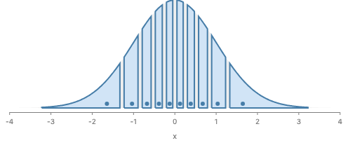
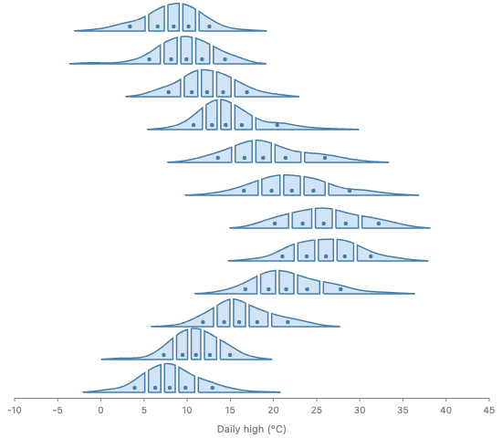
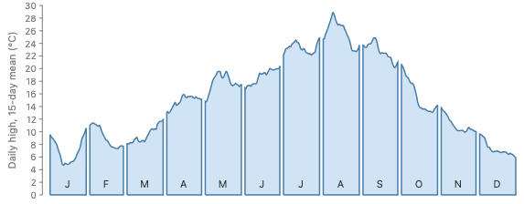
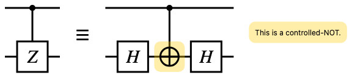
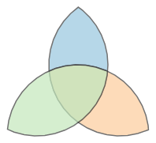

# Proposal: a shape that is defined but not drawn (#1267)

**Summary.**

- GoFish already has the rule we need. `blank()` is laid out, carries its data, counts for scales and can be referred to, and it draws nothing. Today the rule exists only for rectangles.
- This proposal gives that rule to every mark as a modifier, `.hidden()`, the same kind of method as `.name()` and `.zOrder()`. A hidden mark is laid out and counts for scales, axes and legends, but it paints nothing and cannot be hovered.
- Prototypes of the four croissant stories, a quantum-circuit diagram and a new Venn example render pixel for pixel the same as today, with the unseen SVG elements gone.

**Recommendation.** Approach A: `mark.hidden()` on any mark, chart or layer, with `blank(opts)` defined as `rect(opts).hidden()`. The runner-up is the same meaning spelled as a wrapper, `hide(mark)`, as in Typst. The other approaches (a separate `defs` slot, a shape that hides itself when an operator reads it, and passing the shape by value) each hit a wall on a real example.

```js
// Before: drawn, but unseen
chart(grid)
  .flow(scatter({ x: "x" }))
  .mark(ribbon({ h: "pdf", fill: "none" }).name("density"));
// After: defined, not drawn
chart(grid)
  .flow(scatter({ x: "x" }))
  .mark(ribbon({ h: "pdf" }).name("density").hidden());
```

## Terminology

- **Definition.** A shape that other parts of the picture use (as a region to cut, a box to align to, an anchor to point at) but that the reader should not see.
- **Laid out.** The layout engine gives the node a size and a position, and the node's size request takes part in its parent's layout.
- **Counts for scales.** The node's data takes part in domain inference, so it moves the scales, and through them the axes and legends.
- **Paints.** The node puts items in the display list, which become SVG elements.
- **Hit testing.** Finding which node is under the pointer. A node with no display item has no hit-test entry.
- **Phantom.** TeX's word for a box that has the size of its content and shows nothing. Used here as the name of the rule: laid out, counts for scales, paints nothing, no hit testing.
- **Region operand.** A child or `ref` of `intersect`, `subtract`, `exclude` or `mask`. It gives shape only; the operator owns the paint.
- **Fusion.** The rewrite `.mark(ribbon(opts))` ⇒ `.mark(blank(anchor)).layer(ribbon(rest))` that lets a relational mark sit in `.mark()` (#748).

## 1. What the issue asks, and the tensions in it

The issue (#1267) names three things:

- **The hack.** Each croissant story draws the curve with `fill: "none"` only so a `.relate()` clause can intersect it with each cell. The curve still sets the scales and the plot size, and still emits an SVG element.
- **Floated spellings.** A mark option (`.hidden()` or `paint: false`), a wrapper (`def(ribbon(...))`), or a builder method (`.def()` in place of `.mark()`).
- **Open questions.** Does a definition take part in layout? Does it make axes and legends? Is it hoverable? How does it reach Python? Does it interact with #1259?

The tensions, each answered below:

- "A definition, not a drawing" versus "laid out but not painted". These are different models: SVG `<defs>` are not laid out at all, while TikZ's `\path` is. Section 4 picks the second, because the curve must set the scales.
- Property of a mark, a wrapper, a slot, or no syntax at all. Section 5 gives one approach per answer.
- Should the need disappear, so that no unseen copy exists? Section 5D tries it.

## 2. What is in the code today

- **`blank()` already is a definition.** `marks/chart.ts` documents it as "an invisible positioning guide. It takes part in layout, carries a datum, anchors refs (`selectAll`) and seeds the color scale exactly as a `rect` does, and it emits NOTHING to the display list: no SVG element, no hit-test entry." `shapes/rect.tsx` builds it as `Rect(opts)` plus `node.INTERNAL_emitNothing()`. The comment there says "Invisibility is structural, not a paint style ... One rule, no flag."
- **The rule is one line on a node.** `GoFishNode.INTERNAL_emitNothing()` (`_node.ts`) replaces the node's lowering with one that returns no items. `GoFishRef` uses the same rule. So the feature desugars into machinery the core already has. The only new part is applying it to a whole subtree, since a plain layer's children are lowered by the bake pass, not by the layer.
- **A paint-time sibling exists.** `INTERNAL_visibleWhile(owner, fn)` hides a subtree at paint time, for `time.sequence` keyframes. Its items are still lowered and still hit-tested. It is for visibility that changes with a signal, not for a definition.
- **Region operands read geometry first.** `porterDuff.tsx` reads each operand's exact outline (`placedOutlines`, from `geometry()`), so a silenced operand still gives its shape on the exact path. The fallback path, used when there is no exact outline, re-lowers the operands and restyles their ink as a mask (`shapeOnly`). A silenced operand lowers to nothing there, so a real implementation must lower the operand's own drawing on that path (the node already has `INTERNAL_lendDrawing` for this).
- **Modifiers live in one table.** `.name()`, `.label()`, `.zOrder()` and `.transition()` are `ModifierConfig`s in `marks/createOperator.ts`, each with an `apply` on the produced node and a `tag` for the IR. `.hidden()` would be one more. On the wire, `MARK_BASE_FIELDS` in `gofish-ir/src/frontend/descriptors.ts` holds `name`, `label`, `relate` and `zOrder`; `hidden` would be one more boolean field there.

The workarounds in the story corpus, all of which mean "laid out, not seen":

| Story                                         | Workaround                                        | What it is for                                          |
| --------------------------------------------- | ------------------------------------------------- | ------------------------------------------------------- |
| `forwardsyntax/Croissant` (4 gallery stories) | `ribbon({ fill: "none" }).name(...)`              | a region the cells cut                                  |
| `bluefish/QuantumCircuit` (gallery)           | `rect({ fill: "transparent" })` ×3                | a centering slot, an empty slot, a leader spacer        |
| `bluefish/OhmParseTree` (gallery)             | `rect({ fill: "transparent" }).name(tok)`         | span sources for `align`, and a char box                |
| `bluefish/DFSCQ` (gallery)                    | `rect({ fill: "transparent" }).name(...)` ×8      | slots that arrows and aligns read                       |
| `bluefish/BakingRecipes` (gallery)            | `enclose({ fill: "none", stroke: "none" }, refs)` | a box around named cells (Bluefish's `Group`)           |
| `animated-vega-lite/Gapminder` sparklines     | `circle({ r: 2.5, opacity: 0 })`                  | anchors whose size insets the plot like the visible dot |
| `animated-vega-lite/BarChartRace`             | CSS `clip-path` on the container (#889)           | an 11th slot that bars slide in from                    |

The Bluefish ports copy Bluefish's own `fill="transparent"` rects (`qc-text.tsx` has three), so the hack is inherited, not invented here.

## 3. Related issues and earlier decisions

Issues:

- #1267. This issue: a way to define a shape without drawing it.
- #1259 (open, parked). Lets a string `ref` sit outside `.relate()`, so the croissant can use `.layer()`. Orthogonal to this proposal: it removes the outer `layer([...]).relate(...)`, this removes the `fill: "none"`. They compose (section 6).
- #889 (open). The bar chart race's 11th rank: "a slot that is laid out but not shown". Section 8 argues it needs a clip, not this.
- #1209 (open). Clipping: where content is clipped to a box, and how a clip relates to compositing.
- #1219 (open). Vector region compositing, to make the croissant chart for real.
- #1229 (merged). Added the croissant stories, `Bin.quantiles`, `quantileRows`, `region({ inset })` and painted vector `intersect`.
- #544 (closed). Croissant charts.
- #1230 (open). Default paint for a region-compositing operator with no `fill` (tint or the first operand's paint). Not changed here.
- #1243 (open). `region()` with no size silently becomes 16px. Found while building the ridgeline croissant.
- #1201 (open). Composites need one convex operand for an exact outline. The Venn example hits it (section 8).
- #677 (open). A `ref` placed before its target silently draws nothing.
- #910 (open). Keyframe visibility should cover every relational mark, not only connectors. Shares the paint-time visibility machinery.
- #748 (merged). Blank fusion: `.mark(R)` ⇒ `.mark(blank).layer(R)`. It is why `blank()` is the anchor of every fused line and area.
- #745 (merged). Relational marks paint below their operands by an explicit `zBelow` default, with no intent inference.
- #1253 (open). JS `toJSON` does not serialize `.relate()`. Unchanged by this proposal.

Decisions in project memory that bear on this:

- `project_relational_mark_fusion`: fusion routes `w`, `h`, `emX`, `emY` to the blank anchor and all paint to the connector. A hidden fused ribbon therefore hides the connector, and the anchors are blank already. Josh had planned to delete `blank()` once nothing used it; fusion still uses it.
- `project_relational_marks_layer` (#745): Josh called intent-detection rules "spooky". This rules out approach C.
- `feedback_methods_vs_options`: a method chain is a universal interface that transforms the object; an option is a local adjective. Hiding works on every mark the same way, so it is a method.
- `feedback_name_scoping`, `feedback_no_unused_name_in_specs`: unchanged. A hidden mark is named only when something reads it, as now.
- `project_croissant_charts_544`: Josh decided that the region and the paint are separate and that the composite owns the paint. A hidden operand fits that: the operand gives shape, the operator paints.
- `project_relate_slot_878`: the six parked `.relate()` questions (#935) are not re-asked here.

## 4. Precedent

The question has two parts: what a definition keeps (layout, scales, paint, hit testing), and where it is written.

| System             | Spelling                                     | Laid out                             | Painted                | Hit-testable | Model or workaround                |
| ------------------ | -------------------------------------------- | ------------------------------------ | ---------------------- | ------------ | ---------------------------------- |
| CSS                | `visibility: hidden`                         | yes                                  | no                     | no           | model                              |
| CSS                | `display: none`                              | no                                   | no                     | no           | model of the other choice          |
| SwiftUI            | `.hidden()`                                  | yes                                  | no                     | no           | model                              |
| SwiftUI            | `.opacity(0)`                                | yes                                  | no                     | yes          | workaround                         |
| Typst              | `hide(content)`                              | yes                                  | no                     | n/a          | model                              |
| TeX                | `\phantom{...}`                              | yes                                  | no                     | n/a          | model                              |
| TikZ               | `\path[name path=c] ...;` vs `\draw`         | yes, and counts for the bounding box | no                     | n/a          | model                              |
| TikZ               | `[use as bounding box]`, `\useasboundingbox` | sets the picture's box               | optional               | n/a          | model (layout only)                |
| SVG                | `<defs>` + `<use>`, `<clipPath>`             | no, placed at each `<use>`           | no                     | no           | model of a template                |
| Figma              | hidden layer (eye icon)                      | no, it leaves auto layout            | no                     | no           | model of `display: none`           |
| Figma, Illustrator | "Use as mask" / clipping path                | yes                                  | no, it loses its paint | no           | model of consumption               |
| Illustrator        | View > Guides > Make Guides                  | yes                                  | no, non-printing       | snaps only   | model                              |
| ggplot2            | `geom_blank()`, `expand_limits()`            | n/a                                  | no                     | n/a          | model for scales only              |
| Vega-Lite          | a layer with `opacity: 0`                    | yes                                  | no                     | yes          | workaround                         |
| Bluefish           | `<Rect fill="transparent">`, `<Group>`       | yes                                  | transparent            | yes          | workaround, plus a paintless group |
| Penrose            | shapes with no fill and no stroke color      | yes                                  | no                     | n/a          | workaround, as far as I know       |

What the survey says:

- **Layout systems agree on the croissant's meaning.** CSS `visibility: hidden`, SwiftUI `.hidden()`, Typst `hide` and TeX `\phantom` all keep the layout and drop the paint. SwiftUI's documentation says hidden views "are invisible and can't receive or respond to interactions. However, they do remain in the view hierarchy and affect layout." CSS also makes a hidden box ignore the pointer. That is exactly `blank()`'s rule.
- **TikZ is the closest match to the croissant.** `\path[name path=curve] plot ...;` builds a curve, names it and draws nothing. `\fill[name intersections={of=curve and line}]` then uses it. The path still counts for the picture's bounding box. Drawing is an option on a path (`\draw` = `\path[draw]`).
- **SVG `<defs>` is a different model.** A definition there is a template with no position until a `<use>` places it. The croissant's curve must be laid out once, in the chart's frame, so it can set the y scale. A template that each cell instantiates would be laid out in each cell instead.
- **Design tools offer consumption.** A Figma mask or an Illustrator clipping path stops painting when it becomes a mask. The meaning comes from use, not from a declaration.
- **Statistics grammars treat this as a workaround,** except for ggplot2's `geom_blank()`, which is the model for "counts for scales, draws nothing". GoFish's `blank()` follows it.

Names. `hidden` is the SwiftUI method and the CSS value; Typst's verb is `hide`. `def` reads as SVG's template, and `def` is a keyword in Python, so the Python method would need another name (`.define()`). `guide` is Illustrator's word, but in ggplot2 "guides" are axes and legends, so it is taken in visualization. `phantom` is TeX jargon.

## 5. Approaches

Each approach is shown on the croissant (the hard case is the ridgeline, where each row's curve is its own definition) and on a spacer from the quantum circuit. A small `cells(grid, density)` helper stands for the partition-and-intersect chart, which is the same in every approach.

### A. `.hidden()`, a modifier on any mark (recommended)

```js
// A. A modifier on any mark, like .name() and .zOrder().
ribbon({ h: "pdf" }).name("density").hidden();
rect({ w: 10, h: GATE }).hidden(); // a spacer
chart(grid)
  .flow(scatter({ x: "x" }))
  .mark(ribbon({ h: "pdf" }))
  .hidden(); // a whole chart, axes included
// blank() is exactly this:
blank({ w, h }); // ≡ rect({ w, h }).hidden()
```

```python
ribbon(h="pdf").name("density").hidden()
rect(w=10, h=GATE).hidden()
```

**Meaning.** A hidden node is laid out exactly as it would be without the modifier. Its data counts for scales, domains, axes and legends. It keeps its name and datum, so `ref`, `selectAll`, constraints and region operands read it. It paints nothing where it stands and has no hit-test entry. The rule covers the node's whole subtree and its attached labels.

**What it desugars into.** `INTERNAL_emitNothing()` on every node of the subtree, which is `blank()`'s rule. `blank(opts)` is then exactly `rect(opts).hidden()`. On the wire, `hidden: true` beside `zOrder` on any mark.

**Trade-offs.** One new method name, with SwiftUI and CSS precedent. It reaches every case in the corpus that is a whole mark: curves, spacers, slots, anchors. It cannot hide a container's own paint while showing its children (BakingRecipes' `Pad`); that stays a paint option (section 8). Extending it later (a per-datum value, as `.zOrder(fn)` has) is a new argument, not a new name.

**Wrapper spelling of A.** The same meaning as a function, like Typst:

```js
// A, wrapper spelling (Typst's hide): the same meaning as a function.
layer([
  hide(
    chart(grid)
      .flow(scatter({ x: "x" }))
      .mark(ribbon({ h: "pdf" }).name("density"))
  ),
]).relate(({ density }) => [cells(grid, density)]);
```

```python
layer(
    [hide(chart(grid).flow(scatter(x="x")).mark(ribbon(h="pdf").name("density")))]
).relate(lambda density: [cells(grid, density)])
```

It reads well around a whole chart, and it is the natural form in a functional language. It is worse here for three reasons. GoFish's per-node adjectives are already methods (`.name()`, `.label()`, `.zOrder()`, `.transition()`). A function call says the parts are independent (`layer([a, b])`), and hiding is a transformation of its one argument (the calls, methods and options rule in `api-design.md`). And a wrapper needs a node of its own or a fake layer, while a modifier sets a field on the node it already has.

### B. A `defs` slot on the container

```js
// B. A definitions slot on the container, like SVG <defs>.
layer({
  defs: [
    chart(grid)
      .flow(scatter({ x: "x" }))
      .mark(ribbon({ h: "pdf" }).name("density")),
  ],
}).relate(({ density }) => [cells(grid, density)]);

// Or on the chart builder, in place of .mark():
chart(grid)
  .flow(scatter({ x: "x" }))
  .def(ribbon({ h: "pdf" }).name("density"))
  .layer(cells(grid, ref("density"))); // also needs #1259

// The wall: a spacer has a place in its spread's order,
// so it cannot move to a defs list.
spread({ dir: "x" }, [rect({ w: 10, h: GATE }), ...slots]);
```

```python
layer(
    [], defs=[chart(grid).flow(scatter(x="x")).mark(ribbon(h="pdf").name("density"))]
).relate(lambda density: [cells(grid, density)])
chart(grid).flow(scatter(x="x")).define(ribbon(h="pdf").name("density")).layer(
    cells(grid, ref("density"))
)
```

**Meaning.** Definitions sit in their own list, as in SVG `<defs>` or a `let` binding. They are laid out in the container's frame and count for scales, and the container does not paint them.

**The wall.** A spacer is laid out in a place in its parent's order: the quantum circuit's leader rect is the first child of a `spread`, and its width pushes the gates right. Moving it to a `defs` list takes it out of the order, and then it pushes nothing. So B still needs A for spacers, and then there are two spellings for one rule. B also needs a slot on every container (`layer`, `spread`, the chart builder), and its builder method cannot be called `def` in Python.

**What it is good at.** It puts every definition in one place, which reads like TikZ's list of named paths. That benefit is real for a diagram with many definitions, and A gets most of it by convention (put hidden marks first).

### C. A shape hides itself when a region operator reads it

```js
// C. A shape that is used as a region operand stops painting where it stands.
layer([
  chart(grid)
    .flow(scatter({ x: "x" }))
    .mark(ribbon({ h: "pdf" }).name("density")), // not drawn: intersect reads it
]).relate(({ density }) => [cells(grid, density)]);
```

```python
layer([chart(grid).flow(scatter(x="x")).mark(ribbon(h="pdf").name("density"))]).relate(
    lambda density: [cells(grid, density)]
)
```

**Meaning.** The Figma and Illustrator mask model: a node that is a region operand stops painting at home. No new syntax.

**The walls.**

- It is an intent rule: what a node draws depends on who reads it, somewhere else in the tree. Josh rejected rules like this for relational marks (#745).
- It cannot say "draw the curve and also cut it". A croissant with a faint full curve behind the slices (the `croissant-shown.png` render) would need a second copy of the curve, which is the hack again.
- It does nothing for spacers, slots and anchors, which no region operator reads.

### D. No unseen copy: pass the shape by value

```js
// D. No unseen copy: each cell intersects the curve itself.
chart(grid)
  .flow(
    derive((rows) => quantileRows(rows, { x: "x", density: "pdf", n: 1000 })),
    partition({ by: field("x").bin(Bin.quantiles(10)), dir: "x" })
  )
  .mark(
    intersect({ fill: FILL, stroke: STROKE }, [
      // Laid out in which frame? The cell's, so it does not line up.
      chart(grid)
        .flow(scatter({ x: "x" }))
        .mark(ribbon({ h: "pdf" })),
      region({ inset: 3 }),
    ])
  );
```

**Meaning.** The need disappears if each cell's `intersect` holds the curve itself, the way `cut` holds an offset copy of its source in each slice. Direct operands already give shape only, so nothing would need hiding.

**The wall.** A child is laid out in its parent's frame. The curve inside a cell would be laid out in the cell, at the cell's width, not across the chart. Making it line up needs the chart's frame before layout (#1244), and then the curve is still laid out ten times, once per cell. It also stops the curve from setting the chart's y scale once. The Venn example shows the same thing from the other side: each circle is used by two lenses, so a by-value operand would mean two copies of each circle. A shape that several things use needs one node and a name, and a node that nobody should see needs a way to say so. That is A.

D does stay true where a shape is used once and in place: `intersect([circle(...), rect(...)])` needs no hiding today.

### Considered and dropped

- **A paint value**, such as `paint: false` or `fill: "none"` with no stroke made to emit nothing. It keeps the meaning in paint, so it still reads as "paint nothing" rather than "this is a definition". It would silently change marks that are transparent on purpose, such as a transparent hover target, which should stay hit-testable. And the `blank()` comment already argues against a flag for this.
- **`.def()` in place of `.mark()`** on the chart builder. It covers only marks in `.mark()` position, not combinator children (the quantum circuit), not rows of a ridgeline written in a `layer([...])`, and `def` is a Python keyword.

## 6. Examples

Every **Proposed** picture below is a real render from `packages/gofish-graphics/stories/proposals/ShapeDefinitions.stories.tsx`. It uses a story-local shim, `hidden(mark)`, that lays the mark out as usual and then calls `INTERNAL_emitNothing()` on its whole subtree. The shim wraps a mark function, so it cannot sit on a mark that `.mark()` fuses. Those prototype stories write the fusion out by hand (`.mark(blank({ h: "pdf" })).layer(hidden(ribbon({}).name("density")))`). A real `.hidden()` would be a modifier and would fuse like `.name()`. Each **Current** picture renders today's spelling. Each pair was compared with pixelmatch at threshold 0.

| Example                    | Kind                                                | Differing pixels | SVG shape elements, current → proposed |
| -------------------------- | --------------------------------------------------- | ---------------- | -------------------------------------- |
| Croissant                  | improvement (gallery)                               | 0                | 41 → 40                                |
| Croissant ridgeline        | improvement (gallery), hard case                    | 0                | 158 → 146                              |
| Seattle highs cut by month | improvement (gallery), chrome from the hidden shape | 0                | 59 → 58                                |
| Quantum circuit            | improvement (gallery), diagram                      | 0                | 29 → 21                                |
| Venn lenses                | new, diagram                                        | 0                | 6 → 3                                  |

### 6.1 Croissant

| Current                        | Proposed (shim render)          |
| ------------------------------ | ------------------------------- |
|  |  |

Current:

```js
layer([
  chart(grid)
    .flow(scatter({ x: "x" }))
    .mark(ribbon({ h: "pdf", fill: "none" }).name("density")),
]).relate(({ density }) => [
  chart(grid)
    .flow(
      derive((rows) => quantileRows(rows, { x: "x", density: "pdf", n: 1000 })),
      partition({ by: field("x").bin(Bin.quantiles(10)), dir: "x" })
    )
    .mark(
      layer([
        intersect({ fill: FILL, stroke: STROKE, strokeWidth: 2 }, [
          density,
          region({ inset: 3 }),
        ]),
        circle({ cx: field("x").median(), cy: 6, r: 3, fill: STROKE }),
      ])
    ),
]);
```

Proposed:

```js
layer([
  chart(grid)
    .flow(scatter({ x: "x" }))
    .mark(ribbon({ h: "pdf" }).name("density").hidden()),
]).relate(({ density }) => [
  chart(grid)
    .flow(
      derive((rows) => quantileRows(rows, { x: "x", density: "pdf", n: 1000 })),
      partition({ by: field("x").bin(Bin.quantiles(10)), dir: "x" })
    )
    .mark(
      layer([
        intersect({ fill: FILL, stroke: STROKE, strokeWidth: 2 }, [
          density,
          region({ inset: 3 }),
        ]),
        circle({ cx: field("x").median(), cy: 6, r: 3, fill: STROKE }),
      ])
    ),
]);
```

```python
layer(
    [chart(grid).flow(scatter(x="x")).mark(ribbon(h="pdf").name("density").hidden())]
).relate(lambda density: [cells(grid, density, n=10, inset=3)])
```

What the hidden curve is: the same spec with the curve given a light fill instead of hidden. It shows that the definition is laid out across the whole chart and sets the scales.



With #1259 as well, the outer `layer([...]).relate(...)` also goes away:

```js
chart(grid)
  .flow(scatter({ x: "x" }))
  .mark(ribbon({ h: "pdf" }).name("density").hidden())
  .layer(
    chart(grid)
      .flow(
        derive((rows) =>
          quantileRows(rows, { x: "x", density: "pdf", n: 1000 })
        ),
        partition({ by: field("x").bin(Bin.quantiles(10)), dir: "x" })
      )
      .mark(
        layer([
          intersect({ fill: FILL, stroke: STROKE, strokeWidth: 2 }, [
            ref("density"),
            region({ inset: 3 }),
          ]),
          circle({ cx: field("x").median(), cy: 6, r: 3, fill: STROKE }),
        ])
      )
  );
```

### 6.2 Croissant ridgeline (hard case: one definition per row)

Each month's row holds its own hidden curve, and `density` in each row's clause means that row's curve. Nothing about this changes under A: the name lookup is the one #1237 built, and the modifier is per node.

| Current                        | Proposed (shim render)          |
| ------------------------------ | ------------------------------- |
|  |  |

Current:

```js
chart(monthlyDensity, {
  w: 520,
  axes: { x: { title: "Daily high (°C)" }, y: false },
})
  .flow(
    spread({
      by: field("month").sort(months),
      dir: "y",
      anchor: "baseline",
      spacing: 36,
    })
  )
  .mark(
    layer({ h: 34 }, [
      chart()
        .flow(scatter({ x: "temp_max" }))
        .mark(ribbon({ h: "pdf", fill: "none" }).name("density")),
    ]).relate(({ density }) => [cells(density, { n: 5, inset: 2 })])
  );
```

Proposed:

```js
chart(monthlyDensity, {
  w: 520,
  axes: { x: { title: "Daily high (°C)" }, y: false },
})
  .flow(
    spread({
      by: field("month").sort(months),
      dir: "y",
      anchor: "baseline",
      spacing: 36,
    })
  )
  .mark(
    layer({ h: 34 }, [
      chart()
        .flow(scatter({ x: "temp_max" }))
        .mark(ribbon({ h: "pdf" }).name("density").hidden()),
    ]).relate(({ density }) => [cells(density, { n: 5, inset: 2 })])
  );
```

```python
chart(monthly_density, w=520).flow(
    spread(by=field("month").sort(MONTHS), dir="y", anchor="baseline", spacing=36)
).mark(
    layer(
        [
            chart()
            .flow(scatter(x="temp_max"))
            .mark(ribbon(h="pdf").name("density").hidden())
        ],
        h=34,
    ).relate(lambda density: [cells(None, density, n=5, inset=2)])
)
```

`cells(density, { n, inset })` stands for the row's partition chart, as in the gallery story.

### 6.3 Seattle highs cut by month (chrome from the hidden shape)

The y axis and its title come from the hidden area: its `temp_smooth` values set the y domain, and nothing else in the picture has a y position in data. This is the case for "a hidden mark counts for scales and axes".

| Current                      | Proposed (shim render)        |
| ---------------------------- | ----------------------------- |
|  |  |

Current:

```js
layer([
  chart(highs2012, { schema })
    .flow(scatter({ x: "date" }))
    .mark(ribbon({ h: "temp_smooth", fill: "none" }).name("temps")),
])
  .relate(({ temps }) => [monthCells(temps)])
  .render(container, {
    w: 560,
    h: 220,
    axes: { x: false, y: { title: "Daily high, 15-day mean (°C)" } },
  });
```

Proposed:

```js
layer([
  chart(highs2012, { schema })
    .flow(scatter({ x: "date" }))
    .mark(ribbon({ h: "temp_smooth" }).name("temps").hidden()),
])
  .relate(({ temps }) => [monthCells(temps)])
  .render(container, {
    w: 560,
    h: 220,
    axes: { x: false, y: { title: "Daily high, 15-day mean (°C)" } },
  });
```

### 6.4 Quantum circuit (diagram: slots and a spacer)

Three transparent rects: a 50×50 slot that centers a gate or a dot, an empty slot, and a 10px leader that pushes the gates right. All three are laid out and none should be seen. Today they emit eight SVG elements that can be hovered.

| Current                      | Proposed (shim render)        |
| ---------------------------- | ----------------------------- |
|  |  |

Current:

```js
const WireSlot = createMark(({ content }) =>
  layer([
    rect({ w: GATE, h: GATE, fill: "transparent" }).name("slot"),
    content.name("content"),
  ]).relate(({ slot, content }) => [
    Constraint.align({ x: "middle", y: "middle" }, [slot, content]),
  ])
);
const EmptySlot = () => rect({ w: GATE, h: GATE, fill: "transparent" });
// In Wire: the 10px leader before the gates.
spread({ dir: "x", spacing: SLOT - GATE, alignment: "middle" }, [
  rect({ w: 10, h: GATE, fill: "transparent" }),
  ...slots,
]);
```

Proposed:

```js
const WireSlot = createMark(({ content }) =>
  layer([
    rect({ w: GATE, h: GATE }).name("slot").hidden(),
    content.name("content"),
  ]).relate(({ slot, content }) => [
    Constraint.align({ x: "middle", y: "middle" }, [slot, content]),
  ])
);
const EmptySlot = () => rect({ w: GATE, h: GATE }).hidden();
// In Wire: the 10px leader before the gates.
spread({ dir: "x", spacing: SLOT - GATE, alignment: "middle" }, [
  rect({ w: 10, h: GATE }).hidden(),
  ...slots,
]);
```

```python
empty_slot = rect(w=GATE, h=GATE).hidden()
spread(
    [rect(w=10, h=GATE).hidden(), *slots],
    dir="x",
    spacing=SLOT - GATE,
    alignment="middle",
)
```

`blank({ w: GATE, h: GATE })` already works for these today. Under A it is the same thing as `rect({ w: GATE, h: GATE }).hidden()`.

### 6.5 Venn lenses (new example: each definition used twice)

Three circles, each used by two lenses. The circles are never drawn. This is new, not an improvement of a gallery story.

| Current                   | Proposed (shim render)     |
| ------------------------- | -------------------------- |
|  |  |

Current:

```js
const LENS = { stroke: "#444", strokeWidth: 1.5, opacity: 0.75 };
layer([
  circle({ cx: 100, cy: 100, r: 90, fill: "none" }).name("a"),
  circle({ cx: 205, cy: 100, r: 90, fill: "none" }).name("b"),
  circle({ cx: 152, cy: 190, r: 90, fill: "none" }).name("c"),
]).relate(({ a, b, c }) => [
  intersect({ fill: "#9ecae1", ...LENS }, [a, b]),
  intersect({ fill: "#fdd0a2", ...LENS }, [b, c]),
  intersect({ fill: "#c7e9c0", ...LENS }, [a, c]),
]);
```

Proposed:

```js
const LENS = { stroke: "#444", strokeWidth: 1.5, opacity: 0.75 };
layer([
  circle({ cx: 100, cy: 100, r: 90 }).name("a").hidden(),
  circle({ cx: 205, cy: 100, r: 90 }).name("b").hidden(),
  circle({ cx: 152, cy: 190, r: 90 }).name("c").hidden(),
]).relate(({ a, b, c }) => [
  intersect({ fill: "#9ecae1", ...LENS }, [a, b]),
  intersect({ fill: "#fdd0a2", ...LENS }, [b, c]),
  intersect({ fill: "#c7e9c0", ...LENS }, [a, c]),
]);
```

## 7. How it composes

- **Layout engine.** No change. A hidden node is the same node with the same size request and position; only its lowering is empty. The prototype's 0-pixel diffs show that nothing moved.
- **Scales, axes, legends.** A hidden node's data counts, as `blank()`'s does today. The Seattle example takes its y axis from a hidden area. A hidden mark with `fill: "species"` still puts species in the legend, as `geom_blank()` expands scales in ggplot2 (decision 3).
- **Chrome of a hidden chart.** `.hidden()` on a whole chart hides its subtree, which includes the axes and legend that chart owns (decision 4). Hiding only the mark keeps the chart's chrome.
- **Labels.** A `.label()` on a hidden mark is an attachment of that mark, so it is hidden with it (decision 4).
- **Refs, constraints, region operands.** Unchanged: they read placement and geometry, not paint. The exact path of `intersect` reads `geometry()`, which a hidden node keeps (the croissant and Venn renders). The fallback mask path must lower the operand's own drawing (`INTERNAL_lendDrawing`) rather than its silenced lowering, or a hidden operand gives an empty mask. Found by reading `porterDuff.tsx`, not rendered.
- **Relational marks and fusion.** `.mark(ribbon(...).hidden())` fuses to `.mark(blank(anchor)).layer(ribbon(...).hidden())`, since modifiers go with the connector. The anchors are blank already.
- **Animation.** Keyframe visibility (`time.sequence`) is paint-time and changes with the clock. `.hidden()` is fixed at resolve. Emitting nothing wins over a visibility rule today, so they compose. A `time.transition()` paints its own copy of a keyframe's mark through `INTERNAL_lendDrawing`, which today lends a silenced node's drawing on purpose. A user-hidden mark must lend nothing, so the implementation must keep "hidden by the user" apart from "silenced because a transition took it over". `.transition({ enter })` on a hidden mark animates nothing.
- **Interaction.** No hit-test entry, as for `blank()`. A transparent rect stays the way to make an invisible hover target.
- **Python and the IR.** One boolean field `hidden` in `MARK_BASE_FIELDS`, written by `.hidden()` the way `zOrder` is written by `.zOrder()`. Python gets `.hidden()` on `Mark`, `ChartBuilder` and the ref proxy, beside `.name()` and `.z_order()`. No new construct crosses the bridge, so no deserializer entry. The generated Python wrapper and the descriptor docs change in the same step.
- **Data types.** No interaction.

## 8. Overlap check

- **`blank()`.** Exact composition: `blank(opts) = rect(opts).hidden()`. Fine by the overlap rule. Keep it as named sugar, or delete it from the public surface (decision 5). Fusion's internal anchor can keep using the `Blank` node either way.
- **`fill: "none"`, `fill: "transparent"`, `opacity: 0`.** Paint values that happen to be invisible. They stay legal and keep their meaning (a transparent rect is still a hover target). The proposal only stops using them as definitions.
- **Keyframe visibility.** A small, degenerate shared case: a keyframe that never shows. Different tier (paint-time, signal-driven), different purpose. Fine.
- **Clipping (#1209, #889).** No overlap. A clip hides part of a mark by region; `.hidden()` hides a whole mark. See the next section.
- **Region compositing.** No overlap. `intersect` and its siblings own paint over shapes; `.hidden()` makes a shape that has no paint of its own.

## 9. Walls and what the design does not cover

- **The bar chart race (#889) is not covered.** Its parked brands wait in an 11th slot, and a bar that enters the top ten slides up out of it. D3 shows half a bar while it crosses the edge. `.hidden()` hides whole marks, so a bar would pop in at the edge instead of sliding. A per-datum `.hidden(d => d.rank > 10)` would pop in the same way. What #889 needs is a clip on the plot box (#1209), so I do not propose a value argument for `.hidden()` now (decision 8).
- **A container's own paint is a separate thing.** BakingRecipes' `Pad` is `enclose({ padding: 5, fill: "transparent", stroke: "none" }, [text(...)])`: the box must not paint, but its text must. `.hidden()` hides the whole subtree, so it is the wrong tool. The right spelling is the enclose's paint options (or a plain padding operator). Its `union` helper wraps only refs, so `.hidden()` fits there.
- **The shim cannot sit on a fused mark.** This is a prototype limit, not a design limit. The prototype stories write the fusion out by hand, and the pixels match.
- **Two things found while building the Venn example, both outside this proposal.** `subtract` over two `ref` circles drew nothing even when the circles were painted, so the example uses only `intersect`. And a stroked `intersect` whose operand is another `intersect` throws "a stroke needs the exact outline", the #1201 limit, so the example has no triple-overlap region.

## 10. Recommendation

I recommend **A, `.hidden()`**.

- **It desugars into the existing core** (`principles.md`, "Why keep the core small"). The rule is `blank()`'s, `INTERNAL_emitNothing()`, applied to a subtree. No node kind, no pass and no layout change.
- **One rule instead of several workarounds** (`api-design.md`, "Prefer the simple general rule to a case split"). Today the same meaning is spelled `blank()`, `fill: "none"`, `fill: "transparent"`, `opacity: 0` and a CSS clip. Under A it is one method, and `blank()` becomes an exact composition of it.
- **It passes the hard examples** (`api-design.md`, "Hard examples are central"). The ridgeline's per-row definitions, the Seattle chart's axis from a hidden area, diagram spacers inside a `spread`, and a shape used by two regions all work, and render the same as today.
- **The method form matches GoFish's rule for calls, methods and options** (`api-design.md`, Naming). It is a universal transformation of the node, like `.name()` and `.zOrder()`.
- **The name has precedent with the same meaning** (SwiftUI `.hidden()`, CSS `visibility: hidden`, Typst `hide`), and it avoids SVG's `def`, which means a template and is a Python keyword.
- **The same shape in Python**, one IR field, no new construct on the bridge.

**Runner-up: the wrapper spelling, `hide(mark)`.** Same meaning. I would pick it if Josh wants hiding to read as a structural boundary that you can see around a whole chart, as in Typst. B would win only if many diagrams turn out to want all their definitions listed in one place, and even then it needs A for spacers.

## 11. Decisions for Josh

1. Is a definition "laid out, counts for scales, axes and legends, paints nothing, cannot be hovered" (the phantom rule)?
2. Spelling: `.hidden()` as a modifier (recommended), `hide(x)` as a wrapper, or something else?
3. Does a hidden mark's color field still feed the color scale and legend? (Recommended yes, as `blank()` does.)
4. Does `.hidden()` hide the mark's labels, and on a whole chart its axes and legend? (Recommended yes: the whole subtree and its attachments.)
5. Keep `blank()` as sugar for `rect(...).hidden()`, or delete it from the public API and migrate its call sites?
6. Should this land with #1259 in one PR, so the croissant becomes `chart(...).mark(ribbon(...).hidden()).layer(...)`?
7. Migrate the gallery stories (the four croissants, QuantumCircuit, OhmParseTree, DFSCQ, the BakingRecipes `union`) in the same change?
8. Leave #889 (the bar chart race) to a clip (#1209), with no value argument on `.hidden()` for now?

User-facing syntax changes to review:

- New: `mark.hidden()` on every mark, chart builder and layer; Python `mark.hidden()`.
- Changed meaning: none. `fill: "none"` and `fill: "transparent"` keep theirs.
- Possibly removed: `blank()` (decision 5).

## 12. Prototype

- Stories: `packages/gofish-graphics/stories/proposals/ShapeDefinitions.stories.tsx` (throwaway, not tagged for the gallery). Pairs: `CroissantCurrent`/`CroissantProposed`, `RidgelineCurrent`/`RidgelineProposed`, `SeattleCurrent`/`SeattleProposed`, `QuantumCurrent`/`QuantumProposed`, `VennCurrent`/`VennProposed`, plus `CroissantShown`, `VennShown` and `DiagUnfused` (the hand-written fusion without the shim, also 0 pixels off).
- No library code changed.
