# Defined, Not Drawn (#1267)

A shape that is laid out and read by other marks, but not painted.

## The proposal

- **decided.** `.hidden()` on any mark, chart or layer: laid out, counts for scales, axes and legends, keeps its name and datum, paints nothing, takes no pointer.
- **decided.** `.hidden(fn)` hides per datum. Toggling only repaints; layout never moves.
- **decided.** An ancestor's `.hidden()` wins over a child's `.hidden(false)`. On one value, the last call wins.
- **decided.** Only on a value you hold: not through `ref` or `selectAll`, and no operator sets it.
- **proposed.** A child slot draws its child as itself. An operand slot is read for shape, place, paint or data, and the operator draws its result from what it read, never the operand as itself. A ref draws nothing.
- **proposed.** Which frame is an operand in? The frame the operator sits in, never the frame it makes for its children. An inline operand is laid out there; a ref is read where it was placed and mapped into that frame.
- **proposed.** Region compositing is five operations: `union`, `intersect`, `subtract`, `exclude` and `atop`. The result is drawn from the operands' coverage. A `fill` gives one new shape. With no fill, each part takes the paint of the operands that cover it, blended by `blendMode` (default `"normal"`) where they overlap, as in PiCCL. `blendMode` is on `union`, `intersect` and `atop` only; `atop` takes no fill. A hidden operand adds its shape and no paint, so it is a stencil. There is no `mode`: a luminance stencil filters itself to alpha. `paint` is renamed `atop`; `mask` is deleted.
- **proposed.** Alpha is shape. An operand gives its shape, which is its alpha, partial coverage included, and its paint. `.hidden()` removes the paint and keeps the shape; no brightness leaks out of a hidden mark.
- **decided.** Bend and envelope are coordinate transforms with a shape argument: `Coord.bend({ along })`, `Coord.envelope({ top, bottom })`. The coord reads the shape and never draws it. Deferred.
- **decided.** Renames: `position` becomes `translate`; `cut(opts, [source])`.

## Hiding

### Croissant: the density curve

The curve is laid out and sets the scale, and `.hidden()` replaces `fill: "none"`.


_Render. Proposed render, 0 px from today's._

**Proposed**

```js
layer([
  chart(grid)
    .flow(scatter({ x: "x" }))
    .mark(ribbon({ h: "pdf" }).name("density").hidden()),
]).relate(({ density }) => [
  chart(grid)
    .flow(
      derive((rows) => quantileRows(rows, { x: "x", density: "pdf", n: 1000 })),
      partition({ by: field("x").bin(Bin.quantiles(10)), dir: "x" })
    )
    .mark(
      layer([
        intersect({ fill: FILL, stroke: STROKE, strokeWidth: 2 }, [
          density,
          region({ inset: 3 }),
        ]),
        circle({ cx: field("x").median(), cy: 6, r: 3, fill: STROKE }),
      ])
    ),
]);
```

<details><summary>Current spelling (20 lines)</summary>

```js
layer([
  chart(grid)
    .flow(scatter({ x: "x" }))
    .mark(ribbon({ h: "pdf", fill: "none" }).name("density")),
]).relate(({ density }) => [
  chart(grid)
    .flow(
      derive((rows) => quantileRows(rows, { x: "x", density: "pdf", n: 1000 })),
      partition({ by: field("x").bin(Bin.quantiles(10)), dir: "x" })
    )
    .mark(
      layer([
        intersect({ fill: FILL, stroke: STROKE, strokeWidth: 2 }, [
          density,
          region({ inset: 3 }),
        ]),
        circle({ cx: field("x").median(), cy: 6, r: 3, fill: STROKE }),
      ])
    ),
]);
```

</details>

### Croissant ridgeline: one hidden curve per row

Each row's curve is hidden, and its cells still read it.


_Render. Proposed render, 0 px from today's._

**Proposed**

```js
chart(monthlyDensity, {
  w: 520,
  axes: { x: { title: "Daily high (°C)" }, y: false },
})
  .flow(
    spread({
      by: field("month").sort(months),
      dir: "y",
      anchor: "baseline",
      spacing: 36,
    })
  )
  .mark(
    layer({ h: 34 }, [
      chart()
        .flow(scatter({ x: "temp_max" }))
        .mark(ribbon({ h: "pdf" }).name("density").hidden()),
    ]).relate(({ density }) => [cells(density, { n: 5, inset: 2 })])
  );
```

<details><summary>Current spelling (19 lines)</summary>

```js
chart(monthlyDensity, {
  w: 520,
  axes: { x: { title: "Daily high (°C)" }, y: false },
})
  .flow(
    spread({
      by: field("month").sort(months),
      dir: "y",
      anchor: "baseline",
      spacing: 36,
    })
  )
  .mark(
    layer({ h: 34 }, [
      chart()
        .flow(scatter({ x: "temp_max" }))
        .mark(ribbon({ h: "pdf", fill: "none" }).name("density")),
    ]).relate(({ density }) => [cells(density, { n: 5, inset: 2 })])
  );
```

</details>

### Seattle highs: the axis comes from a hidden area

The hidden area still sets the y axis.


_Render. Proposed render, 0 px from today's._

**Proposed**

```js
layer([
  chart(highs2012, { schema })
    .flow(scatter({ x: "date" }))
    .mark(ribbon({ h: "temp_smooth" }).name("temps").hidden()),
])
  .relate(({ temps }) => [monthCells(temps)])
  .render(container, {
    w: 560,
    h: 220,
    axes: { x: false, y: { title: "Daily high, 15-day mean (°C)" } },
  });
```

**Current**

```js
layer([
  chart(highs2012, { schema })
    .flow(scatter({ x: "date" }))
    .mark(ribbon({ h: "temp_smooth", fill: "none" }).name("temps")),
])
  .relate(({ temps }) => [monthCells(temps)])
  .render(container, {
    w: 560,
    h: 220,
    axes: { x: false, y: { title: "Daily high, 15-day mean (°C)" } },
  });
```

### Quantum circuit: slots and a spacer

Spacers and alignment slots say they are hidden, instead of `fill: "transparent"`, and take no pointer.


_Render. Proposed render, 0 px from today's._

**Proposed**

```js
const WireSlot = createMark(({ content }) =>
  layer([
    rect({ w: GATE, h: GATE }).name("slot").hidden(),
    content.name("content"),
  ]).relate(({ slot, content }) => [
    Constraint.align({ x: "middle", y: "middle" }, [slot, content]),
  ])
);
const EmptySlot = () => rect({ w: GATE, h: GATE }).hidden();
spread({ dir: "x", spacing: SLOT - GATE, alignment: "middle" }, [
  rect({ w: 10, h: GATE }).hidden(), // the leader before the gates
  ...slots,
]);
```

**Current**

```js
const WireSlot = createMark(({ content }) =>
  layer([
    rect({ w: GATE, h: GATE, fill: "transparent" }).name("slot"),
    content.name("content"),
  ]).relate(({ slot, content }) => [
    Constraint.align({ x: "middle", y: "middle" }, [slot, content]),
  ])
);
const EmptySlot = () => rect({ w: GATE, h: GATE, fill: "transparent" });
spread({ dir: "x", spacing: SLOT - GATE, alignment: "middle" }, [
  rect({ w: 10, h: GATE, fill: "transparent" }), // the leader before the gates
  ...slots,
]);
```

### Venn lenses: each circle read twice

The three circles are hidden, and each is an operand of two lenses.


_Render. Proposed render, 0 px from today's._

**Proposed**

```js
// three circles
union({ blendMode: "multiply" }, [r, g, b]);
```

**Current**

```js
const LENS = { stroke: "#444", strokeWidth: 1.5, opacity: 0.75 };
layer([
  circle({ cx: 100, cy: 100, r: 90, fill: "none" }).name("a"),
  circle({ cx: 205, cy: 100, r: 90, fill: "none" }).name("b"),
  circle({ cx: 152, cy: 190, r: 90, fill: "none" }).name("c"),
]).relate(({ a, b, c }) => [
  intersect({ fill: "#9ecae1", ...LENS }, [a, b]),
  intersect({ fill: "#fdd0a2", ...LENS }, [b, c]),
  intersect({ fill: "#c7e9c0", ...LENS }, [a, c]),
]);
```

### Hidden per datum

`.hidden(fn)` hides some data, like `.zOrder(fn)`, and only repaints.

_Sketch: drawn in the HTML page._

**Proposed**

```js
chart(countries)
  .flow(scatter({ x: "gdp", y: "lifeExpectancy" }))
  .mark(circle({ r: 3 }).hidden((d) => d.year !== year));
```

**Current:** Not expressible today. `filter` drops the rows, so the scales move.

<details><summary>Python</summary>

```python
chart(countries).flow(scatter(x="gdp", y="life_expectancy")).mark(
    circle(r=3).hidden(lambda d: d["year"] != year)
)
```

</details>

### Hiding a helper's whole chart

`.hidden()` on a built chart hides all of it, axes included, and its rows can still be read.

_Sketch: drawn in the HTML page._

**Proposed**

```js
layer([ridgeline(data).name("rows").hidden()]).relate(({ rows }) => [
  monthLabels(rows),
]);
```

**Current:** Not expressible today, unless the helper takes its own flag.

## Guides drawn or not

### Voronoi without its seeds

No change: the seeds are rows, not a shape, so there is nothing to hide.

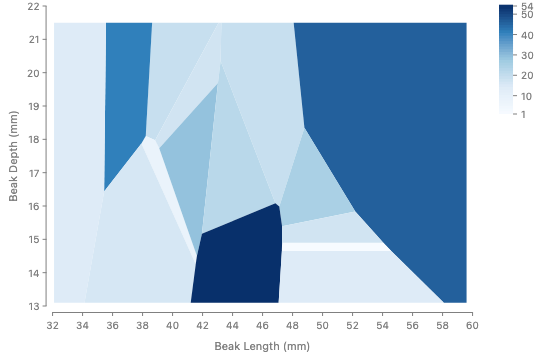

**Proposed**

```js
layer({ w: 420, h: 300 }, [
  chart(beaked, { color: Color.gradient("blues") })
    .flow(partition({ by: key.bin(Bin.voronoi({ seeds })) }))
    .mark(region({ fill: field("Species").count(), stroke: "white" })),
]);
```

**Current:** the same code. No change.

### Voronoi with its seeds

No change: drawing the seeds is one more chart over the same rows.


**Proposed**

```js
layer({ w: 420, h: 300 }, [
  chart(beaked, { color: Color.gradient("blues") })
    .flow(partition({ by: key.bin(Bin.voronoi({ seeds })) }))
    .mark(region({ fill: field("Species").count(), stroke: "white" })),
  chart(seeds)
    .flow(scatter({ x: "Beak Length (mm)", y: "Beak Depth (mm)" }))
    .mark(circle({ r: 3.5, fill: "black" })),
]);
```

**Current:** the same code. No change.

## Region compositing

### The five operations

`union`, `intersect`, `subtract`, `exclude` and `atop`. The result is drawn from the operands' coverage. With a `fill`, it is one new shape in that paint. With no fill, each part takes the paint of the operands that cover it; where two overlap, they blend by `blendMode`, and `"normal"` draws the later one over the earlier. Every card uses the same `a`, `b` and `stripes`.

**Shared by every card**

```js
const a = circle({ cx: 70, cy: 70, r: 50, fill: RED });
const b = circle({ cx: 130, cy: 70, r: 50, fill: BLUE });
const stripes = layer(bars); // vertical bars
const aWhite = circle({ cx: 70, cy: 70, r: 50, fill: "white" });
const bGray = circle({ cx: 130, cy: 70, r: 50, fill: "gray" });
```

| No fill     | Only in a | Only in b | In both          |
| ----------- | --------- | --------- | ---------------- |
| `union`     | a         | b         | a and b, blended |
| `intersect` | none      | none      | a and b, blended |
| `subtract`  | a         | none      | none             |
| `exclude`   | a         | b         | none             |
| `atop`      | a         | none      | a and b, blended |

#### inputs: a and b

a and b drawn as outlines only, nothing composited, so the overlap is plain. Every card below starts from them.

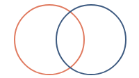

#### union, filled

One shape: everything in a or b, with one outline.

Inputs:  `a`  `b` → result

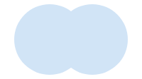

_Rendered today as `layer([a, b])`, both filled: the same pixels with no stroke._

**Proposed**

```js
union({ fill: FILL }, [a, b]);
```

**Current:** Not expressible today. The closest is `layer([a, b])`, which draws each circle, so a stroke gives two outlines.

#### union, no fill

a, b, and in the overlap b over a.

Inputs:  `a`  `b` → result

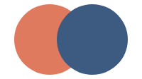

_Real render of today's `layer([a, b])`: the same pixels._

**Proposed**

```js
union([a, b]);
```

**Current**

```js
layer([a, b]);
```

#### intersect, filled

One shape: where a and b overlap.

Inputs:  `a`  `b` → result

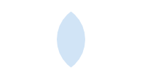

**Proposed**

```js
intersect({ fill: FILL }, [a, b]);
```

**Current:** the same code. No change.

#### intersect, no fill

Only the overlap, with b over a.

Inputs:  `a`  `b` → result

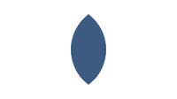

_Rendered today as `mask` with a white a._

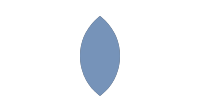

_Today's `intersect([a, b])`: a grayed, b blended over it in `"color"`._

**Proposed**

```js
intersect([a, b]);
```

**Current**

```js
mask([aWhite, b]);
```

#### subtract, filled

One shape: a with b cut out.

Inputs:  `a`  `b` → result


_Rendered today as `subtract([b, a])`. Bug: today `subtract([a, b])` draws b minus a, the reverse of its doc comment._

**Proposed**

```js
subtract({ fill: FILL }, [a, b]);
```

**Current**

```js
subtract([b, a]); // both filled FILL
```

#### subtract, no fill

a's part outside b, in a's paint.

Inputs:  `a`  `b` → result


_Real render of today's `subtract([b, a])`: the operand order is reversed today._

**Proposed**

```js
subtract([a, b]);
```

**Current**

```js
subtract([b, a]);
```

#### exclude, filled

One shape: in a or b, not both.

Inputs:  `a`  `b` → result

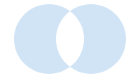

_Rendered today as two `subtract`s._

**Proposed**

```js
exclude({ fill: FILL }, [a, b]);
```

**Current**

```js
// both filled FILL
layer([subtract([b, a]), subtract([a, b])]);
```

#### exclude, no fill

Each lobe in its own paint.

Inputs:  `a`  `b` → result


_Rendered today as two `subtract`s._

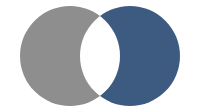

_Today's `exclude([a, b])`: a's lobe grayed._

**Proposed**

```js
exclude([a, b]);
```

**Current**

```js
layer([subtract([b, a]), subtract([a, b])]);
```

#### atop

All of a, and b over it only inside a. atop takes no fill: its region is always a's.

Inputs:  `a`  `b` → result

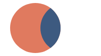

_Rendered today as a, then `mask([aWhite, b])`._

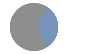

_Today's `paint([a, b])`: a grayed, b blended over it in `"color"`._

**Proposed**

```js
atop([a, b]);
```

**Current**

```js
layer([a, mask([aWhite, b])]);
```

#### Masking: intersect

A hidden operand adds its shape and no paint, so this is the stripes inside a.

Inputs:  `stripes`  `a.hidden()` → result


_Rendered today as `mask` with a white a._

**Proposed**

```js
intersect([stripes, a.hidden()]);
```

**Current**

```js
mask([aWhite, stripes]);
```

#### Masking: subtract

The stripes everywhere in their box except inside a: an inverted mask.

Inputs:  `stripes`  `a.hidden()` → result


_Real render of today's `subtract([a, stripes])`: the operand order is reversed today._

**Proposed**

```js
subtract([stripes, a.hidden()]);
```

**Current**

```js
subtract([a, stripes]);
```

#### Masking: luminance

The stencil turns its brightness into alpha before it is hidden, as the bottle image grays itself. White keeps all of the stripes, gray about half.

Inputs:  `stripes`  `fade.filter("luminance-to-alpha").hidden()` → result


_Rendered today as `mask`, which reads luminance: the same values, if the filter works in sRGB as a luminance mask does._

**Proposed**

```js
const fade = layer([aWhite, bGray]);
intersect([stripes, fade.filter("luminance-to-alpha").hidden()]);
```

**Current**

```js
const fade = layer([aWhite, bGray]);
mask([fade, stripes]);
```

#### union, multiply

Three circles, each overlap in the product of the paints over it.

Inputs:  `r`  `g`  `b` → result

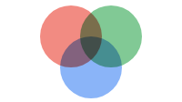

_Drawn in plain SVG with `mix-blend-mode: multiply`._

**Proposed**

```js
// three circles
union({ blendMode: "multiply" }, [r, g, b]);
```

**Current:** Not expressible today. Only `line` and `ribbon` take a blend mode.

Today every composite grays its first operand and blends the second over it in `"color"` (`paintSVG.tsx`). That is GoFish's own lowering. PiCCL draws each operand in its own paint: `GroupShape.renderSVG` in [PiCCL_core/src/compiler/shape.ts](https://github.com/PiCCL/PiCCL_core/blob/main/src/compiler/shape.ts) masks each operand by the others and blends them by `blend`, default `"normal"` ([operator.ts](https://github.com/PiCCL/PiCCL_core/blob/main/src/library/operator.ts)). Issue #196 (boolean operators after PiCCL and Porter-Duff) writes atop as A ∪ (B ∩ A). `blendMode` applies where two operands overlap, so `union`, `intersect` and `atop` take it; `subtract` and `exclude` never put two paints in one place, and passing it to them is a type error. Using an exact outline, for strokes and hit-testing, is an internal choice made when one exists. A composite is drawn in an isolated group today (`isolation: isolate`), so a blend reaches only its own operands.

<details><summary>Merged and removed: `mask` and `clip`; `paint` becomes `atop`</summary>

Earlier rounds had separate operators for drawing content inside a stencil. A hidden operand adds shape and no paint, so `intersect` with a hidden operand is the mask and `subtract` the inverted mask. Today's `mask` is deleted; a luminance mask is a stencil filtered by `"luminance-to-alpha"`, and there is no `mode` option. `paint` stays, as `atop`: its wire name is already `"atop"`.

</details>

### The bottle: one inline atop

The image grays itself with its own `filter`, which `image` has today. The rect is then blended over it in `"color"`, inside the image.

Inputs:  `image`, grayed by its `filter`  `rect` → result

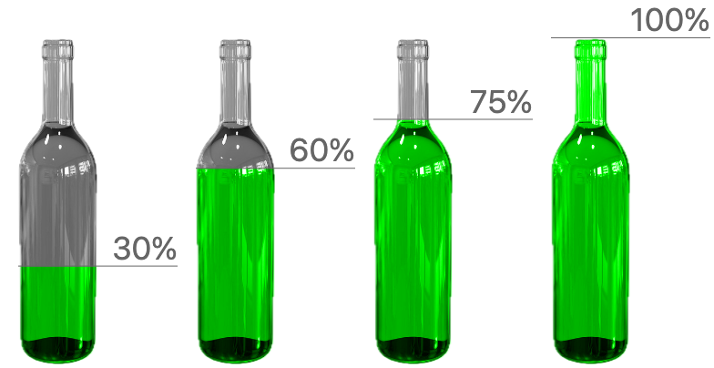

_Render. Real render: today's `paint` over an image that grays itself. Graying it again does nothing, so these are the proposal's pixels._

**Proposed**

```js
atop({ blendMode: "color" }, [
  image({
    href: bottle,
    h: v(100),
    filter: "grayscale(1)",
  }),
  rect({
    h: "amount",
    w: 175,
    fill: "#00ff00",
  }),
]);
```

**Current**

```js
paint({ blendMode: "color" }, [
  image({
    href: bottle,
    h: v(100),
  }),
  rect({
    h: "amount",
    w: 175,
    fill: "#00ff00",
  }),
]);
```

<details><summary>Why the image needs its own gray</summary>

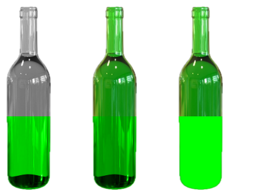

_Plain SVG, left to right: the image grayed, the rect in `"color"` (today, and PiCCL); the image in its own green, `"color"`, with no fill line; its own green, `"normal"`; grayed, `"luminosity"` with the rect on top, flat gray._

Today's `paint` grays its base before it blends. The new rule draws each operand in its own paint, so the gray has to come from the image.

</details>

<details><summary>PiCCL's bottle chart, the precedent</summary>

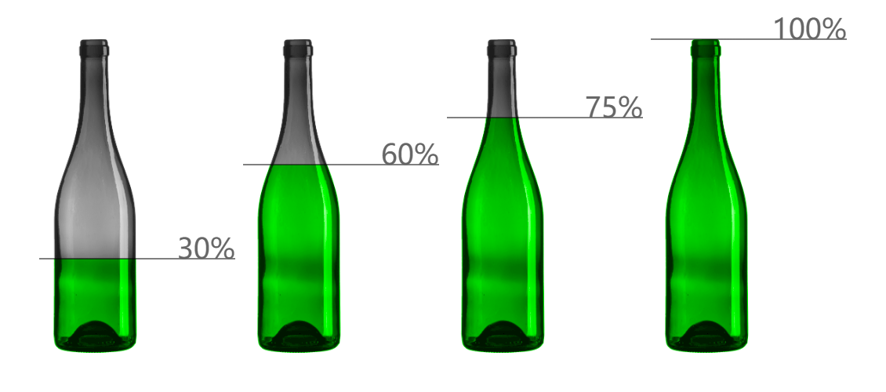

_PiCCL's render, from [piccl.github.io/example/bottle](https://piccl.github.io/example/bottle) (code: [bottle.txt](https://piccl.github.io/examples/codes/bottle.txt)). GoFish's Bottle story ports it._

```ts
const data1 = [
  { category: "a", amount: 30 },
  { category: "d", amount: 60 },
  { category: "b", amount: 75 },
  { category: "c", amount: 100 },
];

const createChart = (pictureUrl: string, refillColor: string) => {
  const scale = new PICCL.LinearScale({ range: [0, 400] });
  const pic = new PICCL.Picture({
    url: pictureUrl,
    height: 400,
    color: "#fff",
  });
  const rect = new PICCL.Rect({
    height: 400,
    fill: refillColor,
  }).mapValue("height", "amount", { scale });
  const recoloredPic = PICCL.atop(pic, rect, "luminosity").lengthMatch(
    rect,
    pic,
    { channel: "width" }
  );
  const line = new PICCL.Line({
    x1: 0,
    y1: 0,
    x2: 250,
    y2: 0,
  }).mapValue("y", "amount", { scale });
  const label = new PICCL.Text({
    fontSize: 36,
    fill: "#666",
    textAnchor: "end",
    suffix: "%",
  }).mapValue("content", "amount");
  const glyph = PICCL.union([recoloredPic, line, label]).pointSnap(
    label,
    line,
    { anchor: [1, 0] }
  );
  const collection = PICCL.replicate(glyph).stackLayout("x", 10);
  return collection;
};

// const chart = createChart("shrimp5.png", "#ff6600")
const chart = createChart("bottle.png", "#00ff00");

await PICCL.show([[chart, data1]], container, { pictures });
```

PiCCL grays the picture with its own option, `Picture({ color: "#fff" })`. It recolors: the picture keeps its shading and takes the color's hue, so white gives plain gray (`svgFilter.ts`, `getColorTransformFilterByColor`). PiCCL blends in `"luminosity"` with the picture on top. GoFish draws the later operand on top, so the same pixels are `"color"` with the rect second: the two are one blend with the layers swapped. PiCCL's current source swaps `atop`'s operands (`operator.ts` line 30); the published render keeps the picture's region.

</details>

**The image's gray, by spelling**

| Spelling                   | Precedent                                                                                                                        | Today                                                        | Takes data                                   |
| -------------------------- | -------------------------------------------------------------------------------------------------------------------------------- | ------------------------------------------------------------ | -------------------------------------------- |
| `filter: "grayscale(1)"`   | CSS `filter`; Observable Plot's `imageFilter` mark option (checked)                                                              | Exists on `image` (`descriptors.ts`: a raw filter attribute) | no                                           |
| `color: "gray"`, a recolor | PiCCL's `Picture({ color, colorMode })` (checked in source)                                                                      | New                                                          | yes: PiCCL's flower chart maps it to a field |
| `saturate: 0`              | SVG `feColorMatrix type="saturate"`, which today's gray step uses; CSS `saturate()`; Figma's Saturation adjustment (from memory) | New                                                          | no                                           |
| `grayscale: true`          | CSS `grayscale()`; Photoshop's Desaturate (from memory)                                                                          | New                                                          | no                                           |

Vega's image mark has no filter (checked); matplotlib has none either (from memory). Recommended: the existing `filter`, since it adds no API and renders today. A recolor like PiCCL's `color` is the general one; add it when an example maps data to an image's color ([open](#d-gray)).

### Luminance: the stencil converts its own brightness

A stencil's shape is its alpha, so a stencil of any color works. To read brightness instead, as SVG `<mask>` does, the stencil filters itself to alpha before it is hidden. No option on the operator. No brightness leaks out of a hidden mark.

Inputs:  `stencil.hidden()`  `stripes` → result

**Shared stencil (the content is the same stripes)**

```js
const stencil = layer([
  circle({ cx: 60, cy: 60, r: 50, fill: "white" }),
  circle({ cx: 180, cy: 60, r: 50, fill: "#808080" }),
  circle({ cx: 300, cy: 60, r: 50, fill: "#1f3b5c" }),
]);
```

**as it is: alpha**


_Rendered today as `mask([stencil, stripes])` with all three circles white._

```js
// its alpha: all three circles
intersect([stripes, stencil.hidden()]);
```

**after luminance-to-alpha**


_Real render of today's `mask([stencil, stripes])`: full, about half, and nearly nothing._

```js
intersect([stripes, stencil.filter("luminance-to-alpha").hidden()]);
```

### A hidden operand vs a transparent one

An operand gives two things: its shape, which is its alpha, partial coverage included, and its paint. `.hidden()` removes the paint and keeps the shape. A `fill: "none"` operand has no alpha inside, so its interior is no shape.

Inputs:  `stripes`  `a.hidden()` → result


_Render. Proposed `intersect([stripes, a.hidden()])`, rendered today as `mask` with a white a._

**Proposed**

```js
intersect([stripes, a.hidden()]); // a adds its shape, no paint: a mask
intersect([stripes, aNone.hidden()]); // fill: "none": only the stroke has alpha
```

**Current**

```js
mask([aWhite, stripes]);
```

**What an operand adds**

| Operand                              | Shape (its alpha)       | Paint                          |
| ------------------------------------ | ----------------------- | ------------------------------ |
| `a`                                  | yes                     | yes, blended where it overlaps |
| `a.hidden()`                         | yes                     | no                             |
| `a` with `opacity: 0.5`              | half coverage           | yes, at half                   |
| `a` with `fill: "none"` and a stroke | the stroke only, a ring | the stroke                     |
| `a` with `fill: "none"`, no stroke   | none                    | none                           |

Implementation: today's shim draws a hidden operand as nothing, so the result is empty. The alpha path must read a hidden operand's geometry, as `INTERNAL_lendDrawing` does for transitions.

### Alpha is shape

A shape's edge is sometimes fuzzy. Its alpha says how much of each point it covers, and that is its shape for every operation. Here a blurred rect, hidden, fades the stripes out at its edge.

Inputs:  `stripes`  `soft.hidden()` → result


_Render. Rendered today as `mask` with the rect white._

**Proposed**

```js
const soft = rect({
  x: 40,
  y: 30,
  w: 120,
  h: 80,
  filter: "blur(8px)",
});
intersect([stripes, soft.hidden()]);
```

**Current**

```js
const soft = rect({
  x: 40,
  y: 30,
  w: 120,
  h: 80,
  fill: "white",
  filter: "blur(8px)",
});
mask([soft, stripes]);
```

**Precedent**

| Source                                                   | What gives the shape                                                                                                  | Hidden or invisible content                                                            | Checked                                                         |
| -------------------------------------------------------- | --------------------------------------------------------------------------------------------------------------------- | -------------------------------------------------------------------------------------- | --------------------------------------------------------------- |
| Porter and Duff 1984, Compositing Digital Images         | Alpha: "0 to indicate no coverage, 1 to mean full coverage, with fractions corresponding to partial coverage"         | n/a                                                                                    | yes, the paper                                                  |
| Porter and Duff 1984, premultiplied alpha                | Color is stored already multiplied by coverage                                                                        | n/a                                                                                    | yes, the paper                                                  |
| Smith 1995, Alpha and the History of Digital Compositing | The alpha channel is the matte; separates binary masking from subtle matting                                          | n/a                                                                                    | partly: the abstract and excerpts                               |
| Smith and Blinn 1996, Blue Screen Matting                | Keying pulls a matte; "alpha channel" and "matte" are used interchangeably                                            | n/a                                                                                    | partly: summaries                                               |
| Film and VFX "matte"                                     | A holdout matte is the analog of the alpha channel                                                                    | n/a                                                                                    | partly, via Smith and Blinn                                     |
| CSS `mask-mode: alpha`                                   | "the alpha (transparency) values of the mask image"; a gradient `mask-image` gives a soft mask                        | n/a                                                                                    | yes for alpha; gradients from memory                            |
| CSS Masking spec, mask                                   | Alpha mask value is the alpha; luminance mask value is luminance times alpha                                          | n/a                                                                                    | yes                                                             |
| SVG `clipPath` (counter)                                 | "The raw geometry of each child element exclusive of rendering properties such as fill, stroke, stroke-width"         | "made invisible by display or visibility it does not contribute"                       | yes, CSS Masking spec                                           |
| Figma, Alpha mask                                        | Opacity: "the higher the opacity, the more that is revealed"; fills, strokes and gradients with varying opacity count | The mask layer is not drawn, but shapes the result                                     | yes                                                             |
| Figma, Vector mask (counter)                             | Outline only; any opacity above zero counts as full                                                                   | same                                                                                   | yes                                                             |
| SwiftUI `.mask`                                          | The mask view's alpha                                                                                                 | `.hidden()` keeps layout and draws nothing, so inside a mask it likely reveals nothing | alpha from memory; `.hidden()` yes; inside a mask not confirmed |
| Flutter `ShaderMask`                                     | Default `BlendMode.modulate`, which applies the shader's alpha to the child                                           | n/a                                                                                    | yes                                                             |
| Flutter `ClipPath` (counter)                             | Geometry, anti-aliased                                                                                                | n/a                                                                                    | yes                                                             |

Verdict: the precedent supports alpha as shape. Every compositing source and every mask (Porter and Duff, Smith, CSS and Figma alpha masks, SwiftUI, Flutter's ShaderMask) treats alpha as coverage. The counter-precedent is clipping: SVG `clipPath`, Figma's Vector mask and Flutter's `ClipPath` use raw geometry. That splits on the clip and mask line, and GoFish takes the mask side; an exact outline is an internal choice where one exists. One conflict: in CSS and SVG, invisible content adds nothing to a clip, and SwiftUI's `.hidden()` most likely adds nothing to a mask. Figma's mask layer, and SVG's own mask and clip content, are used for shape without being drawn, which is the role `.hidden()` takes here ([open](#d-hidden-op)). When implemented, the rule goes in `api-design.md` and the concepts docs ([open](#d-alpha)).

### Slots, by operator

What each operator does with each slot. A child may also be read; it is still drawn as itself.

**The rule, by operator**

| Slot kind                                                                | Operators                                                                                                                                                                |
| ------------------------------------------------------------------------ | ------------------------------------------------------------------------------------------------------------------------------------------------------------------------ |
| Child: drawn as itself                                                   | `layer`, `spread`, `stack`, `scatter`, `group`, `partition`, `treemap`, `pack`, `frame`, `translate`, `offset`, a coord's children, `enclose`'s children, `arrow`'s ends |
| Operand: read for shape and paint; the result is drawn from its coverage | `union`, `intersect`, `subtract`, `exclude`, `atop` (with or without a fill)                                                                                             |
| Operand: read for shape, place or data                                   | `Shape.blob({ avoiding })`, relational `line` and `ribbon`, `Constraint.*`, `cut`'s source, `Coord.bend`'s `along`, `Coord.envelope`'s `top` and `bottom`                |
| Pointer: draws nothing                                                   | `ref`                                                                                                                                                                    |
| Data                                                                     | `Bin.voronoi`'s `seeds`                                                                                                                                                  |

No exceptions. An operator never draws an operand as itself. A set operation draws its result, and that result is in the operands' paint where no fill is given. `.hidden()` on an operand drops its paint and keeps its shape. Today `intersect` switches its slots from children to operands with its paint option; that goes away.

## Naming

### Compositing names elsewhere

Union, intersection, difference, symmetric difference, shape-only clip, paint-based mask, and the clip region's parameter.

**Precedent**

| System            | Union               | Intersection      | A minus B        | Xor                      | Clip (shape)                    | Mask (paint)                                                          | Region parameter   |
| ----------------- | ------------------- | ----------------- | ---------------- | ------------------------ | ------------------------------- | --------------------------------------------------------------------- | ------------------ |
| Figma             | Union               | Intersect         | Subtract         | Exclude                  | Use as mask (Vector)            | Use as mask (Alpha, Luminance)                                        | the bottom layer   |
| Illustrator       | Unite               | Intersect         | Minus Front      | Exclude                  | Clipping Mask                   | Opacity Mask                                                          | the top object     |
| Inkscape          | Union               | Intersection      | Difference       | Exclusion                | Clip                            | Mask (luminance)                                                      | the top object     |
| Sketch            | Union               | Intersect         | Subtract         | Difference               | Outline Mask                    | Alpha Mask                                                            | the bottom layer   |
| Affinity Designer | Add                 | Intersect         | Subtract         | Xor                      | nested clip                     | mask layer                                                            | the parent layer   |
| SVG               | none                | none              | none             | none                     | <clipPath>, clip-path           | <mask>                                                                | url(#id)           |
| CSS               | none                | none              | none             | none                     | clip-path                       | mask, mask-mode                                                       | its value          |
| Canvas 2D         | none                | source-in         | destination-out  | xor                      | clip()                          | destination-in                                                        | the current path   |
| PDF, PostScript   | none                | none              | none             | none                     | clip path                       | soft mask                                                             | the current path   |
| Skia              | kUnion              | kIntersect        | kDifference      | kXOR                     | clipPath                        | mask filter, shader                                                   | a path             |
| SwiftUI           | union(\_:)          | intersection(\_:) | subtracting(\_:) | symmetricDifference(\_:) | .clipShape(\_:)                 | .mask(\_:)                                                            | unlabeled          |
| Flutter           | PathOperation.union | .intersect        | .difference      | .xor                     | ClipPath(clipper:)              | ShaderMask                                                            | clipper            |
| Jetpack Compose   | PathOperation.Union | Intersect         | Difference       | Xor                      | Modifier.clip(shape)            | BlendMode.DstIn                                                       | shape              |
| Typst             | none                | none              | none             | none                     | box(clip: true)                 | none                                                                  | the box itself     |
| TikZ              | none                | none              | none             | none                     | \clip                           | path fading                                                           | the path           |
| p5.js             | none                | none              | none             | none                     | clip(callback)                  | img.mask()                                                            | a callback         |
| Paper.js          | unite               | intersect         | subtract         | exclude                  | clipMask (clipped group)        | none                                                                  | first child        |
| Shapely, GEOS     | union               | intersection      | difference       | symmetric_difference     | none                            | none                                                                  | none               |
| JTS               | union               | intersection      | difference       | symDifference            | none                            | none                                                                  | none               |
| Clipper2          | Union               | Intersect         | Difference       | Xor                      | none                            | none                                                                  | the clip paths     |
| Turf              | union               | intersect         | difference       | none                     | none                            | none                                                                  | none               |
| polybool          | union               | intersect         | difference       | xor                      | none                            | none                                                                  | none               |
| JS Set (ES2025)   | union               | intersection      | difference       | symmetricDifference      | none                            | none                                                                  | none               |
| Observable Plot   | none                | none              | none             | none                     | clip: "frame", GeoJSON          | none                                                                  | its value          |
| Vega-Lite         | none                | none              | none             | none                     | clip: true                      | none                                                                  | none               |
| ggplot2, ggfx     | none                | none              | none             | none                     | coord_cartesian(clip=)          | with_mask(), luminance; ch_alpha()                                    | mask               |
| D3                | none                | none              | none             | none                     | clipExtent                      | SVG mask                                                              | extent             |
| Bluefish, Penrose | none                | none              | none             | none                     | none                            | none                                                                  | none               |
| PiCCL             | union, over         | intersect, In     | subtract, out    | xor                      | intersect                       | none                                                                  | the first operand  |
| GoFish today      | none                | intersect         | subtract         | exclude                  | none                            | mask, luminance only                                                  | the first child    |
| GoFish proposed   | union               | intersect         | subtract         | exclude                  | intersect with a hidden operand | intersect with a hidden operand; luminance by a filter on the stencil | the hidden operand |

Names as each system documents them, from my knowledge, not re-checked online, except the mask column (Figma's mask types), the ggfx row (it has no `mask_type`), and the PiCCL row, read from its source. The least certain: Affinity's clipping and mask layers, and Bluefish and Penrose having none.

**Recommendations**

- **union.** Keep `union`: Figma (the recorded naming source, #196, #404), Inkscape, Sketch, SwiftUI, Flutter, Compose, Skia, Shapely, Clipper2, PiCCL and the JS `Set` all say union. `unite` (Illustrator, Paper.js) is the runner-up. Every design tool keeps Union apart from Group, as `union` stays apart from `layer`.
- **intersect, subtract, exclude.** Keep them. This is the recorded Figma decision; Paper.js uses the same verbs, and PiCCL says `intersect` and `subtract`. The set mixes one noun-verb (`union`) with verbs, as Figma does.
- **Clip and mask columns.** No separate name. A hidden operand adds shape and no paint, so `intersect([stripes, a.hidden()])` is the mask and `subtract` the inverted mask. CSS does the same: `mask-composite` takes `add`, `subtract`, `intersect` and `exclude`, and ggfx inverts a mask with `invert = TRUE`.

### atop or paint

The fifth operation keeps all of its first operand and draws the second only inside it.

**Precedent**

| System               | Name                                                           | Checked            |
| -------------------- | -------------------------------------------------------------- | ------------------ |
| Porter-Duff          | atop                                                           | yes                |
| PiCCL                | `atop(o1, o2, blend)`, and the method `"atop"`                 | yes, in source     |
| SVG `feComposite`    | `operator="atop"` (default `over`)                             | yes                |
| Canvas 2D            | `source-atop`, `destination-atop` (default `source-over`)      | yes                |
| Cairo                | `CAIRO_OPERATOR_ATOP` (default `OVER`)                         | yes                |
| Flutter              | `BlendMode.srcATop`, `dstATop`                                 | yes                |
| Android              | `BlendMode.SRC_ATOP`, `DST_ATOP`                               | yes                |
| Skia                 | `SkBlendMode::kSrcATop`                                        | from memory        |
| Photoshop, Procreate | Clipping Mask                                                  | yes, earlier round |
| Krita                | Inherit Alpha                                                  | yes, earlier round |
| After Effects        | Preserve Underlying Transparency                               | yes, earlier round |
| Illustrator          | Draw Inside                                                    | yes, earlier round |
| Figma                | none                                                           | yes, earlier round |
| GoFish today         | `paint` (wire `"atop"`), from #202, which renamed PiCCL's atop | yes                |

Recommended: `atop` ([open](#d-atop)).

**Recommendations**

- **atop.** The one name PiCCL, Porter-Duff, SVG, Canvas, Cairo, Flutter and Android share, and today's wire name. It is a preposition beside `union`, `intersect`, `subtract` and `exclude`, which are verbs.
- **paint.** A verb, so it fits the family's grammar. No other system uses it, and it collides with paint as a fill or stroke color, which this page uses throughout.
- **Design-tool names.** Clipping Mask, Inherit Alpha and Draw Inside are layer properties, not operators. `drawInside` is the nearest as a verb; it is dropped as the recommendation.

## Coordinate transforms with a shape argument

### Which frame is an operand in?

An operand is read in the frame the operator sits in, never in the frame it makes for its children. An inline operand is laid out there; a ref is read where it was placed and mapped into that frame.

**The rule, by operator**

| Operator                                                   | Operand         | Frame it is read in                                                                                                      |
| ---------------------------------------------------------- | --------------- | ------------------------------------------------------------------------------------------------------------------------ |
| `Coord.bend({ along })`, `Coord.envelope({ top, bottom })` | the guide shape | Outside the coord. The coord's inner frame is defined by the guide, so laying the guide out inside it would be circular. |
| `Bin.voronoi({ seeds })`                                   | seed rows       | The chart's frame, placed by its scales. Cells are computed there; under polar, from the warped positions.               |

Blocker: a ref spine drawn under one coord and read by a bend in another depends on #605 (a ref across a coord boundary reads the target's box in the coord's own space, such as θ and r under polar, not its warped screen position). The code still does this: `src/ast/_ref.tsx` copies `selectedNode.intrinsicDims` (line 350), and `coord.tsx` computes warped boxes only for its own bounding box (lines 307 and 551), never for the child. The issue's description holds; its line numbers and its `shapes/_ref.tsx` path are out of date. #1225 (a symbolic port for refs through affine coords) would cover affine coords only; a bend is not affine, so it needs #605.

### Bend: the spine drawn, read through a ref

`Coord.bend` reads the spine and never draws it; here the spine is drawn once, where it was made.

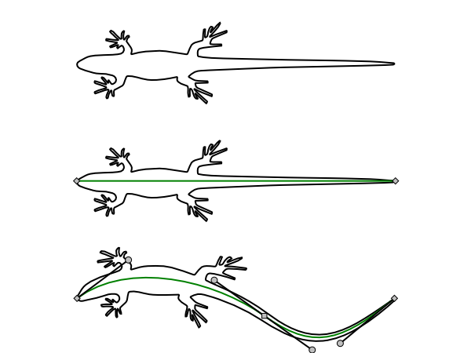

_Not GoFish. Image: [warpjs#15](https://github.com/benjamminf/warpjs/issues/15), posted by the issue's author to show Inkscape's Bend live path effect. Not drawn by GoFish._

**Proposed**

```js
layer([
  chart(spinePoints)
    .flow(scatter({ x: "x", y: "y" }))
    .mark(line({ curve: Curve.natural, stroke: "green" }))
    .name("spine"),
]).relate(({ spine }) => [
  layer({ coord: Coord.bend({ along: spine }) }, [
    polygon({ points: gecko, fill: "none", stroke: "black" }),
  ]),
]);
```

**Current:** Not expressible today. It stays deferred, as `notes/design/polar-coordinate-spaces.md` records; see the draft issue.

### Bend: the spine hidden

The usual output: the spine is a hidden child, laid out and not drawn.

_Sketch: drawn in the HTML page._

**Proposed**

```js
layer([
  chart(spinePoints)
    .flow(scatter({ x: "x", y: "y" }))
    .mark(line({ curve: Curve.natural, stroke: "green" }))
    .name("spine")
    .hidden(),
]).relate(({ spine }) => [
  layer({ coord: Coord.bend({ along: spine }) }, [
    polygon({ points: gecko, fill: "none", stroke: "black" }),
  ]),
]);
```

**Current:** Not expressible today.

### Envelope between two curves

`Coord.envelope` maps its children into the region between two shapes, here both hidden.

_Sketch: drawn in the HTML page._

**Proposed**

```js
layer([upper.name("upper").hidden(), lower.name("lower").hidden()]).relate(
  ({ upper, lower }) => [
    layer({ coord: Coord.envelope({ top: upper, bottom: lower }) }, [
      text({ text: "WORD", fontSize: 96 }),
    ]),
  ]
);
```

**Current:** Not expressible today.

## Renames

### position becomes translate

One operator and its method twin, one node on the wire.

**Proposed**

```js
translate({ x: 10 }, [rect({ w: 20, h: 20 })]);
rect({ w: 20, h: 20 }).translate({ x: 10 }); // the same node
```

**Current**

```js
position({ x: 10 }, [rect({ w: 20, h: 20 })]); // node: { type: "position" }
rect({ w: 20, h: 20 }).translate({ x: 10 }); // field: translate: { x: 10 }
```

### cut takes options first

The source becomes the one child, like every other operator.

**Proposed**

```js
stack({ dir: "y" }, cut({ dir: "y", size }, [image({ href, w: 193, h: 600 })]));
```

**Current**

```js
stack({ dir: "y" }, cut(image({ href, w: 193, h: 600 }), { dir: "y", size }));
```

## Parked

### use(ref): a second mark that follows a shape

Parked: no example needs it yet. A blob filled below its members and outlined above them.

_Sketch: drawn in the HTML page._

**Proposed**

```js
layer([
  enclose({ shape: Shape.blob, fill: "#eef3f8" }, members).name("group"),
  use(ref("group"), { fill: "none", stroke: "#467DA8", zOrder: 1 }),
]);
```

**Current:** Not expressible as one shape today.

## Errors and edge cases

| Call                                          | Result                                                                                        |
| --------------------------------------------- | --------------------------------------------------------------------------------------------- |
| `ref("x").hidden()`                           | Error: a ref reads a shape and cannot change its paint.                                       |
| `selectAll("bars").hidden()`                  | Error, for the same reason.                                                                   |
| `.hidden().hidden(false)`                     | Drawn. The last call wins.                                                                    |
| `.hidden().hidden()`                          | Hidden.                                                                                       |
| `layer([a, b.hidden(false)]).hidden()`        | Both hidden. The ancestor wins.                                                               |
| `intersect([b, a.hidden()])`                  | b inside a: a adds its shape and no paint. A mask.                                            |
| `subtract({ blendMode: "multiply" }, [a, b])` | Type error: `subtract` and `exclude` never put two paints in one place.                       |
| `atop({ fill: "red" }, [a, b])`               | Type error: `atop`'s region is always a's. Fill a instead.                                    |
| `intersect([b, aNone.hidden()])`              | aNone has `fill: "none"`: its alpha, and so its shape, is only its stroke. b shows in a ring. |
| `circle(o).hidden((d) => ...)`                | Per datum. Repaint only, no new layout.                                                       |
| `ridgeline(data).hidden()`                    | The whole chart, axes and legend included.                                                    |

## Open decisions

1. Adopt the rule: children are drawn as themselves (and may also be read); an operand is read, and the operator draws its result from what it read, never the operand as itself; refs draw nothing? (card: slots)
2. (1) Adopt the coverage-blend rule: with no fill, each part of the result takes the paint of the operands that cover it, blended by `blendMode` where they overlap? It is PiCCL's rule (`GroupShape.renderSVG`), drops today's gray step, and closes #1230 (what a compositing operator with no fill paints). (card: ops)
3. (2) Default `blendMode` to `"normal"`, the later operand over the earlier, on `union`, `intersect` and `atop` (the only operations that take it), as PiCCL, Canvas, Cairo and SVG `feComposite` default to over? Today the default is `"color"` (`porterDuff.tsx` lines 460 and 505), and the type, `"color" | "multiply" | "screen" | "overlay"` (`chart.ts` line 1164), has no `"normal"`; it gets one. (card: ops)
4. (3) Adopt "alpha is shape": an operand gives its shape, which is its alpha, partial coverage included, and its paint? Precedent supports it on the mask side (Porter and Duff, Smith, CSS and Figma alpha masks, Flutter's ShaderMask); clips use raw geometry. Document it in `api-design.md` and the concepts docs when it lands? (card: alpha-shape)
5. (4) What does a hidden operand give? (A) Its shape and no paint, so `intersect([stripes, a.hidden()])` is a mask: Figma's mask layer and SVG's mask content are used without being drawn. (B) Nothing, as invisible content adds nothing to an SVG clip and SwiftUI's `.hidden()` most likely adds nothing to a mask; a stencil would then need another way to drop its paint. Recommended: A, since `.hidden()` already means laid out and not painted. This replaces the old decision to warn on `.hidden()` on an operand. (card: intersect-hidden)
6. (5) Name the fifth operation `atop` (Porter-Duff, PiCCL, SVG, Canvas, Cairo, Flutter, Android, and today's wire name), or keep `paint` (#202)? Recommended: `atop`. (card: naming-atop)
7. (6) One spelling for a mark that filters itself. The bottle grays its image with the existing `filter: "grayscale(1)"` option (on `image` and `rect` today, a CSS filter string). A luminance stencil needs `luminance-to-alpha`, which has no CSS function (it is SVG `feColorMatrix type="luminanceToAlpha"`). Today a rect renders it as `filter: "url(#lumToAlpha)"` pointing at a hand-written SVG filter (checked: white gives alpha 1, `#808080` about 0.5 in sRGB, black 0), so the option carries it but the user must write the filter. And `circle` and `layer` have no filter option. Options: a `.filter()` method on any mark, chart or layer, like `.hidden()`, with the option folded in; or the option on every mark and layer. The value: a string, or a family (`Filter.grayscale()`, `Filter.luminanceToAlpha()`), as option values that choose a strategy are. A recolor like PiCCL's `Picture({ color })` can follow when an example maps data to an image's color. (card: mask-modes)
8. (7) `line` and `ribbon` say `mixBlendMode` (`"normal" | "multiply"`, `chart.ts` lines 973 and 1037); the operations say `blendMode` (Python `blend_mode`). Unify on one name? (card: ops)
9. (8) Migrate in the same change? `paint` becomes a rename to `atop`: 4 calls (the Bottle story, which also gains `filter: "grayscale(1)"`; the PorterDuffRelations paint story; two Python stories), with the wire name unchanged. `mask` is rewritten as `intersect` with a hidden operand filtered by `luminance-to-alpha`, since today's mask reads luminance: 3 calls (the PorterDuffRelations mask story, `coordPaintOrder.test.ts` line 411, one Python story), plus the internal `Mask` in `cut.tsx`. The `mask` entries in `descriptors.ts`, `jsonSchema.ts` and `_generated.py` go. 5 docs pages: region-compositing and cut, JS and Python, and the handwritten pictorial-charts tutorial, which gets an issue. (card: ops)
10. Add `union` (Figma, Inkscape, Sketch, SwiftUI, Shapely, Clipper2, PiCCL) as a region shape, separate from `layer`, as every design tool keeps Union apart from Group? (card: naming-grid)
11. Keep `use(ref)` parked until an example needs it? (card: use-ref)
12. File the bend and envelope issue, kept deferred? (Decided: a coord with a shape argument, not an operator.) (card: gecko)
13. Do both renames in one PR, separate from `.hidden()`? (card: translate)
14. Step 2 for `cut`: unify it with the `.cut()` mark method? (card: cut)
15. Add the method-twin rule to api-design.md: a method has a function twin only for a one-child operator, and both build one node? (card: translate)
16. Does a hidden mark's color still feed the scale and legend? (Recommended yes, as `blank()` does.) (card: venn)
17. Keep `blank()` as sugar for `rect().hidden()`, or delete it? (card: quantum)
18. Migrate the gallery stories (four croissants, QuantumCircuit, OhmParseTree, DFSCQ) in the same change? (card: croissant)
19. Land with #1259 (`.layer()` reads names), so the croissant needs no outer `layer`? (card: croissant)

Draft issues: `issue-cut.md`, `issue-translate-position.md`, `issue-spine-envelope.md`.

## Why

<details><summary>Precedent and rationale</summary>

| System             | Spelling             | Laid out    | Painted | Takes pointer |
| ------------------ | -------------------- | ----------- | ------- | ------------- |
| CSS                | `visibility: hidden` | yes         | no      | no            |
| CSS                | `display: none`      | no          | no      | no            |
| SwiftUI            | `.hidden()`          | yes         | no      | no            |
| Typst              | `hide(body)`         | yes         | no      | n/a           |
| TeX                | `\phantom{...}`      | yes         | no      | n/a           |
| TikZ               | `\path[name path=c]` | yes         | no      | n/a           |
| SVG                | `<defs> + <use>`     | at each use | no      | no            |
| Figma, Illustrator | `Use as mask`        | yes         | no      | no            |
| ggplot2            | `geom_blank()`       | scales only | no      | n/a           |
| Vega-Lite          | `opacity: 0`         | yes         | no      | yes           |
| Bluefish           | `fill="transparent"` | yes         | no      | yes           |

- Layout systems agree: CSS `visibility: hidden`, SwiftUI `.hidden()`, Typst `hide` and TeX `\phantom` keep layout and drop paint. That is `blank()`'s rule, applied to any subtree.
- It adds no node kind and no pass. It reuses `INTERNAL_emitNothing()` and goes on the wire as `hidden: true`, beside `zOrder`.
- It replaces five spellings of one idea: `blank()`, `fill: "none"`, `fill: "transparent"`, `opacity: 0` and a CSS clip.
- A method, not a wrapper: it is a fact about the mark's own nodes, like `.name()` and `.zOrder()`. SwiftUI has `.hidden()` only, with no wrapper form.
- `hidden` has precedent with this exact meaning. `def` means a template in SVG and is a keyword in Python.
- The children and operands rule falls out of the same question: does this operator draw this slot? Region compositing answers it one way: the operator draws its result from the operands' coverage, each part in the paint of the operands over it. That is PiCCL's rule, and it leaves no degenerate case: union and exclude keep both paints, and a hidden operand is a stencil.

</details>

Prototype stories: `packages/gofish-graphics/stories/proposals/ShapeDefinitions.stories.tsx` (throwaway; a story-only `hidden()` shim). No library code changed.
