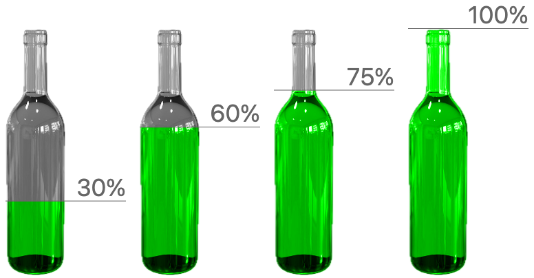
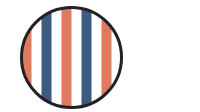

# Defined, Not Drawn (#1267)

A shape that is laid out and read by other marks, but not painted.

## The proposal

- **decided.** `.hidden()` on any mark, chart or layer: laid out, counts for scales, axes and legends, keeps its name and datum, paints nothing, takes no pointer.
- **decided.** `.hidden(fn)` hides per datum. Toggling only repaints; layout never moves.
- **decided.** An ancestor's `.hidden()` wins over a child's `.hidden(false)`. On one value, the last call wins.
- **decided.** Only on a value you hold: not through `ref` or `selectAll`, and no operator sets it.
- **proposed.** A child slot draws its child as itself. An operand slot is read for shape, place or data and never drawn. A ref draws nothing. Reading a child's shape or ink is allowed; drawing it differently, or not at all, is not.
- **proposed.** Which frame is an operand in? The frame the operator sits in, never the frame it makes for its children. An inline operand is laid out there; a ref is read where it was placed and mapped into that frame.
- **proposed.** Two jobs. Region shapes (`intersect`, `subtract`, `exclude`, `union`) draw one new shape from operands. `mask([stencil, ...content])` draws its content inside its first child. The stencil is a child, drawn unless `.hidden()`; a ref stencil draws nothing here. `mode`: `"alpha"` (default), `"outline"` or `"luminance"`. It replaces `paint` and today's `mask`.
- **decided.** Bend and envelope are coordinate transforms with a shape argument: `Coord.bend({ along })`, `Coord.envelope({ top, bottom })`. The coord reads the shape and never draws it. Deferred.
- **decided.** Renames: `position` becomes `translate`; `cut(opts, [source])`.

## Hiding

### Croissant: the density curve

The curve is laid out and sets the scale, and `.hidden()` replaces `fill: "none"`.


_Render. Proposed render, 0 px from today's._

**Proposed**

```js
layer([
  chart(grid)
    .flow(scatter({ x: "x" }))
    .mark(ribbon({ h: "pdf" }).name("density").hidden()),
]).relate(({ density }) => [
  chart(grid)
    .flow(
      derive((rows) => quantileRows(rows, { x: "x", density: "pdf", n: 1000 })),
      partition({ by: field("x").bin(Bin.quantiles(10)), dir: "x" })
    )
    .mark(
      layer([
        intersect({ fill: FILL, stroke: STROKE, strokeWidth: 2 }, [
          density,
          region({ inset: 3 }),
        ]),
        circle({ cx: field("x").median(), cy: 6, r: 3, fill: STROKE }),
      ])
    ),
]);
```

<details><summary>Current spelling (20 lines)</summary>

```js
layer([
  chart(grid)
    .flow(scatter({ x: "x" }))
    .mark(ribbon({ h: "pdf", fill: "none" }).name("density")),
]).relate(({ density }) => [
  chart(grid)
    .flow(
      derive((rows) => quantileRows(rows, { x: "x", density: "pdf", n: 1000 })),
      partition({ by: field("x").bin(Bin.quantiles(10)), dir: "x" })
    )
    .mark(
      layer([
        intersect({ fill: FILL, stroke: STROKE, strokeWidth: 2 }, [
          density,
          region({ inset: 3 }),
        ]),
        circle({ cx: field("x").median(), cy: 6, r: 3, fill: STROKE }),
      ])
    ),
]);
```

</details>

### Croissant ridgeline: one hidden curve per row

Each row's curve is hidden, and its cells still read it.


_Render. Proposed render, 0 px from today's._

**Proposed**

```js
chart(monthlyDensity, {
  w: 520,
  axes: { x: { title: "Daily high (°C)" }, y: false },
})
  .flow(
    spread({
      by: field("month").sort(months),
      dir: "y",
      anchor: "baseline",
      spacing: 36,
    })
  )
  .mark(
    layer({ h: 34 }, [
      chart()
        .flow(scatter({ x: "temp_max" }))
        .mark(ribbon({ h: "pdf" }).name("density").hidden()),
    ]).relate(({ density }) => [cells(density, { n: 5, inset: 2 })])
  );
```

<details><summary>Current spelling (19 lines)</summary>

```js
chart(monthlyDensity, {
  w: 520,
  axes: { x: { title: "Daily high (°C)" }, y: false },
})
  .flow(
    spread({
      by: field("month").sort(months),
      dir: "y",
      anchor: "baseline",
      spacing: 36,
    })
  )
  .mark(
    layer({ h: 34 }, [
      chart()
        .flow(scatter({ x: "temp_max" }))
        .mark(ribbon({ h: "pdf", fill: "none" }).name("density")),
    ]).relate(({ density }) => [cells(density, { n: 5, inset: 2 })])
  );
```

</details>

### Seattle highs: the axis comes from a hidden area

The hidden area still sets the y axis.


_Render. Proposed render, 0 px from today's._

**Proposed**

```js
layer([
  chart(highs2012, { schema })
    .flow(scatter({ x: "date" }))
    .mark(ribbon({ h: "temp_smooth" }).name("temps").hidden()),
])
  .relate(({ temps }) => [monthCells(temps)])
  .render(container, {
    w: 560,
    h: 220,
    axes: { x: false, y: { title: "Daily high, 15-day mean (°C)" } },
  });
```

**Current**

```js
layer([
  chart(highs2012, { schema })
    .flow(scatter({ x: "date" }))
    .mark(ribbon({ h: "temp_smooth", fill: "none" }).name("temps")),
])
  .relate(({ temps }) => [monthCells(temps)])
  .render(container, {
    w: 560,
    h: 220,
    axes: { x: false, y: { title: "Daily high, 15-day mean (°C)" } },
  });
```

### Quantum circuit: slots and a spacer

Spacers and alignment slots say they are hidden, instead of `fill: "transparent"`, and take no pointer.


_Render. Proposed render, 0 px from today's._

**Proposed**

```js
const WireSlot = createMark(({ content }) =>
  layer([
    rect({ w: GATE, h: GATE }).name("slot").hidden(),
    content.name("content"),
  ]).relate(({ slot, content }) => [
    Constraint.align({ x: "middle", y: "middle" }, [slot, content]),
  ])
);
const EmptySlot = () => rect({ w: GATE, h: GATE }).hidden();
spread({ dir: "x", spacing: SLOT - GATE, alignment: "middle" }, [
  rect({ w: 10, h: GATE }).hidden(), // the leader before the gates
  ...slots,
]);
```

**Current**

```js
const WireSlot = createMark(({ content }) =>
  layer([
    rect({ w: GATE, h: GATE, fill: "transparent" }).name("slot"),
    content.name("content"),
  ]).relate(({ slot, content }) => [
    Constraint.align({ x: "middle", y: "middle" }, [slot, content]),
  ])
);
const EmptySlot = () => rect({ w: GATE, h: GATE, fill: "transparent" });
spread({ dir: "x", spacing: SLOT - GATE, alignment: "middle" }, [
  rect({ w: 10, h: GATE, fill: "transparent" }), // the leader before the gates
  ...slots,
]);
```

### Venn lenses: each circle read twice

The three circles are hidden, and each is an operand of two lenses.


_Render. Proposed render, 0 px from today's._

**Proposed**

```js
const LENS = { stroke: "#444", strokeWidth: 1.5, opacity: 0.75 };
layer([
  circle({ cx: 100, cy: 100, r: 90 }).name("a").hidden(),
  circle({ cx: 205, cy: 100, r: 90 }).name("b").hidden(),
  circle({ cx: 152, cy: 190, r: 90 }).name("c").hidden(),
]).relate(({ a, b, c }) => [
  intersect({ fill: "#9ecae1", ...LENS }, [a, b]),
  intersect({ fill: "#fdd0a2", ...LENS }, [b, c]),
  intersect({ fill: "#c7e9c0", ...LENS }, [a, c]),
]);
```

**Current**

```js
const LENS = { stroke: "#444", strokeWidth: 1.5, opacity: 0.75 };
layer([
  circle({ cx: 100, cy: 100, r: 90, fill: "none" }).name("a"),
  circle({ cx: 205, cy: 100, r: 90, fill: "none" }).name("b"),
  circle({ cx: 152, cy: 190, r: 90, fill: "none" }).name("c"),
]).relate(({ a, b, c }) => [
  intersect({ fill: "#9ecae1", ...LENS }, [a, b]),
  intersect({ fill: "#fdd0a2", ...LENS }, [b, c]),
  intersect({ fill: "#c7e9c0", ...LENS }, [a, c]),
]);
```

### Hidden per datum

`.hidden(fn)` hides some data, like `.zOrder(fn)`, and only repaints.

_Sketch: drawn in the HTML page._

**Proposed**

```js
chart(countries)
  .flow(scatter({ x: "gdp", y: "lifeExpectancy" }))
  .mark(circle({ r: 3 }).hidden((d) => d.year !== year));
```

**Current:** Not expressible today. `filter` drops the rows, so the scales move.

<details><summary>Python</summary>

```python
chart(countries).flow(scatter(x="gdp", y="life_expectancy")).mark(
    circle(r=3).hidden(lambda d: d["year"] != year)
)
```

</details>

### Hiding a helper's whole chart

`.hidden()` on a built chart hides all of it, axes included, and its rows can still be read.

_Sketch: drawn in the HTML page._

**Proposed**

```js
layer([ridgeline(data).name("rows").hidden()]).relate(({ rows }) => [
  monthLabels(rows),
]);
```

**Current:** Not expressible today, unless the helper takes its own flag.

## Guides drawn or not

### Voronoi without its seeds

No change: the seeds are rows, not a shape, so there is nothing to hide.


**Proposed**

```js
layer({ w: 420, h: 300 }, [
  chart(beaked, { color: Color.gradient("blues") })
    .flow(partition({ by: key.bin(Bin.voronoi({ seeds })) }))
    .mark(region({ fill: field("Species").count(), stroke: "white" })),
]);
```

**Current:** the same code. No change.

### Voronoi with its seeds

No change: drawing the seeds is one more chart over the same rows.


**Proposed**

```js
layer({ w: 420, h: 300 }, [
  chart(beaked, { color: Color.gradient("blues") })
    .flow(partition({ by: key.bin(Bin.voronoi({ seeds })) }))
    .mark(region({ fill: field("Species").count(), stroke: "white" })),
  chart(seeds)
    .flow(scatter({ x: "Beak Length (mm)", y: "Beak Depth (mm)" }))
    .mark(circle({ r: 3.5, fill: "black" })),
]);
```

**Current:** the same code. No change.

## Region compositing

### The operators

Two jobs. Region shapes draw one new shape from two operands, which are never drawn. `mask` draws its content inside its first child, the stencil: a child, drawn as itself unless `.hidden()`. Every card uses the same `a`, `b` and `stripes`.

**Shared by every card**

```js
const a = circle({ cx: 70, cy: 70, r: 50 });
const b = circle({ cx: 130, cy: 70, r: 50 });
const stripes = layer(bars); // 11 vertical bars
```

#### union

One shape: everything in a or b, with one outline.


_Rendered today as `layer([a, b])`, both filled: the same pixels with no stroke._

**Proposed**

```js
union({ fill: FILL }, [a, b]);
```

**Current:** Not expressible today. The closest is `layer([a, b])`, which draws each circle, so a stroke gives two outlines.

#### intersect

One shape: where a and b overlap.


**Proposed**

```js
intersect({ fill: FILL }, [a, b]);
```

**Current:** the same code. No change.

#### subtract

One shape: a with b cut out.


_Rendered today as `subtract([b, a])`. Bug: today `subtract([a, b])` draws b minus a, the reverse of its doc comment._

**Proposed**

```js
subtract({ fill: FILL }, [a, b]);
```

**Current**

```js
subtract([b, a]); // both filled
```

#### exclude

One shape: in a or b, not both.


_Rendered today as two `subtract`s. Bug: today `exclude` draws a's half gray, through a `saturate(0)` filter._

**Proposed**

```js
exclude({ fill: FILL }, [a, b]);
```

**Current**

```js
exclude([a, b]); // both filled
```

#### mask, drawn stencil

Alpha, the default: the image is drawn, and the rect shows only where it has ink.



_Rendered today as `paint`, the PICCL bottle (`stories/piccl/Bottle.stories.tsx`)._

**Proposed**

```js
mask([
  image({ href: bottle, h: v(100) }),
  rect({
    h: "amount",
    w: 175,
    fill: "#00ff00",
    mixBlendMode: "color",
  }),
]);
```

**Current**

```js
paint({ blendMode: "color" }, [
  image({ href: bottle, h: v(100) }),
  rect({
    h: "amount",
    w: 175,
    fill: "#00ff00",
  }),
]);
```

#### mask, hidden stencil

The stencil is read for ink and not drawn, so any color works. `"outline"` draws the same here.


_Rendered today as `mask` with a white a._

**Proposed**

```js
mask([a.hidden(), stripes]);
```

**Current**

```js
mask([a, stripes]); // a white
```

#### mask, ref stencil

a is drawn elsewhere, unfilled. A ref draws nothing here. `"outline"` reads a's geometry; alpha would read only its stroke.



_Rendered today as a white mask and a second, outlined a. Today `mask([ref, ...])` draws nothing._

**Proposed**

```js
mask({ mode: "outline" }, [ref("a"), stripes]);
```

**Current**

```js
layer([
  mask([a, stripes]), // a white
  a, // again, outlined
]);
```

#### mask, luminance

Today's `mask`: white shows all of the content, gray about half.


_Rendered today as `mask`: a white, b gray._

**Proposed**

```js
const fade = layer([aWhite, bGray]);
mask({ mode: "luminance" }, [fade.hidden(), stripes]);
```

**Current**

```js
const fade = layer([aWhite, bGray]);
mask([fade, stripes]);
```

`"outline"` needs an exact outline and errors without one (an image, text). Implementation: a hidden or ref stencil must still lend its drawing to be read, as `INTERNAL_lendDrawing` does for transitions. Moving the blend to the content needs a `mixBlendMode` option on `rect` and the other marks: today only `line` and `ribbon` have one, typed `"normal" | "multiply"` (`chart.ts` lines 973 and 1037), and the operator's `blendMode` takes `"color" | "multiply" | "screen" | "overlay"` (line 1164).

<details><summary>Merged: `paint`, `drawInside`, `clip({ to })` and `mask({ mode })`</summary>

Earlier rounds had four operators for one job, drawing content inside a stencil. They differed only in whether the stencil is drawn and what is read of it. `.hidden()` already says whether a child is drawn, so one operator with `mode` covers all four.

</details>

### mask modes: alpha vs luminance

Alpha reads the stencil's ink, so a stencil of any color works. Luminance reads its brightness, as SVG `<mask>` does.

**Shared stencil (the content is the same stripes)**

```js
const stencil = layer([
  circle({ cx: 60, cy: 60, r: 50, fill: "white" }),
  circle({ cx: 180, cy: 60, r: 50, fill: "#808080" }),
  circle({ cx: 300, cy: 60, r: 50, fill: "#1f3b5c" }),
]);
```

**alpha, the default**


_Rendered today as `mask([stencil, stripes])` with all three circles white._

```js
mask([stencil.hidden(), stripes]); // mode: "alpha", the default
```

**luminance**


_Real render of today's `mask([stencil, stripes])`: full, about half, and nearly nothing._

```js
mask({ mode: "luminance" }, [stencil.hidden(), stripes]);
```

### The stencil: the first child, or an option

As the first child, the stencil is a child like any other: drawn as itself unless `.hidden()`, and a ref draws nothing. No new rule is needed.

<details><summary>The option form, and why it is worse</summary>

```js
// (a) The stencil as an option: a named sibling, read through `to`.
layer([image({ href: bottlePng, h: v(100) }).name("glass")]).relate(
  ({ glass }) => [
    mask({ to: glass }, [
      rect({ h: "amount", w: 175, fill: "#00ff00", mixBlendMode: "color" }),
    ]),
  ]
);
```

(a) needs a name and a `.relate()`, or #1259 (`.layer()` reads names), to reach the image.

```js
// (b) The stencil inline in `to`, and again as a drawn sibling.
layer([
  image({ href: bottlePng, h: v(100) }),
  mask({ to: image({ href: bottlePng, h: v(100) }) }, [
    rect({ h: "amount", w: 175, fill: "#00ff00", mixBlendMode: "color" }),
  ]),
]);
```

(b) writes the image twice: two nodes that can drift apart.

</details>

### Intersect without paint

The blend goes away: `intersect` always draws one new shape, and `mask` with a hidden stencil keeps an operand's own paint.


_Render. Today: a blend of a and b._

**Proposed**

```js
intersect({ fill: "#5b7aa0" }, [a, b]); // one new shape; default paint open (#1230)
mask([b.hidden(), a]); // a's own paint, inside b
```

**Current**

```js
intersect([a, b]); // a blend of a's and b's paint, each clipped to the other
```

### Intersect with a hidden operand

An operand is read, never drawn, so `.hidden()` on it has no effect.


_Render. Today, with the shim: empty._

**Proposed**

```js
intersect({ fill: "#5b7aa0" }, [a.hidden(), b]); // same as without .hidden()
```

**Current**

```js
intersect([hidden(a), b]); // prototype shim: draws nothing
```

**Today's code, by case**

| `intersect` case                                                                              | Transparent operand (`fill: "none"`, no stroke) | Hidden operand       |
| --------------------------------------------------------------------------------------------- | ----------------------------------------------- | -------------------- |
| No paint (`porterDuff.tsx` 396 to 427): composites the operands with their own paint          | Empty                                           | Empty (same)         |
| Paint, exact outline (338 to 358): draws the computed overlap                                 | Overlap drawn                                   | Overlap drawn (same) |
| Paint, no exact outline (361 to 393): `shapeOnly` redraws each operand solid as an alpha mask | Overlap drawn                                   | Empty (differs)      |

Hidden should behave like transparent for shape. The third row is the implementation fix already noted (feed that path the operand's geometry, as `INTERNAL_lendDrawing` does for transitions), not a new rule.

### Slots, by operator

What each operator does with each slot. A child may also be read; it is still drawn as itself.

**The rule, by operator**

| Slot kind                  | Operators                                                                                                                                                                                              |
| -------------------------- | ------------------------------------------------------------------------------------------------------------------------------------------------------------------------------------------------------ |
| Child: drawn as itself     | `layer`, `spread`, `stack`, `scatter`, `group`, `partition`, `treemap`, `pack`, `frame`, `translate`, `offset`, a coord's children, `enclose`'s children, `arrow`'s ends, `mask`'s content             |
| Child, also read           | `mask`'s first child, the stencil: read for its alpha, outline or luminance                                                                                                                            |
| Operand: read, never drawn | `intersect`, `subtract`, `exclude`, `union`, `Shape.blob({ avoiding })`, relational `line` and `ribbon`, `Constraint.*`, `cut`'s source, `Coord.bend`'s `along`, `Coord.envelope`'s `top` and `bottom` |
| Pointer: draws nothing     | `ref`                                                                                                                                                                                                  |
| Data                       | `Bin.voronoi`'s `seeds`                                                                                                                                                                                |

Today two operators break this: `intersect` switches its slots from children to operands with its paint option, and `mask` never draws its first child and reads only luminance, so a ref or a colored stencil fails. `paint` follows it: its first child is drawn and also read, as `Constraint.align` reads the boxes of marks that are drawn where they were made.

## Naming

### Naming the one operator: mask or clip

How other systems name "draw content inside a stencil", whether the stencil is drawn, and what they call the modes.

**Precedent**

| System            | Name                                                        | Stencil drawn?                            | Reads                                        | Checked against docs                                                      |
| ----------------- | ----------------------------------------------------------- | ----------------------------------------- | -------------------------------------------- | ------------------------------------------------------------------------- |
| Sketch            | Mask; Mask Mode: Outline, Alpha                             | yes: the fill shows until you turn it off | outline, alpha                               | partly: the docs say you can toggle the fill off and the mask still works |
| Figma             | Use as mask; mask type: Alpha (default), Vector, Luminance  | no: the mask layer is hidden              | alpha, vector, luminance                     | types, yes; hidden, from help and forum answers                           |
| Photoshop         | Clipping mask                                               | yes: the base layer stays visible         | alpha of the base                            | yes (Photoshop Elements help page)                                        |
| Procreate         | Clipping Mask                                               | yes                                       | alpha of the layer below                     | yes                                                                       |
| Affinity Designer | clipping (child on the name), mask (child on the thumbnail) | clipping yes, mask no                     | alpha; luminance for masks                   | partly (tutorials)                                                        |
| Illustrator       | Draw Inside; Clipping Mask; Opacity Mask                    | Draw Inside yes; the other two no         | outline; luminance for Opacity Mask          | Draw Inside, yes; the others not re-checked                               |
| Krita             | Inherit Alpha                                               | yes                                       | alpha                                        | yes                                                                       |
| After Effects     | Preserve Underlying Transparency                            | yes                                       | alpha                                        | yes                                                                       |
| CSS               | mask, mask-mode                                             | no                                        | alpha, luminance, match-source (initial)     | yes (MDN)                                                                 |
| SVG               | <mask>, mask-type                                           | no                                        | luminance (initial), alpha                   | yes (MDN)                                                                 |
| CSS, SVG          | clip-path, <clipPath>                                       | no                                        | outline only                                 | not re-checked                                                            |
| ggfx (R)          | with_mask(x, mask, invert)                                  | no: the mask is a reference layer         | luminance by default; ch_alpha() picks alpha | yes; it has no mask_type argument, which the earlier grid said            |
| Canvas 2D         | source-atop; clip()                                         | source-atop yes; clip() no                | alpha; outline                               | not re-checked                                                            |
| GoFish today      | paint; mask                                                 | paint yes; mask no                        | paint alpha; mask luminance                  | from the code                                                             |

Checked with a web search on 2026-11-02 against the Sketch, Figma, Adobe, Procreate and Krita help pages, MDN for CSS and SVG, and the ggfx reference.

**Recommendations**

- **Recommend `mask`.** The deciding precedent is Sketch: its Mask is this design. The mask shape keeps its fill unless you turn it off, and it has two modes, Outline and Alpha. The mode values are mask words everywhere: CSS `mask-mode` (alpha, luminance), SVG `mask-type` (luminance, alpha) and Figma's mask types (Alpha, Vector, Luminance).
- **Why not `clip`.** It is the most common word, and Photoshop and Procreate draw the base. But their term is "clipping mask", which is a kind of mask. In every code API, clip is outline only and all or nothing: SVG `<clipPath>`, CSS `clip-path`, Canvas `clip()`, SwiftUI `.clipShape`, Flutter `ClipPath`. So `clip({ mode: "luminance" })` contradicts its own name, and an image stencil's soft edge is not a clip.
- **Against `mask`.** Figma hides the mask layer, so Figma users expect a mask's stencil not to draw. Here that is one call: `.hidden()` on the stencil. Today's GoFish `mask` also never draws its stencil, so every current call needs `.hidden()` on its first child.
- **The option is `mode`.** CSS calls it `mask-mode` and Sketch calls it Mask Mode. `type` (Figma's mask type, SVG `mask-type`) is the runner-up; it is a Python builtin, so `mask(type=...)` shadows it. ggfx has no option; it picks a channel with `ch_alpha()`. The values: `"alpha"` (CSS, SVG, Figma, Sketch), `"luminance"` (CSS, SVG, Figma) and `"outline"` (Sketch; Figma says Vector).

### Compositing names elsewhere

Union, intersection, difference, symmetric difference, shape-only clip, paint-based mask, and the clip region's parameter.

**Precedent**

| System             | Union               | Intersection      | A minus B        | Xor                      | Clip (shape)              | Mask (paint)                       | Region parameter  |
| ------------------ | ------------------- | ----------------- | ---------------- | ------------------------ | ------------------------- | ---------------------------------- | ----------------- |
| Figma              | Union               | Intersect         | Subtract         | Exclude                  | Use as mask (Vector)      | Use as mask (Alpha, Luminance)     | the bottom layer  |
| Illustrator        | Unite               | Intersect         | Minus Front      | Exclude                  | Clipping Mask             | Opacity Mask                       | the top object    |
| Inkscape           | Union               | Intersection      | Difference       | Exclusion                | Clip                      | Mask (luminance)                   | the top object    |
| Sketch             | Union               | Intersect         | Subtract         | Difference               | Outline Mask              | Alpha Mask                         | the bottom layer  |
| Affinity Designer  | Add                 | Intersect         | Subtract         | Xor                      | nested clip               | mask layer                         | the parent layer  |
| SVG                | none                | none              | none             | none                     | <clipPath>, clip-path     | <mask>                             | url(#id)          |
| CSS                | none                | none              | none             | none                     | clip-path                 | mask, mask-mode                    | its value         |
| Canvas 2D          | none                | source-in         | destination-out  | xor                      | clip()                    | destination-in                     | the current path  |
| PDF, PostScript    | none                | none              | none             | none                     | clip path                 | soft mask                          | the current path  |
| Skia               | kUnion              | kIntersect        | kDifference      | kXOR                     | clipPath                  | mask filter, shader                | a path            |
| SwiftUI            | union(\_:)          | intersection(\_:) | subtracting(\_:) | symmetricDifference(\_:) | .clipShape(\_:)           | .mask(\_:)                         | unlabeled         |
| Flutter            | PathOperation.union | .intersect        | .difference      | .xor                     | ClipPath(clipper:)        | ShaderMask                         | clipper           |
| Jetpack Compose    | PathOperation.Union | Intersect         | Difference       | Xor                      | Modifier.clip(shape)      | BlendMode.DstIn                    | shape             |
| Typst              | none                | none              | none             | none                     | box(clip: true)           | none                               | the box itself    |
| TikZ               | none                | none              | none             | none                     | \clip                     | path fading                        | the path          |
| p5.js              | none                | none              | none             | none                     | clip(callback)            | img.mask()                         | a callback        |
| Paper.js           | unite               | intersect         | subtract         | exclude                  | clipMask (clipped group)  | none                               | first child       |
| Shapely, GEOS      | union               | intersection      | difference       | symmetric_difference     | none                      | none                               | none              |
| JTS                | union               | intersection      | difference       | symDifference            | none                      | none                               | none              |
| Clipper2           | Union               | Intersect         | Difference       | Xor                      | none                      | none                               | the clip paths    |
| Turf               | union               | intersect         | difference       | none                     | none                      | none                               | none              |
| polybool           | union               | intersect         | difference       | xor                      | none                      | none                               | none              |
| JS Set (ES2025)    | union               | intersection      | difference       | symmetricDifference      | none                      | none                               | none              |
| Observable Plot    | none                | none              | none             | none                     | clip: "frame", GeoJSON    | none                               | its value         |
| Vega-Lite          | none                | none              | none             | none                     | clip: true                | none                               | none              |
| ggplot2, ggfx      | none                | none              | none             | none                     | coord_cartesian(clip=)    | with_mask(), luminance; ch_alpha() | mask              |
| D3                 | none                | none              | none             | none                     | clipExtent                | SVG mask                           | extent            |
| Bluefish, Penrose  | none                | none              | none             | none                     | none                      | none                               | none              |
| PiCCL, Porter-Duff | over                | in                | out              | xor                      | in                        | none                               | the first operand |
| GoFish today       | none                | intersect         | subtract         | exclude                  | none                      | mask                               | the first child   |
| GoFish proposed    | union               | intersect         | subtract         | exclude                  | mask({ mode: "outline" }) | mask, mode alpha or luminance      | the first child   |

Names as each system documents them, from my knowledge, not re-checked online, except the mask column, checked in the card above: Figma's mask types and the ggfx row (it has no `mask_type`). The least certain: Affinity's clipping and mask layers, and Bluefish and Penrose having none.

**Recommendations**

- **union.** Keep `union`: Figma (the recorded naming source, #196, #404), Inkscape, Sketch, SwiftUI, Flutter, Compose, Skia, Shapely, Clipper2 and the JS `Set` all say union. `unite` (Illustrator, Paper.js) is the runner-up. Every design tool keeps Union apart from Group, and Josh asked for a separate Union in #196 because it draws one new outline. The reference page says it in one line: `union` draws one shape, `layer` draws each child.
- **intersect, subtract, exclude.** Keep them. This is the recorded Figma decision, and Paper.js uses the same verbs. The set mixes one noun-verb (`union`) with three verbs, as Figma does; renaming to all nouns (`intersection`, `difference`, as in SwiftUI, Shapely and JS `Set`) would break the recorded decision and GoFish's verb-named operators.
- **Clip and mask columns.** One operator, `mask`, covers both, with `mode: "outline"` for the clip column. See the card above.

## Coordinate transforms with a shape argument

### Which frame is an operand in?

An operand is read in the frame the operator sits in, never in the frame it makes for its children. An inline operand is laid out there; a ref is read where it was placed and mapped into that frame.

**The rule, by operator**

| Operator                                                   | Operand         | Frame it is read in                                                                                                      |
| ---------------------------------------------------------- | --------------- | ------------------------------------------------------------------------------------------------------------------------ |
| `Coord.bend({ along })`, `Coord.envelope({ top, bottom })` | the guide shape | Outside the coord. The coord's inner frame is defined by the guide, so laying the guide out inside it would be circular. |
| `Bin.voronoi({ seeds })`                                   | seed rows       | The chart's frame, placed by its scales. Cells are computed there; under polar, from the warped positions.               |

Blocker: a ref spine drawn under one coord and read by a bend in another depends on #605 (a ref across a coord boundary reads the target's box in the coord's own space, such as θ and r under polar, not its warped screen position). The code still does this: `src/ast/_ref.tsx` copies `selectedNode.intrinsicDims` (line 350), and `coord.tsx` computes warped boxes only for its own bounding box (lines 307 and 551), never for the child. The issue's description holds; its line numbers and its `shapes/_ref.tsx` path are out of date. #1225 (a symbolic port for refs through affine coords) would cover affine coords only; a bend is not affine, so it needs #605.

### Bend: the spine drawn, read through a ref

`Coord.bend` reads the spine and never draws it; here the spine is drawn once, where it was made.


_Not GoFish. Image: [warpjs#15](https://github.com/benjamminf/warpjs/issues/15), posted by the issue's author to show Inkscape's Bend live path effect. Not drawn by GoFish._

**Proposed**

```js
layer([
  chart(spinePoints)
    .flow(scatter({ x: "x", y: "y" }))
    .mark(line({ curve: Curve.natural, stroke: "green" }))
    .name("spine"),
]).relate(({ spine }) => [
  layer({ coord: Coord.bend({ along: spine }) }, [
    polygon({ points: gecko, fill: "none", stroke: "black" }),
  ]),
]);
```

**Current:** Not expressible today. It stays deferred, as `notes/design/polar-coordinate-spaces.md` records; see the draft issue.

### Bend: the spine hidden

The usual output: the spine is a hidden child, laid out and not drawn.

_Sketch: drawn in the HTML page._

**Proposed**

```js
layer([
  chart(spinePoints)
    .flow(scatter({ x: "x", y: "y" }))
    .mark(line({ curve: Curve.natural, stroke: "green" }))
    .name("spine")
    .hidden(),
]).relate(({ spine }) => [
  layer({ coord: Coord.bend({ along: spine }) }, [
    polygon({ points: gecko, fill: "none", stroke: "black" }),
  ]),
]);
```

**Current:** Not expressible today.

### Envelope between two curves

`Coord.envelope` maps its children into the region between two shapes, here both hidden.

_Sketch: drawn in the HTML page._

**Proposed**

```js
layer([upper.name("upper").hidden(), lower.name("lower").hidden()]).relate(
  ({ upper, lower }) => [
    layer({ coord: Coord.envelope({ top: upper, bottom: lower }) }, [
      text({ text: "WORD", fontSize: 96 }),
    ]),
  ]
);
```

**Current:** Not expressible today.

## Renames

### position becomes translate

One operator and its method twin, one node on the wire.

**Proposed**

```js
translate({ x: 10 }, [rect({ w: 20, h: 20 })]);
rect({ w: 20, h: 20 }).translate({ x: 10 }); // the same node
```

**Current**

```js
position({ x: 10 }, [rect({ w: 20, h: 20 })]); // node: { type: "position" }
rect({ w: 20, h: 20 }).translate({ x: 10 }); // field: translate: { x: 10 }
```

### cut takes options first

The source becomes the one child, like every other operator.

**Proposed**

```js
stack({ dir: "y" }, cut({ dir: "y", size }, [image({ href, w: 193, h: 600 })]));
```

**Current**

```js
stack({ dir: "y" }, cut(image({ href, w: 193, h: 600 }), { dir: "y", size }));
```

## Parked

### use(ref): a second mark that follows a shape

Parked: no example needs it yet. A blob filled below its members and outlined above them.

_Sketch: drawn in the HTML page._

**Proposed**

```js
layer([
  enclose({ shape: Shape.blob, fill: "#eef3f8" }, members).name("group"),
  use(ref("group"), { fill: "none", stroke: "#467DA8", zOrder: 1 }),
]);
```

**Current:** Not expressible as one shape today.

## Errors and edge cases

| Call                                       | Result                                                                                                   |
| ------------------------------------------ | -------------------------------------------------------------------------------------------------------- |
| `ref("x").hidden()`                        | Error: a ref reads a shape and cannot change its paint.                                                  |
| `selectAll("bars").hidden()`               | Error, for the same reason.                                                                              |
| `.hidden().hidden(false)`                  | Drawn. The last call wins.                                                                               |
| `.hidden().hidden()`                       | Hidden.                                                                                                  |
| `layer([a, b.hidden(false)]).hidden()`     | Both hidden. The ancestor wins.                                                                          |
| `intersect(o, [a.hidden(), b])`            | Proposed: no effect on the result. Warn? ([open](#d-warn)). Today, with no paint, it empties the result. |
| `mask([stencil.hidden(), b])`              | Proposed: the stencil is read and not drawn. Today: no effect; the stencil is never drawn.               |
| `mask({ mode: "outline" }, [image(o), b])` | Error: an image has no exact outline. Use alpha.                                                         |
| `mask([ref("a"), b])`                      | Alpha reads a's ink. If a is unfilled, that is only its stroke; use `mode: "outline"`.                   |
| `circle(o).hidden((d) => ...)`             | Per datum. Repaint only, no new layout.                                                                  |
| `ridgeline(data).hidden()`                 | The whole chart, axes and legend included.                                                               |

## Open decisions

1. Adopt the rule: children are drawn as themselves (and may also be read), operands are read and never drawn, refs draw nothing? (card: slots)
2. (a) Adopt one operator for drawing content inside a stencil, replacing `paint` and today's `mask`? Region shapes from operands stay the other job, and the unpainted `intersect` blend is dropped. (card: ops)
3. (b) Name it `mask` (recommended: Sketch's Mask draws its stencil and has Outline and Alpha modes; CSS, SVG and Figma use mask with alpha and luminance; clip is outline only in every code API), or `clip`? And the option `mode` (CSS `mask-mode`, Sketch's Mask Mode), or `type` (Figma, SVG `mask-type`)? (card: naming-mask)
4. (c) The stencil as the first child (recommended: drawn unless hidden, no new rule), or as an option, `mask({ to }, content)`? (card: stencil-slot)
5. (d) Move `blendMode` from the operator to the content as `mixBlendMode`? Today only `line` and `ribbon` have it, as `"normal" | "multiply"`, so every mark would get it, with `"color"` added. (card: ops)
6. Add `union` (Figma, Inkscape, Sketch, SwiftUI, Shapely, Clipper2) as a region shape, separate from `layer`, as every design tool keeps Union apart from Group? (card: naming-grid)
7. Warn when `.hidden()` sits on an inline operand, where it has no effect? (card: intersect-hidden)
8. Keep `use(ref)` parked until an example needs it? (card: use-ref)
9. File the bend and envelope issue, kept deferred? (Decided: a coord with a shape argument, not an operator.) (card: gecko)
10. Do both renames in one PR, separate from `.hidden()`? (card: translate)
11. Step 2 for `cut`: unify it with the `.cut()` mark method? (card: cut)
12. Add the method-twin rule to api-design.md: a method has a function twin only for a one-child operator, and both build one node? (card: translate)
13. Does a hidden mark's color still feed the scale and legend? (Recommended yes, as `blank()` does.) (card: venn)
14. Keep `blank()` as sugar for `rect().hidden()`, or delete it? (card: quantum)
15. Migrate the gallery stories (four croissants, QuantumCircuit, OhmParseTree, DFSCQ) in the same change? (card: croissant)
16. Land with #1259 (`.layer()` reads names), so the croissant needs no outer `layer`? (card: croissant)

Draft issues: `issue-cut.md`, `issue-translate-position.md`, `issue-spine-envelope.md`.

## Why

<details><summary>Precedent and rationale</summary>

| System             | Spelling             | Laid out    | Painted | Takes pointer |
| ------------------ | -------------------- | ----------- | ------- | ------------- |
| CSS                | `visibility: hidden` | yes         | no      | no            |
| CSS                | `display: none`      | no          | no      | no            |
| SwiftUI            | `.hidden()`          | yes         | no      | no            |
| Typst              | `hide(body)`         | yes         | no      | n/a           |
| TeX                | `\phantom{...}`      | yes         | no      | n/a           |
| TikZ               | `\path[name path=c]` | yes         | no      | n/a           |
| SVG                | `<defs> + <use>`     | at each use | no      | no            |
| Figma, Illustrator | `Use as mask`        | yes         | no      | no            |
| ggplot2            | `geom_blank()`       | scales only | no      | n/a           |
| Vega-Lite          | `opacity: 0`         | yes         | no      | yes           |
| Bluefish           | `fill="transparent"` | yes         | no      | yes           |

- Layout systems agree: CSS `visibility: hidden`, SwiftUI `.hidden()`, Typst `hide` and TeX `\phantom` keep layout and drop paint. That is `blank()`'s rule, applied to any subtree.
- It adds no node kind and no pass. It reuses `INTERNAL_emitNothing()` and goes on the wire as `hidden: true`, beside `zOrder`.
- It replaces five spellings of one idea: `blank()`, `fill: "none"`, `fill: "transparent"`, `opacity: 0` and a CSS clip.
- A method, not a wrapper: it is a fact about the mark's own nodes, like `.name()` and `.zOrder()`. SwiftUI has `.hidden()` only, with no wrapper form.
- `hidden` has precedent with this exact meaning. `def` means a template in SVG and is a keyword in Python.
- The children and operands rule falls out of the same question: does this operator draw this slot? In region compositing the answer is muddled today: `intersect` switches its slots with its paint option, and `mask` reads luminance. So it splits into two jobs: region shapes from operands, and `mask`, whose stencil is a child.

</details>

Prototype stories: `packages/gofish-graphics/stories/proposals/ShapeDefinitions.stories.tsx` (throwaway; a story-only `hidden()` shim). No library code changed.
