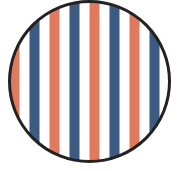
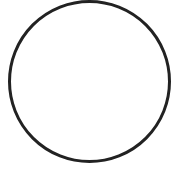
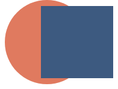
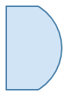

# Defined, Not Drawn (#1267)

A shape that is laid out and read by other marks, but not painted.

## The proposal

- **decided.** `.hidden()` on any mark, chart or layer: laid out, counts for scales, axes and legends, keeps its name and datum, paints nothing, takes no pointer.
- **decided.** `.hidden(fn)` hides per datum. Toggling only repaints; layout never moves.
- **decided.** An ancestor's `.hidden()` wins over a child's `.hidden(false)`. On one value, the last call wins.
- **decided.** Only on a value you hold: not through `ref` or `selectAll`, and no operator sets it.
- **proposed.** A child slot draws its child as itself. An operand slot is read for shape, place or data and never drawn. A ref draws nothing. Reading a child's shape or ink is allowed; drawing it differently, or not at all, is not.
- **proposed.** Which frame is an operand in? The frame the operator sits in, never the frame it makes for its children. An inline operand is laid out there; a ref is read where it was placed and mapped into that frame.
- **proposed.** Three jobs. Region shapes (`intersect`, `subtract`, `exclude`, `union`) draw one new shape from operands. `clip({ to }, children)` clips to an outline it never draws. `drawInside` (today `paint`) draws its first child and clips the rest to that child's ink. `mask` is parked.
- **decided.** Bend and envelope are coordinate transforms with a shape argument: `Coord.bend({ along })`, `Coord.envelope({ top, bottom })`. The coord reads the shape and never draws it. Deferred.
- **decided.** Renames: `position` becomes `translate`; `cut(opts, [source])`.

## Hiding

### Croissant: the density curve

The curve is laid out and sets the scale, and `.hidden()` replaces `fill: "none"`.


_Render. Proposed render, 0 px from today's._

**Proposed**

```js
layer([
  chart(grid)
    .flow(scatter({ x: "x" }))
    .mark(ribbon({ h: "pdf" }).name("density").hidden()),
]).relate(({ density }) => [
  chart(grid)
    .flow(
      derive((rows) => quantileRows(rows, { x: "x", density: "pdf", n: 1000 })),
      partition({ by: field("x").bin(Bin.quantiles(10)), dir: "x" })
    )
    .mark(
      layer([
        intersect({ fill: FILL, stroke: STROKE, strokeWidth: 2 }, [
          density,
          region({ inset: 3 }),
        ]),
        circle({ cx: field("x").median(), cy: 6, r: 3, fill: STROKE }),
      ])
    ),
]);
```

<details><summary>Current spelling (20 lines)</summary>

```js
layer([
  chart(grid)
    .flow(scatter({ x: "x" }))
    .mark(ribbon({ h: "pdf", fill: "none" }).name("density")),
]).relate(({ density }) => [
  chart(grid)
    .flow(
      derive((rows) => quantileRows(rows, { x: "x", density: "pdf", n: 1000 })),
      partition({ by: field("x").bin(Bin.quantiles(10)), dir: "x" })
    )
    .mark(
      layer([
        intersect({ fill: FILL, stroke: STROKE, strokeWidth: 2 }, [
          density,
          region({ inset: 3 }),
        ]),
        circle({ cx: field("x").median(), cy: 6, r: 3, fill: STROKE }),
      ])
    ),
]);
```

</details>

### Croissant ridgeline: one hidden curve per row

Each row's curve is hidden, and its cells still read it.


_Render. Proposed render, 0 px from today's._

**Proposed**

```js
chart(monthlyDensity, {
  w: 520,
  axes: { x: { title: "Daily high (°C)" }, y: false },
})
  .flow(
    spread({
      by: field("month").sort(months),
      dir: "y",
      anchor: "baseline",
      spacing: 36,
    })
  )
  .mark(
    layer({ h: 34 }, [
      chart()
        .flow(scatter({ x: "temp_max" }))
        .mark(ribbon({ h: "pdf" }).name("density").hidden()),
    ]).relate(({ density }) => [cells(density, { n: 5, inset: 2 })])
  );
```

<details><summary>Current spelling (19 lines)</summary>

```js
chart(monthlyDensity, {
  w: 520,
  axes: { x: { title: "Daily high (°C)" }, y: false },
})
  .flow(
    spread({
      by: field("month").sort(months),
      dir: "y",
      anchor: "baseline",
      spacing: 36,
    })
  )
  .mark(
    layer({ h: 34 }, [
      chart()
        .flow(scatter({ x: "temp_max" }))
        .mark(ribbon({ h: "pdf", fill: "none" }).name("density")),
    ]).relate(({ density }) => [cells(density, { n: 5, inset: 2 })])
  );
```

</details>

### Seattle highs: the axis comes from a hidden area

The hidden area still sets the y axis.


_Render. Proposed render, 0 px from today's._

**Proposed**

```js
layer([
  chart(highs2012, { schema })
    .flow(scatter({ x: "date" }))
    .mark(ribbon({ h: "temp_smooth" }).name("temps").hidden()),
])
  .relate(({ temps }) => [monthCells(temps)])
  .render(container, {
    w: 560,
    h: 220,
    axes: { x: false, y: { title: "Daily high, 15-day mean (°C)" } },
  });
```

**Current**

```js
layer([
  chart(highs2012, { schema })
    .flow(scatter({ x: "date" }))
    .mark(ribbon({ h: "temp_smooth", fill: "none" }).name("temps")),
])
  .relate(({ temps }) => [monthCells(temps)])
  .render(container, {
    w: 560,
    h: 220,
    axes: { x: false, y: { title: "Daily high, 15-day mean (°C)" } },
  });
```

### Quantum circuit: slots and a spacer

Spacers and alignment slots say they are hidden, instead of `fill: "transparent"`, and take no pointer.


_Render. Proposed render, 0 px from today's._

**Proposed**

```js
const WireSlot = createMark(({ content }) =>
  layer([
    rect({ w: GATE, h: GATE }).name("slot").hidden(),
    content.name("content"),
  ]).relate(({ slot, content }) => [
    Constraint.align({ x: "middle", y: "middle" }, [slot, content]),
  ])
);
const EmptySlot = () => rect({ w: GATE, h: GATE }).hidden();
spread({ dir: "x", spacing: SLOT - GATE, alignment: "middle" }, [
  rect({ w: 10, h: GATE }).hidden(), // the leader before the gates
  ...slots,
]);
```

**Current**

```js
const WireSlot = createMark(({ content }) =>
  layer([
    rect({ w: GATE, h: GATE, fill: "transparent" }).name("slot"),
    content.name("content"),
  ]).relate(({ slot, content }) => [
    Constraint.align({ x: "middle", y: "middle" }, [slot, content]),
  ])
);
const EmptySlot = () => rect({ w: GATE, h: GATE, fill: "transparent" });
spread({ dir: "x", spacing: SLOT - GATE, alignment: "middle" }, [
  rect({ w: 10, h: GATE, fill: "transparent" }), // the leader before the gates
  ...slots,
]);
```

### Venn lenses: each circle read twice

The three circles are hidden, and each is an operand of two lenses.


_Render. Proposed render, 0 px from today's._

**Proposed**

```js
const LENS = { stroke: "#444", strokeWidth: 1.5, opacity: 0.75 };
layer([
  circle({ cx: 100, cy: 100, r: 90 }).name("a").hidden(),
  circle({ cx: 205, cy: 100, r: 90 }).name("b").hidden(),
  circle({ cx: 152, cy: 190, r: 90 }).name("c").hidden(),
]).relate(({ a, b, c }) => [
  intersect({ fill: "#9ecae1", ...LENS }, [a, b]),
  intersect({ fill: "#fdd0a2", ...LENS }, [b, c]),
  intersect({ fill: "#c7e9c0", ...LENS }, [a, c]),
]);
```

**Current**

```js
const LENS = { stroke: "#444", strokeWidth: 1.5, opacity: 0.75 };
layer([
  circle({ cx: 100, cy: 100, r: 90, fill: "none" }).name("a"),
  circle({ cx: 205, cy: 100, r: 90, fill: "none" }).name("b"),
  circle({ cx: 152, cy: 190, r: 90, fill: "none" }).name("c"),
]).relate(({ a, b, c }) => [
  intersect({ fill: "#9ecae1", ...LENS }, [a, b]),
  intersect({ fill: "#fdd0a2", ...LENS }, [b, c]),
  intersect({ fill: "#c7e9c0", ...LENS }, [a, c]),
]);
```

### Hidden per datum

`.hidden(fn)` hides some data, like `.zOrder(fn)`, and only repaints.

_Sketch: drawn in the HTML page._

**Proposed**

```js
chart(countries)
  .flow(scatter({ x: "gdp", y: "lifeExpectancy" }))
  .mark(circle({ r: 3 }).hidden((d) => d.year !== year));
```

**Current:** Not expressible today. `filter` drops the rows, so the scales move.

<details><summary>Python</summary>

```python
chart(countries).flow(scatter(x="gdp", y="life_expectancy")).mark(
    circle(r=3).hidden(lambda d: d["year"] != year)
)
```

</details>

### Hiding a helper's whole chart

`.hidden()` on a built chart hides all of it, axes included, and its rows can still be read.

_Sketch: drawn in the HTML page._

**Proposed**

```js
layer([ridgeline(data).name("rows").hidden()]).relate(({ rows }) => [
  monthLabels(rows),
]);
```

**Current:** Not expressible today, unless the helper takes its own flag.

## Guides drawn or not

### Voronoi without its seeds

No change: the seeds are rows, not a shape, so there is nothing to hide.


**Proposed**

```js
layer({ w: 420, h: 300 }, [
  chart(beaked, { color: Color.gradient("blues") })
    .flow(partition({ by: key.bin(Bin.voronoi({ seeds })) }))
    .mark(region({ fill: field("Species").count(), stroke: "white" })),
]);
```

**Current:** the same code. No change.

### Voronoi with its seeds

No change: drawing the seeds is one more chart over the same rows.


**Proposed**

```js
layer({ w: 420, h: 300 }, [
  chart(beaked, { color: Color.gradient("blues") })
    .flow(partition({ by: key.bin(Bin.voronoi({ seeds })) }))
    .mark(region({ fill: field("Species").count(), stroke: "white" })),
  chart(seeds)
    .flow(scatter({ x: "Beak Length (mm)", y: "Beak Depth (mm)" }))
    .mark(circle({ r: 3.5, fill: "black" })),
]);
```

**Current:** the same code. No change.

### Clip, without the outline

`clip({ to })` replaces `mask`, and reads its region for shape, so the fill need not be white.


_Render. Today's render._

**Proposed**

```js
clip({ to: circle({ cx: 100, cy: 100, r: 80 }) }, [stripes()]);
```

**Current**

```js
mask([circle({ cx: 100, cy: 100, r: 80, fill: "white" }), stripes()]);
```

### Clip, with the outline

The circle is drawn once, as itself, and the clip reads it through a ref.



_Render. Today's render, with a second circle._

**Proposed**

```js
layer([circle({ cx: 100, cy: 100, r: 80, ...OUTLINE }).name("disc")]).relate(
  ({ disc }) => [clip({ to: disc }, [stripes()])]
);
```

**Current**

```js
layer([
  mask([circle({ cx: 100, cy: 100, r: 80, fill: "white" }), stripes()]),
  circle({ cx: 100, cy: 100, r: 80, ...OUTLINE }),
]);
```

## Region compositing

### clip vs mask: shape vs paint

`clip` reads only the outline; `mask` reads the stencil's brightness, like SVG `vs`.

**Shared stencil (the content is the same stripes)**

```js
const stencil = layer([
  circle({ cx: 60, cy: 60, r: 50, fill: "white" }),
  circle({ cx: 180, cy: 60, r: 50, fill: "#808080" }),
  circle({ cx: 300, cy: 60, r: 50, fill: "#1f3b5c" }),
]);
```

**clip (proposed)**


_`clip`'s output, rendered today as `mask([stencil, stripes])` with all three circles set to `fill: "white"`._

```js
clip({ to: stencil }, [stripes]);
```

**mask (today)**


_Real render: full, about half, and nearly nothing._

```js
mask([stencil, stripes]);
```

### Mask by ref

`mask` reads its stencil as ink, so a ref gives nothing; `clip` reads the ref's shape.



_Render. Today: outline only, no stripes._


_Render. Proposed: the same picture as the outline card._

**Proposed**

```js
layer([circle({ cx: 100, cy: 100, r: 80, ...OUTLINE }).name("disc")]).relate(
  ({ disc }) => [clip({ to: disc }, [stripes()])]
);
```

**Current**

```js
layer([circle({ cx: 100, cy: 100, r: 80, ...OUTLINE }).name("disc")]).relate(
  ({ disc }) => [mask([disc, stripes()])]
);
```

### Intersect with paint

No change: one new shape, and the operands are not drawn.



_Render. The operands a and b._



_Render. The result._

**Proposed**

```js
intersect({ fill: "#D1E4F6", stroke: "#467DA8", strokeWidth: 2 }, [a, b]);
```

**Current:** the same code. No change.

### Intersect without paint

The blend goes away: `intersect` always draws one new shape, and `clip` keeps an operand's own paint.


_Render. Today: a blend of a and b._

**Proposed**

```js
intersect({ fill: "#5b7aa0" }, [a, b]); // one new shape; default paint open (#1230)
clip({ to: b }, [a]); // a's own paint, inside b
```

**Current**

```js
intersect([a, b]); // a blend of a's and b's paint, each clipped to the other
```

### Intersect with a hidden operand

An operand is read, never drawn, so `.hidden()` on it has no effect.


_Render. Today, with the shim: empty._

**Proposed**

```js
intersect({ fill: "#5b7aa0" }, [a.hidden(), b]); // same as without .hidden()
```

**Current**

```js
intersect([hidden(a), b]); // prototype shim: draws nothing
```

**Today's code, by case**

| `intersect` case                                                                              | Transparent operand (`fill: "none"`, no stroke) | Hidden operand       |
| --------------------------------------------------------------------------------------------- | ----------------------------------------------- | -------------------- |
| No paint (`porterDuff.tsx` 396 to 427): composites the operands with their own paint          | Empty                                           | Empty (same)         |
| Paint, exact outline (338 to 358): draws the computed overlap                                 | Overlap drawn                                   | Overlap drawn (same) |
| Paint, no exact outline (361 to 393): `shapeOnly` redraws each operand solid as an alpha mask | Overlap drawn                                   | Empty (differs)      |

Hidden should behave like transparent for shape. The third row is the implementation fix already noted (feed that path the operand's geometry, as `INTERNAL_lendDrawing` does for transitions), not a new rule.

### Bottle: draw inside a drawn shape

The image is a child, drawn as itself, and its alpha clips the rect. Only the name changes.


_Render. Today's render of the PICCL gallery story (`stories/piccl/Bottle.stories.tsx`). It stays the same._

**Proposed**

```js
drawInside({ blendMode: "color" }, [
  image({ href: bottlePng, h: v(100) }),
  rect({ h: "amount", w: 175, fill: "#00ff00" }),
]);
```

**Current**

```js
paint({ blendMode: "color" }, [
  image({ href: bottlePng, h: v(100) }),
  rect({ h: "amount", w: 175, fill: "#00ff00" }),
]);
```

<details><summary>Alternatives, and why they are worse</summary>

```js
// (a) The image as a named sibling, read as an alpha stencil.
layer([image({ href: bottlePng, h: v(100) }).name("glass")]).relate(
  ({ glass }) => [
    mask({ mode: "alpha", to: glass }, [
      rect({ h: "amount", w: 175, fill: "#00ff00", mixBlendMode: "color" }),
    ]),
  ]
);
```

(a) needs a name and a `.relate()`, or #1259, to reach the image. It needs `mixBlendMode: "color"` on the rect, and marks only allow `"normal" | "multiply"` today (`chart.ts` line 973). It also needs `mask({ mode })`, which is parked.

```js
// (b) The image inline in `to`, and again as a drawn sibling.
layer([
  image({ href: bottlePng, h: v(100) }),
  mask({ mode: "alpha", to: image({ href: bottlePng, h: v(100) }) }, [
    rect({ h: "amount", w: 175, fill: "#00ff00", mixBlendMode: "color" }),
  ]),
]);
```

(b) writes the image twice: two nodes that can drift apart. It has the same blend-mode problem.

</details>

### Region shapes, clip and drawInside

`intersect`, `subtract`, `exclude` and a new `union` take operands only; `clip` replaces `mask`; `drawInside` is today's `paint`.

_Sketch: drawn in the HTML page._

**Proposed**

```js
intersect({ fill: FILL, stroke: STROKE }, [a, b]);
subtract({ fill: FILL }, [a, b]);
exclude({ fill: FILL }, [a, b]);
union({ stroke: STROKE }, [a, b]); // one outline
clip({ to: a }, [b]); // a's outline; a is not drawn
drawInside([a, b]); // a drawn; b inside a's ink
clip({ to: rect({ w, h }) }, [bars]); // a plot-box clip (#1209)
```

**Current**

```js
intersect({ fill: FILL, stroke: STROKE }, [a, b]);
subtract({ fill: FILL }, [a, b]);
exclude({ fill: FILL }, [a, b]);
layer([a, b]); // two outlines
mask([a, b]); // a read as luminance: a ref or a non-white a fails
paint([a, b]); // a drawn; b inside a's ink
// no plot-box clip (#1209)
```

### Slots, by operator

What each operator does with each slot. A child may also be read; it is still drawn as itself.

**The rule, by operator**

| Slot kind                  | Operators                                                                                                                                                                                                             |
| -------------------------- | --------------------------------------------------------------------------------------------------------------------------------------------------------------------------------------------------------------------- |
| Child: drawn as itself     | `layer`, `spread`, `stack`, `scatter`, `group`, `partition`, `treemap`, `pack`, `frame`, `translate`, `offset`, a coord's children, `enclose`'s children, `arrow`'s ends, `clip`'s children                           |
| Child, also read for ink   | `drawInside` (today `paint`): its first child; the rest are plain children                                                                                                                                            |
| Operand: read, never drawn | `clip`'s `to`, `intersect`, `subtract`, `exclude`, `union`, `Shape.blob({ avoiding })`, relational `line` and `ribbon`, `Constraint.*`, `cut`'s source, `Coord.bend`'s `along`, `Coord.envelope`'s `top` and `bottom` |
| Pointer: draws nothing     | `ref`                                                                                                                                                                                                                 |
| Data                       | `Bin.voronoi`'s `seeds`                                                                                                                                                                                               |
| Parked                     | `mask`'s stencil (an undrawn alpha stencil, such as a gradient fade)                                                                                                                                                  |

Today two operators break this: `intersect` switches its slots from children to operands with its paint option, and `mask` reads luminance, so a ref or a colored stencil fails. `paint` does not: its first child is drawn and also read, as `Constraint.align` reads the boxes of marks that are drawn where they were made.

## Naming

### Naming: draw inside a drawn shape

How other systems name "draw A, then draw B clipped to A's ink, with A still visible".

**Precedent**

| System                                | Name                                        | What it does                                                                                                | Checked against docs                                                    |
| ------------------------------------- | ------------------------------------------- | ----------------------------------------------------------------------------------------------------------- | ----------------------------------------------------------------------- |
| Photoshop                             | Create Clipping Mask                        | Base layer stays visible; layers above show only where it has pixels, and take its opacity and blend mode.  | yes (Photoshop Elements help page)                                      |
| Procreate                             | Clipping Mask                               | Clips to the layer below; that layer stays visible.                                                         | yes                                                                     |
| Affinity Designer                     | Clipping (drop on the layer's name)         | Parent stays visible; the child is clipped to it. Dropping on the thumbnail makes a mask instead.           | partly (tutorials)                                                      |
| Illustrator                           | Draw Inside                                 | Content drawn into a selected object is clipped to it, and the object stays.                                | clipping, yes (help page); the object keeping its paint, not re-checked |
| After Effects                         | Preserve Underlying Transparency (T switch) | A layer takes its transparency from the layers below; Adobe says it behaves like a Photoshop clipping mask. | yes                                                                     |
| Krita                                 | Inherit Alpha                               | A layer is confined to the alpha of the layers below it in its group.                                       | yes                                                                     |
| Canvas 2D                             | globalCompositeOperation = "source-atop"    | New paint only where the canvas already has paint.                                                          | from MDN, not re-checked                                                |
| Porter-Duff                           | atop                                        | B atop A: A drawn, B inside A.                                                                              | not re-checked                                                          |
| CSS                                   | background-clip: text                       | The background shows only inside the text glyphs; text only.                                                | not re-checked                                                          |
| Figma                                 | none                                        | Use as mask, types Alpha (default), Vector, Luminance: a stencil, not a drawn base.                         | mask types, yes                                                         |
| Sketch                                | none clear                                  | Use as Mask, Outline or Alpha mode.                                                                         | partly                                                                  |
| Inkscape, SVG, GIMP, SwiftUI, Flutter | none                                        | Clip and mask hide the stencil; draw it again yourself.                                                     | not re-checked                                                          |

Checked with a web search on 2026-11-02 against the Adobe, Procreate, Krita and Figma help pages; Affinity from tutorials.

**Recommendations**

- **Precedent.** Raster tools call this a clipping mask (Photoshop, Procreate) or clipping (Affinity), and the base stays visible. That word is taken: in GoFish, `clip` is the operator whose stencil is not drawn. Other names: Draw Inside (Illustrator), Inherit Alpha (Krita), Preserve Underlying Transparency (After Effects), atop (Porter-Duff, Canvas).
- **Recommend `drawInside`.** It is Illustrator's name for exactly this, it is a verb like the other operators, and it says both halves: the base is drawn, and the rest goes inside it. Next to `clip` it cannot be misread. `clip({ to: a }, [b])` draws only b; `drawInside([a, b])` draws a, then b inside it.
- **Why not keep `paint`.** GoFish already uses "paint" for fill and stroke: the Paint options group, `intersect`'s paint, and "paints nothing" on this page. The operator name does not say that its first child is the stencil.
- **Rejected.** `clipTo` reads as `clip` with an argument. `inside` is `intersect`'s wire name. `atop` is the Porter-Duff jargon #196 replaced. `inherit` needs Krita to make sense.

### Compositing names elsewhere

Union, intersection, difference, symmetric difference, shape-only clip, paint-based mask, and the clip region's parameter.

**Precedent**

| System             | Union               | Intersection      | A minus B        | Xor                      | Clip (shape)             | Mask (paint)                   | Region parameter  |
| ------------------ | ------------------- | ----------------- | ---------------- | ------------------------ | ------------------------ | ------------------------------ | ----------------- |
| Figma              | Union               | Intersect         | Subtract         | Exclude                  | Use as mask (Vector)     | Use as mask (Alpha, Luminance) | the bottom layer  |
| Illustrator        | Unite               | Intersect         | Minus Front      | Exclude                  | Clipping Mask            | Opacity Mask                   | the top object    |
| Inkscape           | Union               | Intersection      | Difference       | Exclusion                | Clip                     | Mask (luminance)               | the top object    |
| Sketch             | Union               | Intersect         | Subtract         | Difference               | Outline Mask             | Alpha Mask                     | the bottom layer  |
| Affinity Designer  | Add                 | Intersect         | Subtract         | Xor                      | nested clip              | mask layer                     | the parent layer  |
| SVG                | none                | none              | none             | none                     | <clipPath>, clip-path    | <mask>                         | url(#id)          |
| CSS                | none                | none              | none             | none                     | clip-path                | mask, mask-mode                | its value         |
| Canvas 2D          | none                | source-in         | destination-out  | xor                      | clip()                   | destination-in                 | the current path  |
| PDF, PostScript    | none                | none              | none             | none                     | clip path                | soft mask                      | the current path  |
| Skia               | kUnion              | kIntersect        | kDifference      | kXOR                     | clipPath                 | mask filter, shader            | a path            |
| SwiftUI            | union(\_:)          | intersection(\_:) | subtracting(\_:) | symmetricDifference(\_:) | .clipShape(\_:)          | .mask(\_:)                     | unlabeled         |
| Flutter            | PathOperation.union | .intersect        | .difference      | .xor                     | ClipPath(clipper:)       | ShaderMask                     | clipper           |
| Jetpack Compose    | PathOperation.Union | Intersect         | Difference       | Xor                      | Modifier.clip(shape)     | BlendMode.DstIn                | shape             |
| Typst              | none                | none              | none             | none                     | box(clip: true)          | none                           | the box itself    |
| TikZ               | none                | none              | none             | none                     | \clip                    | path fading                    | the path          |
| p5.js              | none                | none              | none             | none                     | clip(callback)           | img.mask()                     | a callback        |
| Paper.js           | unite               | intersect         | subtract         | exclude                  | clipMask (clipped group) | none                           | first child       |
| Shapely, GEOS      | union               | intersection      | difference       | symmetric_difference     | none                     | none                           | none              |
| JTS                | union               | intersection      | difference       | symDifference            | none                     | none                           | none              |
| Clipper2           | Union               | Intersect         | Difference       | Xor                      | none                     | none                           | the clip paths    |
| Turf               | union               | intersect         | difference       | none                     | none                     | none                           | none              |
| polybool           | union               | intersect         | difference       | xor                      | none                     | none                           | none              |
| JS Set (ES2025)    | union               | intersection      | difference       | symmetricDifference      | none                     | none                           | none              |
| Observable Plot    | none                | none              | none             | none                     | clip: "frame", GeoJSON   | none                           | its value         |
| Vega-Lite          | none                | none              | none             | none                     | clip: true               | none                           | none              |
| ggplot2, ggfx      | none                | none              | none             | none                     | coord_cartesian(clip=)   | with_mask(mask_type=)          | mask              |
| D3                 | none                | none              | none             | none                     | clipExtent               | SVG mask                       | extent            |
| Bluefish, Penrose  | none                | none              | none             | none                     | none                     | none                           | none              |
| PiCCL, Porter-Duff | over                | in                | out              | xor                      | in                       | none                           | the first operand |
| GoFish today       | none                | intersect         | subtract         | exclude                  | none                     | mask                           | the first child   |
| GoFish proposed    | union               | intersect         | subtract         | exclude                  | clip({ to })             | mask({ mode }), parked         | to                |

Names as each system documents them, from my knowledge, not re-checked online. The least certain: Figma's mask types, Affinity's clipping and mask layers, and Bluefish and Penrose having none.

**Recommendations**

- **union.** Keep `union`: Figma (the recorded naming source, #196, #404), Inkscape, Sketch, SwiftUI, Flutter, Compose, Skia, Shapely, Clipper2 and the JS `Set` all say union. `unite` (Illustrator, Paper.js) is the runner-up. Every design tool keeps Union apart from Group, and Josh asked for a separate Union in #196 because it draws one new outline. The reference page says it in one line: `union` draws one shape, `layer` draws each child.
- **intersect, subtract, exclude.** Keep them. This is the recorded Figma decision, and Paper.js uses the same verbs. The set mixes one noun-verb (`union`) with three verbs, as Figma does; renaming to all nouns (`intersection`, `difference`, as in SwiftUI, Shapely and JS `Set`) would break the recorded decision and GoFish's verb-named operators.
- **clip({ to }).** `clip` is the universal name: SVG, CSS, Canvas, PDF, Skia, SwiftUI, Flutter, Compose, Typst, TikZ, p5, Plot, Vega-Lite and ggplot2. For the region, `to` reads as "clip to the disc" and follows GoFish's prepositions for shape operands (`along`, `avoiding`, `around`). The others collide: `shape` is `enclose`'s strategy option (`Shape.blob`), `region` is a mark, and `by` is the split key. Line's `to` also takes a ref to a shape, so the two uses agree.
- **clip and mask are two names.** Confirmed. SVG, CSS, Canvas, PDF, Skia, Illustrator, Inkscape, Sketch, Affinity, SwiftUI, Flutter, TikZ, p5 and ggfx all split them; Figma has one command with a type setting. If `mask` returns, it reads paint with `mask({ mode: "alpha" | "luminance" })`, after CSS `mask-mode` and ggfx `mask_type`, nested as one option. Default alpha (SwiftUI, p5, ggfx, Figma), so a stencil of any color works; today's luminance needs white.
- **paint.** Keep the operator, renamed `drawInside`; see the card above. Its first child is drawn and also read for ink, which the children rule allows.

## Coordinate transforms with a shape argument

### Which frame is an operand in?

An operand is read in the frame the operator sits in, never in the frame it makes for its children. An inline operand is laid out there; a ref is read where it was placed and mapped into that frame.

**The rule, by operator**

| Operator                                                   | Operand         | Frame it is read in                                                                                                      |
| ---------------------------------------------------------- | --------------- | ------------------------------------------------------------------------------------------------------------------------ |
| `Coord.bend({ along })`, `Coord.envelope({ top, bottom })` | the guide shape | Outside the coord. The coord's inner frame is defined by the guide, so laying the guide out inside it would be circular. |
| `clip({ to }, children)`                                   | the region      | The clip's own frame. `clip` makes no new frame, so the region and the children share it.                                |
| `Bin.voronoi({ seeds })`                                   | seed rows       | The chart's frame, placed by its scales. Cells are computed there; under polar, from the warped positions.               |

Blocker: a ref spine drawn under one coord and read by a bend in another depends on #605 (a ref across a coord boundary reads the target's box in the coord's own space, such as θ and r under polar, not its warped screen position). The code still does this: `src/ast/_ref.tsx` copies `selectedNode.intrinsicDims` (line 350), and `coord.tsx` computes warped boxes only for its own bounding box (lines 307 and 551), never for the child. The issue's description holds; its line numbers and its `shapes/_ref.tsx` path are out of date. #1225 (a symbolic port for refs through affine coords) would cover affine coords only; a bend is not affine, so it needs #605.

### Bend: the spine drawn, read through a ref

`Coord.bend` reads the spine and never draws it; here the spine is drawn once, where it was made.


_Not GoFish. Image: [warpjs#15](https://github.com/benjamminf/warpjs/issues/15), posted by the issue's author to show Inkscape's Bend live path effect. Not drawn by GoFish._

**Proposed**

```js
layer([
  chart(spinePoints)
    .flow(scatter({ x: "x", y: "y" }))
    .mark(line({ curve: Curve.natural, stroke: "green" }))
    .name("spine"),
]).relate(({ spine }) => [
  layer({ coord: Coord.bend({ along: spine }) }, [
    polygon({ points: gecko, fill: "none", stroke: "black" }),
  ]),
]);
```

**Current:** Not expressible today. It stays deferred, as `notes/design/polar-coordinate-spaces.md` records; see the draft issue.

### Bend: the spine hidden

The usual output: the spine is a hidden child, laid out and not drawn.

_Sketch: drawn in the HTML page._

**Proposed**

```js
layer([
  chart(spinePoints)
    .flow(scatter({ x: "x", y: "y" }))
    .mark(line({ curve: Curve.natural, stroke: "green" }))
    .name("spine")
    .hidden(),
]).relate(({ spine }) => [
  layer({ coord: Coord.bend({ along: spine }) }, [
    polygon({ points: gecko, fill: "none", stroke: "black" }),
  ]),
]);
```

**Current:** Not expressible today.

### Envelope between two curves

`Coord.envelope` maps its children into the region between two shapes, here both hidden.

_Sketch: drawn in the HTML page._

**Proposed**

```js
layer([upper.name("upper").hidden(), lower.name("lower").hidden()]).relate(
  ({ upper, lower }) => [
    layer({ coord: Coord.envelope({ top: upper, bottom: lower }) }, [
      text({ text: "WORD", fontSize: 96 }),
    ]),
  ]
);
```

**Current:** Not expressible today.

## Renames

### position becomes translate

One operator and its method twin, one node on the wire.

**Proposed**

```js
translate({ x: 10 }, [rect({ w: 20, h: 20 })]);
rect({ w: 20, h: 20 }).translate({ x: 10 }); // the same node
```

**Current**

```js
position({ x: 10 }, [rect({ w: 20, h: 20 })]); // node: { type: "position" }
rect({ w: 20, h: 20 }).translate({ x: 10 }); // field: translate: { x: 10 }
```

### cut takes options first

The source becomes the one child, like every other operator.

**Proposed**

```js
stack({ dir: "y" }, cut({ dir: "y", size }, [image({ href, w: 193, h: 600 })]));
```

**Current**

```js
stack({ dir: "y" }, cut(image({ href, w: 193, h: 600 }), { dir: "y", size }));
```

## Parked

### use(ref): a second mark that follows a shape

Parked: no example needs it yet. A blob filled below its members and outlined above them.

_Sketch: drawn in the HTML page._

**Proposed**

```js
layer([
  enclose({ shape: Shape.blob, fill: "#eef3f8" }, members).name("group"),
  use(ref("group"), { fill: "none", stroke: "#467DA8", zOrder: 1 }),
]);
```

**Current:** Not expressible as one shape today.

## Errors and edge cases

| Call                                   | Result                                                                                                   |
| -------------------------------------- | -------------------------------------------------------------------------------------------------------- |
| `ref("x").hidden()`                    | Error: a ref reads a shape and cannot change its paint.                                                  |
| `selectAll("bars").hidden()`           | Error, for the same reason.                                                                              |
| `.hidden().hidden(false)`              | Drawn. The last call wins.                                                                               |
| `.hidden().hidden()`                   | Hidden.                                                                                                  |
| `layer([a, b.hidden(false)]).hidden()` | Both hidden. The ancestor wins.                                                                          |
| `intersect(o, [a.hidden(), b])`        | Proposed: no effect on the result. Warn? ([open](#d-warn)). Today, with no paint, it empties the result. |
| `mask([stencil.hidden(), b])`          | Today: no effect. The stencil is never drawn.                                                            |
| `circle(o).hidden((d) => ...)`         | Per datum. Repaint only, no new layout.                                                                  |
| `ridgeline(data).hidden()`             | The whole chart, axes and legend included.                                                               |

## Open decisions

1. Adopt the rule: children are drawn as themselves (and may also be read), operands are read and never drawn, refs draw nothing? (card: slots)
2. Three jobs: region shapes from operands, `clip` (stencil not drawn) and `drawInside` (stencil drawn, its ink clips), with `mask` parked and the unpainted blend dropped? (card: regions)
3. Rename `paint` to `drawInside` (Illustrator's Draw Inside), or keep `paint`? (card: naming-paint)
4. Name the outline-only operator `clip({ to })` and keep `mask` for the paint-based case (returning only when an example needs it), or one name for both? Precedent splits them (SVG, CSS, Illustrator, Inkscape, SwiftUI, Flutter, p5); only Figma has one. If `mask` returns: `mask({ mode })`, default alpha? (card: clip-vs-mask)
5. Add `union` (Figma, Inkscape, Sketch, SwiftUI, Shapely, Clipper2) as a region shape, separate from `layer`, as every design tool keeps Union apart from Group? (card: naming-grid)
6. Warn when `.hidden()` sits on an inline operand, where it has no effect? (card: intersect-hidden)
7. Keep `use(ref)` parked until an example needs it? (card: use-ref)
8. File the bend and envelope issue, kept deferred? (Decided: a coord with a shape argument, not an operator.) (card: gecko)
9. Do both renames in one PR, separate from `.hidden()`? (card: translate)
10. Step 2 for `cut`: unify it with the `.cut()` mark method? (card: cut)
11. Add the method-twin rule to api-design.md: a method has a function twin only for a one-child operator, and both build one node? (card: translate)
12. Does a hidden mark's color still feed the scale and legend? (Recommended yes, as `blank()` does.) (card: venn)
13. Keep `blank()` as sugar for `rect().hidden()`, or delete it? (card: quantum)
14. Migrate the gallery stories (four croissants, QuantumCircuit, OhmParseTree, DFSCQ) in the same change? (card: croissant)
15. Land with #1259 (`.layer()` reads names), so the croissant needs no outer `layer`? (card: croissant)

Draft issues: `issue-cut.md`, `issue-translate-position.md`, `issue-spine-envelope.md`.

## Why

<details><summary>Precedent and rationale</summary>

| System             | Spelling             | Laid out    | Painted | Takes pointer |
| ------------------ | -------------------- | ----------- | ------- | ------------- |
| CSS                | `visibility: hidden` | yes         | no      | no            |
| CSS                | `display: none`      | no          | no      | no            |
| SwiftUI            | `.hidden()`          | yes         | no      | no            |
| Typst              | `hide(body)`         | yes         | no      | n/a           |
| TeX                | `\phantom{...}`      | yes         | no      | n/a           |
| TikZ               | `\path[name path=c]` | yes         | no      | n/a           |
| SVG                | `<defs> + <use>`     | at each use | no      | no            |
| Figma, Illustrator | `Use as mask`        | yes         | no      | no            |
| ggplot2            | `geom_blank()`       | scales only | no      | n/a           |
| Vega-Lite          | `opacity: 0`         | yes         | no      | yes           |
| Bluefish           | `fill="transparent"` | yes         | no      | yes           |

- Layout systems agree: CSS `visibility: hidden`, SwiftUI `.hidden()`, Typst `hide` and TeX `\phantom` keep layout and drop paint. That is `blank()`'s rule, applied to any subtree.
- It adds no node kind and no pass. It reuses `INTERNAL_emitNothing()` and goes on the wire as `hidden: true`, beside `zOrder`.
- It replaces five spellings of one idea: `blank()`, `fill: "none"`, `fill: "transparent"`, `opacity: 0` and a CSS clip.
- A method, not a wrapper: it is a fact about the mark's own nodes, like `.name()` and `.zOrder()`. SwiftUI has `.hidden()` only, with no wrapper form.
- `hidden` has precedent with this exact meaning. `def` means a template in SVG and is a keyword in Python.
- The children and operands rule falls out of the same question: does this operator draw this slot? In region compositing the answer is muddled today: `intersect` switches its slots with its paint option, and `mask` reads luminance. So it splits into three jobs: region shapes, `clip` and `drawInside`.

</details>

Prototype stories: `packages/gofish-graphics/stories/proposals/ShapeDefinitions.stories.tsx` (throwaway; a story-only `hidden()` shim). No library code changed.
