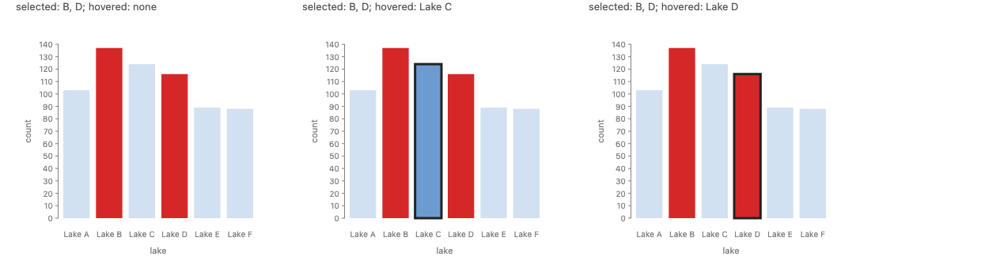
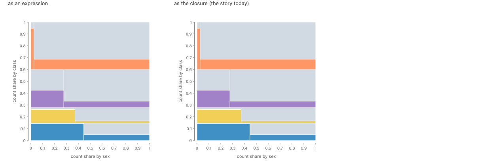
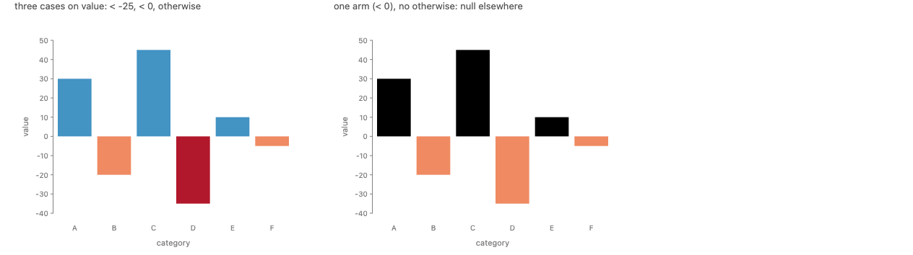
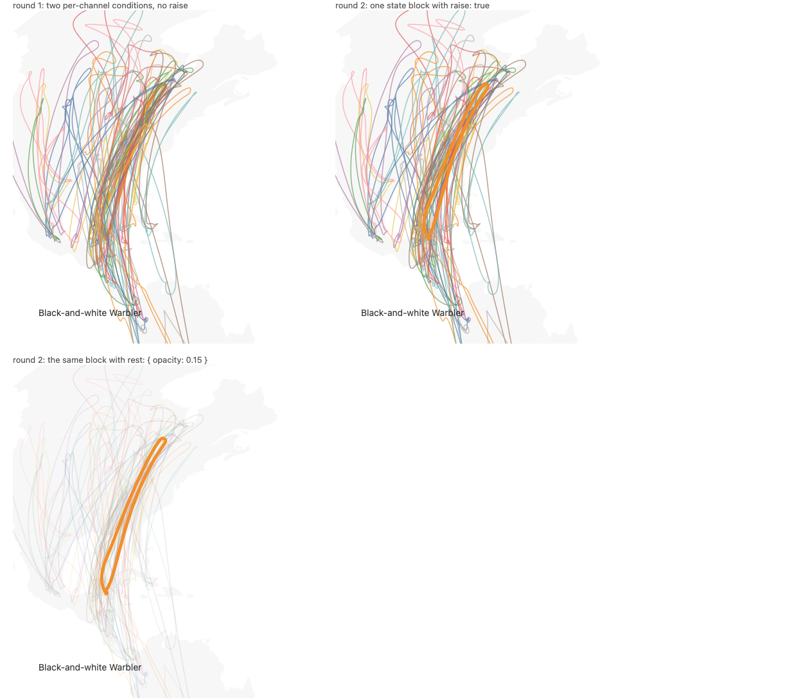
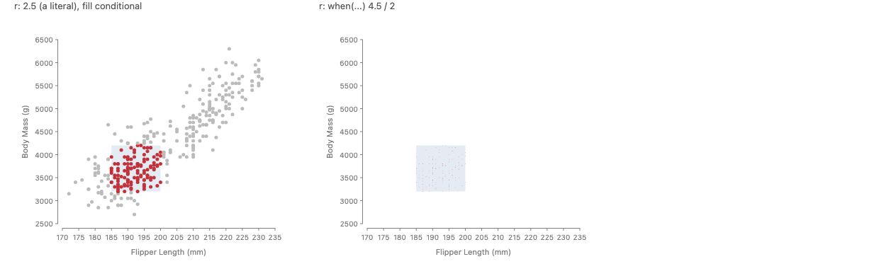
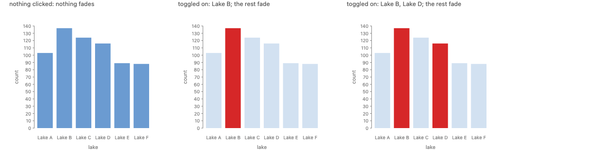

# Reading interaction sources: a hover is a selection (round 3)

**Summary.**

1. "The shapes under the pointer" is a GoFish selection, a list of refs (round 1). An input with no scope that tests a mark's own shapes picks among that mark's shapes, defined by a rewrite to a named pick (round 2).
2. Styling for a state is declared once, after the mark, as a **state block**, `rect({ fill: BLUE }).when(hover, { fill: RED, front: true, rest: { opacity: 0.3 } })` (round 2, approved). Round 3 defines a block without any cascade: it is a **conditional record update** (options in, options out), and a chain of blocks is **function composition**, so the later block wins because it is the outer function. Its rewrite is one first-match conditional per channel.
3. Round 3 splits what round 2 called one idea into two that are related by a rewrite: **choosing a value** (a first-match conditional, like a `switch`, SQL `CASE` or Lisp `cond`) and **updating a record** (a state block, like `{ ...o, ...p }`). The value form gets a flat spelling with every case at one level: `cases([c1, v1], [c2, v2]).otherwise(d)`. The word `when` is kept for the update.

**Recommendation.** Round 1's Approach C (inputs pick refs), the default target, and state blocks `.when(cond, { ... })`, as in round 2. New in round 3: spell the channel conditional as a flat switch, **`cases([c, v], ...).otherwise(d)`** (Python `cases((c, v), ...).otherwise(d)`), replacing polars' `when(c).then(v)` chain on this branch. Runner-up: pair per call, `when(c, v).when(c2, v2).otherwise(d)`, which is shortest for two cases but has the same shape as the state-block chain with the opposite precedence.

**Scope.** This answers how a spec reads pointer, drag, brush and click-select inside the browser-evaluated expressions of the approved proposal `proposals/python-animation-interaction/proposal.md` (Approach B there: sources plus polars-style `when/then/otherwise`), and, in round 3, how a conditional value is spelled. Wheel, timer and signal reads are unchanged from that proposal.

**Prototype.** `packages/gofish-graphics/stories/proposals/source-reads/SourceReads.stories.tsx` (Storybook: "Proposals/Source Reads"). Throwaway, exempt from parity. The capture harness cannot send pointer events (#672, scripted interaction states for captures), so every picture fixes the value the input would produce. Round 2 added `desugarStates`, a prototype of the state-block rewrite. Round 3 adds `TitanicCases`, `SignedFill` and `BrushRadius`, which draw real conditionals in today's expression form. **All code labeled "proposed" does not run yet,** in either language.

**Sugar and rewrite render the same.** `StatePrecedence` (through `desugarStates`) and `StatePrecedenceExplicit` (hand-written) have byte-identical DOM and PNG (round 2). In round 3, the Titanic mosaic drawn with its closure and with the five-case expression have byte-identical SVG.

---

## What changed in round 3

Josh's feedback on round 2, verbatim:

> my reservation is that when().then().when().then() puts when and then at the same level of indentation whereas if () then {} etc don't do this... same with ternaries. well I guess else if allows that kind of chaining as sugar? switch statements feel like they put them on slightly more consistent ground?

> in general I'm a bit skeptical of CSS cascading rules b/c I can't easily map them to functional principles. I tend to like looking at what typst has done to get similar functionality or things like that, but my opinion is definitely not fully formed

> I want to see a comparison between when(hover, RED) and when(hover).then(RED) in some realistic examples

> look up Typst's semantics rather than relying on memory

Already decided, and not reopened here: S1 state blocks `.when(cond, { ...overrides, rest, front })` after the mark; `.emphasize` as a preset over `.when`; every convenience desugars (and ideally decompiles) into explicit forms the language can express.

| Round 2                                                                                      | Round 3                                                                                                                                                                                                                                                                                                                                             |
| -------------------------------------------------------------------------------------------- | --------------------------------------------------------------------------------------------------------------------------------------------------------------------------------------------------------------------------------------------------------------------------------------------------------------------------------------------------- |
| Channel conditional: polars' `when(c).then(v).when(c2).then(v2).otherwise(d)`.               | Compared three spellings on eight real examples, formatted by prettier and black. Recommended: `cases([c, v], ...).otherwise(d)`, a flat switch with every case at one level. Same IR.                                                                                                                                                              |
| "`when` already means a conditional; `.when` is the same conditional at the size of a mark." | Two ideas, related by an exact rewrite: a channel conditional **chooses** a value (first match wins); a state block **updates** a record (later block wins). Different precedence, so different words: `cases` and `.when`.                                                                                                                         |
| Precedence of blocks: "the CSS cascade by source order, with no specificity."                | No cascade. A block is a function from options to options; a chain is composition; "later wins" is "the outer function wins". Commutes when the blocks touch disjoint channels or their conditions never hold together. Compared against Typst (looked up and tested with Typst 0.14.2), spread and `dict \|`, lenses, Nix `//`, SwiftUI modifiers. |
| (none)                                                                                       | **Finding:** with Python's `&`, `field("count").sum() > cut & flag` silently builds `count > (cut & flag)` and draws a wrong picture. Proposed fix: typed boolean operators, loud at construction or at first render. Proposed named combinators `allOf(...)` / `anyOf(...)` for several predicates without parentheses.                            |
| (none)                                                                                       | **Finding:** a conditional with no `otherwise` gives null, and a null `fill` draws **black** today, not the mark's default. Proposed: null on a channel means "unset".                                                                                                                                                                              |
| (none)                                                                                       | **Finding:** an expression on `r` is read as a data value and sent through the size scale, so `r: when(c).then(4.5).otherwise(2)` draws nearly invisible dots, while the literal `r: 2.5` is pixels. The spelling does not cause this, but every size conditional meets it.                                                                         |

Kept from rounds 1 and 2: everything below the line, including the default target, `pick`, `front`, `rest`, `.any()`, the IR and the tiers.

## Terms (round 3)

- **Conditional value** (also **switch**, **multi-way conditional**). An expression that picks one value from a list of cases: each **case** (or **arm**) is a condition and a value; the first case whose condition holds gives the value; if none holds, the **default** (`otherwise`, `else`) does. This is SQL's `CASE`, Lisp's `cond`, Kotlin's `when { }`.
- **First match.** The rule that the first true case wins. Every conditional value in the survey below uses it.
- **Record update.** Making a new record from an old one with some fields replaced: JS `{ ...o, ...p }`, Python `o | p`, Nix `o // p`, Elm `{ o | fill = red }`. The fields of the right-hand record win.
- **Conditional record update.** A record update that applies only where a condition holds: `o => c ? { ...o, ...p } : o`. Round 3's definition of a state block.
- **Composition.** Applying one function to the result of another, `(g ∘ f)(x) = g(f(x))`. In a chain `x.f().g()`, `g` is the outer function.
- **Commute.** Two updates commute when applying them in either order gives the same result.
- **Cascade.** CSS's rule for choosing among several matching rules: origin and importance, then **specificity** (a score computed from the selector), then source order. Round 3 uses no cascade.
- **Variadic.** A function that takes any number of arguments (`f(*args)` in Python, `f(...args)` in JS).

## Part 3: spelling a conditional value

### The candidates

All three build the same IR node, the one this branch already has (`packages/gofish-ir/src/frontend/schema.ts`): `{ "type": "when", "branches": [[cond, value], ...], "otherwise": value }`. The IR does not change for any of them; only the builder a user calls does.

- **(A) polars chain** (on this branch now): `when(c).then(v).when(c2).then(v2).otherwise(d)`. A case is two calls.
- **(B) pair per call:** `when(c, v).when(c2, v2).otherwise(d)`. A case is one call, the same shape as the approved mark-level `.when(c, { ... })`.
- **(C) flat switch:** `cases([c, v], [c2, v2]).otherwise(d)` in JS, `cases((c, v), (c2, v2)).otherwise(d)` in Python. Every case is one argument of one call.
- **(D) default first, updates after** (included because it is the per-channel form of a state block): `value(d).when(c, v).when(c2, v2)`, where the **later** case wins. Covered briefly at the end of this part; not recommended.

Variants of C considered: the default as an option (`cases([c, v], { default: d })`, Python `default=d`, as in numpy's `select` and Ibis' `else_=`) or as a final positional argument. A positional default is ambiguous in JS, because a case value can itself be an array (a `strokeDasharray`). The option form formats badly with prettier when there is one case: `fill: cases([field("count").sum().gt(cut), "#d62728"], {` breaks the `{ default: "#6b9bd1" }` object onto three lines of its own. `.otherwise(d)` keeps the word this branch already uses and formats on one line, so C uses it in both languages.

### The examples, side by side

Each example is real: it is in a story on this branch, or it is a closure from the corpus converted to an expression. The code is exactly what prettier 3.6.2 (the repo's `.prettierrc`) and black 26.10 print, so the line breaks are the ones a user would see. A, B and C build the same IR, so each example has one render.

#### 1. Draggable threshold (one case and a default)

`stories/interaction/DraggableThreshold.stories.tsx`.

<table>
<tr><th>(A) <code>when(c).then(v)</code></th><th>(B) <code>when(c, v)</code></th><th>(C) <code>cases([c, v])</code></th></tr>
<tr><td>

```ts
fill: when(field("count").sum().gt(cut)).then("#d62728").otherwise("#6b9bd1"),
```

```python
fill=when(field("count").sum() > cut).then("#d62728").otherwise("#6b9bd1"),
```

</td><td>

```ts
fill: when(field("count").sum().gt(cut), "#d62728").otherwise("#6b9bd1"),
```

```python
fill=when(field("count").sum() > cut, "#d62728").otherwise("#6b9bd1")
```

</td><td>

```ts
fill: cases([field("count").sum().gt(cut), "#d62728"]).otherwise("#6b9bd1"),
```

```python
fill=cases((field("count").sum() > cut, "#d62728")).otherwise("#6b9bd1")
```

</td></tr>
</table>


_Rendered (`Threshold`): the drag held at y = 35, 60 and 85._

All three fit on one line. B is the shortest. C pays two brackets for its one case. With state blocks approved, this example can also be written as an update on the mark, `rect({ h: "count", fill: BLUE }).when(field("count").sum().gt(cut), { fill: RED })`, which is how most one-case conditionals will be written.

#### 2. Selected and hovered (the state-block rewrite)

The explicit form of round 2's two state blocks (`StatePrecedenceExplicit`). The `opacity` channel has three outcomes.

<table>
<tr><th>(A)</th><th>(B)</th><th>(C)</th></tr>
<tr><td>

```ts
fill: when(picked).then(RED).otherwise(BLUE),
opacity: when(hover)
  .then(1)
  .when(picked.not().and(picked.isEmpty().not()))
  .then(0.3)
  .otherwise(1),
strokeWidth: when(hover).then(3).otherwise(0),
```

</td><td>

```ts
fill: when(picked, RED).otherwise(BLUE),
opacity: when(hover, 1)
  .when(picked.not().and(picked.isEmpty().not()), 0.3)
  .otherwise(1),
strokeWidth: when(hover, 3).otherwise(0),
```

</td><td>

```ts
fill: cases([picked, RED]).otherwise(BLUE),
opacity: cases(
  [hover, 1],
  [picked.not().and(picked.isEmpty().not()), 0.3]
).otherwise(1),
strokeWidth: cases([hover, 3]).otherwise(0),
```

</td></tr>
<tr><td>

```python
fill=when(picked).then(RED).otherwise(BLUE),
opacity=when(hover)
.then(1)
.when(~picked & ~picked.is_empty())
.then(0.3)
.otherwise(1),
stroke_width=when(hover).then(3).otherwise(0),
```

</td><td>

```python
fill=when(picked, RED).otherwise(BLUE),
opacity=when(hover, 1).when(~picked & ~picked.is_empty(), 0.3).otherwise(1),
stroke_width=when(hover, 3).otherwise(0),
```

</td><td>

```python
fill=cases((picked, RED)).otherwise(BLUE),
opacity=cases((hover, 1), (~picked & ~picked.is_empty(), 0.3)).otherwise(1),
stroke_width=cases((hover, 3)).otherwise(0),
```

</td></tr>
</table>



_Rendered (`StatePrecedence` / `StatePrecedenceExplicit`): Lake B and Lake D selected; hover on nothing, on Lake C, on Lake D._

Black puts a broken method chain at the same indentation as the keyword argument (`opacity=when(hover)` then `.then(1)` flush under `opacity`), so in A the conditions and the values alternate down one column: Josh's indentation point, made worse. B and C keep each case on one line.

#### 3. Titanic mosaic: five cases (a closure from the corpus)

`stories/lowlevel/NestedMosaicChart.stories.tsx` colors each cell with `(d) => (d.survived === "No" ? gray : classColor[d.class])`, a closure (so it cannot cross to Python and is treated as a pipeline read). As an expression it is five cases.

<table>
<tr><th>(A)</th><th>(B)</th><th>(C)</th></tr>
<tr><td>

```ts
fill: when(field("survived").eq("No"))
  .then(gray)
  .when(field("class").eq("First"))
  .then(color6[0])
  .when(field("class").eq("Second"))
  .then(color6[1])
  .when(field("class").eq("Third"))
  .then(color6[2])
  .otherwise(color6[3]),
```

</td><td>

```ts
fill: when(field("survived").eq("No"), gray)
  .when(field("class").eq("First"), color6[0])
  .when(field("class").eq("Second"), color6[1])
  .when(field("class").eq("Third"), color6[2])
  .otherwise(color6[3]),
```

</td><td>

```ts
fill: cases(
  [field("survived").eq("No"), gray],
  [field("class").eq("First"), color6[0]],
  [field("class").eq("Second"), color6[1]],
  [field("class").eq("Third"), color6[2]]
).otherwise(color6[3]),
```

</td></tr>
<tr><td>

```python
fill=when(field("survived") == "No")
.then(gray)
.when(field("class") == "First")
.then(color6[0])
.when(field("class") == "Second")
.then(color6[1])
.when(field("class") == "Third")
.then(color6[2])
.otherwise(color6[3]),
```

</td><td>

```python
fill=when(field("survived") == "No", gray)
.when(field("class") == "First", color6[0])
.when(field("class") == "Second", color6[1])
.when(field("class") == "Third", color6[2])
.otherwise(color6[3]),
```

</td><td>

```python
fill=cases(
    (field("survived") == "No", gray),
    (field("class") == "First", color6[0]),
    (field("class") == "Second", color6[1]),
    (field("class") == "Third", color6[2]),
).otherwise(color6[3]),
```

</td></tr>
</table>



_Rendered (`TitanicCases`): left, the five-case expression; right, the story's closure. The two SVGs are byte-identical._

This is the example that separates the candidates. In A, the nine lines alternate condition, value, condition, value. In B, the first case sits on the `fill:` line and the other three hang under it one level deeper, so the first case is at a different level from its siblings. In C, the four cases are at one level, as in a `switch`, and the default closes the call, as `} else {` does. (A lookup such as `classColor[class]` is better as a color scale, `fill: "class"`; the expression is needed here only because one case, "did not survive", overrides the lookup.)

#### 4. Signed bars: three cases on a value

`stories/forwardsyntax/Bar/BarNegative.stories.tsx` ("UnroundedMin"), with an added diverging fill by sign and size.

<table>
<tr><th>(A)</th><th>(B)</th><th>(C)</th></tr>
<tr><td>

```ts
fill: when(field("value").lt(-25))
  .then("#b2182b")
  .when(field("value").lt(0))
  .then("#ef8a62")
  .otherwise("#4393c3"),
```

```python
fill=when(field("value") < -25)
.then("#b2182b")
.when(field("value") < 0)
.then("#ef8a62")
.otherwise("#4393c3"),
```

</td><td>

```ts
fill: when(field("value").lt(-25), "#b2182b")
  .when(field("value").lt(0), "#ef8a62")
  .otherwise("#4393c3"),
```

```python
fill=when(field("value") < -25, "#b2182b")
.when(field("value") < 0, "#ef8a62")
.otherwise("#4393c3"),
```

</td><td>

```ts
fill: cases(
  [field("value").lt(-25), "#b2182b"],
  [field("value").lt(0), "#ef8a62"]
).otherwise("#4393c3"),
```

```python
fill=cases(
    (field("value") < -25, "#b2182b"),
    (field("value") < 0, "#ef8a62"),
).otherwise("#4393c3"),
```

</td></tr>
</table>



_Rendered (`SignedFill`): left, the three cases; right, the one case `< 0` with no `otherwise`, which shows the null finding below: the other bars draw black._

Thresholds read best when every case is at one level, because the order is the logic: `< -25` must come before `< 0`. Excel's `IFS` and dplyr's `case_when` are used for exactly this.

#### 5. Bird migration: width, opacity with the rest, and the readout

The state-block rewrite of `stories/animated-vega-lite/BirdMigration.stories.tsx` panel B (round 2), plus a readout that says what to do when nothing is hovered.

<table>
<tr><th>(A)</th><th>(B)</th><th>(C)</th></tr>
<tr><td>

```ts
strokeWidth: when(hover).then(5).otherwise(1.5),
opacity: when(hover)
  .then(1)
  .when(hover.isEmpty().not())
  .then(0.15)
  .otherwise(0.7),
// the readout
text: when(hover.isEmpty())
  .then("Hover a path")
  .otherwise(hover.field("species")),
```

</td><td>

```ts
strokeWidth: when(hover, 5).otherwise(1.5),
opacity: when(hover, 1).when(hover.isEmpty().not(), 0.15).otherwise(0.7),
// the readout
text: when(hover.isEmpty(), "Hover a path").otherwise(hover.field("species")),
```

</td><td>

```ts
strokeWidth: cases([hover, 5]).otherwise(1.5),
opacity: cases([hover, 1], [hover.isEmpty().not(), 0.15]).otherwise(0.7),
// the readout
text: cases([hover.isEmpty(), "Hover a path"]).otherwise(
  hover.field("species")
),
```

</td></tr>
<tr><td>

```python
stroke_width=when(hover).then(5).otherwise(1.5),
opacity=when(hover).then(1).when(~hover.is_empty()).then(0.15).otherwise(0.7),
text=when(hover.is_empty()).then("Hover a path").otherwise(hover.field("species"))
```

</td><td>

```python
stroke_width=when(hover, 5).otherwise(1.5),
opacity=when(hover, 1).when(~hover.is_empty(), 0.15).otherwise(0.7),
text=when(hover.is_empty(), "Hover a path").otherwise(hover.field("species"))
```

</td><td>

```python
stroke_width=cases((hover, 5)).otherwise(1.5),
opacity=cases((hover, 1), (~hover.is_empty(), 0.15)).otherwise(0.7),
text=cases((hover.is_empty(), "Hover a path")).otherwise(hover.field("species"))
```

</td></tr>
</table>



_Rendered (`BirdStates`, round 2): the Black-and-white Warbler held as hovered._

In practice a user writes this as one state block (`.when(hover, { strokeWidth: 5, opacity: 1, front: true, rest: { opacity: 0.15 } })`), and these per-channel forms are what it rewrites to. The readout is the case a state block cannot cover, because the text mark is not hovered: it is a value read, so a conditional value is the only spelling.

#### 6. A size conditional

The brush on the penguins, with brushed points drawn larger (pipeline tier, because the layout reads `r`).

<table>
<tr><th>(A)</th><th>(B)</th><th>(C)</th></tr>
<tr><td>

```ts
r: when(brushed).then(4.5).otherwise(2),
fill: when(brushed).then(RED).otherwise("#bbb"),
```

</td><td>

```ts
r: when(brushed, 4.5).otherwise(2),
fill: when(brushed, RED).otherwise("#bbb"),
```

</td><td>

```ts
r: cases([brushed, 4.5]).otherwise(2),
fill: cases([brushed, RED]).otherwise("#bbb"),
```

</td></tr>
</table>



_Rendered (`BrushRadius`): left, `r: 2.5` and a conditional fill; right, `r` as a conditional, where the dots almost vanish._

**Finding: a conditional size is read as data.** A literal `r: 2.5` is pixels, but an expression on `r` is a function accessor, and the channel reads a function's result as a data value and sends it through the size scale. So `4.5` and `2` become radii of about 0.3 and 0.13 pixels. Every spelling meets this; it is a question about what a literal inside an expression means (pixels or data), which is the parked question of pixel offsets (#1053, #1054: what a pixel offset means inside data space; deferred). Until then, a size conditional is written as a state block over a literal base, or with `datum(...)` / pixel values made explicit. Noted, not designed here.

#### 7. A nested case

The Titanic fill again, written as "did not survive, else by class", the way a reader would say it.

<table>
<tr><th>(A)</th><th>(B)</th><th>(C)</th></tr>
<tr><td>

```ts
fill: when(field("survived").eq("No"))
  .then(gray)
  .otherwise(
    when(field("class").eq("First"))
      .then(color6[0])
      .when(field("class").eq("Second"))
      .then(color6[1])
      .otherwise(color6[3])
  ),
```

</td><td>

```ts
fill: when(field("survived").eq("No"), gray).otherwise(
  when(field("class").eq("First"), color6[0])
    .when(field("class").eq("Second"), color6[1])
    .otherwise(color6[3])
),
```

</td><td>

```ts
fill: cases([field("survived").eq("No"), gray]).otherwise(
  cases(
    [field("class").eq("First"), color6[0]],
    [field("class").eq("Second"), color6[1]]
  ).otherwise(color6[3])
),
```

</td></tr>
</table>

Nesting in the default position is the same in all three, and in all three it flattens by one law: `cases(P).otherwise(cases(Q).otherwise(d))` is `cases(P, Q).otherwise(d)`. A decompiler can print either. Nesting in a **value** position (`cases([c, cases(...)])`) does not flatten and reads as a nested `switch`; it is rare in the corpus (none found).

#### 8. One case, no default

<table>
<tr><th>(A)</th><th>(B)</th><th>(C)</th></tr>
<tr><td>

```ts
fill: when(hover).then(RED);
```

</td><td>

```ts
fill: when(hover, RED);
```

</td><td>

```ts
fill: cases([hover, RED]);
```

</td></tr>
</table>

**What a missing `otherwise` means.** In every candidate, and in polars, PySpark, SQL and Ibis, a conditional with no default is null where no case holds. **Finding: a null `fill` draws black today.** The right panel of `SignedFill` above has no `otherwise`, and the bars with value 0 or more are black (the SVG default for an absent `fill` attribute), not the mark's default color. That is a silently wrong picture. Proposed: a null channel value means "unset", so the mark draws what it draws with the channel left out. Then `fill: cases([hover, RED])` means "red when hovered, the default color otherwise", which is also exactly what the one-block state `.when(hover, { fill: RED })` gives when the mark has no base `fill`. The alternative is to require `otherwise` on a channel and error without it.

### Several predicates in one case

#### How other systems combine predicates

| System                       | AND                                                                  | OR                                                                          | Source                                                                                                                                                                                    |
| ---------------------------- | -------------------------------------------------------------------- | --------------------------------------------------------------------------- | ----------------------------------------------------------------------------------------------------------------------------------------------------------------------------------------- |
| polars                       | `pl.when(c1, c2)` (variadic, "implicitly combined with `&`"), or `&` | `(c1) \| (c2)`, or `pl.any_horizontal(c1, c2)` ("logical OR horizontally")  | `polars.when` docstring (polars 1.42.1, read from the installed package); [`any_horizontal`](https://docs.pola.rs/api/python/stable/reference/expressions/api/polars.any_horizontal.html) |
| Altair 5.4+                  | `alt.when(p1, p2)` ("restricted to types supporting `&`")            | `\|` and `~` on predicates, e.g. `alt.when(brush, (a >= 30) \| (b >= 130))` | [`altair.when`](https://altair-viz.github.io/user_guide/generated/api/altair.when.html)                                                                                                   |
| PySpark, pandas, numpy, Ibis | `(c1) & (c2)`                                                        | `(c1) \| (c2)`                                                              | [PySpark `when(condition, value)`](https://spark.apache.org/docs/latest/api/python/reference/pyspark.sql/api/pyspark.sql.functions.when.html) takes one condition                         |
| SQLAlchemy                   | `and_(c1, c2)`                                                       | `or_(c1, c2)`                                                               | [`case`](https://docs.sqlalchemy.org/en/20/core/sqlelement.html#sqlalchemy.sql.expression.case)                                                                                           |
| SQL                          | `c1 AND c2`                                                          | `c1 OR c2`                                                                  | keywords, so no precedence trap                                                                                                                                                           |
| dplyr                        | `c1 & c2` (R's `&` binds looser than comparisons)                    | `c1 \| c2`                                                                  | [`case_when`](https://dplyr.tidyverse.org/reference/case-and-replace-when.html)                                                                                                           |
| Vega-Lite                    | `{"and": [p1, p2]}`                                                  | `{"or": [p1, p2]}`, `{"not": p}`                                            | [predicate composition](https://vega.github.io/vega-lite/docs/predicate.html)                                                                                                             |
| Excel                        | `AND(c1, c2)`                                                        | `OR(c1, c2)`                                                                | functions                                                                                                                                                                                 |
| Kotlin, Rust, Swift, JS      | `c1 && c2`                                                           | `c1 \|\| c2`                                                                | language operators                                                                                                                                                                        |
| Typst selectors              | `heading.where(level: 1).and(...)`                                   | `.or(...)`                                                                  | [selector](https://typst.app/docs/reference/foundations/selector/): "Selects all elements that match this and all of the other selectors"                                                 |
| GoFish JS (this branch)      | `c1.and(c2)`                                                         | `c1.or(c2)`                                                                 | methods, so no precedence trap                                                                                                                                                            |
| GoFish Python (this branch)  | `(c1) & (c2)`                                                        | `(c1) \| (c2)`                                                              | `packages/gofish-python/gofish/expr.py`                                                                                                                                                   |

Nearly every system combines predicates into **one boolean before the conditional**. polars and Altair 5.4+ are the exceptions with a variadic `when(*predicates)`, and the variadic form is **AND only**: OR still needs `|` with parentheses, or polars' `pl.any_horizontal`. So the variadic form solves half of the precedence problem.

**Why Python needs help at all.** `and`, `or` and `not` cannot be overloaded in Python (PEP 335, which proposed it, was [rejected](https://peps.python.org/pep-0335/)), so expression libraries overload `&`, `|` and `~`. Those bind **tighter** than comparisons ([operator precedence](https://docs.python.org/3/reference/expressions.html#operator-precedence)), so `a > 1 & b < 2` parses as `a > (1 & b) < 2`.

#### Finding: one misparse is silent today

Tested on this branch (`packages/gofish-python`, Python 3.13):

| What the user meant                   | What they typed                                        | What happens today                                                                                                                                                                                       |
| ------------------------------------- | ------------------------------------------------------ | -------------------------------------------------------------------------------------------------------------------------------------------------------------------------------------------------------- |
| `(a > 1) & (b < 2)`                   | `field("a") > 1 & field("b") < 2`                      | **Loud.** It is a chained comparison, which calls `bool()` on an expression, and `ExprMethods.__bool__` raises "an expression has no truth value in Python".                                             |
| `(field("count").sum() > cut) & flag` | `field("count").sum() > cut & (field("flag") == True)` | **Silent.** Builds `gt(count, and(cut, flag))`. In JS, `and` returns a boolean, and `gt` compares a number with it (`count > true`), so the bars color by a meaningless test. A wrong picture, no error. |
| `(field("a") == "x") & hovered`       | `field("a") == "x" & hovered`                          | Silent at build (`eq(a, and("x", hovered))`); at render `and` treats the string as truthy.                                                                                                               |

This is independent of the spelling: A, B and C all accept the same condition expressions. api-design.md says a silently wrong picture is not acceptable ("loud errors over broken pictures"), so the expression layer should make every such misparse loud. **Proposed fix**, in two layers:

1. **At construction (both languages).** Each operation has a result type: comparisons, `and`, `or`, `not`, `isIn` give booleans; arithmetic, `clip`, `floor`, `round` give numbers; a `field` or a source read is unknown (or the reader's declared type). Then `and` / `or` / `not` with an operand of known non-boolean type (a number or string literal, an arithmetic result) is an error, and `gt` / `lt` / `gtEq` / `ltEq` with a boolean operand is an error. Every `&` misparse puts either a boolean under an ordering comparison (`a > (b & c)`) or a non-boolean into `&` (`1 & b`), so the error fires at the line that wrote it whenever one side's type is known.
2. **At evaluation (JS).** `and` / `or` / `not` throw on a non-boolean, non-null operand, and ordering comparisons throw on a boolean. This catches what construction cannot see (two fields).

#### Several predicates under each candidate

The brush test (four comparisons) from example 6, written inline:

<table>
<tr><th>(A)</th><th>(B)</th><th>(C)</th></tr>
<tr><td>

```python
fill=when(
    (field(FLIP) >= 185)
    & (field(FLIP) <= 200)
    & (field(MASS) >= 3200)
    & (field(MASS) <= 4200)
)
.then(RED)
.otherwise("#bbb")
```

</td><td>

```python
fill=when(
    (field(FLIP) >= 185)
    & (field(FLIP) <= 200)
    & (field(MASS) >= 3200)
    & (field(MASS) <= 4200),
    RED,
).otherwise("#bbb")
```

</td><td>

```python
fill=cases(
    (
        (field(FLIP) >= 185)
        & (field(FLIP) <= 200)
        & (field(MASS) >= 3200)
        & (field(MASS) <= 4200),
        RED,
    ),
).otherwise("#bbb")
```

</td></tr>
</table>

Only A could also take polars' variadic form, `when(c1, c2, c3, c4).then(RED)`. B and C cannot, because the second positional argument is the value. Three ways to give B and C the same convenience:

| Option                                  | Example (proposed)                                                         | Verdict                                                                                                                                                                                                                                                                                                       |
| --------------------------------------- | -------------------------------------------------------------------------- | ------------------------------------------------------------------------------------------------------------------------------------------------------------------------------------------------------------------------------------------------------------------------------------------------------------- |
| Parenthesized `&` / `\|`                | `((field(FLIP) >= 185) & (field(FLIP) <= 200), RED)`                       | Works today. The parentheses are what users forget; with the fix above, forgetting them is a loud error, not a wrong picture.                                                                                                                                                                                 |
| **Named combinators `allOf` / `anyOf`** | `cases([allOf(c1, c2, c3, c4), RED])`; Python `all_of(...)`, `any_of(...)` | **Recommended.** No parentheses for AND **or** OR, nest freely (`anyOf(allOf(a, b), c)`), same shape in JS and Python. Precedent: polars `all_horizontal` / `any_horizontal`, SQLAlchemy `and_` / `or_`, Vega-Lite `{"and": [...]}` / `{"or": [...]}`, Excel `AND()` / `OR()`, JSON Schema `allOf` / `anyOf`. |
| A list as the condition                 | `when([c1, c2], RED)`                                                      | Rejected. AND only, like the variadic form; and in C a case is already a list or tuple, so `[[c1, c2], RED]` is easy to misread.                                                                                                                                                                              |

Why not polars' own names? `all_horizontal` names a dataframe idea (across columns, as opposed to down a column) that a mark's options do not have. Why not `and_` / `or_`? Python needs the trailing underscore (`and` is a keyword) and JS would not, so the two languages would differ. `allOf` / `anyOf` also keep apart from round 2's `.any()`, the whole-mark aggregate, the same way polars keeps `pl.any_horizontal` (across predicates) apart from `Expr.any()` (down a column). JS already has `c1.and(c2)` and needs the combinators less, but they cost nothing there and keep the languages the same.

The brush test with the combinator:

```ts
// proposed
fill: cases([
  allOf(
    field(FLIP).gtEq(185),
    field(FLIP).ltEq(200),
    field(MASS).gtEq(3200),
    field(MASS).ltEq(4200)
  ),
  RED,
]).otherwise("#bbb"),
```

```python
# proposed
fill=cases(
    (
        all_of(
            field(FLIP) >= 185,
            field(FLIP) <= 200,
            field(MASS) >= 3200,
            field(MASS) <= 4200,
        ),
        RED,
    ),
).otherwise("#bbb")
```

(For a brush, the user would not write the four comparisons at all: `drag().pick(selectAll("dots"))` is the brushed set, round 1.)

### Precedent: condition and value as one unit, or split

| Form                            | System                   | Spelling                                                                                              | Source                                                                                                                                                                                                       |
| ------------------------------- | ------------------------ | ----------------------------------------------------------------------------------------------------- | ------------------------------------------------------------------------------------------------------------------------------------------------------------------------------------------------------------ |
| **Split** (a case is two calls) | polars                   | `pl.when(*predicates, **constraints).then(v).when(...).then(...).otherwise(d)`                        | `polars.when` docstring; variadic added by [polars#12603](https://github.com/pola-rs/polars/pull/12603) (Nov 2023)                                                                                           |
|                                 | Altair 5.4+              | `alt.when(predicate, *more_predicates, empty=, **constraints).then(v).otherwise(d)`                   | [`altair.when`](https://altair-viz.github.io/user_guide/generated/api/altair.when.html); added by [altair#3427](https://github.com/vega/altair/pull/3427) (5.4.0, Aug 2024), which cites polars as its model |
|                                 | SQL                      | `CASE WHEN c THEN v ... ELSE d END`                                                                   | keyword syntax: `WHEN c THEN v` is written as one unit on one line                                                                                                                                           |
| **Pair per call** (B)           | PySpark                  | `F.when(condition, value).when(c2, v2).otherwise(d)`                                                  | [`pyspark.sql.functions.when(condition, value)`](https://spark.apache.org/docs/latest/api/python/reference/pyspark.sql/api/pyspark.sql.functions.when.html)                                                  |
|                                 | Ibis before 10           | `ibis.case().when(c, v).else_(d).end()`                                                               | soft-deprecated by [ibis#9096](https://github.com/ibis-project/ibis/pull/9096) (10.0): "I want there to be ONE endorsed way"                                                                                 |
| **Flat list of pairs** (C)      | Ibis 10+                 | `ibis.cases((c, v), (c2, v2), else_=d)`                                                               | [`ibis.cases`](https://ibis-project.org/reference/expression-generic#ibis.cases): "Create a multi-branch if-else expression. Equivalent to a SQL CASE statement."                                            |
|                                 | SQLAlchemy               | `case((c, v), (c2, v2), else_=d)`                                                                     | [`case`](https://docs.sqlalchemy.org/en/20/core/sqlelement.html#sqlalchemy.sql.expression.case): `*whens` are "2-tuples of `(<sql expression>, <value>)`"                                                    |
|                                 | pandas 2.2+              | `s.case_when([(c, v), (c2, v2)])`; the Series `s` is the default                                      | `Series.case_when` docstring (pandas 2.3.3): "A list of tuples of conditions and expected replacements"                                                                                                      |
|                                 | dplyr                    | `case_when(c ~ v, c2 ~ v2, .default = d)`; `replace_when(x, c ~ v)` keeps `x` where nothing matches   | [`case_when` / `replace_when`](https://dplyr.tidyverse.org/reference/case-and-replace-when.html)                                                                                                             |
|                                 | Excel                    | `IFS(c1, v1, c2, v2, ...)`                                                                            | [IFS](https://support.microsoft.com/en-us/office/ifs-function-36329a26-37b2-467c-972b-4a39bd951d45): `=IFS(A2>89,"A",A2>79,"B",A2>69,"C",A2>59,"D",TRUE,"F")`                                                |
|                                 | Vega-Lite                | `"condition": [{"test": ..., "value": ...}, ...], "value": d`                                         | [condition](https://vega.github.io/vega-lite/docs/condition.html): "one or more conditional datum or value definitions"                                                                                      |
|                                 | Kotlin                   | `when { c -> v; c2 -> v2; else -> d }`                                                                | [control flow](https://kotlinlang.org/docs/control-flow.html): "you can use `when` with or without a subject"                                                                                                |
|                                 | Lisp, Scheme             | `(cond (c v) (c2 v2) (else d))`                                                                       | language form                                                                                                                                                                                                |
|                                 | Haskell                  | guards `\| c = v \| c2 = v2 \| otherwise = d`, where `otherwise` is defined as `True`                 | [Haskell 2010 Prelude](https://www.haskell.org/onlinereport/haskell2010/haskellch9.html) (the origin of the word `otherwise`)                                                                                |
|                                 | Rust, Scala, Swift       | `match x { _ if c => v, _ => d }`; `x match { case _ if c => v }`; `switch x { case _ where c: ... }` | language forms                                                                                                                                                                                               |
|                                 | Mathematica              | `Piecewise[{{v, c}, {v2, c2}}, d]` (value first)                                                      | language form; the math notation it prints is a brace of cases                                                                                                                                               |
| **Separate lists**              | numpy                    | `np.select(condlist, choicelist, default=0)`; two cases: `np.where(c, x, y)`                          | [`numpy.select`](https://numpy.org/doc/stable/reference/generated/numpy.select.html): "When multiple conditions are satisfied, the first one encountered in condlist is used."                               |
| **Ternary** (two outcomes only) | Altair before 5.4        | `alt.condition(predicate, if_true, if_false)`                                                         | [`altair.condition`](https://altair-viz.github.io/user_guide/generated/api/altair.condition.html)                                                                                                            |
|                                 | dplyr, Excel, JS, Python | `if_else(c, t, f)`; `IF(c, a, b)`; `c ? a : b`; `a if c else b`                                       | language forms                                                                                                                                                                                               |
|                                 | Typst                    | `if c {..} else if c2 {..} else {..}`, an expression; Typst has no `switch` or `match`                | [scripting: conditionals](https://typst.app/docs/reference/scripting/#conditionals): "Typst supports if, else if and else expressions"                                                                       |

What this shows:

- **Every multi-way form outside the polars family puts a condition and its value in one unit**, and the long forms list the units side by side (Ibis 10, SQLAlchemy, pandas, dplyr, IFS, Vega-Lite, Kotlin, `cond`, guards, `match`). Josh's reading is right: a `switch` puts all cases on the same footing.
- **The split is polars' and its copies'.** SQL's `WHEN ... THEN` is keyword syntax, written as one unit per line; polars turned the keywords into method calls, and Altair 5.4 copied polars ("Throughout this PR I frequently reference `polars.when`", altair#3427).
- **Why polars split.** polars' `when(*predicates, **constraints)` cannot take the value as its second positional argument, because every positional argument is another predicate (ANDed) and every keyword is an equality test (`pl.when(x=40)`). But the split **predates** the variadic form: polars#12603 (Nov 2023) "Preserves existing behaviour of `when`" while adding the multi-predicate syntax. So the variadic form is a use the split enabled, not its origin. Altair's motivating issue, [altair#2759](https://github.com/vega/altair/issues/2759) "Improve the syntax for conditions with multiple predicates", was mostly about **more than two outcomes** (`alt.condition` had only `if_true` and `if_false`), which any multi-case form fixes.
- **What GoFish loses without the split:** only the variadic AND (`when(c1, c2)`) and the keyword equality shortcut (`when(species="Adelie")`). The first is `allOf(c1, c2)`; the second is `field("species").eq("Adelie")`, which is clearer about which field and which comparison.
- **One library moved from a builder to a flat list.** Ibis had the pair-per-call builder `ibis.case().when(c, v).else_(d).end()` and, in 10.0, made the flat `ibis.cases((c, v), ..., else_=d)` the one endorsed spelling (ibis#9096).

### Evaluation

| Criterion                                                         | (A) `when(c).then(v)`                                  | (B) `when(c, v)`                                                                                                                      | (C) `cases([c, v])`                                                                          |
| ----------------------------------------------------------------- | ------------------------------------------------------ | ------------------------------------------------------------------------------------------------------------------------------------- | -------------------------------------------------------------------------------------------- |
| Condition and value at the right level (Josh's indentation point) | No: they alternate down one column (worst under black) | Each case one line, but the first case sits on the `fill:` line and the rest hang one level deeper                                    | **Yes: every case at one level, the default closes the call** (examples 3, 4)                |
| Two outcomes (`hover`: red, else blue)                            | `when(hover).then(RED).otherwise(BLUE)`                | **Shortest**: `when(hover, RED).otherwise(BLUE)`                                                                                      | `cases([hover, RED]).otherwise(BLUE)`: two brackets more                                     |
| Five outcomes (Titanic)                                           | 9 lines, alternating                                   | 5 lines, first case offset                                                                                                            | **5 lines, aligned**, plus the closing line                                                  |
| Consistency with the approved mark-level `.when(c, {...})`        | Different shape                                        | **Same shape, opposite precedence**: `when(a, x).when(b, y)` picks `x` when both hold; `.when(a, {...}).when(b, {...})` applies `b`'s | Different word and shape for a different rule; the rewrite between them is one line (Part 4) |
| Several predicates (Python)                                       | Variadic `when(c1, c2)` (AND only)                     | `allOf(...)` or parenthesized `&`                                                                                                     | `allOf(...)` or parenthesized `&`                                                            |
| Matches the IR node                                               | Builds half-pairs                                      | Folds pairs one at a time                                                                                                             | **Is the node**: a list of pairs and a default. The decompiler prints it directly            |
| Precedent                                                         | polars, Altair 5.4+                                    | PySpark, old Ibis                                                                                                                     | Ibis 10, SQLAlchemy, pandas, dplyr, IFS, Vega-Lite, Kotlin, `cond`, guards                   |
| Familiar to the Python audience                                   | polars and Altair users                                | PySpark users                                                                                                                         | pandas 2.2, Ibis, SQLAlchemy and dplyr users                                                 |
| Migration on this branch                                          | None                                                   | Small (below)                                                                                                                         | Small (below)                                                                                |

**Which is the explicit form.** A, B and C are three builders for one IR node, so none is sugar over another in the IR. At the surface, C is the explicit form: its arguments are the node's fields, one to one, and it is what Python prints a `when` node back as. B is a fold that builds the same list one case at a time, and A builds each case in two halves. If B were also offered (for two outcomes), it would be sugar defined by `when(c, v)` = `cases([c, v])` and `x.when(c, v)` = `cases(...x.cases, [c, v])`.

**Migration on this branch.** The IR, the evaluator (`evalExpr`), the tier rule and the serializer do not change. What changes is the builder (about 40 lines in `src/ast/expr.ts`, 60 in `gofish/expr.py`), the export in `lib.ts`, and the call sites: of the 41 animation and interaction stories ported to Python, five use `when` (`HoverHighlight`, `ComponentPointer`, `DraggableThreshold`, `TimerPulse`, `BirdMigration` with two), so six JS and six Python call sites; about seven test call sites (`expr.test.ts`, `irRoundTrip.test.ts`, `interaction.test.ts`, `test_sources_expr.py`); and four docs pages (`js/api/expressions.md`, `python/api/expressions.md`, `internals/frontend/reactivity.md`, and the example in `internals/design/api-design.md`), plus docstrings in `readers.ts`, `readers.py` and `sources.py`. A clean break, no alias (api-design.md: clean breaks over shims).

### (D) Default first, updates after

`value(BLUE).when(hover, RED).when(picked, GREEN)`: start from the default and apply conditional updates, later wins. It reads like a state block and has its precedence, and thresholds read well in ascending order (`value("F").when(A > 59, "D").when(A > 69, "C")`). But it is exactly a state block cut down to one channel, so it is the same idea twice, with a new wrapper name (`value`, polars' `lit`) for the default; and it reverses the first-match rule every multi-way conditional in the survey uses. Not recommended. The state block already is this form, at the size where it helps.

## Part 4: state blocks as updates, without a cascade

### The definition

A mark's options are a record, `o`. A state block `.when(c, p)` is a **conditional record update**, a function from options to options:

```
when(c, p)  =  o  ↦  { k: cases([c, p[k]]).otherwise(o[k])  for k in p }  ∪  o
```

In words: every channel the block sets becomes "the block's value where `c` holds, else what it was"; every other channel is unchanged. With `rest`, the block sets two cases per channel:

```
when(c, { ...p, rest: r })  =  o  ↦  { k: cases([c, p[k]], [c.not().and(c.any()), r[k]]).otherwise(o[k]) }  ∪  o
```

(a case is left out when its part does not set `k`). A chain is composition, applied to the mark's own options as the base:

```
rect(base).when(c1, p1).when(c2, p2)   means   (when(c2, p2) ∘ when(c1, p1))(base)
```

Applying the definition twice and flattening the nested `otherwise` (the law in example 7) gives, per channel:

```ts
// the rewrite of two blocks, proposed spelling
k: cases(
  [c2, p2[k]],
  [c2.not().and(c2.any()), r2[k]],
  [c1, p1[k]],
  [c1.not().and(c1.any()), r1[k]]
).otherwise(base[k]);
```

This is round 2's rewrite, now derived instead of stated: "later blocks first" is what composition does, because the outer function's case is checked first. `front: true` is not a channel update; it adds one z constraint to a set (round 2), and adding to a set commutes, so `front` has no order.

### What order means, and when it does not matter

- **Later wins** means: the outer function's value is the one you see where both conditions hold. It is the same rule as JS `{ ...o, ...p }`, Python `o | p` ([PEP 584](https://peps.python.org/pep-0584/): "the last-seen value (i.e. that from the right-hand operand) wins"), Nix `o // p` and Elm `{ o | fill = red }`: the record on the right replaces fields of the one on the left.
- **Two blocks commute** (either order draws the same picture) when, for every channel both set, no shape has both conditions true with different values. Two easy sufficient cases: they set **disjoint channels** (selected sets `fill`, hovered sets `strokeWidth`), or their conditions are **mutually exclusive** (hovered and not-hovered). Count `rest` as its own condition `c.not().and(c.any())`: `.when(picked, { fill: RED, rest: { opacity: 0.3 } }).when(hover, { opacity: 1 })` does not commute, because a hovered, unpicked bar is in the first block's rest and in the second block's condition, and both set `opacity`. That is the `StatePrecedence` example: the hover block comes later, so hovering Lake C lifts its opacity back to 1.
- **No special rule remains.** There is no specificity (a key test does not beat an identity test because it is "more specific"), no `!important`, no inheritance between marks. The mark's own options are the innermost value, and each block wraps the previous result. A reader who sees two blocks setting one channel needs only their order.

### Compared against

| System                                     | What wins when two rules set one property                                                                                                                                                                                                                                                                                                                                                     | Fits GoFish's blocks?                                                                                                                                                                                     |
| ------------------------------------------ | --------------------------------------------------------------------------------------------------------------------------------------------------------------------------------------------------------------------------------------------------------------------------------------------------------------------------------------------------------------------------------------------- | --------------------------------------------------------------------------------------------------------------------------------------------------------------------------------------------------------- |
| **CSS cascade** (the foil)                 | Origin and `!important` (among other steps), then specificity (a score from the selector: ids beat classes beat tags), then source order. A rule earlier in the file can beat a later one because its selector is longer.                                                                                                                                                                     | No. Specificity is a hidden score the reader must compute (api-design.md, "no rule a user has to model in their head"), and it has no reading as a function. GoFish blocks have no score.                 |
| **Typst show-set rules** (looked up below) | The later rule wins, whatever its selector: a later `show heading: set ...` beats an earlier `show heading.where(level: 1): set ...`. Rules nearer the element beat ambient `set` rules. Explicit call arguments beat every rule.                                                                                                                                                             | **Yes, for order**: later wins, no specificity. The difference (explicit arguments win in Typst) comes from what a rule is: a Typst rule sets defaults under the call, a GoFish block overrides the call. |
| **Typst show-function rules**              | Several `show heading: it => ...` rules wrap the element one after another; the **earlier** rule ends up innermost, so its `set` wins (tested below).                                                                                                                                                                                                                                         | A warning, not a model: a rule that wraps reverses the order. GoFish blocks are record updates, not wrappers, so they keep show-set's order.                                                              |
| **JS spread, Python `\|`, Nix `//`, Elm**  | The right-hand record wins, field by field.                                                                                                                                                                                                                                                                                                                                                   | **Yes**: a block is a guarded spread.                                                                                                                                                                     |
| **Lenses** (Haskell `lens`, Monocle)       | `o & fill .~ red & fill .~ blue` gives blue: updates compose left to right, the last setter wins.                                                                                                                                                                                                                                                                                             | **Yes**: each block is a guarded set through a lens per channel.                                                                                                                                          |
| **dplyr `replace_when`**                   | `replace_when(x, c ~ v)` "retains the original values from x" where no case matches: a conditional update of a column.                                                                                                                                                                                                                                                                        | **Yes**, at the size of one channel. dplyr keeps it apart from the choosing `case_when`, which "falls through to a `.default`": the same split as `.when` versus `cases`.                                 |
| **SwiftUI modifiers**                      | Each modifier wraps the view. For layout modifiers order changes the result (`.padding().background()` versus `.background().padding()`, [Swift by Sundell](https://swiftbysundell.com/questions/swiftui-modifier-order)). For environment values, the setting **closest to the view** wins ([Hacking with Swift](https://www.hackingwithswift.com/books/ios-swiftui/environment-modifiers)). | Partly. SwiftUI's "closest wins" is the wrapper order (like Typst's show-function rules). GoFish blocks are not wrappers, so later wins.                                                                  |

## Typst's styling semantics, looked up

Sources: the [Styling reference](https://typst.app/docs/reference/styling/), the [Context reference](https://typst.app/docs/reference/context/), the [State reference](https://typst.app/docs/reference/introspection/state/), the [Selector reference](https://typst.app/docs/reference/foundations/selector/), the [Formatting tutorial](https://typst.app/docs/tutorial/formatting/), [typst#4591](https://github.com/typst/typst/issues/4591) (Laurenz Mädje, a Typst maintainer, on show-set versus show-function), and a test file compiled with **Typst 0.14.2** for every ordering claim the docs leave unstated.

**Set rules are defaults, scoped by blocks.**

- "With set rules, you can customize the appearance of elements. They are written as a function call to an element function preceded by the `set` keyword." (Styling)
- "Set rules can be conceptualized as setting default values for some of the parameters of a function for all future uses of that function." (Formatting tutorial)
- "A top level set rule stays in effect until the end of the file. When nested inside of a code or content block, it is only in effect until the end of that block." (Styling)
- Conditional: "Sometimes, you'll want to apply a set rule conditionally. For this, you can use a set-if rule." Example: `set text(red) if critical`. (Styling) The condition is an ordinary value in scope, not a per-element test.

**Show rules select elements.**

- "The most basic form of show rule is a show-set rule. Such a rule is written as the `show` keyword followed by a selector, a colon and then a set rule. ... This lets the set rule only apply to the selected element." (Styling)
- "For maximum flexibility, you can instead write a transformational show rule that defines how to format an element from scratch. ... This function receives the element in question and can return arbitrary content." (Styling)
- Selectors: everything (`show: rest => ..`), text, regex, "Function with fields: `show heading.where(level: 1): ..` Transform only elements that have the specified fields", and labels (Styling). Selectors combine with `.and()` and `.or()` (Selector). `.where` tests field equality; an arbitrary predicate on an element needs a show-function rule with an `if` inside.
- "Like set rules, show rules are in effect until the end of the current block or file." (Styling)

**Ordering: later show-set rules override earlier ones; show-function rules do not compose that way.**

- The docs say why to prefer show-set: separate show-set rules "can still be overridden by later show-set rules in the document, keeping styling composable. In contrast, set rules within a transformational show rule would not be overridable anymore." (Styling)
- Laurenz Mädje, typst#4591: "when there are multiple show rules of the latter kind [functions], they need to be evaluated in some order. This means the table goes through various stages of styling and there isn't one canonical representation of it. ... In contrast, with show-set Typst can statically resolve all rules at once when 'preparing' the table." Before Typst 0.11 both behaved the same, and "it was impossible to overwrite show-set rules with subsequent ones" (footnote, citing [typst#3311](https://github.com/typst/typst/pull/3311)).
- The docs do not state which rule wins in every case, so I compiled each case with Typst 0.14.2 and read the fills (or, for heading fields, `typst query`):

| Case                                                                             | Winner                                                    |
| -------------------------------------------------------------------------------- | --------------------------------------------------------- |
| Two show-set rules, same selector                                                | **The later one**                                         |
| Earlier `show heading.where(level: 1): set ...`, later `show heading: set ...`   | **The later, general one** (no specificity)               |
| Earlier `show heading: set ...`, later `show heading.where(level: 1): set ...`   | The later, specific one                                   |
| Two show-set rules setting different properties                                  | Both apply                                                |
| Earlier `show heading: set text(..)`, later plain `set text(..)`                 | **The show-set rule** (it applies at the heading, nearer) |
| Plain `set text(..)`, later `show heading: set text(..)`                         | The show-set rule                                         |
| Two show-function rules, `it => { set text(c); it }`                             | **The earlier one** (it ends up innermost)                |
| `set text(fill: a)` then `text(fill: b)[..]`                                     | **The explicit argument**                                 |
| `show heading: set heading(numbering: "I.")` then `heading(numbering: "1.")[..]` | The explicit argument (`"1."`, read with `typst query`)   |
| `set text(..) if c` with `c` false                                               | Not applied                                               |

**Context and state.** "A context expression is reactive to the different environments it is placed into" (Context), and set values are read inside it as fields (`context text.lang`). `state` "is always updated in layout order, not in evaluation order", and `update` takes a value or "a function [that] receives the previous state and has to return the new state" (State). A state update is "an invisible piece of content" placed in the document: time in Typst is position in the document.

### What Typst implies for GoFish

1. **Typst has the same two ideas, with two spellings.** `if c {..} else if c2 {..} else {..}` is an expression that chooses a value (first match); `set` and `show ... : set` are updates to a record of defaults (later wins). That is the split round 3 proposes: `cases` chooses, `.when` updates.
2. **Typst's update order is "later wins, no specificity"**, the order GoFish blocks have. A more specific `.where` selector does not beat a later general rule. So the cascade Josh distrusts is not what Typst does; Typst's rule is the record-update rule.
3. **Wrappers reverse the order.** Typst's show-function rules (and SwiftUI's environment) make the earlier rule innermost and so the winner, and Typst's maintainers call show-function a last resort for that reason. GoFish blocks stay record updates (no function bodies), so they keep one order. A `createMark` component that wraps a mark is the GoFish analog of a show-function rule; its precedence is lexical (the wrapped mark's blocks are inside), which is not a state-block question.
4. **Explicit arguments: the one difference.** In Typst the call's own arguments beat every rule, because rules set defaults beneath the call. In GoFish a block is applied **after** the call, to the mark it is chained on, so it overrides the call's options; the call's options are the base. Read in Typst terms (pseudo-Typst: `rect(if c)` is not a real selector), `rect({ fill: BLUE }).when(c, { fill: RED })` is `{ set rect(fill: blue); show rect(if c): set rect(fill: red); rect() }`: the base is the first rule, and the block is a later show-set rule. Typst cannot write `show rect(if c)` for a per-element data condition (`.where` tests equality only), which is what GoFish's expression conditions add.
5. **Scoping.** Typst rules end with their block; a GoFish block is scoped to the one mark it is chained on, which is the same idea at the size of a mark. A theme-wide default (Typst's top-level `set`) would be a separate GoFish feature, not a state block.

## Recommendation (round 3)

**Channel conditional: (C) `cases([c, v], ...).otherwise(d)`**, Python `cases((c, v), ...).otherwise(d)`, replacing `when(c).then(v)` on this branch, with `allOf` / `anyOf` (Python `all_of` / `any_of`) for several predicates, typed boolean operators so a Python `&` misparse is loud, and a null channel value meaning "unset".

- **Every case at one level** (examples 3 and 4), as Josh asked: the switch form. The default closes the call, as `else` does.
- **Two words for two rules.** `cases` chooses (first match); `.when` updates (later wins). The rewrite from one to the other is one line (Part 4). Spelling the channel form as `when(c, v).when(...)` (B) would give the two rules the same shape and opposite precedence, which is the kind of overlap api-design.md asks us to avoid ("one concept is one operator"; two concepts should not look like one).
- **It is the IR node.** Its arguments are the node's fields, so it is the explicit form and the decompiler's output, and the IR does not change.
- **Precedent** outside the polars family: Ibis 10 (which moved to this form from a builder), SQLAlchemy, pandas 2.2, dplyr, Excel `IFS`, Vega-Lite's condition arrays, Kotlin `when { }`, `cond`, Haskell guards, Typst's `if / else if`.
- **Same shape in JS and Python**: a list of pairs and `.otherwise`.
- **Its cost** is the two-outcome case, two brackets longer than B. Most two-outcome conditionals on marks are states and are written as blocks (`.when(hover, { fill: RED })`), so the channel form is used mostly for value logic with three or more cases, where it reads best.

**Runner-up: (B) `when(c, v).when(c2, v2).otherwise(d)`.** Shortest for two outcomes, one case per call, and PySpark's spelling. What would change the pick: if Josh reads `when(c, v)` and `.when(c, {...})` as one idea and is happy to remember that the channel chain is first-match while the block chain is later-wins. B could also be added later as sugar for two outcomes, `when(c, v)` = `cases([c, v])`, without changing anything else.

## Decisions for Josh (round 3)

1. **Channel spelling.** `cases([c, v], ...).otherwise(d)` (C), `when(c, v)...otherwise(d)` (B), or keep polars' `when(c).then(v)` (A)?
2. **Its name.** `cases` (Ibis), `caseWhen` (dplyr, pandas, SQL), `cond` (Lisp), or `piecewise` (Mathematica, numpy)?
3. **The default.** `.otherwise(d)` in both languages, or an option (`{ default: d }` in JS, `default=d` in Python, as numpy and Ibis do)?
4. **Two words.** Keep `when` only for the mark-level update and `cases` for choosing, or also offer `when(c, v)` as two-outcome sugar over `cases`?
5. **Missing `otherwise`.** A null channel value means "unset, draw the mark's default" (proposed), or a channel conditional must have `otherwise`?
6. **Several predicates.** Add `allOf(...)` / `anyOf(...)` (Python `all_of` / `any_of`)?
7. **Loud misparse.** Type the boolean operators (construction-time where types are known, evaluation-time otherwise) so a Python `&` precedence slip is an error?
8. **Block order, stated as composition.** Confirm: a state block is a conditional record update, a chain is composition, later wins, no specificity.

Still open from round 2 (not reopened by round 3): the default target (an unscoped input in an identity test picks among its own mark's shapes); z constraints over selections as the explicit form of `front`, and its name; the rest's guard (`c.any()` or "selection non-empty"); adding `.any()`; where the state-block rewrite runs; animated states through `.transition({ update })` (#914). Decided and not re-asked: S1 state blocks; `emphasize` as a preset over `.when`.

## Syntax changes to review (round 3)

- Changed (proposed): `when(c).then(v).when(c2).then(v2).otherwise(d)` becomes `cases([c, v], [c2, v2]).otherwise(d)`; Python `cases((c, v), (c2, v2)).otherwise(d)`. The IR `when` node is unchanged.
- New (proposed): `allOf(...)`, `anyOf(...)`; Python `all_of(...)`, `any_of(...)`.
- New errors (proposed): `and` / `or` / `not` with a non-boolean operand, and an ordering comparison with a boolean operand (at construction when the type is known, else at evaluation).
- Changed behavior (proposed): a null channel value is "unset" (today a null `fill` draws black).
- Unchanged: `.when(cond, { ...overrides, rest, front })` on marks.

---

## What changed in round 2

Josh's feedback on round 1: the single chart was "weirdly awkward and circular" (`pointer().pick(selectAll("bars"))` read inside the bars that are named `"bars"`), the target can often be inferred, and several conditionals on one hovered object read better declared together after the mark, "a little bit like enter/update/exit". A later requirement: each convenience must **desugar** into explicit forms already in the language, so overlapping concepts are related by definition.

| Round 1                                                                         | Round 2                                                                                                                                                                       |
| ------------------------------------------------------------------------------- | ----------------------------------------------------------------------------------------------------------------------------------------------------------------------------- |
| Every pick names its scope: `pointer().pick(selectAll("bars"))`.                | An unscoped input that tests a mark's own shapes picks among that mark's shapes. Defined as a rewrite to the round 1 form. Value reads (`.field`, `isIn`) still need a scope. |
| One `when(hover)` per channel.                                                  | One state block per state: `.when(hover, { ... })` after the mark. Defined as a rewrite to per-channel `when` chains.                                                         |
| No way to raise the hovered shape.                                              | `front: true` in a state block. Its rewrite needs a new explicit form: `Constraint.zAbove` over selections.                                                                   |
| "Fade the rest only when something is picked" was `when(picked.isEmpty() ...)`. | `rest: { ... }` in a state block. Its rewrite needs `.any()` over the mark's shapes for key tests.                                                                            |
| `radius` on the pick.                                                           | `radius` on the pointer, `pointer({ radius: 8 })`, so an unscoped pointer can carry it.                                                                                       |
| Hover tests and #641 `emphasize` were separate.                                 | `emphasize` (#641) is a preset over state blocks, defined by a rewrite; not designed here.                                                                                    |

Kept from round 1: selections as data (`chart(sel)`), the identity test `when(sel)`, the key test `field(k).isIn(sel)` for linked views and graph edges, the readout `sel.field(k)`, the IR pick node, and all of round 1's precedent and research (below).

## Terms (rounds 1 and 2)

- **Source.** Anything whose value changes after the chart is drawn: a clock, a piece of state, or an input (`pointer`, `drag`, `click`, `wheel`). Decided in the parent proposal.
- **Input.** A source driven by the user's pointer or keys.
- **Ref.** A reference to a mark that is already placed. It carries the mark's geometry and its **datum**, the bag of rows that flowed into it (`ref.datum`).
- **Shape.** One drawn instance of a mark. `rect(...)` under `spread({ by: "lake" })` is one mark that draws six shapes.
- **Selection.** In GoFish, a plain list of refs, as `selectAll("bars")` returns. In Vega-Lite, a "selection" is a predicate over data rows; this proposal calls that a **selection parameter**.
- **Pick.** Deciding which drawn shapes are at a screen point or inside a screen region (the 3D graphics and deck.gl term). A **hit test** takes only the shape exactly under the point; a **nearest pick** takes the closest shape within a radius.
- **Scope** of a pick. The selection it picks among.
- **Default target.** The scope an input gets when it has none and tests a mark's own shapes: that mark's shapes.
- **Identity test.** "Is this shape one of the selected shapes?" **Key test.** "Does this row's key match a selected shape's key?" (a **semi-join**: SQL `WHERE lake IN (...)`, polars `is_in`).
- **State block.** One declaration on a mark: a condition and the overrides that apply while it holds. CSS calls the same thing a rule block (`.bar:hover { ... }`).
- **The rest.** The shapes of the same mark for which a state's condition is false, while it is true for at least one shape. Mosaic and Bokeh style these as "unselected" and "nonselection".
- **Sugar, rewrite, desugar.** Sugar is a short spelling defined as an exact rewrite into longer forms the language already has. To desugar is to apply that rewrite. **Decompile** is the reverse: recognize the long form and print the sugar.
- **Paint order** (z-order). Which shape is drawn on top. GoFish sorts each node's direct children by `.zOrder()` (#982, paint order resolved per layer among its own children).
- **Paint tier, pipeline tier.** A source read that only repaints versus one that lays the chart out again. Decided in the parent proposal: inferred from the channel, no `live()` wrapper.
- **Previous frame.** #830's rule that an input is interpreted against the geometry that was on screen when the event happened.

## Related issues

- **#641** An `emphasize` API that drives color and paint order from one declaration; open question "by category, by predicate, or by selection". Round 2's state blocks answer "by selection" and give `emphasize` a rewrite target.
- **#643** (merged) `.zOrder(fn)` per shape, the enabling primitive #641 names.
- **#982** Paint order sorts each layer among its own children instead of flattening nested layers. Why `.zOrder()` cannot raise a path that is alone in its group (finding below).
- **#986** The relational default `zBelow` is not applied to lines drawn by `.relate()`.
- **#914** Build-in: diff marks across re-renders by key (enter, update, exit) instead of animating the first render only. The machinery an animated state change would use.
- **#881** The spelling of `.layer(time.transition())`; the chained `.transition()` came out of it.
- **#802** Operators cannot be `.name()`d, so a state block cannot sit on the groups an operator makes.
- **#819** A name lookup with zero matches is a loud error.
- **#830** Interaction as data. An input is a dataset (`chart(drag())`); projections `.within(ref)`, `.snap(selectAll(...))`, `.lock`, `.offset` are methods on the input; selectors are `inside(ref, d)` over `ref.datum`; multi-brush is `spread({ by: "id" })` over gesture ids. Open, unsigned off, Josh's preferred direction.
- **#667** Arvind's Meros prototype PR (open). Josh's review there: no explicit `when` keyword needed if callbacks work (but a serializable `when` is useful); `chart(pointerEvent()).flow(clamp(... selectAll("bars"))).mark(rect())`; "the dataset should always be a signal"; "differentiate binding modes by underlying space"; "always data to visuals, relayout every time".
- **#671** (merged) The reactive layer: `live()`, `pointer/drag/click/wheel/timer/signal`, the two tiers.
- **#705** Converge `signal()` and Solid's `createSignal()`.
- **#672** Scripted interaction states for the capture harness. Why every picture here is a fixed state.
- **#774** Port the reactive layer to Python. **#1022** IR and Python for animation. The parent proposal answers both.
- **#849** Hover on thin marks needs a nearest pick within a radius; decided there that it is a Meros Match projection, `pointer().snap(selectAll("paths"))`, not a one-off option.
- **#850** `pointer().dataPos()` cannot invert a geo projection, which blocks a tooltip at the pointer on the bird migration map.
- **#864** `click()` loses a press when the chart re-resolves between press and release, because node ids are per resolve.
- **#673** Stable node identity across re-resolves. The identity test leans on it.
- **#517** Grow `selectAll` into a query language (`where` predicates over `datum`); singular `select(q)` is reserved for "a query that must match exactly one".
- **#510**, **#513** (closed) `ref` is the singular noun and `selectAll` the plural verb.
- **#802** Operators cannot be `.name()`d, so you cannot select the groups an operator makes.
- **#1160** `enclose` over a list of selections; `resolve` with several `from` selections.
- **#45** A mutable selection (old, open).
- **#1191**, **#1137** Charts that resolve at the same time register their inputs with each other.
- **#859** Widget write effects are never disposed. **#861** A bare mark as the whole render thunk registers no inputs.
- **#1109** Annotation tutorial, including selection-based annotation.

## What exists today

JS, `src/interaction/inputs.ts`:

| Input       | Readers                                                                                         |
| ----------- | ----------------------------------------------------------------------------------------------- |
| `pointer()` | `pos()`, `dataPos()`, `datum()` (the datum of the mark under the pointer, any mark), `isDown()` |
| `drag()`    | `isActive()`, `origin()`, `current()`, `delta()`, `originData()`, `currentData()`               |
| `click()`   | `count()`, `isArmed()`                                                                          |

Every hover in the corpus compares datums by reference inside `live()`:

```ts
// stories/interaction/HoverHighlight.stories.tsx (today)
fill: live((d) => (d === p.datum() ? "#d62728" : "#6b9bd1"))

// stories/animated-vega-lite/BirdMigration.stories.tsx, panel B (today)
const hot = (d) => hover.datum()?.[0]?.species === d?.[0]?.species;
strokeWidth: live((d) => (hot(d) ? 3 : 0.1)),
text: live(() => hover.datum()?.[0]?.species ?? ""),
```

Two things are already true here. First, `p.datum()` is a hit test over **every** mark: on the bird map, hovering a country makes `hover.datum()` a country row, and the readout comes out empty only because countries have no `species` field. Second, the test is an identity test on the datum, which is what Vega-Lite does by default and what `hover.over` would do.

There is no `inside(ref, d)` in the code; it exists only in #830's note. `between` exists as a field predicate for `filter` (`field("x").between(lo, hi)`).

Also added in round 2 to what exists:

- **Expressions.** `src/ast/expr.ts` has polars' `when(c).then(v).when(c2).then(v2).otherwise(w)` (first true branch wins), comparisons, `and`, `or`, `not`, `clip`, `fillNull`. An expression is a function of the datum and also data, so it crosses the IR. Paint channels on `line` take expressions, not closures.
- **Paint order.** `.zOrder(n)` or `.zOrder((d) => n)` on a mark (#643). The bake sorts each node's **direct children** by it (#982). A z constraint, `Constraint.zAbove(a, b)` inside `.relate((c) => [...])`, orders shapes across frames: it orders the two children of the node where the operands' paths part. Its operands are names today.
- **Transitions.** `.transition({ enter, update, exit })` on a mark (`src/ast/marks/createOperator.ts`, `MarkTransition` in `src/animation/transition.ts`). `enter` and `exit` take effects (`Animation.grow()`, `Animation.fadeIn()`); `update` takes a tween and today plays only between two keyframes of a `time.sequence`. An operator's `.transition()` takes time arrangements (`time.stagger`). On a re-render with no sequence, the chart draws its final frame (#914 is the keyed join that would fix that).

## The examples

| Example                           | What makes it hard                                                                                                                                                                         |
| --------------------------------- | ------------------------------------------------------------------------------------------------------------------------------------------------------------------------------------------ |
| Hover highlight on bars           | The easy case. Round 2's test: it must be short.                                                                                                                                           |
| Bird migration hover (hard, real) | 72 thin paths over a basemap: the hover must ignore the countries, wants a nearest pick (#849), drives three overrides (width, opacity, raise), fades the rest, and reads out the species. |
| Click multi-select, fade the rest | State accumulates across clicks; "the rest" fades only once something is picked.                                                                                                           |
| Two states at once                | Selected and hovered on the same bars; which wins on a shared channel.                                                                                                                     |
| Draggable threshold               | Value logic (`count > cut`), no marks picked at all.                                                                                                                                       |
| Brush on a scatterplot            | A region picks many shapes; the points have no key field.                                                                                                                                  |
| Linked views (hard)               | Hovering a bar highlights the same lake in a second chart, whose shapes were never hovered.                                                                                                |
| Graph hover (diagram)             | Hovering a node highlights and raises its edges, a different, relational mark matched through `resolve`d ref columns.                                                                      |

## Precedent

### Round 1: what a hover or a selection is

Each card: what the user writes, what the hover or selection is (a value, a per-item predicate, or a set), and how that relates to `hover.over` versus a selection.

| System                                                         | What the user writes                                                                                                                                                                                                      | What the hover/selection is                                                                                                                                                                               | Relation to `hover.over` / selections                                                                                                                                                                                                                                                  | Model or foil                                                                                              |
| -------------------------------------------------------------- | ------------------------------------------------------------------------------------------------------------------------------------------------------------------------------------------------------------------------- | --------------------------------------------------------------------------------------------------------------------------------------------------------------------------------------------------------- | -------------------------------------------------------------------------------------------------------------------------------------------------------------------------------------------------------------------------------------------------------------------------------------- | ---------------------------------------------------------------------------------------------------------- |
| **CSS**                                                        | `.bar:hover { fill: red }`; fade the rest: `.chart:has(.bar:hover) .bar:not(:hover) { opacity: .3 }`                                                                                                                      | A per-element state, tested in the element's own context                                                                                                                                                  | `:hover` is exactly `hover.over`: implicit "this element". Fading the rest needs `:has()`, a relational query from a scope, which is a selection                                                                                                                                       | Model for the identity test; shows the implicit form needs a scope as soon as you style non-hovered things |
| **Figma** prototyping                                          | Trigger "While hovering", action "Change to" a variant                                                                                                                                                                    | A per-component state                                                                                                                                                                                     | Same as `:hover`; no data, no linking                                                                                                                                                                                                                                                  | Names only                                                                                                 |
| **SwiftUI**                                                    | `.onHover { isHovered = $0 }` on a view; read `isHovered` in a modifier                                                                                                                                                   | A per-view boolean written into state                                                                                                                                                                     | `hover.over` with a hand-written state variable                                                                                                                                                                                                                                        | Foil: imperative write per view                                                                            |
| **SolidJS**                                                    | `const [sel, setSel] = createSignal()`; `const isSelected = createSelector(sel)`; `<li classList={{ active: isSelected(item.id) }}>`                                                                                      | `createSelector` returns a **keyed predicate** `(key) => boolean` over a source; only the two items whose answer changes re-run (O(1) per change). Optional comparator `(key, value) => boolean` for sets | The closest model. It is "is this item the selected one" written as a key test, not as "this", and it is what GoFish's reactive layer is built on. `field("lake").is_in(hover)` is `createSelector` with the key named by a field; `when(hover)` is `createSelector` keyed by identity | **Model**                                                                                                  |
| **Solid**: signals, `createMemo`, reads by location            | `const hot = createMemo(() => ...)`; a read inside JSX patches only that attribute                                                                                                                                        | Fine-grained reads; where a signal is read decides what updates                                                                                                                                           | GoFish's tier rule (paint versus pipeline by where a source is read) comes from here; the parent proposal infers it from the channel                                                                                                                                                   | Model (already adopted)                                                                                    |
| **solid-primitives** `mouse`, `pointer`                        | `createMousePosition(el)` returns `{ x, y, sourceType, isInside }`; `createPointerPosition({ target })` returns `{ x, y, isActive }`; `createPointerList()`; directive `use:pointerHover={setHovering}`                   | A **signal of a value** (position), plus an element-level boolean through a directive                                                                                                                     | The value form is `dr.x`, `dr.y`. The `pointerHover` directive is per-element `hover.over`, written by a setter. No primitive returns "which item"; that is left to `createSelector`                                                                                                   | Model for input values; per-element hover is the foil                                                      |
| **solid-primitives** `active-element`                          | `createActiveElement()` (the focused element); `createFocusSignal(el)` (is this element focused)                                                                                                                          | One value ("which element") and a per-element predicate                                                                                                                                                   | The same split as `pointer().datum()` versus `hover.over`: Solid offers both, and the per-element one is sugar over comparing to the value                                                                                                                                             | Model for "value plus derived predicate"                                                                   |
| **solid-primitives** `event-listener`, `keyboard`, `selection` | `createEventListener(el, "pointermove", fn)`, `createEventSignal`; `useKeyDownList()`, `createKeyHold("Shift")`; `createSelection()` (text selection)                                                                     | Event streams as signals; held keys as booleans                                                                                                                                                           | `createKeyHold` is the modifier-key read a toggle needs (shift-click). `createSelection` means **text** selection, a name clash to avoid in docs                                                                                                                                       | Substrate, and a naming caution                                                                            |
| **D3** + d3-brush                                              | `sel.on("pointerover", (event, d) => ...)`; `d3.brush().on("brush", ({ selection }) => ...)`                                                                                                                              | Event handlers; the brush emits a pixel extent the user inverts and filters                                                                                                                               | Imperative: the user writes the test                                                                                                                                                                                                                                                   | Foil                                                                                                       |
| **Vega-Lite / Altair**                                         | `hover = alt.selection_point(on="pointerover", fields=["lake"], empty=False, nearest=True)`; `alt.when(hover).then(...)`; `brush = alt.selection_interval(encodings=["x"])`; `transform_filter(brush)`; `toggle` on click | A **selection parameter**: a predicate over data rows. With no `fields` it matches by row identity; with `fields` by key values. `empty` says what an empty selection tests as                            | `alt.when(hover)` reads exactly like `when(hover.over)`, but the hover is declared once with its scope and key. Linking across views comes from `fields`                                                                                                                               | Strong model for the channel side; its "selection" word means something else than GoFish's                 |
| **Mosaic / vgplot**                                            | `const sel = vg.Selection.intersect()`; `vg.toggleX({ as: sel })`, `vg.intervalX({ as: brush })`, `vg.nearestX({ as })`; `vg.highlight({ by: sel, channels: { opacity: 0.2 } })`; `filterBy: brush`                       | A shared object holding SQL predicates from several **clients**; `single`, `union`, `intersect`, `crossfilter` resolve them                                                                               | Interactors write (`as`), marks read (`by`). `highlight` is #641's "emphasize by selection"                                                                                                                                                                                            | Model for multi-select resolution and for `emphasize`; foil for its separate interactor vocabulary         |
| **Observable Plot**                                            | `Plot.dot(data, Plot.pointer({ x, y, fill: "red" }))`; `Plot.tip(data, Plot.pointer(...))`; `maxRadius` (default 40), `pointerX`                                                                                          | A render transform that **filters** a mark's data to the pointed datum                                                                                                                                    | The highlight is a second mark over the picked data, not a conditional channel. This is `chart(hover).mark(...)`                                                                                                                                                                       | Model for consuming a selection as data; nearest pick by default                                           |
| **deck.gl**                                                    | `deck.pickObject({ x, y, radius, layerIds })`, `deck.pickObjects({ x, y, width, height, layerIds })`; layer prop `autoHighlight`                                                                                          | Picked objects, scoped to named layers, at a point (with radius) or in a rectangle                                                                                                                        | `pickObject` versus `pickObjects` is hover versus brush; `layerIds` is `selectAll("bars")` as the scope                                                                                                                                                                                | Model for `pick` and its scope                                                                             |
| **Bokeh**                                                      | `source.selected.indices`; glyph props `selection_color`, `nonselection_alpha`, `hover_line_width`; `HoverTool`, `TapTool`, `BoxSelectTool`                                                                               | A set of row indices on the data source; per-state styles on the glyph                                                                                                                                    | Selection is data (indices), and styling is per state on the mark                                                                                                                                                                                                                      | Model for "selection is data"; foil for per-state glyph props                                              |
| **Plotly / Dash**                                              | `selectedpoints=[...]`, `selected={"marker": {...}}`, `unselected=...`; callbacks read `hoverData`, `selectedData`                                                                                                        | Point indices and point records                                                                                                                                                                           | Same as Bokeh, with a server round trip in Dash                                                                                                                                                                                                                                        | Foil (kernel tier)                                                                                         |
| **HoloViews**                                                  | `streams.Selection1D(source=points)` gives `index`; `link_selections(layout)`                                                                                                                                             | A stream of selected indices; linked by dimension                                                                                                                                                         | Selection as data, linked by key                                                                                                                                                                                                                                                       | Model for linking by dimension                                                                             |
| **mafs.dev**                                                   | `const p = useMovablePoint([0, 0], { constrain: "horizontal" })` or `constrain: ([x, y]) => [Math.round(x), Math.round(y)]`; read `p.x`, `p.point`, render `p.element`                                                    | An input **value** with a projection                                                                                                                                                                      | `dr.x`, `dr.y` and #830's `.within/.snap`                                                                                                                                                                                                                                              | Model for drag reads                                                                                       |
| **Meros** (Wootton et al.) and the #667 prototype              | `when(hovered(), "#d62728").else(...)`; selectors `inside("b")`, `above("cut", of)`; selector fields inferred from encodings                                                                                              | `hovered()` is an implicit per-mark predicate; brush selectors invert anchors through encodings                                                                                                           | `hovered()` is `hover.over`. Josh's review: drop the explicit `when` unless it buys serialization; the "spooky" part was inference                                                                                                                                                     | Foil for implicit scope; model for "selector kind follows the input's shape"                               |
| **polars / SQL**                                               | `pl.col("lake").is_in(sel["lake"])`; `df.join(sel, on="lake", how="semi")`; `WHERE lake IN (...)`                                                                                                                         | Membership of a key in another table                                                                                                                                                                      | The data-side reading of "highlight the rows that match the hovered mark"                                                                                                                                                                                                              | Model for the key test's name                                                                              |

Three lessons.

- Every system that links views (Vega-Lite `fields`, Mosaic, HoloViews, Solid's `createSelector`, SQL) tests a **key**, not "this mark". The per-element forms (CSS `:hover`, Figma, SwiftUI, `pointerHover`, Meros `hovered()`) stop at the hovered element and need a second mechanism (`:has()`) to reach anything else.
- The systems that do both separate **which items** (a value: `createActiveElement`, `pickObject`, `selected.indices`) from **the test** (`createFocusSignal`, `createSelector`, `alt.when`). The test is derived from the value.
- Scoping is always explicit where it exists: deck.gl `layerIds`, Bokeh tools' `renderers`, Vega-Lite's selection lives on the view that declares it. Plot and CSS scope by attaching to one mark.

### Round 2: how per-state styling is declared

The question here is where the overrides for a state live: on each channel (one conditional per channel), or in one block per state.

| System                  | What the user writes                                                                                                                                                                              | Per channel or per state                                                                                    | The rest, several states, raise, animation                                                                                                                                                                               | Model or foil                                                                                      |
| ----------------------- | ------------------------------------------------------------------------------------------------------------------------------------------------------------------------------------------------- | ----------------------------------------------------------------------------------------------------------- | ------------------------------------------------------------------------------------------------------------------------------------------------------------------------------------------------------------------------ | -------------------------------------------------------------------------------------------------- |
| **CSS**                 | `.bar { fill: steelblue; transition: fill 150ms }` `.bar:hover { fill: red; stroke-width: 3 }` `.chart:has(.bar:hover) .bar:not(:hover) { opacity: .3 }`                                          | **Per state**: one rule block per pseudo-class, holding every override                                      | Rest needs `:has()`. Several states: the cascade (specificity, then source order). Raise: `z-index`, which SVG ignores, so D3 has `selection.raise()`. Animation: `transition` on the element, not in the `:hover` block | **Model** for the block, the cascade, and transitions kept separate                                |
| **Figma** variants      | A component set with a `State=Default/Hover` property; prototype trigger "While hovering", action "Change to" the Hover variant, with Smart animate                                               | **Per state**: a variant is a whole copy of the component                                                   | No rest. One state at a time per property. Animation chosen on the interaction                                                                                                                                           | Names ("while hovering"); the transition is separate from the state                                |
| **SwiftUI**             | `.onHover { hovered = $0 }` then `.scaleEffect(hovered ? 1.1 : 1).zIndex(hovered ? 1 : 0).animation(.easeOut, value: hovered)`; `ButtonStyle` reads `configuration.isPressed`                     | **Per channel** (a ternary per modifier); `ButtonStyle` groups them per state                               | Raise is `zIndex`, a modifier among siblings, like GoFish's `.zOrder`. Animation is one modifier keyed on the state                                                                                                      | Foil for per-channel ternaries; model for `.animation(value:)`                                     |
| **SolidJS** `classList` | `<rect classList={{ hovered: isHovered(d.id), selected: isSelected(d.id) }} />` with the overrides in CSS                                                                                         | **Per state**: a boolean per state name on the element, the overrides in a block elsewhere                  | Several states are several classes, resolved by the CSS cascade                                                                                                                                                          | Model: conditions and overrides separate, one boolean per state                                    |
| **Vega-Lite / Altair**  | `"color": {"condition": {"param": "hover", "value": "red"}, "value": "steelblue"}` and the same again for `strokeWidth`, `opacity`; Altair `alt.when(hover).then(...).otherwise(...)` per channel | **Per channel**: the condition is repeated in every channel it touches                                      | Rest is the `value` branch (no "only while something is picked" without `empty`). Raise: an `order` channel with its own condition, or a second layer filtered to the selection                                          | **Foil**: three conditionals for one hovered path                                                  |
| **Mosaic** `highlight`  | `vg.dot(..., { ... }), vg.highlight({ by: sel, channels: { opacity: 0.2 } })`                                                                                                                     | **Per state**, and only the rest: `channels` apply to the **unselected** items (default `{ opacity: 0.2 }`) | The rest applies only while the selection is not empty. No raise                                                                                                                                                         | **Model for `rest`**                                                                               |
| **Bokeh**               | `p.scatter(..., selection_color="firebrick", nonselection_fill_alpha=0.2, hover_line_width=3)`; under the hood `renderer.selection_glyph`, `nonselection_glyph`, `hover_glyph`, `muted_glyph`     | **Per state**: a whole glyph per state. The flat `hover_line_width` kwargs are a prefixed shorthand for it  | `nonselection_glyph` applies only while something is selected (the rest). A fixed set of states                                                                                                                          | Model for per-state glyphs; the prefixed kwargs are the anti-pattern (api-design.md "Nest a role") |
| **Plotly**              | `go.Scatter(selectedpoints=[...], selected={"marker": {"color": "red"}}, unselected={"marker": {"opacity": 0.3}})`                                                                                | **Per state**, nested: `selected` and `unselected` objects                                                  | `unselected` applies only while there is a selection. Two states only; hover styling is not declarative                                                                                                                  | Model for the nested `rest` object                                                                 |
| **deck.gl**             | `new ScatterplotLayer({ ..., pickable: true, autoHighlight: true, highlightColor: [255, 0, 0, 255] })`                                                                                            | **Per state**, one channel: the picked object gets `highlightColor`                                         | No rest, no raise. The target is the layer's own objects with no scope written                                                                                                                                           | **Model for the default target**                                                                   |

Four lessons.

- Every system that lets you style several properties of a hovered item groups them **per state** (CSS, Figma, Bokeh's glyphs, Plotly, Solid's `classList`). The per-channel form (Vega-Lite `condition`, SwiftUI ternaries) repeats the condition once per channel.
- "The rest" is a first-class role in every data system that has selections (Mosaic, Bokeh, Plotly), and in all three it applies **only while something is selected**.
- Raise is never a channel in the per-channel systems. In SwiftUI it is `zIndex` among siblings, the same limit as GoFish's `.zOrder` (finding below). In SVG it is a DOM reorder (D3 `selection.raise()`).
- Animation of a state change is declared **apart** from the state: CSS `transition`, SwiftUI `.animation(value:)`, Figma's Smart animate on the interaction. So a state block need not carry timing.

## Part 1: the default target

### The rule

> An input with no `.pick(...)`, used as an identity test on mark M (`when(input)` in M's options, or the condition of a state block on M), picks among M's own shapes.

That is the whole rule. It applies only to the identity test, because that is the only read that asks about "this shape". A value read of an unscoped input (`.field(k)`, `.len()`, `.isEmpty()`, `field(k).isIn(input)`) has no shape asking, so it is a loud error: "`pointer()` has no scope here. A value read needs to know which shapes to pick from; write `pointer().pick(selectAll("paths"))`." An input's own row (`dr.x`, `chart(drag())`) is not a pick and needs no scope.

### Its rewrite

<table>
<tr><th>Sugar</th><th>Rewrite (explicit form)</th></tr>
<tr><td>

```ts
rect({ h: "count", fill: BLUE }).when(pointer(), { fill: RED });
```

</td><td>

```ts
const n = createName("hovered");
rect({ h: "count", fill: BLUE })
  .name(n)
  .when(pointer().pick(selectAll(n)), { fill: RED });
```

</td></tr>
</table>

- **The name.** `n` is M's own name when it has one (`.name("bars")`), and otherwise a fresh `createName()` token, the hygienic name GoFish already uses to cross component boundaries.
- **Why the lookup is well defined.** A name lookup starts at the use site and widens one ancestor at a time; it stops at the first level whose subtree has a match, and never crosses a `createMark` boundary (the scoping rule decided 2026-09-25). The use site is M itself, and M carries `n`, so the first level already matches. A fresh token cannot match anything else, so there is never a duplicate. If M already had a string name that a sibling repeats, that is today's duplicate-name error, unchanged.
- **Total.** Every unscoped identity test sits on exactly one mark, so the rewrite always applies.
- **Decompile.** A pick whose scope is `selectAll(n)`, where `n` names exactly the mark the test sits on and nothing else reads `n`, prints back as the bare input. This runs backwards exactly.

### How it behaves in the hard cases

| Case                                                                    | What the rule gives                                                                                                                                                                                                                                                                                       |
| ----------------------------------------------------------------------- | --------------------------------------------------------------------------------------------------------------------------------------------------------------------------------------------------------------------------------------------------------------------------------------------------------- |
| Mark inside nested operators (`spread` then `stack` then `rect`)        | M's shapes are all its instances, in every group. The pick takes the topmost one under the pointer.                                                                                                                                                                                                       |
| Mark inside a `createMark` component                                    | M's shapes in every instance of the component. No string name is involved, so the component boundary does not matter. To expose the hover outside the component, pass a `createName()` token out, as today.                                                                                               |
| A layer with several marks (bars plus value labels)                     | Each mark gets its own scope. Hovering a label does not steal the bar's hover: the bar's pick ignores labels (the D3 `pointer-events: none` chore goes away). To make a label hover light up its bar, write one explicit scope and a key test.                                                            |
| The same `const hover = pointer()` on two marks                         | Two rewrites, two picks, one per mark. This is CSS's `:hover`: each element answers for itself. A shared hover across marks is the explicit form.                                                                                                                                                         |
| Relational marks: a line over points (`.mark(circle).layer(line(...))`) | The line's shapes are its paths, one per series. The line's own pointer picks the path under the pointer (with `pointer({ radius })` for thin paths); the points are not in its scope. To light up a series when one of its points is hovered: `field("series").isIn(pointer().pick(selectAll("dots")))`. |
| Brush in a scatter's own options                                        | `circle({ fill: "#bbb" }).when(drag(), { fill: RED })`. The drag's rectangle picks the circle's own shapes. The count readout is a value read, so it names the scope.                                                                                                                                     |
| A readout `text` that is not on the hovered marks                       | A value read: loud error until the pick is scoped.                                                                                                                                                                                                                                                        |
| On an operator (`spread(...).when(...)`)                                | Not available: operators cannot be named (#802), so the rewrite has no `n`. Out of scope until #802.                                                                                                                                                                                                      |

Uniform rule plus explicit override: the rule never looks at data or names to decide; it depends only on where the test is written.

## Part 2: state blocks

### The candidates

All four spell the same thing: a condition, the overrides that apply while it holds, overrides for the rest, and whether the picked shapes come to the front. They differ in where that lives.

**S1. `.when(cond, { ...overrides, rest, front })` chained after the mark (recommended).**

```ts
rect({ h: "count", fill: BLUE }).when(hover, {
  fill: RED,
  front: true,
  rest: { opacity: 0.3 },
});
```

```python
rect(h="count", fill=BLUE).when(hover, fill=RED, front=True, rest=dict(opacity=0.3))
```

**S2. `.emphasize(cond, { ... })`** (#641's word; Mosaic's `highlight`).

```ts
rect({ h: "count", fill: BLUE }).emphasize(hover, {
  fill: RED,
  rest: { opacity: 0.3 },
});
```

**S3. Per-state methods** (CSS pseudo-classes, Bokeh's states).

```ts
rect({ h: "count", fill: BLUE })
  .hover({ fill: RED })
  .selected({ stroke: "#222" });
```

**S4. A `states` option** (Plotly's `selected` / `unselected`).

```ts
rect({
  h: "count",
  fill: BLUE,
  states: [{ when: hover, fill: RED, rest: { opacity: 0.3 } }],
});
```

### The rewrite (shared by all four)

For a mark with base options `base`, and state blocks `s1 ... sn` in chain order, each channel `k` that any block touches becomes:

```ts
k: when(sn.cond).then(sn[k])                                  // later blocks first
     .when(sn.cond.not().and(sn.cond.any())).then(sn.rest[k])
     ...
     .when(s1.cond).then(s1[k])
     .when(s1.cond.not().and(s1.cond.any())).then(s1.rest[k])
     .otherwise(base[k])
```

(a branch is left out when its block does not set `k`), and each block with `front: true` adds one constraint on the mark's chart:

```ts
.relate(() => [Constraint.zAbove(selectAll(n).where(s.cond), selectAll(n))])
```

where `n` is the mark's name (a fresh token if it has none, as in Part 1). When `s.cond` is a selection used as an identity test, `selectAll(n).where(s.cond)` is just that selection.

What each part of a block needs from the explicit layer:

| Part of a state block                              | Explicit form                                                                                   | Exists today?                                                                                                                                                                                              |
| -------------------------------------------------- | ----------------------------------------------------------------------------------------------- | ---------------------------------------------------------------------------------------------------------------------------------------------------------------------------------------------------------- |
| Paint overrides (`fill`, `opacity`, `strokeWidth`) | a per-channel `when` chain                                                                      | **Yes.** The prototype's sugar and hand-written stories render byte-identical DOM.                                                                                                                         |
| Size or position overrides (`r: 6`, `h`)           | a `when` chain on a layout channel                                                              | **Yes**, as an expression channel; it is pipeline tier (see Tiers).                                                                                                                                        |
| Several states, later wins                         | branch order in one `when` chain                                                                | **Yes.** First true branch wins, so later blocks go first. This is the CSS cascade by source order, with no specificity.                                                                                   |
| `rest` with a selection condition                  | `.when(sel.not().and(sel.isEmpty().not()))`                                                     | **Yes, given round 1.** With the default target, "some shape of M is picked" is "the pick is not empty".                                                                                                   |
| `rest` with a key test or value condition          | `.when(c.not().and(c.any()))`, where `c.any()` is "c holds for at least one shape of this mark" | **No: needs `.any()`**, an aggregate over all of the mark's shapes, broadcast back to each shape. Polars has the same thing: `pl.col("c").any()` inside `with_columns` is one value repeated on every row. |
| `front: true`                                      | `Constraint.zAbove(selectAll(n).where(c), selectAll(n))`                                        | **No: needs z constraints over selections**, and `selectAll(n).where(c)` (#517's query) for a non-selection condition. `.zOrder(expr)` is not enough (finding below).                                      |
| Animating a state change                           | `.transition({ update: Animation.tween(...) })` on the mark                                     | **Not part of the block.** `update` today plays only between `time.sequence` keyframes. Letting it play on any keyed change of a mark is #914's join. A state block adds no timing, as in CSS.             |

**Finding: `.zOrder()` cannot raise the hovered path.** The first prototype rewrote `front` as `.zOrder(when(c).then(1).otherwise(0))`. It did nothing on the bird map: under `group({ by: "species" })` each path is the only child of its group's frame, and the bake sorts only siblings (#982). On the graph, `.zOrder(fn)` on the relational edge line ran **once, with the bag of all five edges**, not once per edge. `.zOrder` raises shapes only when they are siblings (bars in one `spread`). A z constraint already orders shapes across frames, by pushing the order down to where their paths part, so it is the explicit form to extend: let its operands be selections, including a pick. The pictures stand `front` in by data order, and say so.

So the state block is a sugar only once the explicit layer gains **`Constraint.zAbove` over selections** and **`.any()` over a mark**. Both are useful on their own (a raise driven by a brush; "is anything over the threshold") and both are listed under "Syntax changes to review" as explicit forms, so the sugar adds no capability the explicit layer lacks.

### The candidates against the rewrite

| Candidate                              | Desugars?                                                                                                                                                                                                                                | Notes                                                                                                                                                                                                                                                                                   |
| -------------------------------------- | ---------------------------------------------------------------------------------------------------------------------------------------------------------------------------------------------------------------------------------------- | --------------------------------------------------------------------------------------------------------------------------------------------------------------------------------------------------------------------------------------------------------------------------------------- |
| S1 `.when(cond, {...})`                | **Desugars cleanly** given the two new explicit forms. Shortest rewrite: the block's condition is the chain's condition. **Decompiles** when a set of `when` chains share a condition node: group branches by condition, in chain order. | A method, because it reads the caller's state (its base options, its shapes for the default target, its name). Same word as the channel `when`, for the same idea at a different size. Python takes the overrides as keyword arguments.                                                 |
| S2 `.emphasize(cond, {...})`           | **Desugars cleanly** with overrides given. With none, #641's default ("emphasized keep their color, the rest go muted, emphasized in front") **needs a new explicit form**: a theme "muted" color role that a channel can name.          | Better as a preset over S1: `.emphasize(c)` = `.when(c, { front: true, rest: { color: muted } })`. That keeps one mechanism and settles #641's "by selection" question. #641's other open question (the color scale's altitude) stays open.                                             |
| S3 `.hover({...})`, `.selected({...})` | **Desugars cleanly**: `.hover(o)` = `.when(pointer(), o)`, `.selected(o)` = `.when(click().toggle(), o)`.                                                                                                                                | Shortest single chart. But one new name per input and configuration (`.brushed`, `.hoverNearest`?), which round 1 rejected for `hover.over` / `brush.covers`. Options such as `radius` need a second argument. Fine as later sugar over S1.                                             |
| S4 `states: [...]` option              | **Desugars cleanly** (the same rewrite).                                                                                                                                                                                                 | Against the repo's taxonomy: an option is a local adjective, and a state reads other sources and other marks. It also puts conditions inside the options they override. Plotly's `selected` is the nested form, Bokeh's flat `selection_color` the prefixed form api-design.md rejects. |

All four rewrite the same way, so the choice is spelling. S1 is the one whose rewrite is shortest (no name to expand, no preset to fill in) and total.

### Value logic stays per channel

`when` on a channel is still the form for logic about values, where the overrides are not a fixed block:

```ts
rect({
  h: "count",
  fill: when(field("count").sum().gt(cut)).then(RED).otherwise(BLUE),
});
```

A state block with the same condition, `.when(field("count").sum().gt(cut), { fill: RED })`, is exactly that chain by the rewrite. Both spellings are fine, and they cannot drift, because one is defined as the other.

### Precedence

Blocks apply in chain order, later wins, per channel. Unset channels fall through to earlier blocks and then to the base. `rest` is a branch of its own block, so a later block's `rest` overrides an earlier block's overrides on the shapes it fades. `front` from several blocks adds several constraints; a shape in two raised sets is raised once.

## The examples in the recommended spelling

### Hover on bars (proposed)

```ts
chart(seafood)
  .flow(spread({ by: "lake", dir: "x" }))
  .mark(
    rect({ h: "count", fill: "#6b9bd1" }).when(pointer(), { fill: "#d62728" })
  )
  .render(container, { w: 400, h: 400 });
```

```python
(
    chart(seafood)
    .flow(spread(by="lake", dir="x"))
    .mark(rect(h="count", fill="#6b9bd1").when(pointer(), fill="#d62728"))
    .render(w=400, h=400)
)
```


_Rendered (`HoverBars`): no pointer, pointer on Lake B, pointer on Lake E._

No `.name()`, no `selectAll`, no circularity. The rewrite is the round 1 spelling (Part 1).

### Bird migration hover (hard, real; proposed)

```ts
const hover = pointer({ radius: 8 }).pick(selectAll("paths"));

basemap()
  .layer(
    chart(birds)
      .flow(
        group({ by: "species" }),
        scatter({ by: "day", x: "lon", y: "lat" })
      )
      .mark(
        line({ stroke: "species", strokeWidth: 1.5, opacity: 0.7 })
          .when(hover, {
            strokeWidth: 5,
            opacity: 1,
            front: true,
            rest: { opacity: 0.15 },
          })
          .name("paths")
      )
  )
  .layer(
    text({
      text: hover.field("species").fillNull(""),
      fontSize: 14,
      fill: "#333",
    })
  )
  .render(container, { w: 600, h: 600 });
```

```python
hover = pointer(radius=8).pick(select_all("paths"))

(
    basemap()
    .layer(
        chart(birds)
        .flow(group(by="species"), scatter(by="day", x="lon", y="lat"))
        .mark(
            line(stroke="species", stroke_width=1.5, opacity=0.7)
            .when(hover, stroke_width=5, opacity=1, front=True, rest=dict(opacity=0.15))
            .name("paths")
        )
    )
    .layer(text(text=hover.field("species").fill_null(""), font_size=14, fill="#333"))
    .render(w=600, h=600)
)
```

Its rewrite, with the one new explicit form marked:

```ts
line({
  stroke: "species",
  strokeWidth: when(hover).then(5).otherwise(1.5),
  opacity: when(hover)
    .then(1)
    .when(hover.not().and(hover.isEmpty().not()))
    .then(0.15)
    .otherwise(0.7),
})
  .name("paths")
  // on the chart that holds the paths:
  .relate(() => [Constraint.zAbove(hover, selectAll("paths"))]); // new: selection operands
```


_Rendered (`BirdStates`, zoomed to the eastern flyway, the Black-and-white Warbler held as hovered): round 1's per-channel width and opacity, where the thick path is buried under 71 others; the state block with `front: true`; the same block with `rest: { opacity: 0.15 }`. The raise is drawn by putting the hovered species' rows last, a stand-in, because `.zOrder` cannot raise it (finding above)._

What this example tests:

- **Scope.** The readout is a value read, so the pick is scoped once, by name. Without the readout, `.when(pointer({ radius: 8 }), {...})` alone would do, and the countries would still be out of scope, since they are not the line's shapes.
- **Nearest pick (#849).** `radius` is now an option of `pointer`, an adjective of the pointer's footprint (deck.gl's `pickingRadius` is likewise set on the deck, not per query). The nearest shape is chosen inside the scope, so never a country.
- **Three overrides plus raise in one place,** and the rest. Round 1 needed a `when` per channel and could not raise.

### Click to select several, fade the rest (proposed)

```ts
chart(seafood)
  .flow(spread({ by: "lake", dir: "x" }))
  .mark(
    rect({ h: "count", fill: "#6b9bd1" }).when(click().toggle(), {
      fill: "#d62728",
      rest: { opacity: 0.3 },
    })
  );
```

```python
(
    chart(seafood)
    .flow(spread(by="lake", dir="x"))
    .mark(rect(h="count", fill="#6b9bd1").when(click().toggle(), fill="#d62728", rest=dict(opacity=0.3)))
)
```



_Rendered (`ClickRest`, through `desugarStates`): nothing clicked, so nothing fades; Lake B; Lake B and Lake D._

`click().toggle()` with no scope picks among the bars by the default target; the toggle folds the click history into a set, as in round 1. The rest fades only once something is picked, because the guard is `picked.isEmpty().not()`.

### Two states at once (proposed)

```ts
rect({ h: "count", fill: BLUE, stroke: "#222", strokeWidth: 0 })
  .when(click().toggle(), { fill: RED, rest: { opacity: 0.3 } })
  .when(pointer(), { strokeWidth: 3, opacity: 1 });
```

<table>
<tr><th>Sugar (<code>StatePrecedence</code>)</th><th>Rewrite (<code>StatePrecedenceExplicit</code>)</th></tr>
<tr><td>

```ts
rect({ h: "count", fill: BLUE, opacity: 1, stroke: "#222", strokeWidth: 0 })
  .when(picked, { fill: RED, rest: { opacity: 0.3 } })
  .when(hover, { strokeWidth: 3, opacity: 1 });
```

</td><td>

```ts
rect({
  h: "count",
  stroke: "#222",
  fill: when(picked).then(RED).otherwise(BLUE),
  opacity: when(hover)
    .then(1)
    .when(picked.not().and(picked.isEmpty().not()))
    .then(0.3)
    .otherwise(1),
  strokeWidth: when(hover).then(3).otherwise(0),
});
```

</td></tr>
</table>


_Rendered: Lake B and Lake D selected; hover on nothing, on Lake C, on Lake D. Hovering Lake C outlines it and lifts its opacity back to 1, because the hover block comes later and wins on `opacity`. The left story goes through the prototype rewrite and the right one is hand-written; their DOM and PNG are byte-identical._

### Linked views (hard; proposed)

The map's circles were never hovered, so this needs the explicit scope and the key test, as in round 1, now as state blocks:

```ts
const hover = pointer().pick(selectAll("bars"));

spread({ dir: "x", spacing: 24 }, [
  chart(seafood)
    .flow(spread({ by: "lake", dir: "x" }))
    .mark(
      rect({ h: "count", fill: BLUE }).when(hover, { fill: RED }).name("bars")
    ),
  chart(lakeLocations, { axes: true })
    .flow(scatter({ by: "lake", x: "x", y: "y" }))
    .mark(
      circle({ r: 9, fill: BLUE }).when(field("lake").isIn(hover), {
        fill: RED,
      })
    ),
]);
```

```python
hover = pointer().pick(select_all("bars"))

spread(
    [
        chart(seafood)
        .flow(spread(by="lake", dir="x"))
        .mark(rect(h="count", fill=BLUE).when(hover, fill=RED).name("bars")),
        chart(lake_locations, axes=True)
        .flow(scatter(by="lake", x="x", y="y"))
        .mark(circle(r=9, fill=BLUE).when(field("lake").is_in(hover), fill=RED)),
    ],
    dir="x",
    spacing=24,
)
```


_Rendered (`LinkedLakes`): Lake D, then Lake F, held as hovered in the bar chart, highlighted in both charts._

A `rest` on the map's circles would use `c.any()` (new), because the condition is a key test. Mosaic, Bokeh and Plotly would instead fade the rest whenever the selection is non-empty, even if no circle matches; see the decisions.

### Graph hover, a diagram (proposed)

```ts
const hover = pointer().pick(selectAll("nodes"));
const touches = field("source").isIn(hover).or(field("target").isIn(hover));

chart(nodes)
  .flow(scatter({ by: "id", x: "grp", y: "id" }))
  .mark(circle({ r: 14, fill: BLUE }).when(hover, { fill: RED }).name("nodes"))
  .layer(
    chart(edges)
      .flow(resolve(["source", "target"], { from: selectAll("nodes") }))
      .mark(
        line({
          from: "source",
          to: "target",
          stroke: "#999",
          strokeWidth: 1.5,
        }).when(touches, {
          stroke: RED,
          strokeWidth: 3,
          front: true,
          rest: { opacity: 0.3 },
        })
      )
  );
```

```python
hover = pointer().pick(select_all("nodes"))
touches = field("source").is_in(hover) | field("target").is_in(hover)

(
    chart(nodes)
    .flow(scatter(by="id", x="grp", y="id"))
    .mark(circle(r=14, fill=BLUE).when(hover, fill=RED).name("nodes"))
    .layer(
        chart(edges)
        .flow(resolve(["source", "target"], from_=select_all("nodes")))
        .mark(
            line(from_="source", to="target", stroke="#999", stroke_width=1.5)
            .when(touches, stroke=RED, stroke_width=3, front=True, rest=dict(opacity=0.3))
        )
    )
)
```


_Rendered (`GraphHover`, through `desugarStates`): node b, then node c, held as hovered; incident edges red and thicker, the others faded to 0.3._

The edge condition is a key test (refs after `resolve` match by identity), so `rest` here needs `touches.any()`, and `front` needs `selectAll(edges).where(touches)`: both new explicit forms. This is the example that found that `.zOrder(fn)` on a relational line sees all edges at once.

### Brush on a scatterplot (sketch level; proposed)

```ts
const brush = drag(); // #830: drag().within(ref("plot"))
const brushed = brush.pick(selectAll("dots"));

chart(penguins, { axes: true })
  .flow(scatter({ x: "Flipper Length (mm)", y: "Body Mass (g)" }))
  .mark(
    circle({ r: 2.5, fill: "#bbb" }).when(brushed, { fill: RED }).name("dots")
  )
  .layer(
    chart(brush).mark(
      rect({
        x: "x0",
        x2: "x",
        y: "y0",
        y2: "y",
        fill: "#4c78a8",
        opacity: 0.15,
      })
    )
  )
  .layer(text({ text: concatStr(brushed.len(), " selected") }));
```

```python
brush = drag()
brushed = brush.pick(select_all("dots"))

(
    chart(penguins, axes=True)
    .flow(scatter(x="Flipper Length (mm)", y="Body Mass (g)"))
    .mark(circle(r=2.5, fill="#bbb").when(brushed, fill=RED).name("dots"))
    .layer(chart(brush).mark(rect(x="x0", x2="x", y="y0", y2="y", fill="#4c78a8", opacity=0.15)))
    .layer(text(text=concat_str(brushed.len(), " selected")))
)
```


_Rendered (`BrushScatter`): no brush, then two brush rectangles with the points inside them in red._

Without the count readout, `circle(...).when(drag(), { fill: RED })` alone works by the default target.

### Draggable threshold: value logic (proposed, unchanged)

No marks are selected, so the threshold reads the drag's row, as in the parent proposal:

```ts
const dr = drag();
const cut = dr.y.clip(0, 95).fillNull(60);

chart(bars)
  .flow(spread({ by: "cat", dir: "x" }))
  .mark(
    rect({
      h: "count",
      fill: when(field("count").sum().gt(cut))
        .then("#d62728")
        .otherwise("#6b9bd1"),
    })
  )
  .layer(rect({ y: cut, h: 3, w: 500, fill: "#333" }));
```

```python
dr = drag()
cut = dr.y.clip(0, 95).fill_null(60)

(
    chart(bars)
    .flow(spread(by="cat", dir="x"))
    .mark(rect(h="count", fill=when(field("count").sum() > cut).then("#d62728").otherwise("#6b9bd1")))
    .layer(rect(y=cut, h=3, w=500, fill="#333"))
)
```


_Rendered (`Threshold`): the drag held at y = 35, 60 and 85._

Under #830, `.clip(0, 95)` becomes `drag().within(ref("plot"))`. This example is here to show the split: a drag's own fields are properties (`dr.y`), because their names are fixed by the input; a picked mark's fields are `sel.field("species")`, because their names are the user's.

### Selections as data (kept from round 1)

The same hover, consumed as data instead of as a condition, is an outline layer over the picked ref. Here the scope must be named, because `chart(hover)` is a value read:

```ts
const hover = pointer().pick(selectAll("bars"));
chart(seafood)
  .flow(spread({ by: "lake", dir: "x" }))
  .mark(rect({ h: "count", fill: "#6b9bd1" }).name("bars"))
  .layer(
    chart(hover).mark(
      enclose({ padding: 4, fill: "none", stroke: "#d62728", strokeWidth: 2.5 })
    )
  );
```


_Rendered (`HoverOverlay`): Lake B and Lake E held as hovered._

## The IR and the tiers

**IR.** Round 1's pick node stays: `{ "type": "pick", "source": "s3", "from": <selectAll IR> }`. An unscoped input in an identity test is a pick with `"from": null`. State blocks ride the mark as written, `"states": [{ "when": <expr>, "set": { "fill": "#d62728" }, "rest": { "opacity": 0.3 }, "front": true }]`, so Python and JS decompile to the same spelling. One JS lowering step, run before layout, applies both rewrites: it fills each `"from": null` with the mark's name (minting a token if needed), and expands `states` into channel `when` nodes and z constraints. No layout pass learns a new node kind. The new explicit forms are one expression op (`any`, evaluated over the mark's shapes) and selection operands for `zAbove` / `zBelow`.

The alternative is to desugar in each frontend before the IR. That keeps the IR smallest, but needs the rewrite written twice (Python and JS) and loses the sugar when Python prints a document back. Lowering in JS keeps one implementation.

**Tiers.** The parent proposal infers the tier from the channel, and the rewrite makes that rule apply unchanged: a state block's tier is the highest tier of the channels its rewrite reads the source in.

| Override in a block                                         | Tier                                                                                                                                            |
| ----------------------------------------------------------- | ----------------------------------------------------------------------------------------------------------------------------------------------- |
| Paint channels (`fill`, `stroke`, `opacity`, `strokeWidth`) | Paint: patch attributes.                                                                                                                        |
| `front: true`                                               | Paint: a z constraint changes the order the bake paints children in, not any position. The renderer reorders DOM nodes, as D3's `raise()` does. |
| Size or position (`r`, `h`, `x`)                            | Pipeline: the layout reads them, so a hover that grows a bar re-lays the chart out. Declared, not hidden.                                       |
| `rest`                                                      | The tier of its own channels, by the same rule. `.any()` is computed once per change over the mark's shapes, in the tier of the read.           |

**Animation.** A state change is a change of one keyed shape's channels between two frames, which is what `update` means in `.transition({ enter, update, exit })`. Today `update` plays only between `time.sequence` keyframes; #914 would make it play on any keyed change, and a state change is one. So `.transition({ update: Animation.tween({ duration: 150 }) })` on the mark would animate its hover, with no timing in the block, the way CSS keeps `transition` off the `:hover` rule. Paint order does not tween; it switches.

## Round 1: the design axes and approaches (kept)

Three choices are independent:

1. **What the input yields**: a contextual property of the input (A), a selection parameter over data (B), or a selection of refs (C).
2. **How a channel tests it**: identity ("this shape") or key ("this row's lake").
3. **Whether it is also data**: can a selection be charted (`chart(hover)`) and filtered, or only tested in a channel?

Round 2 does not reopen axis 1. Its default target is A's reading (`hover.over` is "this shape, tested in its own context") defined as a rewrite into C, so the two no longer compete: A is C with the scope filled in.

### Approach A: a property of the input (the strawman)

A pointer is a value with contextual properties. `hover.over` is true when evaluated on the mark under the pointer; `hover.field(k)` reads that mark's field.

Hover on bars, **proposed**:

```ts
const hover = pointer();

chart(seafood)
  .flow(spread({ by: "lake", dir: "x" }))
  .mark(
    rect({
      h: "count",
      fill: when(hover.over).then("#d62728").otherwise("#6b9bd1"),
    })
  )
  .render(container, { w: 400, h: 400 });
```

```python
hover = pointer()

(
    chart(seafood)
    .flow(spread(by="lake", dir="x"))
    .mark(rect(h="count", fill=when(hover.over).then("#d62728").otherwise("#6b9bd1")))
    .render(w=400, h=400)
)
```


_Rendered (`HoverBars`): no pointer, pointer on Lake B, pointer on Lake E. The same picture serves every approach._

Bird migration, **proposed**: `hover.over` on the line works, but the scope has to become an option, or the basemap's countries are "over" too and a nearest pick (#849) would always pick the country under the pointer:

```ts
const hover = pointer({ on: "paths", radius: 8 });
line({
  stroke: "species",
  strokeWidth: when(hover.over).then(3).otherwise(0.1),
  opacity: when(hover.over).then(1).otherwise(0.5),
}).name("paths");
text({ text: hover.field("species").fillNull(""), fontSize: 14, fill: "#333" });
```

```python
hover = pointer(on="paths", radius=8)
line(stroke="species",
     stroke_width=when(hover.over).then(3).otherwise(0.1),
     opacity=when(hover.over).then(1).otherwise(0.5)).name("paths")
text(text=hover.field("species").fill_null(""), font_size=14, fill="#333")
```


_Rendered (`BirdHover`): no pointer, then the Red-eyed Vireo and the Lapland Longspur held as hovered, with the readout in the corner._

Brush and click, **proposed**: each input needs its own contextual word.

```ts
const brush = drag();
circle({ r: 2.5, fill: when(brush.covers).then(RED).otherwise("#bbb") });

const pick = click({ toggle: true });
rect({ h: "count", fill: when(pick.selected).then(RED).otherwise(BLUE) });
```

Linked views and the graph cannot use `.over` at all (the map's circles and the edges are never under the pointer), so A needs a key test too:

```ts
circle({
  r: 9,
  fill: when(field("lake").eq(hover.field("lake")))
    .then(RED)
    .otherwise(BLUE),
});
```

**How it composes.** `.over` is evaluated per mark, so it desugars into today's `d === p.datum()`. Nothing in A is data: a hover cannot be charted, so the Plot-style overlay and #830's `chart(pointer())` are a separate mechanism.

**Overlap check.** `.over`, `.covers` and `.selected` are three spellings of one test (is this mark in the input's set). That is a large partial overlap across inputs, and `on:` duplicates what `selectAll("paths")` already says.

**Trade-offs.** Shortest for the single-chart hover, and it reads like CSS. But the scope is implicit (or a string option beside the selection system), each input invents a word, and linking needs a second spelling anyway. It does not grow into #830.

### Approach B: selection parameters (Vega-Lite and Altair)

An input declared with a key becomes a predicate over data rows. In a channel, the parameter itself is the condition: it tests the current row.

**Proposed**:

```ts
const hover = pointer({ on: "bars", fields: ["lake"] });

chart(seafood)
  .flow(spread({ by: "lake", dir: "x" }))
  .mark(
    rect({
      h: "count",
      fill: when(hover).then("#d62728").otherwise("#6b9bd1"),
    }).name("bars")
  );
```

```python
hover = pointer(on="bars", fields=["lake"])
rect(h="count", fill=when(hover).then("#d62728").otherwise("#6b9bd1")).name("bars")
```

Linked views come free: any chart with a `lake` field can read `when(hover)`.


_Rendered (`LinkedLakes`): Lake D and Lake F held as hovered in the bar chart, highlighted in the bar chart and in a scatter of lake locations. Two separate renders side by side; the proposed spelling puts them in one spec._

Brush and click, **proposed**:

```ts
const brush = drag({ fields: ["Flipper Length (mm)", "Body Mass (g)"] }); // or inferred from the x/y encodings
circle({ r: 2.5, fill: when(brush).then(RED).otherwise("#bbb") });
chart(penguins).flow(filter(brush)); // the brushed rows as data

const pick = click({ on: "bars", fields: ["lake"], toggle: true });
```

```python
brush = drag(fields=["Flipper Length (mm)", "Body Mass (g)"])
circle(r=2.5, fill=when(brush).then(RED).otherwise("#bbb"))
```


_Rendered (`BrushScatter`): no brush, then two brush rectangles with the points inside them in red. The rectangle is a data-space `rect` drawn with today's `datum()` positions._

The graph: the edges have no `id` field, so B needs a value read: `when(field("source").eq(hover.field("id")) | field("target").eq(hover.field("id")))`.

**How it composes.** A parameter is an expression (a row predicate), so it desugars into the expression language of the parent proposal and into `filter`. It is not refs, so it has no geometry: it cannot be enclosed, labeled or connected.

**Overlap check.** B's "selection" and GoFish's `selectAll` are two meanings of one word: a predicate over rows and a list of refs. They cover much of the same ground by different routes (both say "these marks"), which is the large partial overlap api-design.md warns about. `fields` also repeats the key the chart already split by.

**Trade-offs.** Most familiar to the Python audience (Altair 5 users write `alt.when(hover)` today). Linking by key is built in. But it adds a second selection concept, the option list grows on every input (`on`, `fields`, `toggle`, `empty`, `nearest`), and the brushed marks are not refs.

### Approach C: inputs pick refs (round 1's recommendation, kept)

An input picks among the shapes of a selection. The result is a selection: refs, with geometry and datums. A channel or a state block tests it by identity or by key; a chart can take it as data. Round 2 changes only where `radius` lives and adds the default target.

| Read                                                            | Meaning                                                                  | Precedent                                                                    |
| --------------------------------------------------------------- | ------------------------------------------------------------------------ | ---------------------------------------------------------------------------- |
| `pointer().pick(selectAll("bars"))`                             | the bars under the pointer (0 or 1, topmost)                             | deck.gl `pickObject({ layerIds })`, Plot `pointer`                           |
| `pointer({ radius: 8 }).pick(selectAll("paths"))`               | the nearest path within 8 px (#849)                                      | deck.gl `pickingRadius`, Plot `maxRadius`, Vega-Lite `nearest`               |
| `drag().pick(selectAll("dots"))`                                | the dots inside the drag's rectangle (start to current)                  | deck.gl `pickObjects({ width, height })`, Meros span selector                |
| `click().pick(selectAll("bars")).toggle()`                      | the bars clicked an odd number of times                                  | Vega-Lite `toggle`, Mosaic `toggle`                                          |
| `pointer()`, `drag()`, `click().toggle()` with no `.pick`       | in an identity test on mark M: picks among M's shapes (round 2)          | CSS `:hover`, deck.gl `autoHighlight`                                        |
| `when(sel)`, `.when(sel, {...})`                                | this shape is one of `sel` (identity)                                    | CSS `:hover`, Solid `createSelector` by identity, Vega-Lite with no `fields` |
| `field("lake").isIn(sel)`                                       | this row's `lake` matches a picked shape's key                           | polars `is_in`, SQL semi-join, Solid `createSelector(...)(key)`              |
| `field("source").isIn(sel, { key: "id" })`                      | match against a named key of the picked shapes                           | `resolve(cols, { from, key })`                                               |
| `sel.field("species")`                                          | the picked shapes' species, collapsed (null if none or if they disagree) | `by: "datum.species"`, `project()`                                           |
| `sel.len()`, `sel.isEmpty()`                                    | how many picked; nothing picked                                          | polars `list.len()`                                                          |
| `chart(sel)`                                                    | the picked refs as data                                                  | `chart(selectAll("bars"))`                                                   |
| `dr.x`, `dr.y`, `dr.x0`, `dr.y0`, `dr.dx`, `dr.dy`, `dr.active` | the drag's own row (unchanged from the parent proposal)                  | mafs `p.x`, solid-primitives `pos.x`                                         |

`isIn`'s default key is the rule `resolve` already uses: the field the picked shapes were split by. A column that holds refs (after `resolve`) matches by identity. JS spells it `isIn`, Python `is_in`.

#### How C relates to #830, `inside`, `.within` and `.snap`

- **`inside(ref, d)`** (#830's selector) is the per-row form of a region pick: `drag().pick(selectAll("dots"))` is `selectAll("dots")` filtered by `inside(brush, r.datum)`. Exact composition. C does not add `inside` as a free function, because the input already knows its own shape.
- **`.snap(selectAll(...))`** moves the input's coordinates onto the nearest member. `.pick(selectAll(...))` returns the member. Snap is pick followed by reading the member's position: `snap(S)` is `pick(S, nearest)` then its anchor. Exact composition, so define snap by that rewrite. #849's hover on thin paths wants the member (to highlight it), not the snapped coordinates, which is why the pick is the primitive.
- **`.within(ref)`** is unchanged: a projection on the input's coordinates, applied before the pick (`drag().within(ref("plot")).pick(selectAll("dots"))`).
- **"Differentiate binding modes by underlying space"** (Josh on #667). The pick dispatches on the input's shape (a point picks by hit or nearest; a rectangle picks by containment), and the test dispatches on the column's type (refs match by identity; plain values match by key). No mode flag.
- **"The dataset should always be a signal."** A selection from a pick is a list that changes over time. `chart(hover)` is #830's `chart(pointer())`, but routed through refs, so it has geometry.
- **Multi-brush.** `drag().pick(...)` over several gestures is a union of picks by gesture `id`, the same `spread({ by: "id" })` #830 proposes for the rectangles.

#### Variant C′: the pick on `selectAll` instead of on the input

The same value, with the query on the selection, in the direction of #517:

```ts
const hover = selectAll("bars", { where: under(pointer()) }); // proposed variant
```

It keeps all the reads above. It reads well as a query, but it puts a spatial test inside #517's `where`, which #517 framed as a predicate over `datum`. And #830 already chose methods on the input (`drag().within(...).snap(...)`), so C's `.pick` sits with its siblings. A third spelling, `pointer().selectAll("bars")`, reuses the GoFish verb but takes a name where `.snap` and `.within` take a selection.

## Overlap check (round 2)

- `.when(c, { k: v })` versus `k: when(c).then(v).otherwise(base)`: exact composition, the first defined by the rewrite into the second. Byte-identical renders in the prototype.
- The default target versus an explicit `.pick(selectAll(n))`: exact composition by the Part 1 rewrite.
- `emphasize` (#641) versus `.when`: a preset, defined by a rewrite into `.when`.
- `front: true` versus `.zOrder(n)`: `.zOrder` orders siblings; `front` orders the mark's shapes wherever they sit, through a z constraint. They agree in the degenerate case where all of a mark's shapes are siblings (bars in one `spread`). Two mechanisms by design, because `.zOrder` is per-sibling by #982.
- `rest` versus Mosaic's `highlight`: Mosaic's `channels` is our `rest`, alone.
- `pick` versus `.snap`, `inside`, `filter(selectAll(...))`: exact compositions, as in round 1.

## Trade-offs

| Spelling                                  | Single chart                                    | Desugars                                                             | New terms            | Python                                   |
| ----------------------------------------- | ----------------------------------------------- | -------------------------------------------------------------------- | -------------------- | ---------------------------------------- |
| Round 1 (`pick` + per-channel `when`)     | Long: name, `selectAll`, one `when` per channel | Nothing to desugar; cannot raise                                     | `pick`               | Same shape                               |
| **S1 `.when(c, {...})` + default target** | `rect(...).when(pointer(), { fill: RED })`      | **Cleanly**, once `zAbove` takes selections and `.any()` exists      | `rest`, `front`      | `.when(hover, fill=RED, rest=dict(...))` |
| S2 `.emphasize`                           | `rect(...).emphasize(pointer(), {...})`         | Cleanly with overrides; its default needs a theme "muted" role (new) | `emphasize`, `rest`  | Same                                     |
| S3 `.hover({...})`                        | Shortest: `rect(...).hover({ fill: RED })`      | Cleanly, into S1                                                     | one method per input | `.hover(fill=RED)`                       |
| S4 `states: [...]`                        | `rect({ ..., states: [{ when, fill }] })`       | Cleanly                                                              | `states`             | `states=[dict(when=..., fill=...)]`      |

Awkward in S1: the readout still forces a named scope; `.any()` is a new kind of expression (an aggregate across shapes, not across one shape's rows); and `front` waits on z constraints over selections. Cost to extend: a new state is a new condition, not a new name; a new pick shape (lasso) is one more input shape; a custom condition is an expression or, in JS only, a function (#1101).

## Recommendation (round 2)

**Approach C, with the default target and S1 state blocks.**

- **Both conveniences are rewrites** into the explicit layer (principles.md, "Why keep the core small"). The default target rewrites to a named pick; a state block rewrites to `when` chains and z constraints. The prototype checks the second for paint channels: sugar and rewrite render byte-identical.
- **The rewrites found the real gaps.** Raise across frames and "the rest" of a key test had no explicit form. The proposal adds them to the explicit layer (`Constraint.zAbove` over selections, `.any()`) instead of letting the sugar carry a capability of its own.
- **Uniform rule plus explicit override.** The default target depends only on where the test is written, never on data or names; `.pick(...)` is the override.
- **Calls, methods, options** (api-design.md). `.when` is a method because it reads the caller: its base options, its shapes, its name. The overrides are a nested role (`rest: {...}`), not prefixed names (`restOpacity`, Bokeh's `nonselection_alpha`).
- **Precedent.** Per-state blocks are what CSS, Figma, Bokeh, Plotly and Solid's `classList` do; Mosaic, Bokeh and Plotly all have "the rest"; deck.gl's `autoHighlight` is the default target; CSS and SwiftUI keep animation apart from the state, as `.transition` does here.
- **One word for one idea.** `when` already means "a conditional" in channels; `.when` is the same conditional at the size of a mark. #641's `emphasize` becomes a preset over it rather than a second mechanism.
- **Same shape in JS and Python.** Overrides are keyword arguments in Python and `rest` is a nested dict. `front` was chosen over `raise` partly because `raise` is a Python keyword; it is also the design-tool word ("Bring to front").

**Runner-up: S3, per-state methods.** Shortest for the one-chart hover and familiar from CSS. What would change the pick: if users mostly write single-chart hovers and never value logic, `.hover({...})` would earn its place, and it can be added later as sugar over S1 with no change to anything else.

## Decisions for Josh (round 2; 2 and 9 since decided)

1. **Default target.** An unscoped input in an identity test picks among the shapes of the mark it sits on, defined by the rewrite to `.pick(selectAll(n))` with a fresh token when the mark has no name; value reads of an unscoped input are a loud error. Approve?
2. **State spelling.** S1 `.when(cond, { ...overrides, rest, front })`, S2 `.emphasize`, S3 `.hover` / `.selected`, or S4 a `states` option?
3. **Raise.** Add z constraints with selection operands (`Constraint.zAbove(sel, selectAll(n))`) as the explicit form of `front`, rather than changing `.zOrder` to sort across frames (which would reverse #982)?
4. **Its name.** `front: true` (Figma and Keynote "Bring to front"), `raise` (D3; a Python keyword), or `z: "front"` (leaves room for `"back"`)?
5. **The rest's guard.** "While the condition holds for at least one shape of this mark" (`c.any()`, uniform), or Mosaic, Bokeh and Plotly's "while the selection is non-empty", which differs only when a key test matches nothing in this chart?
6. **`.any()`.** Add a whole-mark aggregate to the expression language (polars' broadcast `any`), which the rest of a key test needs?
7. **Where the rewrite runs.** Keep state blocks in the IR and lower them in JS (one implementation, decompiles in Python), or desugar in each frontend?
8. **Animated states.** Make `.transition({ update })` play on any keyed change of a mark (#914), so a hover tween needs no new syntax?
9. **#641.** Settle `emphasize` as a preset over `.when` (its default needs a theme "muted" color role), and design that preset separately?

Still open from round 1, unchanged: a pointer picks only the topmost shape, and the default `radius` is 0; `drag().pick` uses the rectangle from start to current; `.toggle()` is a method, and a click on empty space clears the set.

## Syntax changes to review (round 2)

- New (proposed): `.when(cond, { ...overrides, rest: {...}, front: true })` on marks (Python: `.when(cond, **overrides, rest=dict(...), front=True)`); unscoped `pointer()`, `drag()`, `click().toggle()` as identity tests; `pointer({ radius })`.
- New explicit forms (proposed): `Constraint.zAbove` / `zBelow` with selection operands; `selectAll(n).where(cond)` (#517); `expr.any()` over a mark's shapes.
- Kept from round 1 (proposed): `.pick(selection)`, `.toggle()`, `when(selection)`, `field(k).isIn(selection, { key })`, `selection.field(k)`, `.len()`, `.isEmpty()`, `chart(selection)`.
- Changed from round 1: `radius` moves from `.pick(sel, { radius })` to `pointer({ radius })`.
- Errors (proposed): a value read (`.field`, `.len`, `.isEmpty`, `isIn`, `chart(...)` of a pick) on an unscoped input; `when(sel)` on a mark that is not of the picked kind.

## Images

All in `img/`, rendered with `pnpm capture-one "Proposals/Source Reads/<Story>"` from fixed input states (the harness cannot dispatch pointer events, #672):

- `titanic-cases.png` (round 3): the Titanic mosaic colored by the five-case expression and by the story's closure; byte-identical SVG.
- `signed-fill.png` (round 3): signed bars with a three-case fill, and the one-case form with no `otherwise`, whose other bars draw black (the null finding).
- `brush-radius.png` (round 3): a held brush with a literal radius and with a conditional radius, whose dots nearly vanish (the size finding).
- `hover-bars.png`: hover highlight with no pointer, on Lake B, on Lake E.
- `bird-states.png` (round 2): the Black-and-white Warbler held as hovered: round 1's per-channel conditions (buried), a state block with `front` (on top), and with `rest` (others faded).
- `click-rest.png` (round 2): click multi-select with the rest faded only once something is picked.
- `state-precedence.png` (round 2): selected and hovered together; the later block wins on `opacity`. Sugar and hand-written rewrite render identically.
- `graph-hover.png` (updated): node b, then node c, hovered; incident edges red and thicker, the rest faded.
- `linked-lakes.png`: Lake D, then Lake F, hovered in the bar chart, highlighted in both charts.
- `brush-scatter.png`: penguins with no brush and two brush rectangles.
- `hover-overlay.png`: the hovered bar outlined by an `enclose` layer over the picked ref.
- `threshold.png`: the threshold at drag y = 35, 60, 85.
- `bird-hover.png`: round 1's bird picture (per-channel conditions, whole map), used by Approach A above.
