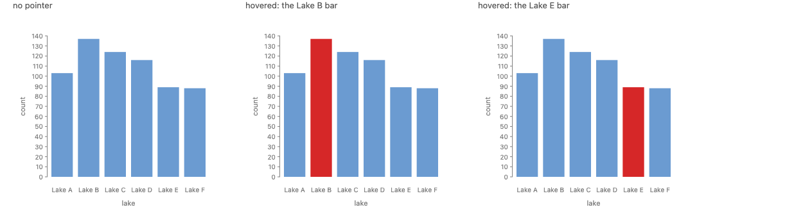
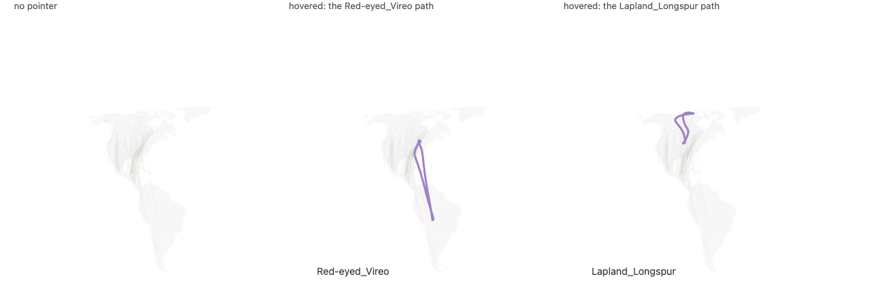
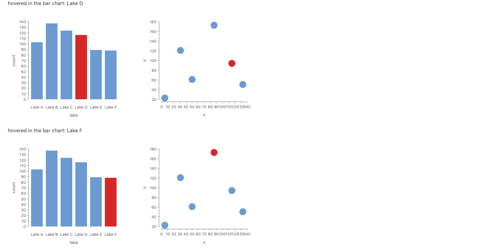
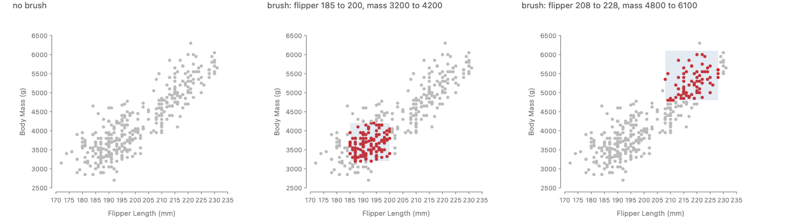
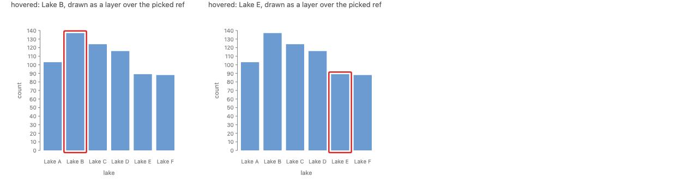
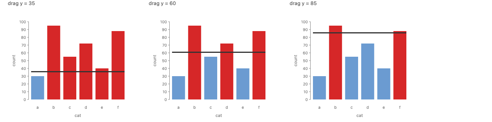
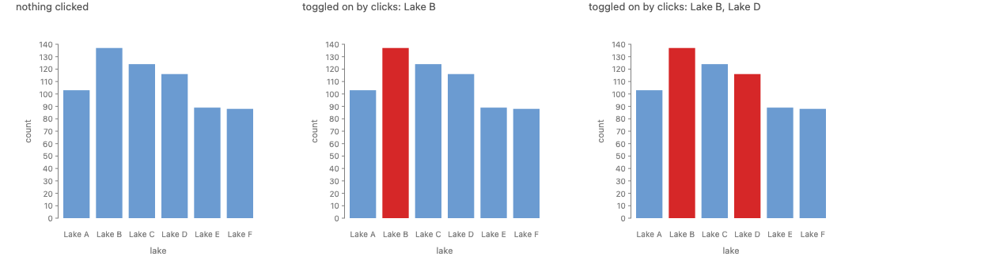
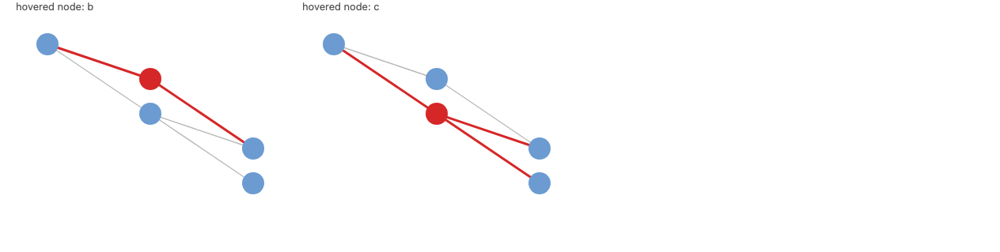

# Reading interaction sources: a hover is a selection

**Summary.**

1. "The mark under the pointer" is a GoFish selection: a list of refs, here of length 0 or 1. An input finds it by **picking** among named marks: `pointer().pick(selectAll("bars"))`. A brush picks the refs inside its rectangle, and a click with `.toggle()` picks a set. All three give the same kind of value.
2. A channel reads a selection in one of two ways. `when(hover)` asks "is this mark one of the picked marks?" (identity). `field("lake").is_in(hover)` asks "does this row's lake match a picked mark's lake?" (a semi-join, matched by the same key rule `resolve` uses). The readout is `hover.field("species")`, a projection with the homogeneity collapse `by: "datum.k"` already uses.
3. Because a selection is a list of refs, it is also chart data: `chart(hover).mark(enclose(...))` draws an outline over the hovered bar, the way `chart(selectAll("bars"))` works today. This is #830's "inputs are data", reached through the selection system instead of beside it.

**Recommendation: Approach C, "inputs pick refs."** Runner-up: Approach B, Vega-Lite style selection parameters, which Python users who know Altair would recognize at once. The strawman `hover.over` (Approach A) turns out to be C's identity test with the scope left implicit; the proposal keeps its reading (`when(hover)`) and makes the scope explicit.

**Scope.** This answers how a spec reads pointer, drag, brush and click-select inside the browser-evaluated expressions of the approved proposal `proposals/python-animation-interaction/proposal.md` (Approach B there: sources plus polars-style `when/then/otherwise`). Wheel, timer and signal reads are unchanged from that proposal: each is a value, read as itself.

**Prototype.** `packages/gofish-graphics/stories/proposals/source-reads/SourceReads.stories.tsx` (Storybook: "Proposals/Source Reads"). Throwaway, exempt from parity. The capture harness cannot send pointer events (#672), so every picture fixes the value the input would produce (the hovered lake, the brush extent, the clicked set) and draws it with today's JS closures. The pictures show what each spec draws; they cannot tell the approaches apart, because the approaches differ only in spelling. **All code labeled "proposed" does not run yet,** in either language.

---

## Terms

- **Source.** Anything whose value changes after the chart is drawn: a clock, a piece of state, or an input (`pointer`, `drag`, `click`, `wheel`). Decided in the parent proposal.
- **Input.** A source driven by the user's pointer or keys.
- **Ref.** A reference to a mark that is already placed. It carries the mark's geometry and its **datum**, the bag of rows that flowed into it (`ref.datum`).
- **Selection.** In GoFish, a plain list of refs, as `selectAll("bars")` returns. In Vega-Lite, a "selection" is something else: a predicate over data rows. This proposal uses the GoFish meaning and calls the Vega-Lite one a **selection parameter**.
- **Pick.** Deciding which drawn marks are at a screen point or inside a screen region. The term is from 3D graphics and deck.gl (`pickObject`, `pickObjects`).
- **Hit test.** A pick that takes only the mark exactly under the point. A **nearest pick** takes the closest mark within a radius.
- **Identity test.** "Is this mark one of the selected marks?"
- **Semi-join.** Keep the rows of one table whose key appears in another table, without adding columns. SQL `WHERE lake IN (SELECT lake FROM ...)`; polars `is_in` and `join(how="semi")`.
- **Homogeneity collapse.** Reading one field off a bag of rows gives the value when every row agrees, and nothing when they disagree. It is the rule `by: "datum.lake"` and `project()` already use.
- **Paint tier, pipeline tier.** A source read that only repaints an attribute versus one that lays the chart out again. Decided in the parent proposal: inferred from the channel, no `live()` wrapper.
- **Previous frame.** #830's rule that an input is interpreted against the geometry that was on screen when the event happened.

## Related issues

- **#830** Interaction as data. An input is a dataset (`chart(drag())`); projections `.within(ref)`, `.snap(selectAll(...))`, `.lock`, `.offset` are methods on the input; selectors are `inside(ref, d)` over `ref.datum`; multi-brush is `spread({ by: "id" })` over gesture ids. Open, unsigned off, Josh's preferred direction.
- **#667** Arvind's Meros prototype PR (open). Josh's review there: no explicit `when` keyword needed if callbacks work (but a serializable `when` is useful); `chart(pointerEvent()).flow(clamp(... selectAll("bars"))).mark(rect())`; "the dataset should always be a signal"; "differentiate binding modes by underlying space"; "always data to visuals, relayout every time".
- **#671** (merged) The reactive layer: `live()`, `pointer/drag/click/wheel/timer/signal`, the two tiers.
- **#705** Converge `signal()` and Solid's `createSignal()`.
- **#672** Scripted interaction states for the capture harness. Why every picture here is a fixed state.
- **#774** Port the reactive layer to Python. **#1022** IR and Python for animation. The parent proposal answers both.
- **#641** An `emphasize` API that drives color and paint order from one declaration; open question "by category, by predicate, or by selection".
- **#849** Hover on thin marks needs a nearest pick within a radius; decided there that it is a Meros Match projection, `pointer().snap(selectAll("paths"))`, not a one-off option.
- **#850** `pointer().dataPos()` cannot invert a geo projection, which blocks a tooltip at the pointer on the bird migration map.
- **#864** `click()` loses a press when the chart re-resolves between press and release, because node ids are per resolve.
- **#673** Stable node identity across re-resolves. The identity test leans on it.
- **#517** Grow `selectAll` into a query language (`where` predicates over `datum`); singular `select(q)` is reserved for "a query that must match exactly one".
- **#510**, **#513** (closed) `ref` is the singular noun and `selectAll` the plural verb.
- **#802** Operators cannot be `.name()`d, so you cannot select the groups an operator makes.
- **#1160** `enclose` over a list of selections; `resolve` with several `from` selections.
- **#45** A mutable selection (old, open).
- **#1191**, **#1137** Charts that resolve at the same time register their inputs with each other.
- **#859** Widget write effects are never disposed. **#861** A bare mark as the whole render thunk registers no inputs.
- **#1109** Annotation tutorial, including selection-based annotation.

## What exists today

JS, `src/interaction/inputs.ts`:

| Input       | Readers                                                                                         |
| ----------- | ----------------------------------------------------------------------------------------------- |
| `pointer()` | `pos()`, `dataPos()`, `datum()` (the datum of the mark under the pointer, any mark), `isDown()` |
| `drag()`    | `isActive()`, `origin()`, `current()`, `delta()`, `originData()`, `currentData()`               |
| `click()`   | `count()`, `isArmed()`                                                                          |

Every hover in the corpus compares datums by reference inside `live()`:

```ts
// stories/interaction/HoverHighlight.stories.tsx (today)
fill: live((d) => (d === p.datum() ? "#d62728" : "#6b9bd1"))

// stories/animated-vega-lite/BirdMigration.stories.tsx, panel B (today)
const hot = (d) => hover.datum()?.[0]?.species === d?.[0]?.species;
strokeWidth: live((d) => (hot(d) ? 3 : 0.1)),
text: live(() => hover.datum()?.[0]?.species ?? ""),
```

Two things are already true here. First, `p.datum()` is a hit test over **every** mark: on the bird map, hovering a country makes `hover.datum()` a country row, and the readout comes out empty only because countries have no `species` field. Second, the test is an identity test on the datum, which is what Vega-Lite does by default and what `hover.over` would do.

There is no `inside(ref, d)` in the code; it exists only in #830's note. `between` exists as a field predicate for `filter` (`field("x").between(lo, hi)`).

## The examples

| Example                           | What makes it hard                                                                                                                                                                              |
| --------------------------------- | ----------------------------------------------------------------------------------------------------------------------------------------------------------------------------------------------- |
| Hover highlight on bars           | The easy case.                                                                                                                                                                                  |
| Bird migration hover (hard, real) | 72 thin paths on a geo map with a basemap underneath: the hover must ignore the countries (scoping), wants a nearest pick (#849), and drives two channels and a readout of the hovered species. |
| Draggable threshold               | A drag value read in both tiers; no marks are selected at all.                                                                                                                                  |
| Brush on a scatterplot            | A region selects many marks; the points have no key field.                                                                                                                                      |
| Click multi-select                | State accumulates across events (toggle).                                                                                                                                                       |
| Linked views (hard)               | Hovering a bar highlights the same lake in a second chart, whose marks were never hovered.                                                                                                      |
| Graph hover (diagram)             | Hovering a node highlights its edges. The edges are a different mark and match through `resolve`d ref columns.                                                                                  |

## Precedent

Each card: what the user writes, what the hover or selection is (a value, a per-item predicate, or a set), and how that relates to `hover.over` versus a selection.

| System                                                         | What the user writes                                                                                                                                                                                                      | What the hover/selection is                                                                                                                                                                               | Relation to `hover.over` / selections                                                                                                                                                                                                                                                  | Model or foil                                                                                              |
| -------------------------------------------------------------- | ------------------------------------------------------------------------------------------------------------------------------------------------------------------------------------------------------------------------- | --------------------------------------------------------------------------------------------------------------------------------------------------------------------------------------------------------- | -------------------------------------------------------------------------------------------------------------------------------------------------------------------------------------------------------------------------------------------------------------------------------------- | ---------------------------------------------------------------------------------------------------------- |
| **CSS**                                                        | `.bar:hover { fill: red }`; fade the rest: `.chart:has(.bar:hover) .bar:not(:hover) { opacity: .3 }`                                                                                                                      | A per-element state, tested in the element's own context                                                                                                                                                  | `:hover` is exactly `hover.over`: implicit "this element". Fading the rest needs `:has()`, a relational query from a scope, which is a selection                                                                                                                                       | Model for the identity test; shows the implicit form needs a scope as soon as you style non-hovered things |
| **Figma** prototyping                                          | Trigger "While hovering", action "Change to" a variant                                                                                                                                                                    | A per-component state                                                                                                                                                                                     | Same as `:hover`; no data, no linking                                                                                                                                                                                                                                                  | Names only                                                                                                 |
| **SwiftUI**                                                    | `.onHover { isHovered = $0 }` on a view; read `isHovered` in a modifier                                                                                                                                                   | A per-view boolean written into state                                                                                                                                                                     | `hover.over` with a hand-written state variable                                                                                                                                                                                                                                        | Foil: imperative write per view                                                                            |
| **SolidJS**                                                    | `const [sel, setSel] = createSignal()`; `const isSelected = createSelector(sel)`; `<li classList={{ active: isSelected(item.id) }}>`                                                                                      | `createSelector` returns a **keyed predicate** `(key) => boolean` over a source; only the two items whose answer changes re-run (O(1) per change). Optional comparator `(key, value) => boolean` for sets | The closest model. It is "is this item the selected one" written as a key test, not as "this", and it is what GoFish's reactive layer is built on. `field("lake").is_in(hover)` is `createSelector` with the key named by a field; `when(hover)` is `createSelector` keyed by identity | **Model**                                                                                                  |
| **Solid**: signals, `createMemo`, reads by location            | `const hot = createMemo(() => ...)`; a read inside JSX patches only that attribute                                                                                                                                        | Fine-grained reads; where a signal is read decides what updates                                                                                                                                           | GoFish's tier rule (paint versus pipeline by where a source is read) comes from here; the parent proposal infers it from the channel                                                                                                                                                   | Model (already adopted)                                                                                    |
| **solid-primitives** `mouse`, `pointer`                        | `createMousePosition(el)` returns `{ x, y, sourceType, isInside }`; `createPointerPosition({ target })` returns `{ x, y, isActive }`; `createPointerList()`; directive `use:pointerHover={setHovering}`                   | A **signal of a value** (position), plus an element-level boolean through a directive                                                                                                                     | The value form is `dr.x`, `dr.y`. The `pointerHover` directive is per-element `hover.over`, written by a setter. No primitive returns "which item"; that is left to `createSelector`                                                                                                   | Model for input values; per-element hover is the foil                                                      |
| **solid-primitives** `active-element`                          | `createActiveElement()` (the focused element); `createFocusSignal(el)` (is this element focused)                                                                                                                          | One value ("which element") and a per-element predicate                                                                                                                                                   | The same split as `pointer().datum()` versus `hover.over`: Solid offers both, and the per-element one is sugar over comparing to the value                                                                                                                                             | Model for "value plus derived predicate"                                                                   |
| **solid-primitives** `event-listener`, `keyboard`, `selection` | `createEventListener(el, "pointermove", fn)`, `createEventSignal`; `useKeyDownList()`, `createKeyHold("Shift")`; `createSelection()` (text selection)                                                                     | Event streams as signals; held keys as booleans                                                                                                                                                           | `createKeyHold` is the modifier-key read a toggle needs (shift-click). `createSelection` means **text** selection, a name clash to avoid in docs                                                                                                                                       | Substrate, and a naming caution                                                                            |
| **D3** + d3-brush                                              | `sel.on("pointerover", (event, d) => ...)`; `d3.brush().on("brush", ({ selection }) => ...)`                                                                                                                              | Event handlers; the brush emits a pixel extent the user inverts and filters                                                                                                                               | Imperative: the user writes the test                                                                                                                                                                                                                                                   | Foil                                                                                                       |
| **Vega-Lite / Altair**                                         | `hover = alt.selection_point(on="pointerover", fields=["lake"], empty=False, nearest=True)`; `alt.when(hover).then(...)`; `brush = alt.selection_interval(encodings=["x"])`; `transform_filter(brush)`; `toggle` on click | A **selection parameter**: a predicate over data rows. With no `fields` it matches by row identity; with `fields` by key values. `empty` says what an empty selection tests as                            | `alt.when(hover)` reads exactly like `when(hover.over)`, but the hover is declared once with its scope and key. Linking across views comes from `fields`                                                                                                                               | Strong model for the channel side; its "selection" word means something else than GoFish's                 |
| **Mosaic / vgplot**                                            | `const sel = vg.Selection.intersect()`; `vg.toggleX({ as: sel })`, `vg.intervalX({ as: brush })`, `vg.nearestX({ as })`; `vg.highlight({ by: sel, channels: { opacity: 0.2 } })`; `filterBy: brush`                       | A shared object holding SQL predicates from several **clients**; `single`, `union`, `intersect`, `crossfilter` resolve them                                                                               | Interactors write (`as`), marks read (`by`). `highlight` is #641's "emphasize by selection"                                                                                                                                                                                            | Model for multi-select resolution and for `emphasize`; foil for its separate interactor vocabulary         |
| **Observable Plot**                                            | `Plot.dot(data, Plot.pointer({ x, y, fill: "red" }))`; `Plot.tip(data, Plot.pointer(...))`; `maxRadius` (default 40), `pointerX`                                                                                          | A render transform that **filters** a mark's data to the pointed datum                                                                                                                                    | The highlight is a second mark over the picked data, not a conditional channel. This is `chart(hover).mark(...)`                                                                                                                                                                       | Model for consuming a selection as data; nearest pick by default                                           |
| **deck.gl**                                                    | `deck.pickObject({ x, y, radius, layerIds })`, `deck.pickObjects({ x, y, width, height, layerIds })`; layer prop `autoHighlight`                                                                                          | Picked objects, scoped to named layers, at a point (with radius) or in a rectangle                                                                                                                        | `pickObject` versus `pickObjects` is hover versus brush; `layerIds` is `selectAll("bars")` as the scope                                                                                                                                                                                | Model for `pick` and its scope                                                                             |
| **Bokeh**                                                      | `source.selected.indices`; glyph props `selection_color`, `nonselection_alpha`, `hover_line_width`; `HoverTool`, `TapTool`, `BoxSelectTool`                                                                               | A set of row indices on the data source; per-state styles on the glyph                                                                                                                                    | Selection is data (indices), and styling is per state on the mark                                                                                                                                                                                                                      | Model for "selection is data"; foil for per-state glyph props                                              |
| **Plotly / Dash**                                              | `selectedpoints=[...]`, `selected={"marker": {...}}`, `unselected=...`; callbacks read `hoverData`, `selectedData`                                                                                                        | Point indices and point records                                                                                                                                                                           | Same as Bokeh, with a server round trip in Dash                                                                                                                                                                                                                                        | Foil (kernel tier)                                                                                         |
| **HoloViews**                                                  | `streams.Selection1D(source=points)` gives `index`; `link_selections(layout)`                                                                                                                                             | A stream of selected indices; linked by dimension                                                                                                                                                         | Selection as data, linked by key                                                                                                                                                                                                                                                       | Model for linking by dimension                                                                             |
| **mafs.dev**                                                   | `const p = useMovablePoint([0, 0], { constrain: "horizontal" })` or `constrain: ([x, y]) => [Math.round(x), Math.round(y)]`; read `p.x`, `p.point`, render `p.element`                                                    | An input **value** with a projection                                                                                                                                                                      | `dr.x`, `dr.y` and #830's `.within/.snap`                                                                                                                                                                                                                                              | Model for drag reads                                                                                       |
| **Meros** (Wootton et al.) and the #667 prototype              | `when(hovered(), "#d62728").else(...)`; selectors `inside("b")`, `above("cut", of)`; selector fields inferred from encodings                                                                                              | `hovered()` is an implicit per-mark predicate; brush selectors invert anchors through encodings                                                                                                           | `hovered()` is `hover.over`. Josh's review: drop the explicit `when` unless it buys serialization; the "spooky" part was inference                                                                                                                                                     | Foil for implicit scope; model for "selector kind follows the input's shape"                               |
| **polars / SQL**                                               | `pl.col("lake").is_in(sel["lake"])`; `df.join(sel, on="lake", how="semi")`; `WHERE lake IN (...)`                                                                                                                         | Membership of a key in another table                                                                                                                                                                      | The data-side reading of "highlight the rows that match the hovered mark"                                                                                                                                                                                                              | Model for the key test's name                                                                              |

Three lessons.

- Every system that links views (Vega-Lite `fields`, Mosaic, HoloViews, Solid's `createSelector`, SQL) tests a **key**, not "this mark". The per-element forms (CSS `:hover`, Figma, SwiftUI, `pointerHover`, Meros `hovered()`) stop at the hovered element and need a second mechanism (`:has()`) to reach anything else.
- The systems that do both separate **which items** (a value: `createActiveElement`, `pickObject`, `selected.indices`) from **the test** (`createFocusSignal`, `createSelector`, `alt.when`). The test is derived from the value.
- Scoping is always explicit where it exists: deck.gl `layerIds`, Bokeh tools' `renderers`, Vega-Lite's selection lives on the view that declares it. Plot and CSS scope by attaching to one mark.

## The three questions, answered

**Is "the mark under the pointer" a selection?** Yes. It is a list of refs of length 0 or 1. It cannot be a singular `ref`, because `ref` means "exactly one, or fail" (#510), and a hover is usually empty. Making it a list also gives a brush (many) and a click toggle (a set) the same type, so one set of reads covers all three.

**Property of the input, predicate over the datum, or selection compared against the current mark?** The selection is the value; the predicate is derived from it. `hover.over` is the identity test with the scope left out. Approach C keeps that test as `when(hover)` and adds the key test `field("lake").is_in(hover)`, which is what linking and diagrams need.

**Singular and plural.** The value is plural (a list). The readout collapses it with the existing homogeneity rule, so `hover.field("species")` is one species or nothing. This is the same split as `pluck` (every value) and `project` (one value when the rows agree).

## Design axes

Three choices are independent:

1. **What the input yields** (the produce side): a contextual property of the input (A), a selection parameter over data (B), or a selection of refs (C).
2. **How a channel tests it**: identity ("this mark") or key ("this row's lake").
3. **Whether it is also data**: can a selection be charted (`chart(hover)`) and filtered, or only tested in a channel?

The approaches below fix axis 1 and say what each allows on axes 2 and 3.

## Approach A: a property of the input (the strawman)

A pointer is a value with contextual properties. `hover.over` is true when evaluated on the mark under the pointer; `hover.field(k)` reads that mark's field.

Hover on bars, **proposed**:

```ts
const hover = pointer();

chart(seafood)
  .flow(spread({ by: "lake", dir: "x" }))
  .mark(
    rect({
      h: "count",
      fill: when(hover.over).then("#d62728").otherwise("#6b9bd1"),
    })
  )
  .render(container, { w: 400, h: 400 });
```

```python
hover = pointer()

(
    chart(seafood)
    .flow(spread(by="lake", dir="x"))
    .mark(rect(h="count", fill=when(hover.over).then("#d62728").otherwise("#6b9bd1")))
    .render(w=400, h=400)
)
```



_Rendered (`HoverBars`): no pointer, pointer on Lake B, pointer on Lake E. The same picture serves every approach._

Bird migration, **proposed**: `hover.over` on the line works, but the scope has to become an option, or the basemap's countries are "over" too and a nearest pick (#849) would always pick the country under the pointer:

```ts
const hover = pointer({ on: "paths", radius: 8 });
line({
  stroke: "species",
  strokeWidth: when(hover.over).then(3).otherwise(0.1),
  opacity: when(hover.over).then(1).otherwise(0.5),
}).name("paths");
text({ text: hover.field("species").fillNull(""), fontSize: 14, fill: "#333" });
```

```python
hover = pointer(on="paths", radius=8)
line(stroke="species",
     stroke_width=when(hover.over).then(3).otherwise(0.1),
     opacity=when(hover.over).then(1).otherwise(0.5)).name("paths")
text(text=hover.field("species").fill_null(""), font_size=14, fill="#333")
```



_Rendered (`BirdHover`): no pointer, then the Red-eyed Vireo and the Lapland Longspur held as hovered, with the readout in the corner._

Brush and click, **proposed**: each input needs its own contextual word.

```ts
const brush = drag();
circle({ r: 2.5, fill: when(brush.covers).then(RED).otherwise("#bbb") });

const pick = click({ toggle: true });
rect({ h: "count", fill: when(pick.selected).then(RED).otherwise(BLUE) });
```

Linked views and the graph cannot use `.over` at all (the map's circles and the edges are never under the pointer), so A needs a key test too:

```ts
circle({
  r: 9,
  fill: when(field("lake").eq(hover.field("lake")))
    .then(RED)
    .otherwise(BLUE),
});
```

**How it composes.** `.over` is evaluated per mark, so it desugars into today's `d === p.datum()`. Nothing in A is data: a hover cannot be charted, so the Plot-style overlay and #830's `chart(pointer())` are a separate mechanism.

**Overlap check.** `.over`, `.covers` and `.selected` are three spellings of one test (is this mark in the input's set). That is a large partial overlap across inputs, and `on:` duplicates what `selectAll("paths")` already says.

**Trade-offs.** Shortest for the single-chart hover, and it reads like CSS. But the scope is implicit (or a string option beside the selection system), each input invents a word, and linking needs a second spelling anyway. It does not grow into #830.

## Approach B: selection parameters (Vega-Lite and Altair)

An input declared with a key becomes a predicate over data rows. In a channel, the parameter itself is the condition: it tests the current row.

**Proposed**:

```ts
const hover = pointer({ on: "bars", fields: ["lake"] });

chart(seafood)
  .flow(spread({ by: "lake", dir: "x" }))
  .mark(
    rect({
      h: "count",
      fill: when(hover).then("#d62728").otherwise("#6b9bd1"),
    }).name("bars")
  );
```

```python
hover = pointer(on="bars", fields=["lake"])
rect(h="count", fill=when(hover).then("#d62728").otherwise("#6b9bd1")).name("bars")
```

Linked views come free: any chart with a `lake` field can read `when(hover)`.



_Rendered (`LinkedLakes`): Lake D and Lake F held as hovered in the bar chart, highlighted in the bar chart and in a scatter of lake locations. Two separate renders side by side; the proposed spelling puts them in one spec._

Brush and click, **proposed**:

```ts
const brush = drag({ fields: ["Flipper Length (mm)", "Body Mass (g)"] }); // or inferred from the x/y encodings
circle({ r: 2.5, fill: when(brush).then(RED).otherwise("#bbb") });
chart(penguins).flow(filter(brush)); // the brushed rows as data

const pick = click({ on: "bars", fields: ["lake"], toggle: true });
```

```python
brush = drag(fields=["Flipper Length (mm)", "Body Mass (g)"])
circle(r=2.5, fill=when(brush).then(RED).otherwise("#bbb"))
```



_Rendered (`BrushScatter`): no brush, then two brush rectangles with the points inside them in red. The rectangle is a data-space `rect` drawn with today's `datum()` positions._

The graph: the edges have no `id` field, so B needs a value read: `when(field("source").eq(hover.field("id")) | field("target").eq(hover.field("id")))`.

**How it composes.** A parameter is an expression (a row predicate), so it desugars into the expression language of the parent proposal and into `filter`. It is not refs, so it has no geometry: it cannot be enclosed, labeled or connected.

**Overlap check.** B's "selection" and GoFish's `selectAll` are two meanings of one word: a predicate over rows and a list of refs. They cover much of the same ground by different routes (both say "these marks"), which is the large partial overlap api-design.md warns about. `fields` also repeats the key the chart already split by.

**Trade-offs.** Most familiar to the Python audience (Altair 5 users write `alt.when(hover)` today). Linking by key is built in. But it adds a second selection concept, the option list grows on every input (`on`, `fields`, `toggle`, `empty`, `nearest`), and the brushed marks are not refs.

## Approach C: inputs pick refs (recommended)

An input picks among the marks of a selection. The result is a selection: refs, with geometry and datums. A channel tests it by identity or by key; a chart can take it as data.

### The surface (proposed)

| Read                                                            | Meaning                                                                 | Precedent                                                                    |
| --------------------------------------------------------------- | ----------------------------------------------------------------------- | ---------------------------------------------------------------------------- |
| `pointer().pick(selectAll("bars"))`                             | the bars under the pointer (0 or 1, topmost)                            | deck.gl `pickObject({ layerIds })`, Plot `pointer`                           |
| `pointer().pick(selectAll("paths"), { radius: 8 })`             | the nearest path within 8 px (#849)                                     | deck.gl `radius`, Plot `maxRadius`, Vega-Lite `nearest`                      |
| `drag().pick(selectAll("dots"))`                                | the dots inside the drag's rectangle (start to current)                 | deck.gl `pickObjects({ width, height })`, Meros span selector                |
| `click().pick(selectAll("bars"))`                               | the bars picked by the last click                                       | Vega-Lite point selection on click                                           |
| `click().pick(selectAll("bars")).toggle()`                      | the bars clicked an odd number of times                                 | Vega-Lite `toggle`, Mosaic `toggle`                                          |
| `when(sel)`                                                     | this mark is one of `sel` (identity)                                    | CSS `:hover`, Solid `createSelector` by identity, Vega-Lite with no `fields` |
| `field("lake").is_in(sel)`                                      | this row's `lake` matches a picked mark's key                           | polars `is_in`, SQL semi-join, Solid `createSelector(...)(key)`              |
| `field("source").is_in(sel, key="id")`                          | match against a named key of the picked marks                           | `resolve(cols, { from, key })`                                               |
| `sel.field("species")`                                          | the picked marks' species, collapsed (null if none or if they disagree) | `by: "datum.species"`, `project()`                                           |
| `sel.is_empty()`                                                | nothing picked                                                          | polars `list.len() == 0`                                                     |
| `chart(sel)`                                                    | the picked refs as data                                                 | `chart(selectAll("bars"))`                                                   |
| `dr.x`, `dr.y`, `dr.x0`, `dr.y0`, `dr.dx`, `dr.dy`, `dr.active` | the drag's own row (unchanged from the parent proposal)                 | mafs `p.x`, solid-primitives `pos.x`                                         |

`is_in`'s default key is the rule `resolve` already uses: the field the picked marks were split by (`spread({ by: "lake" })` makes the key `lake`). A column that holds refs (after `resolve`) matches by identity. JS spells the method `isIn`, Python `is_in`.

### Example 1: hover on bars (proposed)

```ts
const hover = pointer().pick(selectAll("bars"));

chart(seafood)
  .flow(spread({ by: "lake", dir: "x" }))
  .mark(
    rect({
      h: "count",
      fill: when(hover).then("#d62728").otherwise("#6b9bd1"),
    }).name("bars")
  )
  .render(container, { w: 400, h: 400 });
```

```python
hover = pointer().pick(select_all("bars"))

(
    chart(seafood)
    .flow(spread(by="lake", dir="x"))
    .mark(rect(h="count", fill=when(hover).then("#d62728").otherwise("#6b9bd1")).name("bars"))
    .render(w=400, h=400)
)
```

Picture: `img/hover-bars.png` above. The same hover, consumed as data instead of as a condition, is an outline layer over the picked ref:

```ts
chart(seafood)
  .flow(spread({ by: "lake", dir: "x" }))
  .mark(rect({ h: "count", fill: "#6b9bd1" }).name("bars"))
  .layer(
    chart(hover).mark(
      enclose({ padding: 4, fill: "none", stroke: "#d62728", strokeWidth: 2.5 })
    )
  );
```

```python
(
    chart(seafood)
    .flow(spread(by="lake", dir="x"))
    .mark(rect(h="count", fill="#6b9bd1").name("bars"))
    .layer(chart(hover).mark(enclose(padding=4, fill="none", stroke="#d62728", stroke_width=2.5)))
)
```



_Rendered (`HoverOverlay`): Lake B and Lake E held as hovered. Today's JS draws it as `chart(selectAll("bars")).flow(filter(...))`, which is exactly what `chart(hover)` would be._

The bars' own fill reads `hover`, and `hover` picks among the bars. That is not a cycle: per #830, a pick reads the previous frame's geometry, and the fill is a paint-tier read.

### Example 2: bird migration hover (hard, real; proposed)

```ts
const hover = pointer().pick(selectAll("paths"), { radius: 8 });
const hot = when(hover);

basemap()
  .layer(
    chart(birds)
      .flow(
        group({ by: "species" }),
        scatter({ by: "day", x: "lon", y: "lat" })
      )
      .mark(
        line({
          stroke: "species",
          strokeWidth: hot.then(3).otherwise(0.1),
          opacity: hot.then(1).otherwise(0.5),
        }).name("paths")
      )
  )
  .layer(
    text({
      text: hover.field("species").fillNull(""),
      fontSize: 14,
      fill: "#333",
    })
  )
  .render(container, { w: 600, h: 600 });
```

```python
hover = pointer().pick(select_all("paths"), radius=8)
hot = when(hover)

(
    basemap()
    .layer(
        chart(birds)
        .flow(group(by="species"), scatter(by="day", x="lon", y="lat"))
        .mark(
            line(
                stroke="species",
                stroke_width=hot.then(3).otherwise(0.1),
                opacity=hot.then(1).otherwise(0.5),
            ).name("paths")
        )
    )
    .layer(text(text=hover.field("species").fill_null(""), font_size=14, fill="#333"))
    .render(w=600, h=600)
)
```

Picture: `img/bird-hover.png` above. What this example tests:

- **Scope.** `selectAll("paths")` keeps the countries out. Today it works only because countries lack a `species` field.
- **Nearest pick (#849).** The radius belongs to the pick, which already has a scope, so "nearest" means nearest path, never the country polygon that always contains the pointer. #849 asked for `pointer().snap(selectAll("paths"))`; see "How C relates to #830" for why the pick, not the snap, is the right home.
- **Readout.** `hover.field("species")` is one species or null. A tooltip at the pointer (`chart(hover)` placed at the pick) still waits on #850 (no geo inverse), and the readout in the corner does not.
- **Shared condition.** `when(hover)` is a value, so the two channels share it; the closure `hot(d)` does the same today.

### Example 3: draggable threshold (proposed, unchanged)

No marks are selected, so the threshold reads the drag's row, as in the parent proposal:

```ts
const dr = drag();
const cut = dr.y.clip(0, 95).fillNull(60);

chart(bars)
  .flow(spread({ by: "cat", dir: "x" }))
  .mark(
    rect({
      h: "count",
      fill: when(field("count").sum().gt(cut))
        .then("#d62728")
        .otherwise("#6b9bd1"),
    })
  )
  .layer(rect({ y: cut, h: 3, w: 500, fill: "#333" }));
```

```python
dr = drag()
cut = dr.y.clip(0, 95).fill_null(60)

(
    chart(bars)
    .flow(spread(by="cat", dir="x"))
    .mark(rect(h="count", fill=when(field("count").sum() > cut).then("#d62728").otherwise("#6b9bd1")))
    .layer(rect(y=cut, h=3, w=500, fill="#333"))
)
```



_Rendered (`Threshold`): the drag held at y = 35, 60 and 85._

Under #830, `.clip(0, 95)` becomes `drag().within(ref("plot"))`. This example is here to show the split: a drag's own fields are properties (`dr.y`), because their names are fixed by the input; a picked mark's fields are `sel.field("species")`, because their names are the user's.

### Example 4: brush on a scatterplot (sketch level; proposed)

```ts
const brush = drag(); // #830: drag().within(ref("plot"))
const brushed = brush.pick(selectAll("dots"));

chart(penguins, { axes: true })
  .flow(scatter({ x: "Flipper Length (mm)", y: "Body Mass (g)" }))
  .mark(
    circle({
      r: 2.5,
      fill: when(brushed).then("#d62728").otherwise("#bbb"),
    }).name("dots")
  )
  .layer(
    chart(brush).mark(
      rect({
        x: "x0",
        x2: "x",
        y: "y0",
        y2: "y",
        fill: "#4c78a8",
        opacity: 0.15,
      })
    )
  )
  .layer(text({ text: concatStr(brushed.len(), " selected") }));
```

```python
brush = drag()
brushed = brush.pick(select_all("dots"))

(
    chart(penguins, axes=True)
    .flow(scatter(x="Flipper Length (mm)", y="Body Mass (g)"))
    .mark(circle(r=2.5, fill=when(brushed).then("#d62728").otherwise("#bbb")).name("dots"))
    .layer(chart(brush).mark(rect(x="x0", x2="x", y="y0", y2="y", fill="#4c78a8", opacity=0.15)))
    .layer(text(text=concat_str(brushed.len(), " selected")))
)
```

Picture: `img/brush-scatter.png` above. The points have no key field, so the identity test `when(brushed)` is the one that works; B would have to name both encoded fields. The brush rectangle as `chart(brush)` and the `x2`/`y2` channels are #830's step 1 and are sketch level. `brushed.len()` is a polars list length; the mean-line readout from #830 is `chart(brushed).flow(derive(...))`, since `brushed` is data.

### Example 5: click to select several (proposed)

```ts
const picked = click().pick(selectAll("bars")).toggle();

chart(seafood)
  .flow(spread({ by: "lake", dir: "x" }))
  .mark(
    rect({
      h: "count",
      fill: when(picked).then("#d62728").otherwise("#6b9bd1"),
    }).name("bars")
  );
```

```python
picked = click().pick(select_all("bars")).toggle()

(
    chart(seafood)
    .flow(spread(by="lake", dir="x"))
    .mark(rect(h="count", fill=when(picked).then("#d62728").otherwise("#6b9bd1")).name("bars"))
)
```



_Rendered (`ClickMulti`): nothing clicked, Lake B clicked, then Lake B and Lake D._

`.toggle()` folds the click history into a set (a mark is in it when clicked an odd number of times). Without it, the selection is the last click's pick, which is single select. #830's reading of `click()` as accumulating rows is what makes this a fold and not a new state machine. Mosaic-style "fade the rest only when something is picked" is `when(picked.is_empty() | picked)`, so no `empty` option is needed.

### Example 6: linked views (hard; proposed)

```ts
const hover = pointer().pick(selectAll("bars"));
const sameLake = when(field("lake").isIn(hover));

spread({ dir: "x", spacing: 24 }, [
  chart(seafood)
    .flow(spread({ by: "lake", dir: "x" }))
    .mark(
      rect({
        h: "count",
        fill: sameLake.then("#d62728").otherwise("#6b9bd1"),
      }).name("bars")
    ),
  chart(lakeLocations, { axes: true })
    .flow(scatter({ by: "lake", x: "x", y: "y" }))
    .mark(
      circle({ r: 9, fill: sameLake.then("#d62728").otherwise("#6b9bd1") })
    ),
]);
```

```python
hover = pointer().pick(select_all("bars"))
same_lake = when(field("lake").is_in(hover))

spread(
    [
        chart(seafood)
        .flow(spread(by="lake", dir="x"))
        .mark(rect(h="count", fill=same_lake.then("#d62728").otherwise("#6b9bd1")).name("bars")),
        chart(lake_locations, axes=True)
        .flow(scatter(by="lake", x="x", y="y"))
        .mark(circle(r=9, fill=same_lake.then("#d62728").otherwise("#6b9bd1"))),
    ],
    dir="x",
    spacing=24,
)
```

Picture: `img/linked-lakes.png` above. The map's circles were never hovered, so the identity test cannot reach them; the key test does, with the key (`lake`) taken from how the bars were split. The map's `when(hover)` (identity) would be a loud error: "hover picks `bars` marks; this channel is on a `circle` that is not one of them. Test a key with `field(...).is_in(hover)`."

### Example 7: graph hover, a diagram (proposed)

```ts
const hover = pointer().pick(selectAll("nodes"));

chart(nodes)
  .flow(scatter({ by: "id", x: "grp", y: "id" }))
  .mark(
    circle({
      r: 14,
      fill: when(hover).then("#d62728").otherwise("#6b9bd1"),
    }).name("nodes")
  )
  .layer(
    chart(edges)
      .flow(resolve(["source", "target"], { from: selectAll("nodes") }))
      .mark(
        line({
          from: "source",
          to: "target",
          stroke: when(
            field("source").isIn(hover).or(field("target").isIn(hover))
          )
            .then("#d62728")
            .otherwise("#bbb"),
        })
      )
  );
```

```python
hover = pointer().pick(select_all("nodes"))
touches = field("source").is_in(hover) | field("target").is_in(hover)

(
    chart(nodes)
    .flow(scatter(by="id", x="grp", y="id"))
    .mark(circle(r=14, fill=when(hover).then("#d62728").otherwise("#6b9bd1")).name("nodes"))
    .layer(
        chart(edges)
        .flow(resolve(["source", "target"], from_=select_all("nodes")))
        .mark(line(from_="source", to="target", stroke=when(touches).then("#d62728").otherwise("#bbb")))
    )
)
```



_Rendered (`GraphHover`): node b, then node c, held as hovered; their incident edges turn red._

After `resolve`, `source` and `target` hold refs, so `is_in` matches them by identity: "this edge's source is one of the hovered nodes". No key needs naming, and the diagram reads like the chart.

### How it composes

- **With the selection system.** A pick takes a selection and returns a selection. Everything that takes `selectAll(...)` takes a pick: `chart(...)`, `enclose`, `resolve(..., { from })`, labels once #803 lowers them onto selections. Names resolve by the existing rule (visible up to the nearest `createMark`), from where the input is read.
- **With expressions.** `when(sel)`, `is_in`, `.field`, `.len`, `.is_empty` are entries in the parent proposal's expression table. A selection is a source-valued leaf.
- **With the tiers.** A channel that reads a selection is in the paint tier when the channel is a paint channel (fill, opacity, stroke width), and in the pipeline tier otherwise (`chart(hover)` lays out again), as the parent proposal decided.
- **With coordinate transforms.** A pick works in pixel space against the previous frame's boxes, so it works under geo and polar with no inverse. Only reading `dr.x` in data units needs the inverse (#850).
- **With emphasize (#641).** A selection is the "by selection" argument #641 asked about: `emphasize(hover, ["color", "z"])` would forward to `when(hover)` for color and `.zOrder` for paint order. Mosaic's `highlight({ by: sel })` is the precedent. Not designed here.
- **With #830.** See the next section.
- **IR.** A pick is a source-expression node: `{ "type": "pick", "source": "s3", "from": <selectAll IR>, "radius": 8 }`; `toggle` is an op on it. `is_in` is one op. No new pass.

### How C relates to #830, `inside`, `.within` and `.snap`

- **`inside(ref, d)`** (#830's selector) is the per-row form of a region pick: `drag().pick(selectAll("dots"))` is `selectAll("dots")` filtered by `inside(brush, r.datum)`. Exact composition. C does not add `inside` as a free function, because the input already knows its own shape.
- **`.snap(selectAll(...))`** moves the input's coordinates onto the nearest member. `.pick(selectAll(...))` returns the member. Snap is pick followed by reading the member's position: `snap(S)` is `pick(S, nearest)` then its anchor. Exact composition, so define snap by that rewrite. #849's hover on thin paths wants the member (to highlight it), not the snapped coordinates, which is why the pick is the primitive.
- **`.within(ref)`** is unchanged: a projection on the input's coordinates, applied before the pick (`drag().within(ref("plot")).pick(selectAll("dots"))`).
- **"Differentiate binding modes by underlying space"** (Josh on #667). The pick dispatches on the input's shape (a point picks by hit or nearest; a rectangle picks by containment), and the test dispatches on the column's type (refs match by identity; plain values match by key). No mode flag.
- **"The dataset should always be a signal."** A selection from a pick is a list that changes over time. `chart(hover)` is #830's `chart(pointer())`, but routed through refs, so it has geometry.
- **Multi-brush.** `drag().pick(...)` over several gestures is a union of picks by gesture `id`, the same `spread({ by: "id" })` #830 proposes for the rectangles.

### Variant C′: the pick on `selectAll` instead of on the input

The same value, with the query on the selection, in the direction of #517:

```ts
const hover = selectAll("bars", { where: under(pointer()) }); // proposed variant
```

It keeps all the reads above. It reads well as a query, but it puts a spatial test inside #517's `where`, which #517 framed as a predicate over `datum`. And #830 already chose methods on the input (`drag().within(...).snap(...)`), so C's `.pick` sits with its siblings. A third spelling, `pointer().selectAll("bars")`, reuses the GoFish verb but takes a name where `.snap` and `.within` take a selection.

### Overlap check

- `when(sel)` versus `field(k).is_in(sel)`: they agree exactly when `k` is a key of the picked marks; otherwise they answer different questions (this mark, versus a row that shares a key). A small degenerate overlap, kept on purpose; the identity form is the only one that works without a key (the penguin dots, component boxes).
- `pick` versus `.snap`: exact composition (above).
- `pick` versus `filter(selectAll(...))` plus `inside`: exact composition.
- `chart(hover)` versus `chart(selectAll("bars"))`: same mechanism.
- `sel.field(k)` versus `project(ref.datum, k)` and `by: "datum.k"`: the same collapse rule, one implementation.
- `.toggle()` versus Vega-Lite's `toggle`: a fold over click history, not a new state.

### Trade-offs

Easy: every example above with one value type; scoping by the existing `.name()`; linking and diagrams by key; selections as data; Python and JS in the same shape. New terms: `pick`, `toggle`, `is_in` (polars), and selection-valued expressions. Awkward: `when(hover)` needs the channel's mark to be one of the picked kind (a loud error otherwise); `.name("bars")` must be written even for a one-chart hover (Josh's rule is to name only what is selected, and here the bars are selected); identity across re-resolves leans on datum identity until #673 lands. Cost to extend: a new pick shape (lasso) is one more input shape; a custom test is a JS function, JS only, as with strategies (#1101).

## Recommendation

**Approach C.**

- **One selection concept** (api-design.md, "One concept is one operator"). A hover, a brush and a click set are the same value as `selectAll`'s, so they work everywhere a selection already works. B would add a second meaning of "selection" with large partial overlap.
- **It desugars into the existing core** (principles.md, "Why keep the core small"). A pick is a filter of a selection by a spatial test against the previous frame; `is_in` is a semi-join with `resolve`'s key rule; `chart(sel)` is `chart(selectAll(...))`. No pass learns a new node kind.
- **A name says the shape of its value** (refs-and-selection.md, "Singular and plural"). A hover is a list because it can be empty, so it is not a `ref`; the readout collapses it with the existing projection rule.
- **Precedent.** The test is Solid's `createSelector` (a keyed predicate derived from a value, the library GoFish's reactivity is built on) and polars' `is_in`. The pick is deck.gl's, with its `layerIds` scope and point versus rectangle forms. The channel reads like Altair's `alt.when(hover)`. The per-element forms (CSS, Figma, SwiftUI, Meros' `hovered()`) are kept as the identity test, with the scope made explicit.
- **The general rule over a case split** (api-design.md). Scope, nearest pick, linking, and diagrams all come from one value plus two tests, with no `on`, `fields`, `nearest` or `empty` options.
- **It is #830's direction.** Inputs become data, through refs; projections stay methods on the input; binding modes dispatch on shape and type.
- **Same shape in JS and Python.** Every example has a twin with the same structure.

**What `hover.over` becomes.** Its reading survives as `when(hover)`. What changes is that `hover` is declared with its scope, `pointer().pick(selectAll("bars"))`, instead of meaning "whatever mark is asking".

**Runner-up: Approach B.** It is what Altair users already know, and its `fields` key makes linking the default. What would change the pick: if Python users testing the API find `pick(select_all(...))` plus `is_in` harder than `pointer(fields=[...])`, or if the parity port finds that selections of refs cannot be computed in the browser at pointer rate (each pick is a geometry query over the previous frame). B could also return later as sugar: `pointer(fields=["lake"])` is `field("lake").is_in(pointer().pick(...))`.

## Decisions for Josh

1. **Is a hover a selection?** Approve C's model: inputs pick refs, the result is a selection (list of refs), and `when(sel)` / `field(k).is_in(sel)` test it.
2. **The verb.** `pointer().pick(selectAll("bars"))` (recommended; the graphics term, takes a selection like `.snap`), `pointer().selectAll("bars")` (the GoFish verb, takes a name), or C′ `selectAll("bars", { where: under(pointer()) })` (#517)?
3. **Both tests?** Keep the identity test `when(sel)` beside the key test `field(k).is_in(sel)`, or ship only `is_in` (which then needs a key on every mark)?
4. **`is_in`'s default key.** Reuse `resolve`'s rule (the field the picked marks were split by; refs match by identity), with `key=` to override?
5. **Hover cardinality and radius.** A pointer picks only the topmost mark (0 or 1), or every mark under it? Default `radius` 0 (exact hit) or Plot's 40 px?
6. **Brush shape.** Does `drag().pick(...)` use the rectangle from start to current, or should that be explicit (`drag().span().pick(...)`), leaving a plain drag to pick at its current point?
7. **Toggle.** `.toggle()` as a method on the pick, or an option on `click()`? Does a click on empty space clear the set? Is shift-click a separate read (`key_held("Shift")`) or part of `toggle`?
8. **Empty selections.** No `empty` option: an empty selection tests false, and "nothing picked yet" is `sel.is_empty()`. Agree?
9. **Reads of a picked mark versus an input's own row.** `sel.field("species")` for the user's columns, and properties `dr.x`, `dr.y` for the input's fixed fields (as the parent proposal has them). Agree, or `dr.field("y")` for both?

## Syntax changes to review

- New in both languages (proposed): `.pick(selection, radius=)` on `pointer()`, `drag()` and `click()`; `.toggle()` on a click pick; `when(selection)`; `field(k).is_in(selection, key=)` (`isIn` in JS); `selection.field(k)`, `.len()`, `.is_empty()`; `chart(selection)` for a pick.
- Unchanged from the parent proposal: `dr.x`, `dr.y`, `dr.x0`, `dr.y0`, `dr.dx`, `dr.dy`, `dr.active`; `when/then/otherwise`, `clip`, `fill_null`.
- Dropped from the parent proposal: `hover.over` and `hover.field(k)` on a bare `pointer()`, replaced by `when(pointer().pick(...))` and `pointer().pick(...).field(k)`.
- Errors (proposed): `when(sel)` on a mark that is not of the picked kind; `is_in` with no key and no ref column.

## Images

All in `img/`, rendered with `pnpm capture-one "Proposals/Source Reads"` from fixed input states (the harness cannot dispatch pointer events, #672):

- `hover-bars.png`: hover highlight with no pointer, on Lake B, on Lake E.
- `hover-overlay.png`: the hovered bar outlined by an `enclose` layer over the picked ref.
- `bird-hover.png`: bird migration with no pointer, then two species held as hovered, with the readout.
- `threshold.png`: the threshold at drag y = 35, 60, 85.
- `brush-scatter.png`: penguins with no brush and two brush rectangles.
- `click-multi.png`: nothing, Lake B, then Lake B and Lake D clicked.
- `linked-lakes.png`: Lake D and Lake F hovered in the bar chart, highlighted in both charts.
- `graph-hover.png`: node b, then node c, hovered, with incident edges in red.
