# Spiral and other periodic tables: a grid under a coord

**Summary.** Issue #1347 asks whether an unusual periodic table, e.g., Benfey's 1964 spiral, is a coordinate transform or a layout. It is both, and the two parts separate cleanly. The layout is the same grid in every table (a column and a row for each element). The coordinate transform is what differs. The standard table, Janet's left-step table, rings, a spiral, a race track and Benfey's lobes below all come from one flow with a different `coord`.

**Recommendation.** Add two coords and no layout operator.

- `Coord.spiral({ pitch, period })` is polar where the radius also grows with the angle. The radius gains `pitch` steps of the radial axis for every `period` units of the angular axis.
- `Coord.along(path)` lays the x axis along a guide path and the y axis along the path's normal. It is the `Coord.bend({ along })` of #1284 under the name Josh preferred on 2026-11-11, and this proposal argues to take it out of deferral.

The scarcity table (cell area shows abundance) is a different kind of thing. Its geometry is solved from the data, so it is a layout strategy for `table`, not a coord. It should get its own issue.

**What is real in the pictures.** Every picture is a GoFish render from `packages/gofish-graphics/stories/proposals/PeriodicTable.stories.tsx`. The coords are prototype `CoordinateTransform` records in `prototypeCoords.ts`, not library code. Each cell is a real `rect` bent by a real coord. Three things are emulated and are marked where they appear: labels are moved through the coord by a patch in the story (#952), the table cartogram is solved in story code, and the rigid squares are drawn as polygons.

## Terminology

- **Guide**: the path a coord reads as an operand. The coord never draws it (#1284).
- **Track**: one row of cells along the guide, one cell thick. In these tables a track is a period.
- **Pitch**: how far the radius advances in one turn of a spiral.
- **Period** (of a spiral): how much of the angular axis's data fits in one turn. The R package `spiralize` uses the same word.
- **Lobe**: a part of the guide that runs out from the core, turns around a thin slit and comes back. The periodic table literature calls it a peninsula.
- **Bend radius**: the radius of curvature of the guide at its tightest point (the stacking design space page uses the same term). A track farther than this from the guide, on the inside of the bend, folds over itself.
- **Table cartogram**: a grid whose cells keep their neighbors while each cell's area equals a weight (Evans et al., 2013).

## The examples

The shared pieces are today's API:

```js
const grid = table({
  by: { x: field("col").bin(Bin.step(1)), y: field("row").bin(Bin.step(1)) },
});
const cell = rect({ fill: field("block") }).label("symbol", {
  position: "center",
});
```

### 1. Standard table (works today)

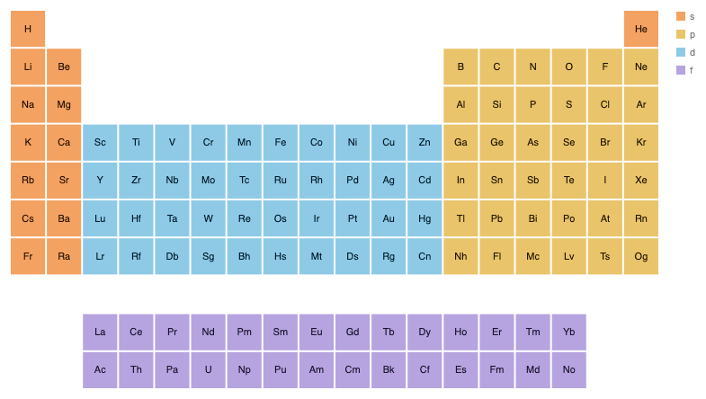

```js
chart(standardTable()).flow(grid).mark(cell);
```

### 2. Janet's left-step table (works today)

Rows are n + l, and the blocks run f, d, p, s. Only the data's `col` and `row` differ from the standard table.

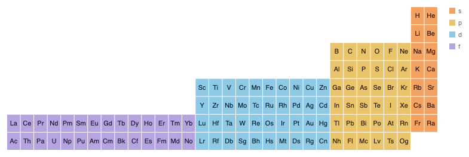

```js
chart(leftStepTable()).flow(grid).mark(cell);
```

### 3. Rings (works today)

The left-step table under `Coord.clock()`. Each row is a closed ring, so a row does not lead into the next one.

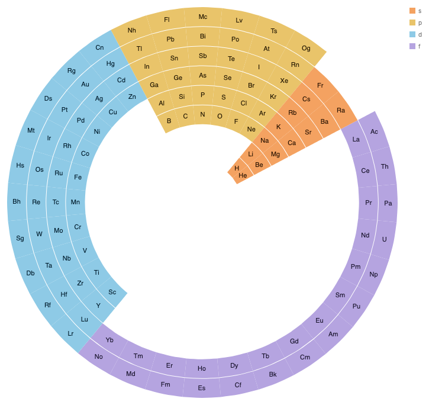

```js
chart(leftStepTable(), { coord: Coord.clock() }).flow(grid).mark(cell);
```

### 4. Spiral (proposed)

The same flow. The end of each row meets the start of the next row. Ba is followed by La, and Ra by Ac.

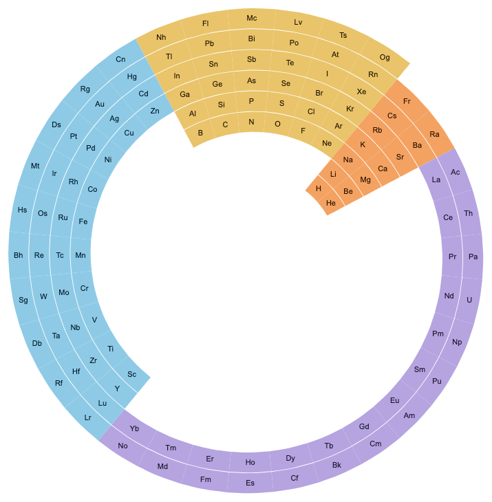

```js
chart(leftStepTable(), { coord: Coord.spiral({ pitch: 1 }) })
  .flow(grid)
  .mark(cell);
```

```python
chart(left_step_table(), coord=Coord.spiral(pitch=1)).flow(grid).mark(cell)
```

Prototype form: `spiralRows({ pitch: 1, rows: 8, spacing: 1, innerRadius: 0.2, outerRadius: 330 })`. The prototype has to be told the row count, the spacing and the radius, because a coord cannot see them today. See "The pitch problem" below.

### 5. Equal cells along a spiral (proposed)

All 118 elements in order, each cell the same arc length. Here the guide is an Archimedean spiral given as points.

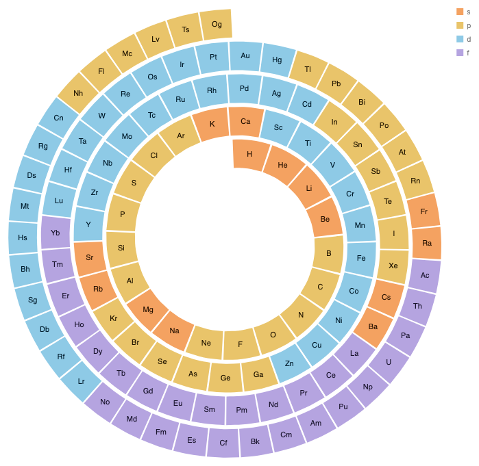

```js
chart(elements, { coord: Coord.along(archimedean({ turns: 4 })) })
  .flow(scatter({ x: "z" }))
  .mark(cell);
```

### 6. Race track (proposed)

The left-step rows as laps of a stadium outline. The guide is a rounded rect passed inline. This is a loose version of Clark's 1933 table.

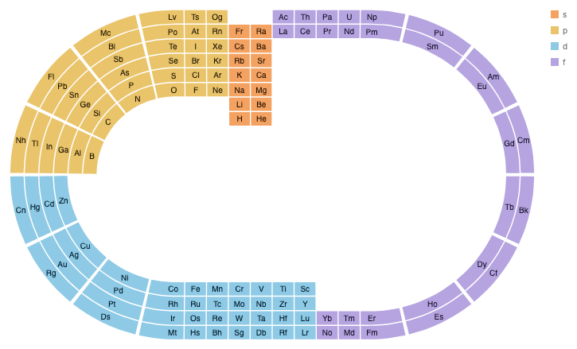

```js
chart(leftStepTable(), {
  coord: Coord.along(rect({ w: 480, h: 160, rx: 80 })),
})
  .flow(grid)
  .mark(cell);
```

```python
chart(left_step_table(), coord=Coord.along(rect(w=480, h=160, rx=80))).flow(grid).mark(
    cell
)
```

### 7. Benfey's spiral (proposed, the hard example)

Reference: [Benfey's table on Wikimedia Commons](https://commons.wikimedia.org/wiki/File:Elementspiral.svg) (CC BY-SA 3.0).

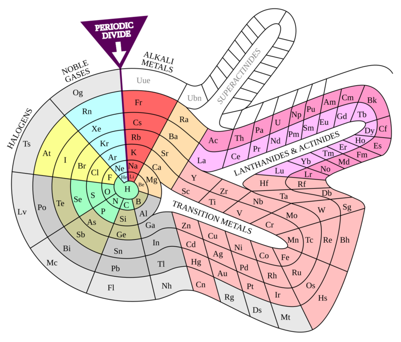

In Benfey's table the band of cells leaves the core after group 2, runs around a thin slit and returns at group 13. Periods 4 to 7 nest around the same slit. The flat picture that the coord starts from is the long-form table with every column pushed against one edge:

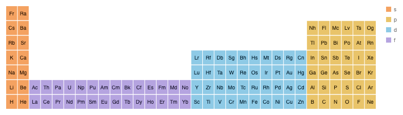

The guide is the inner edge of that table, drawn as four pieces. They are the s arc, the f lobe, the d lobe and the p arc.

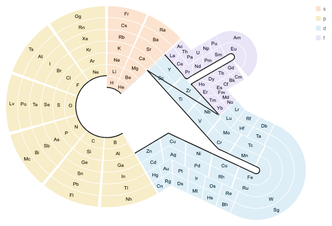

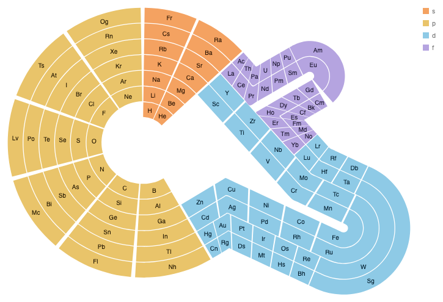

```js
// track = period minus the first period of the column's block.
chart(benfeyTable(), { coord: Coord.along([sArc, fLobe, dLobe, pArc]) })
  .flow(table({ by: { x: "col", y: "track" } }))
  .mark(cell);
```

No cells overlap and the sequence is unbroken (Ca is next to Sc, Zn next to Ga, Ba next to La). Three things in this render need a decision. They are listed under "Lobes" below.

## Why a coord and not a layout operator

Three approaches were considered.

### A. A layout operator that places children along a path

CSS `offset-path`, Illustrator's scatter brush and Blender's "instance on points" all work this way. The operator puts each child at a station along the path and turns it to the tangent. The child keeps its shape.

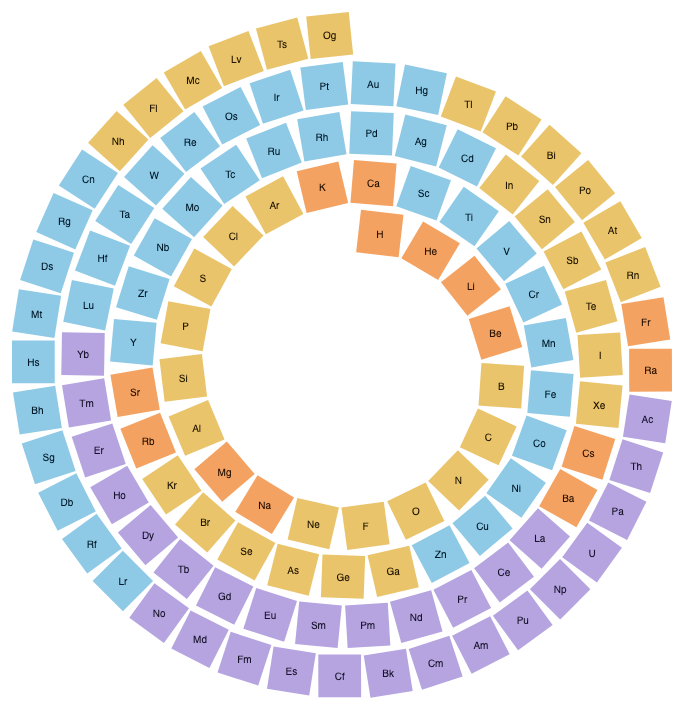

```js
chart(elements)
  .flow(spread({ by: "z", along: archimedean({ turns: 4 }) }))
  .mark(cell);
```

- **How it composes.** The operator needs its own answer for the second axis (tracks), for sizes along the path and for what a `stack` inside it means. A coord already answers all three.
- **Overlap check.** It overlaps `spread` under a coord almost completely. The only difference is that children stay rigid. That is a large partial overlap, which `api-design.md` says to avoid.
- **Trade-offs.** Wedge gaps open between rigid cells on tight turns. Rigid placement is still useful for glyphs, and GoFish already has a rule for it. Circles and text inside a coord are placed and not bent (#1323). So rigid marks along a path are `scatter` inside `Coord.along` with a glyph mark, with no new operator.

### B. A coord (recommended)

The layout runs in a straight box. The coord then bends the box. Blender's Array and Curve modifiers, Inkscape's Bend effect and `spiralize` all split the work this way. Every example above is this approach.

- **How it composes.** `table`, `spread`, `stack` and `scatter` work unchanged inside it. A `stack` along y stacks along the guide's normal, which is what the stacking design space page wants for bundled edges.
- **Overlap check.** `Coord.clock()` is `Coord.spiral` at pitch 0, and it is `Coord.along` a circle. Both overlaps are exact. The clock stays its own coord and is not redefined through either.
- **Trade-offs.** The user has to supply the guide. For Benfey that is the hard part of the spec (150 lines of geometry in the prototype). A guide drawn in a vector tool and pasted as a path would be the usual way.

### C. An envelope

`Coord.envelope` maps the box into the region between two curves. Josh asked whether it applies here. It does not fit, for one reason. An envelope gives every row the same number of columns. A periodic table's rows have 2, 8, 8, 18, 18, 32 and 32 cells. Example 3 is the envelope between two circles, and the short rows leave holes. Along a guide, the tracks farther out are longer, and a lobe adds its block's cells to every track outside it. That is why a lobe exists in these drawings, and it is what `along` gives for free. The envelope stays the right tool for the bottle, where the box is full.

## The pitch problem, and two fixes

A spiral should let the user write "one row per turn". The prototype could not, for two reasons found in `coord.tsx`.

- A coord's `transform` is fixed before the scale fit runs (line 403), so its options can only be in fitted units. These are radians and pixels.
- For a `table`, a row step is the band plus the table's `spacing`. The coord can read the band after the fit. It cannot read the spacing, which stays inside the grid constraint. The first prototype passed a fraction of the radius by hand and drifted by one eighth of the spacing on each turn.

The two fixes below are shown on the same two examples. Neither needs the scale-transforms work.

### Fix 1. Pitch in steps of the radial axis

The data keeps two axes. The radius advances `pitch` steps of the radial axis per turn.


```js
chart(leftStepTable(), { coord: Coord.spiral({ pitch: 1 }) })
  .flow(grid)
  .mark(cell);
```

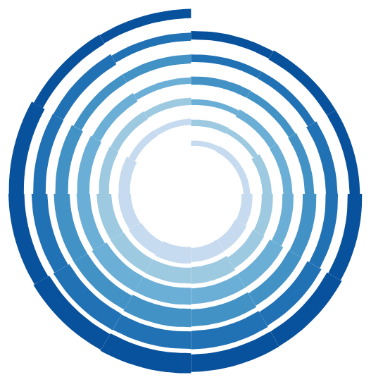

```js
chart(seasons, { coord: Coord.spiral({ pitch: 1 }) })
  .flow(table({ by: { x: "month", y: "year" } }))
  .mark(rect({ h: "value", fill: "year" }));
```

- **What the engine needs.** The coord builds its transform after the fit and reads the fitted radial scale. The carry is linear in that scale, so the fit is still one solve. The analysis puts the change at about 20 lines in `coord.tsx`. An ordinal axis also has to expose its step (band plus spacing), the way a d3 band scale has `step()`. Without that, the table must use zero spacing and draw its gaps with `inset`.
- **What it keeps.** Month and year, or group and period, stay data axes. `table` works, and a period axis can be drawn.
- **Where it is awkward.** A bar chart has to place its bars inside a year band.

### Fix 2. One sequence axis and a period

The data has one long axis. The angle covers `period` data units per turn. The radius advances by the thickness of the band plus a gap, so turns touch by construction. There is no pitch.

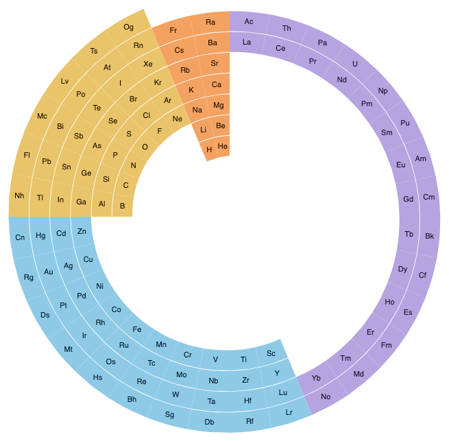

```js
// seq = (row - 1) * 32 + col
chart(leftStepSequence(), { coord: Coord.spiral({ period: 32 }) })
  .flow(scatter({ x: "seq" }))
  .mark(cell);
```

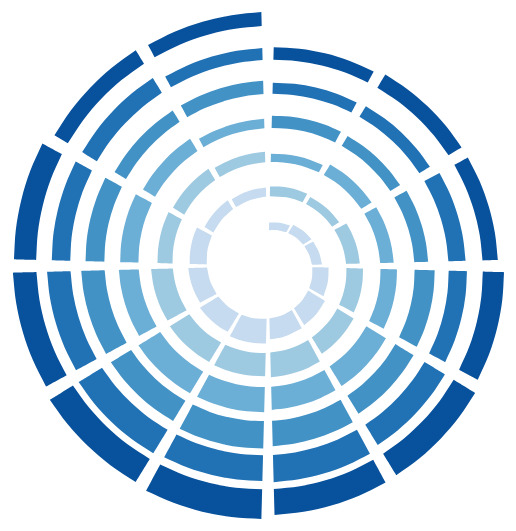

```js
chart(seasons, { coord: Coord.spiral({ period: 12 }) })
  .flow(scatter({ x: "t" }))
  .mark(rect({ h: "value", fill: "year" }));
```

- **What the engine needs.** The polar budget rule has to read the angular axis's data extent, so that the angular budget is 2π times the extent divided by the period. Today that budget is a constant.
- **What it keeps.** The spec for a time series is the shortest one. It is the `spiralize` model.
- **What it loses.** There is no row axis, so `table` cannot be used and a period or year axis cannot be drawn. Holes in the table become missing sequence values.

The two table pictures have the same joins. They differ by a rotation, which comes from an angle offset in `Coord.clock` under a `table` that is not explained yet.

### Recommendation: one coord with both options

The two fixes are the two numbers of one rule. The radius gains `pitch` for every `period` along the angle. So this proposal recommends one `Coord.spiral` with both options.

- `period` is in the angular axis's data units. Its default is the axis's whole extent, which is one turn.
- `pitch` is in steps of the radial axis. Its default is the radial axis's whole extent plus the gap, so that turns touch.

The periodic table writes `Coord.spiral({ pitch: 1 })`. The time series writes `Coord.spiral({ period: 12 })`. Fix 1 alone is the runner-up, because it is the one that keeps both axes as data.

## Lobes

The Benfey render shows that a guide of several pieces carries a whole table. It also shows three limits.

- **A lobe that starts on another lobe's tracks.** The f lobe stands on the d lobe's first two tracks. The d lobe's outer two tracks therefore start later than its inner two. One path per piece cannot say that. The prototype gives the d piece a second path for its outer tracks, which is an emulation.
- **Sharp inside corners.** Where the guide turns toward its own tracks, the prototype joins the tracks with a miter. Nothing folds as long as the straight run on each side of the corner is long enough. A curved run next to such a corner folds. This is the bend radius rule from the stacking design space page, and it is still open there (error, or force a minimum radius).
- **A wide mouth.** Because of the corner rule, a lobe's mouth is at least twice its depth. Benfey's drawing avoids this by letting the inner rings widen into the gap, which a circular core cannot do.

Three ways to write lobes:

```js
// (a) Pieces. Simple, and enough for one lobe, e.g., Clark's table.
Coord.along([sArc, dLobe, pArc]);

// (b) Pieces that say which track they start on. Needed for Benfey's f lobe.
Coord.along([sArc, { path: fLobe, from: 2 }, dLobe, pArc]);

// (c) A lobe is its own layer with its own coord, placed in the parent.
layer({ coord: Coord.clock() }, [
  core,
  layer({ coord: Coord.along(dLobe) }, [dBlock]),
]);
```

This proposal recommends shipping `Coord.along` with a single path first, then (a). Whether (b) or (c) is the right way to nest lobes should wait until a second real example needs it. Hyde's 1975 table is a candidate.

## The scarcity table

The EuChemS table keeps the 18 columns and makes each cell's area show the element's abundance on a log scale. It was drawn by hand. Three versions:

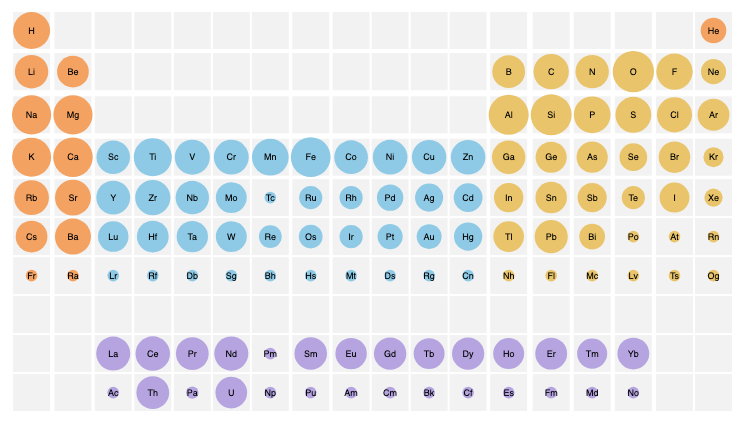

```js
chart(withAbundance(standardTable()))
  .flow(grid)
  .mark(
    layer([
      rect({ w: 37, h: 37, fill: "#f2f2f2" }).name("box"),
      circle({ area: "abundance", fill: field("block") }).name("dot"),
    ]).relate(({ box, dot }) => [
      Constraint.align({ x: "middle", y: "middle" }, [box, dot]),
    ])
  );
```

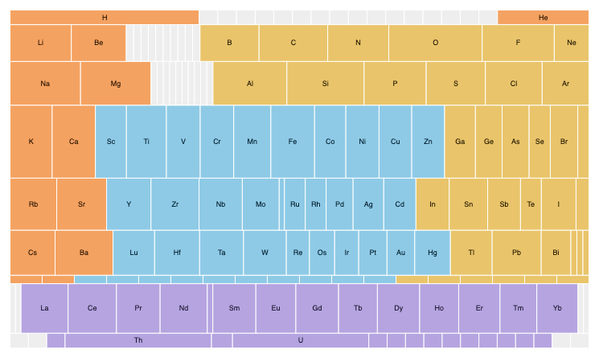

```js
// scarcityGrid adds blank cells for the empty stretches, so the gaps keep their width.
chart(scarcityGrid())
  .flow(
    stack({ by: "row", dir: "y", size: "abundance" }),
    stack({ by: "col", dir: "x", size: field("abundance").normalize() })
  )
  .mark(cell);
```

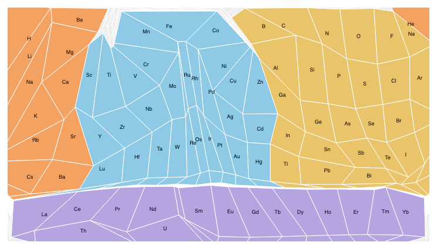

```js
// Proposed. The spelling of the weight option is open.
chart(withAbundance(standardTable()))
  .flow(table({ by: { x: "col", y: "row" }, size: "abundance" }))
  .mark(cell);
```

- The rows version has exact areas but the columns no longer line up.
- The table cartogram keeps every cell's four neighbors and gives up straight rows and columns. Evans et al. prove one always exists with exact areas, and their first figure is a periodic table. The emulation here is a numeric solve with a worst area error of 5.8 percent.

**Is it related to the coords?** Only loosely. In both cases the grid keeps its neighbors and changes its geometry. The difference is where the geometry comes from. A coord's map is fixed before the data arrives. A cartogram's map is solved from the weights, the way `treemap` solves its tiles. So it belongs with `treemap` and the `Tile` family, as a way for `table` to size its cells. It also composes with the coords above. A cartogram table inside `Coord.spiral` would be a spiral cartogram. This proposal recommends a separate issue for it.

## Prior work

| System                                         | Model                                                                                                                                | Names                                       | Fit for GoFish                                                                      |
| ---------------------------------------------- | ------------------------------------------------------------------------------------------------------------------------------------ | ------------------------------------------- | ----------------------------------------------------------------------------------- |
| Blender, Array and Curve modifiers             | Array repeats a mesh along a straight axis. Curve then maps that axis onto a curve's arc length and the other axes onto its normals. | array, curve, deform axis                   | The same split as this proposal. Layout first, then a coord.                        |
| Inkscape, Bend and Pattern Along Path          | One skeleton path. A point (x, y) goes to U(x) + y N(x).                                                                             | bend, skeleton, along path                  | The map `Coord.along` uses (#1284).                                                 |
| `spiralize` (R, Zuguang Gu)                    | A spiral coordinate system with tracks. `scale_by` is "angle" or "curve_length". `period` is the data per loop.                      | spiral, track, period                       | The source of `period`, and of the choice between equal angle and equal arc length. |
| NetworkX `spiral_layout`                       | `equidistant` chooses equal arc length over equal angle.                                                                             | equidistant                                 | The same choice as a flag. Here it is two coords.                                   |
| ggplot2 `coord_polar`, `coord_radial`          | No spiral. Users plot year plus fraction on the radius.                                                                              |                                             | A workaround. The user does the carry in the data.                                  |
| ggraph `layout_linear(circular)`               | Lay nodes on a line, then bend the line into a circle.                                                                               | linear, circular                            | A coord switch on a one-dimensional layout.                                         |
| CSS `offset-path`, SVG `textPath`              | Put a box at a distance along a path, turned to the tangent.                                                                         | offset-path, offset-distance, offset-rotate | Approach A. Rigid placement.                                                        |
| Illustrator brushes and Blend spine            | Scatter, art and pattern brushes place or stretch art along a path. A blend follows a "spine".                                       | spine, on a path                            | Designers' words are "along a path" and "spine".                                    |
| TikZ `markings`, MetaPost `arctime`            | Positions along a path by arc length are a primitive.                                                                                | mark at position, along path                | Supports "along" as the name.                                                       |
| Weber et al. (2001), Carlis and Konstan (1998) | Time series on a spiral. One cycle per turn shows periodic structure.                                                                | spiral                                      | The seasons example.                                                                |
| Brehmer et al., "Timelines revisited" (2017)   | Representation (linear, radial, grid, spiral, arbitrary) is a design axis separate from scale and layout.                            | representation                              | Published support for making the path a parameter of its own.                       |
| Evans et al., "Table cartograms" (2013)        | Cells are convex quadrilaterals with the grid's adjacency and exact areas.                                                           | table cartogram                             | The exact model for the scarcity table.                                             |
| R `cartogram`, d3-cartogram, go-cart           | Contiguous, non-contiguous and Dorling cartograms of map regions.                                                                    | cartogram                                   | Map regions only. None takes a grid.                                                |

Mazurs sorted about 700 published periodic tables into types (short, medium, long, helical, spiral and others). Read as a design space, the tables differ in the order of the sequence, the guide it follows, whether groups line up, how blocks attach (inline, lobe, inset or separate grid), and what sets cell size. The first two and the last are the flow, the coord and the cartogram of this proposal. How blocks attach is the lobe question.

## Related GoFish issues and pages

- #1347 is this issue.
- #1284 records `Coord.bend({ along })` and `Coord.envelope` as deferred coords that take a guide as an operand. This proposal renames bend to `Coord.along` and gives it its first real examples.
- The stacking design space page writes the same coord as `Coord.along(spine)` and defines the bend radius rule. The two pages now agree on the name.
- The bottle proposal uses `Coord.envelope` with an `"area"` measure. It leaves open whether a bend gets an area option. These tables do not need one.
- #952: text and labels ignore the coord. Every coord picture here needs a patch for it.
- #605: a ref across a coord boundary reads the unbent box. A guide passed as a ref to a sibling needs this.
- #1342: outlines are unbent under a coord while the drawn shape is bent.
- #122: the wrap operator. A spiral's `period` and a wrap's column count say the same thing in two geometries.
- #1101: user-defined strategies. A guide given as a function would need it.

## Found along the way

- A coord with its own `fit` rejects ordinal content (`coord.tsx:356-373`), so `table` works only under the polar budget rule and the `along` prototypes use `scatter`.
- Literal sizes inside a coord are in the coord's units. Spacing along the angle is in radians.
- Empty table cells still get the mark, and a string `fill: "block"` on an empty cell is read as a color, which paints the hole black. `field("block")` avoids it.
- Under `Coord.clock`, a table's first column starts at about 2 o'clock, not 12.
- The polar outer axis ring is a circle, which is wrong for a spiral.
- The stories are not type-checked.

## Decisions for Josh

1. Is the factoring right? The layout is today's grid, the variation is the coord, and there is no operator that places children along a path.
2. Take #1284 out of deferral as `Coord.along(path, options)`, with the path as the first argument? I would then update #1284 and the stacking page.
3. Is the spiral its own coord, `Coord.spiral`, or a `pitch` option on `Coord.polar` and `Coord.clock`? The spiral drops the angle's cycle trait, which argues for its own name.
4. Fix 1, fix 2, or one coord with both `pitch` and `period`?
5. Are the defaults right? `period` defaults to one turn for the whole axis, and `pitch` to turns that touch.
6. Should an ordinal axis expose its step, so that `pitch: 1` includes the table's spacing? The shortcut is zero spacing and `inset`.
7. Equal angle or equal arc length. Is it right that this is two coords (`Coord.spiral`, or `Coord.along` a spiral path) and not an option?
8. How is a guide written? Candidates are an inline shape (`rect({ rx })`), a ref to a hidden mark as in #1284, and a list of points. Should common guides such as an Archimedean spiral be named anywhere?
9. Lobes. Ship a single path first and decide between pieces with a starting track and nested layers later?
10. The fold rule. When a track is farther from the guide than the bend radius, is that an error or a miter join? The stacking page has the same open question.
11. Should the scarcity table get its own issue as a weight option on `table`?
