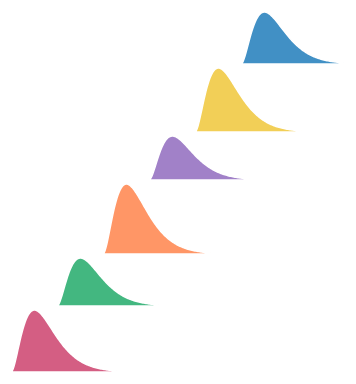
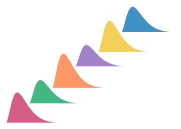
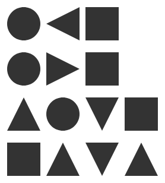
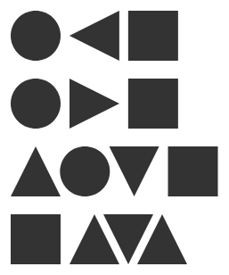

# Stack profiles, in three examples

1. A stacked area is the limit of stacked bars. Draw it as bars of width dx and shrink dx. Each column is an ordinary stack of boxes, and the stack only moves each box. So the one new thing a stack needs is a child that reports many thin boxes, its **slices**, instead of one. The list of slices is the shape's **profile**.
2. A stack's `baseline` option chooses where its own 0 is: `Baseline.start()`, `Baseline.middle()`, `Baseline.wiggle()` or `Baseline.at(part, fraction)`. Each one gives every slice an offset and never changes a thickness.
3. A density is two channels over one hidden variable t, `ribbon({ x: mass.support(), h: mass.density() })`. `partition` cuts that profile into cells, which draws the croissant with no grid and no `intersect`.
4. `spread` can read the same slices to space shapes by their outlines, `Spacing.contour(n)`. On traced glyphs and on circles, triangles and squares, contact spacing does not look even. The page shows where, and lists the choices.

This page is focused on three examples and the idea behind them. The full survey of eleven examples is at commit [2f3b2a4bf](https://github.com/gofish-graphics/gofish-graphics/blob/2f3b2a4bf/proposals/stack-profile/proposal.md).

The review page is `page.html` beside this file.

## Terms

| Term                    | Meaning                                                                                                                                                                                                                                                                                  |
| ----------------------- | ---------------------------------------------------------------------------------------------------------------------------------------------------------------------------------------------------------------------------------------------------------------------------------------- |
| Slice                   | A thin box of a shape at one position u along the cross axis: how far the shape reaches below and above its baseline there.                                                                                                                                                              |
| Profile                 | A shape's list of slices, or in the limit the function from u to its reach below and above its baseline. A box is one slice that does not change. Precedents: a tidy tree's contour, a skyline in computational geometry, and the calculus region between two graphs.                    |
| Baseline                | A node's own 0 point. A rect's baseline is its bottom edge, and it bubbles up: a parent with `alignment: "baseline"` lines up its children's 0 points. A stack's `baseline` option chooses where the stack's 0 is. In the code the model is `StackOrigin` (`constraints/distribute.ts`). |
| Per-x form              | `scatter` or `spread` by x, then `stack`, which is today's spelling of a stacked area. The stack runs once in each x slice and sees only that slice.                                                                                                                                     |
| Field expression        | `field("mass")`, a column expression like polars' `pl.col("mass")`. Bare, it is a value per row. Its methods make other kinds of value (see "What the methods compute").                                                                                                                 |
| Box gap and contact gap | Two ways to measure the space between neighbors. A box gap is between bounding boxes, as `spread` does today. A contact gap is the smallest gap between facing outlines, measured slice by slice.                                                                                        |

## Why stacking may reshape an area

Stacking areas changes the shape of each area, which a box cannot do. Josh's framing: "a ribbon's area is a limit of some AABBs. So if that shape change can happen with the discrete AABB union I feel like it's more acceptable and natural to have the ribbon behavior be guided by that." (An AABB is an axis-aligned bounding box, the box every GoFish node reports today.) This section makes that the explanation of stacking.


_Four series as stacked bars 5, 10, 20 and 60 bars wide, then the stacked area. Each bar reads its series at the bar's middle. Real renders with today's `spread` and `stack`; each panel scales to its own height._

Each bar panel, which runs today:

```js
chart(rows) // one row per series per bar
  .flow(
    spread({ by: "bar", dir: "x", spacing: 0 }),
    stack({ by: "series", dir: "y" })
  )
  .mark(rect({ w: barWidth, h: "value", fill: "series" }));
```

```python
chart(rows).flow(
    spread(by="bar", dir="x", spacing=0),
    stack(by="series", dir="y"),
).mark(rect(w=bar_width, h="value", fill="series"))
```

<h4>The argument, checked step by step</h4>
<ol>
<li><b>A ribbon is the limit of a row of thin rects</b>, one per slice of x. Correct. One detail: each rect reads the series at its slice, so the limit is the series' curve through its rows. How a series is read between its rows (its <code>curve</code>) is part of the shape.</li>
<li><b>In the discrete case, stacking uses only what boxes allow.</b> Correct. Each column is an ordinary stack of rects, as in the panels above. The stack moves each rect and never changes its width or height.</li>
<li><b>One series' rects form a staircase band whose outline changes shape</b>, because each slice moves by a different amount, while no box is reshaped. Correct. In the limit the staircase becomes the stacked ribbon.</li>
<li><b>So the profile rule is: a child may report many boxes, and the parent moves each one.</b> Correct. The thickness at each x never changes, only the offset, so stacking is a translation per slice. This is what the full survey called a frame that is a boundary curve: the curve is the list of offsets.</li>
<li><b>Series sampled at different x fit too.</b> Splitting a slice in two does not change the shape, so the columns can use the union of every series' breakpoints. Correct, with one condition: the new slice's height is the series' value at the new x, which comes from its curve (linear between rows, as ggplot2 reads it). Outside its own x range a series' slice is empty, so its thickness there is 0.</li>
<li><b>Contour spacing reads the same slices.</b> The closest approach of two shapes is the smallest gap over their shared slices, a skyline. Correct, with a limit: the gap is measured along the spacing axis in each slice, not as a straight-line distance. Example 3 shows what that does to glyphs and shapes.</li>
<li><b>A rigid shape (a circle, text, a line with no thickness) is one box that cannot be split, so it gets one translation.</b> This needs a correction. The full survey made a rigid part in a curved stack an error. The slice picture gives a rigid part a defined place instead: it rests on the highest point of the boundary below it across its width, as a skyline does. But then the slices under it are no longer glued, and a gap opens wherever the boundary below is lower. So the picture turns the old rule into a choice, which is decision 2.</li>
</ol>
<h4>How it relates to the approaches in the full survey</h4>
<p>Runner-up B, the per-x form, is this argument at a fixed dx: the slices are the rows' x positions, each slice is stacked on its own, and the ribbon connects the stacked points. Approach A is the limit: a child reports its profile as a function of x, so the stack does not depend on where the rows happen to be. A can ship first as B, by choosing the slices as the union of breakpoints. That is the declared shortcut in the full survey.</p>
<h4>Does every baseline only move slices?</h4>
<div class="table-wrap"><table>
<tr><th>Baseline</th><th>Offset of slice u</th><th>Only moves slices?</th></tr>
<tr><td><code>Baseline.start()</code></td><td>0</td><td>Yes</td></tr>
<tr><td><code>Baseline.middle()</code></td><td>minus half the total at u</td><td>Yes</td></tr>
<tr><td><code>Baseline.at(part, fraction)</code></td><td>minus (the start of <code>part</code> at u plus <code>fraction</code> times its thickness at u)</td><td>Yes</td></tr>
<tr><td><code>Baseline.wiggle()</code></td><td>a running sum over the slices to the left, chosen to flatten the bands (d3's <code>stackOffsetWiggle</code>)</td><td>Yes, but its value depends on dx. d3 sums over the rows' x, so finer rows give a slightly different curve. In the limit the sum is an integral, so the proposal defines wiggle on the profile, not on the rows.</td></tr>
</table></div>
<p>Every baseline holds, and nothing in layout resizes a slice. A 100% stacked area is not a separate divide operation. It is <code>normalize</code>, the callback <code>(x, xs) =&gt; x / sum(xs)</code> with <code>xs</code> the values in one x column, which changes the values before layout, followed by a plain stack that only moves slices. When the whole is a drawn shape instead of 1 (a bottle filled by share), that is a size choice for the stack's total, not a new operation.</p>

## 1. Stacked area, with each baseline

US unemployment by industry, monthly from 2000 to 2010, 14 industries (vega-datasets `unemployment-across-industries`, from the Bureau of Labor Statistics). The stack's `baseline` chooses where its own 0 is. Each choice is an offset per slice, so every band keeps its thickness.


_`Baseline.start()`, the default: the first industry starts at 0. Real render of today's spelling._

Proposed:

```js
chart(jobs)
  .flow(stack({ by: "series", dir: "y" }))
  .mark(ribbon({ x: "date", h: "count", fill: "series" }));
```

```python
chart(jobs).flow(stack(by="series", dir="y")).mark(
    ribbon(x="date", h="count", fill="series")
)
```

Today (runs):

```js
chart(jobs)
  .flow(scatter({ by: "date", x: "date" }), stack({ by: "series", dir: "y" }))
  .mark(ribbon({ h: "count", fill: "series" }));
```


_`Baseline.middle()`: the middle of the whole is at 0 (emulated: d3's silhouette offset computed in `derive`). The y axis is dropped, because position no longer means an amount from 0._

Proposed:

```js
chart(jobs)
  .flow(stack({ by: "series", dir: "y", baseline: Baseline.middle() }))
  .mark(ribbon({ x: "date", h: "count", fill: "series" }));
```

```python
chart(jobs).flow(stack(by="series", dir="y", baseline=Baseline.middle())).mark(
    ribbon(x="date", h="count", fill="series")
)
```

Today (the offset computed by hand, about 20 lines):

```js
chart(jobs)
  .flow(
    derive((rows) => stackRows(rows, { offset: "silhouette" })),
    scatter({ by: "date", x: "date" }),
    scatter({ by: "series", yMin: "y0", yMax: "y1" })
  )
  .mark(ribbon({ fill: "series" }));
```


_`Baseline.wiggle()`: the baseline curve that flattens the bands, a streamgraph (emulated: d3's wiggle offset computed in `derive`)._

Proposed:

```js
chart(jobs)
  .flow(stack({ by: "series", dir: "y", baseline: Baseline.wiggle() }))
  .mark(ribbon({ x: "date", h: "count", fill: "series" }));
```

```python
chart(jobs).flow(stack(by="series", dir="y", baseline=Baseline.wiggle())).mark(
    ribbon(x="date", h="count", fill="series")
)
```

Today (the offset computed by hand):

```js
chart(jobs)
  .flow(
    derive((rows) => stackRows(rows, { offset: "wiggle" })),
    scatter({ by: "date", x: "date" }),
    scatter({ by: "series", yMin: "y0", yMax: "y1" })
  )
  .mark(ribbon({ fill: "series" }));
```


_`Baseline.at("Neutral", 0.5)`: a diverging stack whose 0 is the middle of the Neutral bar. Real render of today's spelling, on a small survey._

Proposed (Trait.diverging stays the default and desugars to this):

```js
chart(survey)
  .flow(
    spread({ by: "question", dir: "y" }),
    stack({ by: "response", dir: "x", baseline: Baseline.at("Neutral", 0.5) })
  )
  .mark(rect({ w: "count", fill: "response" }));
```

```python
chart(survey).flow(
    spread(by="question", dir="y"),
    stack(by="response", dir="x", baseline=Baseline.at("Neutral", 0.5)),
).mark(rect(w="count", fill="response"))
```

Today (runs; the unit's trait sets the 0):

```js
chart(survey, {
  schema: {
    response: Unit({
      domain: Domain.discrete(LEVELS),
      traits: [Trait.diverging()],
    }),
  },
})
  .flow(
    spread({ by: "question", dir: "y" }),
    stack({ by: "response", dir: "x" })
  )
  .mark(rect({ w: "count", fill: "response" }));
```

The values name a place on the stack, as `alignment`'s values do, so d3's `zero` becomes `start` and Vega-Lite's `center` becomes `middle`. `Baseline.end()` also exists, for a stack that grows the other way. An explicit `baseline` over a unit with `Trait.diverging` is an error, because the unit already fixes the 0. With `middle` and `wiggle` a position on the value axis is no longer an amount from 0, so the axis can only measure thickness, which is why streamgraphs drop it.

**Precedent.** d3's `stackOffsetNone`, `Silhouette`, `Wiggle` and `Diverging`; Vega-Lite's `stack: "zero" | "center" | "normalize"`; matplotlib's `stackplot(baseline="zero" | "sym" | "wiggle" | "weighted_wiggle")`. Byron and Wattenberg (2008) call the bottom curve g<sub>0</sub> the baseline.

**Naming.** `baseline` is already GoFish's word for a node's 0 point, and `alignment: "baseline"` already reads it, so one word names one thing: the stack sets its baseline, and the parent lines baselines up. `origin` is out because the origin lives on the measure type, and an option by that name would read as overriding it. `alignment` is out because it is the parent's rule for the other axis.

## 2. Croissant: a density cut into equal-probability slices


_Today's gallery story `Forward Syntax/Croissant` (real render). The proposed code draws the same picture; it does not run yet._

Proposed:

```js
const params = [{ mean: 0, sd: 1 }];
const d = dist.normal({ mean: "mean", sd: "sd" });
chart(params)
  .flow(partition({ by: d.bin(Bin.quantiles(5)), dir: "x" }))
  .mark(
    layer([
      ribbon({
        x: d.support(),
        h: d.density(),
        inset: 3,
        fill: PAPER_FILL,
        stroke: PAPER_STROKE,
      }),
      circle({ cx: d.median(), cy: 6, r: 3, fill: PAPER_STROKE }),
    ])
  );
```

```python
params = [{"mean": 0, "sd": 1}]
d = dist.normal(mean="mean", sd="sd")
chart(params).flow(partition(by=d.bin(Bin.quantiles(5)), dir="x")).mark(
    layer(
        [
            ribbon(
                x=d.support(),
                h=d.density(),
                inset=3,
                fill=PAPER_FILL,
                stroke=PAPER_STROKE,
            ),
            circle(cx=d.median(), cy=6, r=3, fill=PAPER_STROKE),
        ]
    )
)
```

Today (stories/forwardsyntax/Croissant.stories.tsx; the sequence repeats three times in the file):

```js
const normPdf = (x, mu = 0, sd = 1) =>
  Math.exp(-0.5 * ((x - mu) / sd) ** 2) / (sd * Math.sqrt(2 * Math.PI));
const gridOf = (f, lo, hi, n) =>
  Array.from({ length: n }, (_, i) => {
    const x = lo + ((hi - lo) * i) / (n - 1);
    return { x, pdf: f(x) };
  });
const croissant = (grid, { n = 10, fill = FILL, stroke = STROKE } = {}) =>
  layer([
    chart(grid)
      .flow(scatter({ x: "x" }))
      .mark(ribbon({ h: "pdf" }).name("density").hidden()),
  ]).relate(({ density }) => [
    chart(grid)
      .flow(
        derive((rows) =>
          quantileRows(rows, { x: "x", density: "pdf", n: 1000 })
        ),
        partition({ by: field("x").bin(Bin.quantiles(n)), dir: "x" })
      )
      .mark(
        layer([
          intersect({ fill, stroke, strokeWidth: 2 }, [
            density,
            region({ inset: 3 }),
          ]),
          circle({ cx: field("x").median(), cy: 6, r: 3, fill: stroke }),
        ])
      ),
  ]);
// on [-3, 3] the missing tails move the outer cells' medians
const normalGrid = gridOf((x) => normPdf(x), -4, 4, 401);
croissant(normalGrid, { n: 5, fill: PAPER_FILL, stroke: PAPER_STROKE });
```

`d` is a field expression over a distribution. Each method makes a different kind of value. `d.bin(Bin.quantiles(5))` is a key that cuts d's axis into 5 cells. `d.support()` and `d.density()` are the position and the height of one curve over a hidden variable t: the support is t ↦ t and the density is t ↦ f(t). The ribbon samples t and evaluates both channels at each sample, as a parametric curve (x(t), y(t)) does. `d.median()` is one number per cell. `partition` on d's axis restricts the curve to each cell, which in the slice picture keeps the slices inside the cell. A cell of a Dist is the Dist over that cell with its mass, so the slices meet exactly. No `intersect`, hidden ribbon, `relate`, grid or quantile rows.

#### What the methods compute

A field expression like `field("mass")` works like polars' `pl.col("mass")`: it sees one column. Every named method on it except `bin` is one named instance of one callback shape, `(x, xs) => result`. `x` is this row's value of the field, and `xs` is the values of that field over the rows of the current group: the rows the mark or operator reading the channel was given. A user can always write the callback instead of the method. Polars has the same two views of one column: `map_elements` gets one value, and `map_batches` gets the whole Series.

Each method and the callback it stands for (bins are open; see below):

```js
field("mass"); // (x) => x  (JS lets a callback drop xs)
field("mass").sum(); // (_, xs) => sum(xs)
field("mass").median(); // (_, xs) => median(xs)
field("mass").normalize(); // (x, xs) => x / sum(xs)
field("mass").support(); // (_, xs) => (t) => t, over the density's range
field("mass").density(); // (_, xs) => kde(xs), a function (t) => number

// a custom method, used like a built-in one (spelling: next section)
const share = field("mass").map((x, i, xs) => x / max(xs), { unit: "ratio" });
```

```python
field("mass")  # lambda x, xs: x
field("mass").sum()  # lambda _, xs: sum(xs)
field("mass").median()  # lambda _, xs: median(xs)
field("mass").normalize()  # lambda x, xs: x / sum(xs)
field("mass").support()  # lambda _, xs: (lambda t: t), over the density's range
field("mass").density()  # lambda _, xs: kde(xs), a function of t

share = field("mass").map(lambda x, i, xs: x / max(xs), unit="ratio")
```

<div class="table-wrap"><table class="methods">
<tr><th>Kind</th><th>Named method</th><th>Formula</th><th>Callback</th></tr>
<tr><td>Per row</td><td><code>field("mass")</code></td><td>the row's value</td><td><code>(x) =&gt; x</code>. A function accessor works today.</td></tr>
<tr><td rowspan="5">Fold: the same value for every row of the group</td><td><code>.sum()</code></td><td>sum of the present values; missing values are dropped</td><td><code>(_, xs) =&gt; sum(xs)</code></td></tr>
<tr><td><code>.mean()</code></td><td>sum &divide; n over the present values</td><td><code>(_, xs) =&gt; mean(xs)</code></td></tr>
<tr><td><code>.median()</code></td><td>sort the present values; with h = (n &minus; 1) &times; 0.5, interpolate between the values at floor(h) and ceil(h): the type-7 quantile at 0.5, as R and numpy compute it (<code>medianOf</code>, <code>fieldExpr.ts</code>)</td><td><code>(_, xs) =&gt; median(xs)</code></td></tr>
<tr><td><code>.count()</code></td><td>n</td><td><code>(_, xs) =&gt; xs.length</code></td></tr>
<tr><td><code>.distinct()</code></td><td>the number of different values</td><td><code>(_, xs) =&gt; new Set(xs).size</code></td></tr>
<tr><td>Per row, reading the group</td><td><code>.normalize()</code></td><td>x &divide; the group's sum</td><td><code>(x, xs) =&gt; x / sum(xs)</code></td></tr>
<tr><td rowspan="2">Curve: a function of a hidden variable t</td><td><code>.support()</code></td><td>t itself, over the range the expression's density uses. That range is open (see the decisions); the lean follows ggdist: for rows, the data's own range, with a bounded estimator; for a <code>Dist</code>, its own range, or its 0.001 to 0.999 quantiles where that range is unbounded</td><td><code>(_, xs) =&gt; (t) =&gt; t</code></td></tr>
<tr><td><code>.density()</code></td><td>f(t) = (1 &divide; bw) &Sigma;<sub>i</sub> K((t &minus; x<sub>i</sub>) &divide; bw), K the standard normal density, bw = 0.9 &times; min(sd, IQR &divide; 1.34) &times; n<sup>&minus;1/5</sup> (Silverman's rule, R's <code>bw.nrd0</code>; <code>silvermanBandwidth</code> in <code>overlap.ts</code> computes it). The area under f is n. For a <code>Dist</code>, f is its exact density, with area 1</td><td><code>(_, xs) =&gt; kde(xs)</code>, whose result is a function <code>(t) =&gt; number</code></td></tr>
<tr><td>Key (bin)</td><td><code>.bin(Bin.step(500))</code>, <code>Bin.thresholds(n)</code>, <code>Bin.quantiles(n)</code></td><td>On main the cells come from the column's domain (its <code>HasDomain</code>), computed once where the data is typed, in <code>chart()</code> or the last <code>derive</code>, so every group of a split sees the same cells, empty ones included (#763; story <code>SharedBinsAcrossGroups</code>). <code>Bin.step(w)</code>: cells [k&times;w, (k+1)&times;w). <code>Bin.thresholds(n)</code>: a step from d3's <code>tickIncrement</code> over the domain, for about n cells. <code>Bin.quantiles(n)</code>: edges at the type-7 quantiles i/n of the column's values (<code>cells.ts</code>)</td><td>Open: how a bin's cells are shared is under review</td></tr>
</table></div>
<p><b>Precedent.</b> A fold that returns the same value for every row of its group is a window function: SQL's <code>median(x) OVER (PARTITION BY g)</code>, or polars' <code>pl.col("x").median().over("g")</code>. <code>normalize</code> fits the same shape with no change, <code>(x, xs) =&gt; x / sum(xs)</code>, as SQL's <code>x / sum(x) OVER (PARTITION BY g)</code> does.</p>
<p><b>Bins are the open item.</b> A bin's cells do not come from the group's <code>xs</code>: on main they come from the column's domain, fixed where the data is typed, and the empty cells and their order are kept for the axis. So a bin does not fit the one callback shape as written. How a bin's cells are shared is under review, so this page proposes no callback form for bins.</p>
<p><b>Curves.</b> A density is drawn by two channels of one mark, <code>x: mass.support()</code> (t &#8614; t) and <code>h: mass.density()</code> (t &#8614; f(t)). The ribbon samples t and evaluates every channel that is a function of t at each sample, as a parametric curve (x(t), y(t)) does. The range of t belongs to the expression, so no spec names it. Two curve channels over different variables in one mark, such as <code>x: mass.support()</code> with <code>h: length.density()</code>, are an error. Precedent: the closest is ggdist (Matt Kay's R package for distributions), whose <code>stat_slabinterval</code> computes <code>x</code> or <code>y</code> (the slab's positions), <code>pdf</code>, <code>cdf</code> and <code>n</code> (<code>Inf</code> for an analytic distribution). Vega-Lite's density transform outputs two fields, <code>value</code> and <code>density</code>, and ggplot2 maps <code>after_stat(x)</code> and <code>after_stat(density)</code>.</p>
<p><b>Area.</b> The area under <code>mass.density()</code> is its row count, so stacked densities add up. ggdist users get the same curve by writing <code>aes(thickness = after_stat(pdf * n))</code>. ggdist instead scales thickness after the fact with <code>normalize</code> (<code>"all"</code>, <code>"panels"</code>, <code>"xy"</code>, <code>"groups"</code> or <code>"none"</code>); here that is the stack's or the spread's job, not the curve's.</p>
<p><b>The range of t.</b> Tools split. seaborn runs a KDE 3 bandwidths past the data (<code>cut=3</code>), and ggplot2 also extends past it. ggdist, for rows, uses <code>density_bounded()</code>, a reflection estimator, and usually trims to the data's range; for an analytic distribution it uses <code>p_limits</code>, the 0.001 and 0.999 quantiles, where the range is unbounded. This is one of the decisions.</p>
<p><b>Naming.</b> <code>support()</code> is the chosen name (Josh is checking it with Matt Kay, author of ggdist). Rejected: <code>value()</code>, which clashes with GoFish's <code>value(...)</code> constructor, and <code>points()</code> or <code>grid()</code>, which name the sampling that specs should not see.</p>
<p><b>Consequences, stated plainly.</b></p>
<ol>
<li><b>A fold cannot be told from a per-row value without running it.</b> A channel that needs one value per group (a <code>circle</code>'s <code>cx</code> in a cell) checks that the value is the same across the group, and fails with the existing "not constant across the connected group" error.</li>
<li><b>A fold called once per row is n calls of O(n) work, O(n&sup2;) in all.</b> A named method avoids it because the engine knows it is a fold and computes it once per group. For a callback, the engine memoizes the result per group (same <code>xs</code>, same result), or the user declares it a fold and it is called once per group. The next section compares declaring it with a verb (<code>.reduce</code>) and with a flag (<code>{ fold: true }</code>).</li>
<li><b>A callback sees one field, so it cannot use two.</b> A mean of x weighted by w reads two fields, so it is a <code>derive</code> step, or an expression over two fields, not a custom method.</li>
<li><b>Units get simpler.</b> The callback sees one field, so the unit it receives is known. It declares only what it returns: the same unit (<code>sum</code>, <code>median</code>), a ratio (<code>normalize</code>), a count, or a curve whose values are that unit's density. Without the declaration, CanSum and the other checks cannot run, so an undeclared result is treated as a plain number that cannot be stacked.</li>
<li><b>Serialization.</b> A named method crosses to Python as data. A callback written in Python reaches JS as a batch call (<code>RESOLVE_ROWS</code>, <code>channels.ts</code>), which today returns one value per row; a fold would be called per group.</li>
</ol>
<p><b>Custom methods.</b> Main has no custom method on a field expression; the closest are the <code>derive(fn)</code> flow step, which sees whole rows, and the batch accessor above. A custom method returns a field expression, so it chains and reads like a built-in one, and a named custom method is just a function that returns one. The next section chooses its name and signature.</p>
<p><b>Docs plan.</b> Each method's API reference entry (its descriptor <code>doc</code>) states its formula and the callback it stands for, as in the table above. This lands with the implementation.</p>

## 2b. Naming the custom method on a field expression

The question here is only the name and signature of the method a user writes when no named method fits. Josh chose the shape: the callback sees `x`, this row's value of the field, and `xs`, the group's values of that field. One callback then covers a per-row value, a fold (the same value for every row of the group, which SQL calls a window function), `normalize`, and a curve (a value that is a function of t). Bins are open separately.

**`.then` is out.** Any object with a `then` method is a _thenable_: `await`, `Promise.resolve`, `Promise.all` and the return of an `async` function all call it as `then(resolve, reject)`. GoFish resolves channels asynchronously. `resolveValue` in `ast/channels.ts` is an `async` function that returns a channel value that is not a plain object as it is, and it runs on every entry of a channel bag that holds a Python accessor, through `Promise.all`. So in `y: { min: field("a").then(f), max: pythonLambda }` the runtime would call `f(resolve, reject)`, and the channel would never resolve. Effect and fp-ts keep the word for promises too: their `map` transforms a value inside a container, and `then` is a `Promise` method that does both `map` and `flatMap`.

**The other `map` in GoFish.** `lib.ts` exports a top-level `map(data, callback)` (`ast/iterators/map.ts`): an async map over an array, a `Map` or an object that returns `Promise<R[]>`, used inside `createMark` bodies. A method `.map` on a field expression does not clash with it in JS, because one is a function and the other a method, and Python exports no `map`. Both mean "apply this to each element", so the word keeps one meaning.

<h4>Precedent</h4>
<div class="table-wrap"><table>
<tr><th>System</th><th>What the user writes</th><th>Callback gets</th><th>One call returns</th><th>Output type declared by</th></tr>
<tr><td>polars</td><td><code>map_elements(f)</code>, <code>map_batches(f)</code>, <code>rolling_map(f, n)</code>, <code>pipe(f)</code>, <code>.over("g")</code></td><td>one value; a whole Series; a window's Series; the expression</td><td>one value per row; a column, or one value with <code>returns_scalar=True</code>; one per window; an expression</td><td><code>return_dtype=</code></td></tr>
<tr><td>pandas</td><td><code>Series.map(f)</code>, <code>apply(f)</code>, <code>groupby().transform(f)</code>, <code>groupby().agg(f)</code>, <code>pipe(f)</code></td><td>one value; a row or column; a group's Series; a group's Series; the frame</td><td>one per row; varies; same length, or a scalar broadcast to the group; one per group; anything</td><td>nothing; inferred</td></tr>
<tr><td>dplyr</td><td><code>group_by(g) |&gt; mutate(y = x / sum(x))</code>, <code>summarise(m = median(x))</code>, <code>across(cols, f)</code></td><td>a vector expression over the group's columns</td><td>one per row (a length-1 result is recycled); one per group</td><td>the vector's type</td></tr>
<tr><td>SQL</td><td><code>median(x) OVER (PARTITION BY g)</code>; <code>CREATE AGGREGATE</code> (Postgres) with <code>SFUNC</code> and <code>FINALFUNC</code></td><td>an aggregate gets a state and one value at a time</td><td>one per group, or one per row with <code>OVER</code></td><td><code>STYPE</code> and the final function's type</td></tr>
<tr><td>DuckDB, Arrow</td><td><code>create_function(name, f, params, return_type)</code>; <code>pc.register_scalar_function</code>, <code>register_aggregate_function</code></td><td>a value, or an Arrow array</td><td>one per row; one per group</td><td>a declared return type</td></tr>
<tr><td>Spark, Beam</td><td><code>map</code>, <code>mapPartitions</code>; <code>pandas_udf</code> (Series to Series, or Series to scalar); Beam <code>Map</code>, <code>CombineFn</code></td><td>one record; a batch; a Series</td><td>one per row; one per group or window (Series to scalar)</td><td>a type string or Python type hints, which also pick the kind</td></tr>
<tr><td>Ibis</td><td><code>@ibis.udf.scalar.python</code>, <code>@ibis.udf.agg.builtin</code></td><td>values or columns</td><td>one per row; one per group</td><td>type annotations; the decorator names the kind</td></tr>
<tr><td>JS arrays</td><td><code>xs.map((x, i, xs) =&gt; ...)</code>, <code>xs.reduce((acc, x) =&gt; ..., init)</code></td><td>element, index, the whole array; accumulator and element</td><td>one per element; one</td><td>none</td></tr>
<tr><td>Arquero</td><td><code>derive({ y: d =&gt; d.x / op.sum(d.x) })</code>, <code>rollup({ m: op.median("x") })</code>, <code>escape(f)</code>; <code>addAggregateFunction</code>, <code>addWindowFunction</code></td><td>a row proxy; <code>escape</code> gets a row and cannot use <code>op</code></td><td>one per row (an aggregate in <code>derive</code> is computed over the group); one per group</td><td>none; the kind is declared by which register call is used</td></tr>
<tr><td>danfo.js</td><td><code>series.map(f)</code>, <code>df.apply(f, { axis })</code>, <code>groupby().agg()</code></td><td>one value; a row or column</td><td>one per row; varies; one per group</td><td>inferred</td></tr>
<tr><td>d3-array</td><td><code>d3.rollup(data, reduce, key)</code>, <code>d3.group</code>, <code>d3.bin().value(f)</code></td><td><code>reduce</code> gets the group's values; an accessor gets <code>(d, i, data)</code></td><td>one per group; one per row</td><td>none</td></tr>
<tr><td>Observable Plot</td><td><code>Plot.groupX({ y: (values) =&gt; ... })</code> or <code>{ reduceIndex(index, values) }</code>; <code>Plot.mapY((values) =&gt; ...)</code> or <code>{ mapIndex }</code></td><td>a reducer gets the group's values; a map gets the series' values</td><td>one per group; a column of the same length</td><td>none; the transform names the kind</td></tr>
<tr><td>Vega, Vega-Lite</td><td>expression strings; <code>aggregate</code> and <code>joinaggregate</code> by op name</td><td>no callbacks</td><td>one per group; one per row (<code>joinaggregate</code>)</td><td>the op</td></tr>
<tr><td>Lodash</td><td><code>_.map</code>, <code>_.sumBy(xs, f)</code>, <code>_.meanBy</code></td><td>element, index, collection</td><td>one per element; one</td><td>none</td></tr>
<tr><td>ggplot2</td><td><code>after_stat(density)</code>; a custom <code>Stat</code> with <code>compute_group</code> or <code>compute_panel</code></td><td>the group's (or panel's) data frame</td><td>a data frame of computed rows</td><td>the columns it returns</td></tr>
<tr><td>ggdist</td><td><code>after_stat(pdf * n)</code>; <code>point_interval</code> functions</td><td>computed variables <code>x</code>, <code>pdf</code>, <code>cdf</code>, <code>n</code></td><td>one per slab position</td><td>the computed variable</td></tr>
<tr><td>Mosaic (vgplot)</td><td>SQL aggregate expressions such as <code>median("x")</code>, made windows with a partition</td><td>no callbacks; SQL runs in DuckDB</td><td>one per group, or per row as a window</td><td>SQL types</td></tr>
</table></div>
<p>Two patterns stand out. Systems that run user functions over groups declare the kind, either by a separate verb or registration call (Plot's map and reduce transforms, Arquero's aggregate and window registration, Ibis's scalar and agg decorators, Spark's pandas_udf kinds, Postgres' <code>CREATE AGGREGATE</code>, Beam's <code>Map</code> and <code>CombineFn</code>) or by a flag (polars' <code>returns_scalar</code>). And polars renamed <code>apply</code> to <code>map_elements</code> and <code>map</code> to <code>map_batches</code> (0.19) because users could not tell which one got a value and which got a column. Here the signature says it: the callback is given both.</p>

A. One verb, Array.map's arguments, a fold flag:

```js
field("mass").map((x) => x / 1000, { unit: "kg" }); // per row
field("mass").map((x, i, xs) => x / sum(xs), { unit: "ratio" }); // reads the group
field("mass").map((x, i, xs) => median(xs), { fold: true, unit: "g" }); // once per group
```

```python
field("mass").map(lambda x, i, xs: x / 1000, unit="kg")
field("mass").map(lambda x, i, xs: x / sum(xs), unit="ratio")
field("mass").map(lambda x, i, xs: median(xs), fold=True, unit="g")
```

B. Two verbs: map for one value per row, reduce for one value per group (recommended):

```js
field("mass").map((x) => x / 1000, { unit: "kg" });
field("mass").map((x, i, xs) => x / sum(xs), { unit: "ratio" });
field("mass").reduce(median, { unit: "g" }); // (xs) => value, any existing function
```

```python
field("mass").map(lambda x, i, xs: x / 1000, unit="kg")
field("mass").map(lambda x, i, xs: x / sum(xs), unit="ratio")
field("mass").reduce(statistics.median, unit="g")
```

C. One verb with Josh's exact shape, (x, xs):

```js
field("mass").apply((x) => x / 1000, { unit: "kg" });
field("mass").apply((x, xs) => x / sum(xs), { unit: "ratio" });
field("mass").apply((_, xs) => median(xs), { fold: true, unit: "g" });
```

```python
field("mass").apply(lambda x, xs: x / 1000, unit="kg")
field("mass").apply(lambda x, xs: x / sum(xs), unit="ratio")
field("mass").apply(lambda _, xs: median(xs), fold=True, unit="g")
```

D. A whole group in, a column or one value out (pandas transform, polars map_batches):

```js
field("mass").transform((xs) => xs.map((x) => x / 1000), { unit: "kg" });
field("mass").transform(
  (xs) => {
    const t = sum(xs);
    return xs.map((x) => x / t);
  },
  { unit: "ratio" }
);
field("mass").transform(median, { unit: "g" }); // a non-array result is one value per group
```

```python
field("mass").transform(lambda xs: [x / 1000 for x in xs], unit="kg")
field("mass").transform(lambda xs: [x / sum(xs) for x in xs], unit="ratio")
field("mass").transform(statistics.median, unit="g")
```

<div class="table-wrap"><table>
<tr><th></th><th>A. <code>.map</code> + flag</th><th>B. <code>.map</code> + <code>.reduce</code></th><th>C. <code>.apply((x, xs))</code></th><th>D. <code>.transform(xs)</code></th></tr>
<tr><td>Declares a fold</td><td><code>{ fold: true }</code>; without it a median runs n times, O(n&sup2;), and the engine checks it is constant across the group</td><td>by the verb; <code>reduce</code> runs once per group and is constant by construction, so neither the flag nor the check is needed</td><td>as A</td><td>by the result: a non-array is one value per group. A curve is a function, so it reads as one value</td></tr>
<tr><td>Normalize cost</td><td>O(n&sup2;) unless <code>sum(xs)</code> is memoized; the engine passes the same <code>xs</code> array to every row of a group, so a memo keyed on it works</td><td>as A</td><td>as A</td><td>O(n): the user computes the sum once</td></tr>
<tr><td>Declares its unit</td><td><code>unit</code> option</td><td><code>unit</code> option on both verbs</td><td><code>unit</code> option</td><td><code>unit</code> option</td></tr>
<tr><td>Crosses to Python</td><td>one registered lambda; the bridge reads the flag to choose one call per row or one per group</td><td>one registered lambda; the verb tells the bridge which: <code>map</code> is today's batch call (<code>RESOLVE_ROWS</code>, one value per row), <code>reduce</code> sends each group's values and gets one value per group</td><td>as A</td><td>one call per group, which returns a list or one value</td></tr>
<tr><td>Reads like precedent</td><td><code>Array.map</code>, polars' <code>returns_scalar</code> flag</td><td><code>Array.map</code>; d3 <code>rollup</code> and Plot reducers for <code>reduce</code>; the kind-per-verb split of Plot, Arquero, Ibis, Spark and SQL</td><td>pandas <code>apply</code>, which is the ambiguity polars removed; and every JS function already has an <code>apply</code> method</td><td>pandas <code>groupby.transform</code>; but <code>Transform</code> is the name Josh endorsed for the coordinate and palette family (the scale-transforms proposal)</td></tr>
<tr><td>One shape</td><td>yes</td><td>two shapes: <code>(x, i, xs)</code> and <code>(xs)</code>; a fold is the map that ignores x, given its own verb</td><td>yes, exactly Josh's</td><td>yes, but per group, not per row</td></tr>
</table></div>
<p><b>Recommendation: B, <code>.map</code> and <code>.reduce</code>.</b> Josh's shape survives as <code>map</code>'s: this row's value and the group's values, in <code>Array.prototype.map</code>'s positions, so a JS user who writes <code>(x, i)</code> gets what they expect. A fold, the one case where the shape needs a flag, gets the verb every group-aware system uses for it, and the flag, the O(n&sup2;) trap and the "not constant" check all go away for folds. <code>reduce</code> takes any existing function of an array (<code>d3.median</code>, <code>statistics.median</code>), and the named methods desugar to it: <code>.median()</code> is <code>.reduce(median)</code>, <code>.density()</code> is <code>.reduce(kde)</code>, whose value is a function of t. <code>.normalize()</code> is a <code>map</code>. The cost is two verbs where Josh asked for one shape, and <code>reduce</code> means d3's <code>(values) =&gt; value</code>, not <code>Array.reduce</code>'s accumulator. <b>Runner-up: A</b>, one <code>.map</code> with <code>{ fold: true }</code>, which keeps one verb and matches polars' <code>returns_scalar</code>. Josh valuing one shape over losing the flag would flip the pick to A. D is the fastest for normalize, but its name is taken and it gives up the per-row view.</p>

## 3. Contour spacing: box gap against contact gap

When shapes are irregular, the space between neighbors can be measured two ways. A **box gap** is the gap between bounding boxes, which is today's `spread`. A **contact gap** is the smallest gap between the facing outlines, measured slice by slice: the shapes slide together until the closest slice reaches the gap. Both renders in each pair use the same gap. The offsets are computed by hand (a throwaway helper, `spacingModels.ts`) and drawn with today's engine. The glyphs are traced from Georgia (serif) and Arial (sans) with fontTools.

Proposed: how the gap is measured is the value of spacing:

```js
spread({ by: "month", dir: "y", spacing: 4 }); // sugar for Spacing.box(4)
spread({
  by: "month",
  dir: "y",
  spacing: Spacing.pitch(70, { at: "baseline" }),
}); // today's anchor
spread({ by: "month", dir: "y", spacing: Spacing.contour(4) });
```

```python
spread(by="month", dir="y", spacing=4)
spread(by="month", dir="y", spacing=Spacing.pitch(70, at="baseline"))
spread(by="month", dir="y", spacing=Spacing.contour(4))
```

Today (box gap, or a pitch with anchor):

```js
spread({ by: "month", dir: "y", spacing: 4 });
spread({ by: "month", dir: "y", spacing: 70, anchor: "baseline" });
```



_Ridgeline, box gap 4 px: each ridge starts above the previous one's box._



_Ridgeline, contact gap 4 px: each ridge drops until its base would touch a ridge below, so it tucks over the long tails._


_Georgia, box gap 6 px._


_Georgia, contact gap 6 px._


_Arial, box gap 6 px._


_Arial, contact gap 6 px._



_Circles, triangles and squares, box gap 10 px. Rows: circle, left-pointing triangle, square; circle, right-pointing triangle, square; up, circle, down, square; square, up, down, up._



_The same rows, contact gap 10 px._

<h4>What the renders show</h4>
<ul>
<li><b>Ridgeline.</b> Contact does what it promises. Each ridge sits as low as it can without touching, and the column is shorter.</li>
<li><b>Serif, "Hamburg".</b> Contact changes almost nothing, in either font. Stems, serifs and round sides reach the bounding box, so the closest slice is at the box edge. In Georgia the serifs set the closest point, so the white between two stems is the gap plus two serifs, wider than between Arial's stems, as expected. But every stem pair gets the same serifs, so the word still looks even.</li>
<li><b>"AVOW".</b> Contact pulls A into V and V into O until their diagonals are 6 px apart, so AVOW sets much tighter than Hamburg in both fonts, and in Georgia the serifs of A and V interleave. The same smallest distance is not the same white: two parallel diagonals 6 px apart leave a thin strip, while a stem beside a bowl leaves wedges of white above and below its closest point.</li>
<li><b>Shapes.</b> In the first two rows contact and box are the same, because the closest points lie on the box edges (a point meeting the widest part of a circle, a flat side meeting a point). The circle and the triangle that points at it touch at one point, so that gap still looks larger than a flat-to-flat gap of the same 10 px. In the last two rows contact slides the triangles under the circle and between each other, so up, down, up closes into an even band, while the gap beside the square stays wide. A row with nested and un-nested pairs looks less even under contact than under box gaps.</li>
</ul>
<p>So contact guarantees a minimum gap and nothing more. That is what tree layouts, sankey node columns and the ridgeline need. It is not a model of looking even, and on glyphs and mixed shapes it looks uneven.</p>
<h4>The choices</h4>
<ol>
<li><b>Keep <code>Spacing.contour(n)</code> with a known limit.</b> Its docs say it guarantees a minimum gap, not an even look.</li>
<li><b>Add a model later that keeps the minimum gap and also reads the white area between outlines.</b> This is what type tools do: HT Letterspacer sets sidebearings from a target white area measured only to a depth inward from the outline, and Tim Ahrens (Kern On) notes that perception works in terms of average distance or white area. It would be one more <code>Spacing</code> strategy, so the option does not change. Our first emulation of an area model looked less even than contact on Josh's reading, so it is not proposed now.</li>
<li><b>Park contour spacing</b> until an example needs it, and ship <code>Spacing.box</code> and <code>Spacing.pitch</code> only.</li>
</ol>
<div class="table-wrap"><table>
<tr><th>Model</th><th>Rule</th><th>Where it is used</th></tr>
<tr><td>Box gap</td><td>the gap between bounding boxes along the axis</td><td>today's <code>spread</code>; Graphviz <code>nodesep</code>; d3-sankey <code>nodePadding</code></td></tr>
<tr><td>Pitch</td><td>a fixed distance between a named point on each child</td><td>today's <code>anchor: "baseline"</code>; ggridges' <code>scale</code></td></tr>
<tr><td>Contact</td><td>the smallest gap between facing outlines, slice by slice, equals the gap</td><td>tidy trees (Reingold and Tilford, 1981, compare contours level by level), <code>d3.tree</code>, d3-flextree (van der Ploeg, 2014, for nodes of different sizes), GoTree; skyline packing</td></tr>
</table></div>
<p><b>Naming.</b> How the gap is measured becomes the value of <code>spacing</code>, a strategy family (<code>Spacing</code>, uppercase, as the API rules ask for a choice among strategies). A plain number stays as sugar for <code>Spacing.box(n)</code>. <code>Spacing.pitch(70, { at: "baseline" })</code> replaces spread's <code>anchor</code> option, which about 28 story, test and docs files use today, each a mechanical change.</p>

## Rules

- **A shape reports its profile, a list of slices.** At each position u along the cross axis, a slice says how far the shape reaches below and above its baseline. A ribbon reports many slices; in the limit, a function of u. A rect reports one slice that does not change, its box.
- **A stack moves slices and never resizes them.** Its frame for a child is one offset per slice. Every `baseline` is a choice of those offsets. A 100% stack is `normalize` on the values followed by a plain stack, so there is no divide operation and no exception.
- **Each value is a size, not a pixel count.** It is a data amount times the scale factor plus fixed pixels, so a stack can still solve its scale before layout.
- **Local means two things.** An operator reads only its children's summaries (a box or a profile), never their rows or vertices, and it writes only each child's frame. When every part is a box, the offsets are all equal and the frame is today's translate.
- **A profile may be a function.** `x: mass.support()` and `h: mass.density()` are both functions of one hidden variable t. The ribbon samples t and evaluates every channel that is a function of t at each sample. The range of t belongs to the expression. Two curve channels over different variables in one mark, such as `x: mass.support()` with `h: length.density()`, are an error.
- **Contour spacing reads the same slices.** The gap between two shapes is the smallest gap over their shared slices, measured along the spacing axis.

## Decisions

1. Is "a ribbon is the limit of thin boxes, and a stack moves each slice" the explanation of stacking, with the profile defined as the list of slices (a function in the limit)?
2. A rigid part (a circle, text, an image, a line) in a stack of profiles: keep it an error that names the fix, or allow it, resting on the highest point of the boundary below it with a gap underneath?
3. Keep the word `baseline`, with values `Baseline.start()`, `.end()`, `.middle()`, `.at(part, fraction)` and `.wiggle()`? `Trait.diverging` stays the default and desugars to `Baseline.at`, and an explicit `baseline` over a diverging unit is an error.
4. `Baseline.wiggle()` is defined on the profile (the limit), not on the rows, so finer rows do not change the curve?
5. Under `Baseline.middle()` and `Baseline.wiggle()` the value axis is dropped, since it can only measure thickness?
6. A density's area is the mass it is made from (the row count, or 1 for a Dist), so stacked densities add up to the density of all rows? The other choice is area 1 for every curve. ggdist reaches the same curve with `after_stat(pdf * n)` and rescales thickness with `normalize`; here rescaling is the parent's job.
7. The range of t: follow ggdist (rows trimmed to the data's range with a bounded estimator; a Dist over its own range, or its 0.001 to 0.999 quantiles where unbounded), or seaborn (3 bandwidths past the data)? The lean is ggdist.
8. Name: `support()` is chosen (Josh is checking it with Matt Kay, ggdist). Rejected: `value()`, which clashes with GoFish's `value(...)` constructor, and `points()` or `grid()`, which name the sampling.
9. One callback shape, `(x, xs) => result`, behind every field method except `bin`, with a custom method for everything else (its spelling is decided in the next section)? (How a bin's cells are shared is under review separately.)
10. Custom method: split verbs, `.map((x, i, xs) => ...)` for one value per row and `.reduce((xs) => ...)` for one value per group, or one `.map` with a `{ fold: true }` flag?
11. `.map`'s callback keeps `Array.prototype.map`'s argument order, `(x, i, xs)`, with the index, rather than `(x, xs)`?
12. `.reduce` takes `(xs) => value`, as d3's `rollup` and Plot's reducers do, not `Array.prototype.reduce`'s `(acc, x)`?
13. A curve is a reduce whose value is a function of t, so `.density()` is `.reduce(kde)` and a custom curve needs no third verb?
14. An undeclared `unit` makes the result a plain number that cannot be stacked, for both verbs?
15. Plan, not a question: each method's API reference entry (its descriptor `doc`) states its formula and the callback it stands for. This lands with the implementation.
16. A cell of a Dist partition is the Dist over the cell with its mass, so `d.density()` in a cell is the parent's curve there?
17. Contour spacing: keep `Spacing.contour(n)` with the known limit, add a minimum-gap-plus-area model later, or park contour spacing?
18. `spacing` takes a number (sugar for `Spacing.box(n)`) or a `Spacing` strategy, and `Spacing.pitch(n, { at })` replaces spread's `anchor` option?
19. Accept the per-x rewrite (B at the union of breakpoints) as a declared shortcut until the engine has profiles?
