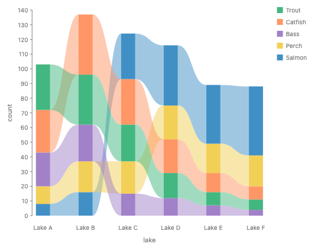
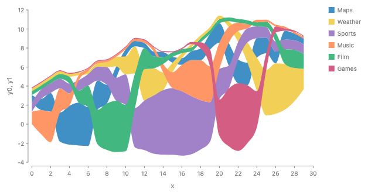

# Stack Profiles: one geometry for stacking and dividing

1. Stacked areas, streamgraphs, stacked densities, croissants, ridgelines, sankey strands and anchor slots all read one thing from a shape: how thick it is at each position along the other axis. Call it the shape's **profile**. A box is the profile that does not change.
2. With profiles, `stack` stays one local operator. It reads each child's profile, adds them, and places each child on the boundary below it. `spread` reads the same profile to space shapes by their outlines, `partition` cuts a profile's domain into cells, and a divide is a stack whose whole is given. `cut` loses its modes.
3. A density is a profile given by a function, so it needs no rows, no `sweep` and no grid. The renderer samples a profile when it draws it, so no spec names a grid.

**Recommendation: Approach A, profiles.** Add one geometry type, the profile, that every node can report (a box reports a constant one). Keep one flow `stack` that adds profiles and takes `baseline`, with `StackOrigin` as the one model of where it starts. `spread` spaces by profiles with `measure: Outline.contour()`. `partition` on a profile restricts it to cells, which draws the croissant with no `intersect`. `cut` keeps one job, splitting a drawn shape into pieces the next operator can move, and takes its regions from a `stack` or a `partition` instead of modes. The per-x form stays for charts whose order changes at each x. **Runner-up: B, per-x core.** It is today's engine with fixes and costs least, but it keeps two concepts of thickness and answers locality by never letting a stack see a ribbon.

The review page is `page.html` beside this file.

## Rules

- **A profile is an extent that varies along the other axis.** For an axis d (the stacking axis) and the cross axis u, a profile is a domain of u and, at each u in it, a descent and an ascent around the node's baseline. A box is the constant profile over its cross extent.
- **Each value is a size, not a pixel count.** It is a data amount times the scale factor plus fixed pixels (a stroke, a fixed-size rect), so a stack can still solve its scale before layout.
- **Readers differ only in how they combine profiles.** `stack` adds them at each u. `spread` with contour spacing takes the largest overlap. A divide adds them and rescales to a given whole. `partition` restricts the domain to cells. An anchor's slot flow runs along a part whose length is a profile's edge.
- **Local means two things.** An operator reads only its children's summaries (a box or a profile), never their rows or vertices, and it writes only each child's frame. A profile stack's frame for a child is the boundary curve below it. When every part is a box, that curve is flat and the frame is today's translate.
- **Profiles live in the layer's unbent space.** Polar, `Coord.along(spine)` and other coordinate transforms bend the result afterwards, so a radial stacked area and strands along a sankey link are plain stacks.
- **A profile may be a function.** `x.density()` is a profile with no rows. The renderer samples it when it draws it. No spec names a grid, and `repeat` stays discrete.

## Terms

| Term            | Meaning                                                                                                                                                                                                                                                                                                                                                                            |
| --------------- | ---------------------------------------------------------------------------------------------------------------------------------------------------------------------------------------------------------------------------------------------------------------------------------------------------------------------------------------------------------------------------------- |
| Profile         | The thickness of a shape along one axis (d) as a function of position along the other (u): at each u, how far the shape reaches below and above its baseline (its descent and ascent, the font-metric words GoFish already uses). Precedents: a tidy tree's contour, a skyline in computational geometry, and the calculus region between two graphs, {(u, v): lo(u) ≤ v ≤ hi(u)}. |
| Index           | The cross-axis position u that a profile is a function of. Two profiles can be added at each u only if their indexes are positions on one shared scale.                                                                                                                                                                                                                            |
| Hull            | The box around a profile: from its lowest point to its highest. A parent that reads only boxes sees the hull.                                                                                                                                                                                                                                                                      |
| Frame           | Where an operator puts a child's local 0. Today it is a point (a translate). In a profile stack it is the boundary curve below the child.                                                                                                                                                                                                                                          |
| Glue            | Neighboring parts share one boundary, so no gap or overlap opens between them. The equations are g*i(u) − g*(i−1)(u) = f_i(u).                                                                                                                                                                                                                                                     |
| Baseline        | Where a stack starts, g_0(u). Zero for stacked bars, a wiggle curve for a streamgraph. In the code it is `StackOrigin` (`constraints/distribute.ts`).                                                                                                                                                                                                                              |
| Given whole     | A total that the spec fixes before the parts are known: 100%, a bottle's outline, a link's width. A stack with a given whole is a divide.                                                                                                                                                                                                                                          |
| Per-x form      | `scatter({ by: "x" })` then `stack`. The stack runs once in each x slice and sees only that slice.                                                                                                                                                                                                                                                                                 |
| Contour spacing | Spacing siblings as close as their outlines allow, not their boxes (`measure: Outline.contour()` on the sankey layout page).                                                                                                                                                                                                                                                       |
| CanSum          | The trait that says a unit's values add up. A stack checks it.                                                                                                                                                                                                                                                                                                                     |

## Approaches

### A. Profiles (recommended)

Every node can report a profile. A box reports a constant one. `stack` adds profiles at each u and gives each child the boundary below it as its frame. `spread` with contour spacing reads the same profile. A divide is a stack with a given whole. `partition` on a profile's index restricts it. A density is a profile given by a function.

Composition:

- **Coordinate transforms.** Profiles live in the layer's unbent space, so polar, `Coord.clock` and `Coord.along(spine)` bend the result after the stack. Every geometry reader already works on the unbent shape (#1342, #1298: outline readers ignore the coordinate bend), so this is the rule, not a new case. Contour spacing in the unbent space still prevents overlap on screen under any one-to-one transform. `Coord.along` is one-to-one only within its bend limit, and past it the layout raises an error.
- **Anchors.** A part such as `x-max` of a violin is a one-dimensional space whose index is the profile's u. A slot flow is an ordinary flow there: `partition` slots are cells of u, `stack` slots are shares of the part's length. Part names stay a separate decision.
- **Distributions (#980).** `x.density()` is a profile with no rows. A cell of a Dist partition is the Dist over the cell with its mass, which picks the mass reading the croissant page left open. `repeat` stays discrete.
- **Choose (silhouette note).** A profile is the silhouette note's contour instance. On constant profiles the profile stack equals today's box stack, which is that note's Law 2 for the degenerate case, so every existing chart is unchanged. Its domination order has no bounded width, so a `choose` over profile layouts is first fit, which is already `choose`'s default.
- **Layout engine.** A thickness is a size claim, a data amount times the scale factor plus pixels. The largest total over u is piecewise linear and increasing in the scale factor, the kind of claim the size pass already solves. This needs checking against the claim algebra.
- **Animation.** A baseline is a value of the stack, so a transition from zero to wiggle tweens the baseline. Stacked to grouped stays an animation between two specs (#831).

Desugaring: A profile stack whose parts share an order desugars into today's per-x form: read every part at the union of its breakpoints, stack each slice, connect. That rewrite is the shortcut until the engine has a profile type.

| Pair                                 | Overlap                                                                                                                                                                                                                        |
| ------------------------------------ | ------------------------------------------------------------------------------------------------------------------------------------------------------------------------------------------------------------------------------ |
| stack of profiles vs per-x stack     | Exact composition when the order is one for all u. Defined by the rewrite above.                                                                                                                                               |
| stack vs spread with contour spacing | Small shared kernel. Both read the profile and share the split. They differ in the combine (sum against largest overlap) and the result (one space against separate spaces). On boxes with no spacing they place shapes alike. |
| divide vs stack                      | Same operator, a different closing condition: a given whole instead of a baseline. `field(f).normalize()` already has this type.                                                                                               |
| `cut` by weight                      | Exact composition: the regions of `stack({ by, size })` intersected with the shape. So `cut` takes the operator, not a mode.                                                                                                   |
| `cut` by cells, croissant            | Exact composition: `partition` regions intersected with the shape. On a profile mark, partition alone restricts the profile, which draws the same picture with no intersect.                                                   |
| `Tile.slice`, `Tile.dice`            | Exact: a normalized stack (#1276 proposes deleting them).                                                                                                                                                                      |
| `baseline` vs `Trait.diverging`      | One model, `StackOrigin`. The trait is a default that desugars into it.                                                                                                                                                        |
| `.stack()` mark method (#290)        | None: dropped.                                                                                                                                                                                                                 |

Trade-offs:

- Easy: one spelling for stacked area, streamgraph, stacked density, polar and along-a-curve stacks; no rows or grids for densities; the croissant and the half violin lose their helpers.
- Awkward: a rigid shape (a circle, text, an image) as a part on a curved boundary has no sensible frame, so it is an error. The ribbon chart still needs the per-x form.
- New terms: profile, index, frame (internal); `Baseline` on the surface. `measure: Outline.contour()` comes from the sankey page.
- Cost: a new geometry type in the engine (beside box, enclosing circle and outline). Until then, the per-x rewrite is a declared shortcut.
- Extension: custom baselines and custom profile readers are functions over profiles, like the other strategy families (#1101).

### B. Per-x core (runner-up)

The core has no profile. `stack` only ever reads boxes. Continuous charts are written in the per-x form: rows over x (from data, or from `sweep` for a density), `scatter` by x, a stack in each slice, and a ribbon threading the pieces. A data helper aligns misaligned series. The baseline is the `alignment` of the outer scatter (`Align.wiggle()`). Contour spacing is a separate pixel-outline query on `spread`.

Composition:

- **Coordinates.** Works today in polar and would work in `Coord.along`.
- **Anchors.** Slots are flows over rows; a violin's side needs sweep rows.
- **Distributions.** Needs `sweep` (a continuum of rows) for every density, and on-demand slice layout that no prototype has built.
- **Choose.** Nothing new: only boxes.

Desugaring: It is the core. Nothing desugars into it that is not already there.

| Pair                                        | Overlap                                                                                                              |
| ------------------------------------------- | -------------------------------------------------------------------------------------------------------------------- |
| ribbon over per-x slices vs contour spacing | Large partial overlap: two notions of a shape's thickness along x, one made of rows, one of pixel outlines.          |
| `align` helper vs stat                      | A visible resample step that names a rule users must remember, or a hidden one inside scatter, which is a heuristic. |
| `cut`                                       | Unchanged, with its modes.                                                                                           |

Trade-offs:

- Easy: costs least; it is today's engine with a resample helper and an alignment strategy.
- Awkward: every continuous chart carries `scatter` by x; densities need `sweep` rows; series on different grids need a step the user must remember.
- Locality holds trivially: a stack never sees a ribbon. The cost is that the ribbon is never one child.
- New terms: `sweep`, `align`, `Align`.

### C. Divide a drawn whole (Mascot)

Draw the whole first, then divide it. A stacked area is one area of the total, cut by group at each x. The croissant is the density cut along x. Sankey strands are the link cut across its width. `stack` stays for boxes.

Composition:

- **Coordinates.** Cut in the unbent space, as A.
- **Anchors.** No role: slots are not a division of a drawn shape.
- **Distributions.** The density is the whole; cut needs each group's share at each x, so it reaches into the groups anyway.

Desugaring: `cut` by group is a stack of shares intersected with the total, so the divide is the stack under another name.

| Pair                          | Overlap                                                                           |
| ----------------------------- | --------------------------------------------------------------------------------- |
| cut by group vs stack         | Large partial overlap: two routes to every stacked area.                          |
| cut by weight vs cut by cells | One name over two types (shares and positions). Josh found these modes confusing. |

Trade-offs:

- Easy: local by construction, since cut reads only its own mark's rows; right for shapes the spec really draws first (a bottle, a horizon chart).
- Awkward: the user writes a total they do not have; stacked lines and ribbon charts cannot be written; a texture per band cannot come from one source.
- New terms: cut modes and an "across" direction.

## Examples

### 1. Stacked area, series measured at different x


_Proposed result (emulated: each series read as a linear function, added at every x)._


_Today's per-x spelling on the same rows: it stacks only rows that share an exact x, with no warning._

Maps is measured every 1, Sports every 1.5, Games at 15 jittered x. Each ribbon's profile is its own curve through its own rows, so the stack adds functions and needs no common sample points. Outside a series' own x range its thickness is 0 (ggplot2's rule).

Proposed (A):

```js
chart(sampled)
  .flow(stack({ by: "series", dir: "y" }))
  .mark(ribbon({ x: "x", h: "y", fill: "series" }));
```

```python
chart(sampled).flow(stack(by="series", dir="y")).mark(
    ribbon(x="x", h="y", fill="series")
)
```

Today (runs, draws the sawtooth above):

```js
chart(sampled)
  .flow(scatter({ by: "x", x: "x" }), stack({ by: "series", dir: "y" }))
  .mark(ribbon({ h: "y", fill: "series" }));
```

B (works, with a visible resample step):

```js
chart(sampled)
  .flow(
    derive(align({ x: "x", by: "series" })), // resample at the union of all x
    scatter({ by: "x", x: "x" }),
    stack({ by: "series", dir: "y" })
  )
  .mark(ribbon({ h: "y", fill: "series" }));
```

```python
chart(sampled).flow(
    derive(align(x="x", by="series")),
    scatter(by="x", x="x"),
    stack(by="series", dir="y"),
).mark(ribbon(h="y", fill="series"))
```

C (works, cut densifies):

```js
chart(sampled).mark(
  ribbon({ x: "x", h: "y", fill: "series" }).cut({ by: "series", dir: "y" })
);
```

```python
chart(sampled).mark(ribbon(x="x", h="y", fill="series").cut(by="series", dir="y"))
```

### 2. Streamgraph with a wiggle baseline


_Weighted wiggle, the d3 and Plot default (emulated: the baseline is computed in derive)._

The baseline is a profile too: g_0(u), chosen to flatten the boundaries. It needs every series over all x, which the whole-series stack sees. `baseline` sets the stack's `StackOrigin`; see the baseline section.

Proposed (A):

```js
chart(topics)
  .flow(stack({ by: "topic", dir: "y", baseline: Baseline.wiggle() }))
  .mark(ribbon({ x: "x", h: "value", fill: "topic" }));
```

```python
chart(topics).flow(stack(by="topic", dir="y", baseline=Baseline.wiggle())).mark(
    ribbon(x="x", h="value", fill="topic")
)
```

Today (wiggle computed by hand, about 20 lines):

```js
chart(topics)
  .flow(
    derive((rows) => stackRows(rows, { offset: "wiggle" })),
    scatter({ by: "x", x: "x" }),
    scatter({ by: "topic", yMin: "y0", yMax: "y1" })
  )
  .mark(ribbon({ fill: "topic" }));
```

B (works, baseline on the outer scatter):

```js
chart(topics)
  .flow(
    scatter({ by: "x", x: "x", alignment: Align.wiggle() }),
    stack({ by: "topic", dir: "y" })
  )
  .mark(ribbon({ h: "value", fill: "topic" }));
```

```python
chart(topics).flow(
    scatter(by="x", x="x", alignment=Align.wiggle()),
    stack(by="topic", dir="y"),
).mark(ribbon(h="value", fill="topic"))
```

C (works, but the user writes a total):

```js
chart(topics).mark(
  ribbon({ x: "x", h: "value", fill: "topic" }).cut({
    by: "topic",
    dir: "y",
    baseline: Baseline.wiggle(),
  })
);
```

```python
chart(topics).mark(
    ribbon(x="x", h="value", fill="topic").cut(
        by="topic", dir="y", baseline=Baseline.wiggle()
    )
)
```

### 3. Stacked density curves (croissant style)


_Stacked group densities, each scaled by its group's count (emulated: KDE grid computed in derive)._


_The same with the whole given as 1 at every x: the conditional density, a divide._

`mass.density()` is a profile given by a function of mass, one per group. The stack adds functions, so there are no rows over mass and no grid. Giving the whole (`.normalize()`) turns the stack into a divide.

Proposed (A):

```js
const mass = field("mass");
chart(penguins)
  .flow(stack({ by: "species", dir: "y" }))
  .mark(
    ribbon({ x: mass, h: mass.density().times(mass.count()), fill: "species" })
  );
```

```python
mass = field("mass")
chart(penguins).flow(stack(by="species", dir="y")).mark(
    ribbon(x=mass, h=mass.density().times(mass.count()), fill="species")
)
```

Today (KDE grid and stack computed by hand):

```js
chart(samples)
  .flow(
    derive((rows) => stackRows(densityRows(rows), { offset: "zero" })),
    scatter({ by: "x", x: "x" }),
    scatter({ by: "c", yMin: "y0", yMax: "y1" })
  )
  .mark(ribbon({ fill: "c" }));
```

B (works, needs sweep rows):

```js
const mass = field("mass");
chart(penguins)
  .flow(
    sweep({ v: mass.range() }),
    scatter({ by: "v", x: "v" }),
    stack({ by: "species", dir: "y" })
  )
  .mark(ribbon({ h: mass.density("v").times(mass.count()), fill: "species" }));
```

```python
mass = field("mass")
chart(penguins).flow(
    sweep(v=mass.range()),
    scatter(by="v", x="v"),
    stack(by="species", dir="y"),
).mark(ribbon(h=mass.density("v").times(mass.count()), fill="species"))
```

C (works, cut must find each group's share):

```js
const mass = field("mass");
chart(penguins).mark(
  ribbon({
    x: mass,
    h: mass.density().times(mass.count()),
    fill: "species",
  }).cut({
    by: "species",
    dir: "y",
  })
);
```

```python
mass = field("mass")
chart(penguins).mark(
    ribbon(x=mass, h=mass.density().times(mass.count()), fill="species").cut(
        by="species", dir="y"
    )
)
```

### 4. Ridgeline (a spread, not a stack)


_Fixed pitch: ridges overlap, as most ridgelines do (today's spread, densities computed in derive)._


_Contour spacing: each ridge as close as its outline allows (emulated)._


_For contrast, the same ridges stacked: a stacked density, a different chart._

Ridges are separate spaces, since their areas do not add, so a ridgeline is a `spread`. With profiles, the spread can space ridges by their outlines. It reads the same profile as a stack and combines it differently: the largest overlap, not a sum.

Proposed (A):

```js
const high = field("high");
chart(weather)
  .flow(
    spread({ by: "month", dir: "y", spacing: 4, measure: Outline.contour() })
  )
  .mark(ribbon({ x: high, h: high.density(), fill: "month" }));
```

```python
high = field("high")
chart(weather).flow(
    spread(by="month", dir="y", spacing=4, measure=Outline.contour())
).mark(
    ribbon(x=high, h=high.density(), fill="month")
)
```

Today (fixed pitch; densities computed by hand):

```js
chart(samples)
  .flow(
    derive((rows) => densityRows(rows, { weighted: false })),
    spread({ by: "c", dir: "y", anchor: "baseline", spacing: 70 }),
    scatter({ by: "x", x: "x" })
  )
  .mark(ribbon({ h: "y", fill: "c", opacity: 0.85 }));
```

B (works, contour is a second geometry query):

```js
const high = field("high");
chart(weather)
  .flow(
    spread({ by: "month", dir: "y", spacing: 4, measure: Outline.contour() }),
    sweep({ v: high.range() }),
    scatter({ by: "v", x: "v" })
  )
  .mark(ribbon({ h: high.density("v"), fill: "month" }));
```

```python
high = field("high")
chart(weather).flow(
    spread(by="month", dir="y", spacing=4, measure=Outline.contour()),
    sweep(v=high.range()),
    scatter(by="v", x="v"),
).mark(ribbon(h=high.density("v"), fill="month"))
```

C (works (same as A)):

```js
const high = field("high");
chart(weather)
  .flow(
    spread({ by: "month", dir: "y", spacing: 4, measure: Outline.contour() })
  )
  .mark(ribbon({ x: high, h: high.density(), fill: "month" }));
```

```python
high = field("high")
chart(weather).flow(
    spread(by="month", dir="y", spacing=4, measure=Outline.contour())
).mark(ribbon(x=high, h=high.density(), fill="month"))
```

### 5. Ribbon chart: the band order changes at each x



_Today's per-x form, unchanged in every approach: bars sorted by count at each lake, then a ribbon per species through its bars._



_The same order drawn as one band per series: a band cannot jump over its neighbors, so it overlaps itself._

A profile stack has one order for all x. Here the order changes at every x, and the ribbons cross between the bars, so no division of one shape draws it. It stays the per-x form in every approach. A sort that depends on x inside a profile stack is a loud error that points here.

Proposed (A):

```js
chart(seafood)
  .flow(
    spread({ by: "lake", dir: "x", spacing: 48 }),
    stack({ by: field("species").sort("count"), dir: "y" })
  )
  .mark(rect({ w: 24, h: "count", fill: "species" }).name("bars"))
  .layer(
    chart(selectAll("bars"))
      .flow(group({ by: "species" }))
      .mark(ribbon({ fill: "species", opacity: 0.5 }))
  );
```

```python
chart(seafood).flow(
    spread(by="lake", dir="x", spacing=48),
    stack(by=field("species").sort("count"), dir="y"),
).mark(rect(w=24, h="count", fill="species").name("bars")).layer(
    chart(select_all("bars"))
    .flow(group(by="species"))
    .mark(ribbon(fill="species", opacity=0.5))
)
```

Today (the same code; no change):

B (per-x form (no change)):

The same as A.

C (can't: crossings are not a division):

The same as A.

### 6. Croissant: a density cut into equal-probability slices


_Today's gallery story `Forward Syntax/Croissant`: hand-made grid, quantile rows, partition and intersect._

`partition` on a profile's own index restricts the profile to each cell. A cell of a Dist is the Dist over that cell with its mass, so `x.density()` in a cell is the parent's curve there, and the slices meet exactly. No `intersect`, no hidden ribbon, no `relate`, no grid, no quantile rows.

Proposed (A):

```js
const params = [{ mean: 0, sd: 1 }];
const x = dist.normal({ mean: "mean", sd: "sd" });
chart(params)
  .flow(partition({ by: x.bin(Bin.quantiles(5)), dir: "x" }))
  .mark(
    layer([
      ribbon({
        x,
        h: x.density(),
        inset: 3,
        fill: PAPER_FILL,
        stroke: PAPER_STROKE,
      }),
      circle({ cx: x.median(), cy: 6, r: 3, fill: PAPER_STROKE }),
    ])
  );
```

```python
params = [{"mean": 0, "sd": 1}]
x = dist.normal(mean="mean", sd="sd")
chart(params).flow(partition(by=x.bin(Bin.quantiles(5)), dir="x")).mark(
    layer(
        [
            ribbon(
                x=x, h=x.density(), inset=3, fill=PAPER_FILL, stroke=PAPER_STROKE
            ),
            circle(cx=x.median(), cy=6, r=3, fill=PAPER_STROKE),
        ]
    )
)
```

Today (stories/forwardsyntax/Croissant.stories.tsx; the sequence repeats three times in the file):

```js
const normPdf = (x, mu = 0, sd = 1) =>
  Math.exp(-0.5 * ((x - mu) / sd) ** 2) / (sd * Math.sqrt(2 * Math.PI));
const gridOf = (f, lo, hi, n) =>
  Array.from({ length: n }, (_, i) => {
    const x = lo + ((hi - lo) * i) / (n - 1);
    return { x, pdf: f(x) };
  });
const croissant = (grid, { n = 10, fill = FILL, stroke = STROKE } = {}) =>
  layer([
    chart(grid)
      .flow(scatter({ x: "x" }))
      .mark(ribbon({ h: "pdf" }).name("density").hidden()),
  ]).relate(({ density }) => [
    chart(grid)
      .flow(
        derive((rows) =>
          quantileRows(rows, { x: "x", density: "pdf", n: 1000 })
        ),
        partition({ by: field("x").bin(Bin.quantiles(n)), dir: "x" })
      )
      .mark(
        layer([
          intersect({ fill, stroke, strokeWidth: 2 }, [
            density,
            region({ inset: 3 }),
          ]),
          circle({ cx: field("x").median(), cy: 6, r: 3, fill: stroke }),
        ])
      ),
  ]);
// on [-3, 3] the missing tails move the outer cells' medians
const normalGrid = gridOf((x) => normPdf(x), -4, 4, 401);
croissant(normalGrid, { n: 5, fill: PAPER_FILL, stroke: PAPER_STROKE });
```

B (works, but each cell's rows must share boundary points):

```js
const params = [{ mean: 0, sd: 1 }];
const x = dist.normal({ mean: "mean", sd: "sd" });
chart(params)
  .flow(
    sweep({ v: x.range() }),
    partition({ by: x.bin(Bin.quantiles(5)), dir: "x" }),
    scatter({ by: "v", x: "v" })
  )
  .mark(ribbon({ h: x.density("v"), inset: 3, fill: PAPER_FILL }));
```

```python
params = [{"mean": 0, "sd": 1}]
x = dist.normal(mean="mean", sd="sd")
chart(params).flow(
    sweep(v=x.range()),
    partition(by=x.bin(Bin.quantiles(5)), dir="x"),
    scatter(by="v", x="v"),
).mark(ribbon(h=x.density("v"), inset=3, fill=PAPER_FILL))
```

C (works, as a second cut mode (cells)):

```js
const params = [{ mean: 0, sd: 1 }];
const x = dist.normal({ mean: "mean", sd: "sd" });
chart(params).mark(
  ribbon({ x, h: x.density(), fill: PAPER_FILL }).cut({
    by: x.bin(Bin.quantiles(5)),
    dir: "x",
    spacing: 6,
  })
);
```

```python
params = [{"mean": 0, "sd": 1}]
x = dist.normal(mean="mean", sd="sd")
chart(params).mark(
    ribbon(x=x, h=x.density(), fill=PAPER_FILL).cut(
        by=x.bin(Bin.quantiles(5)), dir="x", spacing=6
    )
)
```

### 7. Sankey: strands stacked along a link's normal, ends stacked in anchors


_Strands of 12, 24 and 12 px stacked along the link's normal: each keeps its width (emulated)._


_The same strands stacked vertically: they thin where the link is steep._


_The energy sankey with ends stacked in anchors (emulated anchors, from the stacked ribbons page)._

Inside `Coord.along(link)`, x is distance along the link and y is distance along its normal, so a plain profile stack draws strands that keep their width. At a node the link leaves horizontally, the normal is vertical, and the strand stack meets the anchor's slot stack exactly. Slots are a flow along a part, so they are the same stack in a one-dimensional space.

Proposed (A):

```js
// strands along one link
layer({ coord: Coord.along(link) }, [
  chart(strands)
    .flow(stack({ by: "strand", dir: "y", baseline: Baseline.center() }))
    .mark(ribbon({ x: "s", h: "width", fill: "strand" })),
]);

// ends on the nodes (the agreed anchor spelling, unchanged)
rect({ w: 12, h: "value" })
  .anchor({
    name: "out",
    position: "x-max",
    slots: data(links, { on: "source" }).flow(
      stack({ by: "target", size: "value" })
    ),
  })
  .name("nodes");
```

```python
layer(
    [
        chart(strands)
        .flow(stack(by="strand", dir="y", baseline=Baseline.center()))
        .mark(ribbon(x="s", h="width", fill="strand"))
    ],
    coord=Coord.along(link),
)

rect(w=12, h="value").anchor(
    name="out",
    position="x-max",
    slots=data(links, on="source").flow(stack(by="target", size="value")),
).name("nodes")
```

Today:

```js
// No spelling: strands along a normal are drawn as hand-computed polygons.
// d3-sankey draws each strand as its own stroke on its own centerline.
```

B (works with Coord.along):

```js
layer({ coord: Coord.along(link) }, [
  chart(strands)
    .flow(
      scatter({ by: "s", x: "s", alignment: "middle" }),
      stack({ by: "strand", dir: "y" })
    )
    .mark(ribbon({ h: "width", fill: "strand" })),
]);
```

```python
layer(
    [
        chart(strands)
        .flow(scatter(by="s", x="s", alignment="middle"), stack(by="strand", dir="y"))
        .mark(ribbon(h="width", fill="strand"))
    ],
    coord=Coord.along(link),
)
```

C (needs a new cut direction, "across"):

```js
ref("link").cut({ by: "strand", size: "width", dir: "across" });
```

```python
ref("link").cut(by="strand", size="width", dir="across")
```

### 8. Half violin with slots


_Penguin body mass: the violin's flat side has one slot per mass bin, joined to a 100% bar (emulated anchors and KDE)._

The violin is a profile over mass. Its `x-max` part is the flat side, whose length is the profile's domain. A `partition` slot flow cuts that domain into cells, the same partition as the croissant's, and the bar's `stack` slots divide its height by share. The KDE helper and its grid go away.

Proposed (A):

```js
const mass = field("mass");
const massBins = mass.bin(Bin.thresholds([3000, 4000, 5000, 6000]));
layer([
  spread({ dir: "x", spacing: 160 }, [
    chart(penguins).mark(
      ribbon({
        y: mass,
        w: mass.density(),
        dir: "y",
        align: "end",
        fill: "#c4c4c4",
      })
        .anchor({
          name: "out",
          position: "x-max",
          slots: data().flow(partition({ by: massBins })),
        })
        .name("violin")
    ),
    chart(penguins).mark(
      rect({ w: 14, h: mass.count() })
        .anchor({
          name: "in",
          position: "x-min",
          slots: data().flow(stack({ by: massBins, size: mass.count() })),
        })
        .name("bar")
    ),
  ]),
  chart(penguins)
    .flow(group({ by: massBins }))
    .mark(
      ribbon({
        from: "violin.out",
        to: "bar.in",
        fill: massBins,
        opacity: 0.55,
      })
    ),
]);
```

```python
mass = field("mass")
mass_bins = mass.bin(Bin.thresholds([3000, 4000, 5000, 6000]))
layer(
    [
        spread(
            [
                chart(penguins).mark(
                    ribbon(
                        y=mass, w=mass.density(), dir="y", align="end", fill="#c4c4c4"
                    )
                    .anchor(
                        name="out",
                        position="x-max",
                        slots=data().flow(partition(by=mass_bins)),
                    )
                    .name("violin")
                ),
                chart(penguins).mark(
                    rect(w=14, h=mass.count())
                    .anchor(
                        name="in",
                        position="x-min",
                        slots=data().flow(stack(by=mass_bins, size=mass.count())),
                    )
                    .name("bar")
                ),
            ],
            dir="x",
            spacing=160,
        ),
        chart(penguins)
        .flow(group(by=mass_bins))
        .mark(ribbon(from_="violin.out", to="bar.in", fill=mass_bins, opacity=0.55)),
    ]
)
```

The stacked ribbons page's target (a KDE helper makes grid rows):

```js
chart(penguins)
  .flow(derive(kde("mass", 200)), scatter({ by: "mass", y: "mass" }))
  .mark(
    ribbon({ w: "density", dir: "y", align: "end", fill: "#c4c4c4" })
      .anchor({
        name: "out",
        position: "x-max",
        slots: data(penguins).flow(partition({ by: massBins })),
      })
      .name("violin")
  );
// Today the render is emulated: slots are rects with h 0 in the violin's
// chart, sizes are written in mass units, and the KDE is hand-written.
```

B (works, slots on sweep rows):

```js
const mass = field("mass");
chart(penguins)
  .flow(sweep({ v: mass.range() }), scatter({ by: "v", y: "v" }))
  .mark(
    ribbon({ w: mass.density("v"), dir: "y", align: "end", fill: "#c4c4c4" })
      .anchor({
        name: "out",
        position: "x-max",
        slots: data(penguins).flow(partition({ by: massBins })),
      })
      .name("violin")
  );
```

```python
mass = field("mass")
chart(penguins).flow(sweep(v=mass.range()), scatter(by="v", y="v")).mark(
    ribbon(w=mass.density("v"), dir="y", align="end", fill="#c4c4c4")
    .anchor(
        name="out", position="x-max", slots=data(penguins).flow(partition(by=mass_bins))
    )
    .name("violin")
)
```

C (same as A or B: cut plays no part in slots):

The same as A.

### 9. Stacked lines (no area to divide)


_Five series stacked; each line runs along the top of its band (today, per-x form)._

What is stacked is the amount, never the stroke. A line with `h` reports the profile of its band and draws the band's top edge, which today's `source` and `target` options already say. A divide has nothing to divide here.

Proposed (A):

```js
chart(topics)
  .flow(stack({ by: "topic", dir: "y" }))
  .mark(
    line({
      x: "x",
      h: "value",
      stroke: "topic",
      source: { y: "end" },
      target: { y: "end" },
    })
  );
```

```python
chart(topics).flow(stack(by="topic", dir="y")).mark(
    line(
        x="x", h="value", stroke="topic", source={"y": "end"}, target={"y": "end"}
    )
)
```

Today (runs, the render above):

```js
chart(topics)
  .flow(scatter({ by: "x", x: "x" }), stack({ by: "topic", dir: "y" }))
  .mark(
    line({
      h: "value",
      stroke: "topic",
      source: { y: "end" },
      target: { y: "end" },
    })
  );
```

B (works (today)):

```js
chart(topics)
  .flow(scatter({ by: "x", x: "x" }), stack({ by: "topic", dir: "y" }))
  .mark(
    line({
      h: "value",
      stroke: "topic",
      source: { y: "end" },
      target: { y: "end" },
    })
  );
```

```python
chart(topics).flow(scatter(by="x", x="x"), stack(by="topic", dir="y")).mark(
    line(h="value", stroke="topic", source={"y": "end"}, target={"y": "end"})
)
```

C (can't):

```js
// No spelling: a divide needs a drawn total to divide.
```

```python
# No spelling: a divide needs a drawn total to divide.
```

### 10. Hard example 1: radial stacked area in polar coordinates


_Today's per-x form in `Coord.polar()`; it already draws (real render)._

Profiles live in the layer's unbent space, so the polar layer bends the stacked area after the stack adds it. The radii add, not the areas. For rings whose areas add, the radius axis is `Coord.clock({ radius: "area" })` from the scale transforms proposal.

Proposed (A):

```js
chart(topics, { coord: Coord.polar() })
  .flow(stack({ by: "topic", dir: "y" }))
  .mark(ribbon({ x: "x", h: "value", fill: "topic" }));
```

```python
chart(topics, coord=Coord.polar()).flow(stack(by="topic", dir="y")).mark(
    ribbon(x="x", h="value", fill="topic")
)
```

Today (runs, the render above):

```js
chart(topics, { coord: Coord.polar() })
  .flow(scatter({ by: "x", x: "x" }), stack({ by: "topic", dir: "y" }))
  .mark(ribbon({ h: "value", fill: "topic" }));
```

B (works (today)):

```js
chart(topics, { coord: Coord.polar() })
  .flow(scatter({ by: "x", x: "x" }), stack({ by: "topic", dir: "y" }))
  .mark(ribbon({ h: "value", fill: "topic" }));
```

```python
chart(topics, coord=Coord.polar()).flow(
    scatter(by="x", x="x"), stack(by="topic", dir="y")
).mark(ribbon(h="value", fill="topic"))
```

C (works):

```js
chart(topics, { coord: Coord.polar() }).mark(
  ribbon({ x: "x", h: "value", fill: "topic" }).cut({ by: "topic", dir: "y" })
);
```

```python
chart(topics, coord=Coord.polar()).mark(
    ribbon(x="x", h="value", fill="topic").cut(by="topic", dir="y")
)
```

### 11. Hard example 2: fan chart of nested forecast intervals


_Nested 50%, 80% and 95% intervals as position profiles (today, real render)._


_The same fan as a stack of quantile gaps on a hidden base part: the axis is forced to 0, because a stack measures from its baseline (today, emulated baseline)._

An interval's ends are positions, not amounts, so a fan is a layer of profiles placed by `yMin` and `yMax`, and nothing adds. It can also be written as a stack of the gaps between quantiles, which do add, on a baseline that is itself a profile: the lowest quantile. That second form is legal and draws the same bands, but the axis must then hold the baseline's 0, so the layered form is the right one. The test: a profile type must not force a stack where positions are meant.

Proposed (A):

```js
chart(forecast)
  .flow(group({ by: "level" }))
  .mark(ribbon({ x: "t", yMin: "lo", yMax: "hi", fill: "level" }))
  .layer(chart(history).mark(line({ x: "t", y: "v" })));
```

```python
chart(forecast).flow(group(by="level")).mark(
    ribbon(x="t", y_min="lo", y_max="hi", fill="level")
).layer(
    chart(history).mark(line(x="t", y="v"))
)
```

Today (runs, the first render):

```js
chart(forecast)
  .flow(
    group({ by: "level" }),
    scatter({ by: "t", x: "t", yMin: "lo", yMax: "hi" })
  )
  .mark(ribbon({ fill: "level" }))
  .layer(
    chart(history)
      .flow(scatter({ by: "t", x: "t", y: "v" }))
      .mark(line({ stroke: "#333", strokeWidth: 2 }))
  );
```

B (works (today)):

```js
chart(forecast)
  .flow(
    group({ by: "level" }),
    scatter({ by: "t", x: "t", yMin: "lo", yMax: "hi" })
  )
  .mark(ribbon({ fill: "level" }))
  .layer(
    chart(history)
      .flow(scatter({ by: "t", x: "t", y: "v" }))
      .mark(line())
  );
```

```python
chart(forecast).flow(
    group(by="level"), scatter(by="t", x="t", y_min="lo", y_max="hi")
).mark(ribbon(fill="level")).layer(
    chart(history).flow(scatter(by="t", x="t", y="v")).mark(line())
)
```

C (same as A):

```js
// The same as A: nothing is divided.
```

```python
# The same as A: nothing is divided.
```

## Trade-offs

| Example                                                                | A                                             | B                                                      | C                                          |
| ---------------------------------------------------------------------- | --------------------------------------------- | ------------------------------------------------------ | ------------------------------------------ |
| Stacked area, series measured at different x                           | works                                         | works, with a visible resample step                    | works, cut densifies                       |
| Streamgraph with a wiggle baseline                                     | works                                         | works, baseline on the outer scatter                   | works, but the user writes a total         |
| Stacked density curves (croissant style)                               | works, no rows                                | works, needs sweep rows                                | works, cut must find each group's share    |
| Ridgeline (a spread, not a stack)                                      | works, same profile as the stack              | works, contour is a second geometry query              | works (same as A)                          |
| Ribbon chart: the band order changes at each x                         | per-x form (no change)                        | per-x form (no change)                                 | can't: crossings are not a division        |
| Croissant: a density cut into equal-probability slices                 | works, partition restricts the profile        | works, but each cell's rows must share boundary points | works, as a second cut mode (cells)        |
| Sankey: strands stacked along a link's normal, ends stacked in anchors | works with Coord.along                        | works with Coord.along                                 | needs a new cut direction, "across"        |
| Half violin with slots                                                 | works, slots are cells of the profile's index | works, slots on sweep rows                             | same as A or B: cut plays no part in slots |
| Stacked lines (no area to divide)                                      | works                                         | works (today)                                          | can't                                      |
| Hard example 1: radial stacked area in polar coordinates               | works                                         | works (today)                                          | works                                      |
| Hard example 2: fan chart of nested forecast intervals                 | works, positions not amounts                  | works (today)                                          | same as A                                  |

New syntax in A:

- `stack` of ribbons with `x`: `.flow(stack({ by, dir }))` and `.mark(ribbon({ x, h }))`, no `scatter` by x.
- `stack({ baseline: Baseline.zero() | Baseline.center() | Baseline.wiggle() })`.
- `spread({ measure: Outline.contour() })` (from the sankey layout page).
- `ribbon({ h: x.density() })` and `ribbon({ x, yMin, yMax })` with no rows over x.
- `shape.cut(stack(...))` and `shape.cut(partition(...))` replacing `cut`'s modes.

## The profile

For a node, an axis d (the one a stack runs along) and the other axis u, the node's **profile** along d is:

- a **domain**, an interval of u. When u is a position scale shared with its siblings (a ribbon's `x`), the domain is in data units. Otherwise it is the node's own extent in pixels.

- at each u in the domain, a **descent** and an **ascent**: how far the shape reaches below and above its baseline along d.

- each descent and ascent is a **size**: a data amount times the scale factor plus fixed pixels. A ribbon's `h: "value"` gives the amount. A stroke or a fixed `h: 12` gives pixels.

Facts that follow:

- **A box is the degenerate case.** Its ascent and descent are constant over its cross extent. A rect with no `x` has no index of its own, so its constant profile covers whatever domain its siblings share.

- **The hull is the box.** The box a parent reads today is the hull of the profile: lowest point to highest point. So any parent that only reads boxes keeps working.

- **Two profiles combine pointwise only on a shared index.** Siblings in a stack must place u on one scale. A ribbon's `x` does that. Profiles with different index scales are an error that names the two scales.

- **A profile can come from rows or from a function.** From rows it is the mark's curve through them (each series is curved first, then added). From a function (`x.density()`) it is evaluated on demand. Outside its domain a part has thickness 0.

- **Under a coordinate transform** the profile stays in the layer's unbent space. Polar maps u to angle and d to radius. `Coord.along(spine)` maps u to distance along the spine and d to distance along its normal.

- **A node's profile is computed bottom-up**, like its box: a stack's profile is [g_0, g_n], a spread's is the union of its children's placed profiles.

## Readers

<div class="table-wrap"><table>
<tr><th>Reader</th><th>How it combines children's profiles</th><th>Result</th><th>Check</th></tr>
<tr><td><code>stack</code></td><td>g_i(u) = g_(i&minus;1)(u) + thickness_i(u); child i's frame is the curve g_(i&minus;1)</td><td>one space, the sum</td><td>CanSum, shared index</td></tr>
<tr><td>divide: <code>stack</code> with a given whole</td><td>the same, with each part rescaled to f_i(u) / &Sigma;f(u) times W(u)</td><td>one space, shares</td><td>CanSum, total not 0</td></tr>
<tr><td><code>spread</code>, <code>measure: Outline.contour()</code></td><td>gap_i = largest over u of (top_(i&minus;1)(u) &minus; bottom_i(u)) + spacing; a rigid translate</td><td>separate spaces</td><td>none (no sum)</td></tr>
<tr><td><code>partition</code> along u</td><td>restricts a profile to each cell of its index</td><td>cells at their places</td><td>key is a cell</td></tr>
<tr><td>anchor slot flow</td><td>the same flows, in the one-dimensional space of a part</td><td>slots ribbons attach to</td><td>as the flow</td></tr>
<tr><td><code>choose</code></td><td>first fit over alternatives' hulls</td><td>one alternative</td><td>none</td></tr>
</table></div>

## What stays local, and why

Josh's objection (croissant round 6) was that a flow `stack` which reaches into a ribbon's vertices is not local. Here is a definition that can be checked:

- an operator reads only its children's summaries (a box today, or a profile), never their rows or vertices;

- it writes only each child's frame, where the child's local 0 goes.

The round 6 stack broke rule 1. It split each ribbon into per-x pieces, stacked the pieces in separate slices, and joined them again, so the ribbon stopped being one child. A profile stack keeps rule 1: it asks each child for its profile, the way it asks a rect for its height, and it never sees the child's rows or vertices. Series measured at different x show the difference: there are no shared vertices to pair, and the stack still adds the curves.

Rule 2 is where the answer has a cost, stated plainly: a profile stack's frame for child i is not a point but the curve g\_(i−1)(u). The child is drawn on that curve, like a shape drawn inside a coordinate transform. That is the same kind of frame a layer gives its children under `Coord.along(spine)`, so it is not a new power, but it is more than a translate. When every part is a box the curve is flat, and the frame is today's translate.

Where it does not hold:

- **Rigid parts on a curved boundary.** A circle, text or an image has no amount along u, and drawing it on a curve would bend it. In a profile stack with a curved boundary such a part is a loud error that points to `.label()` or `scatter`. With all boxes there is no curve, so dot plots and stacked bars are unchanged.

- **Order that changes with u.** One stack has one order, so the ribbon chart stays the per-x form.

- **Sharing an index means sharing a scale.** That is already true of any two siblings on one axis, so it is no new reach.

## Baseline and StackOrigin

A stack's zero point already has one model in the code: `StackOrigin { part, fraction, mirrored }` (`constraints/distribute.ts:71`). Today only `Trait.diverging(midpoint)` on the `by` column's unit sets it (`families/trait.ts:42`). A separate `baseline` option would be a second channel for the same point unless the two are one. Proposed:

- `StackOrigin` is the one model. With profiles it becomes a profile: g_0(u).

- `baseline` is how a spec writes it. `Baseline.zero()` is today's default, the first part's tail. `Baseline.center()` is the middle of the whole (`fraction` 0.5 of the whole stack). `Baseline.wiggle()` is computed from all parts over u; it has no part and fraction, which is why `StackOrigin` must become a profile.

- `Trait.diverging(midpoint)` stays a property of the data. It is the default that desugars into a `StackOrigin` at the midpoint. Meaning lives on the type, so an explicit `baseline` on a stack over a diverging unit is an error, not an override.

- **Which way a stack grows is the same question.** A stack grows from its baseline away from the measure's zero, which the layer seats at the bottom of a y-up value axis. Five stories (`WaffleChart`, `UnitColumnChart`, `UnitHistogram`, `TitanicFacet`, `Violin`) use `reverse` or `alignment: "end"` to mean bottom, because they are spreads in a free space, which runs y-down. A waffle column is a count, so in this design it is a stack and grows up from its baseline with no `reverse`. That needs stacks with spacing, which the choose proposal left open.

## Cut

On main, `cut` builds each slice as `intersect([rect.hidden(), offset(source)])` and only cuts an image or a rect (`cut.tsx`). The croissant does the same operation with a hidden ribbon, `partition` and `intersect`, so the divide is already on main as two paths with no shared code. `cut`'s sizes, where `datum(n)` is a share of what is left after fixed pixels, repeat `fr(n)` (#1220). And `cut`'s `inset` is a gap along `dir`, while `rect`'s and `region`'s `inset` shrink the outline.

With profiles, the regions come from the operators that already make them, and the modes go away (Josh's "regions from stack/partition intersected with the shape"):

- shares of a drawn shape: `shape.cut(stack({ by, size }))`;

- cells of a drawn shape: `shape.cut(partition({ by }))`;

- a profile mark divided in place needs no `cut`: `partition` or a divide restricts it directly (the croissant, stacked densities).

`cut` keeps one job no other operator does: it makes each piece a separate child, so the next operator can move it. The horizon chart moves its bands down to one baseline, and the bottle stories spread their pieces apart. The gap between pieces is the next operator's `spacing`, so `cut`'s own `inset` and its flexbox sizes go.

## Sampling and the continuum

- **No spec names a grid.** A profile is a function. Its curve is fixed by the mark's rows (with the mark's `curve`) or by a function such as `x.density()`.

- **Curve, then add.** Each part is curved by itself, then the stack adds functions. Today GoFish stacks points and then curves each boundary, and with the default monotone curve that can give a band a negative thickness (stacking page, 8% here).

- **The renderer samples when it draws.** A boundary is drawn through the union of the breakpoints of the parts below it, plus extra points where a curve is not linear and for function profiles. A fixed count (512) stands until screen-aware sampling, which Josh deferred.

- **Continuum rows are not needed for any example here.** Densities are function-valued channels. `repeat` stays discrete (draws, quantile levels). `sweep` stays parked for curves that are not a function of either axis, such as a spiral or a Lissajous figure.

## Implementation path

- **Shortcut now.** A `stack` whose parts are collective marks with `x` lowers to the per-x form: curve each part, read it at the union of breakpoints, compute the baseline from all parts, stack each slice, connect. This is a declared shortcut, because the stack peeks at the mark kind to know a part is a profile.

1. **One geometry kernel.** The profile belongs in `geometry/` beside box, enclosing circle and outline. That module has duplicates to fold first: two `simplifyRing` functions (`geometry/outline.ts`, `geometry/clip.ts`), enclose's own point, box and hull (`enclose/prims.ts`), and three inset paths. `pack` reports its children's outlines while `treemap` reports its box (#1233), which a profile query should settle the same way for both.

1. **One divide kernel.** The glue solve with a closing condition (baseline or whole) serves `stack`, `normalize`, `Tile.slice` and `Tile.dice`, and `cut`, and carries one CanSum check. Today the check is placed by hand: `stack` uses the units' sum (`distribute.ts:366`), `treemap`, the size channel and `.sum()` call `checkSummable` (#1208), and `cut` with a datum array and `pack` check nothing.

1. **Full fix.** Profiles in the size and placement passes, so the stack reads them and the per-x rewrite goes away.

## Precedent

### ggplot2


```r
ggplot(sampled, aes(x, y, fill = series)) +
  geom_area()  # stat = "align", position = "stack"
```

`stat_align` (the default since 3.4.0) reads every series at the union of all x by linear interpolation and pads 0 outside each series' own range, then `position_stack` adds. Same misaligned data as the first card. Real render.

### ggplot2, densities


```r
ggplot(peng, aes(v, after_stat(count), fill = species)) +
  geom_density(position = "stack")  # "fill" gives the conditional density
```

Stacked densities are a position adjustment on a computed curve. `after_stat(count)` scales each group by its size. Real render.

### ggridges


```r
ggplot(peng, aes(v, species)) +
  geom_density_ridges(scale = 1.6)
```

Ridges on a categorical y with an overlap `scale`: a spread with a fixed pitch. No contour spacing. Real render.

### ggalluvial


```r
ggplot(al, aes(axis1 = Class, axis2 = Sex, y = Freq)) +
  geom_alluvium(aes(fill = Survived)) +
  geom_stratum()
```

Strata are stacks at each axis, and each flow's ends are slots in them. The closest precedent for anchors with stacked slots. Real render.

### d3-shape


```js
d3
  .stack()
  .keys(keys)
  .offset(d3.stackOffsetWiggle)
  .order(d3.stackOrderInsideOut)(wide);
```

Offsets (none, expand, diverging, silhouette, wiggle) and orders are functions over the whole table. Keys must share every x. Real render.

### Vega-Lite


```json
{ "mark": "area", "encoding": { "y": { "field": "value", "stack": "center" } } }
```

`stack` is an encoding property: zero, center, normalize. A missing x becomes 0. Real render.

### Observable Plot

```js
Plot.areaY(data, {
  x: "x",
  y: "value",
  fill: "topic",
  offset: "wiggle",
  order: "inside-out",
});
```

`stackY` is applied for you by `areaY`. Offset and order are options of the stack transform. No alignment of x grids.

### ggstream

```r
ggplot(d, aes(x, value, fill = topic)) +
  geom_stream(type = "mirror")  # "ridge", "proportional"
```

Snaps every series to a 1000-point grid and smooths, then stacks. The grid is hidden but fixed.

### matplotlib

```python
ax.stackplot(x, ys, baseline="weighted_wiggle")
```

One x array for all series. Baselines zero, sym, wiggle, weighted_wiggle.

### Mascot

```js
// paraphrased from Mascot's stacked area example
let area = scene.mark("area", { x1, y1, x2, y2 });
let areas = scene.densify(area, table, { attribute: "date" });
let bands = scene.divide(areas, table, {
  attribute: "company",
  orientation: "vertical",
});
```

Draw the whole, densify to common vertices, divide by group at each vertex. The divide-first model of Approach C. Paraphrase, not verbatim.

### PiCCL

```js
// paraphrased
divide(circle, "angular", { by: "category", size: "value" });
```

Divides a drawn shape (a circle, a bottle) into parts by weight. A given whole.

### TeX and Haskell diagrams

```
\vbox{\hbox{A}\hbox{B}}      % boxes report height and depth
a === b                        -- diagrams: placed by envelopes
```

TeX stacks boxes that report height, depth and a baseline. Haskell diagrams places shapes by their envelope, a support function. Both read a summary richer than a box, as a profile is, and never the shape's parts.

## Bugs seen while rendering

- A stack of ribbons over series measured at different x stacks only rows that share an exact x, with no warning (card 1, today's render). Already listed on the stacking page as bug 1.
- `Stacking Matrix/ConditionalDensity` throws "Species is not constant across the connected group" on a fused ribbon over `stack({ size: normalize })`. Already listed as stacking bug 7.
- The fan chart written as a stack forces 0 into the y axis. This is right (a stack measures from its baseline) and shows why a profile baseline matters; not a bug.

## Related issues

- #47: stacked and divided ribbons (sankey strands, anchors)
- #290: `.stack()` as a mark method (dropped)
- #809: wiggle as a stack-level baseline (Josh's idea)
- #831: update is connect on time (stacked to grouped is an animation)
- #980: first-class distributions (densities as profiles)
- #1101: custom strategies as functions
- #1208: `checkSummable`, the shared CanSum check
- #1220: `fr` lengths, which `cut`'s datum sizes repeat
- #1233: pack reports outlines, treemap reports a box
- #1276: delete `Tile.slice` and `Tile.dice`: a normalized stack
- #1284: `Coord.envelope` (the bottle fill by area)
- #1298, #1342: geometry readers work on the unbent shape under coordinates
- #1332: croissant sampling

## Decisions

1. Is a profile (an extent that varies along the other axis, a box being the constant case) the one geometry concept for stack, contour spacing, divide, slots and densities?
2. Does the two-rule definition of local (read only summaries, write only frames, where a frame may be a boundary curve) answer your locality objection?
3. Should a rigid part (circle, text, image) on a curved boundary be an error?
4. One model for a stack's zero: `StackOrigin` as a profile, written `baseline: Baseline.*`, with `Trait.diverging` as a default and an explicit baseline over a diverging unit an error?
5. `cut` takes the operator that makes its regions (`cut(stack(...))`, `cut(partition(...))`), loses its modes, flexbox sizes and `inset`, and keeps only the job of making movable pieces?
6. A cell of a Dist partition is the Dist over the cell with its mass, so `x.density()` in a cell is the parent's curve there?
7. Outside its own x range a part has thickness 0 (ggplot2), rather than an error?
8. Densities as function-valued channels, so no `sweep` for any chart here, and `sweep` parked for parametric curves?
9. Accept the per-x rewrite as a declared shortcut until the engine has a profile type?
10. Name: "profile", or "contour", "envelope" (taken by `Coord.envelope`, #1284) or "skyline"?
