# Stack Profiles: one geometry for stacking and dividing

1. Stacked areas, streamgraphs, stacked densities, croissants, ridgelines, sankey strands and anchor slots all read one thing from a shape: how thick it is at each position along the other axis. Call it the shape's **profile**. A box is the profile that does not change.
2. With profiles, `stack` stays one local operator. It reads each child's profile, adds them, and places each child on the boundary below it. `spread` can read the same profile to space shapes by their outlines (`spacing: Spacing.contour(4)`), `partition` cuts a profile's domain into cells, and a divide is a stack whose whole is given.
3. A density is a profile given by a function: `ribbon({ x: mass.support(), h: mass.density() })` needs no rows and no grid. Both channels are functions of one hidden variable t, and the renderer samples t when it draws, so no spec names a grid.

**Recommendation: Approach A, profiles.** Add one geometry type, the profile, that every node can report (a box reports a constant one). Keep one flow `stack` that adds profiles. Its `baseline` option chooses where the stack's own 0 is (`Baseline.start()`, `Baseline.middle()`, `Baseline.wiggle()`), and a parent's `alignment` lines up those 0 points. `spread`'s `spacing` takes a number or a `Spacing` strategy (box, pitch, contour), which replaces its `anchor` option. `partition` on a profile restricts it to cells, which draws the croissant with no `intersect`. A density's position is written explicitly as `support()` on the same field expression. A ribbon chart, whose order changes at each x, stays the per-x spelling it is today. **Runner-up: B, per-x core.** It is today's engine with fixes and costs least, but it keeps two concepts of thickness and answers locality by never letting a stack see a ribbon.

The review page is `page.html` beside this file.

## Rules

- **A profile is an extent that varies along the other axis.** For an axis d (the stacking axis) and the cross axis u, a profile is a domain of u and, at each u in it, a descent and an ascent around the node's baseline. A box is the constant profile over its cross extent.
- **Each value is a size, not a pixel count.** It is a data amount times the scale factor plus fixed pixels (a stroke, a fixed-size rect), so a stack can still solve its scale before layout.
- **Readers differ only in how they combine profiles.** `stack` adds them at each u. `spread` with contour spacing takes the largest overlap. A divide adds them and rescales to a given whole. `partition` restricts the domain to cells. An anchor's slot flow runs along a part whose length is a profile's edge.
- **Local means two things.** An operator reads only its children's summaries (a box or a profile), never their rows or vertices, and it writes only each child's frame. A profile stack's frame for a child is the boundary curve below it. When every part is a box, that curve is flat and the frame is today's translate.
- **Only amounts stack.** A part of a profile stack must have a thickness along u. A line, a circle, text or an image has none, so it is an error in a profile stack, and the error names the fix.
- **Profiles live in the layer's unbent space.** Polar, `Coord.along(spine)` and other coordinate transforms bend the result afterwards, so a radial stacked area and strands along a sankey link are plain stacks.
- **A profile may be a function.** `x: mass.support()` and `h: mass.density()` are both functions of one hidden variable t: the support is t ↦ t and the density is t ↦ f(t). The ribbon samples t and evaluates every channel that is a function of t at each sample, as a parametric curve (x(t), y(t)) does. No spec names a grid, and `repeat` stays discrete.

## Terms

| Term             | Meaning                                                                                                                                                                                                                                                                                                                                                                            |
| ---------------- | ---------------------------------------------------------------------------------------------------------------------------------------------------------------------------------------------------------------------------------------------------------------------------------------------------------------------------------------------------------------------------------- |
| Profile          | The thickness of a shape along one axis (d) as a function of position along the other (u): at each u, how far the shape reaches below and above its baseline (its descent and ascent, the font-metric words GoFish already uses). Precedents: a tidy tree's contour, a skyline in computational geometry, and the calculus region between two graphs, {(u, v): lo(u) ≤ v ≤ hi(u)}. |
| Index            | The cross-axis position u that a profile is a function of. Two profiles can be added at each u only if their indexes are positions on one shared scale.                                                                                                                                                                                                                            |
| Hull             | The box around a profile: from its lowest point to its highest. A parent that reads only boxes sees the hull.                                                                                                                                                                                                                                                                      |
| Baseline         | A node's own 0 point. Today a rect's baseline is its bottom edge, and it bubbles up: a parent with `alignment: "baseline"` lines up its children's 0 points. A stack's `baseline` option chooses where the stack's 0 is. In the code it is `StackOrigin` (`constraints/distribute.ts`).                                                                                            |
| Frame            | Where an operator puts a child's local 0. Today it is a point (a translate). In a profile stack it is the boundary curve below the child.                                                                                                                                                                                                                                          |
| Glue             | Neighboring parts share one boundary, so no gap or overlap opens between them. The equations are g*i(u) − g*(i−1)(u) = f_i(u).                                                                                                                                                                                                                                                     |
| Given whole      | A total that the spec fixes before the parts are known: 100%, a bottle's outline, a link's width. A stack with a given whole is a divide.                                                                                                                                                                                                                                          |
| Per-x form       | `spread` or `scatter` by x, then `stack`. The stack runs once in each x slice and sees only that slice.                                                                                                                                                                                                                                                                            |
| Field expression | `field("mass")`: a column expression, like polars' `pl.col("mass")`. Bare, it is a value per row. Its methods make other kinds of value (see "What the methods compute").                                                                                                                                                                                                          |
| CanSum           | The trait that says a unit's values add up. A stack checks it.                                                                                                                                                                                                                                                                                                                     |

## Approaches

### A. Profiles (recommended)

Every node can report a profile. A box reports a constant one. `stack` adds profiles at each u and gives each child the boundary below it as its frame. `spread` with contour spacing reads the same profile. A divide is a stack with a given whole. `partition` on a profile's index restricts it. A density is a profile given by a function.

Composition:

- **Coordinate transforms.** Profiles live in the layer's unbent space, so polar, `Coord.clock` and `Coord.along(spine)` bend the result after the stack. Every geometry reader already works on the unbent shape (#1342, #1298: outline readers ignore the coordinate bend), so this is the rule, not a new case. Contour spacing in the unbent space still prevents overlap on screen under any one-to-one transform. `Coord.along` is one-to-one only within its bend limit, and past it the layout raises an error.
- **Anchors.** A part such as `x-max` of a violin is a one-dimensional space whose index is the profile's u. A slot flow is an ordinary flow there: `partition` slots are cells of u, `stack` slots are shares of the part's length. Part names stay a separate decision.
- **Distributions (#980).** `x: mass.support()` with `h: mass.density()` is a profile with no rows. A cell of a Dist partition is the Dist over the cell with its mass, which picks the mass reading the croissant page left open. `repeat` stays discrete.
- **Choose (silhouette note).** A profile is the silhouette note's contour instance. On constant profiles the profile stack equals today's box stack, which is that note's Law 2 for the degenerate case, so every existing chart is unchanged. Its domination order has no bounded width, so a `choose` over profile layouts is first fit, which is already `choose`'s default.
- **Layout engine.** A thickness is a size claim, a data amount times the scale factor plus pixels. The largest total over u is piecewise linear and increasing in the scale factor, the kind of claim the size pass already solves. This needs checking against the claim algebra.
- **Animation.** A baseline is a value of the stack, so a transition from zero to wiggle tweens the baseline. Stacked to grouped stays an animation between two specs (#831).

Desugaring: A profile stack whose parts share an order desugars into today's per-x form: read every part at the union of its breakpoints, stack each slice, connect. That rewrite is the shortcut until the engine has a profile type.

| Pair                                 | Overlap                                                                                                                                                                                                                        |
| ------------------------------------ | ------------------------------------------------------------------------------------------------------------------------------------------------------------------------------------------------------------------------------ |
| stack of profiles vs per-x stack     | Exact composition when the order is one for all u. Defined by the rewrite above.                                                                                                                                               |
| stack vs spread with contour spacing | Small shared kernel. Both read the profile and share the split. They differ in the combine (sum against largest overlap) and the result (one space against separate spaces). On boxes with no spacing they place shapes alike. |
| divide vs stack                      | Same operator, a different closing condition: a given whole instead of a baseline. `field(f).normalize()` already has this type.                                                                                               |
| `cut` by weight                      | Exact composition: the regions of `stack({ by, size })` intersected with the shape. So `cut` takes the operator, not a mode.                                                                                                   |
| `cut` by cells, croissant            | Exact composition: `partition` regions intersected with the shape. On a profile mark, partition alone restricts the profile, which draws the same picture with no intersect.                                                   |
| `Tile.slice`, `Tile.dice`            | Exact: a normalized stack (#1276 proposes deleting them).                                                                                                                                                                      |
| `baseline` vs `Trait.diverging`      | One model, `StackOrigin`. The trait is a default that desugars into it.                                                                                                                                                        |
| `.stack()` mark method (#290)        | None: dropped.                                                                                                                                                                                                                 |

Trade-offs:

- Easy: one spelling for stacked area, streamgraph, stacked density, polar and along-a-curve stacks; no rows or grids for densities; the croissant and the half violin lose their helpers.
- Awkward: a rigid shape (a circle, text, an image) as a part on a curved boundary has no sensible frame, so it is an error. The ribbon chart still needs the per-x form.
- New terms: profile, index, frame (internal); `Baseline` and `Spacing` on the surface.
- Cost: a new geometry type in the engine (beside box, enclosing circle and outline). Until then, the per-x rewrite is a declared shortcut.
- Extension: custom baselines and custom profile readers are functions over profiles, like the other strategy families (#1101).

### B. Per-x core (runner-up)

The core has no profile. `stack` only ever reads boxes. Continuous charts are written in the per-x form: rows over x (from data, or from `sweep` for a density), `scatter` by x, a stack in each slice, and a ribbon threading the pieces. A data helper aligns misaligned series. The baseline is the `alignment` of the outer scatter (`Align.wiggle()`). Contour spacing is a separate pixel-outline query on `spread`.

Composition:

- **Coordinates.** Works today in polar and would work in `Coord.along`.
- **Anchors.** Slots are flows over rows; a violin's side needs sweep rows.
- **Distributions.** Needs `sweep` (a continuum of rows) for every density, and on-demand slice layout that no prototype has built.
- **Choose.** Nothing new: only boxes.

Desugaring: It is the core. Nothing desugars into it that is not already there.

| Pair                                        | Overlap                                                                                                              |
| ------------------------------------------- | -------------------------------------------------------------------------------------------------------------------- |
| ribbon over per-x slices vs contour spacing | Large partial overlap: two notions of a shape's thickness along x, one made of rows, one of pixel outlines.          |
| `align` helper vs stat                      | A visible resample step that names a rule users must remember, or a hidden one inside scatter, which is a heuristic. |
| `cut`                                       | Unchanged, with its modes.                                                                                           |

Trade-offs:

- Easy: costs least; it is today's engine with a resample helper and an alignment strategy.
- Awkward: every continuous chart carries `scatter` by x; densities need `sweep` rows; series on different grids need a step the user must remember.
- Locality holds trivially: a stack never sees a ribbon. The cost is that the ribbon is never one child.
- New terms: `sweep`, `align`, `Align`.

### C. Divide a drawn whole (Mascot)

Draw the whole first, then divide it. A stacked area is one area of the total, cut by group at each x. The croissant is the density cut along x. Sankey strands are the link cut across its width. `stack` stays for boxes.

Composition:

- **Coordinates.** Cut in the unbent space, as A.
- **Anchors.** No role: slots are not a division of a drawn shape.
- **Distributions.** The density is the whole; cut needs each group's share at each x, so it reaches into the groups anyway.

Desugaring: `cut` by group is a stack of shares intersected with the total, so the divide is the stack under another name.

| Pair                          | Overlap                                                                           |
| ----------------------------- | --------------------------------------------------------------------------------- |
| cut by group vs stack         | Large partial overlap: two routes to every stacked area.                          |
| cut by weight vs cut by cells | One name over two types (shares and positions). Josh found these modes confusing. |

Trade-offs:

- Easy: local by construction, since cut reads only its own mark's rows; right for shapes the spec really draws first (a bottle, a horizon chart).
- Awkward: the user writes a total they do not have; stacked lines and ribbon charts cannot be written; a texture per band cannot come from one source.
- New terms: cut modes and an "across" direction.

## Examples

### 1. Stacked area, series measured at different x

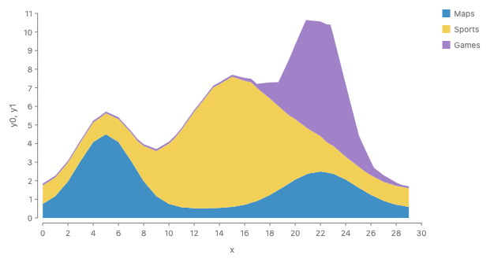

_Proposed result (emulated: each series read as a linear function, added at every x)._

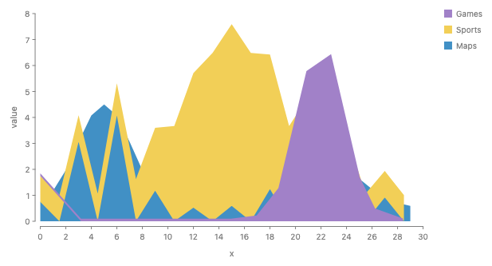

_Today's per-x spelling on the same rows: it stacks only rows that share an exact x, with no warning._

Maps is measured every 1, Sports every 1.5, Games at 15 jittered x. Each ribbon's profile is its own curve through its own rows, so the stack adds functions and needs no common sample points. Outside a series' own x range its thickness is 0 (ggplot2's rule).

Proposed (A):

```js
chart(sampled)
  .flow(stack({ by: "series", dir: "y" }))
  .mark(ribbon({ x: "x", h: "y", fill: "series" }));
```

```python
chart(sampled).flow(stack(by="series", dir="y")).mark(
    ribbon(x="x", h="y", fill="series")
)
```

Today (runs, draws the sawtooth above):

```js
chart(sampled)
  .flow(scatter({ by: "x", x: "x" }), stack({ by: "series", dir: "y" }))
  .mark(ribbon({ h: "y", fill: "series" }));
```

B (works, with a visible resample step):

```js
chart(sampled)
  .flow(
    derive(align({ x: "x", by: "series" })), // resample at the union of all x
    scatter({ by: "x", x: "x" }),
    stack({ by: "series", dir: "y" })
  )
  .mark(ribbon({ h: "y", fill: "series" }));
```

```python
chart(sampled).flow(
    derive(align(x="x", by="series")),
    scatter(by="x", x="x"),
    stack(by="series", dir="y"),
).mark(ribbon(h="y", fill="series"))
```

C (works, cut densifies):

```js
chart(sampled).mark(
  ribbon({ x: "x", h: "y", fill: "series" }).cut({ by: "series", dir: "y" })
);
```

```python
chart(sampled).mark(ribbon(x="x", h="y", fill="series").cut(by="series", dir="y"))
```

### 2. Streamgraph with a wiggle baseline

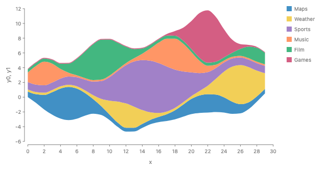

_Weighted wiggle, the d3 and Plot default (emulated: the baseline is computed in derive)._

The baseline is a profile too: g_0(u), chosen to flatten the boundaries. It needs every series over all x, which the whole-series stack sees. `baseline` sets the stack's `StackOrigin`; the next card shows how it meets a parent's `alignment`.

Proposed (A):

```js
chart(topics)
  .flow(stack({ by: "topic", dir: "y", baseline: Baseline.wiggle() }))
  .mark(ribbon({ x: "x", h: "value", fill: "topic" }));
```

```python
chart(topics).flow(stack(by="topic", dir="y", baseline=Baseline.wiggle())).mark(
    ribbon(x="x", h="value", fill="topic")
)
```

Today (wiggle computed by hand, about 20 lines):

```js
chart(topics)
  .flow(
    derive((rows) => stackRows(rows, { offset: "wiggle" })),
    scatter({ by: "x", x: "x" }),
    scatter({ by: "topic", yMin: "y0", yMax: "y1" })
  )
  .mark(ribbon({ fill: "topic" }));
```

B (works, baseline on the outer scatter):

```js
chart(topics)
  .flow(
    scatter({ by: "x", x: "x", alignment: Align.wiggle() }),
    stack({ by: "topic", dir: "y" })
  )
  .mark(ribbon({ h: "value", fill: "topic" }));
```

```python
chart(topics).flow(
    scatter(by="x", x="x", alignment=Align.wiggle()),
    stack(by="topic", dir="y"),
).mark(ribbon(h="value", fill="topic"))
```

C (works, but the user writes a total):

```js
chart(topics).mark(
  ribbon({ x: "x", h: "value", fill: "topic" }).cut({
    by: "topic",
    dir: "y",
    baseline: Baseline.wiggle(),
  })
);
```

```python
chart(topics).mark(
    ribbon(x="x", h="value", fill="topic").cut(
        by="topic", dir="y", baseline=Baseline.wiggle()
    )
)
```

### Baseline and alignment: one point, two sides of a handshake

In GoFish a node's **baseline** is its own 0 point, and it bubbles up: a rect's baseline is its bottom edge, a stack of rects has the baseline of its first part. A stack's `baseline` option is how the stack chooses where its own 0 is along its own axis. `alignment` is how a parent lines up its children on the other axis, and its value `"baseline"` means "line up the children's 0 points". So the two compose: the child says where its 0 is, and the parent decides whether to line up those points or the children's boxes. The renders show where the choice matters. Each Likert row's 0 is the middle of its Neutral bar (set by `Trait.diverging`), and the stacked areas' 0 is the bottom of each stack.


_`alignment: "baseline"` (the default): the rows' 0 points line up, so the Neutral middles form one line and one axis measures every row (real render)._


_`alignment: "middle"`: the rows' boxes are centered instead, so the Neutral middles no longer line up, and no shared axis is left (real render; the axis labels are a bug)._


_Two stacked areas spread side by side with `alignment: "baseline"`: both start at 0, so one value axis serves both (real render)._


_The same with `alignment: "middle"`: the smaller one floats to the middle of the taller one (real render; the axis labels are the same bug)._

The stack sets its 0; the parent lines 0 points up:

```js
chart(survey, { schema: { response: Unit({ traits: [Trait.diverging()] }) } })
  .flow(
    spread({ by: "question", dir: "y", alignment: "baseline" }), // parent: line up 0 points
    stack({ by: "response", dir: "x" }) // child: 0 is the Neutral middle
  )
  .mark(rect({ w: "count", fill: "response" }));
```

```python
chart(survey, schema={"response": Unit(traits=[Trait.diverging()])}).flow(
    spread(by="question", dir="y", alignment="baseline"),  # parent: line up 0 points
    stack(by="response", dir="x"),  # child: 0 is the Neutral middle
).mark(rect(w="count", fill="response"))
```

Baseline values:

```js
stack({ by: "topic", dir: "y", baseline: Baseline.start() }); // the default: the first part starts at 0
stack({ by: "topic", dir: "y", baseline: Baseline.end() }); // the last part ends at 0: grows the other way
stack({ by: "topic", dir: "y", baseline: Baseline.middle() }); // the middle of the whole is at 0
stack({ by: "answer", dir: "x", baseline: Baseline.at("Neutral", 0.5) }); // what Trait.diverging desugars to
stack({ by: "topic", dir: "y", baseline: Baseline.wiggle() }); // a computed curve
```

```python
stack(by="topic", dir="y", baseline=Baseline.start())
stack(by="topic", dir="y", baseline=Baseline.end())
stack(by="topic", dir="y", baseline=Baseline.middle())
stack(by="answer", dir="x", baseline=Baseline.at("Neutral", 0.5))
stack(by="topic", dir="y", baseline=Baseline.wiggle())
```

<p>The values name a place on the stack, like <code>alignment</code>'s values do, so <code>center</code> becomes <code>middle</code> and <code>zero</code> becomes <code>start</code>; "zero" named a data value, not a place. For <code>Baseline.wiggle()</code> the 0 is the 0 of the coordinates the wiggle curve is written in (d3 starts the curve at 0 at the first x).</p>
<h4>The other names, fairly</h4>
<div class="table-wrap"><table>
<tr><th>Name</th><th>For it</th><th>Against it</th></tr>
<tr><td><b><code>baseline</code></b> (proposed)</td><td>It is already GoFish's word for a node's 0 point, and <code>alignment: "baseline"</code> already reads it. The streamgraph literature calls g_0 the baseline (Byron and Wattenberg, 2008). One word names one thing in both places: the stack sets its baseline, the parent lines baselines up.</td><td>Readers may first take <code>baseline</code> for an alignment value; the handshake has to be explained once, as here.</td></tr>
<tr><td><code>origin</code></td><td>The code calls the model <code>StackOrigin</code>, and the option name is free.</td><td>The axes note puts the origin on the measure type: it is the identity or fixed point of the unit, as <code>Trait.diverging</code> sets it. An option named <code>origin</code> would read as overriding the measure's origin, which that note rules out. The stack does not change what 0 means for the data; it chooses where its own 0 sits among its parts.</td></tr>
<tr><td>CSS <code>justify</code> and <code>align</code></td><td>CSS splits the main axis (<code>justify-content</code>) from the cross axis (<code>align-items</code>), which is the same split as here.</td><td><code>justify-content</code> distributes items in a container's free space. A stack has no free space on its axis (its parts are glued), so there is nothing to distribute. It would add a second word for a different idea.</td></tr>
<tr><td><code>alignment</code></td><td>One word for every "where does it sit" question.</td><td><code>alignment</code> is the parent's rule for its children on the other axis. Giving <code>stack</code> an <code>alignment</code> for its own axis would make one option mean two axes, depending on the operator. Approach B used it only because each x slice there was a child of an outer <code>scatter</code>.</td></tr>
</table></div>
<p><b>Check against "origin lives on the measure type".</b> No conflict. <code>Baseline.start()</code> puts the measure's own 0 at the start of the first part, which is the bar chart's identity. <code>Trait.diverging</code> is a fixed point read from the type, so it stays the default and desugars to <code>Baseline.at</code>; an explicit <code>baseline</code> over a diverging unit is an error. With <code>Baseline.middle()</code> or <code>wiggle()</code>, positions on the value axis no longer mean amounts from 0, so the axis can only measure thickness, not position, which is why streamgraphs drop their y axis. The bug in the <code>"middle"</code> renders is the same fact: once 0 points stop lining up, there is no shared value axis to draw.</p>
<p><b>A unit stack that should grow up.</b> Five stories (<code>WaffleChart</code>, <code>UnitColumnChart</code>, <code>UnitHistogram</code>, <code>TitanicFacet</code>, <code>Violin</code>) use <code>reverse</code> or <code>alignment: "end"</code> to mean bottom, because they are spreads in a free space, which runs y-down. A waffle column is a count, so it is a stack, and a stack grows from its baseline away from the measure's 0, upward on a y-up value axis, with no <code>reverse</code>. That needs stacks with spacing, which is still open.</p>

### 3. Stacked density curves

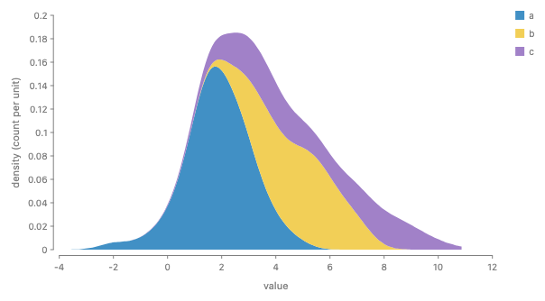

_Stacked group densities, each with area equal to its group's count (emulated: KDE grid computed in derive)._

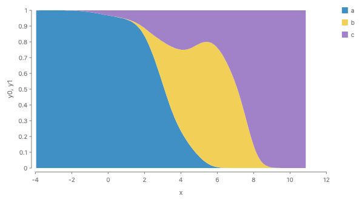

_The same with the whole given as 1 at every x: the conditional density, a divide._

`mass.density()` is a curve over mass, one per species. Its area is the count of rows it is made from, so the stack adds up to the density of all penguins. The position is `mass.support()`. `x: mass.support()` and `h: mass.density()` are both functions of one hidden variable t: the support is t ↦ t and the density is t ↦ f(t). The ribbon samples t and evaluates every channel that is a function of t at each sample, as a parametric curve (x(t), y(t)) does. Giving the whole (`size: normalize`) turns the stack into a divide.

Proposed (A):

```js
const mass = field("mass");
chart(penguins)
  .flow(stack({ by: "species", dir: "y" }))
  .mark(ribbon({ x: mass.support(), h: mass.density(), fill: "species" }));
```

```python
mass = field("mass")
chart(penguins).flow(stack(by="species", dir="y")).mark(
    ribbon(x=mass.support(), h=mass.density(), fill="species")
)
```

Today (KDE grid and stack computed by hand):

```js
chart(samples)
  .flow(
    derive((rows) => stackRows(densityRows(rows), { offset: "zero" })),
    scatter({ by: "x", x: "x" }),
    scatter({ by: "c", yMin: "y0", yMax: "y1" })
  )
  .mark(ribbon({ fill: "c" }));
```

B (works, needs sweep rows):

```js
const mass = field("mass");
chart(penguins)
  .flow(
    sweep({ v: mass.range() }),
    scatter({ by: "v", x: "v" }),
    stack({ by: "species", dir: "y" })
  )
  .mark(ribbon({ h: mass.density("v"), fill: "species" }));
```

```python
mass = field("mass")
chart(penguins).flow(
    sweep(v=mass.range()),
    scatter(by="v", x="v"),
    stack(by="species", dir="y"),
).mark(ribbon(h=mass.density("v"), fill="species"))
```

C (works, cut must find each group's share):

```js
const mass = field("mass");
chart(penguins).mark(
  ribbon({ x: mass.support(), h: mass.density(), fill: "species" }).cut({
    by: "species",
    dir: "y",
  })
);
```

```python
mass = field("mass")
chart(penguins).mark(
    ribbon(x=mass.support(), h=mass.density(), fill="species").cut(
        by="species", dir="y"
    )
)
```

### 4. Ridgeline (a spread, not a stack)

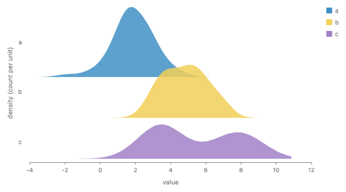

_A fixed pitch between baselines: ridges overlap, as most ridgelines do (today's spread, densities computed in derive)._

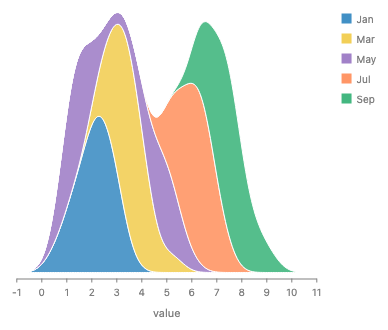

_For contrast, the same ridges stacked: a stacked density, a different chart._

Ridges are separate spaces, since their areas do not add, so a ridgeline is a `spread`. Today the pitch is set by two options, `anchor: "baseline"` and `spacing: 70`. In A, how the gap is measured is the value of `spacing`: a pitch between baselines here, or a contour gap (see the next card).

Proposed (A):

```js
const high = field("high");
chart(weather)
  .flow(
    spread({
      by: "month",
      dir: "y",
      spacing: Spacing.pitch(70, { at: "baseline" }),
    })
  )
  .mark(ribbon({ x: high.support(), h: high.density(), fill: "month" }));
```

```python
high = field("high")
chart(weather).flow(
    spread(by="month", dir="y", spacing=Spacing.pitch(70, at="baseline"))
).mark(
    ribbon(x=high.support(), h=high.density(), fill="month")
)
```

Today (densities computed by hand):

```js
chart(samples)
  .flow(
    derive((rows) => densityRows(rows, { weighted: false })),
    spread({ by: "c", dir: "y", anchor: "baseline", spacing: 70 }),
    scatter({ by: "x", x: "x" })
  )
  .mark(ribbon({ h: "y", fill: "c", opacity: 0.85 }));
```

B (works, with sweep rows):

```js
const high = field("high");
chart(weather)
  .flow(
    spread({
      by: "month",
      dir: "y",
      spacing: Spacing.pitch(70, { at: "baseline" }),
    }),
    sweep({ v: high.range() }),
    scatter({ by: "v", x: "v" })
  )
  .mark(ribbon({ h: high.density("v"), fill: "month" }));
```

```python
high = field("high")
chart(weather).flow(
    spread(by="month", dir="y", spacing=Spacing.pitch(70, at="baseline")),
    sweep(v=high.range()),
    scatter(by="v", x="v"),
).mark(ribbon(h=high.density("v"), fill="month"))
```

C (same as A: nothing is divided):

The same as A.

### Spacing between outlines: box or contact

When shapes are irregular, the gap between them can be measured two ways. A **box gap** is the gap between bounding boxes (today's `spread`). A **contact** gap is the smallest distance between the facing outlines: the shapes slide together until they would touch. The renders compute both by hand (a throwaway helper, `spacingModels.ts`) and draw the result with today's engine.


_Box gap: each ridge starts above the previous one's box._


_Contact: each ridge drops until its base would touch a ridge below. Where the ridge below has a long tail, it drops far._


_Box gap on letter-like outlines: T and A, A and V look far apart._


_Contact: A and V touch along their slopes and T tucks over A._

Proposed: how the gap is measured is the value of spacing:

```js
spread({ by: "month", dir: "y", spacing: 4 }); // sugar for Spacing.box(4)
spread({
  by: "month",
  dir: "y",
  spacing: Spacing.pitch(70, { at: "baseline" }),
}); // today's anchor
spread({ by: "month", dir: "y", spacing: Spacing.contour(4) });
```

```python
spread(by="month", dir="y", spacing=4)
spread(by="month", dir="y", spacing=Spacing.pitch(70, at="baseline"))
spread(by="month", dir="y", spacing=Spacing.contour(4))
```

<div class="table-wrap"><table>
<tr><th>Model</th><th>Rule</th><th>Where it is used</th></tr>
<tr><td>Box gap</td><td>gap between bounding boxes along the axis</td><td>today's <code>spread</code>; Graphviz <code>nodesep</code>; d3-sankey <code>nodePadding</code></td></tr>
<tr><td>Pitch</td><td>a fixed distance between a named point on each child</td><td>today's <code>anchor: "baseline"</code>; ggridges' <code>scale</code></td></tr>
<tr><td>Contact (minimum distance)</td><td>the smallest distance between facing outlines equals the gap</td><td>tidy trees (Reingold and Tilford, 1981: contours compared level by level), <code>d3.tree</code>, d3-flextree (van der Ploeg, 2014, nodes of different sizes), GoTree; skyline packing; the sankey layout page's contour spacing</td></tr>
</table></div>
<p><b>Optical spacing is left out.</b> Type tools space letters by white area rather than by contact: HT Letterspacer sets sidebearings from a target white area measured only to a depth inward from the outline, and Tim Ahrens (Kern On) notes that perception works in terms of average distance or white area. Our first emulation of that model looked less even than contact on Josh's reading (the A to V gap grew larger than the V to O gap), and no example here needs it, so the family leaves it out. It could be added later as one more <code>Spacing</code> strategy without changing the option.</p>
<p><b>Naming.</b> <code>measure</code> is out. Spread already has an option for how spacing is measured, <code>anchor: "edge" | "start" | "middle" | "end" | "baseline"</code> (facing edges, or a fixed pitch between named points). Contour is another answer to the same question, so it should not be a second option. The proposal makes the answer the value of <code>spacing</code>, as a strategy family (<code>Spacing</code>, uppercase, as the API rules ask for a choice among strategies). A plain number stays as sugar for <code>Spacing.box(n)</code>, so a default is still something a user can write, and <code>percent</code> and <code>fr</code> lengths still work. <code>Spacing.pitch(70, { at: "baseline" })</code> takes a required length, so it is a call only. This removes spread's <code>anchor</code> option, which frees the word for the anchors design's <code>.anchor()</code>. About 28 story, test and docs files use an <code>anchor</code> value today, and each moves mechanically.</p>

### 5. Ribbon chart: the order changes at each x

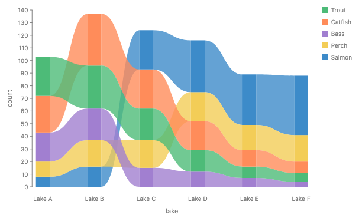

_The ribbon chart: at each lake the bars are sorted by count, and each species' ribbon joins its bars, crossing the others where the ranking changes (today, the gallery story)._

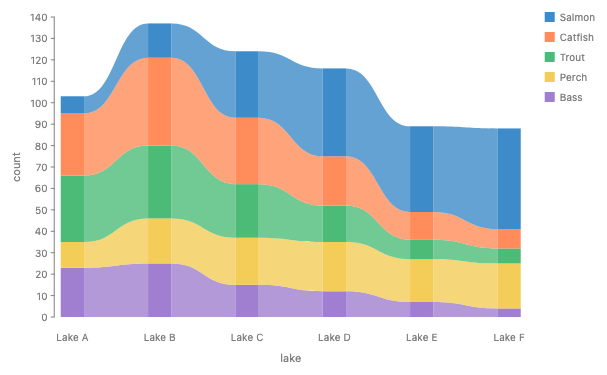

_A profile stack sorted by each species' total: one order for every lake, so no ribbon crosses. A stacked area, not a ribbon chart (emulated with a total column)._

A ribbon chart (a Power BI chart type) sorts the bars at each x by value, so the order of the series changes from x to x, and joins each series across x with a ribbon that crosses the others. The way to write it is the per-x spelling below, which is today's gallery code, unchanged: the bars are spread by lake and stacked by count in each lake, and a layer draws a ribbon through each species' bars. Each lake is its own stack, so each lake has its own order. The ribbons are connectors between bars, not bands with a thickness at every x. A profile stack is different: its children are whole series, and it orders them the way any operator orders its children, by a key with one value per child. So `sort("count")` there sorts by each series' total and gives one order for all x, the second render. Both are legal, and nothing needs an error. **Known gap.** One order per stack rules out a ribbon chart over series measured at different x, with the order changing at each x. Two ways out: resample the series onto shared x positions first (the union of their x values) and use the per-x spelling, or let a profile stack swap two profiles where they cross, which breaks one order per stack and so stays parked.

What you write (today's code, unchanged):

```js
chart(seafood)
  .flow(
    spread({ by: "lake", dir: "x", spacing: 64 }),
    stack({ by: field("species").sort("count"), dir: "y" })
  )
  .mark(rect({ h: "count", fill: "species" }))
  .layer(ribbon({ opacity: 0.8 }));
```

```python
chart(seafood).flow(
    spread(by="lake", dir="x", spacing=64),
    stack(by=field("species").sort("count"), dir="y"),
).mark(rect(h="count", fill="species")).layer(ribbon(opacity=0.8))
```

The second render: a profile stack sorted by total (A):

```js
chart(seafood)
  .flow(stack({ by: field("species").sort("count"), dir: "y" }))
  .mark(ribbon({ x: "lake", h: "count", fill: "species" }));
```

B (per-x spelling (no change)):

The same as A.

C (can't: crossings are not a division):

```js
// No spelling: crossings are not a division of one shape.
```

```python
# No spelling: crossings are not a division of one shape.
```

### 6. Croissant: a density cut into equal-probability slices


_Today's gallery story `Forward Syntax/Croissant`: hand-made grid, quantile rows, partition and intersect._

`d` is a field expression over a distribution. Each method makes a different kind of value: `d.bin(Bin.quantiles(5))` is a key that cuts d's axis into 5 cells, `d.support()` and `d.density()` are the position and the height of one curve over a hidden variable t (t ↦ t and t ↦ f(t)), and `d.median()` is one number per cell. The ribbon samples t and evaluates both at each sample. `partition` on d's axis restricts the curve to each cell. A cell of a Dist is the Dist over that cell with its mass, so the slices meet exactly. No `intersect`, hidden ribbon, `relate`, grid or quantile rows. The next card gives the formula and the callback behind each method.

Proposed (A):

```js
const params = [{ mean: 0, sd: 1 }];
const d = dist.normal({ mean: "mean", sd: "sd" });
chart(params)
  .flow(partition({ by: d.bin(Bin.quantiles(5)), dir: "x" }))
  .mark(
    layer([
      ribbon({
        x: d.support(),
        h: d.density(),
        inset: 3,
        fill: PAPER_FILL,
        stroke: PAPER_STROKE,
      }),
      circle({ cx: d.median(), cy: 6, r: 3, fill: PAPER_STROKE }),
    ])
  );
```

```python
params = [{"mean": 0, "sd": 1}]
d = dist.normal(mean="mean", sd="sd")
chart(params).flow(partition(by=d.bin(Bin.quantiles(5)), dir="x")).mark(
    layer(
        [
            ribbon(
                x=d.support(),
                h=d.density(),
                inset=3,
                fill=PAPER_FILL,
                stroke=PAPER_STROKE,
            ),
            circle(cx=d.median(), cy=6, r=3, fill=PAPER_STROKE),
        ]
    )
)
```

Today (stories/forwardsyntax/Croissant.stories.tsx; the sequence repeats three times in the file):

```js
const normPdf = (x, mu = 0, sd = 1) =>
  Math.exp(-0.5 * ((x - mu) / sd) ** 2) / (sd * Math.sqrt(2 * Math.PI));
const gridOf = (f, lo, hi, n) =>
  Array.from({ length: n }, (_, i) => {
    const x = lo + ((hi - lo) * i) / (n - 1);
    return { x, pdf: f(x) };
  });
const croissant = (grid, { n = 10, fill = FILL, stroke = STROKE } = {}) =>
  layer([
    chart(grid)
      .flow(scatter({ x: "x" }))
      .mark(ribbon({ h: "pdf" }).name("density").hidden()),
  ]).relate(({ density }) => [
    chart(grid)
      .flow(
        derive((rows) =>
          quantileRows(rows, { x: "x", density: "pdf", n: 1000 })
        ),
        partition({ by: field("x").bin(Bin.quantiles(n)), dir: "x" })
      )
      .mark(
        layer([
          intersect({ fill, stroke, strokeWidth: 2 }, [
            density,
            region({ inset: 3 }),
          ]),
          circle({ cx: field("x").median(), cy: 6, r: 3, fill: stroke }),
        ])
      ),
  ]);
// on [-3, 3] the missing tails move the outer cells' medians
const normalGrid = gridOf((x) => normPdf(x), -4, 4, 401);
croissant(normalGrid, { n: 5, fill: PAPER_FILL, stroke: PAPER_STROKE });
```

B (works, but each cell's rows must share boundary points):

```js
const params = [{ mean: 0, sd: 1 }];
const d = dist.normal({ mean: "mean", sd: "sd" });
chart(params)
  .flow(
    sweep({ v: d.range() }),
    partition({ by: d.bin(Bin.quantiles(5)), dir: "x" }),
    scatter({ by: "v", x: "v" })
  )
  .mark(ribbon({ h: d.density("v"), inset: 3, fill: PAPER_FILL }));
```

```python
params = [{"mean": 0, "sd": 1}]
d = dist.normal(mean="mean", sd="sd")
chart(params).flow(
    sweep(v=d.range()),
    partition(by=d.bin(Bin.quantiles(5)), dir="x"),
    scatter(by="v", x="v"),
).mark(ribbon(h=d.density("v"), inset=3, fill=PAPER_FILL))
```

C (works, as a second cut mode (cells)):

```js
const params = [{ mean: 0, sd: 1 }];
const d = dist.normal({ mean: "mean", sd: "sd" });
chart(params).mark(
  ribbon({ x: d.support(), h: d.density(), fill: PAPER_FILL }).cut({
    by: d.bin(Bin.quantiles(5)),
    dir: "x",
    spacing: 6,
  })
);
```

```python
params = [{"mean": 0, "sd": 1}]
d = dist.normal(mean="mean", sd="sd")
chart(params).mark(
    ribbon(x=d.support(), h=d.density(), fill=PAPER_FILL).cut(
        by=d.bin(Bin.quantiles(5)), dir="x", spacing=6
    )
)
```

### What the methods compute

A field expression like `field("mass")` works like polars' `pl.col("mass")`: it sees one column. Every named method on it except `bin` is one named instance of one callback shape, `(x, xs) => result`. `x` is this row's value of the field, and `xs` is the values of that field over the rows of the current group: the rows the mark or operator reading the channel was given. A user can always write the callback instead of the method. Polars has the same two views of one column: `map_elements` gets one value, and `map_batches` gets the whole Series.

Each method and the callback it stands for (bins are open; see below):

```js
field("mass"); // (x) => x  (JS lets a callback drop xs)
field("mass").sum(); // (_, xs) => sum(xs)
field("mass").median(); // (_, xs) => median(xs)
field("mass").normalize(); // (x, xs) => x / sum(xs)
field("mass").support(); // (_, xs) => (t) => t, over the density's range
field("mass").density(); // (_, xs) => kde(xs), a function (t) => number

// a custom method, used like a built-in one
const share = field("mass").then((x, xs) => x / max(xs), { unit: "ratio" });
```

```python
field("mass")  # lambda x, xs: x
field("mass").sum()  # lambda _, xs: sum(xs)
field("mass").median()  # lambda _, xs: median(xs)
field("mass").normalize()  # lambda x, xs: x / sum(xs)
field("mass").support()  # lambda _, xs: (lambda t: t), over the density's range
field("mass").density()  # lambda _, xs: kde(xs), a function of t

share = field("mass").then(lambda x, xs: x / max(xs), unit="ratio")
```

<div class="table-wrap"><table class="methods">
<tr><th>Kind</th><th>Named method</th><th>Formula</th><th>Callback</th></tr>
<tr><td>Per row</td><td><code>field("mass")</code></td><td>the row's value</td><td><code>(x) =&gt; x</code>. A function accessor works today.</td></tr>
<tr><td rowspan="5">Fold: the same value for every row of the group</td><td><code>.sum()</code></td><td>sum of the present values; missing values are dropped</td><td><code>(_, xs) =&gt; sum(xs)</code></td></tr>
<tr><td><code>.mean()</code></td><td>sum &divide; n over the present values</td><td><code>(_, xs) =&gt; mean(xs)</code></td></tr>
<tr><td><code>.median()</code></td><td>sort the present values; with h = (n &minus; 1) &times; 0.5, interpolate between the values at floor(h) and ceil(h): the type-7 quantile at 0.5, as R and numpy compute it (<code>medianOf</code>, <code>fieldExpr.ts</code>)</td><td><code>(_, xs) =&gt; median(xs)</code></td></tr>
<tr><td><code>.count()</code></td><td>n</td><td><code>(_, xs) =&gt; xs.length</code></td></tr>
<tr><td><code>.distinct()</code></td><td>the number of different values</td><td><code>(_, xs) =&gt; new Set(xs).size</code></td></tr>
<tr><td>Per row, reading the group</td><td><code>.normalize()</code></td><td>x &divide; the group's sum</td><td><code>(x, xs) =&gt; x / sum(xs)</code></td></tr>
<tr><td rowspan="2">Curve: a function of a hidden variable t</td><td><code>.support()</code></td><td>t itself, over the range the expression's density uses. That range is open (see the decisions); the lean follows ggdist: for rows, the data's own range, with a bounded estimator; for a <code>Dist</code>, its own range, or its 0.001 to 0.999 quantiles where that range is unbounded</td><td><code>(_, xs) =&gt; (t) =&gt; t</code></td></tr>
<tr><td><code>.density()</code></td><td>f(t) = (1 &divide; bw) &Sigma;<sub>i</sub> K((t &minus; x<sub>i</sub>) &divide; bw), K the standard normal density, bw = 0.9 &times; min(sd, IQR &divide; 1.34) &times; n<sup>&minus;1/5</sup> (Silverman's rule, R's <code>bw.nrd0</code>; <code>silvermanBandwidth</code> in <code>overlap.ts</code> computes it). The area under f is n. For a <code>Dist</code>, f is its exact density, with area 1</td><td><code>(_, xs) =&gt; kde(xs)</code>, whose result is a function <code>(t) =&gt; number</code></td></tr>
<tr><td>Key (bin)</td><td><code>.bin(Bin.step(500))</code>, <code>Bin.thresholds(n)</code>, <code>Bin.quantiles(n)</code></td><td>On main the cells come from the column's domain (its <code>HasDomain</code>), computed once where the data is typed, in <code>chart()</code> or the last <code>derive</code>, so every group of a split sees the same cells, empty ones included (#763; story <code>SharedBinsAcrossGroups</code>). <code>Bin.step(w)</code>: cells [k&times;w, (k+1)&times;w). <code>Bin.thresholds(n)</code>: a step from d3's <code>tickIncrement</code> over the domain, for about n cells. <code>Bin.quantiles(n)</code>: edges at the type-7 quantiles i/n of the column's values (<code>cells.ts</code>)</td><td>Open: how a bin's cells are shared is under review</td></tr>
</table></div>
<p><b>Precedent.</b> A fold that returns the same value for every row of its group is a window function: SQL's <code>median(x) OVER (PARTITION BY g)</code>, or polars' <code>pl.col("x").median().over("g")</code>. <code>normalize</code> fits the same shape with no change, <code>(x, xs) =&gt; x / sum(xs)</code>, as SQL's <code>x / sum(x) OVER (PARTITION BY g)</code> does.</p>
<p><b>Bins are the open item.</b> A bin's cells do not come from the group's <code>xs</code>: on main they come from the column's domain, fixed where the data is typed, and the empty cells and their order are kept for the axis. So a bin does not fit the one callback shape as written. How a bin's cells are shared is under review, so this page proposes no callback form for bins.</p>
<p><b>Curves.</b> A density is drawn by two channels of one mark, <code>x: mass.support()</code> (t &#8614; t) and <code>h: mass.density()</code> (t &#8614; f(t)). The ribbon samples t and evaluates every channel that is a function of t at each sample, as a parametric curve (x(t), y(t)) does. The range of t belongs to the expression, so no spec names it. Two curve channels over different variables in one mark, such as <code>x: mass.support()</code> with <code>h: length.density()</code>, are an error. Precedent: the closest is ggdist (Matt Kay's R package for distributions), whose <code>stat_slabinterval</code> computes <code>x</code> or <code>y</code> (the slab's positions), <code>pdf</code>, <code>cdf</code> and <code>n</code> (<code>Inf</code> for an analytic distribution). Vega-Lite's density transform outputs two fields, <code>value</code> and <code>density</code>, and ggplot2 maps <code>after_stat(x)</code> and <code>after_stat(density)</code>.</p>
<p><b>Area.</b> The area under <code>mass.density()</code> is its row count, so stacked densities add up. ggdist users get the same curve by writing <code>aes(thickness = after_stat(pdf * n))</code>. ggdist instead scales thickness after the fact with <code>normalize</code> (<code>"all"</code>, <code>"panels"</code>, <code>"xy"</code>, <code>"groups"</code> or <code>"none"</code>); here that is the stack's or the spread's job, not the curve's.</p>
<p><b>The range of t.</b> Tools split. seaborn runs a KDE 3 bandwidths past the data (<code>cut=3</code>), and ggplot2 also extends past it. ggdist, for rows, uses <code>density_bounded()</code>, a reflection estimator, and usually trims to the data's range; for an analytic distribution it uses <code>p_limits</code>, the 0.001 and 0.999 quantiles, where the range is unbounded. This is a decision below.</p>
<p><b>Naming.</b> <code>support()</code> is the chosen name (Josh is checking it with Matt Kay, author of ggdist). Rejected: <code>value()</code>, which clashes with GoFish's <code>value(...)</code> constructor, and <code>points()</code> or <code>grid()</code>, which name the sampling that specs should not see.</p>
<p><b>Consequences, stated plainly.</b></p>
<ol>
<li><b>A fold cannot be told from a per-row value without running it.</b> A channel that needs one value per group (a <code>circle</code>'s <code>cx</code> in a cell) checks that the value is the same across the group, and fails with the existing "not constant across the connected group" error.</li>
<li><b>A fold called once per row is n calls of O(n) work, O(n&sup2;) in all.</b> A named method avoids it because the engine knows it is a fold and computes it once per group. For a callback, the engine memoizes the result per group (same <code>xs</code>, same result), or the user declares it a fold, <code>.then(fn, { fold: true })</code>, and it is called once per group.</li>
<li><b>A callback sees one field, so it cannot use two.</b> A mean of x weighted by w reads two fields, so it is a <code>derive</code> step, or an expression over two fields, not a <code>.then</code>.</li>
<li><b>Units get simpler.</b> The callback sees one field, so the unit it receives is known. It declares only what it returns: the same unit (<code>sum</code>, <code>median</code>), a ratio (<code>normalize</code>), a count, or a curve whose values are that unit's density. Without the declaration, CanSum and the other checks cannot run, so an undeclared result is treated as a plain number that cannot be stacked.</li>
<li><b>Serialization.</b> A named method crosses to Python as data. A callback written in Python reaches JS as a batch call (<code>RESOLVE_ROWS</code>, <code>channels.ts</code>), which today returns one value per row; a fold would be called per group.</li>
</ol>
<p><b>Custom methods.</b> Main has no <code>.then</code> or similar on a field expression; the closest are the <code>derive(fn)</code> flow step, which sees whole rows, and the batch accessor above. The proposal is one method, <code>field("x").then((x, xs) =&gt; ..., { unit, fold })</code>, which returns a field expression, so it chains and reads like a built-in method. Polars splits the same idea into <code>map_elements</code> (one value), <code>map_batches</code> (the whole column) and <code>pipe</code> (a function from expression to expression). <code>.then</code> covers the first two with one shape. <code>pipe</code> is plain function composition in JS (<code>share(field("x"))</code>), so it needs no method. A named custom method is just a function that returns <code>.then(...)</code>.</p>
<p><b>Docs plan.</b> Each method's API reference entry (its descriptor <code>doc</code>) states its formula and the callback it stands for, as in the table above. This lands with the implementation.</p>

### 7. Sankey: strands stacked along a link's normal, ends stacked in anchors

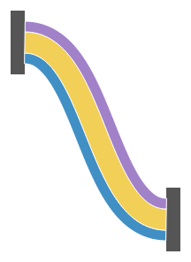

_Strands of 12, 24 and 12 px stacked along the link's normal: each keeps its width (emulated)._

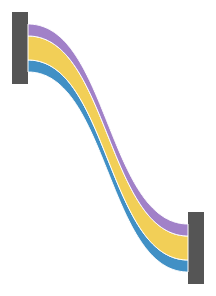

_The same strands stacked vertically: they thin where the link is steep._

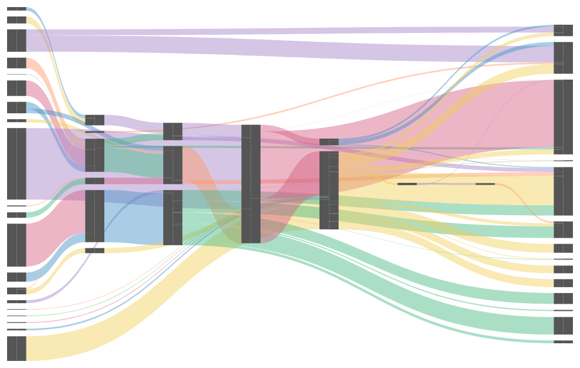

_The energy sankey with ends stacked in anchors (emulated anchors, from the stacked ribbons page)._

Inside `Coord.along(link)`, x is distance along the link and y is distance along its normal, so a plain profile stack draws strands that keep their width. At a node the link leaves horizontally, the normal is vertical, and the strand stack meets the anchor's slot stack exactly. Slots are a flow along a part, so they are the same stack in a one-dimensional space.

Proposed (A):

```js
// strands along one link
layer({ coord: Coord.along(link) }, [
  chart(strands)
    .flow(stack({ by: "strand", dir: "y", baseline: Baseline.center() }))
    .mark(ribbon({ x: "s", h: "width", fill: "strand" })),
]);

// ends on the nodes (the agreed anchor spelling, unchanged)
rect({ w: 12, h: "value" })
  .anchor({
    name: "out",
    position: "x-max",
    slots: data(links, { on: "source" }).flow(
      stack({ by: "target", size: "value" })
    ),
  })
  .name("nodes");
```

```python
layer(
    [
        chart(strands)
        .flow(stack(by="strand", dir="y", baseline=Baseline.center()))
        .mark(ribbon(x="s", h="width", fill="strand"))
    ],
    coord=Coord.along(link),
)

rect(w=12, h="value").anchor(
    name="out",
    position="x-max",
    slots=data(links, on="source").flow(stack(by="target", size="value")),
).name("nodes")
```

Today:

```js
// No spelling: strands along a normal are drawn as hand-computed polygons.
// d3-sankey draws each strand as its own stroke on its own centerline.
```

B (works with Coord.along):

```js
layer({ coord: Coord.along(link) }, [
  chart(strands)
    .flow(
      scatter({ by: "s", x: "s", alignment: "middle" }),
      stack({ by: "strand", dir: "y" })
    )
    .mark(ribbon({ h: "width", fill: "strand" })),
]);
```

```python
layer(
    [
        chart(strands)
        .flow(scatter(by="s", x="s", alignment="middle"), stack(by="strand", dir="y"))
        .mark(ribbon(h="width", fill="strand"))
    ],
    coord=Coord.along(link),
)
```

C (needs a new cut direction, "across"):

```js
ref("link").cut({ by: "strand", size: "width", dir: "across" });
```

```python
ref("link").cut(by="strand", size="width", dir="across")
```

### 8. Half violin with slots

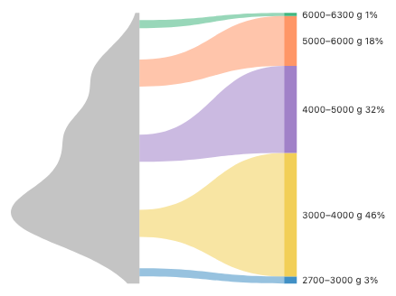

_Penguin body mass: the violin's flat side has one slot per mass bin, joined to a 100% bar (emulated anchors and KDE)._

The violin is a density of mass drawn upright: `y: mass.support()` is the position and `w: mass.density()` the thickness, both functions of one hidden variable t. The ribbon runs along the axis whose channel is a function of t, so `dir: "y"` is no longer needed. Its `x-max` part is the flat side, whose length is the profile's domain. A `partition` slot flow cuts that domain into cells, the same partition as the croissant's, and the bar's `stack` slots divide its height by share. The KDE helper and its grid go away.

Proposed (A):

```js
const mass = field("mass");
const massBins = mass.bin(Bin.thresholds([3000, 4000, 5000, 6000]));
layer([
  spread({ dir: "x", spacing: 160 }, [
    chart(penguins).mark(
      ribbon({
        y: mass.support(),
        w: mass.density(),
        align: "end",
        fill: "#c4c4c4",
      })
        .anchor({
          name: "out",
          position: "x-max",
          slots: data().flow(partition({ by: massBins })),
        })
        .name("violin")
    ),
    chart(penguins).mark(
      rect({ w: 14, h: mass.count() })
        .anchor({
          name: "in",
          position: "x-min",
          slots: data().flow(stack({ by: massBins, size: mass.count() })),
        })
        .name("bar")
    ),
  ]),
  chart(penguins)
    .flow(group({ by: massBins }))
    .mark(
      ribbon({
        from: "violin.out",
        to: "bar.in",
        fill: massBins,
        opacity: 0.55,
      })
    ),
]);
```

```python
mass = field("mass")
mass_bins = mass.bin(Bin.thresholds([3000, 4000, 5000, 6000]))
layer(
    [
        spread(
            [
                chart(penguins).mark(
                    ribbon(
                        y=mass.support(), w=mass.density(), align="end", fill="#c4c4c4"
                    )
                    .anchor(
                        name="out",
                        position="x-max",
                        slots=data().flow(partition(by=mass_bins)),
                    )
                    .name("violin")
                ),
                chart(penguins).mark(
                    rect(w=14, h=mass.count())
                    .anchor(
                        name="in",
                        position="x-min",
                        slots=data().flow(stack(by=mass_bins, size=mass.count())),
                    )
                    .name("bar")
                ),
            ],
            dir="x",
            spacing=160,
        ),
        chart(penguins)
        .flow(group(by=mass_bins))
        .mark(ribbon(from_="violin.out", to="bar.in", fill=mass_bins, opacity=0.55)),
    ]
)
```

The stacked ribbons page's target (a KDE helper makes grid rows):

```js
chart(penguins)
  .flow(derive(kde("mass", 200)), scatter({ by: "mass", y: "mass" }))
  .mark(
    ribbon({ w: "density", dir: "y", align: "end", fill: "#c4c4c4" })
      .anchor({
        name: "out",
        position: "x-max",
        slots: data(penguins).flow(partition({ by: massBins })),
      })
      .name("violin")
  );
// Today the render is emulated: slots are rects with h 0 in the violin's
// chart, sizes are written in mass units, and the KDE is hand-written.
```

B (works, slots on sweep rows):

```js
const mass = field("mass");
chart(penguins)
  .flow(sweep({ v: mass.range() }), scatter({ by: "v", y: "v" }))
  .mark(
    ribbon({ w: mass.density("v"), dir: "y", align: "end", fill: "#c4c4c4" })
      .anchor({
        name: "out",
        position: "x-max",
        slots: data(penguins).flow(partition({ by: massBins })),
      })
      .name("violin")
  );
```

```python
mass = field("mass")
chart(penguins).flow(sweep(v=mass.range()), scatter(by="v", y="v")).mark(
    ribbon(w=mass.density("v"), dir="y", align="end", fill="#c4c4c4")
    .anchor(
        name="out", position="x-max", slots=data(penguins).flow(partition(by=mass_bins))
    )
    .name("violin")
)
```

C (same as A or B: cut plays no part in slots):

The same as A.

### 9. Stacked lines: stack the bands, draw their edges


_Five series stacked, each line along the top of its band (today's render, which gives `line` an `h`; the proposed spelling draws the same picture but does not run yet)._

A line has no thickness, so it has no amount to add, and `line` has no `h`. A line inside a stack is an error: "line has no thickness, so a stack has nothing to add. Stack ribbons and draw each band's edge with a line." What is stacked is the bands. The lines are drawn on each band's top edge, the band's `y-max` part. Reading that part from another chart needs a part reference, so this spelling waits on the reference model; `edge` below is a placeholder for it.

Proposed (A):

```js
chart(topics)
  .flow(stack({ by: "topic", dir: "y" }))
  .mark(ribbon({ x: "x", h: "value" }).hidden().name("bands"))
  .layer(
    chart(selectAll("bands")).mark(line({ edge: "y-max", stroke: "topic" }))
  );
```

```python
chart(topics).flow(stack(by="topic", dir="y")).mark(
    ribbon(x="x", h="value").hidden().name("bands")
).layer(
    chart(select_all("bands")).mark(line(edge="y-max", stroke="topic"))
)
```

Today (runs, the render above; line takes h):

```js
chart(topics)
  .flow(scatter({ by: "x", x: "x" }), stack({ by: "topic", dir: "y" }))
  .mark(
    line({
      h: "value",
      stroke: "topic",
      source: { y: "end" },
      target: { y: "end" },
    })
  );
```

B (works, lines join bar tops):

```js
chart(topics)
  .flow(scatter({ by: "x", x: "x" }), stack({ by: "topic", dir: "y" }))
  .mark(rect({ w: 0, h: "value" }).name("bars"))
  .layer(
    chart(selectAll("bars"))
      .flow(group({ by: "topic" }))
      .mark(
        line({ source: { y: "end" }, target: { y: "end" }, stroke: "topic" })
      )
  );
```

```python
chart(topics).flow(scatter(by="x", x="x"), stack(by="topic", dir="y")).mark(
    rect(w=0, h="value").name("bars")
).layer(
    chart(select_all("bars"))
    .flow(group(by="topic"))
    .mark(line(source={"y": "end"}, target={"y": "end"}, stroke="topic"))
)
```

C (can't):

```js
// No spelling: a divide needs a drawn total to divide.
```

```python
# No spelling: a divide needs a drawn total to divide.
```

### 10. Hard example 1: radial stacked area in polar coordinates


_Today's per-x form in `Coord.polar()`; it already draws (real render)._

Profiles live in the layer's unbent space, so the polar layer bends the stacked area after the stack adds it. The radii add, not the areas. For rings whose areas add, the radius axis is `Coord.clock({ radius: "area" })` from the scale transforms proposal.

Proposed (A):

```js
chart(topics, { coord: Coord.polar() })
  .flow(stack({ by: "topic", dir: "y" }))
  .mark(ribbon({ x: "x", h: "value", fill: "topic" }));
```

```python
chart(topics, coord=Coord.polar()).flow(stack(by="topic", dir="y")).mark(
    ribbon(x="x", h="value", fill="topic")
)
```

Today (runs, the render above):

```js
chart(topics, { coord: Coord.polar() })
  .flow(scatter({ by: "x", x: "x" }), stack({ by: "topic", dir: "y" }))
  .mark(ribbon({ h: "value", fill: "topic" }));
```

B (works (today)):

```js
chart(topics, { coord: Coord.polar() })
  .flow(scatter({ by: "x", x: "x" }), stack({ by: "topic", dir: "y" }))
  .mark(ribbon({ h: "value", fill: "topic" }));
```

```python
chart(topics, coord=Coord.polar()).flow(
    scatter(by="x", x="x"), stack(by="topic", dir="y")
).mark(ribbon(h="value", fill="topic"))
```

C (works):

```js
chart(topics, { coord: Coord.polar() }).mark(
  ribbon({ x: "x", h: "value", fill: "topic" }).cut({ by: "topic", dir: "y" })
);
```

```python
chart(topics, coord=Coord.polar()).mark(
    ribbon(x="x", h="value", fill="topic").cut(by="topic", dir="y")
)
```

### 11. Hard example 2: fan chart of nested forecast intervals

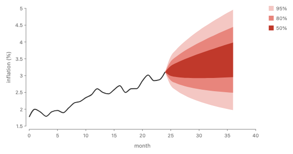

_Nested 50%, 80% and 95% intervals as position profiles (today, real render)._

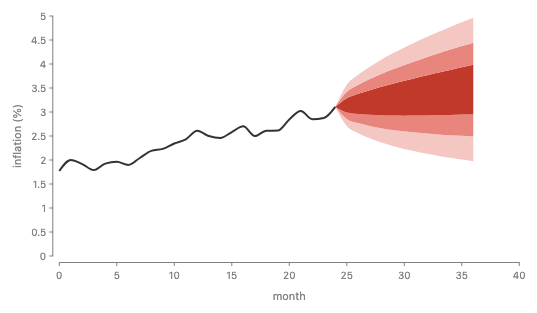

_The same fan as a stack of quantile gaps on a hidden base part: the axis is forced to 0, because a stack measures from its baseline (today, emulated baseline)._

An interval's ends are positions, not amounts, so a fan is a layer of profiles placed by a span, and nothing adds. It can also be written as a stack of the gaps between quantiles on a baseline that is itself a profile, but then the axis must hold the baseline's 0, so the layered form is right. The span is written `y: { min, max }`, nested as the API rules ask (#1144, nest a role instead of prefixing it). On main the nested form exists only under `scatter`'s `dims`, and the flat `yMin` and `yMax` are still the channel names, so letting `y` take `{ min, max }` belongs to that audit.

Proposed (A):

```js
chart(forecast)
  .flow(group({ by: "level" }))
  .mark(ribbon({ x: "t", y: { min: "lo", max: "hi" }, fill: "level" }))
  .layer(chart(history).mark(line({ x: "t", y: "v" })));
```

```python
chart(forecast).flow(group(by="level")).mark(
    ribbon(x="t", y={"min": "lo", "max": "hi"}, fill="level")
).layer(
    chart(history).mark(line(x="t", y="v"))
)
```

Today (runs, the first render):

```js
chart(forecast)
  .flow(
    group({ by: "level" }),
    scatter({ by: "t", x: "t", yMin: "lo", yMax: "hi" })
  )
  .mark(ribbon({ fill: "level" }))
  .layer(
    chart(history)
      .flow(scatter({ by: "t", x: "t", y: "v" }))
      .mark(line({ stroke: "#333", strokeWidth: 2 }))
  );
```

B (works (today)):

```js
chart(forecast)
  .flow(
    group({ by: "level" }),
    scatter({ by: "t", x: "t", y: { min: "lo", max: "hi" } })
  )
  .mark(ribbon({ fill: "level" }))
  .layer(
    chart(history)
      .flow(scatter({ by: "t", x: "t", y: "v" }))
      .mark(line())
  );
```

```python
chart(forecast).flow(
    group(by="level"), scatter(by="t", x="t", y={"min": "lo", "max": "hi"})
).mark(ribbon(fill="level")).layer(
    chart(history).flow(scatter(by="t", x="t", y="v")).mark(line())
)
```

C (same as A):

```js
// The same as A: nothing is divided.
```

```python
# The same as A: nothing is divided.
```

## Trade-offs

| Example                                                                | A                                             | B                                                      | C                                          |
| ---------------------------------------------------------------------- | --------------------------------------------- | ------------------------------------------------------ | ------------------------------------------ |
| Stacked area, series measured at different x                           | works                                         | works, with a visible resample step                    | works, cut densifies                       |
| Streamgraph with a wiggle baseline                                     | works                                         | works, baseline on the outer scatter                   | works, but the user writes a total         |
| Stacked density curves                                                 | works, no rows                                | works, needs sweep rows                                | works, cut must find each group's share    |
| Ridgeline (a spread, not a stack)                                      | works                                         | works, with sweep rows                                 | same as A: nothing is divided              |
| Ribbon chart: the order changes at each x                              | per-x spelling (no change)                    | per-x spelling (no change)                             | can't: crossings are not a division        |
| Croissant: a density cut into equal-probability slices                 | works, partition restricts the profile        | works, but each cell's rows must share boundary points | works, as a second cut mode (cells)        |
| Sankey: strands stacked along a link's normal, ends stacked in anchors | works with Coord.along                        | works with Coord.along                                 | needs a new cut direction, "across"        |
| Half violin with slots                                                 | works, slots are cells of the profile's index | works, slots on sweep rows                             | same as A or B: cut plays no part in slots |
| Stacked lines: stack the bands, draw their edges                       | works, waits on part references               | works, lines join bar tops                             | can't                                      |
| Hard example 1: radial stacked area in polar coordinates               | works                                         | works (today)                                          | works                                      |
| Hard example 2: fan chart of nested forecast intervals                 | works, positions not amounts                  | works (today)                                          | same as A                                  |

New syntax in A:

- `stack` of ribbons with `x`: `.flow(stack({ by, dir }))` and `.mark(ribbon({ x, h }))`, no `scatter` by x.
- `stack({ baseline: Baseline.start() | Baseline.middle() | Baseline.wiggle() | ... })`.
- `spread({ spacing: 4 | Spacing.box(4) | Spacing.pitch(70, { at }) | Spacing.contour(4) })`, replacing `anchor`.
- `ribbon({ x: mass.support(), h: mass.density() })`, and `ribbon({ x, y: { min, max } })`.
- `line` loses `h`; a stacked line chart is a stack of ribbons with a line on each band's edge.
- `shape.cut(stack(...))` and `shape.cut(partition(...))` replacing cut's sizes and `inset`.
- `field("x").then((x, xs) => ..., { unit, fold })` for custom methods.

## The profile

For a node, an axis d (the one a stack runs along) and the other axis u, the node's **profile** along d is:

- a **domain**, an interval of u. When u is a position scale shared with its siblings (a ribbon's `x`), the domain is in data units. Otherwise it is the node's own extent in pixels.

- at each u in the domain, a **descent** and an **ascent**: how far the shape reaches below and above its baseline along d.

- each descent and ascent is a **size**: a data amount times the scale factor plus fixed pixels. A ribbon's `h: "value"` gives the amount. A stroke or a fixed `h: 12` gives pixels.

Facts that follow:

- **A box is the degenerate case.** Its ascent and descent are constant over its cross extent. A rect with no `x` has no index of its own, so its constant profile covers whatever domain its siblings share.

- **The hull is the box.** The box a parent reads today is the hull of the profile: lowest point to highest point. So any parent that only reads boxes keeps working.

- **Two profiles combine pointwise only on a shared index.** Siblings in a stack must place u on one scale. A ribbon's `x` does that. Profiles with different index scales are an error that names the two scales.

- **A profile can come from rows or from a function.** From rows it is the mark's curve through them (each series is curved first, then added). From a function (`x: mass.support()` with `h: mass.density()`) it is evaluated at samples of the hidden variable t. Outside its domain a part has thickness 0.

- **Under a coordinate transform** the profile stays in the layer's unbent space. Polar maps u to angle and d to radius. `Coord.along(spine)` maps u to distance along the spine and d to distance along its normal.

- **A node's profile is computed bottom-up**, like its box: a stack's profile is [g_0, g_n], a spread's is the union of its children's placed profiles.

## Readers

<div class="table-wrap"><table>
<tr><th>Reader</th><th>How it combines children's profiles</th><th>Result</th><th>Check</th></tr>
<tr><td><code>stack</code></td><td>g_i(u) = g_(i&minus;1)(u) + thickness_i(u); child i's frame is the curve g_(i&minus;1)</td><td>one space, the sum</td><td>CanSum, shared index</td></tr>
<tr><td>divide: <code>stack</code> with a given whole</td><td>the same, with each part rescaled to f_i(u) / &Sigma;f(u) times W(u)</td><td>one space, shares</td><td>CanSum, total not 0</td></tr>
<tr><td><code>spread</code>, <code>spacing: Spacing.contour(n)</code></td><td>gap_i = largest over u of (top_(i&minus;1)(u) &minus; bottom_i(u)) + spacing; a rigid translate</td><td>separate spaces</td><td>none (no sum)</td></tr>
<tr><td><code>partition</code> along u</td><td>restricts a profile to each cell of its index</td><td>cells at their places</td><td>key is a cell</td></tr>
<tr><td>anchor slot flow</td><td>the same flows, in the one-dimensional space of a part</td><td>slots ribbons attach to</td><td>as the flow</td></tr>
<tr><td><code>choose</code></td><td>first fit over alternatives' hulls</td><td>one alternative</td><td>none</td></tr>
</table></div>

## What stays local, and why

Josh's objection (croissant round 6) was that a flow `stack` which reaches into a ribbon's vertices is not local. Here is a definition that can be checked:

- an operator reads only its children's summaries (a box today, or a profile), never their rows or vertices;

- it writes only each child's frame, where the child's local 0 goes.

The round 6 stack broke rule 1. It split each ribbon into per-x pieces, stacked the pieces in separate slices, and joined them again, so the ribbon stopped being one child. A profile stack keeps rule 1: it asks each child for its profile, the way it asks a rect for its height, and it never sees the child's rows or vertices. Series measured at different x show the difference: there are no shared vertices to pair, and the stack still adds the curves.

Rule 2 is where the answer has a cost, stated plainly: a profile stack's frame for child i is not a point but the curve g\_(i−1)(u). The child is drawn on that curve, like a shape drawn inside a coordinate transform. That is the same kind of frame a layer gives its children under `Coord.along(spine)`, so it is not a new power, but it is more than a translate. When every part is a box the curve is flat, and the frame is today's translate.

Where it does not hold:

- **Rigid parts on a curved boundary.** A line, a circle, text or an image has no amount along u, and drawing it on a curve would bend it. In a profile stack with a curved boundary such a part is a loud error that points to `.label()` or `scatter`. With all boxes there is no curve, so dot plots and stacked bars are unchanged.

- **Order that changes with u.** One stack has one order, so the ribbon chart stays the per-x form.

- **Sharing an index means sharing a scale.** That is already true of any two siblings on one axis, so it is no new reach.

## Baseline and StackOrigin

A stack's zero point already has one model in the code: `StackOrigin { part, fraction, mirrored }` (`constraints/distribute.ts:71`). Today only `Trait.diverging(midpoint)` on the `by` column's unit sets it (`families/trait.ts:42`). With profiles it becomes a profile, g_0(u), because `Baseline.wiggle()` has no part and fraction. `baseline` is how a spec writes it, and `Trait.diverging` is the default that desugars to `Baseline.at`. The card after the streamgraph shows how it meets a parent's `alignment`.

## Cut

**What cut is today.** `shape.cut({ dir, size, inset })` slices one drawn shape (an image or a rect) into strips along `dir`, one strip per row. `size` gives each strip's length: a plain number is pixels, and `datum(n)` is a relative weight, so the strips share the room left after the fixed ones, as flexbox does. `inset` trims a gap off each strip. The bottle story spreads the strips apart afterwards (`cut.tsx`, `stories/forwardsyntax/Cut.stories.tsx`).

**Why it should change.** The croissant divides a shape too, but a different way: a hidden ribbon, `partition` and `intersect`. So main has two ways to divide a shape with no shared code. Cut's weights repeat `fr(n)`, the flexible length GoFish already has (#1220). Its `inset` means a gap between strips, while `rect`'s and `region`'s `inset` shrink the outline.

**The proposal.** Cut stops having its own size rules. Instead it takes the operator that would divide the shape:

- split this bottle the way this stack divides its whole: `bottle.cut(stack({ by: "category", size: "amount" }))`;

- split this density into these partition cells: `density.cut(partition({ by: d.bin(Bin.quantiles(5)) }))`.

Cut's only remaining job is to turn the pieces into separate children, so the next operator can move them: the exploded bottle spreads them apart, a horizon chart moves its bands down to one line. When the pieces stay where they are, no cut is needed at all: `partition` or a divide restricts a profile directly, as in the croissant and the stacked densities.

## Sampling and the continuum

- **No spec names a grid.** A profile is a function. Its curve is fixed by the mark's rows (with the mark's `curve`) or by a function such as `x.density()`.

- **Curve, then add.** Each part is curved by itself, then the stack adds functions. Today GoFish stacks points and then curves each boundary, and with the default monotone curve that can give a band a negative thickness (stacking page, 8% here).

- **The renderer samples when it draws.** A boundary is drawn through the union of the breakpoints of the parts below it, plus extra points where a curve is not linear and for function profiles. A fixed count (512) stands until screen-aware sampling, which Josh deferred.

- **Continuum rows are not needed for any example here.** A density's position and height are channels that are functions of one hidden variable t, `support()` and `density()`; the range of t belongs to the expression (below). Two such channels over different fields in one mark, such as `x: mass.support()` with `h: length.density()`, are an error. `repeat` stays discrete (draws, quantile levels). `sweep` stays parked for curves that are not a function of either axis, such as a spiral or a Lissajous figure.

## Implementation path

- **Shortcut now.** A `stack` whose parts are collective marks with `x` lowers to the per-x form: curve each part, read it at the union of breakpoints, compute the baseline from all parts, stack each slice, connect. This is a declared shortcut, because the stack peeks at the mark kind to know a part is a profile.

1. **One geometry kernel.** The profile belongs in `geometry/` beside box, enclosing circle and outline. That module has duplicates to fold first: two `simplifyRing` functions (`geometry/outline.ts`, `geometry/clip.ts`), enclose's own point, box and hull (`enclose/prims.ts`), and three inset paths. `pack` reports its children's outlines while `treemap` reports its box (#1233), which a profile query should settle the same way for both.

1. **One divide kernel.** The glue solve with a closing condition (baseline or whole) serves `stack`, `normalize`, `Tile.slice` and `Tile.dice`, and `cut`, and carries one CanSum check. Today the check is placed by hand: `stack` uses the units' sum (`distribute.ts:366`), `treemap`, the size channel and `.sum()` call `checkSummable` (#1208), and `cut` with a datum array and `pack` check nothing.

1. **Full fix.** Profiles in the size and placement passes, so the stack reads them and the per-x rewrite goes away.

## Precedent

### ggplot2

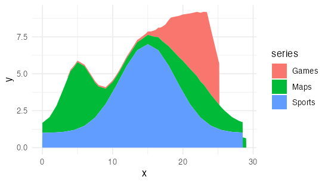

```r
ggplot(sampled, aes(x, y, fill = series)) +
  geom_area()  # stat = "align", position = "stack"
```

`stat_align` (the default since 3.4.0) reads every series at the union of all x by linear interpolation and pads 0 outside each series' own range, then `position_stack` adds. Same misaligned data as the first card. Real render.

### ggplot2, densities

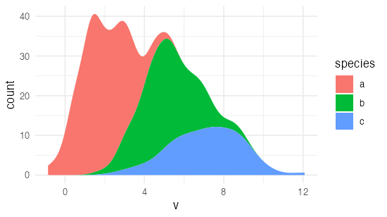

```r
ggplot(peng, aes(v, after_stat(count), fill = species)) +
  geom_density(position = "stack")  # "fill" gives the conditional density
```

Stacked densities are a position adjustment on a computed curve. `after_stat(count)` scales each group by its size. Real render.

### ggridges

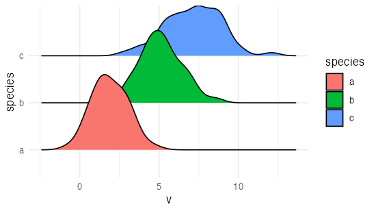

```r
ggplot(peng, aes(v, species)) +
  geom_density_ridges(scale = 1.6)
```

Ridges on a categorical y with an overlap `scale`: a spread with a fixed pitch. No contour spacing. Real render.

### ggalluvial

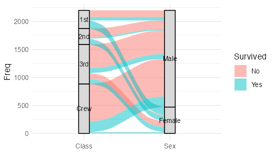

```r
ggplot(al, aes(axis1 = Class, axis2 = Sex, y = Freq)) +
  geom_alluvium(aes(fill = Survived)) +
  geom_stratum()
```

Strata are stacks at each axis, and each flow's ends are slots in them. The closest precedent for anchors with stacked slots. Real render.

### d3-shape

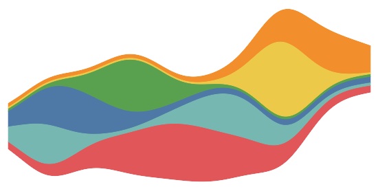

```js
d3
  .stack()
  .keys(keys)
  .offset(d3.stackOffsetWiggle)
  .order(d3.stackOrderInsideOut)(wide);
```

Offsets (none, expand, diverging, silhouette, wiggle) and orders are functions over the whole table. Keys must share every x. Real render.

### Vega-Lite

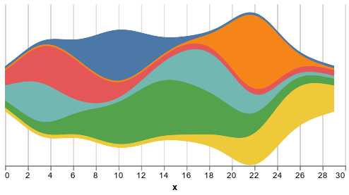

```json
{ "mark": "area", "encoding": { "y": { "field": "value", "stack": "center" } } }
```

`stack` is an encoding property: zero, center, normalize. A missing x becomes 0. Real render.

### Observable Plot

```js
Plot.areaY(data, {
  x: "x",
  y: "value",
  fill: "topic",
  offset: "wiggle",
  order: "inside-out",
});
```

`stackY` is applied for you by `areaY`. Offset and order are options of the stack transform. No alignment of x grids.

### ggstream

```r
ggplot(d, aes(x, value, fill = topic)) +
  geom_stream(type = "mirror")  # "ridge", "proportional"
```

Snaps every series to a 1000-point grid and smooths, then stacks. The grid is hidden but fixed.

### matplotlib

```python
ax.stackplot(x, ys, baseline="weighted_wiggle")
```

One x array for all series. Baselines zero, sym, wiggle, weighted_wiggle.

### Mascot

```js
// paraphrased from Mascot's stacked area example
let area = scene.mark("area", { x1, y1, x2, y2 });
let areas = scene.densify(area, table, { attribute: "date" });
let bands = scene.divide(areas, table, {
  attribute: "company",
  orientation: "vertical",
});
```

Draw the whole, densify to common vertices, divide by group at each vertex. The divide-first model of Approach C. Paraphrase, not verbatim.

### PiCCL

```js
// paraphrased
divide(circle, "angular", { by: "category", size: "value" });
```

Divides a drawn shape (a circle, a bottle) into parts by weight. A given whole.

### TeX and Haskell diagrams

```
\vbox{\hbox{A}\hbox{B}}      % boxes report height and depth
a === b                        -- diagrams: placed by envelopes
```

TeX stacks boxes that report height, depth and a baseline. Haskell diagrams places shapes by their envelope, a support function. Both read a summary richer than a box, as a profile is, and never the shape's parts.

## Bugs seen while rendering

- A stack of ribbons over series measured at different x stacks only rows that share an exact x, with no warning (card 1, today's render). Already listed on the stacking page as bug 1.
- `Stacking Matrix/ConditionalDensity` throws "Species is not constant across the connected group" on a fused ribbon over `stack({ size: normalize })`. Already listed as stacking bug 7.
- With `alignment: "middle"` on a spread of stacks that share a value axis, the axis still draws, with meaningless labels (50, 50, 50 in the Likert render; 1, 1, 1 in the stacked areas). Repro: `Proposals/Stack Profile/Spacing Alignment/LikertMiddle` and `AreasMiddle`. Once the children's 0 points no longer line up, there is no shared value axis to draw.
- Today a curve is applied after stacking, so with the default monotone curve a band can get a negative thickness (stacking page).

## Related issues

- #47: stacked and divided ribbons (sankey strands, anchors)
- #290: `.stack()` as a mark method (dropped)
- #809: wiggle as a stack-level baseline (Josh's idea)
- #831: update is connect on time (stacked to grouped is an animation)
- #980: first-class distributions (densities as profiles)
- #1101: custom strategies as functions
- #1208: `checkSummable`, the shared CanSum check
- #1220: `fr` lengths, which `cut`'s datum sizes repeat
- #1233: pack reports outlines, treemap reports a box
- #1276: delete `Tile.slice` and `Tile.dice`: a normalized stack
- #1284: `Coord.envelope` (the bottle fill by area)
- #1298, #1342: geometry readers work on the unbent shape under coordinates
- #1332: croissant sampling

## Decisions

1. Is a profile (an extent that varies along the other axis, a box being the constant case) the one geometry concept for stack, contour spacing, divide, slots and densities?
2. Does the two-rule definition of local (read only summaries, write only frames, where a frame may be a boundary curve) answer your locality objection?
3. Only amounts stack: a part with no thickness along u (a line, circle, text or image) in a profile stack is an error that names the fix. For lines, the fix is a stack of ribbons with a line on each band's edge, which waits on part references.
4. Keep the word `baseline`: the stack's option chooses its own 0 (`Baseline.start()`, `.end()`, `.middle()`, `.at(part, fraction)`, `.wiggle()`), and a parent's `alignment: "baseline"` lines up those 0 points. `StackOrigin` is the one model, and `Trait.diverging` is a default that desugars into `Baseline.at`?
5. `spacing` takes a number (sugar for `Spacing.box(n)`) or a `Spacing` strategy, and `Spacing.pitch(n, { at })` replaces spread's `anchor` option?
6. `Spacing` ships with box, pitch and contour only, and leaves optical spacing out until an example needs it?
7. `cut` takes the stack or partition that divides the shape, drops its own sizes and `inset`, and only makes the pieces movable children?
8. A density's area is the mass it is made from (the row count, or 1 for a Dist), so stacked densities add up to the density of all rows? The other choice is area 1 for every curve. ggdist reaches the same curve with `after_stat(pdf * n)` and rescales thickness with `normalize`; here rescaling is the parent's job.
9. The range of t: follow ggdist (rows trimmed to the data's range with a bounded estimator; a Dist over its own range, or its 0.001 to 0.999 quantiles where unbounded), or seaborn (3 bandwidths past the data)? The lean is ggdist.
10. Name: `support()` is chosen (Josh is checking it with Matt Kay, ggdist). Rejected: `value()`, which clashes with GoFish's `value(...)` constructor, and `points()` or `grid()`, which name the sampling.
11. One callback shape, `(x, xs) => result`, behind every field method except `bin`, with `field("x").then(fn, { unit, fold })` for custom methods? (How a bin's cells are shared is under review separately.)
12. Plan, not a question: each method's API reference entry (its descriptor `doc`) states its formula and the callback it stands for. This lands with the implementation.
13. A cell of a Dist partition is the Dist over the cell with its mass, so `d.density()` in a cell is the parent's curve there?
14. Outside its own x range a part has thickness 0 (ggplot2), rather than an error?
15. Accept the per-x rewrite as a declared shortcut until the engine has a profile type?
16. Name: "profile", or "contour" or "skyline" ("envelope" is taken by `Coord.envelope`, #1284)?
