# Stacking: is there a third kind?

The maintainer proposes an interval representation for lines and ribbons: an interval at each x, castable to an axis-aligned box (AABB). Then `stack` is one operator that stacks boxes or interval families. He asks whether there is a third kind of stacking. This note answers with real renders.

Stories: `packages/gofish-graphics/stories/proposals/StackingKinds.stories.tsx` (title `Proposals/Stacking Kinds/`). Data and emulation helpers: `stackingKinds.ts` next to it. Images: `img/k2-*.png`.

## Short answer

Two candidates turn out to be the two kinds already proposed, read in another frame. One is new.

- **Contact stacking is a third kind.** Rigid shapes are raised until they touch what is below. The operator reads an outline (or an enclosing circle), not a length, and the offset is a maximum over the contact, not a sum. The amounts do not add. The dodge (`Overlap.separate`) and a contact ridgeline are examples.
- **Stacking along a curve's normal is interval stacking with a different parameter.** The intervals are indexed by arc length along a centerline, not by x. Widths add, measured across the curve. It cannot be cast to an interval family over x, because the two edges of a strand sit at different x for the same point of the curve.
- **Area-additive stacking is box stacking under a warp.** Concentric rings whose areas add are rings whose squared radii add. That is a box stack along a radius measured in r squared, the `Coord.clock({ radius: "area" })` idea of the scale-transforms proposal.

A Wilkinson dot plot is not contact stacking. Circles in one bin share an x, so contact and sum agree: it is box stacking.

## Renders

Size 480 by 260 unless noted. "Today" means the spec runs on the current API with no emulation.

### k2-box-stack: box stacking, for reference

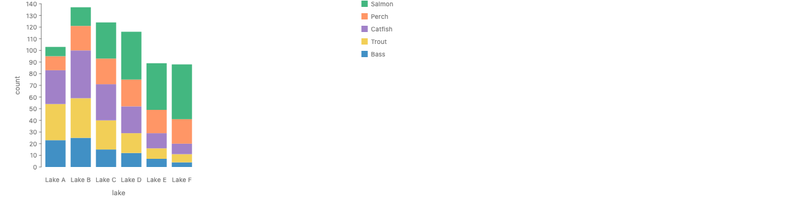

```js
chart(seafood, { w: 480, h: 260 })
  .flow(spread({ by: "lake", dir: "x" }), stack({ by: "species", dir: "y" }))
  .mark(rect({ w: 32, h: "count", fill: "species" }))
  .render(el);
```

- Emulated: nothing. Today.
- The operator reads: each child's box (`geometry/box.ts`), its extent along `dir`.
- Amounts add: yes. Column height is the sum of counts.

### k2-interval-stack: interval stacking, for reference

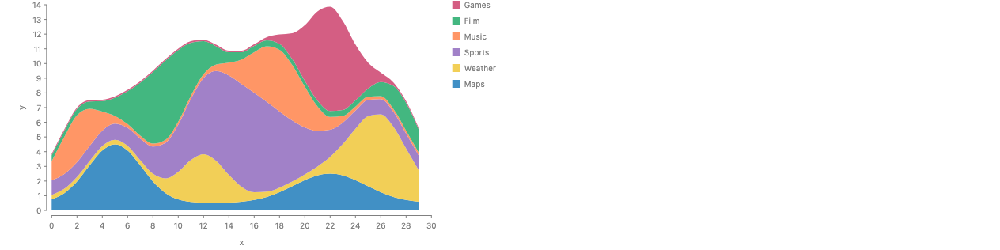

```js
chart(topicsByX, { w: 480, h: 260 })
  .flow(scatter({ by: "x", x: "x" }), stack({ by: "c", dir: "y" }))
  .mark(ribbon({ h: "y", fill: "c" }))
  .render(el);
```

- Emulated: nothing. Today (the rows are sorted by x first, see `NOTES-baselines.md`).
- The operator reads: an interval family, one interval per child at each x.
- Amounts add: yes, at each x.

### k2-line-stack: not part of the proposal

Dropped after the maintainer clarified that thick lines are not stacked. A stroke's width only matters when an interval is cast to a box. The stories `LineStack` and `LineStackSection` are left in the file, unpolished, and no PNG was copied.

### k2-dotplot-equal: Wilkinson dot plot

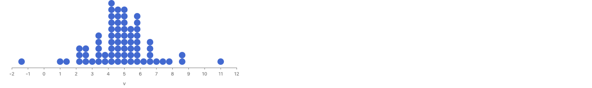

```js
chart(dotValues, { w: 480 })
  .flow(
    partition({
      by: field("v").bin(Bin.step(0.4)),
      dir: "x",
      alignment: "end",
    }),
    stack({ by: "id", dir: "y", axes: false })
  )
  .mark(circle({ r: 7, fill: "#4269d0" }))
  .render(el);
```

- Emulated: nothing. Today. 70 values, bins of 0.4, circles of radius 7.
- The operator reads: each circle's box. Every circle in a column has the same x, so a circle touches the one below at its bottom point, and contact and sum agree.
- Amounts add: yes. Column height is count times diameter. This is box stacking.
- Two walls on the way, both worked around (see Walls 3 and 4): with `h: 260` the columns float at the top of the plot, and `alignment: "start"` hangs them down from the top.

### k2-dodge-varied and k2-dodge-box-stack: contact of circles

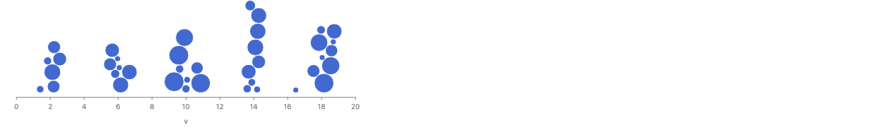

```js
chart(dodgeDots, { w: 480 })
  .flow(scatter({ x: "v", alignment: "end", overlap: Overlap.separate() }))
  .mark((d) =>
    circle({ r: d[0].r, fill: "#4269d0", stroke: "white", strokeWidth: 1 })(d)
  )
  .render(el);
```

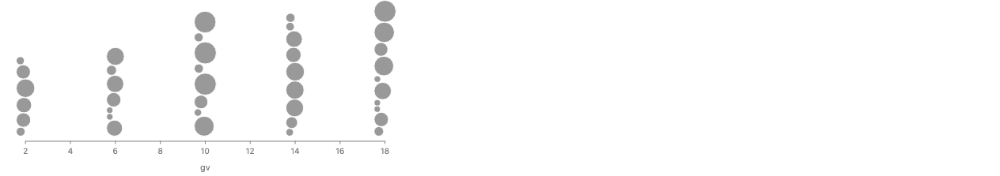

```js
chart(dodgeDots, { w: 480 })
  .flow(scatter({ by: "g", x: "gv", alignment: "end" }), stack({ dir: "y" }))
  .mark((d) =>
    circle({ r: d[0].r, fill: "#999", stroke: "white", strokeWidth: 1 })(d)
  )
  .render(el);
```

- Emulated: nothing. Both today. Five clusters of 6 to 10 circles, radii 4 to 14 px, values spread about half a unit around each cluster's center.
- The dodge reads: each child's enclosing circle (`geometry/enclosingCircle.ts`) and its position on the data axis (`OverlapItem`, `graphicalOperators/overlap.ts:32`). Each circle goes to the free spot nearest the line, in data order.
- Amounts add: no. Both images are at one pixel scale. The dodged columns are about 74, 70, 90, 132 and 98 px tall. The sums of diameters, which the box stack draws, are 101, 112, 158, 156 and 172 px. Small circles fall into the gaps between big ones.
- The first draft drew the sums as gray bars in a second layer of the dodge chart. The two layers did not share the free-axis line (Wall 6), so the box stack became its own render.

### k2-ridge-fixed, k2-contact-ridgeline, k2-ridge-sum: three ridgelines

300 by 260 each, meant as a 3-up row.

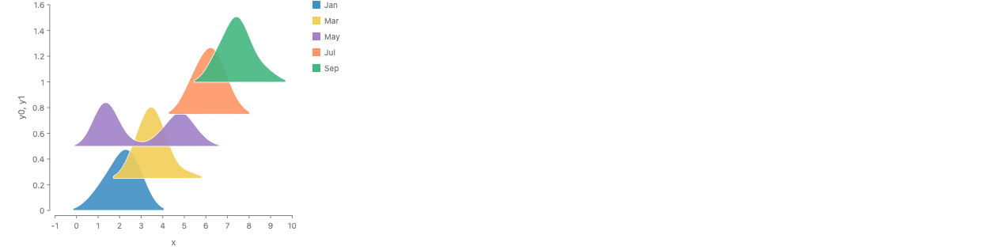 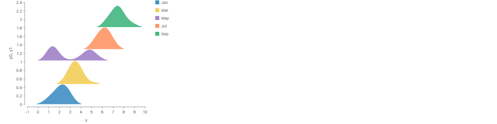 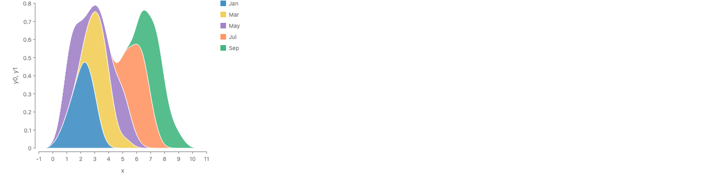

```js
const ridges = (kind) =>
  chart(ridgeRows(kind), { w: 300, h: 260 })
    .flow(
      group({ by: "c" }),
      scatter({ by: "x", x: "x", yMin: "y0", yMax: "y1" })
    )
    .mark(ribbon({ fill: "c", stroke: "white", strokeWidth: 1, opacity: 0.9 }));

ridges("fixed").render(el);
ridges("contact").render(el);
ridges("sum").render(el);
```

- Emulated: all three offsets, in `ridgeRows` (`stackingKinds.ts`). Five groups of 40 values whose means drift right; May is bimodal. A Gaussian KDE per group on one shared grid. For fixed and contact, each ridge is trimmed to where it is above 3% of its peak, so its lower outline (a flat baseline) has ends.
  - **fixed**: ridge k at k times 0.45 of the largest peak. The ridges overlap.
  - **contact**: ridge k at the maximum, over the x in its support, of the upper outline of every ridge placed so far. That is the max over x of (upper outline below minus this ridge's lower outline), with a flat lower outline at 0.
  - **sum**: the stacked density on the full grid, as today's interval stack would draw it.
- The operator reads: fixed reads nothing from the children. Contact reads outlines: the upper outline of what is below and the lower outline of the new child (`geometry/outline.ts`). Sum reads an interval family.
- Amounts add: fixed, no; contact, no; sum, yes.
- Finding: with a flat lower outline, contact gives almost the box stack. The offsets are 0, 0.474, 1.028, 1.295 and 1.814. A box stack of the peaks gives 0, 0.474, 1.028, 1.368 and 1.887. Only Jul slides down (by 0.073), because its support misses May's left peak. A ridge whose base spans the peak of the one below can never go lower than that peak. Contact pays off only when ridges are narrow next to their drift, or when the lower outline is not flat (a violin, a mirrored density).

### k2-normal-vs-vertical: one link, width 40, two ways

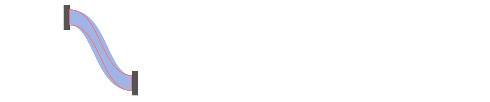

```js
pixelChart(480)
  .layer(chart(linkNodes).mark(polygon({ points: "ring", fill: "#555" })))
  .layer(
    chart(linkCenter)
      .flow(scatter({ by: "i", x: "x", y: "y" }))
      .mark(
        line({
          stroke: "#4269d0",
          strokeWidth: 40,
          opacity: 0.5,
          curve: Curve.linear,
        })
      )
  )
  .layer(
    chart(strands([40], "vertical")).mark(
      polygon({
        points: "ring",
        fill: "none",
        stroke: "#ff725c",
        strokeWidth: 2,
      })
    )
  )
  .render(el);
```

- Emulated: the link geometry, in pixels. The centerline is d3-sankey's `linkHorizontal` cubic from (160, 215) to (320, 45), with horizontal tangents at both ends (`linkAt` in `stackingKinds.ts`). `pixelChart` fixes the y scale at one unit per pixel: two invisible `blank` anchor points at y = 0 and y = 260, with axes and legend off (Wall 7).
- (a), blue: a stroke of width 40 along the centerline. Its width is measured across the curve, as d3-sankey draws it.
- (b), orange outline: a band of height 40 at each x, the stacked-area convention.
- Where they differ: in the steep middle the slope reaches about 2.1 (65 degrees). There the vertical band is only about 17 px thick across the curve, and the stroke is about 94 px tall. At the two ends, where the tangent is flat, they agree.

### k2-strands-normal and k2-strands-vertical: three strands of 10, 20 and 10

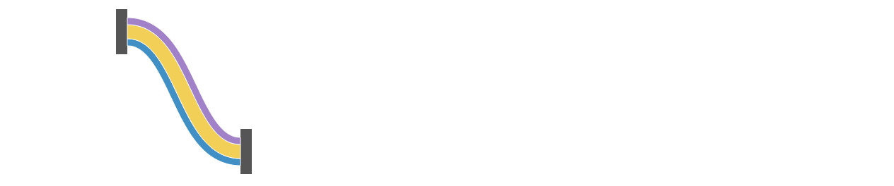

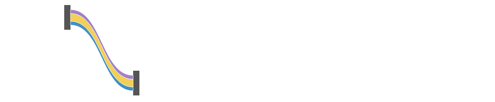

```js
pixelChart(480)
  .layer(chart(linkNodes).mark(polygon({ points: "ring", fill: "#555" })))
  .layer(
    chart(strands([10, 20, 10], "normal")).mark(
      polygon({ points: "ring", fill: "c", stroke: "white", strokeWidth: 1 })
    )
  )
  .render(el);
// the same with strands([10, 20, 10], "vertical")
```

- Emulated: the strands, in `strands` (`stackingKinds.ts`). Each strand is a polygon between two offsets of the centerline: along the unit normal at each point (normal), or straight up at each point (vertical). The offsets are the running sums of the widths, centered on the link.
- The normal stack reads: a centerline and one width per child. Its intervals are indexed by the curve's parameter. It is not an interval family over x: the two edges of a strand at the same point of the curve sit at different x, so it is drawn as polygons, not ribbons. The vertical stack reads an interval family over x and could be a ribbon.
- Amounts add: yes in both, along a different direction. Normal: widths add across the curve, so each strand keeps its width everywhere. Vertical: heights add straight up, so in the steep middle every strand is thinned by the cosine of the slope (about 0.43 here), and the 10 px strands look like hairlines.
- Not hit here, but a limit of the normal stack: an offset larger than the curve's radius of curvature folds the inner edge over itself. The vertical stack never folds.

### k2-concentric-area and k2-concentric-radius: rings

260 by 260 each, side by side.

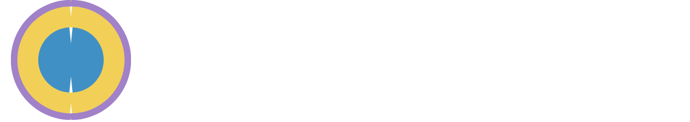 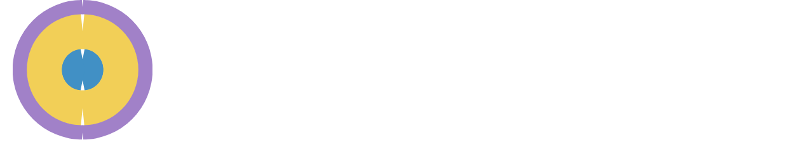

```js
const rings = (kind) =>
  chart(
    ringRows(kind).flatMap((r) => [0, 1].map((half) => ({ ...r, half }))),
    { coord: Coord.clock(), w: 260, h: 260, axes: false, legend: false }
  )
    .flow(
      spread({ by: "c", dir: "y", spacing: 0 }),
      stack({ by: "half", dir: "x" })
    )
    .mark((d) => rect({ w: "one", h: d[0].px, fill: "c" })(d));

rings("area").render(el);
rings("radius").render(el);
```

- Emulated: each ring's radial thickness, in `ringRows`. Amounts 30, 50 and 20. Area: r_k = sqrt(S_k / pi), where S_k is the sum of the first k amounts, so each ring's area is its amount. Radius: r_k = S_k. Both are scaled so the outer radius is 110 px, and the thickness is given in pixels through a `spread` with spacing 0, as the sunburst story does. Each ring is drawn as two half rings (Wall 2), which leaves thin seams at 12 and 6 o'clock.
- The operator reads: the area of each child, or, after a warp, its thickness in r squared.
- Amounts add: area version, yes as areas (the radii do not add). Radius version, yes as radii. The area version gives the inner disc (30) a radius of 0.55 of the whole; the radius version gives it 0.30, so its area reads as 9% of the whole instead of 30%.
- This is box stacking along the radius in a warped unit (r squared), not a new kind.

### k2-tex-boxes

Skipped, as allowed.

## What each kind reads

| Kind                  | Reads from each child                     | Placement of child k                                 | Amounts add               | Examples here                               |
| --------------------- | ----------------------------------------- | ---------------------------------------------------- | ------------------------- | ------------------------------------------- |
| Box                   | its box along `dir`                       | sum of the extents below                             | yes                       | box stack, dot plot, dodge box stack        |
| Interval over x       | an interval at each x                     | sum of the intervals below, at each x                | yes, at each x            | interval stack, ridge sum, strands vertical |
| Interval over a curve | a width at each point of a centerline     | sum of the widths below, along the normal            | yes, across the curve     | strands normal, link stroke                 |
| Box under a warp      | its extent in the warped unit (r squared) | sum in the warped unit                               | yes, in that unit (areas) | concentric area                             |
| Contact               | its outline, or its enclosing circle      | max over the contact of (top below minus own bottom) | no                        | dodge, contact ridgeline                    |

## Walls

1. **A stroke on a polar band replaces its fill.** In a nonlinear space, a `rect` with one data dimension and one pixel dimension is drawn as a stroked midline whose stroke width is the thickness (`packages/gofish-graphics/src/ast/shapes/rect.tsx:384-412`). The stroke color is the user's `stroke`, falling back to the fill (`rect.tsx:322-323`). So `rect({ fill: "c", stroke: "white", strokeWidth: 1 })` in `Coord.clock` paints each ring solid white, and the white outline is lost. The ring stories drop the stroke.
2. **A one-child `stack` along the angle draws no ring.** In `Coord.clock`, `stack({ by: "c", dir: "x" })` with one child per ring and `w: "one"` gave every arc a zero angle (the SVG paths all sat at one x). Two halves per ring fixed it. The cause was not traced; a guess is that the angle domain is read from the values, and one value gives a domain of zero width.
3. **With a fixed `h`, a stack of circles or a dodge floats at the top.** When no data scale places y (circles of pixel size), `chart(..., { h: 260 })` put the dot plot and the dodge at the top of the plot, about 130 px above the x axis. Leaving `h` out sizes the chart to its content. Not traced.
4. **`alignment: "start"` hangs a dodge or a dot plot down from the top.** With no y scale the frame reads y down, so "start" is the top. `alignment: "end"` puts them on the axis. This may be intended, but `Separate.stories.tsx` (`OneSided`) says "the dots grow up from the line at start".
5. **`axes: false` on a `stack` inside `scatter` does not remove its key axis.** Inside `partition` it does. In the dodge box stack, `stack({ by: "id", dir: "y", axes: false })` still drew an "id" axis with every id. `stack({ dir: "y" })` with no `by` avoids it.
6. **Two layers of free-axis scatters do not share their line.** A layer with gray bars (`scatter({ by: "g", x: "v", alignment: "end" })`) on top of the dodge put the bars' box below the dots' box, not on the same baseline. The comparison became a second render.
7. **No way to fix a scale's domain.** Pixel geometry (the link) needs one data unit per pixel. `pixelChart` gets it with two invisible anchor points and the axes off. A missing option, not a bug.

No library source was changed. A throwaway `_prototypeKindsNumbers.ts`, used to print the offsets and sums above, was deleted.
