# Stacking: a type table and a chart-type matrix

This note extends the Constraints section of the croissant proposal (`proposals/croissant-sampling/proposal.md`, #1332). That section spelled 11 examples under five factorings. This note adds a type table read from the code, about 25 more chart types spelled five ways, real renders for the new ones, and verdicts on four hypotheses.

It does not recommend a design. It maps the space.

## What the maintainer said

- "I really want you to examine all the different options including stack(), .stack(), and .cut() across many different chart types (including hard cases) ... think in a type-directed way and/or about nearby operators like partition"
- "There's something nice about the Mascot approach [divide] that I can't quite shake. But there are instances where it really feels like stacking is stacking things _up_ rather than splitting them apart ... it may be a distinction without a difference, we have many operators that pass information in different directions."
- "Stacking feels a lot like spreading but with 'glue'."
- "Now that we have stronger types and more operators, stacking and spreading share less in common with each other than it felt like they did before."
- "Stacked bars and grouped bars seemed pretty similar so we wanted to make it easy to transition between them, but now at a type level they have very different behavior."
- A past decision: operators are local. They arrange their children as wholes. A flow `stack` that reaches into a ribbon's vertices was rejected as not local.

## The five spellings

- **(i) Flow `stack`, as today.** The operator lays whole children end to end. For a continuous chart this is F5 of the croissant grid: `scatter` by x, then `stack` inside each x slice, then a fused ribbon through the pieces.
- **(ii) Function-valued flow `stack` (hypothetical).** The same operator, but a child's extent along `dir` may be a function of the cross axis (a ribbon's height at each x). The stack adds the functions pointwise, as Haskell's `Num` instance for functions adds `f + g = \x -> f x + g x`. The glue between neighbors is one shared boundary function. It reads only its children, so it stays local.
- **(iii) `.stack()` mark modifier.** A method on a collective mark (`ribbon`, `line`) that stacks the mark's rows at each position. It rewrites to (i).
- **(iv) `.cut()` divide (Mascot).** Divide one shape you already have: by weight, by cells, or (proposed) a total area by a group at each vertex.
- **(v) `partition` or regions plus `intersect`.** `partition` gives cells pinned at their place on a scale; `intersect` clips a shape to a region.

Terms. A **unit** is what a column is measured in. **CanSum** is the trait that says amounts in a unit add up (`Trait.summable()`). An extent's **origin state** (`underlyingSpace.ts:48-64`) is **pinned** (placed at a data position), **free** (an amount hanging from a baseline nothing has placed yet) or **none** (only a width means anything). A **claim** is the room in pixels a node asks for. A **share** is a weight divided by the total of its siblings.

## Type table

Two passes compute sizes, both bottom-up: the type pass (data extents, `underlyingSpace.ts`) and the claim pass (pixels, `extent.ts`). The type pass never reads a claim (`apps/docs/docs/internals/core/underlying-space.md`, "Why two walks"). Each node's type is a pair, one space per axis (`Size<UnderlyingSpace>`, `dims.ts:592`, `_node.ts:518`), and each space has one scalar interval (`CONTINUOUS_TYPE`, `underlyingSpace.ts:87-120`). No type relates one axis to the other. Placement then runs top-down: a parent seats its children in the room it is given. So "direction" below names where a part's size along `dir` comes from.

| Operator                                                   | Takes (along `dir`)                                                                                 | Gives                                                                                                                                                                                                                                                                                               | CanSum checked                                                                                                                        | Size of a part comes from                                                            |
| ---------------------------------------------------------- | --------------------------------------------------------------------------------------------------- | --------------------------------------------------------------------------------------------------------------------------------------------------------------------------------------------------------------------------------------------------------------------------------------------------- | ------------------------------------------------------------------------------------------------------------------------------------- | ------------------------------------------------------------------------------------ |
| `stack`                                                    | children whose space has an origin, pinned or free                                                  | one pinned continuous space: the parts laid end to end as vectors from the stack's origin (`distribute.ts:349-391`). A `HasMidpoint` `by` column moves the origin to the midpoint of the order and marks the space mirrored (`spread.tsx:257-282`, `distribute.ts:370-390`)                         | yes, for each free part's summands (`distribute.ts:366-369`, `measure.ts:443`); a pinned part adds only its width, unchecked          | the child (up); the whole is the sum                                                 |
| `stack` with a part that has no origin, or an ordinal part | same                                                                                                | silently an ordinal space, as if it were a `spread` (`distribute.ts:346`). Not an error                                                                                                                                                                                                             | no                                                                                                                                    | the child                                                                            |
| `stack({ size: field })`                                   | any children; one size per child                                                                    | each child wrapped in a layer of that size on `dir` (`spread.tsx:121-150`), then the stack above                                                                                                                                                                                                    | yes, through the size channel (`channels.ts:226`)                                                                                     | the operator assigns it from the child's rows (sideways, then down into the wrapper) |
| `stack({ size: field(f).normalize() })`                    | the same                                                                                            | shares: each entry's value over the window's total, in a new unit `"f share by k"` with CanSum (`fieldExpr.ts:625-630`, `640-664`). The stack then sums the shares to 1, and the scale fits 1 to the box. A total of 0 or less warns and gives every share 0, not an error (`fieldExpr.ts:651-660`) | yes, on the total (`fieldExpr.ts:650`)                                                                                                | siblings (each share reads the total), then the box the scale fits                   |
| `spread`                                                   | any children                                                                                        | a sequence of separate spaces: ordinal over the keys, anonymous with no `by`, undefined with no keys (`distribute.ts:394-398`). Units are not unified across parts (`distribute.ts:325-334`)                                                                                                        | no                                                                                                                                    | the child (up)                                                                       |
| `scatter`                                                  | any children                                                                                        | each child pinned at its data position on the position axes; on the other axis, an align (`scatter.tsx:219-295`)                                                                                                                                                                                    | no                                                                                                                                    | the child; its place comes from the data                                             |
| `group`                                                    | any children                                                                                        | an overlay: the union of the children's spaces                                                                                                                                                                                                                                                      | no                                                                                                                                    | the child                                                                            |
| `partition`                                                | a key with a region (`field(x).bin(...)`, `struct({ x, y }).bin(...)`), a `dir`                     | one cell per bin, each a position constraint with a region, pinned at its true place; the space carries its `cells` (`partition.tsx:28-74`, `underlyingSpace.ts:105-112`)                                                                                                                           | no; the key's differences must mean something, unchecked                                                                              | the cell, from the scale (down)                                                      |
| `bin`                                                      | a continuous column                                                                                 | a key whose values are cells                                                                                                                                                                                                                                                                        | no                                                                                                                                    | n/a                                                                                  |
| `treemap` (`Tile.slice`, `Tile.dice`, `Tile.squarify`)     | one size per child                                                                                  | tiles of the given box, area = share (d3 hierarchy, in pixels)                                                                                                                                                                                                                                      | yes (`treemap.tsx:243`)                                                                                                               | the parent's box (down), in pixels                                                   |
| `cut` by weight (`size`)                                   | a source mark with a laid-out size; weights                                                         | slices: pixel extents of the source, raw numbers absolute, `datum()` weights split the rest (`cut.tsx:143-189`). Each slice is `intersect([regionRect.hidden(), offset(source)])` (`cut.tsx:36-40`)                                                                                                 | a field name yes (`channels.ts:226`); a function accessor no (`channels.ts:219-222`); combinator `datum()` weights no (`cut.tsx:183`) | the source's pixels (down)                                                           |
| `cut` by cells                                             | not implemented; spelled `partition` + `intersect` today                                            |                                                                                                                                                                                                                                                                                                     |                                                                                                                                       |                                                                                      |
| function-valued `stack` (hypothetical)                     | children whose extent along `dir` is a function of the cross axis, over a shared, pinned cross axis | one space whose extent is the pointwise sum; each boundary is a function                                                                                                                                                                                                                            | per part, as `stack`                                                                                                                  | the child (up)                                                                       |

### Stacked bars and grouped bars: two types

```js
// stacked
chart(seafood)
  .flow(spread({ by: "lake", dir: "x" }), stack({ by: "species", dir: "y" }))
  .mark(rect({ w: 32, h: "count", fill: "species" }));

// grouped
chart(seafood)
  .flow(
    spread({ by: "lake", dir: "x", spacing: 12 }),
    spread({ by: "species", dir: "x", spacing: 0 })
  )
  .mark(rect({ w: 7, h: "count", fill: "species" }));
```

|                      | Stacked                                                        | Grouped                                                                                           |
| -------------------- | -------------------------------------------------------------- | ------------------------------------------------------------------------------------------------- |
| x axis               | ordinal over lake                                              | ordinal over lake, each slot an ordinal over species (two levels)                                 |
| y space of one bar   | pinned `[s, s + count]`, where `s` is the running sum below it | free `[0, count]`, seated on the shared baseline by the spread's align                            |
| y space of the chart | pinned `[0, max over lakes of the lake total]` (about 140)     | pinned `[0, max single count]` (about 47)                                                         |
| y unit               | count, summed: CanSum checked                                  | count, not summed: no check. Grouped temperatures are fine; stacked temperatures are a type error |
| stack direction      | y                                                              | x (the species spread runs along x)                                                               |

So the two flows differ in four ways at once: the operator (`stack` against `spread`), its direction (y against x), the x axis type (one level against two), and the y domain (totals against single values). The y unit is the only thing they share. A transition between them is not a type-preserving morph of one option. It is a change between two layouts of the same rows, with the same mark identity (one bar per lake and species).

What a transition needs from the API, then: two specs whose marks match by key, and an interpolation of each mark's placed geometry, the y scale included (d3's classic stacked-to-grouped tweens the y domain too). It does not need one operator with a switch. Today the morph can be emulated by computing both layouts in data and interpolating the rows (render below, `MorphT05`): both layouts become pinned intervals on one `scatter`, which is the type they can share. `time.sequence` cannot do it on its own, because it is a `spread` over a data field (`ast/marks/time.ts:11`), and the choice of operator is not a data value.

### What stack and spread share, and what they no longer share

The code has one constructor. `stack` is `Spread({ ...props, glue: true })` (`graphicalOperators/stack.tsx:14-24`, `spread.tsx:305-336`), and both elaborate to `layer` + `align` + `distribute` (`spread.tsx:182-200`). What the flag reaches:

|                  | Shared                                         | Not shared                                                                                                                                                                                        |
| ---------------- | ---------------------------------------------- | ------------------------------------------------------------------------------------------------------------------------------------------------------------------------------------------------- |
| Split            | `by`, `splitEntries`, `reverse`, `hasOrder`    | the origin from a `HasMidpoint` column: stack only (`spread.tsx:260-281`)                                                                                                                         |
| Direction        | `dir`, the cross-axis `align` with `alignment` |                                                                                                                                                                                                   |
| Spacing          |                                                | stack forces 0 (`distribute.ts:114`); spread takes a gap or a fixed pitch (`anchor`)                                                                                                              |
| Placement        | one chain of relations                         | stack chains a part's tail to the previous head, so a negative part goes back (`distribute.ts:200`); spread chains facing edges or a fixed anchor                                                 |
| Type             |                                                | stack: one pinned continuous space, the sum; spread: separate spaces, ordinal over the keys (`distribute.ts:349` against `394`)                                                                   |
| Units            |                                                | stack unifies the parts' units and checks CanSum; spread unifies nothing (`distribute.ts:325-334`)                                                                                                |
| Axis             |                                                | stack: a numeric axis over the sum; spread: a category axis over the keys                                                                                                                         |
| Downstream       |                                                | a stack's space can be stacked again (but see bug 1) and aligned by baseline; a spread's ordinal space cannot be stacked (a stack of spreads falls back to an ordinal space, `distribute.ts:346`) |
| `size` per entry | yes, the same wrapper                          |                                                                                                                                                                                                   |

Reading: "stack is spread with glue" is true of the plumbing (split, direction, align, `size`, one chain). It is false of the type: the glue flag picks one of two type folds, two units policies, two axis kinds and two placement anchors. The code supports the newer framing.

## The matrix

Legend: **W** works, **A** awkward, **C** can't. "Given" says what the data holds: amounts (parts given, the whole is their sum), a whole (a shape or a box exists before the parts), positions, or cells. Direction: up = parts to whole, down = whole to parts.

| #   | Chart                                  | Given                                | (i) flow stack                                                            | (ii) fn-valued stack                                     | (iii) `.stack()`                                    | (iv) `.cut()`                                      | (v) partition / regions                             | Direction                        |
| --- | -------------------------------------- | ------------------------------------ | ------------------------------------------------------------------------- | -------------------------------------------------------- | --------------------------------------------------- | -------------------------------------------------- | --------------------------------------------------- | -------------------------------- |
| 1   | Stacked area                           | amounts per x                        | W: F5                                                                     | W: stack of whole ribbons                                | W: rewrites to F5                                   | W: the total area divided at each x                | A: the regions are the bands                        | up                               |
| 2   | Streamgraph (silhouette)               | amounts per x                        | W: `scatter({ y: 0 })`                                                    | W: an offset option                                      | A: no place for centering                           | W: `cy: 0` on the whole                            | A                                                   | up, then placed                  |
| 3   | Streamgraph (wiggle, inside-out order) | amounts per x                        | C: a slice cannot see other x                                             | W: the stack sees whole series                           | C: rewrites to F5                                   | W: an `Offset` on the cut, which sees every vertex | C                                                   | up, whole-series                 |
| 4   | Croissant                              | a density and quantile cells         | C                                                                         | C: cells, not amounts                                    | C                                                   | W: cut by cells                                    | W: today                                            | down (cells)                     |
| 5   | 100% bar                               | amounts, normalized                  | W: `size: normalize`                                                      | n/a                                                      | A: second route                                     | W: a fixed rect by weight                          | W                                                   | down (shares)                    |
| 6   | Stacked bars                           | amounts                              | W                                                                         | n/a (constant functions)                                 | A: second route                                     | A: build the total first                           | W                                                   | up                               |
| 7   | Bands each with a texture              | amounts per x                        | W + `atop` via a selection                                                | W, if a band is a region                                 | A                                                   | C: one source paint                                | W                                                   | up                               |
| 8   | Bottle fill                            | a shape and an amount                | C                                                                         | C                                                        | C                                                   | A: two pieces, one blank                           | W: today                                            | down                             |
| 9   | Pie                                    | amounts                              | W: in clock                                                               | n/a                                                      | A                                                   | W: divide a circle                                 | W                                                   | up                               |
| 10  | Sankey link strands                    | a link and amounts                   | C                                                                         | A: the link's cross axis is curved                       | C                                                   | W                                                  | A                                                   | down                             |
| 11  | Waffle                                 | counts                               | W: a spread of units                                                      | C                                                        | C                                                   | A                                                  | W                                                   | up                               |
| 12  | Ribbon chart (rank per x)              | amounts per x                        | W: F5 with a sort per slice                                               | C: order is constant per series                          | A: hides that order changes                         | C: crossing pieces                                 | C                                                   | up, per x                        |
| 13  | Stacked vs grouped bars                | amounts                              | W: two flows                                                              | n/a                                                      | W: a one-word toggle, but it hides a change of type | C: grouped bars do not tile a whole                | n/a                                                 | up                               |
| 14  | Stacked lines                          | amounts per x                        | W: line through heads                                                     | W: the lines are the boundaries                          | W                                                   | A: a line has no extent                            | C                                                   | up                               |
| 15  | Cumulative line                        | amounts along x                      | W: `stack({ by: "x" })`, parts placed along x                             | n/a                                                      | A: the stack runs along the line                    | C                                                  | C                                                   | up, across x                     |
| 16  | Waterfall                              | signed amounts along x               | W: the same, signed parts go back                                         | n/a                                                      | C                                                   | C                                                  | C                                                   | up, across x                     |
| 17  | Gantt with dependencies                | durations                            | W: the waterfall along x                                                  | n/a                                                      | C                                                   | A: divide the project span                         | C                                                   | up                               |
| 18  | Gantt (given dates)                    | positions                            | n/a: `scatter` with `xMin`/`xMax`                                         | n/a                                                      | n/a                                                 | n/a                                                | n/a                                                 | positions                        |
| 19  | Diverging stacked bar (Likert)         | amounts and an order with a midpoint | W: `Trait.diverging()`                                                    | n/a                                                      | A                                                   | A: the center is not an end                        | C                                                   | up, from the midpoint            |
| 20  | Population pyramid                     | two amounts                          | W: a Likert with two levels                                               | n/a                                                      | A                                                   | A                                                  | C                                                   | up, from the midpoint            |
| 21  | Marimekko / mosaic                     | amounts                              | W: `stack({ size })` twice                                                | n/a                                                      | C                                                   | W: cut a box by weight twice                       | W                                                   | down (shares)                    |
| 22  | Icicle                                 | a hierarchy of amounts               | W: a stack per depth, aligned only because every depth has the same total | n/a                                                      | C                                                   | W: cut each parent (Mascot stratify)               | A                                                   | up per depth, or down by nesting |
| 23  | Sunburst                               | the same                             | W: the icicle in clock                                                    | n/a                                                      | C                                                   | W                                                  | A                                                   | the same                         |
| 24  | Stacked histogram                      | counts per cell                      | W: `partition` then `stack`                                               | n/a                                                      | A                                                   | A                                                  | W: partition is the x half                          | down on x, up on y               |
| 25  | Horizon                                | one series, band height              | C                                                                         | C                                                        | C                                                   | A: cut by cells along y, then overlay the pieces   | A: partition + intersect leaves the pieces in place | down (cells), then moved         |
| 26  | Radial stacked area                    | amounts per angle                    | W: F5 in polar                                                            | W                                                        | W                                                   | W                                                  | A                                                   | up                               |
| 27  | Violin                                 | one density                          | n/a: `scatter({ y: 0 })` centers each slice                               | A: a stack of one, centered                              | C                                                   | C                                                  | C                                                   | positions                        |
| 28  | Stacked density                        | densities on a grid                  | W: F5                                                                     | W, and needs no shared grid                              | W                                                   | W                                                  | A                                                   | up                               |
| 29  | Conditional density                    | densities, normalized per x          | W: F5 with `size: normalize` (two tiers; bugs 4, 5)                       | A: the total is a function too                           | W                                                   | W: cut each slice by weight                        | A                                                   | down (shares per x)              |
| 30  | Ridgeline                              | densities, separate                  | n/a: a `spread`                                                           | n/a; a contour `spread` would make a non-overlapping one | C                                                   | C                                                  | C                                                   | none: separate spaces            |
| 31  | Bump chart                             | ranks                                | n/a: `spread` of slots, then a line                                       | n/a                                                      | C                                                   | C                                                  | C                                                   | none                             |
| 32  | Error band                             | intervals                            | n/a: `scatter` with `yMin`/`yMax`                                         | n/a                                                      | C                                                   | C                                                  | C                                                   | positions                        |
| 33  | Slope chart                            | positions                            | n/a                                                                       | n/a                                                      | C                                                   | C                                                  | C                                                   | positions                        |
| 34  | Nested stacked bars                    | amounts in two keys                  | A: stack of stacks typed right, placed wrong (bug 1)                      | n/a                                                      | C                                                   | W: cut a total twice                               | W                                                   | up                               |
| 35  | Two series on different x grids        | amounts at different x               | A: silently an overlay                                                    | W: interpolate, then add                                 | A: as (i)                                           | W, if the total is defined                         | C                                                   | up                               |

### Where `.cut()` feels natural and where stacking up does

`.cut()` reads naturally when the whole exists before the parts: a shape (the bottle, a circle, a sankey link, a parent cell in an icicle), a box the parts must fill (100% bars, marimekko, conditional density), or a density whose cells come from the density itself (the croissant, the horizon). Stacking up reads naturally when the data gives amounts and the whole is only their sum: stacked bars, stacked area, cumulative line, waterfall, Gantt with dependencies, Likert. The data says which: a column of amounts makes a stack; a mark or a total that the spec names makes a divide.

The cases where the two meet are the ones where the whole is a sum the data already holds (a stacked area read as one total area). There the two spellings draw the same thing, and the choice is about which knobs each exposes (H3).

## Per-chart spellings

The croissant proposal already spells rows 1 to 12 under F1 to F5. Its (ii) column is new, so it is given here once, for the stacked area; the rest follow the same pattern.

### 1. Stacked area, function-valued

```js
// (ii): legal; today this is the error case in the croissant proposal
chart(rows)
  .flow(stack({ by: "c", dir: "y" }))
  .mark(ribbon({ x: "x", h: "y", fill: "c" }));
```

### 13. Stacked vs grouped bars

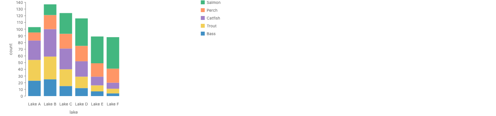

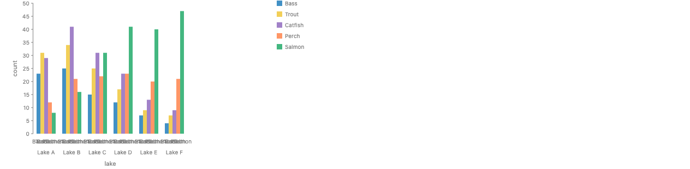

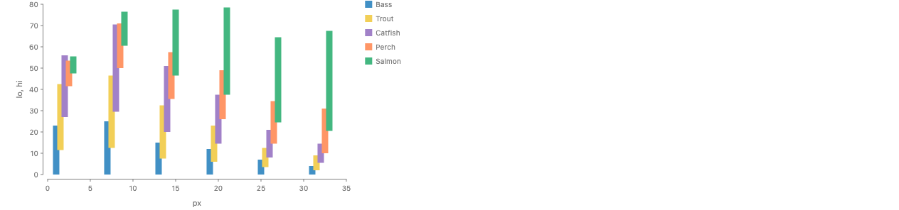

The third render is a frame halfway between the two, made by computing both layouts in data and interpolating (`MorphT0`, `MorphT05`, `MorphT1`).

```js
// (i) today: two flows (see the type section)
// (iii) a modifier would make the switch one word, and hide a change of type
chart(seafood)
  .flow(spread({ by: "lake", dir: "x" }))
  .mark(
    rect({ h: "count", fill: "species" }).stack({ by: "species", dir: "y" })
  );
// (iv): stacked bars cut a total; grouped bars cannot be a cut
chart(seafood)
  .flow(spread({ by: "lake", dir: "x" }))
  .mark(rect({ h: "count", fill: "species" }).cut({ by: "species", dir: "y" }));

// The morph today, in data
chart(morphRows(t))
  .flow(scatter({ by: "id", x: "px", yMin: "lo", yMax: "hi" }))
  .mark(rect({ w: 9, fill: "species" }));
```

### 15 and 16. Cumulative line and waterfall: one stack, parts placed along x

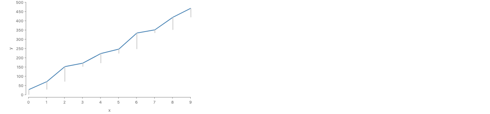

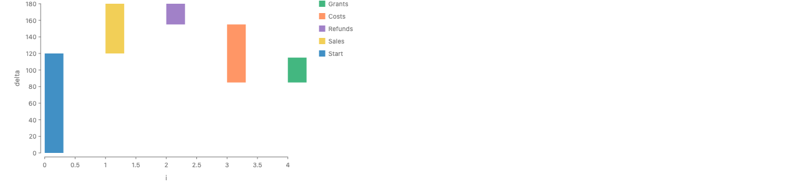

Both run today. The stack runs along y, by x, and each part also has an x position. The stack only relates its parts along `dir`; the cross axis is left to each part. Signed parts go back (#773), which is the waterfall. A stacked area nests the other way: a `scatter` by x outside, a `stack` by series inside.

```js
// (i) cumulative line: the parts, hidden, and a line through their heads
chart(series)
  .flow(stack({ by: "x", dir: "y" }))
  .mark(rect({ x: "x", w: 2, h: "y" }).name("steps"))
  .layer(
    chart(selectAll("steps")).mark(
      line({ source: { y: "end" }, target: { y: "end" } })
    )
  );

// (i) waterfall
chart(steps)
  .flow(stack({ by: "step", dir: "y" }))
  .mark(rect({ x: "i", w: 30, h: "delta", fill: "step" }));

// in data, for comparison (m-waterfall-derive.png, m-cumulative-line.png)
chart(waterfallRows)
  .flow(scatter({ by: "step", x: "i", yMin: "lo", yMax: "hi" }))
  .mark(rect({ w: 30, fill: "step" }));
```

### 17 and 18. Gantt

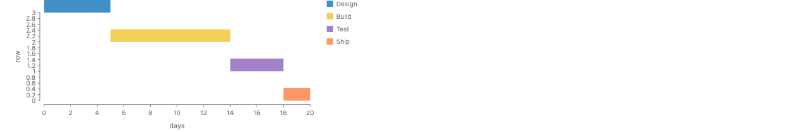

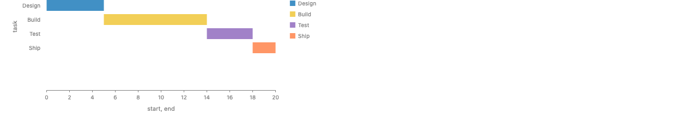

```js
// (i) dependencies: the waterfall along x
chart(tasks)
  .flow(stack({ by: "task", dir: "x" }))
  .mark(rect({ y: "row", h: 20, w: "days", fill: "task" }));

// given dates: positions, no stack
chart(ganttRows)
  .flow(
    spread({ by: "task", dir: "y", spacing: 6 }),
    scatter({ by: "task", xMin: "start", xMax: "end" })
  )
  .mark(rect({ h: 20, fill: "task" }));
```

### 19 and 20. Likert and population pyramid

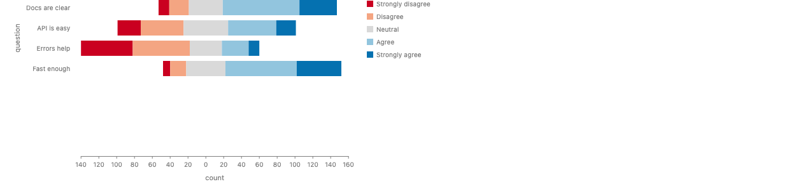

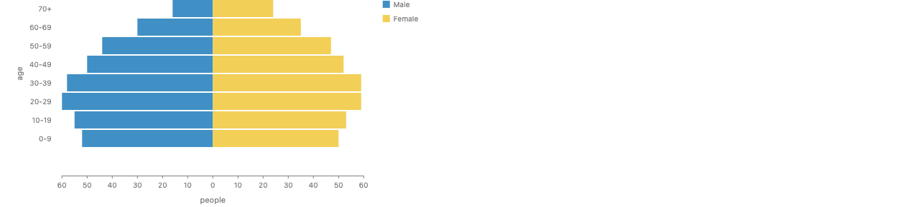

A population pyramid is a Likert with two levels: the midpoint of the order `[Male, Female]` is the boundary between them. Both parts are counts, and the axis labels distances from 0 on both sides. A `spread` would give two separate spaces and no shared 0.

```js
// (i) today
chart(pyramidRows, {
  schema: {
    sex: Unit({
      domain: Domain.discrete(["Male", "Female"]),
      traits: [Trait.diverging()],
    }),
  },
})
  .flow(
    spread({ by: "age", dir: "y", spacing: 2, reverse: true }),
    stack({ by: "sex", dir: "x" })
  )
  .mark(rect({ h: 24, w: "people", fill: "sex" }));

// (iv): a cut has no natural place for a center that is not an end
chart(pyramidRows)
  .flow(spread({ by: "age", dir: "y" }))
  .mark(rect({ w: "people", fill: "sex" }).cut({ by: "sex", dir: "x" }));
```

### 22 and 23. Icicle and sunburst

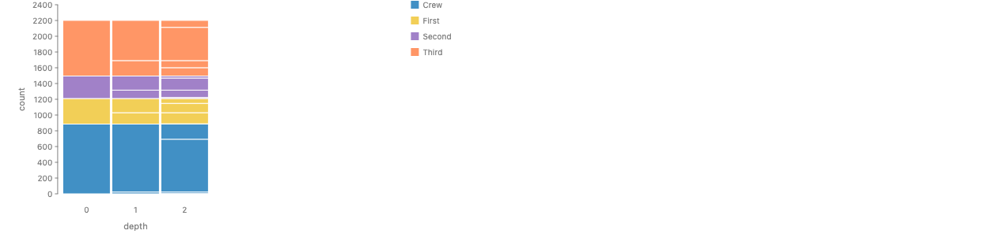

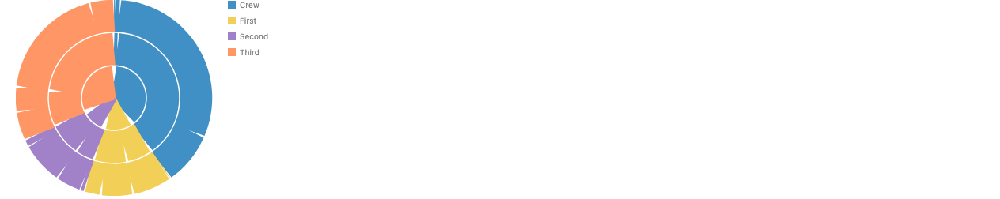

One row per node per depth; a `spread` of depths and a `stack` of the nodes at each depth. The columns line up only because every depth sums to the same total in the same sort order. Nothing ties a child to its parent: drop one row from a depth and that column shifts with no warning. That is the quantifier problem of F5 again, with depth in the place of x. Mascot's stratify, and the gallery's low-level Icicle Chart, divide each parent instead, which is top-down by nesting.

```js
// (i) today: per-depth stacks
chart(hierarchyRows)
  .flow(
    spread({ by: "depth", dir: "x", spacing: 2 }),
    stack({ by: "node", dir: "y" })
  )
  .mark(rect({ w: 60, h: "count", fill: "top" }));

// the sunburst: the same flow in clock coordinates
chart(hierarchyRows, { coord: Coord.clock() })
  .flow(
    spread({ by: "depth", dir: "y", spacing: 2 }),
    stack({ by: "node", dir: "x" })
  )
  .mark(rect({ h: 40, w: "count", fill: "top" }));

// (iv): divide each parent (proposed), the nesting carries the alignment
chart(titanic).mark(
  rect({ h: "count" })
    .cut({ by: "class", dir: "y" })
    .cut({ by: "sex", dir: "y" })
);
```

### 24. Stacked histogram

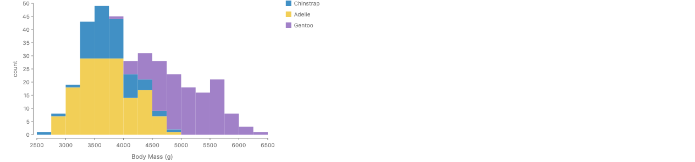

`partition` gives the x half (each cell's width comes down from the scale) and `stack` the y half (each column's height comes up from its counts). Two directions in one chart, on two axes.

```js
chart(penguins)
  .flow(
    partition({ by: field("Body Mass (g)").bin(Bin.step(250)), dir: "x" }),
    stack({ by: "Species", dir: "y" })
  )
  .mark(rect({ h: field("Species").count(), fill: "Species" }));
```

### 25. Horizon

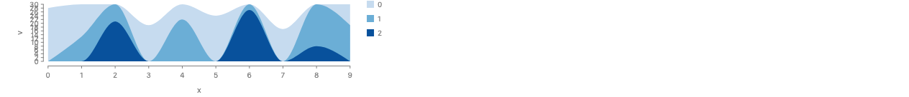

A series cut into bands of height B along y, each band moved down to the baseline and overlaid. It is a divide by cells along the value axis followed by a re-layout. `partition` plus `intersect` leaves each piece where it was, so it cannot fold. Today the bands are computed in data.

```js
// today: the bands in data, overlaid with group
chart(horizonRows)
  .flow(group({ by: "band" }), scatter({ by: "x", x: "x" }))
  .mark(ribbon({ h: "v", fill: "band" }));

// (iv) proposed: cut by cells along y, then lay the pieces on one baseline
chart(series)
  .flow(group({ by: "piece" }))
  .mark(ribbon({ x: "x", h: "y" }).cut({ by: y.bin(Bin.step(30)), dir: "y" }));
```

### 26. Radial stacked area

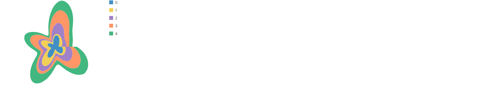

```js
chart(streamgraphData, { coord: Coord.polar() })
  .flow(scatter({ by: "x", x: "x" }), stack({ by: "c", dir: "y" }))
  .mark(ribbon({ h: "y", fill: "c" }));
```

The x domain [0, 9] maps onto the full turn, so x = 9 lands on x = 0 and the ribbon has a seam there. A cyclic x needs a domain with `HasCycle`.

### 27 to 29. Violin, stacked density, conditional density

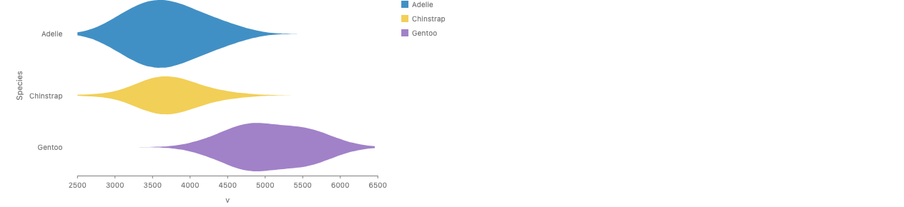

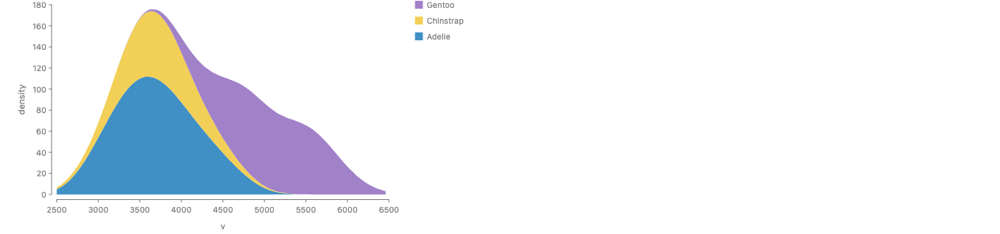

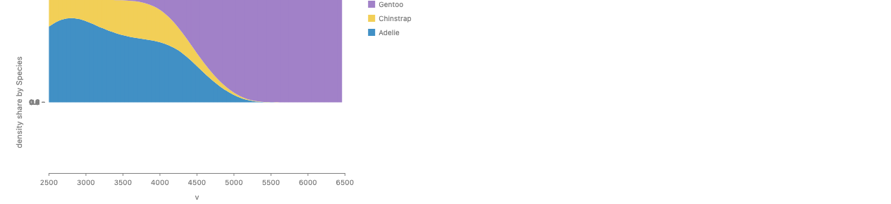

```js
// violin: a point y centers each slice; nothing stacks
chart(densityRows)
  .flow(
    spread({ by: "Species", dir: "y", spacing: 12 }),
    scatter({ by: "v", x: "v", y: 0 })
  )
  .mark(ribbon({ h: "density", fill: "Species" }));

// stacked density (i)
chart(densityRows)
  .flow(scatter({ by: "v", x: "v" }), stack({ by: "Species", dir: "y" }))
  .mark(ribbon({ h: "density", fill: "Species" }));

// conditional density (i): fails fused (bug 4), so two tiers
chart(densityRows)
  .flow(
    scatter({ by: "v", x: "v", h: 160 }),
    stack({ by: "Species", dir: "y", size: field("density").normalize() })
  )
  .mark(rect({ w: 0.1, fill: "Species" }).name("pts"))
  .layer(
    chart(selectAll("pts"))
      .flow(group({ by: "Species" }))
      .mark(ribbon({ fill: "Species" }))
  );

// (iv) conditional density: each x slice of a fixed-height ribbon cut by weight
chart(densityRows).mark(
  ribbon({ x: "v", h: 160, fill: "Species" }).cut({
    by: "Species",
    dir: "y",
    size: "density",
  })
);
```

The conditional density render has a wrong y axis and is clipped at the top (bug 5).

### 30. Ridgeline, and contour spacing

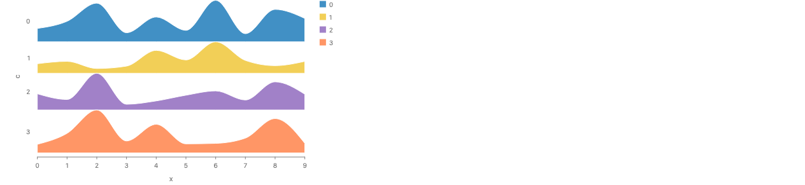

`spread` with edge spacing reads each ridge's box, which is its peak, so no two ridges overlap and the gaps are as tall as each ridge's highest point. The croissant render `l-ridgeline.png` is the overlapping one, with a fixed pitch. A contour spacing would sit between: each ridge as close to the one before as their profiles allow, as a tidy tree packs subtrees by their contours (Reingold and Tilford). The engine has no profile extent (H2).

```js
chart(streamgraphData)
  .flow(spread({ by: "c", dir: "y", spacing: 0 }), scatter({ by: "x", x: "x" }))
  .mark(ribbon({ h: "y", fill: "c" }));
```

### 31 to 33. Bump, error band, slope

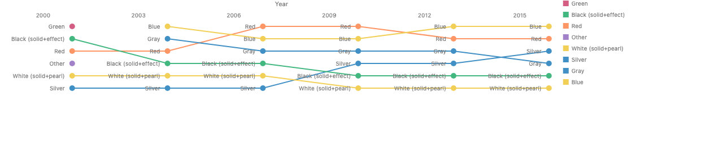

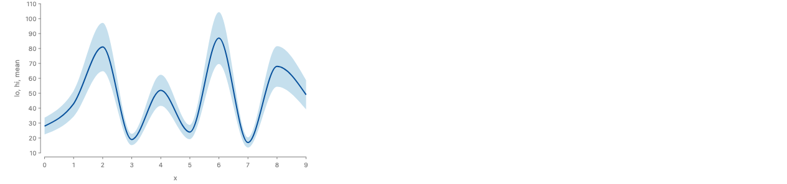

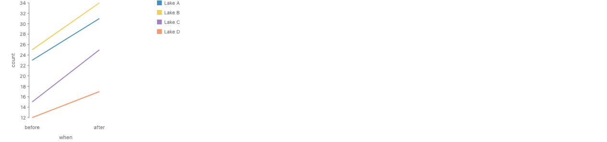

A bump chart is the ribbon chart (row 12) with `spread` in the place of `stack`: ranks are slots, and nothing adds up. An error band and a slope chart place positions; nothing stacks. They are here to mark the edge of the family.

```js
// bump
chart(bumpRows)
  .flow(
    spread({ by: "Year", dir: "x", spacing: 56 }),
    spread({
      by: field("Color").sort("Rank"),
      dir: "y",
      spacing: 12,
      reverse: true,
    })
  )
  .mark(circle({ r: 5, fill: "Color" }).name("dots"))
  .layer(
    chart(selectAll("dots"))
      .flow(group({ by: "Color" }))
      .mark(line({ stroke: "Color" }))
  );

// error band
chart(bandRows)
  .flow(scatter({ by: "x", x: "x", yMin: "lo", yMax: "hi" }))
  .mark(ribbon({ fill: "#9ecae1" }));
```

### 34. Nested stacked bars

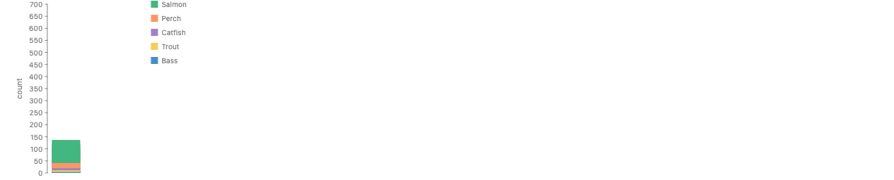

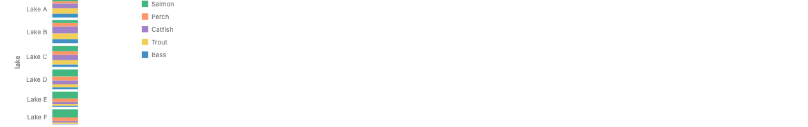

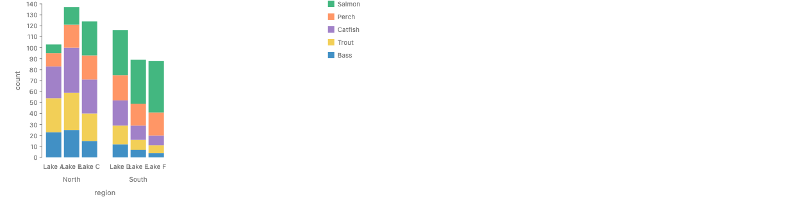

A stack of stacks along one axis should be one stack (stacking is associative). The type is right (the axis runs to 700), but every inner stack is drawn from 0, so they overlap (bug 1). A `spread` of stacks along the same axis works, and gives a category axis. Stacked within grouped works.

```js
// should equal one stack by (lake, species); draws overlapping today
chart(seafood)
  .flow(stack({ by: "lake", dir: "y" }), stack({ by: "species", dir: "y" }))
  .mark(rect({ w: 40, h: "count", fill: "species" }));
```

### 35. Two series on different x grids

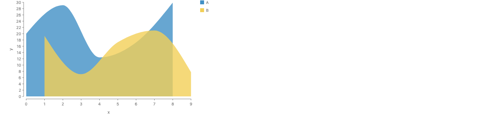

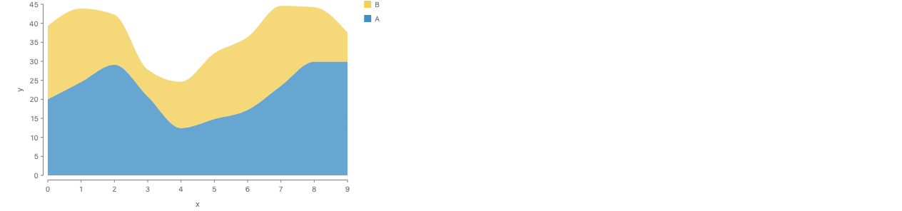

Series A is sampled at even x, series B at odd x. "For each x, stack" (F5) only stacks rows that share an x. Each slice has one part, so each band sits on the baseline and the two ribbons overlap. No error is raised. Resampled onto the union of the grids in data, the same flow draws the right stack. A function-valued stack would read each series between its samples and add the functions, which is what the second render does by hand.

```js
// F5: silently an overlay
chart([...gridA, ...gridB])
  .flow(scatter({ by: "x", x: "x" }), stack({ by: "c", dir: "y" }))
  .mark(ribbon({ h: "y", fill: "c" }));

// (ii): the stack adds f_A + f_B as functions
chart([...gridA, ...gridB])
  .flow(stack({ by: "c", dir: "y" }))
  .mark(ribbon({ x: "x", h: "y", fill: "c" }));
```

## Renders

All are real renders with today's API, from `packages/gofish-graphics/stories/proposals/StackingMatrix.stories.tsx` (title prefix "Proposals/Stacking Matrix/"). New in this note, in `img/`:

`m-stacked-bars`, `m-grouped-bars`, `m-morph-t0`, `m-morph-t05`, `m-morph-t1`, `m-likert`, `m-population-pyramid`, `m-waterfall-stack-pinned-x`, `m-waterfall-derive`, `m-gantt-stack`, `m-gantt-intervals`, `m-cumulative-line`, `m-cumulative-stack`, `m-stack-of-stacks`, `m-spread-of-stacks`, `m-stacked-grouped`, `m-icicle`, `m-sunburst`, `m-sunburst-stroked` (bug 3), `m-stacked-histogram`, `m-stacked-density`, `m-conditional-density-two-tier`, `m-violin`, `m-horizon`, `m-radial-stacked-area`, `m-error-band`, `m-bump`, `m-slope`, `m-mismatched-grids`, `m-mismatched-grids-resampled`, `m-ridgeline-box-spaced`.

The fused `ConditionalDensity` story throws (bug 4) and has no PNG.

From the croissant proposal, by path: `../croissant-sampling/img/l-stacked-area.png`, `l-streamgraph.png`, `c-normal.png`, `s-mosaic-stack.png`, `d-hundred-cut.png`, `k-stacked-bars.png`, `k-bands-textured.png`, `k-bottle.png`, `k-pie.png`, `j-energy.png`, `k-waffle.png`, `k-ribbon-chart.png`, `l-stacked-lines.png`, `l-ridgeline.png`, `l-stack-outer-today.png`, `sg-derive-wiggle.png`.

Not drawn: a function-valued stack and a contour spread (no profile extent in the engine), a `.cut()` that divides by group (not implemented), and an animated stacked-to-grouped transition (no transition between two specs; the three frames are in data).

## Verdicts

### H1: one relation, two directions. Partly confirmed.

The relation is one: the whole is the sum of its parts along one axis, and neighbors share a boundary. Every row from 1 to 29 that sums uses it.

But the engine does not solve it in two directions. Types and claims are computed bottom-up only (`underlying-space.md`, "Why two walks"). The top-down forms reach the same relation two other ways:

1. **Shares in data.** `stack({ size: field(f).normalize() })` turns each value into a share, in a new unit with CanSum (`fieldExpr.ts:625-664`), and then stacks the shares bottom-up. They sum to 1, and the scale fits 1 to the box. So a 100% bar is a stacked bar in the share unit. The whole is "given" only because the unit makes it 1.
2. **Pixels after layout.** `treemap` and `cut` divide a box that is already laid out, in pixels (`cut.tsx:143-189`, `treemap.tsx`). This is real top-down, below the type system.

So what decides the direction is not what a solver is given. It is where the whole comes from: a sum of amounts in the data (up), or a shape or box the spec names (down). That lines up with where `.cut()` feels natural (see the matrix). It also explains the maintainer's sense that "stacking is stacking things _up_": in GoFish today that is literally the only direction the types run.

### H2: glue is a shared boundary; a function-valued stack can be local. Confirmed in principle, not in the engine.

- The engine has no notion of a profile or contour extent. Each node's type is one scalar interval per axis (`underlyingSpace.ts:87-120`), kept as an independent pair (`dims.ts:592`). Spacing is between box edges or fixed anchors (`distribute.ts:186-204`). GoTree spaces by boxes or by centers (`gofish-gotree/src/helpers.ts:23-27`). The nearest things are scatter's `Overlap.noise` outline, a function of the data axis made of summed bumps (`graphicalOperators/overlap.ts:450`), and the piecewise-linear functions the solver uses for claims as functions of the scale factor (`solver/pwl.ts`).
- A function-valued stack would read only its children, so the locality objection is answered. What it costs: a new extent type that ties one axis to the other, a precondition that the children share a pinned cross axis (the stack's align already unions their domains), and a rule for children sampled on different grids. Row 35 shows that rule is not optional: today's F5 is the pointwise sum only when the grids match, and silently draws an overlay when they do not.
- Glue as a shared boundary fits the code: a stack's placement chains each tail to the previous head (`distribute.ts:200`), which is one shared boundary per pair. A contour `spread` (a non-overlapping ridgeline that nests) would be the same boundary read with a gap. It is plausible, and unimplemented; the box-spaced ridgeline shows what is lost without it.
- What it cannot do: change the order per x (the ribbon chart, row 12).

### H3: quantifier order. Confirmed, with a refinement.

- The flow already writes the quantifier. `stack({ by: "x" })` with parts placed along x is one stack across x (cumulative line, waterfall, Gantt, rows 15 to 17). `scatter({ by: "x" })` then `stack({ by: "c" })` is a stack for each x (F5). Both run today, and both are local.
- F5 exposes per-x knobs: a sort inside each slice (the ribbon chart), a position for each slice (`scatter({ y: 0 })`, the silhouette). It cannot see other x, so it cannot do wiggle or an inside-out order from whole-series sums (the croissant's `sg-derive-wiggle.png` does it in data).
- A function-valued stack and a `.cut()` of the total ribbon share the other quantifier: the whole series is one operand, so order is constant and offsets can use whole-series information (an `Offset` strategy has a place to live). They differ only in which way the spec is written: up from series, or down from the total.
- The `.stack()` modifier reads like the whole-series form but rewrites to F5, so it has F5's knobs. That mismatch counts against it.

### H4: partition is the positional counterpart; is cut by cells = partition + intersect? Partly.

- `partition` gives cells pinned at their place on a scale, with no sum, and each child takes its size from its cell (down). It is the positional counterpart of `stack({ size })`, which takes its sizes from shares.
- `cut` by cells equals `partition` plus `intersect` only for pieces that stay in place (the croissant). `cut` also moves pieces (each slice is an `offset` of the source, `cut.tsx:36-40`), which the horizon chart needs (row 25) and an exploded cut needs. And `cut` works in the source's pixels, while `partition` works in data cells on the chart's scale. So: cut by cells = partition + intersect + an optional re-layout of the pieces.
- The stacked histogram (row 24) shows the two composing on two axes in one chart: partition down on x, stack up on y.

## The most informative charts for the decision

1. **Cumulative line and waterfall (15, 16).** One `stack` across x, parts placed along x, running today. The quantifier is already written by flow nesting; the flow `stack` is one-dimensional and local.
2. **Two series on different grids (35).** Where "for each x, stack" stops being a sum, silently. A function-valued stack or a cut of a defined total is the only spelling with an answer.
3. **Ribbon chart against wiggle (12, 3).** Per-x order needs F5; whole-series order needs a whole-series operand (function-valued stack or `.cut()`). No one spelling has both knobs.
4. **Stacked against grouped bars (13).** A change of operator, direction, x axis type and y domain at once. A transition between them is a morph between two specs matched by key, not one switchable option.
5. **Icicle and horizon (22, 25).** The icicle aligns by coincidence of totals under per-depth stacks, and by construction under nested division. The horizon needs a divide by cells that also moves the pieces, which `partition` + `intersect` cannot do.

## Bugs found

1. **A stack of stacks overlaps.** `stack({ by: "lake" })` then `stack({ by: "species" })` types to `[0, 700]` but draws every inner stack from 0 (`m-stack-of-stacks.png`). The type fold adds a pinned part's width (`distribute.ts:363-366`), but placement does not chain the pinned inner stacks; the chain lowering skips relations between parts that are already placed (`distribute.ts:233-239`), which is the likely cause.
2. **A stack of parts with no origin is silently a spread.** `distributeSpaceFold` returns an ordinal space when any part lacks an origin (`distribute.ts:346`). The croissant's rule 3 wants this to be a loud error.
3. **A polar rect with a fixed thickness is drawn as a stroked center line.** Its fill becomes the stroke color, so a user `stroke` paints the whole band and no outline is drawn (`m-sunburst-stroked.png`: every ring white). `shapes/rect.tsx:321-323` (stroke defaults to fill) and `384-413` (the band is a path with `fill: "none"` and `strokeWidth: thickness`).
4. **A fused ribbon over `stack({ size })` throws.** `scatter` then `stack({ by: "Species", size: field("density").normalize() })` then `ribbon({ fill: "Species" })` throws "`Species` is not constant across the connected group". The two-tier form draws. The size wrapper layer (`spread.tsx:121-150`) likely hides the split from fusion.
5. **A normalized stack inside a sized `scatter` slice has the wrong y axis.** The slices draw at the given pixel height, but the y axis maps the share [0, 1] onto a few pixels (labels pile up at "0.0"), and the plot overflows the top (`m-conditional-density-two-tier.png`).
6. **`normalize` with a total of 0 or less warns and returns zeros** (`fieldExpr.ts:651-660`). A share needs a total above 0, so it should be an error, as the croissant says of `cut`.
7. **A function accessor on a per-row size is not checked for CanSum** (`channels.ts:219-222`); only a field name is.
8. **Minor.** The waterfall's y axis is titled "delta" though it shows running sums. Grouped bars' inner category labels overlap (`m-grouped-bars.png`). A radial area over a non-cyclic x has a seam where the last x meets the first.

## Corrections to the croissant proposal's types table

- **stack, Takes**: not only free extents. It takes parts with an origin, pinned or free; a pinned part adds only its width, with no CanSum check. A part with no origin, or an ordinal part, makes the stack silently ordinal (`distribute.ts:346`), not an error.
- **stack with `size`, normalize**: a total of 0 or less gives zeros with a warning, not an error (`fieldExpr.ts:651-660`); the share unit is named `"<field> share by <by>"` and has CanSum (`fieldExpr.ts:625-630`).
- **spread, Gives**: ordinal over the keys, anonymous (no axis) when there is no `by`, undefined when nothing is keyed (`distribute.ts:394-398`). Its parts' units are not unified (`distribute.ts:325-334`), so "nothing to check" is right, and deliberate.
- **cut (b), Checked**: a field name is checked; a function accessor is not (`channels.ts:219-222`).
- **"Two directions, one rule"** (What is stack?): the top-down forms are a bottom-up stack in a share unit, or a pixel division after layout. The engine does not run the rule top-down at the type level.
