# Stacking along paths: renders

These renders test bands and strands that follow a path instead of the x axis: edge bundling, a split sankey link, a Minard band, a branching trunk and a fold. Every one of them is emulated. The geometry is computed in plain JS in `stackingKinds.ts` (section "k3: routing paths"), in pixels, and drawn as `polygon` rings and `line` polylines in a frame whose x and y scales are one data unit per pixel. GoFish has no B-spline curve and no operator that offsets a band along a path, so nothing here is a proposed spec. Each section says what the helper computes.

Stories: `packages/gofish-graphics/stories/proposals/StackingKinds.stories.tsx` (title `Proposals/Stacking Kinds/`, the exports after the "k3" banner). Images: `img/k3-*.png`. Size 480 by 300 unless noted.

The shared drawing helpers in the stories file:

```js
// A w by h chart whose x and y scales are one data unit per pixel.
const frame = (w, h) =>
  chart(
    [
      { x: 0, y: 0, k: "lo" },
      { x: w, y: h, k: "hi" },
    ],
    { w, h, axes: false, legend: false }
  )
    .flow(scatter({ by: "k", x: "x", y: "y" }))
    .mark(blank());

// Polylines, one per value of `by`, from rows {i, x, y}.
const polylines = (rows, by, style) =>
  chart(rows)
    .flow(...(by ? [group({ by })] : []), scatter({ by: "i", x: "x", y: "y" }))
    .mark(line({ curve: Curve.linear, ...style }));

// Closed rings {c, ring}, one polygon each.
const pieces = (rows, style = {}) =>
  chart(rows).mark(
    polygon({
      points: "ring",
      fill: "c",
      stroke: "white",
      strokeWidth: 1,
      ...style,
    })
  );
```

The geometry helpers in `stackingKinds.ts`: `sample` (a dense point list to samples with unit tangent, left unit normal and arc length), `cubic`, `hlink` (d3-sankey's link: a cubic with horizontal tangents at both ends), `fillet` (a polyline with circular arcs at the corners), `bandAlong(path, lo(s), hi(s))` (a ring between two normal offsets that may vary with arc length s), `strandsAlong(path, widths)` (bands stacked along the normal, centered), `bspline` (uniform cubic B-spline with tripled end points, as d3's `curveBasis`) and `straighten` (Holten's beta).

## 1. Hierarchical edge bundling (Holten 2006)

Four groups of five leaves on a circle, with a one-slot gap between groups. Fifteen seeded edges join leaves in different groups. An edge's control points are the tree path leaf, group, root, group, leaf. Leaves sit at radius 1, groups at 1/2 (at the angle of their middle leaf) and the root at 0. Straightening: P'_i = beta P_i + (1 - beta)(P_0 + i/(N-1)(P_{N-1} - P_0)). The spline is a uniform cubic B-spline through the straightened points. Edges take the color of their source leaf's group. Gray dots are the root and the group nodes. 300 by 300.

```js
const GROUPS = ["g0", "g1", "g2", "g3"];
const heb = (beta, kind) =>
  GROUPS.reduce(
    (ch, g, k) =>
      ch
        .layer(
          polylines(
            hebRows(beta, kind).filter((r) => r.g === g),
            "e",
            { stroke: COLORS[k], strokeWidth: 1.5, opacity: 0.75 }
          )
        )
        .layer(
          chart(hebLeaves().filter((r) => r.g === g))
            .flow(scatter({ by: "id", x: "x", y: "y" }))
            .mark(circle({ r: 4, fill: COLORS[k] }))
        ),
    frame(300, 300).layer(
      chart(hebInternal())
        .flow(scatter({ by: "id", x: "x", y: "y" }))
        .mark(circle({ r: 2, fill: "#bbb" }))
    )
  );

heb(0, "screen").render(el); // k3-heb-b0
heb(0.5, "screen").render(el); // k3-heb-b05
heb(0.85, "screen").render(el); // k3-heb-b085, k3-heb-screen
heb(0.85, "polar").render(el); // k3-heb-polar
```

- Emulated: the control points, the straightening and the B-spline are all computed in `hebRows` and drawn as polylines in pixels. GoFish has no B-spline (basis) curve.
- `"screen"` maps the control points to the plane first, then straightens and splines there. This is d3's convention (`d3.curveBundle.beta`).
- `"polar"` straightens and splines in (angle, radius) and maps the result. The root has no angle, so in this variant it takes the angle halfway between the two groups, the short way round. That choice is forced by the domain: the polar point r = 0 has every angle.

### k3-heb-b0: beta 0

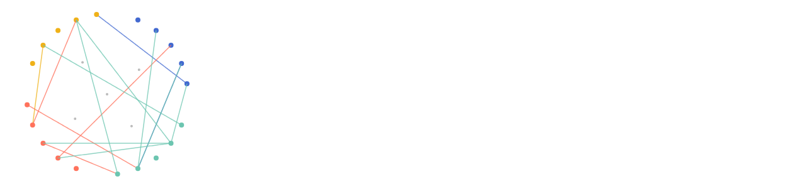

Every edge is the straight chord between its leaves. No bundling.

### k3-heb-b05: beta 0.5

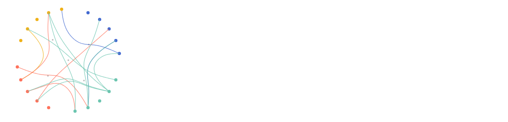

Edges bow toward the center and start to share routes.

### k3-heb-b085 (and k3-heb-screen): beta 0.85, spline in screen space

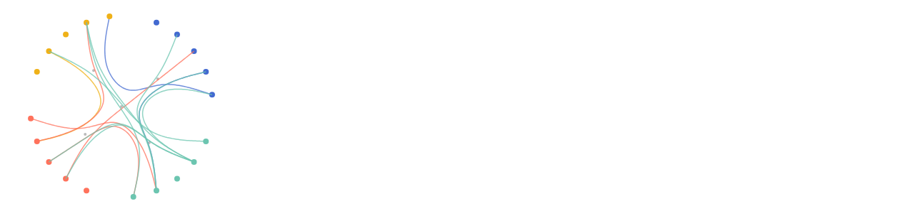

Edges between the same two groups run together through the group nodes, then fan out to their leaves. `k3-heb-screen` is the same render under the name the comparison uses.

### k3-heb-polar: beta 0.85, spline in (angle, radius)

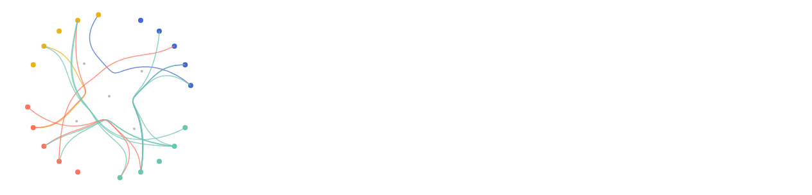

The edges swirl: a straight line in (angle, radius) is a spiral on screen, so each edge turns around the center while it goes in and out. Straightening also differs. At beta 0 in this variant both leaves sit at radius 1, so the chord in (angle, radius) is the arc of the rim itself, not a line across the disc. The two variants agree on the control points and disagree on everything between them.

### k3-heb-polar-native: the same polar splines, drawn by GoFish's `Coord.polar`

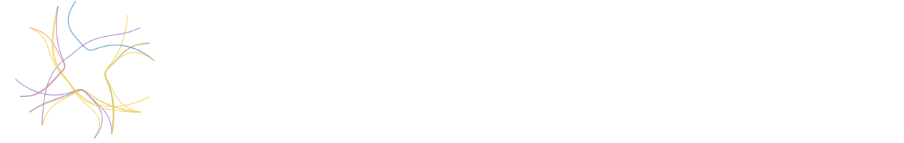

```js
chart(
  [
    { th: 0, r: 0, k: "lo" },
    { th: 2 * Math.PI, r: 1, k: "hi" },
  ],
  { w: 256, h: 256, coord: Coord.polar(), axes: false, legend: false }
)
  .flow(scatter({ by: "k", x: "th", y: "r" }))
  .mark(blank())
  .layer(
    chart(hebPolarData(0.85))
      .flow(group({ by: "e" }), scatter({ by: "i", x: "th", y: "r" }))
      .mark(
        line({
          stroke: "g",
          strokeWidth: 1.5,
          opacity: 0.7,
          curve: Curve.linear,
        })
      )
  )
  .render(el);
```

- Emulated: the B-spline is still computed in derive (`hebPolarData`), but in (angle, radius) data, and GoFish maps it. A `line` under a nonlinear coord is resampled, so the polyline bends with the space (`connect.tsx:951`). The shapes match `k3-heb-polar`. No leaves are drawn and the top edge clips by a pixel; it is a check, not a polished render.
- It needed one workaround: the angles have to be wrapped back into [0, 2 pi) and each polyline cut where it crosses the seam. See wall 2.

## 2. One sankey link in three strands

One link of total width 48 from a node at (160, 250) to a node at (320, 50), split into strands 12, 24, 12. Same pixel scale in all three.

```js
const link3 = (kind) =>
  frame(480, 300)
    .layer(pieces(link3Nodes, { fill: "#555", stroke: "none" }))
    .layer(
      pieces(
        linkStrands(kind),
        kind === "separate"
          ? { opacity: 0.55, stroke: "#222", strokeWidth: 0.75 }
          : {}
      )
    );
```

### k3-link-separate: d3-sankey, each strand its own link

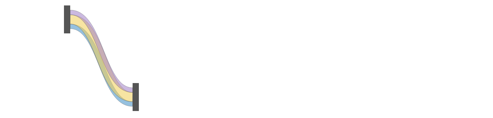

- Emulated: each strand is its own `hlink` from its own y at the source to its own y at the target, drawn as a band of its width along its own normal (what an SVG stroke of that width draws). Each centerline is the spine moved up or down by a constant, so the centerlines stay a fixed vertical distance apart, while the strokes are measured across the curve. In the steep middle the strokes overlap (the darker bands, drawn at 55% opacity with outlines); they only just touch where the link is flat. With the same order at both ends they never gap; a gap needs strands that change order between the ends.

### k3-link-vertical: strands stacked vertically on one spine

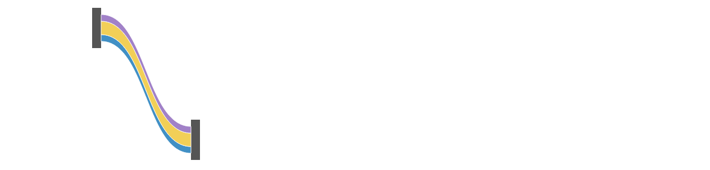

- Emulated: `linkStrands("vertical")`, each strand's band offset vertically from the spine. No overlap, but each strand gets thin where the link is steep, so the thickness no longer shows the amount.

### k3-link-normal: strands stacked along the spine's normal

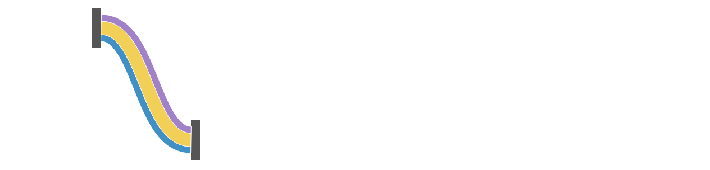

- Emulated: `strandsAlong(spine, [12, 24, 12])`. Each strand keeps its width across the curve, and the strands tile the link with no overlap and no gap. At both ends the tangent is horizontal, so the normal is vertical and the strands meet the nodes in the same intervals as the vertical stack.

## 3. k3-minard: a band whose width changes along the route

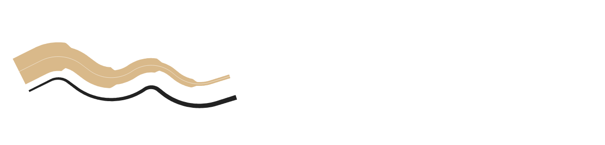

```js
frame(480, 300)
  .layer(pieces(minardBands.slice(0, 1), { fill: "#d9b98a", stroke: "none" }))
  .layer(pieces(minardBands.slice(1), { fill: "#222", stroke: "none" }))
  .layer(
    polylines(minardCenter, null, {
      stroke: "white",
      strokeWidth: 0.75,
      opacity: 0.8,
    })
  )
  .render(el);
```

- Emulated: the route is a polyline with four bends, rounded by circular fillets of radius 80 (`fillet`). The width is a function of arc length: 60 px, stepping down to 44, 30, 18 and 8 at 22%, 45%, 66% and 84% of the route, each step eased over 10 px. The band is `bandAlong(route, s => -w(s)/2, s => w(s)/2)`, so it is centered on the route (the thin white line) and its offsets are along the normal. The return band (black) is centered 46 px to the right of the route and grows from 4 px to 10 px.
- The steps show as notches, as in Minard's map. The fillet radius (80) is larger than any half width (30 and, for the return band, 51), so nothing folds (see section 5).

## 4. A trunk that splits into two branches

A trunk of width 48 from a node on the left to a split point, in strands 18 (bottom) and 30 (top), stacked along the trunk's normal. Branch k starts at the center of strand k's interval at the trunk's end and runs to its own target.

```js
const split = (kind) =>
  frame(480, 300)
    .layer(pieces(splitNodes, { fill: "#555", stroke: "none" }))
    .layer(pieces(splitRings(kind), { opacity: 0.75, stroke: "none" }));
```

### k3-split: tangents match at the split

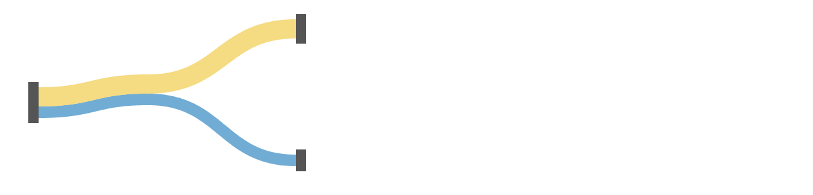

- Emulated: the trunk is an `hlink`, so its tangent at the split is horizontal. Each branch is a cubic that leaves with that same tangent, so its first cross-section is vertical and covers exactly its strand's interval of the trunk's end. The two branches peel apart with no gap, no overlap and no seam.

### k3-split-mismatch: tangents do not match

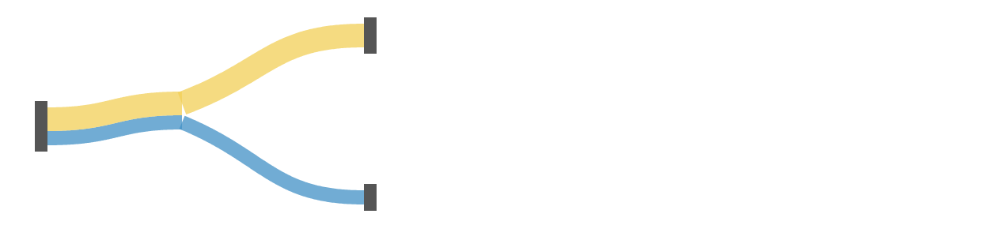

- Emulated: the same start points, but each branch leaves heading straight at its target. Its first cross-section is then tilted. A white wedge opens between the trunk's end and the branches, and the two branch ends meet at a point instead of along a shared edge.
- So a branch's band is a strand of the trunk only when the branch continues the trunk's tangent. Matching position is not enough.

## 5. A bend tighter than half the bundle

A bundle of three strands of 20 px (width 60) along an arch, a Gaussian bump of height 130. The tightest bend, at the top, has radius r_min = sigma^2 / 130. The black line is the bundle's inner (lower) boundary, the thin line its spine.

```js
const fold = (rMin) =>
  frame(480, 300)
    .layer(pieces(foldRings(rMin), { opacity: 0.6, stroke: "none" }))
    .layer(polylines(foldSpine(rMin), null, { stroke: "#333", strokeWidth: 1 }))
    .layer(
      polylines(foldInner(rMin), null, { stroke: "black", strokeWidth: 1.5 })
    );

fold(6).render(el); // k3-fold
fold(30).render(el); // k3-fold-ok
```

### k3-fold: r_min = 6, below half the width (30)

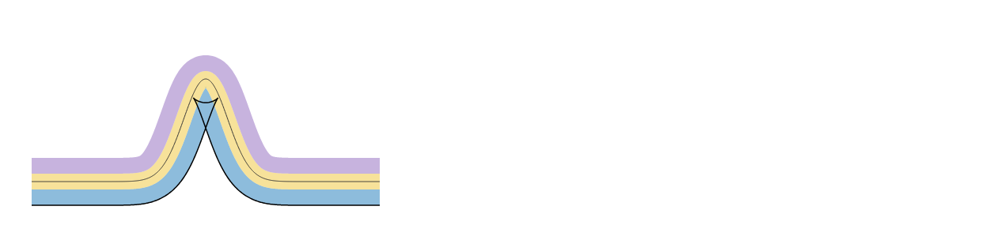

- Emulated: `strandsAlong(arch, [20, 20, 20])`. Under the apex the inner boundary, offset 30 px along the normal, runs backward and crosses itself: a swallowtail with two cusps. The bottom strand covers the same pixels twice there. Any offset larger than the radius of curvature does this; the strands are no longer a stack.

### k3-fold-ok: r_min = 30, half the width

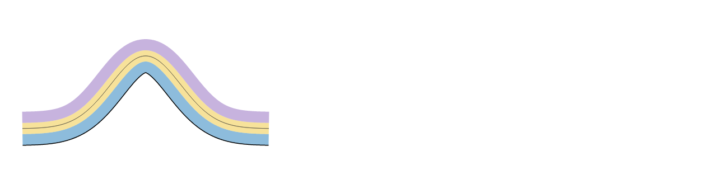

- Emulated: the same with the bend widened. The inner boundary just reaches a single sharp point at the apex and does not fold. Any wider bend gives a smooth boundary. The rule: stacking along a normal needs the path's radius of curvature to be at least the offset on the inner side, everywhere.

## Walls

1. No B-spline curve. The `Curve` family has `linear`, `step`, `monotone`, `smooth`, `catmullRom`, `bezier`, `orthogonal`, `arc` and `perfectArrows` (`packages/gofish-graphics/src/families/curve.ts:35-97`), and no basis spline, so edge bundling has to compute its spline in derive. A `Curve.basis` (or `Curve.bundle({ beta })`) would cover the screen variant.
2. The polar angle is fit to the data, not read in radians. The coord fits each axis's data extent into its budget (`packages/gofish-graphics/src/ast/coordinateTransforms/coord.tsx:445-471`): `HasCycle` only seats data 0 at the start; it does not wrap. An edge whose angles are unwrapped past 0 or 2 pi widens the extent and shrinks every angle. The native polar render had to wrap angles back into [0, 2 pi) and cut each polyline at the seam (`hebPolarData` in `stackingKinds.ts`). A cyclic axis that wraps values, or a curve that interpolates the short way round on a cyclic axis, would remove that.
3. The polar root has no angle. With control points interpolated in (angle, radius), the root at r = 0 needs an angle, and any choice is a decision (here, halfway between the two groups). This is inherent to the domain, not a GoFish wall, but a polar edge-bundling operator would have to name it.
4. No offset along a path. Strands along a normal (sections 2, 4 and 5) and a width that varies with arc length (section 3) are computed in `bandAlong` and drawn as polygons. A `line` has one scalar `strokeWidth` (`packages/gofish-graphics/src/ast/graphicalOperators/connect.tsx:220`), and `ribbon` is an interval at each x, so neither can carry an interval indexed by arc length. This is the same wall as `k2-strands-normal`.
5. No split or merge of a band. A branch that takes strand k's interval of the trunk has to be built by hand, with its start point and its tangent copied from the trunk's end. Section 4 shows the tangent must match, not only the position.
6. Nothing guards the fold. A band offset past the radius of curvature self-intersects, and the polygon draws the overlap without a warning. This is geometry, not a bug, but an operator that stacks along a normal would need either a rule (radius of curvature at least the inner offset) or a fallback.
