# Stack, spread and divide

Status: proposal. Not implemented. Every picture is a real GoFish render made with today's API. Anything GoFish cannot do yet is computed by hand in `derive` and labeled "emulated".

**Summary.**

1. Stacking and dividing are one set of equations. Neighboring parts share a boundary, and each part's thickness is its amount. The equations leave one value open. A stack fills it with a **baseline** (where the whole starts). A divide fills it with a **given whole** (how big the whole must be). Spread has none of these equations, so it shares only plumbing with stack.
2. A stack that adds whole ribbons can stay local if a ribbon's thickness is a function of x and not one number. The stack then reads only its children, the same as for rects. The baselines from the streamgraph papers (zero, center, wiggle, expand, diverging) and the inside-out order become options of that one `stack`, because it sees whole series. The baseline is the alignment of the operator that loops over the cross axis; `baseline` on a stack of ribbons is short for it.
3. Neighboring bands do not need common sample points. They need to draw the same boundary. The simple rule that is always right is to resample every series at the union of all x positions, after each series is curved (ggplot2's `stat_align`).

**Recommendation.** Approach B. Keep one flow `stack`. Let its children's thickness be a function of the cross axis, and add a `baseline` option to it (`Align.zero()`, `.center()`, `.wiggle()`). The baseline is the alignment of the operator that loops over the cross axis; `baseline` on a stack of ribbons is short for it. The ribbon stays a plain mark: `ribbon({ x, h })`. Keep the per-x form (`scatter` by x, then `stack`) as the spelling for charts whose order changes at each x, e.g., the ribbon chart. Keep `.cut()` for dividing a shape that the spec draws first (a bottle, a horizon chart, a sankey link), and define it as a stack of shares intersected with that shape. Drop the `.stack()` mark method (#290). Stacked bars and grouped bars stay two different flows, and a transition between them is an animation between two specs, not an option.

```js
// Proposed: a streamgraph
chart(topics)
  .flow(stack({ by: "topic", dir: "y", baseline: Align.wiggle() }))
  .mark(ribbon({ x: "x", h: "value", fill: "topic" }));
```

```python
gf.chart(topics).flow(gf.stack(by="topic", dir="y", baseline=Align.wiggle())).mark(
    gf.ribbon(x="x", h="value", fill="topic")
)
```

The shortcut: the engine has no type for a thickness that is a function of x. Until it does, B is a rewrite into today's per-x flow. It resamples the series to the union grid, runs the per-x stack, and computes the baseline from the whole series before it places any slice. Section "Implementation path" says what the full fix is.

## Terms

- **Part.** One child of a stack: a bar, or one series' band.
- **Boundary.** The line between two neighboring parts. In a stacked area each boundary is a curve over x.
- **Glue.** Two neighboring parts share one boundary, so no gap and no overlap can open between them. Stack has glue. Spread does not.
- **Baseline.** Where the bottom of a stack sits. For a stacked area it is 0. For a streamgraph it changes with x. GoFish already uses "baseline" for a node's local 0, the value that `alignment: "baseline"` lines up. This is the same meaning.
- **Given whole.** A size that the spec fixes before the parts are known, e.g., a 100% bar or a bottle shape.
- **Profile.** A thickness that is a function of the cross axis. A rect has a number as its height. A ribbon over x has a profile.
- **Per-x form.** `scatter({ by: "x" })` then `stack(...)`. The stack runs once inside each x slice and sees only that slice.
- **Whole-series form.** `stack(...)` of whole ribbons. The stack runs once and sees every series over all x.
- **CanSum.** The trait that says a unit's values add up (#1311). Stack checks it.

## The one relation

Write the parts' amounts as f_1, ..., f_n and the boundaries as g_0 (the bottom) to g_n (the top). Glue says:

```
g_1 - g_0 = f_1
g_2 - g_1 = f_2
...
g_n - g_(n-1) = f_n
```

That is n equations in n + 1 unknowns. One more condition picks the picture. The literature agent's reading of Byron and Wattenberg (2008) and of d3, Plot, matplotlib and Vega supports this. Every stacking system answers that one question.

| The extra condition                                      | What it draws                                           | Name today                                       | Local in x?                       |
| -------------------------------------------------------- | ------------------------------------------------------- | ------------------------------------------------ | --------------------------------- |
| g_0 = 0                                                  | stacked bars, stacked area                              | d3 `stackOffsetNone`, Vega-Lite `"zero"`         | yes                               |
| g_0 + g_n = 0                                            | silhouette streamgraph (ThemeRiver)                     | d3 `stackOffsetSilhouette`, Vega-Lite `"center"` | yes                               |
| g_0 at the midpoint of an ordered key                    | Likert bars, population pyramid                         | GoFish `Trait.diverging()` today                 | yes                               |
| g_0 minimizes the summed squared slope of the boundaries | weighted wiggle streamgraph (Byron and Wattenberg)      | d3 and Plot `"wiggle"`                           | no, a running sum over x          |
| g_0 minimizes the unweighted wiggle                      | the "deviation" baseline, a pointwise formula           | matplotlib `"wiggle"`                            | yes                               |
| g_n - g_0 = W, a given whole                             | 100% bar, mosaic, conditional density, a cut of a shape | `normalize()`, `Tile.slice`, `cut`               | yes, but each f_i becomes a share |

The last row is the divide. If the whole W is given and the parts are given, the system has too many conditions. The parts must be rescaled to shares, f_i times W over the total. So a divide needs more than a stack needs:

- the amounts must be CanSum, as for a stack;
- the total must not be 0;
- the result is a ratio, a share of the whole, and no longer the original unit.

`stack({ size: field(f).normalize() })` already has exactly this type. It makes a new unit "f share by k" with CanSum (`fieldExpr.ts:625`). #1276 already proposes that `Tile.slice` and `Tile.dice` are this same normalized stack.

So Josh's two readings are both right, and they differ in a way the types can see:

- **Stacking up.** The data holds amounts. The whole is their sum. The extra condition is a baseline. Stacked bars, stacked area, cumulative line, waterfall, Gantt with dependencies, Likert.
- **Dividing.** The spec gives the whole: a box to fill, a shape, a density. The extra condition is the whole. The parts are shares. 100% bars, mosaic, bottle, croissant, horizon, sankey link strands.

The engine computes sizes bottom-up in both cases (`underlying-space.md`, "Why two walks"). The top-down forms today are either a bottom-up stack in share units (`normalize`) or a division of pixels after layout (`cut`, `treemap`). So the direction is decided by where the whole comes from: a sum of data (up) or a shape or box in the spec (down).

### Stack and spread

`stack` is `Spread({ glue: true })` in the code (`stack.tsx:14`). They share:

- the split by `by`, `reverse` and the order;
- `dir`;
- the cross-axis `alignment`;
- the `size` wrapper.

The glue flag then picks a different answer for everything else:

|                     | stack                                               | spread                                                       |
| ------------------- | --------------------------------------------------- | ------------------------------------------------------------ |
| Type of the result  | one continuous space, the sum (`distribute.ts:349`) | separate spaces, ordinal over the keys (`distribute.ts:394`) |
| Units               | unified, CanSum checked                             | not unified                                                  |
| Axis                | a number axis over the sum                          | a category axis over the keys                                |
| Spacing             | always 0                                            | a gap or a fixed pitch                                       |
| Placement           | tail to head, so a negative part goes back          | facing edges                                                 |
| The equations above | yes                                                 | none                                                         |

So stack and spread share how they split rows and where they put children across the axis. They do not share a type. The code supports Josh's newer reading.

### Stacked bars and grouped bars

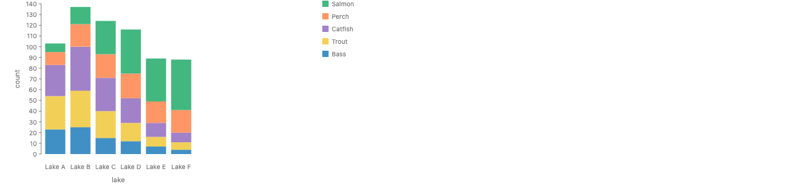 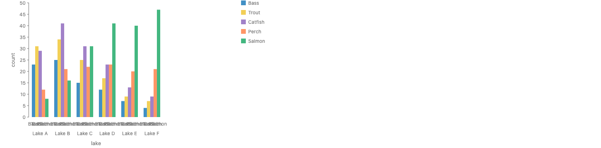

```js
// stacked
chart(seafood)
  .flow(spread({ by: "lake", dir: "x" }), stack({ by: "species", dir: "y" }))
  .mark(rect({ w: 32, h: "count", fill: "species" }));

// grouped
chart(seafood)
  .flow(
    spread({ by: "lake", dir: "x", spacing: 12 }),
    spread({ by: "species", dir: "x", spacing: 0 })
  )
  .mark(rect({ w: 7, h: "count", fill: "species" }));
```

The two flows differ in four ways at once:

- the operator (`stack` against `spread`);
- its direction (y against x);
- the x axis (one level against two);
- the y domain (largest total, about 140, against largest single count, about 47).

Only the y unit is shared. Grouped temperatures are fine, and stacked temperatures are a type error. So one switch between them would hide a change of type.

A transition between them is an animation between two specs whose marks match by key (lake and species). The y scale moves too, as in d3's classic stacked-to-grouped example. That belongs to the transition work (#831, "update is connect on time"), and needs no option on `stack`. The halfway frame below is emulated: both layouts are computed in data and the rows are interpolated.

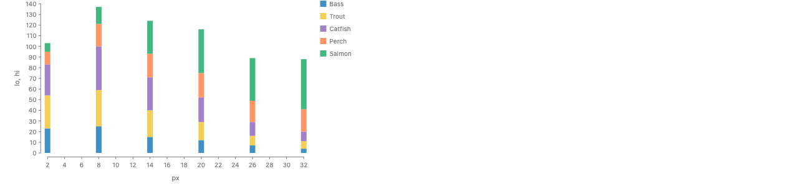 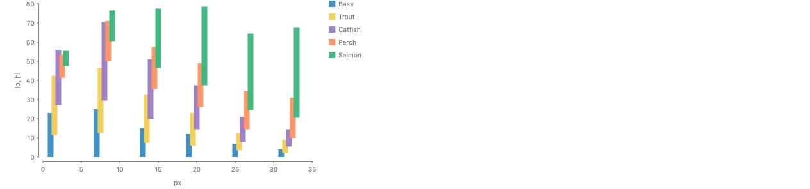 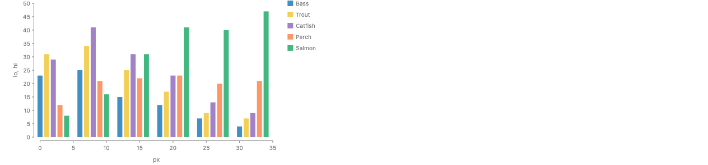

## Which wiggle

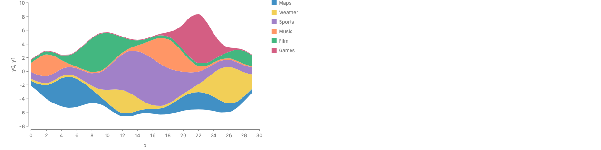 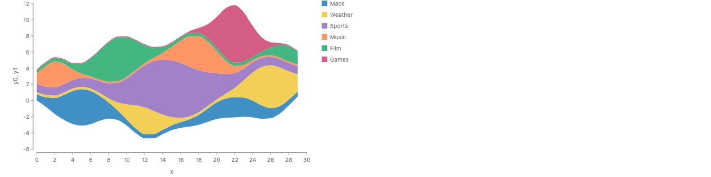 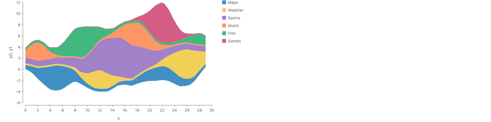

Left to right: deviation (local); weighted wiggle (d3, Plot); SineStream. Same data and order. All three are emulated in `derive`.

The literature has at least four wiggle baselines. They differ in what they make flat.

- **Deviation** (Byron and Wattenberg 2008). It keeps the boundaries close to 0. Its formula needs only one x, and its derivative also minimizes the unweighted wiggle. matplotlib's `wiggle` is close to it.
- **Weighted wiggle** (Byron and Wattenberg 2008). It flattens each band's slope, weighted by the band's thickness, so thick bands come out flattest. It is a running sum along x. d3, Plot and matplotlib's `weighted_wiggle` use it.
- **SineStream** (Bu et al. 2021). The weighted wiggle with a weight that also counts how fast a band changes, to reduce the sine illusion (the eye reads the gap between two parallel curves at a right angle, not vertically).
- **L1 wiggle** (Di Bartolomeo and Hu 2016). Absolute slopes instead of squared ones. I could not read this paper; SineStream reports that L1 prefers one large bend over several small ones.

No study picks a best one. Thudt et al. 2016 found the weighted wiggle streamgraph a little easier to read than ThemeRiver and the stacked area for some tasks, with small differences. The weighted wiggle is the default in d3 and Plot because they followed Byron and Wattenberg, so it is the one users expect, not a proven best. Both later papers pair their baseline with an order, and the order changes the picture as much as the baseline does.

So `Align` is a strategy family with a function escape hatch, like the other families (#1101). `Align.wiggle()` is the weighted wiggle, so a spec ported from d3 or Plot draws the same picture. `Align.deviation()` and `Align.sineStream()` are small additions. A custom strategy is a function that takes the parts on the shared grid, in stack order, and returns the offset at each x. d3's offsets have the same shape.

## Where the baseline lives

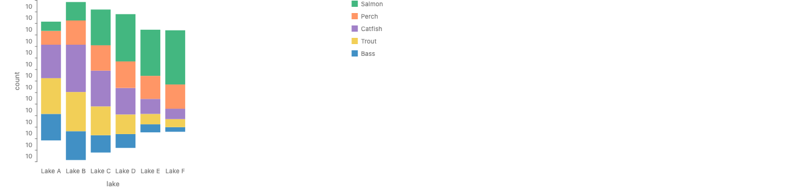 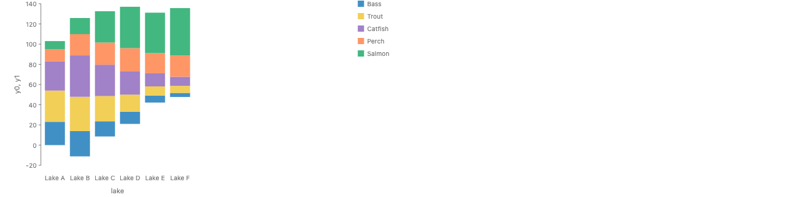

Left: today, `alignment: "middle"`. Right: proposed, `Align.wiggle()`, emulated.

Baselines come in two kinds.

- **One stack at a time.** Zero, center, diverging, expand and deviation each need only one stack. They work for any mark, rects included. GoFish already has one: `spread({ alignment: "middle" })` centers each stack, and the gallery streamgraph uses it.
- **Neighbors.** Weighted wiggle, SineStream and L1 need the stacks on either side. Only the operator that loops over the cross axis sees them.

So the baseline is the alignment of the operator that loops over the cross axis. In bar charts and in the per-x form that is the outer `spread` or `scatter`, and the option is its `alignment`: `"middle"` today, `Align.wiggle()` proposed. That operator reads each child stack's part boundaries by key, which are the child's own measurements reported up to it, so it stays local.

In the whole-series form the loop over x sits inside each profile, so no outer operator exists. There, `stack({ baseline: Align.wiggle() })` is short for writing the `scatter` by x out with that alignment. The core is `alignment` on the operator that loops over the cross axis, and `baseline` on a stack of profiles is sugar with an exact rewrite.

```js
// centered stacked bars (today)
chart(seafood)
  .flow(
    spread({ by: "lake", dir: "x", alignment: "middle" }),
    stack({ by: "species", dir: "y" })
  )
  .mark(rect({ w: 32, h: "count", fill: "species" }));

// wiggle stacked bars (proposed)
chart(seafood)
  .flow(
    spread({ by: "lake", dir: "x", alignment: Align.wiggle() }),
    stack({ by: "species", dir: "y" })
  )
  .mark(rect({ w: 32, h: "count", fill: "species" }));

// streamgraph: the sugar and what it is short for
chart(topics)
  .flow(stack({ by: "topic", dir: "y", baseline: Align.wiggle() }))
  .mark(ribbon({ x: "x", h: "value", fill: "topic" }));

chart(topics)
  .flow(
    scatter({ by: "x", x: "x", alignment: Align.wiggle() }),
    stack({ by: "topic", dir: "y" })
  )
  .mark(ribbon({ h: "value", fill: "topic" }));
```

## What the stack reads

Today each node reports a box, one interval per axis (`underlyingSpace.ts:87`). A ribbon's box runs from its lowest to its highest y over all x. A stack of boxes puts each ribbon above the whole ribbon before it, which draws a ridgeline. So boxes alone cannot make a stacked area.

The stack in B reads a **profile**: each child's extent along `dir` as a function of the cross axis, in data units. For a ribbon it is the `h` channel over x. For a rect it is a constant. The data gives it before layout, so the stack's axis can be the sum, and CanSum can be checked at each x.

The geometry interface (`geometry/index.ts`: box, enclosing circle, outline) is the pixel counterpart, and it answers after layout. An outline gives a pixel profile of any shape: its lowest and highest y at each x. Contour spacing needs exactly that, e.g., ridgelines that never overlap, or tidy trees. That is a `spread` with no sum. So there are two profiles. A stack adds data profiles. A spread can space shapes by pixel profiles. A shape that has only a pixel outline, e.g., a circle or an image, cannot be stacked this way, because its outline is not an amount.

## Interval families and kinds of stacking

Josh's direction (11-07): give lines and ribbons an **interval family** as a geometry query, the way a circle has an enclosing circle for packing. A ribbon is a family of intervals, one at each x. A line is the same kind of family, with each interval as wide as its stroke. The box is the hull of the family, so an interval family can be cast to a box. Then `stack` is one operator over boxes and interval families, and no mark needs a `.stack()` method.

### What an interval family carries

Edge routing shows what has to be in it (`research/edge-routing-and-stacking-kinds.md`). Graphviz dot already lays out a long edge as one interval per rank: a chain of placeholder nodes, each with a width. In ordered edge bundles (Bereg, Holroyd, Nachmanson and Pupyrev), a bundle is as wide as the sum of its edges plus the gaps between them. So the family needs:

- **A parameter.** The intervals are indexed by x for a ribbon, by rank in a layered graph, or by distance along the path for a path that turns back in x.
- **A cross-section direction.** A stacked area measures each interval vertically. A sankey link drawn as a thick stroke (d3-sankey) measures it at right angles to the curve. The two agree only where the curve is flat.
- **A width at each point.** For a line this is its stroke. A box can be grown by half the stroke on every side, but a curved line cannot, because the stroke spreads at right angles to the curve. So the cast from a line's family to a box needs the stroke. This only affects the cast, not what gets stacked.

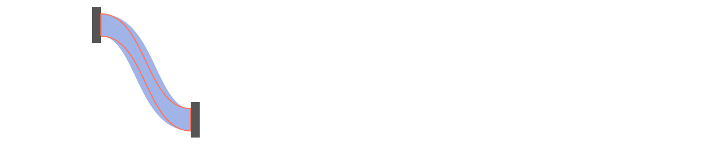

A 40 px link drawn both ways. In the steep middle the vertical band is about 17 px thick across the curve, and the stroke is about 94 px tall. Three strands of 10, 20 and 10 px stacked along the normal keep their width (left). Stacked vertically, they thin to about 0.43 of it in the middle (right).

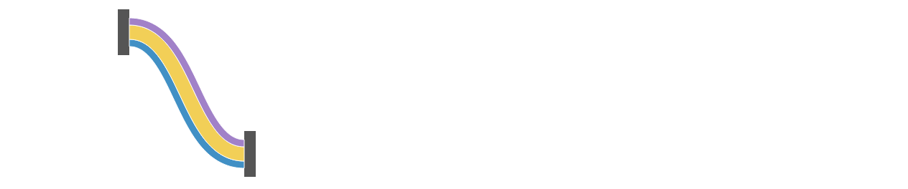 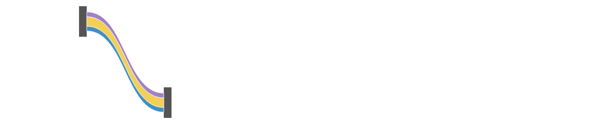

The stack in this proposal uses one setting: intervals over x, measured vertically. Sankey strands (#47, stacked ribbons) need the other setting.

### Three kinds of stacking

The clearest split is by how each child moves.

- **Pointwise.** Each child gets its own offset at every x, so it takes the shape of the one below. The amounts add. The stack reads interval families. Examples are the stacked area and the streamgraph.
- **Rigid contact.** Each child moves as a whole, by one offset: the largest overlap between its outline and the outline below. That is a maximum, not a sum, so the amounts do not add. It reads outlines or enclosing circles, after layout. Examples are the beeswarm (`Overlap.separate`, Plot's `dodge`), ridgelines that never overlap, and tidy trees.
- **Boxes.** A box has the same height at every x, so both rules give the same answer. This is the one case where contact adds the amounts, which is why stacking bars felt like one idea. Examples are stacked bars and the Wilkinson dot plot.

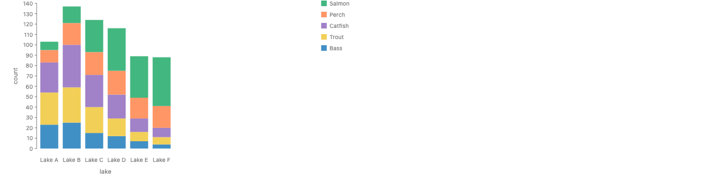 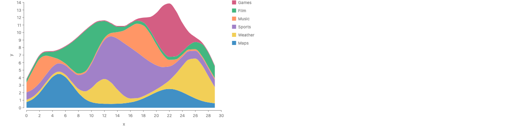

Box stacking and pointwise stacking, today's API.

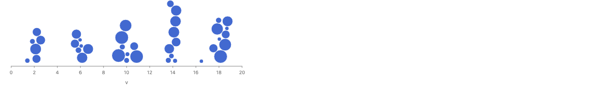 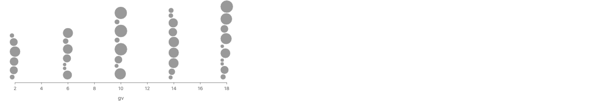

Rigid contact (`Overlap.separate`, today) against box stacking of the same circles. The contact columns are 70 to 132 px tall. The box columns are the sums of the diameters, 101 to 172 px.

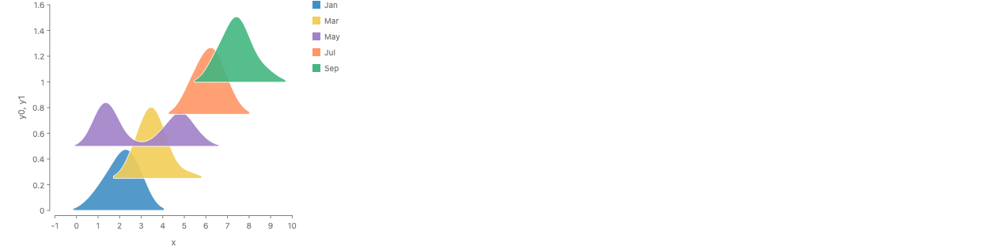 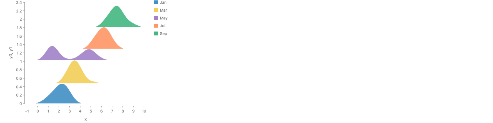 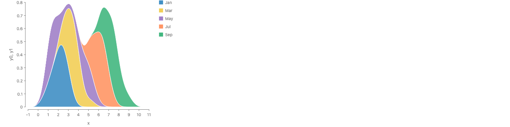

Ridgelines with fixed spacing (they overlap), with rigid contact (emulated), and as the pointwise sum (a stacked density). Here contact lands close to a box stack, and only one ridge slides down. A ridge with a flat base cannot go below the peak under it, so contact gains most for narrow ridges.

Two cases that look new reduce to these:

- **Along a curve's normal** (sankey strands, metro lines, bundled edges). This is pointwise stacking with distance along the path as the parameter. It holds between junctions, and only while the stack is thinner than the radius of the bend. A ribbon cannot draw it, because a strand's two edges sit at different x for the same point on the path, so the renders use polygons.
- **Rings whose areas add.** This is box stacking with squared radius as the axis, which is `Coord.clock({ radius: "area" })` from the scale transforms proposal.

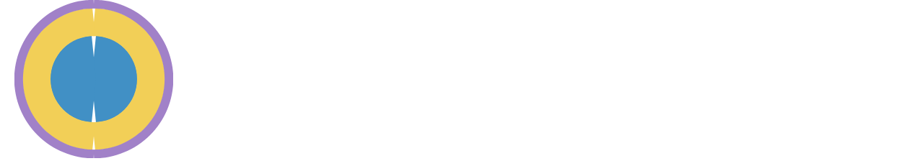 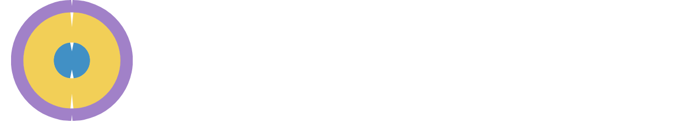

Amounts 30, 50 and 20 as rings. Areas add (left), radii add (right).

Tiling in 2D (Voronoi treemaps) and packing in 2D (circle packing, word clouds) are not stacking, because there is no single line to stack along.

The closest precedent for "spread with glue" is TeX. A `\vbox` stacks boxes that each report a height, a depth and a baseline, and the glue between them has a natural size that can stretch or shrink. `\vbox to size` meets a given size by stretching the glue, not by rescaling the parts. TeX reads only boxes.

### What this means for the operators

- **`stack` is the additive kinds.** It reads a box or an interval family from each child, adds them over the shared parameter, and its axis is the sum, with CanSum checked. The interval family has to be in data units for this, e.g., from the ribbon's `h` channel.
- **Rigid contact is not `stack`.** Its axis is not a sum, and it runs on pixel outlines after layout. It is a spacing rule of `spread` and `scatter`, as `Overlap.separate` already is for `scatter`. A contact rule on `spread` would draw ridgelines that never overlap.
- **The third kind is not a reason for a `.stack()` method.** It belongs on the operators that lay children out without adding them.

### Where the baseline goes

When `stack` reads interval families, the stack owns the x parameter, so the baseline is the stack's own option and not sugar: `stack({ by, dir, baseline: Align.wiggle() })`.

When `stack` reads boxes, it has no parameter inside it. Zero, center and diverging still apply to one stack and fit the same option. Wiggle needs the neighboring stacks, which only the outer `spread` sees, so it is that spread's `alignment: Align.wiggle()`.

The rule is the same in both cases. The option goes on the operator that owns the parameter the baseline changes along.

### Walls found while rendering

1. A stroke on a polar band replaces its fill. A `rect` with one data dimension in a nonlinear space is drawn as a stroked midline (`rect.tsx:384`), colored by the user's `stroke` (`rect.tsx:322`), so `stroke: "white"` paints whole rings white.
2. In `Coord.clock`, a `stack` along the angle with one child per ring and a constant `w` draws arcs of zero angle. The renders draw each ring as two halves, which leaves thin seams.
3. With a fixed `h`, a stack of circles sized in pixels, or a dodge, floats at the top of the plot.
4. `alignment: "start"` hangs those shapes down from the top, which contradicts the `OneSided` story's comment.
5. `axes: false` on a `stack` inside a `scatter` does not remove its "id" axis.
6. Two scatter layers placed only by `alignment` do not share a baseline.
7. There is no way to fix a scale's domain (a missing option, not a bug).

## Where the "for each x" is written

The flow already says where the loop over x is. This decides which knobs a spelling has.

- **Per-x form** (`scatter` by x outside, `stack` inside). Each slice's stack sees only its own x. The order can change at every x, and that is the ribbon chart. A slice cannot see its neighbors, so weighted wiggle and the inside-out order cannot live on that stack.
- **Whole-series form** (`stack` of whole ribbons). The stack sees every series over all x. The order is one order for all x, and the baseline can use the whole series.

Both are real charts. No one spelling has both kinds of knob, so GoFish needs both spellings. B makes the whole-series form a plain `stack`. Then the two spellings differ only in where `scatter` sits.

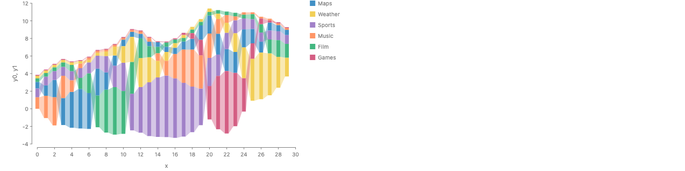

The ribbon chart above is the per-x form: rects re-sorted at each x, joined by ribbons. The same order drawn as one band per series overlaps itself, because a band cannot jump across its neighbors (below, `o-per-x-rank-area`).

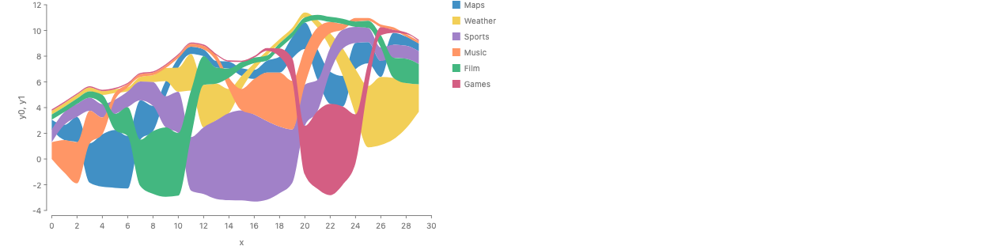

## Sampling: do the boundaries need common points?

No. Two neighboring bands must draw the same boundary. Each boundary needs only the sample points of the series under it.

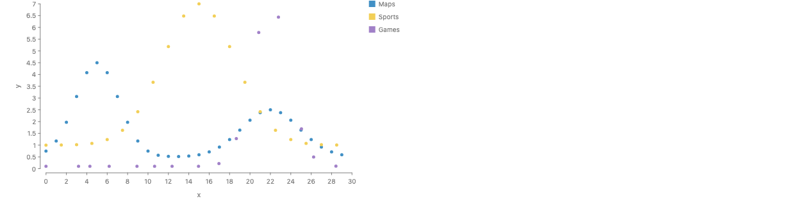

Three series measured at different x. Maps is measured every 1.0. Sports is measured every 1.5. Games is measured at 15 jittered x.

**Today.** `scatter` by x, then `stack`, stacks only rows that share an exact x. It draws this with no warning:

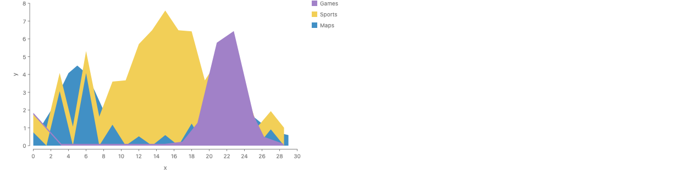

Sports turns into a sawtooth between 0 and the top of Maps. Games starts as a thin sliver and slides to the floor. If the rows are not sorted by x, the ribbon also zigzags back along x, because a ribbon joins its pieces in data order (`connect.tsx:551`).

**Union grid, as ggplot2 does it (emulated).** Every series is read at the union of all x by linear interpolation, then stacked.

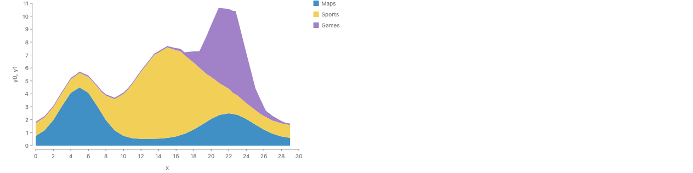

**One boundary per series sum (emulated).** Boundary k is f_1 + ... + f_k, read only at the union of the samples of f_1 to f_k. So the boundaries have 2, 30, 40 and 54 points. Each band is the region between two boundaries, and neighboring bands use the same point array. The picture is the same, with fewer points on the lower boundaries. The dots mark each boundary's own points.

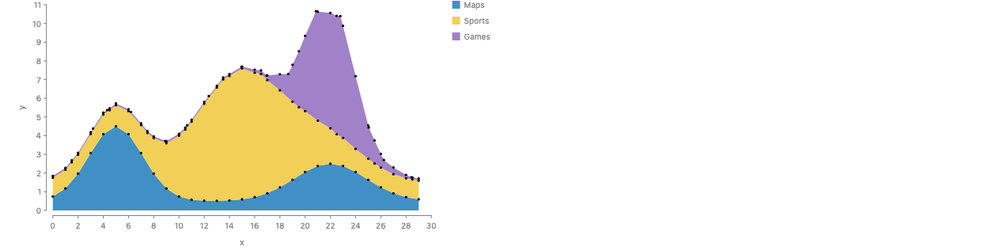

A `ribbon` cannot draw this. Each ribbon anchor gives both edges at one x, so a band whose top and bottom have different x samples has to be a `polygon`, and `polygon` has no `curve`.

**What the precedent does** (from the literature notes, `research/streamgraphs.md`):

- **ggplot2 `stat_align`** (the default for `geom_area` since 3.4.0). It reads every series by linear interpolation at the union of all x, plus each zero crossing. It pads each series to 0 just outside its own range.
- **Vega-Lite.** It fills in 0 at a missing x, so a series dips to 0 between its own samples.
- **Observable Plot.** No alignment. On ggplot2's own misaligned example nothing stacks.
- **ggstream.** It snaps to a grid of 1000 points and smooths each series, then stacks.
- **Mascot.** Its densify step makes vertices at every unique x of the whole table before the divide, so the samples are common by construction.

**Curve order.** Today GoFish stacks the points and then curves each boundary on its own. With the default monotone curve this differs from curving each series and then adding. The Games band even gets a negative thickness near x = 14.6, so two bands overlap.

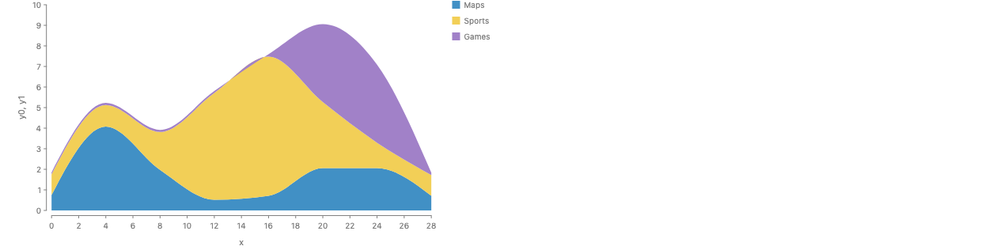 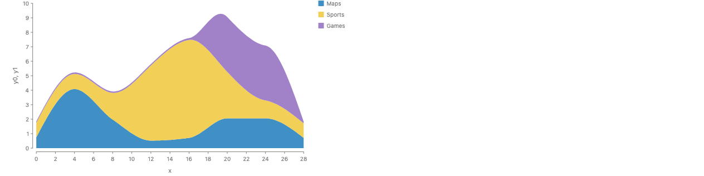

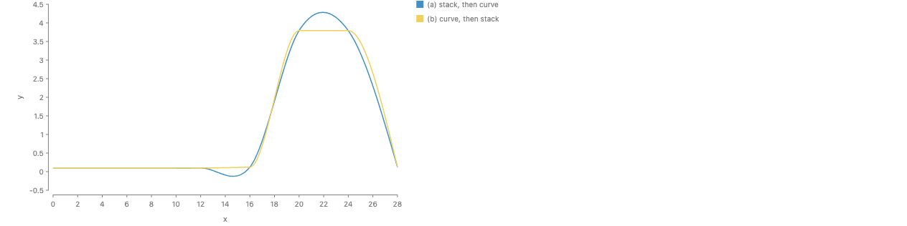

The literature agent checked d3's curves the same way. Curves that are linear in the values (linear, basis, cardinal, natural) give the same boundaries either way. Cardinal and natural still overshoot, so they can still give a negative thickness. Monotone and Catmull-Rom are not linear in the values, so the order matters for them.

**The rule B uses.**

1. Curve each series by itself.
2. Read every series at the union of all x positions. For a curve that is not linear, add points between them.
3. Add the series.
4. Draw every band between two boundaries that both neighbors share.

The union grid is the simple choice. It lets `ribbon` draw each band, because both edges have the same x samples. A grid per boundary saves points but needs a new band mark, and only matters for very large data.

For a function of x with no samples at all, e.g., `x.density()` from #980, the renderer picks the grid. For now that is a fixed count (512). Picking points by screen error comes later, as Josh already deferred in #1332.

## Approaches

### A. Per-x everywhere (today, with fixes)

Keep `scatter` by x then `stack`. Add the baselines and orders as data helpers in `derive`.

```js
chart(topics)
  .flow(
    derive((rows) => stackRows(rows, { offset: "wiggle" })), // adds y0, y1
    scatter({ by: "x", x: "x" }),
    scatter({ by: "topic", yMin: "y0", yMax: "y1" })
  )
  .mark(ribbon({ fill: "topic" }));
```

- It adds no operator.
- Wiggle and inside-out need a helper of about 20 lines each, written outside the flow.
- Misaligned grids stay a silent bug unless `stack` checks for them.
- The curve order stays wrong unless the ribbon learns to curve each part before the stack.
- Silhouette needs #1343 fixed (`scatter` drops `alignment` on the free axis today).

### B. Whole-series stack (recommended)

`stack` takes children whose thickness along `dir` is a profile over the cross axis. It adds the profiles, which is the same addition as for numbers, done at every x. The glue is the shared boundary. The baseline is an option of the stack. The ribbon is a plain mark with `x` and `h`.

```js
// stacked area
chart(topics)
  .flow(stack({ by: "topic", dir: "y" }))
  .mark(ribbon({ x: "x", h: "value", fill: "topic" }));

// streamgraph, centered
chart(topics)
  .flow(stack({ by: "topic", dir: "y", baseline: Align.center() }))
  .mark(ribbon({ x: "x", h: "value", fill: "topic" }));

// streamgraph, wiggle, inside-out order
chart(topics)
  .flow(
    stack({
      by: field("topic").sort(Order.insideOut("value")),
      dir: "y",
      baseline: Align.wiggle(),
    })
  )
  .mark(ribbon({ x: "x", h: "value", fill: "topic" }));

// 100%: the whole is given, the parts are shares at each x
chart(topics)
  .flow(stack({ by: "topic", dir: "y" }))
  .mark(ribbon({ x: "x", h: field("value").normalize(), fill: "topic" }));

// stacked densities: no grid in the spec
chart(groups)
  .flow(stack({ by: "group", dir: "y" }))
  .mark(ribbon({ h: x.density(), fill: "group" }));
```

```python
gf.chart(topics).flow(
    gf.stack(
        by=gf.field("topic").sort(Order.inside_out("value")),
        dir="y",
        baseline=Align.wiggle(),
    )
).mark(gf.ribbon(x="x", h="value", fill="topic"))
```

How it answers Josh's locality rule. Josh rejected a flow `stack` that reaches into a ribbon's vertices (croissant round 6). In B the stack does not read vertices. It reads each child's thickness, as it does for a rect, and that thickness is a function. A rect's thickness is the special case of a function that does not change with x.

How it composes:

- **Coordinates.** In polar, the same spec draws a radial stacked area (`m-radial-stacked-area`).
- **Partition.** `partition` then `stack` is the stacked histogram. Partition makes cells on x, and the stack works inside each cell.
- **Spread.** A `spread` of whole ribbons is a ridgeline: separate spaces, no glue. With profiles, a spread could also space ridges by their outlines so they never overlap. That uses the same profile type and is the same idea as outline spacing for tidy trees.
- **Distributions (#980).** `ribbon({ h: x.density() })` is a profile with no rows. Stacking densities weighted by their share draws the mixture density. Normalizing them draws the conditional density, P(group given v), as R's `cdplot`. This gives approach B of #1332 a home, and it needs no `sweep`.
- **Animation.** A baseline is a value of the stack, so a transition between zero and wiggle tweens the baseline.

Overlap check:

- **The per-x form.** B's stacked area draws the same picture as the per-x form when the series share x and the curve is linear. Define B by that rewrite (resample, then per-x stack), and the overlap is an exact composition.
- **`.cut()` of a total area.** Exact composition of a stack of shares and `intersect`, as below.
- **`spread`.** Small shared case only: the split and the cross-axis alignment.

Trade-offs:

- New terms: `Align` and maybe `Order.insideOut`. The option name `baseline` is already Josh's word for this in #809.
- The engine needs a profile type for full support (see "Implementation path").
- A per-x sort written on a whole-series stack is an error, because one order holds for all x. The message points at the per-x form.

### C. Divide first (Mascot)

Draw the total area, then cut it by group at each x.

```js
chart(topics).mark(
  ribbon({ x: "x", h: "value", fill: "topic" }).cut({
    by: "topic",
    dir: "y",
    baseline: Align.wiggle(),
  })
);
```

- It has the whole-series view, so wiggle and inside-out fit.
- It is the right spelling when the spec draws the whole first: a bottle, a horizon chart, sankey link strands, a picture divided into a pie.
- For a stacked area the whole is only the sum of the parts. So the user writes a total that is not given, and `cut` must invert it into shares and multiply back. That is the same stack under another name.
- `cut` today has three modes (weight, cells, a group per vertex). The weight mode has the type of a normalized stack, and the cells mode has the type of `partition`. One name over two types.

### D. `.stack()` on the mark (#290)

```js
chart(topics).mark(
  ribbon({ x: "x", h: "value", fill: "topic" }).stack({ by: "topic", dir: "y" })
);
```

- It reads like the whole-series form but rewrites to the per-x form, so it hides which knobs exist.
- On a ribbon it has three readings: a ridgeline, a stacked area, or a ribbon chart.
- Rejected.

## Examples

Each example shows the render, the proposed B spelling, and today's code.

### Stacked area

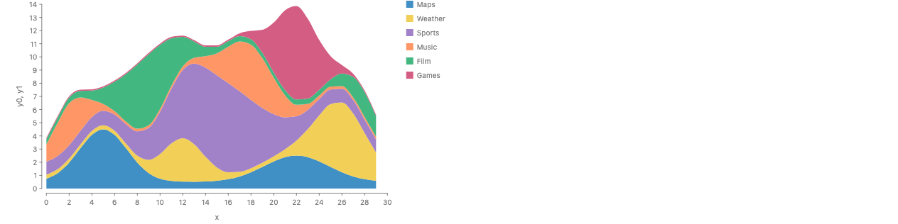

```js
// proposed
chart(topics)
  .flow(stack({ by: "topic", dir: "y" }))
  .mark(ribbon({ x: "x", h: "value", fill: "topic" }));

// today
chart(topics)
  .flow(scatter({ by: "x", x: "x" }), stack({ by: "topic", dir: "y" }))
  .mark(ribbon({ h: "value", fill: "topic" }));
```

### Silhouette

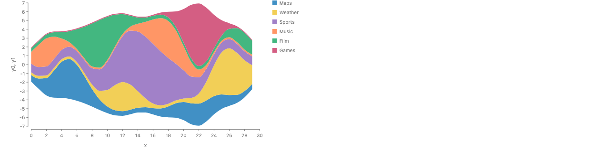

```js
// proposed
chart(topics)
  .flow(stack({ by: "topic", dir: "y", baseline: Align.center() }))
  .mark(ribbon({ x: "x", h: "value", fill: "topic" }));

// today (needs #1343; the y: 0 form runs but draws no y axis)
chart(topics)
  .flow(
    scatter({ by: "x", x: "x", alignment: "middle" }),
    stack({ by: "topic", dir: "y" })
  )
  .mark(ribbon({ h: "value", fill: "topic" }));
```

### Wiggle, and wiggle with the inside-out order

 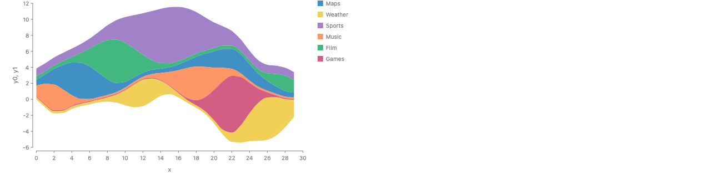

```js
// proposed
chart(topics)
  .flow(
    stack({
      by: field("topic").sort(Order.insideOut("value")),
      dir: "y",
      baseline: Align.wiggle(),
    })
  )
  .mark(ribbon({ x: "x", h: "value", fill: "topic" }));

// today (emulated: about 20 lines each for the offset and the order)
chart(topics)
  .flow(
    derive((rows) =>
      stackRows(rows, { offset: "wiggle", order: orderInsideOut(rows) })
    ),
    scatter({ by: "x", x: "x" }),
    scatter({ by: "topic", yMin: "y0", yMax: "y1" })
  )
  .mark(ribbon({ fill: "topic" }));
```

### Expand (100%)

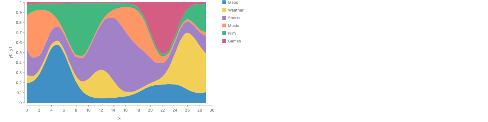

```js
// proposed
chart(topics)
  .flow(stack({ by: "topic", dir: "y" }))
  .mark(ribbon({ x: "x", h: field("value").normalize(), fill: "topic" }));
```

### Diverging

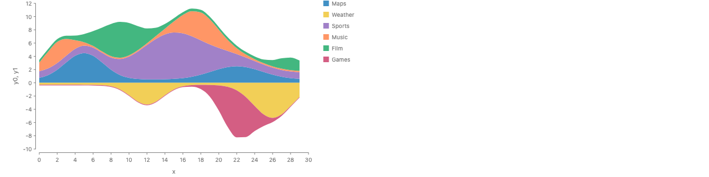

```js
// proposed: signed parts go below the baseline, as Likert bars do today
chart(topicsSigned)
  .flow(stack({ by: "topic", dir: "y" }))
  .mark(ribbon({ x: "x", h: "value", fill: "topic" }));
```

### Series on different x grids


```js
// proposed: the same spec as any stacked area; the stack resamples
chart(sampled)
  .flow(stack({ by: "c", dir: "y" }))
  .mark(ribbon({ x: "x", h: "y", fill: "c", curve: Curve.linear }));
```

### Ribbon chart (order changes at each x)

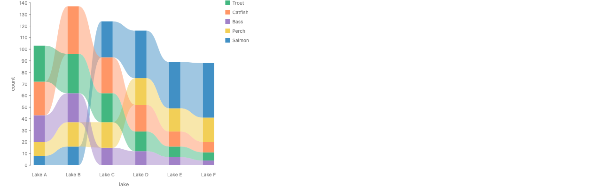

```js
// stays the per-x form
chart(seafood)
  .flow(
    spread({ by: "lake", dir: "x", spacing: 48 }),
    stack({ by: field("species").sort("count"), dir: "y" })
  )
  .mark(rect({ w: 24, h: "count", fill: "species" }).name("bars"))
  .layer(
    chart(selectAll("bars"))
      .flow(group({ by: "species" }))
      .mark(ribbon({ fill: "species", opacity: 0.5 }))
  );
```

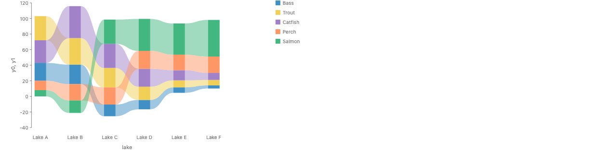

An earlier version of this page showed the ribbon chart drawn with a wiggle baseline next to a spec with no baseline. That spec draws a zero baseline, above. With a wiggle baseline it is the spec below (proposed; the render is emulated).

```js
chart(seafood)
  .flow(
    spread({ by: "lake", dir: "x", spacing: 48, alignment: Align.wiggle() }),
    stack({ by: field("species").sort("count"), dir: "y" })
  )
  .mark(rect({ w: 24, h: "count", fill: "species" }).name("bars"))
  .layer(
    chart(selectAll("bars"))
      .flow(group({ by: "species" }))
      .mark(ribbon({ fill: "species", opacity: 0.5 }))
  );
```

### Stacked density and conditional density

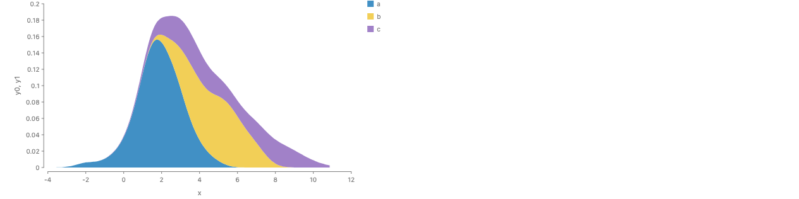 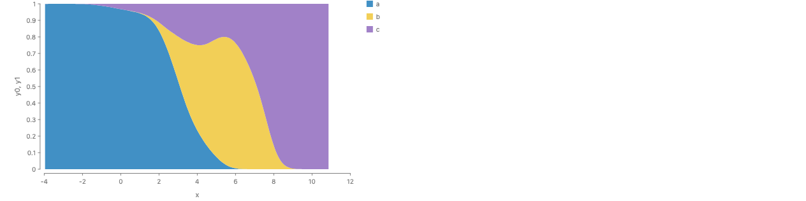

```js
// proposed: the mixture density
chart(groups)
  .flow(stack({ by: "group", dir: "y" }))
  .mark(ribbon({ h: x.density().times(x.mass()), fill: "group" }));

// conditional density, P(group given v)
chart(groups)
  .flow(stack({ by: "group", dir: "y" }))
  .mark(ribbon({ h: x.density().times(x.mass()).normalize(), fill: "group" }));
```

`x.mass()` and `.times()` are placeholders. #980 has not decided whether a group's density carries its mass.

### Ridgeline (a spread, for contrast)

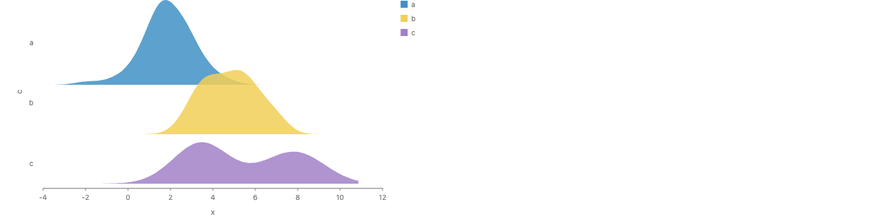

```js
chart(groups)
  .flow(spread({ by: "group", dir: "y", anchor: "baseline", spacing: 70 }))
  .mark(ribbon({ h: x.density(), fill: "group" }));
```

### Croissant (cells, not a stack)

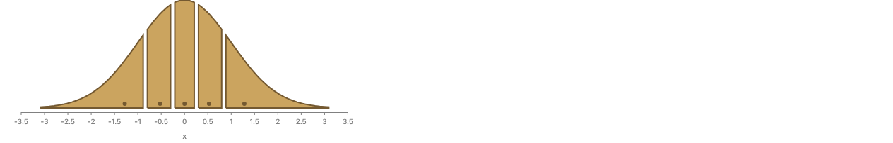

```js
// partition makes cells at quantiles; intersect clips the density to each
chart(days)
  .mark(ribbon({ h: x.density() }).name("density").hidden())
  .layer(
    chart(days)
      .flow(partition({ by: x.bin(Bin.quantiles(10)) }))
      .mark(intersect([ref("density"), region({ inset: 3 })]))
  );
```

Partition has the type of positions. Its cells sit at their places on one scale, and nothing is added. It is not a stack and does not need a baseline.

### Horizon (a divide that moves its pieces)

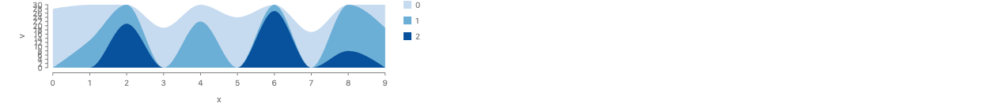

A horizon chart cuts one area into bands of a fixed height and lays the bands on top of each other. Cells along y and intersect make the bands, but they stay in place. So a horizon chart needs a cut that also moves its pieces: partition, then intersect, then a layout of the pieces. This is where `.cut()` is the natural word.

### Cumulative line and waterfall (one stack along x)

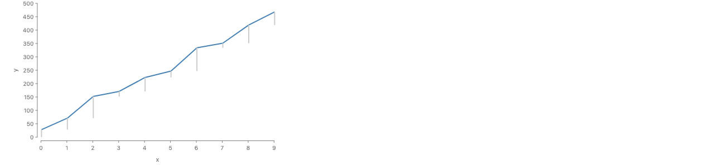 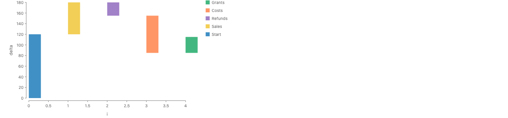

`stack({ by: "x", dir: "y" })` with parts placed along x draws these today. Signed parts go back down. This is the per-part stack with no profiles, and B leaves it alone.

### Stack of stacks

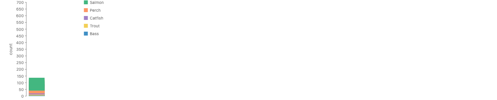

Typed right and placed wrong today: every inner stack draws from 0 (bug list below).

### Icicle and sunburst

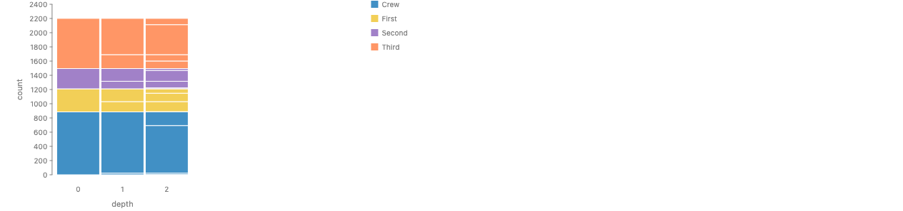 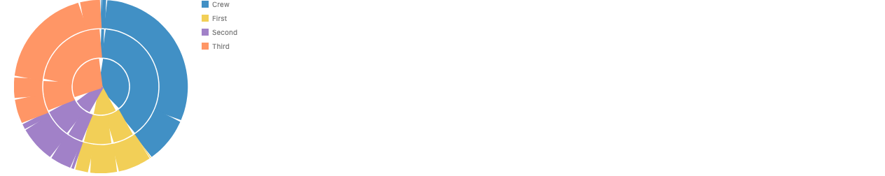

A stack per depth lines up only because every depth has the same total. Read as a divide, each parent cell is cut into its children, as Mascot's stratify does. This is a hierarchy of given wholes, so it is a divide.

## Precedent

| System          | What the user writes                                                    | Baseline                                    | Order                                                       | Misaligned x                     |
| --------------- | ----------------------------------------------------------------------- | ------------------------------------------- | ----------------------------------------------------------- | -------------------------------- |
| d3-shape        | `d3.stack().offset(d3.stackOffsetWiggle).order(d3.stackOrderInsideOut)` | none, expand, diverging, silhouette, wiggle | none, ascending, descending, insideOut, reverse, appearance | not handled, keys must align     |
| Vega-Lite       | `"y": { "stack": "center" }`                                            | zero, center, normalize                     | sort by a field                                             | fills 0 at a missing x           |
| Observable Plot | `Plot.areaY(data, { x, y, offset: "wiggle" })`                          | normalize, center, wiggle                   | inside-out by default with wiggle                           | none                             |
| ggplot2         | `geom_area(position = "stack")`, `position_fill()`                      | zero, fill                                  | factor order                                                | `stat_align`: union of x, linear |
| ggstream        | `geom_stream(type = "mirror")`                                          | mirror, ridge, proportional                 | factor order                                                | 1000-point grid                  |
| matplotlib      | `stackplot(x, ys, baseline="weighted_wiggle")`                          | zero, sym, wiggle, weighted_wiggle          | the order given                                             | one x array for all              |
| Mascot          | `densify`, then `divide`, then a stack layout                           | `vertCellAlignment`                         | the divide's order                                          | densify gives common vertices    |
| productplots    | `hbar`, `hspine`, `vspine`                                              | zero                                        | factor order                                                | n/a                              |

What the precedent shows:

- Every system puts the baseline and order on the stacking step, which sees the whole table. Plot's `areaY` looks like an exception only because it applies `stackY` for you.
- productplots is the clearest precedent for two directions. `hbar` stacks amounts against a common scale. `hspine` and `vspine` divide a given whole by shares. Its stacked bar is "1 hbar and 1 vspine", which rests on f(x, y) = f(y given x) f(x).
- No system states the boundary rule. Each one shares a boundary because one array of numbers feeds both bands.

## Implementation path

1. **Shortcut, now.** B is a rewrite at flow lowering. A `stack` whose children are collective marks with `x` lowers to:
   - curve each series;
   - resample at the union grid;
   - compute the baseline and order from the whole series;
   - run the per-x `scatter` and `stack`;
   - connect with one ribbon per series.

   This matches how stacked areas run today, so it costs little. It is a declared shortcut, because the stack peeks at the mark kind to know that a child is a profile.

2. **Full fix.** A profile type in the underlying space: an extent along `dir` that is a function of the cross axis. Today each axis carries one interval (`underlyingSpace.ts:87`) and the two axes are independent (`dims.ts:592`). The same type would give outline spacing for `spread` (ridgelines that never overlap, tidy trees).
3. **Fixes that stand alone** (bugs below). They are worth doing in any approach.

## Bugs found (not filed yet)

1. Series on different x grids stack wrong with no warning (`s-naive`). The per-x stack only stacks rows that share an exact x.
2. A ribbon joins its pieces in data order, not along x (`connect.tsx:551`).
3. The default monotone curve on a stacked area can make a band's thickness negative, because it curves each boundary after the stack.
4. A stack of stacks overlaps. Every inner stack draws from 0 (`distribute.ts:233`).
5. A stack whose parts have no origin silently becomes ordinal, as a spread does (`distribute.ts:346`).
6. In polar, a rect with a fixed thickness draws as a stroked center line, so a user stroke paints the whole band (`shapes/rect.tsx:321`).
7. A fused ribbon over `stack({ size: normalize })` throws "Species is not constant across the connected group" (`spread.tsx:121`).
8. A normalized stack inside a sized `scatter` slice squeezes the y axis to a few pixels.
9. `normalize` with a total of 0 warns and returns zeros. It should be an error (`fieldExpr.ts:651`).
10. A function accessor for a size skips the CanSum check (`channels.ts:219`).
11. Colors follow row order, so a reorder recolors the series (#1303).

## Related issues

- #47 Stacked and divided ribbons (sankey strands are a divide of a given link).
- #290 `.stack()` as a mark method (D, rejected here).
- #809 Wiggle baseline as a stack-level `baseline` choice (Josh's earlier idea, which B adopts).
- #980 First-class distributions (densities as profiles).
- #992 Nested signed stacks need a net value besides their extent.
- #1029 A glued stack is typed pinned though nothing placed it.
- #1115 Hierarchical, type-driven axes (grouped bars, mosaic, streamgraph).
- #1213 Streamgraph y axis reads "10 10 10".
- #1276 Delete `Tile.slice` and `Tile.dice`: a one-axis tiling is a normalized stack.
- #1282 `cut`: options first, the source as its one child.
- #1303 Sorting a stack changes which color each category gets.
- #1332 Croissant sampling (the proposal this came from).
- #1343 `scatter` alignment on the free axis is ignored.
- #831 Update is connect on time (the stacked-to-grouped transition).

## Decisions for Josh

1. Is the whole-series `stack` of ribbons (B) local enough? It reads each child's thickness, and that thickness is a function of x. This reverses the round 6 answer on a new argument.
2. Name of the family and options: `Align` with `alignment` on spread and scatter, and `baseline` on a stack of profiles as sugar? Or one name in both places?
3. Which baselines ship: zero, center and wiggle? Should diverging stay a trait of the order (`Trait.diverging()`) or become `Align.diverging()`?
4. Default wiggle: weighted (d3, Plot), with `Align.deviation()` and `Align.sineStream()` as named variants and a function escape hatch?
5. Inside-out order: a sort strategy `field("topic").sort(Order.insideOut("value"))`, or an option on `stack`?
6. Keep `.cut()` only for dividing a shape the spec draws first, defined as a stack of shares plus `intersect`, plus an optional layout of the pieces?
7. Drop `.stack()` as a mark method (#290)?
8. Union grid (simple, works with `ribbon`) or one grid per boundary (fewer points, needs a band mark)?
9. Curve each series before the stack, which changes today's default stacked areas a little (up to 8% here)?
10. Stacked to grouped: an animation between two specs (#831), and no option on `stack`. Agree?
11. Accept the shortcut (a rewrite that peeks at the mark kind) before the profile type exists?
