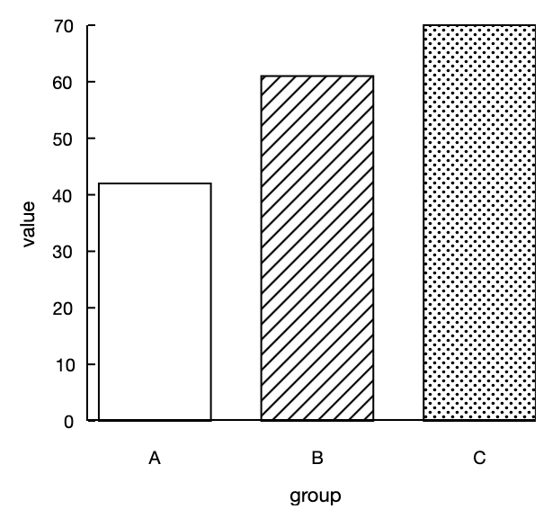
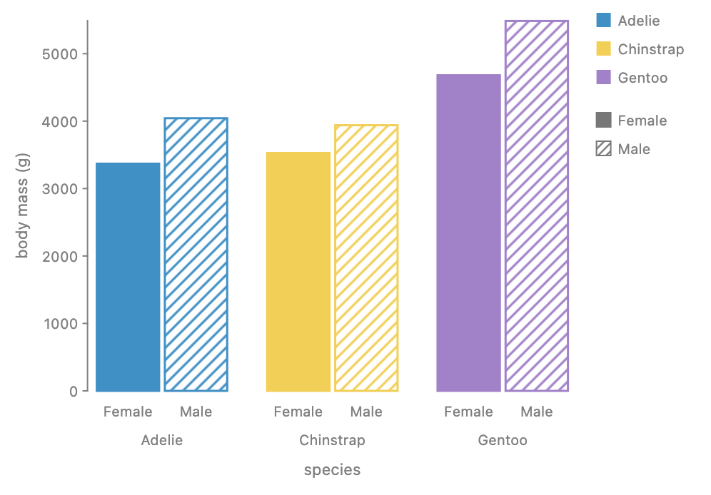
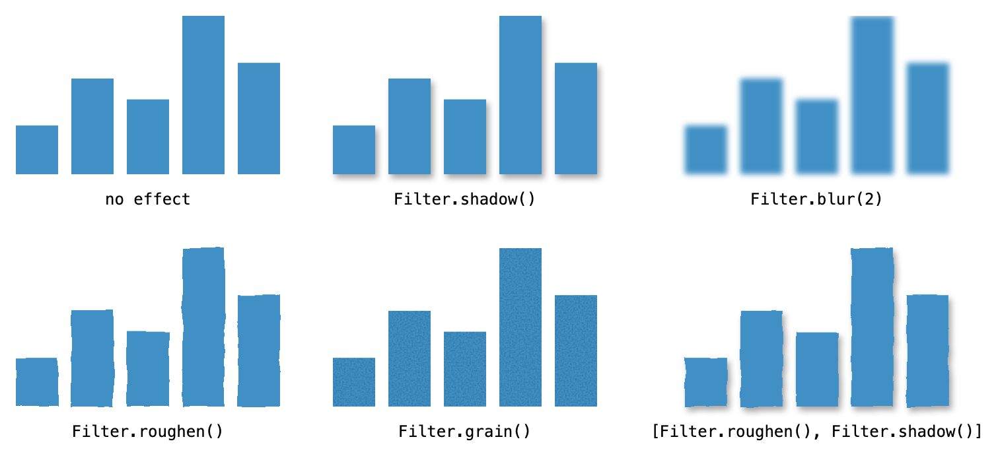
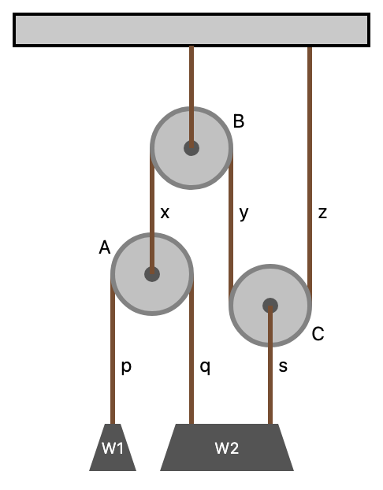
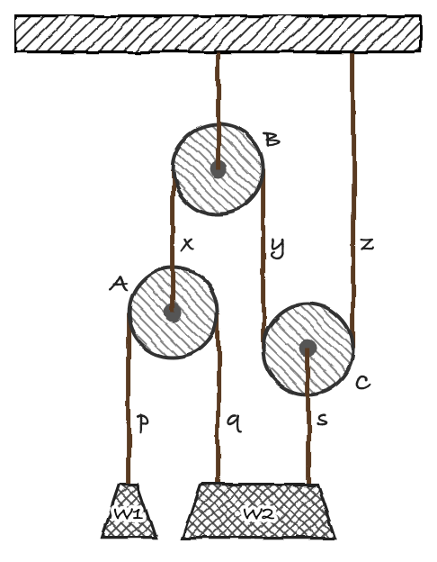
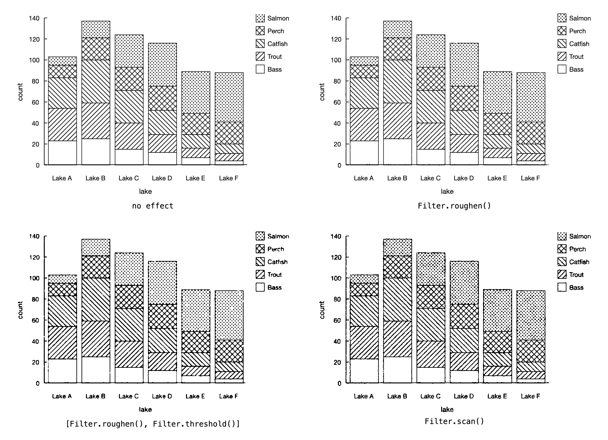
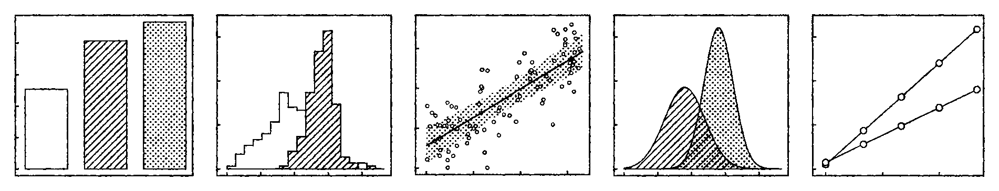
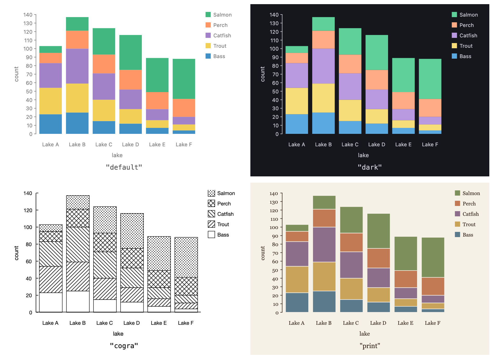
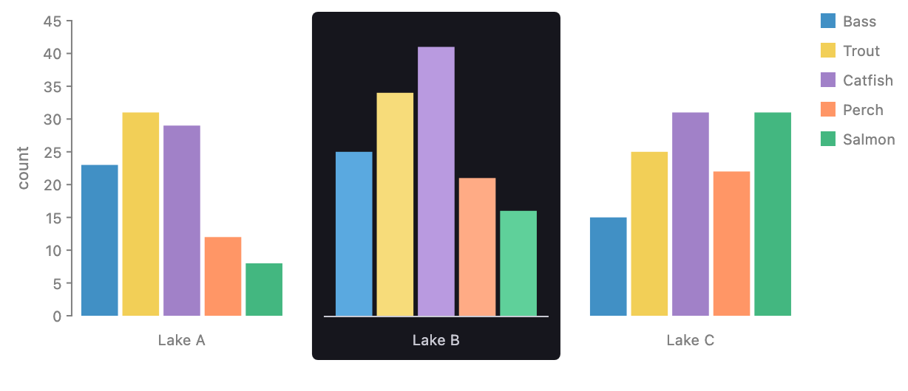

# Patterns, effects and themes

**Summary.** A pattern is a kind of paint: `fill` and `stroke` accept `Pattern.lines()` the same way they accept a color, and a palette may hold patterns. An effect is a member of the existing `Filter` family (`Filter.shadow()`, `Filter.roughen()`). A theme is a plain object of default options, keyed by the name of the mark or chrome part they belong to, set on any `chart` or `layer` and inherited by everything inside it.

**Recommendation.** Build all three, in that order. None needs a new operator. The Cogra look from #1396 is then one theme: a palette of patterns, a black `ink` and white `paper`, and a few defaults for `rect` and `axis`. An existing chart that says `fill: "species"` turns black and white without any change to its own code.

**Status.** Proposal for review. Nothing is implemented. Decided so far: a pattern is a paint, not a second option beside `fill`; a theme is a keyed object for now, with the door left open to selector rules later (Josh, 2026-11-22). Every picture here was rendered by GoFish with a workaround that exists today (hand-written SVG `<pattern>` and `<filter>` defs, and in some pictures edits to the rendered SVG). The prototype sources are in `prototypes/`.

## Terms

- **Paint.** What a shape is filled or stroked with. SVG's word. Today a GoFish paint is always one color.
- **Pattern.** A paint made by repeating a small picture, the tile, across the shape. A hatch is a pattern whose tile is one line.
- **Effect.** A change applied to a mark after it has been drawn, such as a shadow or a blur. It never changes layout. GoFish already has two (`Filter.grayscale`, `Filter.luminanceToAlpha`).
- **Theme.** A set of default option values. A default is what a mark uses for an option the user did not write.
- **Chrome.** The parts of a chart that are not data marks: axes, legends, labels, titles. In GoFish these are ordinary nodes since #1293.
- **Role color.** A color named for its job, not its hue: `ink` (text and lines), `paper` (the page), `accent` (a mark with no data color), `muted` (things that should recede). ggplot2 4.0 uses the first three names.

## What exists today

Earlier attempts, oldest first:

- `packages/gofish-graphics/src/ast/texture/temp_filter.tsx` (722 lines, from the first commit, imported by nothing). Hand-written SVG filters: drop shadow, watercolor, moss, felt, glass, paper.
- `src/tests/fishRibbonChartTextured.tsx`, `fishPolarRibbonChartTextured.tsx`, `vlStackedBarRefactorTextured.tsx` (unreferenced). Hatch and dot `<pattern>` defs, used as `fill: "url(#diagonalLeftFill)"`. `img/ribbon-patterns.png` recreates the first on today's API.
- #222 "Theming" (open). Josh's first statement: a context that components read defaults from, nested anywhere in the tree, like SwiftUI, CSS or Typst. No code.
- #380 (open). How themes relate to scales: a scale maps data to a range, and a theme supplies the ranges and the type styles that scales and marks draw from.
- PR #1044 (draft, parked). A paper-cutout stacked bar: `filter` as a per-row channel on `rect`, with filters passed through `defs`.
- #1196 (open). Pen, pencil and watercolor effects that keep the layout exact. Asks where an effect should sit.
- PR #1287 (merged). The `filter` option and the `Filter` family on every mark and on `layer`, `blendMode`, `.hidden()`, and the region operators.
- #1324 scale ranges (signed off, not built). `color: Color.palette(...)` or `color: { Region: Color.palette(...) }`. Its `theme` field was deferred until there were more examples. This proposal is those examples.
- #1338, PR #1336, #1385, PR #1366 (open). Safari ignores raw CSS filter strings; filters are being lowered to SVG `<filter>` defs; the family may be renamed from `Filter` to `Effect`. This proposal uses the names on main and follows whatever that rename decides.
- #1396 (open). Asks for styles and textures, with Cogra as the example.

What a user can do today: pass SVG through `.render(el, { defs })` and write `fill: "url(#id)"` or `filter: "url(#id)"`. That is JavaScript only (JSX cannot cross to Python), needs one `<pattern>` per color, and nothing knows what the pattern is, so legends and label colors ignore it. Axes and legends have no style options at all. Every default (palette, fonts, axis gray, tick length) is a constant in the file that uses it, about forty of them.

## Precedent

### Where a texture lives

| System                     | Spelling                                                                                  | What a texture is             |
| -------------------------- | ----------------------------------------------------------------------------------------- | ----------------------------- |
| SVG                        | `fill="url(#hatch)"`, a paint server                                                      | paint                         |
| Typst                      | `rect(fill: tiling(size: (6pt, 6pt), line(...)))`                                         | paint                         |
| SwiftUI                    | `.fill(ImagePaint(...))`; Swift Charts maps data to any `ShapeStyle`                      | paint                         |
| Figma                      | Fill types: Solid, Gradient, Pattern, Image                                               | paint                         |
| matplotlib                 | `ax.bar(x, h, hatch="//")`                                                                | paint property                |
| Highcharts                 | `color: { pattern: { path, width, height } }`                                             | paint                         |
| rough.js, Excalidraw       | `fill: "red", fillStyle: "hachure"`                                                       | second option beside `fill`   |
| ggpattern                  | `geom_col_pattern(aes(pattern = sex, pattern_fill = species))`, 15 `pattern_*` aesthetics | channels with scales          |
| Plotly Express             | `px.bar(df, color="nation", pattern_shape="nation")`                                      | channel                       |
| ECharts                    | `aria: { decal: { show: true } }`                                                         | overlay switched on per chart |
| Vega-Lite, Observable Plot | none (vega#1372 and plot#903 are open)                                                    |                               |

The typed systems and the design tools all make a pattern one kind of paint. The visualization grammars that added patterns added a second set of channels and scales beside color. Swift Charts shows the first model is enough for data: its color scale maps a value to any `ShapeStyle`, pattern or color.

### What a theme is

| Mechanism                           | Examples                                                                                                                                             | Can restyle parts the library did not list |
| ----------------------------------- | ---------------------------------------------------------------------------------------------------------------------------------------------------- | ------------------------------------------ |
| Global defaults                     | matplotlib `rcParams`, `Chart.defaults`, `Highcharts.setOptions`                                                                                     | no                                         |
| Config object with a fixed key list | Vega-Lite `config`, ggplot2 `theme(axis.text = element_text())`, Plotly templates, MUI `components.MuiButton.styleOverrides`                         | no                                         |
| Scoped inherited values             | Typst `set text(font: "X")`, SwiftUI `.font()` and `.tint()`, CeTZ `set-style(rect: (fill: blue))`, Compose `CompositionLocalProvider`, TikZ `scope` | yes, for any element's own options         |
| Rules that match elements           | Typst `show heading: it => ...`, CSS with `@scope`, Penrose style programs, TikZ `every node/.style`                                                 | yes                                        |
| Component replacement               | shadcn/ui, SwiftUI `ButtonStyle.makeBody`                                                                                                            | yes                                        |
| Role values                         | CSS custom properties, SwiftUI `.primary`, ggplot2 4.0 `ink` / `paper` / `accent` with `from_theme()`                                                |                                            |

Two facts from this survey shape the proposal. In Typst and CeTZ the things a theme can set are exactly the element's own parameters, so a theme adds no second vocabulary. And Cogra itself is three separate things: a pattern per group in place of a color per group, a set of defaults (black ink, white fills, inward ticks, a font), and an optional "wear" filter over the whole figure.

## Part 1. Patterns

### Decided: a pattern is a paint

`fill` and `stroke` accept a color, a field, or a `Pattern`.

```js
rect({ h: "count", fill: Pattern.lines() });
rect({
  h: "count",
  fill: Pattern.lines({ angle: 0, gap: 8, color: "species" }),
});
rect({
  h: "count",
  fill: Pattern.tile(circle({ r: 3.5, fill: "none", stroke: Color.ink }), {
    spacing: 4,
  }),
});
```

```python
rect(h="count", fill=Pattern.lines())
rect(h="count", fill=Pattern.lines(angle=0, gap=8, color="species"))
rect(
    h="count",
    fill=Pattern.tile(circle(r=3.5, fill="none", stroke=Color.ink), spacing=4),
)
```

The family (see `img/pattern-grid.png`):

| Member                            | Options                              | Draws                                                          |
| --------------------------------- | ------------------------------------ | -------------------------------------------------------------- |
| `Pattern.lines`                   | `angle` (45), `gap` (6), `width` (1) | parallel lines                                                 |
| `Pattern.cross`                   | `angle`, `gap`, `width`              | two sets of lines at right angles                              |
| `Pattern.dots`                    | `gap` (6), `r` (1)                   | a grid of dots                                                 |
| `Pattern.solid`                   |                                      | a flat fill, so a plain color can sit in a palette of patterns |
| `Pattern.tile(node, { spacing })` | any GoFish node                      | that node, repeated                                            |

Every member also takes `color` (default `Color.ink`; it may be a field, like any color) and `background` (default none). `Pattern.lines` is `Pattern.lines()`, as in the other families.

`Pattern.tile` is the general member and the other three are named cases of it: `Pattern.lines()` is a tile holding one `line`. A pattern fill itself is sugar for something the core already draws. The tile is repeated across the mark's box and kept only where the mark is, which is what `atop` does with a mark and a layer of tiles. So patterns add no new kind of drawing.

**How a pattern is built.** It is sugar over the core, plus one new primitive.

```js
// What the user writes
rect({ h: "count", fill: Pattern.lines({ gap: 6 }) });

// What it means, in three steps of sugar
rect({
  h: "count",
  fill: Pattern.tile(line({ w: 6, stroke: Color.ink }), { angle: 45 }),
});
atop([
  rect({ h: "count" }),
  tile(line({ w: 6, stroke: Color.ink }), { angle: 45 }),
]);
```

- `lines`, `cross`, `dots` and `solid` are plain functions that return `Pattern.tile(...)` of ordinary marks. They have no code of their own in the engine.
- A pattern fill is `atop` of the mark and a tiling. `atop` exists.
- The one new thing is the tiling: one node repeated across a box. It cannot be sugar, because writing it out as thousands of copies would put every copy through layout. The colorbar legend shows the cost: with no gradient primitive it draws 40 stacked rects. So the display list gets one item, "repeat this group across this box", which the SVG painter writes as a `<pattern>`. The tile itself is laid out and lowered once, by the normal engine.

So there is no pattern code path. Whether the tiling is also a public operator is a separate choice; a pictogram bar has the same shape, but its repeat is counted in data, so the tiling stays internal until an example asks for it. Not yet checked by prototype: that `atop` over a tiling lowers to one pattern-filled shape and not a mask per mark.

**A palette may hold patterns.** This is what makes the Cogra bar chart work.



```js
chart(scores, {
  color: Color.palette(["white", Pattern.lines(), Pattern.dots()]),
})
  .flow(spread({ by: "group", dir: "x" }))
  .mark(rect({ h: "value", fill: "group", stroke: "black", strokeWidth: 1 }));
```

```python
(
    chart(scores, color=Color.palette(["white", Pattern.lines(), Pattern.dots()]))
    .flow(spread(by="group", dir="x"))
    .mark(rect(h="value", fill="group", stroke="black", stroke_width=1))
)
```

The mark says `fill: "group"`, which means "tell the groups apart". The palette decides how. The legend draws each swatch with its paint, so it needs no pattern legend.

**Rules.**

- A pattern is anchored to the page, not to each mark, so the lines run unbroken across stacked segments that share a pattern.
- A pattern is not bent by a coordinate transform. In a polar chart the hatch lines stay straight (`img/ribbon-patterns-polar.png`). A paint is laid on after the shape is drawn.
- A label placed on a patterned mark picks its color against the pattern's `background`, or the paper when there is none.

### The hard example: color by one field, pattern by another



Decided (pattern as paint). `fill` picks the paint by sex, and each paint takes its color from species:

```js
chart(penguinMeans, {
  color: {
    Sex: Color.palette({
      Female: Pattern.solid({ color: "species" }),
      Male: Pattern.lines({ color: "species" }),
    }),
  },
})
  .flow(spread({ by: "species", dir: "x" }), spread({ by: "sex", dir: "x" }))
  .mark(rect({ h: "body mass (g)", fill: "sex" }));
```

Not chosen (pattern as a second option beside `fill`, the rough.js and ggpattern model):

```js
chart(penguinMeans, {
  pattern: { Sex: [Pattern.none, Pattern.lines] },
})
  .flow(spread({ by: "species", dir: "x" }), spread({ by: "sex", dir: "x" }))
  .mark(rect({ h: "body mass (g)", fill: "species", pattern: "sex" }));
```

The second form reads better here, and this is the one case where it does. Josh chose the paint model, for three reasons:

1. Gradients and images have to be paints anyway, since nobody wants a `gradient` option beside `fill`. A separate `pattern` option would then cover part of the same ground as paints by a different route, which is the large partial overlap `api-design.md` warns against.
2. A second option needs its own ranges, its own legend and a rule for merging that legend with the color legend. ggpattern's fifteen aesthetics are where that road ends.
3. With paints in palettes, a theme can swap colors for patterns in a chart that only says `fill: "species"`. With a second option, the chart would have had to say `pattern: "species"` in advance. This is the Cogra use, and the accessibility use (patterns for readers who cannot tell the hues apart).

The cost is `Pattern.solid`, a member that exists so a solid fill can sit in a palette of patterns and take a color from a field.

### Not recommended: composition only

Write the desugared form by hand: `atop([rect(...), tiles])`. It needs no new API, and it stays available. But a pattern chosen by a data field then needs a `createMark` wrapper around every mark, and palettes, legends and themes cannot see it.

### The name

`Pattern` is Figma's fill type, SVG's element and TikZ's key. Typst renamed its `pattern` to `tiling` in 0.13. "Texture" is Bertin's word in English and the issue's word, but in Figma a Texture is an effect, and He et al. use "pattern" for the fill and "texture" for the surface look. `Hatch` covers only lines. PR #1366 adds a rule that the option taking a family member has the same name in lowercase. `fill: Pattern.lines()` departs from that rule in the way `spacing: 8` and `fill: "red"` already do: `fill` takes a paint, and a color and a pattern are both paints. If that rule should hold strictly, the family is `Fill` (`fill: Fill.lines()`), which reads worse on `stroke`.

## Part 2. Effects

The `filter` option and the `Filter` family already exist on every mark and on `layer`. The proposal is more members and one composition rule.



```js
rect({ h: "value", filter: Filter.shadow() });
rect({ h: "value", filter: Filter.shadow({ y: 2, blur: 6, color: "#0004" }) });
rect({ h: "value", filter: [Filter.roughen(), Filter.shadow()] });
```

```python
rect(h="value", filter=Filter.shadow())
rect(h="value", filter=Filter.shadow(y=2, blur=6, color="#0004"))
rect(h="value", filter=[Filter.roughen(), Filter.shadow()])
```

| Member                                        | Options                               | Does                                                              |
| --------------------------------------------- | ------------------------------------- | ----------------------------------------------------------------- |
| `Filter.shadow`                               | `x` (0), `y` (2), `blur` (4), `color` | drop shadow that follows the shape                                |
| `Filter.blur(radius)`                         |                                       | Gaussian blur                                                     |
| `Filter.roughen`                              | `amount` (2), `scale`, `seed`         | wobbles edges, as a hand or a photocopier would                   |
| `Filter.grain`                                | `amount`, `scale`, `seed`             | paper grain inside the shape                                      |
| `Filter.threshold`                            | `spread`, `level`, `jitter`           | spreads the ink and cuts it to ink or paper, with nothing between |
| `Filter.grayscale`, `Filter.luminanceToAlpha` |                                       | exist today                                                       |

A list applies its members in order. These four answer #1338 (they replace raw CSS strings, which Safari ignores) and most of #1196:

- **Where does an effect sit?** On a mark, or on a layer for a whole subtree. No new place.
- **Does it keep the layout exact?** Yes. An effect runs after layout and never changes a box. A roughened bar still ends at its value.
- **Is it repeatable in visual tests?** Yes. `seed` has a fixed default.

 

```js
const sketch = {
  circle: { fill: Pattern.lines({ gap: 4 }), filter: Filter.roughen() },
  polygon: { fill: Pattern.cross({ gap: 5 }), filter: Filter.roughen() },
  rect: { fill: Pattern.lines({ gap: 7 }), filter: Filter.roughen() },
  line: { filter: Filter.roughen() },
  text: { fontFamily: "Bradley Hand, cursive" },
};

layer({ theme: sketch }, [pulley()]);
```

The pulley is built from `createMark` components. The theme reaches the `circle`, `polygon` and `line` marks inside them.

### The rough Cogra look





```js
// Stays vector: wobble, then ink spread cut to pure black and white.
chart(seafood, {
  theme: cogra,
  filter: [Filter.roughen(), Filter.threshold()],
});

// Cogra's own scan look: the figure is drawn to pixels and sampled at 200 dpi, 1 bit.
chart(seafood, { theme: cogra, filter: Filter.scan() });
chart(seafood, {
  theme: cogra,
  filter: Filter.scan({ dpi: 150, weight: 1.5, specks: true }),
});
```

Cogra's scan look (`wear.py`, `scan`) is not a wobble. It works on the finished figure as pixels: render at 600 dpi, displace by less than one output pixel, blur slightly, then threshold with a level that varies over space, so some letters and strokes come out heavier than their neighbors. Last, it averages down to 200 dpi and cuts to 1 bit. That last step makes the stair-stepped edges, which are most of the look. Cogra's web version is an SVG filter that does the same without the last step.

- `Filter.threshold({ spread, level, jitter })` blurs the ink by `spread`, shifts the cut by slow noise scaled by `jitter`, and cuts to two levels: `Color.ink` on `Color.paper`. It works on ink coverage (how dark and how opaque), not on alpha alone, since a white bar is opaque. It throws color away, so it belongs on a whole figure in a one-ink theme. It is an SVG filter (`img/cogra-scan-large.png`).
- `Filter.scan({ dpi, weight, specks, seed })` cannot be an SVG filter, because it has to average over a sampling grid coarser than the screen. It would be the first effect that draws its layer to an image (`img/cogra-scan-raster-large.png`). The text inside stops being text, and a headless or Python export needs a rasterizer. An SVG pixelate trick was tried and loses thin lines (`img/cogra-scan-svg-pixelate.png`).

Decided (Josh, 2026-11-22): the first round stops at the threshold. `roughen` and `threshold` ship with the first effects, and `scan` waits for a separate design of the effects that need pixels, together with the watercolor in #1196. They share one question: whether a layer may be drawn as an image. Cogra's other looks, `xerox` and `aged`, are the same kind.

Found while prototyping: a whole-figure filter region must follow the SVG's viewBox; pattern ids must be unique per chart, or removing one chart breaks the others on the page; roughen at too high a frequency tears 10 pixel text; stipple dots closer than about 5 pixels fill in to a mesh after the threshold.

What this does not cover is the rough.js kind of hand-drawn look, where each path is redrawn as two wobbly strokes and filled with uneven hachure lines. That is a rewrite of the geometry, not a change to pixels. It can come later as one more member (`Filter.sketch()`), lowered as a rewrite of the display list instead of an SVG filter, with the same option and the same rule that the layout does not move. Watercolor with real pigment mixing (#1196) needs a canvas renderer and is outside this proposal.

## Part 3. Themes

### Recommended: default options, keyed by what they belong to, scoped to a subtree

A theme is a plain object. Its keys are the names of marks and chrome parts, and each value is a set of that thing's own options. `chart` and `layer` take a `theme`.



```js
const dark = {
  color: {
    ink: "#c9c9d3",
    paper: "#16161d",
    muted: "#c9c9d3",
    category: Color.palette([
      "#5aa9e0",
      "#f5dd7c",
      "#b99ae0",
      "#ffac8a",
      "#5fd39b",
    ]),
  },
};

const print = {
  color: {
    ink: "#3b2a1e",
    paper: "#f6f1e7",
    muted: "#3b2a1e",
    category: Color.palette([
      "#5b7a8c",
      "#c9a35a",
      "#8c6d8a",
      "#c27a54",
      "#7d8f5c",
    ]),
  },
  text: { fontFamily: "Georgia, serif" },
  rect: { stroke: Color.paper, strokeWidth: 1 },
};

const cogra = {
  color: {
    ink: "black",
    paper: "white",
    muted: "black",
    category: Color.palette([
      "white",
      Pattern.lines(),
      Pattern.lines({ angle: -45 }),
      Pattern.cross(),
      Pattern.dots(),
    ]),
  },
  text: { fontFamily: "Helvetica, Arial, sans-serif" },
  rect: { stroke: Color.ink, strokeWidth: 1 },
  axis: { line: true, tick: { side: "inside", every: 20 } },
  legend: { swatch: { size: 14, stroke: Color.ink } },
};

// The chart is the same in all four pictures. Only `theme` changes.
chart(seafood, { theme: cogra })
  .flow(spread({ by: "lake", dir: "x" }), stack({ by: "species", dir: "y" }))
  .mark(rect({ h: "count", fill: "species" }));
```

```python
cogra = dict(
    color=dict(
        ink="black",
        paper="white",
        muted="black",
        category=Color.palette(
            [
                "white",
                Pattern.lines(),
                Pattern.lines(angle=-45),
                Pattern.cross(),
                Pattern.dots(),
            ]
        ),
    ),
    text=dict(font_family="Helvetica, Arial, sans-serif"),
    rect=dict(stroke=Color.ink, stroke_width=1),
    axis=dict(line=True, tick=dict(side="inside", every=20)),
    legend=dict(swatch=dict(size=14, stroke=Color.ink)),
)

(
    chart(seafood, theme=cogra)
    .flow(spread(by="lake", dir="x"), stack(by="species", dir="y"))
    .mark(rect(h="count", fill="species"))
)
```

The chart code is the same in all four panels. Only `theme` changes.

**Rules.**

1. **A theme sets only what the user left out.** An option written on a mark always wins. Next comes the nearest enclosing theme, then the ones outside it, then `defaultTheme`.
2. **The keys are names GoFish already has.** `rect: { ... }` takes `rect`'s options and nothing else. The reference page for `rect` is also the reference for what a theme can set on it. A mark made with `createMark` and given a name is keyed by that name in the same way.
3. **Chrome parts are keyed by the part and nest by role**, following "nest a role instead of prefixing": `axis: { line, tick, label, title }`, `legend: { label, title, swatch }`, `label: { halo, background }`. `axis.label` and `legend.label` take `text` options, and they inherit from the `text` rule, so `text: { fontFamily }` reaches every piece of text. The same keys become options on one axis: `axes: { x: { label: { fontSize: 12 } } }`. Today an axis has no style options at all.
4. **`color` holds the role colors and the default ranges**: `ink`, `paper`, `accent`, `muted`, and `category`, `sequential`, `diverging`. A default refers to a role as `Color.ink`. `defaultTheme` says `text: { fill: Color.ink }`, `axis: { line: { stroke: Color.muted } }`, `label: { halo: { color: Color.paper } }`, `rect: { fill: Color.accent }`. That is why the dark theme above sets only `color`. A chart's own `color` option (#1324) wins over the theme's ranges.
5. **`theme` takes one theme or a list.** Later entries win: `theme: [cogra, { text: { fontFamily: "Georgia" } }]`.
6. **A scope that sets `paper` paints it** behind its own box. Anything else that needs the page color (label halos, automatic label contrast, which is #1216) reads the nearest `paper`.

**`defaultTheme` is exported, and it is the whole list of defaults.** Every constant now spread over `rect.tsx`, `text.tsx`, `axes/elaborate.tsx`, `legends/elaborate.tsx`, `labels/` and `color.ts` moves into one object a user can read, copy and change. This is the "a default is sugar, not a branch" rule applied to style: every default becomes a value the user could have written.

### The hard example: a theme on part of a figure



```js
const panel = (lake) =>
  chart(seafood.filter((d) => d.lake === lake))
    .flow(spread({ by: "species", dir: "x" }))
    .mark(rect({ h: "count", fill: "species" }));

spread({ dir: "x", spacing: 36 }, [
  panel("Lake A"),
  layer({ theme: dark }, [panel("Lake B")]),
  panel("Lake C"),
]);
```

The middle panel's bars, baseline and label read the dark theme, and it paints its own dark paper. The other two never see it. A config object at the chart root cannot say this. This is also what a highlighted small multiple, an inset, and a diagram embedded in a page with its own style need.

### Not recommended: a config object with its own key list

This is the Vega-Lite and ggplot2 model, and the sketch deferred in #1324.

```js
chart(seafood, {
  theme: {
    font: "Georgia",
    background: "#f6f1e7",
    axis: {
      domainColor: "black",
      tickColor: "black",
      labelFontSize: 10,
      gridColor: "#ddd",
    },
    mark: { bar: { stroke: "black", strokeWidth: 1 } },
    range: { category: ["#5b7a8c", "#c9a35a", "#8c6d8a"] },
  },
});
```

It looks like the recommended form, and for the four themes above it is about as short. The difference is where the keys come from. Here they are a second vocabulary, chosen by the library one at a time (`domainColor`, `labelFontSize`), that sits beside the mark options and has to grow each time someone wants to style something new. It also applies only at the root. Vega-Lite's config has about 150 axis keys for this reason.

### Later, not now: rules with selectors and replacement

This is Typst's `show`, CSS, and Penrose.

```js
chart(seafood, {
  theme: [
    set(rect, { stroke: "black", strokeWidth: 1 }),
    set(selectAll("bars"), { fill: Pattern.lines() }),
    show(axis, (a) => myAxis(a)),
    show(rect, (r) => layer([shadowOf(r), r])),
  ],
});
```

This is the most open form: a rule can target named marks, and a `show` rule can replace how something is drawn. It is also the most machinery. Selector matching, rule order and specificity are a small language that users must learn and the wire format must carry, and `set` is a builtin in Python. Most of its reach is already available another way: a named mark can be given its options where it is written, and a mark that should look different everywhere is a `createMark` component.

Decided: the keyed object ships first, and the door to a selector syntax stays open. A keyed theme is the simplest rule list: each key is a rule that selects by kind and sets options. The first version keeps three things true so that selectors can be added without a break.

- `theme` already takes a list, and later entries win. A rule can later be one more kind of entry in that list, beside keyed objects, with the same order rule.
- A key means "every mark of this kind in scope" and nothing more. No key gets a special meaning that a selector would later have to work around, and no selector-like strings (`"rect.bars"`, `"axis > label"`) are accepted as keys.
- A value is options only. A function as a value is reserved for replacing how a part is drawn (`axis: (a) => myAxis(a)`), which is Typst's `show`. It needs the axis and legend interfaces from #1279 first.

What a selector would match on is already in the language: a mark's kind, its name (`selectAll("bars")`), and its data. Decided (Josh, 2026-11-22): a later rule matches with `selectAll`, the selection GoFish already has, and gets no selector language of its own.

### What stays in user space: components

```js
const bar = (opts) => rect({ stroke: "black", strokeWidth: 1, ...opts });
```

This is how the Bluefish stories keep a house style today (`stories/bluefish/PythonTutor/`), and it stays the right tool for a look that belongs to one kind of mark. It cannot reach the axes and legends, and it cannot reach marks inside a chart template someone else wrote. A theme reaches both.

## Why this design

- **It desugars into the core.** A pattern fill is `atop` over tiles. An effect is the `filter` that exists. A theme is the options the user did not write. (`principles.md`, "Desugaring over special-casing".)
- **A default is sugar.** `defaultTheme` gives every style default a spelling. (`api-design.md`, "A default is sugar, not a branch".)
- **One concept, one mechanism.** Paints cover colors, patterns and later gradients and images, where a second channel would overlap them in the middle. (`api-design.md`, "Overlap is fine at the edges".)
- **Almost no new words.** `Pattern`, `theme`, four role colors. Theme keys are existing mark and chrome names. The effect names are Figma's and Illustrator's.
- **Closed kinds plus an open member.** `Pattern.lines`, `cross` and `dots` are presets of `Pattern.tile`, which takes any node. (`three-surfaces.md`; the memory rule "named presets are exact points in one tunable space".)
- **The same in Python.** A theme is nested dicts of keyword names. Nothing in it is a function, so all of it crosses the wire.
- **It is the context #222 asked for**, and the "theme supplies the ranges" layer #380 asked for, without the fixed record that `composition-not-enumeration.md` criticizes in the grammar of graphics.

One earlier decision needs a careful reading. In #1267 Josh ruled that an operator must never change its children's state, and that a mark must not depend on the whole program. A theme does not change any option a mark was given. It answers the question "what does a missing option mean here", which today is answered by a constant. The answer comes from the nearest enclosing scope the user wrote, as a name does.

## What this changes in the existing API

- `fill` and `stroke` accept a `Pattern` on every mark that has them.
- `filter` accepts a list. `Filter` gains `shadow`, `blur`, `roughen`, `grain`. Raw CSS filter strings can then go (#1338).
- `chart` and `layer` gain `theme`. `Color` gains `ink`, `paper`, `accent`, `muted`.
- The axis and legend parts gain style options (`line`, `tick`, `label`, `title`, `swatch`).
- `fontSize`, `fontFamily`, `fontWeight`, `fontStyle` on `text` and on label options are a prefix written into names. By the nesting rule they should be `font: { size, family, weight, style }`, and a theme then sets a font as one value. I recommend making that change with the theme work. `strokeWidth` and `strokeDasharray` have the same shape (`stroke: { color, width, dash }`, as in Typst) and touch nearly every story, so that one should be its own issue.
- `.render(el, { defs })` stays as the JavaScript escape hatch.

## Related issues

- #1396 themes and textures (this proposal). #222 theming context. #380 themes and scales.
- #1324 scale ranges, whose `theme` field this fills in. #1322 legends and grid lines. #1279 axis and legend interfaces.
- #1196 pen, pencil and watercolor effects. #1338 raw filters in Safari. #1385 and PR #1366 the `Filter` or `Effect` name. PR #1044 the parked paper stacked bar.
- #1216 label colors assume a white page, fixed by `paper`. #641 emphasis, which wants the `muted` role. #113 New York Times chart styles, which would be a theme.
- #1101 custom strategies, the route for a user-written effect.

## Record of smaller choices

Kept for later sessions. Each is decided as stated unless Josh says otherwise.

- Pattern lengths (`gap`, `width`, `r`) are in pixels.
- `Pattern.tile` takes its tile size from the node's box, plus `spacing`.
- Type roles (title, label, caption sizes shared across chrome parts, as `graphic-design.md` asks) are left for a second round. In this round each chrome part has its own text options.
- User-defined role colors beyond the four are not in this round.
- A whole-figure effect is written on the chart or layer, not inside the theme, because `filter` is not inherited: a rule under `layer` would filter every nested layer again. A look that bundles a theme and an effect is a function that wraps a node.

## What the prototypes taught

- A `url(#...)` string already passes through `Color.palette`, and legend swatches and ribbons pick it up. So palettes of paints need little new plumbing.
- Patterns line up across neighboring marks today because the rendered SVG is flat, with every mark in page pixels. That would break if marks were drawn inside transformed groups.
- Automatic label color treats a `url(#...)` fill as no paint (`labels/autoLabelColor.ts`). A pattern needs a color to contrast against.
- The 10 pixel legend swatch (`legends/elaborate.tsx`, `SWATCH_SIZE`) shows half a tile. Pattern swatches need to be larger and outlined, with the pattern anchored to the swatch.
- A default rect's stroke copies its fill, so a pattern fill becomes the stroke paint too. With a pattern fill the stroke should take the pattern's `color`.
- Text is measured during layout, so a theme's font must be known when the tree is built. A theme cannot be a paint-time pass.
- SVG filter regions default to the element's bounding box. A straight line's box has no width, so the line vanishes. Shadows clip unless the region is padded. `feDropShadow` trips SolidJS's template check. SVG has no filter lists, so a list becomes one chained filter.
- The axis has no baseline for an ordinal axis, no tick side, no tick count and no color option. All the Cogra chrome here was edited into the rendered SVG.
