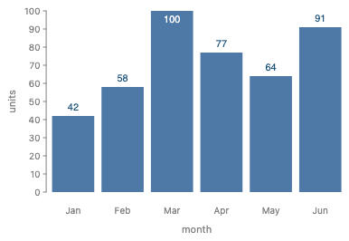
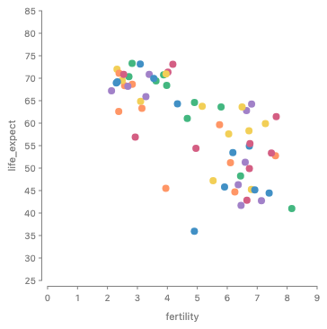
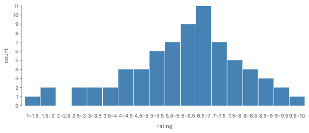
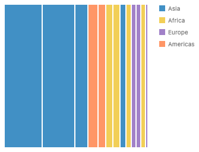
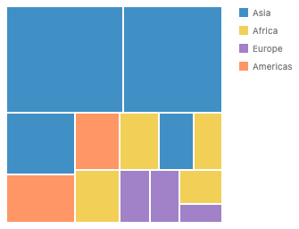

# Naming strategy options (#1355)

GoFish has thirteen strategy families, and their names and option keys follow no single rule: `curve: Curve.monotone` repeats the family in the key, `.label({ position: Place.around })` does not, and `Place`, `Bin` and the old `Tile` read as verbs.
This page proposes one naming rule for every family and every option that takes one, and checks every such option in the library against it.
Five spellings change. The `tile` decision, `tile({ method: Tiling.voronoi })`, is the rule's first case and is already in PR #1366.

Status: accepted on 2026-11-17 and implemented in PR #1366. This applies to the `tile` part only. The naming rule and the other renames on this page are proposed, not accepted.

**Recommendation.** Adopt five naming rules for every strategy family and every option that takes one:

1. **Family.** A family is a capitalized singular noun for what one member is: `Curve`, `Shape`, `Coord`, `Color`, `Animation`. When the members are the ways an operator does its job, the family is the noun for what that operator makes: `Tiling`, `Packing`, `Binning`, `Placement`. A family never shares its name with an operator.
2. **Key.** The option key is the family's name in lowercase: `curve: Curve.monotone`, `shape: Shape.blob`, `placement: Placement.around`.
3. **`method`.** If that key would repeat the operator's own word, the key is `method`: `tile({ method: Tiling.voronoi })`, and `pack({ method: Packing.circles })` when `pack` gets a second strategy.
4. **Several slots.** When one construct takes the same family in several slots, the slots are named for their roles: `.transition({ enter: Animation.grow(), exit: Animation.fadeOut() })`.
5. **No key.** A method whose only argument is a required strategy takes it without a key: `field("x").bin(Binning.step(0.5))`.

Under them, these spellings change:

- `.label("units", { position: Place.around })` becomes `.label("units", { placement: Placement.around })`
- `interpolate(rows, { method: Curve.monotone })` becomes `interpolate(rows, { curve: Curve.monotone })`
- `coord({ transform: Coord.polar() }, children)` becomes `layer({ coord: Coord.polar() }, children)`, and the `coord` combinator is removed
- `field("x").bin(Bin.step(0.5))` becomes `field("x").bin(Binning.step(0.5))`
- `tile({ tile: Tile.voronoi })` becomes `tile({ method: Tiling.voronoi })`, done in PR #1366

Python follows: `.label(placement=Placement.around)`, the modules `gofish.placement` and `gofish.binning`. Nothing else changes; the audit lists every option that was checked.

## The rule

1. **Family.** A family is a capitalized singular noun for what one member is: `Curve`, `Shape`, `Coord`, `Color`, `Animation`. When the members are the ways an operator does its job, the family is the noun for what that operator makes: `Tiling`, `Packing`, `Binning`, `Placement`. A family never shares its name with an operator.

```js
[Curve.monotone, Shape.blob, Tiling.voronoi, Placement.around];
```

2. **Key.** The option key is the family's name in lowercase: `curve: Curve.monotone`, `shape: Shape.blob`, `placement: Placement.around`.

```js
circle({ r: 4 }).label("country", { placement: Placement.around });
```

3. **`method`.** If that key would repeat the operator's own word, the key is `method`: `tile({ method: Tiling.voronoi })`, and `pack({ method: Packing.circles })` when `pack` gets a second strategy.

```js
tile({ method: Tiling.voronoi });
```

4. **Several slots.** When one construct takes the same family in several slots, the slots are named for their roles: `.transition({ enter: Animation.grow(), exit: Animation.fadeOut() })`.

```js
rect({ h: "v" }).transition({
  enter: Animation.grow(),
  exit: Animation.fadeOut(),
});
```

5. **No key.** A method whose only argument is a required strategy takes it without a key: `field("x").bin(Binning.step(0.5))`.

```js
field("x").bin(Binning.step(0.5));
```

- **Strategy family**: a capitalized namespace whose members are the choices for one option, such as `Curve.monotone` or `Overlap.separate`.
- **Member**: one of those choices, such as `monotone`.
- **Key**: the name of the option that takes a member.

## Examples

Each example shows a real render, then the spelling under the rule, then today's. Examples 1, 2 and 5 each carry one fork.

### 1. Label placement: `Place` becomes `Placement`



Each bar's value goes above it, or inside its top when there is no room. From `Forward Syntax/Label Placement/BarValuesAboveOrInside`.

Rule 1 renames the family to the noun for what `.label()` makes, a placement, and rule 2 then names the key `placement`. The same key still takes the 34 position strings (`"center"`, `"outset"`, `"inset-top"`, `"outset-left-start"` and the rest, `labelPlacement.ts:130`), as `filter` takes a CSS string beside a `Filter` member.

Under the rule:

```js
chart(sales, { w: 320, h: 200 })
  .flow(spread({ by: "month", dir: "x" }))
  .mark(
    rect({ h: "units", fill: "#4e79a7" }).label("units", {
      placement: Placement.around({
        directions: ["top"],
        side: ["outset", "inset"],
      }),
    })
  );
```

Today:

```js
chart(sales, { w: 320, h: 200 })
  .flow(spread({ by: "month", dir: "x" }))
  .mark(
    rect({ h: "units", fill: "#4e79a7" }).label("units", {
      position: Place.around({
        directions: ["top"],
        side: ["outset", "inset"],
      }),
    })
  );
```

**Fork 1: `placement: Placement.around` or `position: Position.around`.**

`Placement` is the pick. `Place` reads as a verb as easily as a noun, and a capital letter is meant to mark a namespace of values, not an action. "Label placement" is the name the field uses for this problem. Tooltip and popover libraries use the same key for the same choice: Floating UI's `computePosition` and Popper take `placement: "top"`, and so do Bootstrap's tooltips and Material UI's `Tooltip`. matplotlib's legend says `loc="upper right"`, Vega's label transform says `anchor`, and ggrepel has no such option, since it pushes labels apart with forces (`force`, `direction`).

`position: Position.around` keeps today's key and needs only the family renamed. It needs #1283 first. That issue, signed off but not done, renames the `position()` operator to `translate()`. Until then `position` is also an operator, so a `Position` family breaks rule 1 and its Python module has to be `gofish/position_.py`.

`placement: Placement.around` (pick):

```js
rect({ h: "units" }).label("units", { placement: Placement.around });
```

`position: Position.around`:

```js
rect({ h: "units" }).label("units", { position: Position.around });
```

### 2. `interpolate`: `method` becomes `curve`



`interpolate` reads the table halfway between the 1955 and 1960 keyframes, and an ordinary scatter draws the result. From `Animated Vega-Lite/Gapminder Tower/L3DataSpace`, with the curve written out at its default; no story writes it.

The curve is written as a call, `Curve.monotone()`, because `interpolate` does not yet read a bare member: `interpolate(rows, { method: Curve.monotone })` throws "expected object, got function". The option skips `withKindValues` (`interpolate.ts:286`); `Animation.tween({ curve })` has the same gap (`families/animation.ts:53`). This is a bug to fix with the rename.

Under the rule:

```js
chart(gapminder, { legend: false, w: 300, h: 300 })
  .flow(
    group({ by: "year" }),
    scatter({ by: "country", x: "fertility", y: "life_expect" })
  )
  .mark(blank())
  .layer(
    chart(gapminder)
      .flow(
        derive((rows) =>
          interpolate(rows, {
            along: "year",
            key: "country",
            at: year(),
            curve: Curve.monotone(),
          })
        ),
        scatter({ by: "country", x: "fertility", y: "life_expect" })
      )
      .mark(circle({ r: 4, fill: "country" }))
  );
```

Today:

```js
chart(gapminder, { legend: false, w: 300, h: 300 })
  .flow(
    group({ by: "year" }),
    scatter({ by: "country", x: "fertility", y: "life_expect" })
  )
  .mark(blank())
  .layer(
    chart(gapminder)
      .flow(
        derive((rows) =>
          interpolate(rows, {
            along: "year",
            key: "country",
            at: year(),
            method: Curve.monotone(),
          })
        ),
        scatter({ by: "country", x: "fertility", y: "life_expect" })
      )
      .mark(circle({ r: 4, fill: "country" }))
  );
```

**Fork 2: `curve: Curve.monotone` or keep `method`.**

`curve` is the pick. Rule 2 is mechanical, and every other slot that takes a `Curve` is already called `curve`: on `line`, `ribbon`, `time.transition` and `Animation.tween`.

Keeping `method` reads `method` as "how this operator does its whole job". That reading would also make `enclose`'s `shape` a `method`, and it asks the user to judge what counts as the whole job, so it is rejected. The `tile` proposal cited `interpolate`'s `method` as precedent for `tile`'s; under the mechanical rule, `tile` keeps `method` for its own reason (rule 3), and `interpolate` changes.

`curve: Curve.monotone` (pick):

```js
interpolate(rows, { along: "year", key: "country", at, curve: Curve.monotone });
```

`method: Curve.monotone`:

```js
interpolate(rows, {
  along: "year",
  key: "country",
  at,
  method: Curve.monotone,
});
```

### 3. The `coord` combinator: removed, `layer({ coord })` stays


A pie: five bars stacked along x in a clock coordinate space. Captured from a throwaway story with the `coord` combinator; `Low Level Syntax/Nested Orientation/PolarInChart` draws the same pie with `layer({ coord })`.

Rule 3 alone would give `coord({ method: Coord.clock() }, children)`. But the combinator shares its name with the `Coord` family, which rule 1 forbids, and it duplicates `layer({ coord })`, which builds a layer around this same combinator (`layer.tsx:229`) and adds name scoping: a named mark inside the combinator cannot be selected by a sibling ("Layer "bars" not found"), while the same children under `layer({ coord })` work (`Forward Syntax/Ribbon/Polar`). So the combinator is removed from the public API, and `coord` is only the chart's and the layer's key, already spelled by rule 2. Keeping the combinator with a `method` key is the alternative; it leaves `Coord` and `coord` sharing a name.

The combinator takes `transform` (required), `key`, `grid`, `axes`, `padding` and the box dimensions (`coord.tsx:186`). It is not in the descriptor table, so it is JS only and not on the wire. No story uses it; only files in `src/tests/` do.

Under the rule:

```js
layer({ coord: Coord.clock() }, [
  stackX(
    { h: 70, spacing: 0, alignment: "start" },
    map(pieData, (d) => rect({ w: v(d.count), fill: d.color }))
  ),
]);
```

Today:

```js
coord({ transform: Coord.clock() }, [
  stackX(
    { h: 70, spacing: 0, alignment: "start" },
    map(pieData, (d) => rect({ w: v(d.count), fill: d.color }))
  ),
]);
```

### 4. Binning: `Bin` becomes `Binning`



Movie ratings in half-point bins. From `Forward Syntax/Bin/RatingHistogram`.

`.bin()` is a method and stays a verb; rule 1 makes the family the noun for what it makes, a binning. Rule 5 keeps the strategy without a key. The two-field kinds follow: `struct({ x, y }).bin(Binning.hex({ radius }))`. `Calendar.month` in the same slot does not change.

Under the rule:

```js
chart(movies, { axes: true, w: 560, h: 200 })
  .flow(
    spread({
      by: field("rating").bin(Binning.step(0.5)),
      dir: "x",
      spacing: 1,
    })
  )
  .mark(rect({ h: field("rating").count(), fill: "steelblue" }));
```

Today:

```js
chart(movies, { axes: true, w: 560, h: 200 })
  .flow(
    spread({
      by: field("rating").bin(Bin.step(0.5)),
      dir: "x",
      spacing: 1,
    })
  )
  .mark(rect({ h: field("rating").count(), fill: "steelblue" }));
```

### 5. `Filter` and the data operator `filter`


The bottle image is drawn in grays with `Filter.grayscale`, and the green fill is laid on it. From `Piccl/Bottle/Default`. The second block is the data operator with the same name, from `Animated Vega-Lite/Gapminder/Frame1955`.

Under pick (a) neither block changes in this proposal.

The `filter` option, a `Filter` member:

```js
chart(data, { axes: false })
  .flow(spread({ by: "category", dir: "x", spacing: 20, axes: { x: false } }))
  .mark(
    layer([
      atop({ blendMode: "color" }, [
        image({ href: bottlePng, h: v(100), filter: Filter.grayscale }),
        rect({ h: "amount", w: 175, fill: "#00ff00" }),
      ]).name("bottle"),
      rect({ h: 1, fill: "#666", w: 175, y: "amount" }).name("line"),
      text({ fontSize: 35, fill: "#666", text: (d) => `${d.amount}%` }).name(
        "label"
      ),
    ]).relate(({ line, label, bottle }) => [
      Constraint.align({ x: "start" }, [bottle, line]),
      Constraint.distribute({ dir: "y", spacing: 0 }, [line, label]),
      Constraint.align({ x: "end" }, [label, line]),
    ])
  );
```

The data operator `filter(predicate)`:

```js
chart(gapminder, { legend: false, w: 300, h: 300 })
  .flow(
    filter((d) => d.year === 1955),
    scatter({ by: "country", x: "fertility", y: "life_expect" })
  )
  .mark(circle({ r: 4, fill: "country" }));
```

**Fork 3: which side moves, the family or the data operator.**

(a) is the pick. The family keeps `Filter`, which is the CSS and SVG word for exactly this, and the data operator is the one that moves. Where it moves is #1100's question: should data transforms (`filter`, `derive`, `join`, `group`) get their own namespace, as polars makes `filter` a method (`df.filter`), Altair a chart method (`transform_filter`), Vega-Lite an entry of its own `transform` array, and Observable Plot a function in its namespace (`Plot.filter`). #1100 decides the new spelling. Until then the clash stays, and Python keeps the module `gofish/filter_.py`.

(b) renames the family instead, for example to `Effect`, Figma's word. By rule 2 the key becomes `effect`, and it no longer matches the CSS string the same option takes, which is a CSS `filter` value.

(a) `filter: Filter.grayscale` (pick):

```js
image({ href: bottlePng, filter: Filter.grayscale });
image({ href: bottlePng, filter: "blur(2px)" });
```

(b) `effect: Effect.grayscale`:

```js
image({ href: bottlePng, effect: Effect.grayscale });
image({ href: bottlePng, effect: "blur(2px)" });
```

### 6. Length

Josh's reservation is that full nouns make long words. The three blocks below are the same three call sites: today's short names, the rule's full nouns, and the full nouns with member imports.

| Call site | Today's short names | Full nouns | Full nouns, member imports |
| --------- | ------------------- | ---------- | -------------------------- |
| Label     | 43                  | 48         | 38                         |
| Tile      | 55                  | 59         | 52                         |
| Bin       | 34                  | 38         | 30                         |

Today's short names:

```js
.label("symbol", { position: Place.end() });
tile({ by: "region", size: "pop", tile: Tile.voronoi });
field("rating").bin(Bin.step(0.5));
```

Full nouns, under the rule:

```js
.label("symbol", { placement: Placement.end() });
tile({ by: "region", size: "pop", method: Tiling.voronoi });
field("rating").bin(Binning.step(0.5));
```

Full nouns, with member imports:

```js
.label("symbol", { placement: end() });
tile({ by: "region", size: "pop", method: voronoi });
field("rating").bin(step(0.5));
```

```js
import { end } from "gofish-graphics/placement";
import { voronoi } from "gofish-graphics/tiling";
import { step } from "gofish-graphics/binning";
```

```python
from gofish.placement import end
from gofish.tiling import voronoi
from gofish.binning import step
```

Full nouns are the pick. The long form appears in full only where a call writes both the key and the family. Member imports, the reason #1013 accepted family prefixes, shorten it to the bare member, and most calls never name a strategy at all because each option has a default. The alternative is clipped names in the style of `Coord`; but `Place`, `Tile` and `Bin` are the clipped forms, and they are the ones that read as verbs and collide with operators.

One cost of member imports: a member name can appear in two families (`step` in `Curve` and `Binning`, `voronoi` in `Tiling` and `Binning`), so a file that imports both renames one with `as`. Today's subpaths are `gofish-graphics/place`, `gofish-graphics/tiling` and `gofish-graphics/bin` (`packages/gofish-graphics/package.json`); `placement` and `binning` are two of them renamed.

## The audit

Some family names are also verbs. `Overlap` and `Filter` are both, as `Place` and `Tile` were. They are not renamed here, because each is the established noun for the thing: overlap removal in the layout literature, and the CSS and SVG filter. Neither collides with an operator in JS. (`Filter` collides with the data operator `filter`; that is fork 3, and a name clash, not a verb reading.)

`Color` and `Calendar` name the domain their members come from more than what one member is (a color scale, a calendar unit). They stay: each is the established word, neither reads as a verb, and neither collides.

Rows marked **changes** change. The rule column names the rule that decides the row.

| Family            | Construct                                              | Today                                                          | Under the rule                                                                 | Rule       |
| ----------------- | ------------------------------------------------------ | -------------------------------------------------------------- | ------------------------------------------------------------------------------ | ---------- |
| `Overlap`         | `scatter`                                              | `overlap: Overlap.separate`                                    | unchanged                                                                      | 2          |
| `Tiling`          | `tile`                                                 | `method: Tiling.voronoi`                                       | unchanged (PR #1366; was `tile: Tile.voronoi`)                                 | 1, 3       |
| `Curve`           | `line`, `ribbon`, `time.transition`, `Animation.tween` | `curve: Curve.monotone`                                        | unchanged                                                                      | 2          |
| `Curve`           | `interpolate(rows, opts)`, JS only                     | `method: Curve.monotone`                                       | **changes:** `curve: Curve.monotone`                                           | 2          |
| `Shape`           | `enclose`                                              | `shape: Shape.blob`                                            | unchanged                                                                      | 2          |
| `Filter`          | every mark, and `layer`                                | `filter: Filter.grayscale`, or a CSS string                    | unchanged; the family shares its name with the data operator `filter` (fork 3) | 1 (broken) |
| `Coord`           | `chart`, `layer`                                       | `coord: Coord.polar()`                                         | unchanged                                                                      | 2          |
| `Coord`           | the `coord` combinator, JS only                        | `coord({ transform: Coord.polar() }, children)`                | **changes:** removed; `layer({ coord: Coord.polar() }, children)`              | 1, 2       |
| `Color`           | `chart`                                                | `color: Color.palette([...])`                                  | unchanged                                                                      | 2          |
| `Place`           | `.label()` on every mark and operator                  | `position: Place.around`, or a position string                 | **changes:** `placement: Placement.around`, or a position string               | 1, 2       |
| `Bin`             | `field(x).bin(...)`, `struct({ x, y }).bin(...)`       | `Bin.step(0.5)`, `Bin.hex({ radius })`                         | **changes:** `Binning.step(0.5)`, `Binning.hex({ radius })`                    | 1, 5       |
| `Calendar`        | `field(x).bin(...)` on a time column                   | `Calendar.month`                                               | unchanged                                                                      | 5          |
| `Calendar`        | an axis's `levels`                                     | `levels: [Calendar.month, Calendar.year]`                      | unchanged: a list with one slot per level                                      | 4          |
| `Animation`       | a mark's `.transition()`, JS only                      | `enter: Animation.grow()`, `exit`, `update: Animation.tween()` | unchanged                                                                      | 4          |
| `Domain`          | `Unit({ domain })`                                     | `domain: Domain.discrete(levels)`                              | unchanged; not a strategy option                                               | none       |
| `Trait`           | `Unit({ traits })`                                     | `traits: [Trait.ordered()]`                                    | unchanged; not a strategy option                                               | none       |
| `Packing`, future | `pack`                                                 | no option: `pack` has one strategy                             | **changes:** `method: Packing.circles`                                         | 1, 3       |

- Sources: the `STRATEGIES` table and the fields that reference it in `packages/gofish-ir/src/frontend/descriptors.ts` (`Filter`, `Tiling`, `Overlap`, `Curve`, `Bin`, `Calendar`, `Shape`, `Place`), the modules in `packages/gofish-graphics/src/families/`, and the `export * as` lines in `src/lib.ts`, which add `Coord`, `Color`, `Animation`, `Domain` and `Trait`.
- `Domain` and `Trait` are not strategy options. `Domain` has one member, `discrete`, and says which values exist. `Trait` is a list in which every entry applies at once. Neither picks one way an operator works, and neither reaches the wire (`api-design.md`).
- An operator's `.transition()` takes the same three keys, but with `time.stagger(...)` or `time.parallel()`, not `Animation` members (`animation/transition.ts:56`).
- Other options that take one value from a set stay plain strings: `alignment` and `anchor` on `spread`, `stack` and `scatter`, `dir`, `tile`'s `sort`, `blendMode`, an axis's `side`, `Overlap.noise`'s `randomness`, `Place.along`'s `side` and `orient`, `Curve.arc`'s `direction`, and an effect's `ease` (a name or a function). None of their members takes arguments, and #1013's rule is that a family exists only with two or more strategies, at least one of which takes arguments.
- Python modules: today `bin`, `calendar`, `color`, `coord`, `curve`, `domain`, `filter_`, `overlap`, `place`, `shape`, `tiling` and `trait`. Only `filter_` collides with an operator; Python exports no `bin`, `coord`, `color`, `shape` or `place` function. Under the rule, `placement` and `binning` collide with nothing. A `Position` family would collide with the exported `position` operator and become `position_`.
- #1100 is partly out of date: neither language exports `bin` or `slice` as a top-level name any more (`bin` is the `.bin()` method of `field(...)` and `struct(...)`), so only `filter` shadows a Python builtin. Member imports still can: `from gofish.bin import hex` and `from gofish.tiling import slice`. `Binning` renames the module, not the members.

**Cost.** The renames that touch the wire are the keys: `.label()`'s `position` becomes `placement` in the label options (`LABEL_OPTIONS`). `interpolate` and the `coord` combinator are JS only. Family names do not touch the wire, which carries `{ kind, ...params }`; renaming `Place` and `Bin` renames their descriptor entries, JS subpaths and Python modules. All of it would land in PR #1366 or one follow-up PR.

## Related issues

- **#1355**: Rename the `treemap` operator to `tile`. PR #1366 implements it, with `tile({ method: Tiling.voronoi })`.
- **#1013**: One namespace per strategy family (`Curve.monotone`, `Overlap.separate`). A family exists only with two or more strategies, at least one taking arguments. It said the key and the family need not match, and named `Packing`.
- **#1100**: Python data-transform names shadow builtins; should data transforms get their own namespace? Decides where the data `filter` goes (fork 3).
- **#1283**: Rename the `position()` operator to `translate()`. Signed off, not done. It frees the word `position` (fork 1).
- **#1145**: Use bare strategy members everywhere, and audit options that take one of a set of strategies outside `STRATEGIES`. The audit on this page answers its item 3.
- **#1101**: One extensibility model for strategy families: a user function beside the declared members. The names chosen here are the namespaces that model extends.
- **#1205**: Labels for points, lines and areas (merged PR). It introduced the `Place` family and `.label()`'s `position` strategies.
- **#1276**: Delete `Tiling.slice` and `Tiling.dice`, since a one-axis tiling is a normalized stack.
- **#762**: Renamed `spread`'s `mode` to `anchor`: a specific word over a generic one.
- **#1279**: Extensibility audit of marks, operators and strategies. Mentions the internal `Tiling` function type.

## Why this rule

1. **The key follows from the family.** Rule 2 leaves no choice to make per option, so a reader who knows the family knows the key. Today the key matches the family for `overlap`, `curve`, `shape`, `filter`, `coord` and `color`; the rule makes the other cases match, or says why they differ (rules 3 to 5).
2. **A capital letter means a namespace of values.** `three-surfaces.md` says lowercase names are operators and capitalized names are namespaces. A family that reads as a verb (`Place`, `Tile`, `Bin`) reads like an operator, and two of them sit next to an operator or method of the same word (`tile`, `.bin()`).
3. **`method` is for the one case where rule 2 repeats a word.** `tile({ tile: Tile.voronoi })` says the word three times. Rule 3 applies only when the key would equal the operator's name, so it is mechanical too.
4. **Python.** A family module whose name is an operator's takes a trailing underscore (`gofish/filter_.py`, from the rule in `packages/gofish-python/scripts/generate.ts:1061`). Rule 1 removes that case for every family except `Filter`, which fork 3 handles.

## Wording for api-design.md

If accepted, these sentences replace the one this PR added to "Strategy families are uppercase namespaces" in `api-design.md`:

> A family is a capitalized singular noun for what one member is, as in `Curve` and `Shape`. When the members are the ways an operator does its job, the family is the noun for what the operator makes: `Tiling`, `Packing`, `Binning`, `Placement`. A family never shares its name with an operator. The option key is the family's name in lowercase, as in `shape: Shape.blob`. When that key would repeat the operator's own word, the key is `method`: `tile({ method: Tiling.voronoi })`. When a construct takes one family in several slots, each slot is named for its role, as in `.transition({ enter, exit })`. A method whose only argument is a required strategy takes it without a key: `field("x").bin(Binning.step(0.5))` (#1355).

## Tile

Status: accepted on 2026-11-17 and implemented in PR #1366. This applies to the `tile` part only. The naming rule and the other renames on this page are proposed, not accepted.

`tile` is the operator that #1355 renamed from `treemap`. Its strategy option is `method`, by rule 3, and its family is `Tiling`, by rule 1. The previous spelling, `tile({ tile: Tile.voronoi })`, said one word three times, and its Python module had to be `gofish/tile_.py`.

`pack` follows when it gets a second strategy: `pack({ method: Packing.circles })`. Today it has one, so it has no option (#1013).


Continents are squarified rectangles; regions and countries inside each are Voronoi cells. From `Forward Syntax/Voronoi Treemap/SquarifyThenVoronoi`.

Accepted, in PR #1366:

```js
chart(countryPopulations, { axes: false, w: 480, h: 480 })
  .flow(
    tile({ by: "continent", size: "pop", spacing: 8 }),
    tile({ by: "region", size: "pop", spacing: 2.5, method: Tiling.voronoi }),
    tile({ size: "pop", spacing: 1, method: Tiling.voronoi })
  )
  .mark(region({ fill: "continent" }));
```

Before PR #1366:

```js
chart(countryPopulations, { axes: false, w: 480, h: 480 })
  .flow(
    tile({ by: "continent", size: "pop", spacing: 8 }),
    tile({ by: "region", size: "pop", spacing: 2.5, tile: Tile.voronoi }),
    tile({ size: "pop", spacing: 1, tile: Tile.voronoi })
  )
  .mark(region({ fill: "continent" }));
```

Python, with the member import:

```python
from gofish import Tiling, tile
from gofish.tiling import voronoi

tile(by="region", size="pop", method=Tiling.voronoi)
tile(by="region", size="pop", method=voronoi)
```

### The five tiling strategies

Each render is the same one-level spec with `.mark(region({ fill: "continent" }))`, 13 regions, 240 by 240 pixels. Only the strategy changes.

#### `Tiling.squarify`


Rows of cells close to square, largest first. The default.

```js
tile({
  by: "region",
  size: "pop",
  spacing: 2,
  method: Tiling.squarify,
});
```

#### `Tiling.slice`


Horizontal strips, top to bottom, in data order.

```js
tile({
  by: "region",
  size: "pop",
  spacing: 2,
  method: Tiling.slice,
});
```

#### `Tiling.dice`



Vertical strips, left to right, in data order.

```js
tile({
  by: "region",
  size: "pop",
  spacing: 2,
  method: Tiling.dice,
});
```

#### `Tiling.binary`



Splits the cells into two halves of about equal total and recurses, cutting across the longer side.

```js
tile({
  by: "region",
  size: "pop",
  spacing: 2,
  method: Tiling.binary,
});
```

#### `Tiling.voronoi`


Convex polygon cells from a weighted Voronoi diagram. Fills any convex region, not only a rectangle.

```js
tile({
  by: "region",
  size: "pop",
  spacing: 2,
  method: Tiling.voronoi,
});
```

## Precedent

### Where a label goes

| System                                                                                       | Spelling                                                  | Key                          |
| -------------------------------------------------------------------------------------------- | --------------------------------------------------------- | ---------------------------- |
| [Floating UI](https://floating-ui.com/docs/computePosition)                                  | `computePosition(ref, el, { placement: "bottom-start" })` | `placement`                  |
| [Popper](https://github.com/floating-ui/floating-ui/tree/v2.x)                               | `createPopper(button, tooltip, { placement: 'right' })`   | `placement`                  |
| [Bootstrap tooltips](https://getbootstrap.com/docs/5.3/components/tooltips/)                 | `data-bs-placement="right"`                               | `placement`                  |
| [Material UI Tooltip](https://mui.com/material-ui/api/tooltip/)                              | `<Tooltip placement="top-start" />`                       | `placement`                  |
| [matplotlib legend](https://matplotlib.org/stable/api/_as_gen/matplotlib.pyplot.legend.html) | `ax.legend(loc="upper right")`                            | `loc`                        |
| [Vega label transform](https://vega.github.io/vega/docs/transforms/label/)                   | `{"type": "label", "anchor": ["top", "bottom"]}`          | `anchor`                     |
| [ggrepel](https://ggrepel.slowkow.com/reference/geom_text_repel.html)                        | `geom_text_repel(force = 1, direction = "both")`          | none: forces move the labels |

### A key and its family

| System                                                                                          | Spelling                                                         | Key                                  | Family or type    | Pattern                                               |
| ----------------------------------------------------------------------------------------------- | ---------------------------------------------------------------- | ------------------------------------ | ----------------- | ----------------------------------------------------- |
| [matplotlib](https://matplotlib.org/stable/api/_as_gen/matplotlib.patches.FancyArrowPatch.html) | `FancyArrowPatch(connectionstyle=ConnectionStyle.Arc3(rad=0.3))` | `connectionstyle`                    | `ConnectionStyle` | Key is the family, lowercased (cited in #1013).       |
| [ggplot2](https://ggplot2.tidyverse.org/reference/position_dodge.html)                          | `geom_linerange(position = position_dodge(width = 0.9))`         | `position`                           | `position_*`      | Key is the family prefix.                             |
| Effect                                                                                          | `Effect.retry(task, { schedule: Schedule.recurs(5) })`           | `schedule`                           | `Schedule`        | Key is the family, lowercased.                        |
| [SwiftUI](https://developer.apple.com/documentation/swiftui/view/buttonstyle%28_%3A%29-7qx1)    | `Button("Save") { }.buttonStyle(.bordered)`                      | none: the role is in the method name | `ButtonStyle`     | A noun type; the argument has no label, as in rule 5. |
| [d3-shape](https://d3js.org/d3-shape/line)                                                      | `d3.line().curve(d3.curveStep)`                                  | `curve`                              | `curve*`          | The method is the family's noun.                      |

### Naming guidance

- [Swift API Design Guidelines](https://swift.org/documentation/api-design-guidelines): "Omit needless words. Every word in a name should convey salient information at the use site," and "omit words that merely repeat type information."
- [Google AIP-140](https://google.aip.dev/140): "Messages should not include a field with the same name as the enclosing message."
- Rust RFC 356: items exported from a module should not be prefixed with the module name (`io::Error`, not `io::IoError`).
- [PEP 8](https://peps.python.org/pep-0008), on an argument name that clashes with a reserved keyword: "Perhaps better is to avoid such clashes by using a synonym."

### The tiling option in other treemap libraries

| System                                                                            | Spelling                                      | Key                                   |
| --------------------------------------------------------------------------------- | --------------------------------------------- | ------------------------------------- |
| [d3-hierarchy](https://d3js.org/d3-hierarchy/treemap)                             | `d3.treemap().tile(d3.treemapSquarify)`       | `tile` ("the tiling method")          |
| visx                                                                              | `<Treemap tile={treemapSquarify} />`          | `tile`                                |
| nivo                                                                              | `<ResponsiveTreeMap tile="squarify" />`       | `tile`                                |
| [Vega](https://vega.github.io/vega/docs/transforms/treemap)                       | `{"type": "treemap", "method": "squarify"}`   | `method` ("The layout method to use") |
| [Vega-Lite, open PR #9784](https://github.com/vega/vega-lite/pull/9784)           | `method on the treemap mark`                  | `method`                              |
| Highcharts                                                                        | `layoutAlgorithm: "squarified"`               | `layoutAlgorithm`                     |
| amCharts 5                                                                        | `layoutAlgorithm: "squarify"`                 | `layoutAlgorithm`                     |
| DevExpress                                                                        | `layoutAlgorithm: "squarified"`               | `layoutAlgorithm`                     |
| [treemapify (ggplot2)](https://wilkox.org/treemapify/reference/geom_treemap.html) | `geom_treemap(layout = "squarified")`         | `layout`                              |
| R treemap                                                                         | `treemap(..., algorithm = "pivotSize")`       | `algorithm`                           |
| [Plotly](https://plotly.com/python/reference/treemap)                             | `tiling: { packing: "squarify" }`             | `packing`, under `tiling`             |
| [productplots](https://vita.had.co.nz/papers/prodplots.pdf)                       | `prodplot(data, formula, divider = mosaic())` | `divider`                             |
| [yFiles](https://docs.yworks.com/yfiles-html/api/TreeMapLayout.html)              | `tilingStrategy: TilingStrategy.SQUARIFIED`   | `tilingStrategy`                      |

Count: `tile` 3, `layoutAlgorithm` 3, `method` 2 (one in an unmerged PR), and one each of `layout`, `algorithm`, `packing`, `divider` and `tilingStrategy`. d3, visx and nivo use `tile` under an operator called `treemap`, so the word is said once there.

### Other patterns for a strategy option

| Pattern              | Examples                                                                                                                                                                                                                                                                    |
| -------------------- | --------------------------------------------------------------------------------------------------------------------------------------------------------------------------------------------------------------------------------------------------------------------------- |
| Generic key          | polars `rank(method=)`, `interpolate(method=)` and `join(how=)`, numpy `sort(kind=)` and [`percentile(method=)`](https://numpy.org/doc/stable/reference/generated/numpy.percentile.html) (renamed from `interpolation` in 1.22), scipy `minimize(method=)`, ELK `algorithm` |
| Strategy as operator | d3's separate `tree` and `cluster`, networkx's `*_layout` functions, pandas `ffill()` and `bfill()` replacing `fillna(method=)`, and the tidyverse design guide's ["three functions in a trench coat"](https://design.tidyverse.org/strategy-functions.html)                |
