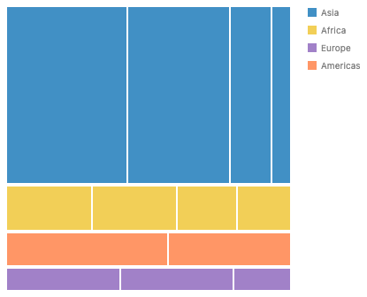
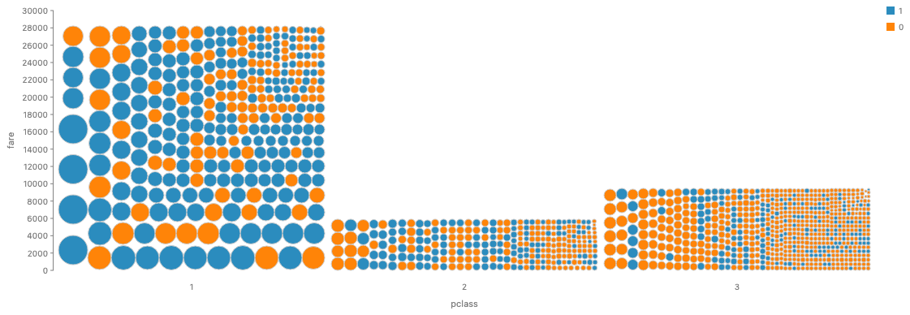
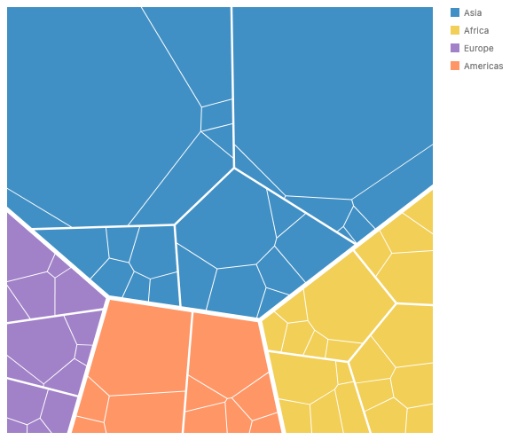
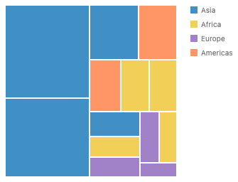

# Naming the strategy option of `tile` (#1355)

After #1355 renamed `treemap` to `tile`, a non-default tiling reads `tile({ size: "pop", tile: Tile.voronoi })`, with one word as the operator, the option key and the strategy family.
The key and the family are two separate choices: the key can be `tile`, `method` or `tiling`, and the family can be `Tile` or `Tiling`.
This page shows each candidate on real examples, rendered, in JS and Python.

**Recommendation.** Use `method` for the key and `Tiling` for the family, so the call reads `tile({ method: Tiling.voronoi })`.

```js
tile({ by: "region", size: "pop", method: Tiling.voronoi });
```

## Terms

- **Strategy family**: a capitalized namespace whose members are the choices for one option, such as `Curve.monotone` or `Overlap.separate`.
- **Key**: the option name that takes a member of a strategy family.
- **Tiling**: a division of a region into cells that cover it, each cell's area proportional to a weight.

## Rules

- The key is `method`, as in `interpolate`'s `method: Curve.monotone`. The operator's own name is the role, so the key does not repeat it.
- The family is `Tiling`, the operator's gerund. `pack` follows the same rule when it gets a second strategy: `pack({ method: Packing.circles })`.
- Rule for `api-design.md`: a strategy option is named for its role; when the operator's own name is that role, the key is `method` and the family is the operator's gerund (`Tiling`, `Packing`).
- The wire field `tile` becomes `method`. Renaming the family touches the namespace, the JS subpath `gofish-graphics/tiling` and the Python module `gofish.tiling`, not the wire.

## Candidates

The key and the family vary independently. The key can be `tile` (today), `method` or `tiling`. The family can be `Tile` (today) or `Tiling`.

The smallest possible change is `method: Tile.voronoi`: a new key and the old family. It removes the repeated key but keeps the `gofish.tile_` module in Python (see example 5).

|       | Candidate                                 | JS                                                            | Python                                                 | Python member import                |
| ----- | ----------------------------------------- | ------------------------------------------------------------- | ------------------------------------------------------ | ----------------------------------- |
| A     | Today, after the rename                   | `tile({ by: "region", size: "pop", tile: Tile.voronoi })`     | `tile(by="region", size="pop", tile=Tile.voronoi)`     | `from gofish.tile_ import voronoi`  |
| **B** | **Recommended**                           | `tile({ by: "region", size: "pop", method: Tiling.voronoi })` | `tile(by="region", size="pop", method=Tiling.voronoi)` | `from gofish.tiling import voronoi` |
| C     | Runner-up on the key                      | `tile({ by: "region", size: "pop", tiling: Tiling.voronoi })` | `tile(by="region", size="pop", tiling=Tiling.voronoi)` | `from gofish.tiling import voronoi` |
| D     | Strategy as the operator, not recommended | `tile.voronoi({ by: "region", size: "pop" })`                 | `tile.voronoi(by="region", size="pop")`                | none: the strategy is not a value   |

## Examples

Each example shows B, the proposal, then A, today's spelling, then C and D.

### 1. Nested levels with mixed strategies


Continents are squarified rectangles. Regions and countries inside each are Voronoi cells. From `Forward Syntax/Voronoi Treemap/SquarifyThenVoronoi`.

B, proposed:

```js
import { chart, region, tile, Tiling } from "gofish-graphics";

chart(countryPopulations, { axes: false, w: 480, h: 480 })
  .flow(
    tile({ by: "continent", size: "pop", spacing: 8 }),
    tile({ by: "region", size: "pop", spacing: 2.5, method: Tiling.voronoi }),
    tile({ size: "pop", spacing: 1, method: Tiling.voronoi })
  )
  .mark(region({ fill: "continent" }));
```

A, today:

```js
import { chart, region, tile, Tile } from "gofish-graphics";

chart(countryPopulations, { axes: false, w: 480, h: 480 })
  .flow(
    tile({ by: "continent", size: "pop", spacing: 8 }),
    tile({ by: "region", size: "pop", spacing: 2.5, tile: Tile.voronoi }),
    tile({ size: "pop", spacing: 1, tile: Tile.voronoi })
  )
  .mark(region({ fill: "continent" }));
```

C:

```js
import { chart, region, tile, Tiling } from "gofish-graphics";

chart(countryPopulations, { axes: false, w: 480, h: 480 })
  .flow(
    tile({ by: "continent", size: "pop", spacing: 8 }),
    tile({ by: "region", size: "pop", spacing: 2.5, tiling: Tiling.voronoi }),
    tile({ size: "pop", spacing: 1, tiling: Tiling.voronoi })
  )
  .mark(region({ fill: "continent" }));
```

D:

```js
import { chart, region, tile } from "gofish-graphics";

chart(countryPopulations, { axes: false, w: 480, h: 480 })
  .flow(
    tile({ by: "continent", size: "pop", spacing: 8 }),
    tile.voronoi({ by: "region", size: "pop", spacing: 2.5 }),
    tile.voronoi({ size: "pop", spacing: 1 })
  )
  .mark(region({ fill: "continent" }));
```

**Fork: the key is `method` or `tiling`.** `method` is the recommendation. It is the key `interpolate` already uses for a `Curve`, the key Vega uses for this exact choice, and one of the two keys #1013 left open for `pack`. `tiling` keeps a role noun and keeps the key matching its family exactly, at the cost of saying the stem three times. A generic key was rejected once before: `spread`'s `mode` became `anchor` (#762), because Auto Layout, TikZ and CSS all had a specific word. Here the specific word is the operator's own name, which is why the generic one is left.

`method` (recommended):

```js
tile({ by: "region", size: "pop", method: Tiling.voronoi });
```

`tiling`:

```js
tile({ by: "region", size: "pop", tiling: Tiling.voronoi });
```

### 2. Slice, then dice



One level slices, the next dices. From `Forward Syntax/Voronoi Treemap/SliceThenDice`.

Issue #1276 proposes deleting `Tile.slice` and `Tile.dice`, because a one-axis tiling is a normalized stack. The naming here does not depend on that.

B, proposed:

```js
chart(countryPopulations, { axes: false, w: 320, h: 320 })
  .flow(
    tile({ by: "continent", size: "pop", spacing: 4, method: Tiling.slice }),
    tile({ by: "region", size: "pop", spacing: 2, method: Tiling.dice })
  )
  .mark(rect({ fill: "continent" }));
```

A, today:

```js
chart(countryPopulations, { axes: false, w: 320, h: 320 })
  .flow(
    tile({ by: "continent", size: "pop", spacing: 4, tile: Tile.slice }),
    tile({ by: "region", size: "pop", spacing: 2, tile: Tile.dice })
  )
  .mark(rect({ fill: "continent" }));
```

C:

```js
chart(countryPopulations, { axes: false, w: 320, h: 320 })
  .flow(
    tile({ by: "continent", size: "pop", spacing: 4, tiling: Tiling.slice }),
    tile({ by: "region", size: "pop", spacing: 2, tiling: Tiling.dice })
  )
  .mark(rect({ fill: "continent" }));
```

D:

```js
chart(countryPopulations, { axes: false, w: 320, h: 320 })
  .flow(
    tile.slice({ by: "continent", size: "pop", spacing: 4 }),
    tile.dice({ by: "region", size: "pop", spacing: 2 })
  )
  .mark(rect({ fill: "continent" }));
```

### 3. A strategy with a parameter



`Tile.squarify({ ratio: 1 })` asks for square cells, one circle per passenger. From `atom/TitanicUnitDots/Default` (its `spacing` argument is written as its default, 0).

In D, the strategy's `ratio` has to merge into the operator's options, next to `h`, `size` and `sort`.

B, proposed:

```js
chart(titanicPassengers, {
  color: Color.palette(["#2b8cbe", "#ff8408"]),
  w: 1000,
  h: 320,
})
  .facet({ by: "pclass", dir: "x" })
  .flow(
    tile({
      h: "fare",
      size: "fare",
      spacing: 0,
      method: Tiling.squarify({ ratio: 1 }),
      sort: "desc",
    })
  )
  .mark(circle({ fill: "survived", stroke: "#ccc", strokeWidth: 1 }));
```

A, today:

```js
chart(titanicPassengers, {
  color: Color.palette(["#2b8cbe", "#ff8408"]),
  w: 1000,
  h: 320,
})
  .facet({ by: "pclass", dir: "x" })
  .flow(
    tile({
      h: "fare",
      size: "fare",
      spacing: 0,
      tile: Tile.squarify({ ratio: 1 }),
      sort: "desc",
    })
  )
  .mark(circle({ fill: "survived", stroke: "#ccc", strokeWidth: 1 }));
```

C:

```js
chart(titanicPassengers, {
  color: Color.palette(["#2b8cbe", "#ff8408"]),
  w: 1000,
  h: 320,
})
  .facet({ by: "pclass", dir: "x" })
  .flow(
    tile({
      h: "fare",
      size: "fare",
      spacing: 0,
      tiling: Tiling.squarify({ ratio: 1 }),
      sort: "desc",
    })
  )
  .mark(circle({ fill: "survived", stroke: "#ccc", strokeWidth: 1 }));
```

D:

```js
chart(titanicPassengers, {
  color: Color.palette(["#2b8cbe", "#ff8408"]),
  w: 1000,
  h: 320,
})
  .facet({ by: "pclass", dir: "x" })
  .flow(
    tile.squarify({
      h: "fare",
      size: "fare",
      spacing: 0,
      ratio: 1,
      sort: "desc",
    })
  )
  .mark(circle({ fill: "survived", stroke: "#ccc", strokeWidth: 1 }));
```

### 4. Three Voronoi levels



The worst case for repetition: today the stem appears nine times in three lines. From `Forward Syntax/Voronoi Treemap/Default`.

A, keeping `tile: Tile.voronoi`, costs nothing, matches d3's key and keeps the key-matches-family pattern. It is the pick if this repetition reads as fine in practice.

B, proposed:

```js
chart(countryPopulations, { axes: false, w: 480, h: 480 })
  .flow(
    tile({ by: "continent", size: "pop", spacing: 5, method: Tiling.voronoi }),
    tile({ by: "region", size: "pop", spacing: 2.5, method: Tiling.voronoi }),
    tile({ size: "pop", spacing: 1, method: Tiling.voronoi })
  )
  .mark(region({ fill: "continent" }));
```

A, today:

```js
chart(countryPopulations, { axes: false, w: 480, h: 480 })
  .flow(
    tile({ by: "continent", size: "pop", spacing: 5, tile: Tile.voronoi }),
    tile({ by: "region", size: "pop", spacing: 2.5, tile: Tile.voronoi }),
    tile({ size: "pop", spacing: 1, tile: Tile.voronoi })
  )
  .mark(region({ fill: "continent" }));
```

C:

```js
chart(countryPopulations, { axes: false, w: 480, h: 480 })
  .flow(
    tile({ by: "continent", size: "pop", spacing: 5, tiling: Tiling.voronoi }),
    tile({ by: "region", size: "pop", spacing: 2.5, tiling: Tiling.voronoi }),
    tile({ size: "pop", spacing: 1, tiling: Tiling.voronoi })
  )
  .mark(region({ fill: "continent" }));
```

D:

```js
chart(countryPopulations, { axes: false, w: 480, h: 480 })
  .flow(
    tile.voronoi({ by: "continent", size: "pop", spacing: 5 }),
    tile.voronoi({ by: "region", size: "pop", spacing: 2.5 }),
    tile.voronoi({ size: "pop", spacing: 1 })
  )
  .mark(region({ fill: "continent" }));
```

### 5. Python


The Python port of example 1, from `tests/python-stories/forward-syntax/test_voronoi_treemap.py`, then the member-import form.

With the family called `Tile`, the family module cannot be `gofish/tile.py`, because `tile` is the operator. The generator's rule for such a clash names it `gofish/tile_.py`, as it already does for `gofish/filter_.py`. PEP 8 says of such clashes: "Perhaps better is to avoid such clashes by using a synonym." `Tiling` gives `gofish.tiling` with no underscore.

B, proposed:

```python
from gofish import Tiling, chart, region, tile

viz = (
    chart(COUNTRY_POPULATIONS, axes=False, w=480, h=480)
    .flow(
        tile(by="continent", size="pop", spacing=8),
        tile(by="region", size="pop", spacing=2.5, method=Tiling.voronoi),
        tile(size="pop", spacing=1, method=Tiling.voronoi),
    )
    .mark(region(fill="continent"))
)
```

```python
from gofish import tile
from gofish.tiling import voronoi

tile(by="region", size="pop", spacing=2.5, method=voronoi)
```

A, today:

```python
from gofish import Tile, chart, region, tile

viz = (
    chart(COUNTRY_POPULATIONS, axes=False, w=480, h=480)
    .flow(
        tile(by="continent", size="pop", spacing=8),
        tile(by="region", size="pop", spacing=2.5, tile=Tile.voronoi),
        tile(size="pop", spacing=1, tile=Tile.voronoi),
    )
    .mark(region(fill="continent"))
)
```

```python
from gofish import tile
from gofish.tile_ import voronoi

tile(by="region", size="pop", spacing=2.5, tile=voronoi)
```

C:

```python
from gofish import Tiling, chart, region, tile

viz = (
    chart(COUNTRY_POPULATIONS, axes=False, w=480, h=480)
    .flow(
        tile(by="continent", size="pop", spacing=8),
        tile(by="region", size="pop", spacing=2.5, tiling=Tiling.voronoi),
        tile(size="pop", spacing=1, tiling=Tiling.voronoi),
    )
    .mark(region(fill="continent"))
)
```

```python
from gofish import tile
from gofish.tiling import voronoi

tile(by="region", size="pop", spacing=2.5, tiling=voronoi)
```

D:

```python
from gofish import chart, region, tile

viz = (
    chart(COUNTRY_POPULATIONS, axes=False, w=480, h=480)
    .flow(
        tile(by="continent", size="pop", spacing=8),
        tile.voronoi(by="region", size="pop", spacing=2.5),
        tile.voronoi(size="pop", spacing=1),
    )
    .mark(region(fill="continent"))
)
```

**Fork: the family is `Tiling` or stays `Tile`.** Both use the `method` key. `Tiling` is the recommendation: its module has a plain name. Keeping `Tile` changes less, and leaves the trailing underscore in every member import.

`Tiling` (recommended):

```python
from gofish import Tiling, tile
from gofish.tiling import voronoi

tile(by="region", size="pop", method=Tiling.voronoi)
```

`Tile`:

```python
from gofish import Tile, tile
from gofish.tile_ import voronoi

tile(by="region", size="pop", method=Tile.voronoi)
```

### 6. A strategy held in a variable

From `src/tests/voronoiTreemap.test.ts`, which runs one check under two strategies. The loop body also reads `strategy.kind` for its message.

In D there is no strategy value, only a function, so the loop holds the operator itself and a parameterized strategy such as `squarify({ ratio: 1 })` cannot be held apart from the other options.

B, proposed:

```js
for (const strategy of [Tiling.squarify, Tiling.voronoi]) {
  const dl = await chart(rows, { axes: false })
    .flow(
      spread({ by: "g", dir: "x", spacing: 0 }),
      tile({
        by: "k",
        size: "v",
        padding: 10,
        w: 200,
        h: 100,
        method: strategy,
      })
    )
    .mark(region({ fill: "#888" }))
    .toDisplayList({ w: 400, h: 100 });
}
```

A, today:

```js
for (const strategy of [Tile.squarify, Tile.voronoi]) {
  const dl = await chart(rows, { axes: false })
    .flow(
      spread({ by: "g", dir: "x", spacing: 0 }),
      tile({ by: "k", size: "v", padding: 10, w: 200, h: 100, tile: strategy })
    )
    .mark(region({ fill: "#888" }))
    .toDisplayList({ w: 400, h: 100 });
}
```

C:

```js
for (const strategy of [Tiling.squarify, Tiling.voronoi]) {
  const dl = await chart(rows, { axes: false })
    .flow(
      spread({ by: "g", dir: "x", spacing: 0 }),
      tile({
        by: "k",
        size: "v",
        padding: 10,
        w: 200,
        h: 100,
        tiling: strategy,
      })
    )
    .mark(region({ fill: "#888" }))
    .toDisplayList({ w: 400, h: 100 });
}
```

D:

```js
for (const tileBy of [tile.squarify, tile.voronoi]) {
  const dl = await chart(rows, { axes: false })
    .flow(
      spread({ by: "g", dir: "x", spacing: 0 }),
      tileBy({ by: "k", size: "v", padding: 10, w: 200, h: 100 })
    )
    .mark(region({ fill: "#888" }))
    .toDisplayList({ w: 400, h: 100 });
}
```

### 7. The sibling operator, `pack`

`pack` has one strategy today, so it has no option (#1013). #1013 names its future family `Packing` and leaves the key open between `method` and `strategy`. B settles that key the same way for both operators. A shows the same-word spelling for comparison.

B, proposed:

```js
pack({ by: "region", method: Packing.circles });
tile({ by: "region", size: "pop", method: Tiling.voronoi });
```

A: the same word for key and family:

```js
pack({ by: "region", pack: Pack.circles });
tile({ by: "region", size: "pop", tile: Tile.voronoi });
```

C:

```js
pack({ by: "region", packing: Packing.circles });
tile({ by: "region", size: "pop", tiling: Tiling.voronoi });
```

### 8. The two precedents already in the repo

`coord` is the one existing operator named after its family, and it takes the strategy under another key, `transform` (`src/ast/coordinateTransforms/coord.tsx`). `interpolate` already holds a family value under `method` (`src/interpolate.ts`).

```js
coord({ transform: Coord.polar() }, children);
interpolate(rows, {
  along: "year",
  key: "country",
  at: 1990.5,
  method: Curve.monotone,
});
```

## The five tiling strategies

Each render is the same one-level spec with `.mark(region({ fill: "continent" }))`, 13 regions, 240 by 240 pixels. Only the strategy changes.

### `Tiling.squarify`



Rows of cells close to square, largest first. The default.

```js
tile({
  by: "region",
  size: "pop",
  spacing: 2,
  method: Tiling.squarify,
});
```

### `Tiling.slice`


Horizontal strips, top to bottom, in data order.

```js
tile({
  by: "region",
  size: "pop",
  spacing: 2,
  method: Tiling.slice,
});
```

### `Tiling.dice`


Vertical strips, left to right, in data order.

```js
tile({
  by: "region",
  size: "pop",
  spacing: 2,
  method: Tiling.dice,
});
```

### `Tiling.binary`


Splits the cells into two halves of about equal total and recurses, cutting across the longer side.

```js
tile({
  by: "region",
  size: "pop",
  spacing: 2,
  method: Tiling.binary,
});
```

### `Tiling.voronoi`


Convex polygon cells from a weighted Voronoi diagram. Fills any convex region, not only a rectangle.

```js
tile({
  by: "region",
  size: "pop",
  spacing: 2,
  method: Tiling.voronoi,
});
```

## Precedent

| System                                                                            | Spelling                                      | Key word                              | Default      |
| --------------------------------------------------------------------------------- | --------------------------------------------- | ------------------------------------- | ------------ |
| [d3-hierarchy](https://d3js.org/d3-hierarchy/treemap)                             | `d3.treemap().tile(d3.treemapSquarify)`       | `tile` ("the tiling method")          | squarify     |
| visx                                                                              | `<Treemap tile={treemapSquarify} />`          | `tile`                                | squarify     |
| nivo                                                                              | `<ResponsiveTreeMap tile="squarify" />`       | `tile`                                | squarify     |
| [Vega](https://vega.github.io/vega/docs/transforms/treemap)                       | `{"type": "treemap", "method": "squarify"}`   | `method` ("The layout method to use") | squarify     |
| [Vega-Lite, open PR #9784](https://github.com/vega/vega-lite/pull/9784)           | `method on the treemap mark`                  | `method`                              | follows Vega |
| Highcharts                                                                        | `layoutAlgorithm: "squarified"`               | `layoutAlgorithm`                     | sliceAndDice |
| amCharts 5                                                                        | `layoutAlgorithm: "squarify"`                 | `layoutAlgorithm`                     | squarify     |
| DevExpress                                                                        | `layoutAlgorithm: "squarified"`               | `layoutAlgorithm`                     | squarified   |
| [treemapify (ggplot2)](https://wilkox.org/treemapify/reference/geom_treemap.html) | `geom_treemap(layout = "squarified")`         | `layout`                              | squarified   |
| R treemap                                                                         | `treemap(..., algorithm = "pivotSize")`       | `algorithm`                           | pivotSize    |
| [Plotly](https://plotly.com/python/reference/treemap)                             | `tiling: { packing: "squarify" }`             | `packing`, under `tiling`             | squarify     |
| [productplots](https://vita.had.co.nz/papers/prodplots.pdf)                       | `prodplot(data, formula, divider = mosaic())` | `divider`                             | mosaic()     |
| [yFiles](https://docs.yworks.com/yfiles-html/api/TreeMapLayout.html)              | `tilingStrategy: TilingStrategy.SQUARIFIED`   | `tilingStrategy`                      | SQUARIFIED   |

Count: `tile` 3, `layoutAlgorithm` 3, `method` 2 (one of them in an unmerged PR), and one each of `layout`, `algorithm`, `packing`, `divider` and `tilingStrategy`. ECharts, Recharts and Python's squarify offer no choice.

d3, visx and nivo use `tile` under an operator called `treemap`, so the word is said once there, not three times. d3's own documentation calls the option "the tiling method".

The research papers say "layout algorithm" (Shneiderman and Wattenberg; Bederson et al.; Balzer and Deussen) and "subdivision" (Bruls et al.).

### A function and its strategy option, elsewhere

| Pattern                      | Examples                                                                                                                                                                                                                                                                                                                           |
| ---------------------------- | ---------------------------------------------------------------------------------------------------------------------------------------------------------------------------------------------------------------------------------------------------------------------------------------------------------------------------------- |
| Same word for key and family | `d3.stack().order(d3.stackOrderNone)`, ggplot2 `position = position_dodge()`, Effect `{ schedule: Schedule.recurs(5) }`                                                                                                                                                                                                            |
| Generic key                  | polars `rank(method=)`, `interpolate(method=)` and `join(how=)`, numpy `sort(kind=)` and [`percentile(method=)`](https://numpy.org/doc/stable/reference/generated/numpy.percentile.html) (renamed from `interpolation` in 1.22), scipy `minimize(method=)`, ELK `algorithm`                                                        |
| Unlabeled argument           | SwiftUI `.buttonStyle(.bordered)`: the role word is in the method name, and the argument has no label                                                                                                                                                                                                                              |
| Strategy as operator         | d3's separate `tree` and `cluster`, networkx's `*_layout` functions, pandas `ffill()` and `bfill()` replacing `fillna(method=)`, productplots' divider functions (where `tile` is itself one divider), and the tidyverse design guide's ["three functions in a trench coat"](https://design.tidyverse.org/strategy-functions.html) |

## Related issues

- **#1355**: Rename `treemap` to `tile`. This question is its first open item.
- **#1013**: Strategy families as capitalized namespaces. Says the key and the family need not match, and names `Packing`.
- **#1276**: Delete `Tile.slice` and `Tile.dice`, since a one-axis tiling is a normalized stack.
- **#762**: Renamed `spread`'s `mode` to `anchor`, a specific word over a generic one.
- **#1279**: Extensibility audit of marks, operators and strategies. Mentions the internal `Tiling` function type.
- **#1005**: Made `tile` a strategy object. It kept the key without discussing it.
- **#1273**: Curved Voronoi treemap cells.
- **#1295**: Revisit the Voronoi treemap.

## Why `method` and `Tiling`

1. **The repo already answers this case twice, and both times the key is not the operator's word.**
   - `coord` is the one existing operator named after its family, and it takes the strategy under another key: `coord({ transform: Coord.polar() }, children)` (`packages/gofish-graphics/src/ast/coordinateTransforms/coord.tsx`).
   - `interpolate(rows, { method: Curve.monotone })` already holds a family value under `method` (`packages/gofish-graphics/src/interpolate.ts`; listed in `apps/docs/docs/internals/design-evolution/three-surfaces.md`).
   - No construct today has an option key that is both its own name and a family name. `text({ text })` repeats its own name, but that is the mark's content, not a strategy.
2. **`pack` has the same shape and was already steered this way.**
   - #1013 removed `pack`'s strategy option until a second packing exists, named the later family `Packing`, and left the key open between `method` and `strategy`: "Both are generic, which suits a family whose future members we cannot predict." So a verb operator with a gerund family is already the plan, and this proposal settles the open key the same way for both: `pack({ method: Packing.circles })` and `tile({ method: Tiling.voronoi })`.
3. **"The family is named after its option key" is a pattern, not a written rule.**
   - #1013 says: "The name usually matches the option key, but does not have to. Because the namespace is capitalized, it is no longer the key itself, so a family can serve keys with other names."
   - The pattern holds for `overlap`/`Overlap`, `curve`/`Curve`, `shape`/`Shape`, `filter`/`Filter`, and the chart-level `coord`/`Coord` and `color`/`Color`. It already does not hold for `interpolate`'s `method`, `.label()`'s `position: Place.x`, `.transition({ enter: Animation.x })`, `.bin(Bin.x)`, or the `coord` combinator's `transform`.
4. **Outside precedent.**
   - Vega's treemap transform spells this exact choice `method` ("The layout method to use"), and the open Vega-Lite treemap PR (#9784) follows it.
   - d3 calls the option `tile` but describes it as "the tiling method". d3, visx and nivo use `tile` under an operator called `treemap`, so the word is said once there.
   - numpy renamed `percentile`'s `interpolation` argument to `method` in 1.22. polars uses `rank(method=)` and `interpolate(method=)`.
5. **Naming guidance.**
   - [Swift API Design Guidelines](https://swift.org/documentation/api-design-guidelines): "Omit needless words. Every word in a name should convey salient information at the use site," and "omit words that merely repeat type information."
   - [Google AIP-140](https://google.aip.dev/140): "Messages should not include a field with the same name as the enclosing message."
   - Rust RFC 356: items exported from a module should not be prefixed with the module name (`io::Error`, not `io::IoError`).
6. **Python.**
   - With the family called `Tile`, the rename forces the family module to `gofish/tile_.py`, so member imports read `from gofish.tile_ import voronoi`. [PEP 8](https://peps.python.org/pep-0008) on such clashes: "Perhaps better is to avoid such clashes by using a synonym." `Tiling` gives `gofish.tiling` and `gofish-graphics/tiling` with no underscore.
7. **Cost.**
   - The wire field `tile` becomes `method`. The family rename touches the namespace, the JS subpath and the Python module, not the wire, which carries plain `{ kind, ...params }` objects.
   - The code already uses `Tiling` internally, as the type of a tiling function in `packages/gofish-graphics/src/ast/graphicalOperators/tile.tsx`. That type needs another name, or it becomes the family's type.

## The case against B

A generic key was rejected before: `spread`'s `mode` became `anchor` (#762) because Auto Layout, TikZ and CSS all had a specific word. Here the specific word is the operator's own name, which is why the generic one is left. If a role noun is preferred, C (`tiling: Tiling.voronoi`) is the spelling: it keeps the key matching the family exactly, at the cost of saying the stem three times.

A (keep `tile: Tile.voronoi`) costs nothing, matches d3's key, and keeps the family pattern. It is the pick if the triple repetition reads as fine in practice.

## Why not D

D has real precedent and says the word once: d3's separate `tree` and `cluster`, networkx's `*_layout` functions, the tidyverse design guide's "three functions in a trench coat", pandas replacing `fillna(method=)` with `ffill()` and `bfill()`, and productplots' divider functions, where `tile` is itself one divider.

It goes against the project's own rules. One concept is one operator with a strategy option (`principles.md`, "Prefer a polymorphic operator to a family of near-duplicates"). Capitalized namespaces hold option values, while lowercase names are operators (`three-surfaces.md`). A strategy could no longer be held as a plain value apart from the operator's options (examples 3 and 6). And `tile` would have to be both a function and a namespace.
