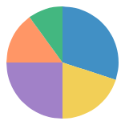
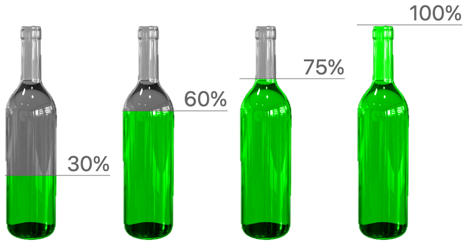
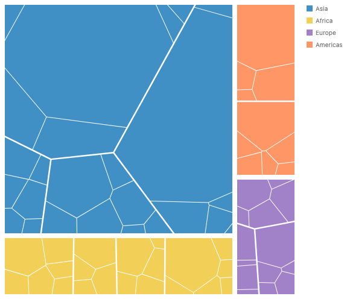
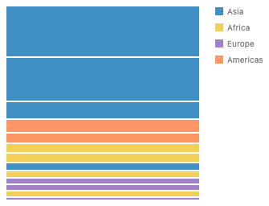
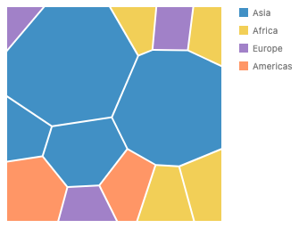

# Naming strategy options (#1355)

GoFish has thirteen strategy families, the capitalized namespaces such as `Curve` and `Tiling` whose members are the choices for one option.
One naming rule of two statements now decides every family's name and the key of every option that takes a member.
Six spellings changed to follow it, among them `tile({ tiling: Tiling.voronoi })` for the operator that #1355 renamed from `treemap`.

Status: accepted and implemented in PR #1366 (2026-11-17).

## The rule

1. A family is a capitalized noun for what one member is: `Curve`, `Shape`, `Effect`. When the members are the ways an operator does its work, the noun is what the operator makes: `Tiling`, `Packing`, `Binning`, `Placement`. It is never an operator's own name.

```js
[
  Curve.monotone,
  Shape.blob,
  Effect.grayscale,
  Tiling.voronoi,
  Placement.around,
];
```

2. The option that takes a member is always the same word in lowercase: `curve: Curve.monotone`, `tiling: Tiling.voronoi`, `placement: Placement.around`, `effect: Effect.grayscale`.

```js
tile({ by: "region", size: "pop", tiling: Tiling.voronoi });
```

The rule has nothing to name where there is no single keyed slot. When one construct takes the same family in several slots, the slots are named for their roles: `.transition({ enter: Animation.grow(), exit: Animation.fadeOut() })`. A method whose only argument is the strategy takes it bare: `field("x").bin(Binning.step(0.5))`. `pack` will follow the rule with `pack({ packing: Packing.circles })` when it gets a second strategy.

- **Strategy family**: a capitalized namespace whose members are the choices for one option, such as `Curve.monotone` or `Overlap.separate`.
- **Member**: one of those choices, such as `monotone`.
- **Key**: the name of the option that takes a member.

## What changed

- `treemap({ tile: Tile.voronoi })` became `tile({ tiling: Tiling.voronoi })`
- `.label("units", { position: Place.around })` became `.label("units", { placement: Placement.around })`
- `interpolate(rows, { method: Curve.monotone() })` became `interpolate(rows, { curve: Curve.monotone })`
- `field("x").bin(Bin.step(0.5))` became `field("x").bin(Binning.step(0.5))`
- `rect({ filter: Filter.grayscale })` became `rect({ effect: Effect.grayscale })`
- `coord({ transform: Coord.polar() }, children)` became `layer({ coord: Coord.polar() }, children)`

Each rename is clean, with no alias for the old spelling, and the `coord` combinator is removed. A bare member such as `Curve.monotone` now works in `interpolate` and `Animation.tween`. Python follows with the modules `gofish.tiling`, `gofish.placement`, `gofish.binning` and `gofish.effect`. `gofish/filter_.py` is gone, and the Python generator now raises an error if a family shares an operator's name.

## Examples

Each example shows a real render, then the spelling now, then the spelling on `main`. The `tile` example is under Tile below.

### 1. Label placement: `placement: Placement.around`


Each bar's value goes above it, or inside its top when there is no room. From `Forward Syntax/Label Placement/BarValuesAboveOrInside`.

The family is the noun for what `.label()` makes, a placement, and the key is the same word in lowercase. The same key still takes the position strings (`"center"`, `"outset"`, `"inset-top"`, `"outset-left-start"` and the rest), as `effect` takes a CSS string beside an `Effect` member.

**Why this spelling.** Tooltip and popover libraries call this option `placement`: Floating UI, Popper, Bootstrap and Material UI all do. The old family name `Place` also read as a verb, and a capital letter is meant to mark a namespace of values, not an action.

Now:

```js
chart(sales, { w: 320, h: 200 })
  .flow(spread({ by: "month", dir: "x" }))
  .mark(
    rect({ h: "units", fill: "#4e79a7" }).label("units", {
      placement: Placement.around({
        directions: ["top"],
        side: ["outset", "inset"],
      }),
    })
  );
```

On `main`:

```js
chart(sales, { w: 320, h: 200 })
  .flow(spread({ by: "month", dir: "x" }))
  .mark(
    rect({ h: "units", fill: "#4e79a7" }).label("units", {
      position: Place.around({
        directions: ["top"],
        side: ["outset", "inset"],
      }),
    })
  );
```

### 2. `interpolate`: the key is `curve`


`interpolate` reads the table halfway between the 1955 and 1960 keyframes, and an ordinary scatter draws the result. From `Animated Vega-Lite/Gapminder Tower/L3DataSpace`, with the curve written out at its default; the story does not write it.

On `main` the curve had to be a call, `Curve.monotone()`, because `interpolate` did not read a bare member. The same commit fixes that here and in `Animation.tween`.

**Why this spelling.** Every other slot that takes a `Curve` is already called `curve`: on `line`, `ribbon`, `time.transition` and `Animation.tween`. `interpolate` now matches them.

Now:

```js
chart(gapminder, { legend: false, w: 300, h: 300 })
  .flow(
    group({ by: "year" }),
    scatter({ by: "country", x: "fertility", y: "life_expect" })
  )
  .mark(blank())
  .layer(
    chart(gapminder)
      .flow(
        derive((rows) =>
          interpolate(rows, {
            along: "year",
            key: "country",
            at: year(),
            curve: Curve.monotone,
          })
        ),
        scatter({ by: "country", x: "fertility", y: "life_expect" })
      )
      .mark(circle({ r: 4, fill: "country" }))
  );
```

On `main`:

```js
chart(gapminder, { legend: false, w: 300, h: 300 })
  .flow(
    group({ by: "year" }),
    scatter({ by: "country", x: "fertility", y: "life_expect" })
  )
  .mark(blank())
  .layer(
    chart(gapminder)
      .flow(
        derive((rows) =>
          interpolate(rows, {
            along: "year",
            key: "country",
            at: year(),
            method: Curve.monotone(),
          })
        ),
        scatter({ by: "country", x: "fertility", y: "life_expect" })
      )
      .mark(circle({ r: 4, fill: "country" }))
  );
```

### 3. The `coord` combinator is removed



A pie: five bars stacked along x in a clock coordinate space. Captured from a throwaway story that used the `coord` combinator on `main`; `Low Level Syntax/Nested Orientation/PolarInChart` draws the same pie with `layer({ coord })`.

The combinator shared its name with the `Coord` family, which statement 1 does not allow. It also did the same job as `layer({ coord })`, which wraps the same internal node and adds name scoping: a named mark inside the combinator could not be selected by a sibling, and under `layer({ coord })` it can. So the combinator is no longer exported, and `coord` is only the key on `chart` and `layer`, which statement 2 already spells. The combinator was JS only and not on the wire, and no story used it.

Now:

```js
layer({ coord: Coord.clock() }, [
  stackX(
    { h: 70, spacing: 0, alignment: "start" },
    map(pieData, (d) => rect({ w: v(d.count), fill: d.color }))
  ),
]);
```

On `main`:

```js
coord({ transform: Coord.clock() }, [
  stackX(
    { h: 70, spacing: 0, alignment: "start" },
    map(pieData, (d) => rect({ w: v(d.count), fill: d.color }))
  ),
]);
```

### 4. Binning: `Bin` becomes `Binning`


Movie ratings in half-point bins. From `Forward Syntax/Bin/RatingHistogram`.

`.bin()` is a method and stays a verb. The family is the noun for what it makes, a binning. The strategy is the method's only argument, so it has no key. The two-field kinds follow: `struct({ x, y }).bin(Binning.hex({ radius }))`. `Calendar.month` in the same slot does not change.

Now:

```js
chart(movies, { axes: true, w: 560, h: 200 })
  .flow(
    spread({
      by: field("rating").bin(Binning.step(0.5)),
      dir: "x",
      spacing: 1,
    })
  )
  .mark(rect({ h: field("rating").count(), fill: "steelblue" }));
```

On `main`:

```js
chart(movies, { axes: true, w: 560, h: 200 })
  .flow(
    spread({
      by: field("rating").bin(Bin.step(0.5)),
      dir: "x",
      spacing: 1,
    })
  )
  .mark(rect({ h: field("rating").count(), fill: "steelblue" }));
```

### 5. Effects: `Filter` becomes `Effect`



The bottle image is drawn in grays with `Effect.grayscale`, and the green fill is laid on it. From `Piccl/Bottle/Default`. The CSS string form moves with the key. The data operator `filter(predicate)` keeps its name; the last block is from `Animated Vega-Lite/Gapminder/Frame1955`.

**Why this spelling.** The word "filter" is kept for filtering rows, which is what it means for arrays. `Effect` is the word Figma, SwiftUI, Sketch, Illustrator and Android use for a visual treatment of one element, and SwiftUI files `grayscale` and `luminanceToAlpha` under "Graphical effects". `Effect` is a working name that will be revisited when shadow and blur are added.

Now:

```js
chart(data, { axes: false })
  .flow(spread({ by: "category", dir: "x", spacing: 20, axes: { x: false } }))
  .mark(
    layer([
      atop({ blendMode: "color" }, [
        image({ href: bottlePng, h: v(100), effect: Effect.grayscale }),
        rect({ h: "amount", w: 175, fill: "#00ff00" }),
      ]).name("bottle"),
      rect({ h: 1, fill: "#666", w: 175, y: "amount" }).name("line"),
      text({ fontSize: 35, fill: "#666", text: (d) => `${d.amount}%` }).name(
        "label"
      ),
    ]).relate(({ line, label, bottle }) => [
      Constraint.align({ x: "start" }, [bottle, line]),
      Constraint.distribute({ dir: "y", spacing: 0 }, [line, label]),
      Constraint.align({ x: "end" }, [label, line]),
    ])
  );
```

On `main`:

```js
chart(data, { axes: false })
  .flow(spread({ by: "category", dir: "x", spacing: 20, axes: { x: false } }))
  .mark(
    layer([
      atop({ blendMode: "color" }, [
        image({ href: bottlePng, h: v(100), filter: Filter.grayscale }),
        rect({ h: "amount", w: 175, fill: "#00ff00" }),
      ]).name("bottle"),
      rect({ h: 1, fill: "#666", w: 175, y: "amount" }).name("line"),
      text({ fontSize: 35, fill: "#666", text: (d) => `${d.amount}%` }).name(
        "label"
      ),
    ]).relate(({ line, label, bottle }) => [
      Constraint.align({ x: "start" }, [bottle, line]),
      Constraint.distribute({ dir: "y", spacing: 0 }, [line, label]),
      Constraint.align({ x: "end" }, [label, line]),
    ])
  );
```

Now, with a CSS string:

```js
image({ href: bottlePng, effect: "blur(2px)" });
```

On `main`, with a CSS string:

```js
image({ href: bottlePng, filter: "blur(2px)" });
```

The data operator `filter(predicate)`, unchanged:

```js
chart(gapminder, { legend: false, w: 300, h: 300 })
  .flow(
    filter((d) => d.year === 1955),
    scatter({ by: "country", x: "fertility", y: "life_expect" })
  )
  .mark(circle({ r: 4, fill: "country" }));
```

### 6. Length

Full nouns make longer names. The three blocks below are the same three call sites: the short names on `main`, the full nouns now, and the full nouns with member imports.

| Call site | On `main` | Now | Now, with member imports |
| --------- | --------- | --- | ------------------------ |
| Label     | 43        | 48  | 38                       |
| Tile      | 58        | 59  | 52                       |
| Bin       | 34        | 38  | 30                       |

On `main`:

```js
.label("symbol", { position: Place.end() });
treemap({ by: "region", size: "pop", tile: Tile.voronoi });
field("rating").bin(Bin.step(0.5));
```

Now:

```js
.label("symbol", { placement: Placement.end() });
tile({ by: "region", size: "pop", tiling: Tiling.voronoi });
field("rating").bin(Binning.step(0.5));
```

Now, with member imports:

```js
.label("symbol", { placement: end() });
tile({ by: "region", size: "pop", tiling: voronoi });
field("rating").bin(step(0.5));
```

```js
import { end } from "gofish-graphics/placement";
import { voronoi } from "gofish-graphics/tiling";
import { step } from "gofish-graphics/binning";
```

```python
from gofish.placement import end
from gofish.tiling import voronoi
from gofish.binning import step
```

The long form appears in full only where a call writes both the key and the family. Member imports, the reason #1013 (one namespace per strategy family) accepted family prefixes, shorten it to the bare member, and most calls never name a strategy at all, because each option has a default. The short names `Place`, `Tile` and `Bin` were the ones that read as verbs and shared a word with an operator or method.

One cost of member imports: a member name can appear in two families (`step` in `Curve` and `Binning`, `voronoi` in `Tiling` and `Binning`), so a file that imports both renames one with `as`. The subpaths are `gofish-graphics/placement`, `gofish-graphics/tiling` and `gofish-graphics/binning`.

## The audit

Some family names are also verbs. `Overlap` is both, as `Place`, `Tile` and `Bin` were. It stays, because it is the established noun for overlap removal in the layout literature, and no operator is called `overlap`.

`Color` and `Calendar` name the domain their members come from more than what one member is (a color scale, a calendar unit). They stay: each is the established word, neither reads as a verb, and neither shares a name with an operator.

Rows marked **changed** changed. The rule column names the statement that decides the row, or "no key" where there is no single keyed slot.

| Family                    | Construct                                              | On `main`                                                      | Now                                                               | Rule      |
| ------------------------- | ------------------------------------------------------ | -------------------------------------------------------------- | ----------------------------------------------------------------- | --------- |
| `Overlap`                 | `scatter`                                              | `overlap: Overlap.separate`                                    | unchanged                                                         | 2         |
| `Tiling` (was `Tile`)     | `tile` (was `treemap`)                                 | `tile: Tile.voronoi`                                           | **changed:** `tiling: Tiling.voronoi`                             | 1, 2      |
| `Curve`                   | `line`, `ribbon`, `time.transition`, `Animation.tween` | `curve: Curve.monotone`                                        | unchanged                                                         | 2         |
| `Curve`                   | `interpolate(rows, opts)`, JS only                     | `method: Curve.monotone()`                                     | **changed:** `curve: Curve.monotone`                              | 2         |
| `Shape`                   | `enclose`                                              | `shape: Shape.blob`                                            | unchanged                                                         | 2         |
| `Effect` (was `Filter`)   | every mark, and `layer`                                | `filter: Filter.grayscale`, or a CSS string                    | **changed:** `effect: Effect.grayscale`, or a CSS string          | 1, 2      |
| `Coord`                   | `chart`, `layer`                                       | `coord: Coord.polar()`                                         | unchanged                                                         | 2         |
| `Coord`                   | the `coord` combinator, JS only                        | `coord({ transform: Coord.polar() }, children)`                | **changed:** removed; `layer({ coord: Coord.polar() }, children)` | 1, 2      |
| `Color`                   | `chart`                                                | `color: Color.palette([...])`                                  | unchanged                                                         | 2         |
| `Placement` (was `Place`) | `.label()` on every mark and operator                  | `position: Place.around`, or a position string                 | **changed:** `placement: Placement.around`, or a position string  | 1, 2      |
| `Binning` (was `Bin`)     | `field(x).bin(...)`, `struct({ x, y }).bin(...)`       | `Bin.step(0.5)`, `Bin.hex({ radius })`                         | **changed:** `Binning.step(0.5)`, `Binning.hex({ radius })`       | 1, no key |
| `Calendar`                | `field(x).bin(...)` on a time column                   | `Calendar.month`                                               | unchanged                                                         | no key    |
| `Calendar`                | an axis's `levels`                                     | `levels: [Calendar.month, Calendar.year]`                      | unchanged: a list with one slot per level                         | no key    |
| `Animation`               | a mark's `.transition()`, JS only                      | `enter: Animation.grow()`, `exit`, `update: Animation.tween()` | unchanged                                                         | no key    |
| `Domain`                  | `Unit({ domain })`                                     | `domain: Domain.discrete(levels)`                              | unchanged; not a strategy option                                  | 2         |
| `Trait`                   | `Unit({ traits })`                                     | `traits: [Trait.ordered()]`                                    | unchanged; not a strategy option, and a list                      | no key    |
| `Packing`, future         | `pack`                                                 | no option: `pack` has one strategy                             | **changed:** `packing: Packing.circles`                           | 1, 2      |

- Sources: the `STRATEGIES` table and the fields that reference it in `packages/gofish-ir/src/frontend/descriptors.ts` (`Effect`, `Tiling`, `Overlap`, `Curve`, `Binning`, `Calendar`, `Shape`, `Placement`), the modules in `packages/gofish-graphics/src/families/`, and the `export * as` lines in `src/lib.ts`, which add `Coord`, `Color`, `Animation`, `Domain` and `Trait`.
- `Domain` and `Trait` are not strategy options. `Domain` has one member, `discrete`, and says which values exist. `Trait` is a list in which every entry applies at once. Neither chooses one way an operator works, and neither reaches the wire (`api-design.md`).
- An operator's `.transition()` takes the same three keys, but with `time.stagger(...)` or `time.parallel()`, not `Animation` members (`animation/transition.ts`).
- Other options that take one value from a set stay plain strings: `alignment` and `anchor` on `spread`, `stack` and `scatter`, `dir`, `tile`'s `sort`, `blendMode`, an axis's `side`, `Overlap.noise`'s `randomness`, `Placement.along`'s `side` and `orient`, `Curve.arc`'s `direction`, and an animation's `ease` (a name or a function). None of their members takes arguments, and #1013's rule is that a family exists only with two or more strategies, at least one of which takes arguments.
- Python modules on `main`: `bin`, `calendar`, `color`, `coord`, `curve`, `domain`, `filter_`, `overlap`, `place`, `shape`, `tile` and `trait`. Now: `binning`, `calendar`, `color`, `coord`, `curve`, `domain`, `effect`, `overlap`, `placement`, `shape`, `tiling` and `trait`. None shares a name with an operator, and the Python generator raises an error if one ever does.
- Member imports can still shadow a Python builtin: `from gofish.binning import hex` and `from gofish.tiling import slice`. The renames changed the module names, not the members.

**The wire.** The keys are what reach the wire: `tiling` in the `tile` options, `placement` in the label options, and `effect` on every mark and `layer`. `interpolate` and the `coord` combinator were JS only. Family names do not reach the wire, which carries `{ kind, ...params }`; renaming a family renamed its descriptor entry, its JS subpath and its Python module.

## Related issues

- **#1355**: Rename the `treemap` operator to `tile`. PR #1366 implements it, with `tile({ tiling: Tiling.voronoi })` and the naming rule on this page.
- **#1013**: One namespace per strategy family (`Curve.monotone`, `Overlap.separate`). A family exists only with two or more strategies, at least one taking arguments. It said the key and the family need not match, and named `Packing`.
- **#1100**: Python data-transform names shadow builtins; should data transforms get their own namespace? It no longer involves a family module, since `gofish/filter_.py` is gone.
- **#1283**: Rename the `position()` operator to `translate()`. Signed off, not done. Labels use `placement`, so they do not wait for it.
- **#1145**: Use bare strategy members everywhere, and audit options that take one of a set of strategies outside `STRATEGIES`. The audit on this page answers its item 3.
- **#1101**: One extensibility model for strategy families: a user function beside the declared members. The names chosen here are the namespaces that model extends.
- **#1205**: Labels for points, lines and areas (merged PR). It introduced the family now called `Placement` and the label key now called `placement`.
- **#1276**: Delete `Tiling.slice` and `Tiling.dice`, since a one-axis tiling is a normalized stack.
- **#762**: Renamed `spread`'s `mode` to `anchor`: a specific word over a generic one.
- **#1279**: Extensibility audit of marks, operators and strategies. Mentions the internal `Tiling` function type.

## Why this rule

1. **Two statements, not five.** Naming should be predictable, and few rules make it so. A reader can guess any key from its family and any family from its key. The two shapes with no key are not extra rules: they are the places where there is no single keyed slot to name.
2. **A capital letter means a namespace of values.** `three-surfaces.md` says lowercase names are operators and capitalized names are namespaces. A family that reads as a verb (`Place`, `Tile`, `Bin`) reads like an operator, and two of them sat next to an operator or method of the same word (`tile`, `.bin()`).
3. **The cost of statement 2.** In `tile({ tiling: Tiling.voronoi })` the stem appears three times. That is accepted for the sake of one predictable rule, and a member import shortens it to `tiling: voronoi`.
4. **Python.** A Python package's submodule and its attribute share one name, so a family module named like an operator would replace that operator on import. On `main`, `gofish/filter_.py` worked around this with a trailing underscore. Statement 1 removes the case, and the generator now raises an error if it comes back.

### Considered and dropped

- **A `method` key when the key would repeat the operator's word,** as in `tile({ method: Tiling.voronoi })`. Dropped because it is a second rule, and a reader has to know when to apply it.
- **`position: Position.around` for labels.** It needs #1283 (rename the `position()` operator to `translate()`) to free the word `position`, and fewer libraries use it for this option than `placement`.
- **Keeping `interpolate`'s `method`.** It would leave one slot that takes a `Curve` and is not called `curve`.
- **The strategy as the operator itself, as in `tile.voronoi({ ... })`.** Each operator would then choose a strategy in its own way, instead of all of them sharing one option shape.

The wording in `api-design.md`, under "Strategy families are uppercase namespaces":

> A family is a capitalized noun for what one member is. When the members are the ways an operator does its work, the noun is what the operator makes (`Tiling`, `Packing`, `Binning`, `Placement`), and it is never the operator's own name. The option key is always the same word in lowercase: `curve: Curve.monotone`, `tiling: Tiling.voronoi`, `placement: Placement.around`, `effect: Effect.grayscale`. The rule does not apply where there is no single keyed slot. Several slots are named by their roles, as in `.transition({ enter, exit })`, and a method whose only argument is the strategy takes it bare, as in `.bin(Binning.step(0.5))`. `pack` will follow the rule with `pack({ packing: Packing.circles })` when it gets a second strategy (#1355).

## Tile

`tile` is the operator that #1355 renamed from `treemap`. Its family is `Tiling`, the noun for what `tile` makes, and its key is the same word in lowercase, `tiling`.

In `tile({ tiling: Tiling.voronoi })` the stem appears three times. That is accepted for the sake of one predictable rule, and a member import shortens it to `tiling: voronoi`.

`pack` follows when it gets a second strategy: `pack({ packing: Packing.circles })`. Today it has one, so it has no option (#1013).



Continents are squarified rectangles; regions and countries inside each are Voronoi cells. From `Forward Syntax/Voronoi Treemap/SquarifyThenVoronoi`.

Now:

```js
chart(countryPopulations, { axes: false, w: 480, h: 480 })
  .flow(
    tile({ by: "continent", size: "pop", spacing: 8 }),
    tile({ by: "region", size: "pop", spacing: 2.5, tiling: Tiling.voronoi }),
    tile({ size: "pop", spacing: 1, tiling: Tiling.voronoi })
  )
  .mark(region({ fill: "continent" }));
```

On `main`:

```js
chart(countryPopulations, { axes: false, w: 480, h: 480 })
  .flow(
    treemap({ by: "continent", size: "pop", spacing: 8 }),
    treemap({ by: "region", size: "pop", spacing: 2.5, tile: Tile.voronoi }),
    treemap({ size: "pop", spacing: 1, tile: Tile.voronoi })
  )
  .mark(region({ fill: "continent" }));
```

Python, with a member import:

```python
from gofish import Tiling, tile
from gofish.tiling import voronoi

tile(by="region", size="pop", tiling=Tiling.voronoi)
tile(by="region", size="pop", tiling=voronoi)
```

### The five tiling strategies

Each render is the same one-level spec with `.mark(region({ fill: "continent" }))`, 13 regions, 240 by 240 pixels. Only the strategy changes.

#### `Tiling.squarify`


Rows of cells close to square, largest first. The default.

```js
tile({
  by: "region",
  size: "pop",
  spacing: 2,
  tiling: Tiling.squarify,
});
```

#### `Tiling.slice`



Horizontal strips, top to bottom, in data order.

```js
tile({
  by: "region",
  size: "pop",
  spacing: 2,
  tiling: Tiling.slice,
});
```

#### `Tiling.dice`


Vertical strips, left to right, in data order.

```js
tile({
  by: "region",
  size: "pop",
  spacing: 2,
  tiling: Tiling.dice,
});
```

#### `Tiling.binary`


Splits the cells into two halves of about equal total and recurses, cutting across the longer side.

```js
tile({
  by: "region",
  size: "pop",
  spacing: 2,
  tiling: Tiling.binary,
});
```

#### `Tiling.voronoi`



Convex polygon cells from a weighted Voronoi diagram. Fills any convex region, not only a rectangle.

```js
tile({
  by: "region",
  size: "pop",
  spacing: 2,
  tiling: Tiling.voronoi,
});
```

## Precedent

### Where a label goes

| System                                                                                       | Spelling                                                  | Key                          |
| -------------------------------------------------------------------------------------------- | --------------------------------------------------------- | ---------------------------- |
| [Floating UI](https://floating-ui.com/docs/computePosition)                                  | `computePosition(ref, el, { placement: "bottom-start" })` | `placement`                  |
| [Popper](https://github.com/floating-ui/floating-ui/tree/v2.x)                               | `createPopper(button, tooltip, { placement: 'right' })`   | `placement`                  |
| [Bootstrap tooltips](https://getbootstrap.com/docs/5.3/components/tooltips/)                 | `data-bs-placement="right"`                               | `placement`                  |
| [Material UI Tooltip](https://mui.com/material-ui/api/tooltip/)                              | `<Tooltip placement="top-start" />`                       | `placement`                  |
| [matplotlib legend](https://matplotlib.org/stable/api/_as_gen/matplotlib.pyplot.legend.html) | `ax.legend(loc="upper right")`                            | `loc`                        |
| [Vega label transform](https://vega.github.io/vega/docs/transforms/label/)                   | `{"type": "label", "anchor": ["top", "bottom"]}`          | `anchor`                     |
| [ggrepel](https://ggrepel.slowkow.com/reference/geom_text_repel.html)                        | `geom_text_repel(force = 1, direction = "both")`          | none: forces move the labels |

### A key and its family

| System                                                                                          | Spelling                                                         | Key                                  | Family or type    | Pattern                                                   |
| ----------------------------------------------------------------------------------------------- | ---------------------------------------------------------------- | ------------------------------------ | ----------------- | --------------------------------------------------------- |
| [matplotlib](https://matplotlib.org/stable/api/_as_gen/matplotlib.patches.FancyArrowPatch.html) | `FancyArrowPatch(connectionstyle=ConnectionStyle.Arc3(rad=0.3))` | `connectionstyle`                    | `ConnectionStyle` | Key is the family, lowercased (cited in #1013).           |
| [ggplot2](https://ggplot2.tidyverse.org/reference/position_dodge.html)                          | `geom_linerange(position = position_dodge(width = 0.9))`         | `position`                           | `position_*`      | Key is the family prefix.                                 |
| Effect (TypeScript library)                                                                     | `Effect.retry(task, { schedule: Schedule.recurs(5) })`           | `schedule`                           | `Schedule`        | Key is the family, lowercased.                            |
| [SwiftUI](https://developer.apple.com/documentation/swiftui/view/buttonstyle%28_%3A%29-7qx1)    | `Button("Save") { }.buttonStyle(.bordered)`                      | none: the role is in the method name | `ButtonStyle`     | A noun type; the argument has no label, as with `.bin()`. |
| [d3-shape](https://d3js.org/d3-shape/line)                                                      | `d3.line().curve(d3.curveStep)`                                  | `curve`                              | `curve*`          | The method is the family's noun.                          |

### Visual effects

| System                     | Word                               | Spelling                                                                                                                                                          |
| -------------------------- | ---------------------------------- | ----------------------------------------------------------------------------------------------------------------------------------------------------------------- |
| Figma                      | Effects                            | `node.effects: Effect[]`, and the widget prop `effect`, for shadows, blurs, noise, texture and glass. Color work is "Image adjustments", in `ImagePaint.filters`. |
| SwiftUI                    | Graphical effects                  | `.grayscale(_:)`, `.luminanceToAlpha()`, and the `VisualEffect` protocol.                                                                                         |
| Android                    | RenderEffect                       | `View.setRenderEffect(...)`                                                                                                                                       |
| Sketch                     | Effects                            | Effects for blurs, with separate Shadows and Color Adjust.                                                                                                        |
| Illustrator, After Effects | Effect                             | The Effect menu.                                                                                                                                                  |
| CSS, SVG, Canvas           | filter                             | `filter: grayscale(1)`. The spec is titled "Filter Effects Module".                                                                                               |
| PixiJS, Konva, Fabric, p5  | filters                            | `filters`                                                                                                                                                         |
| Observable Plot            | imageFilter                        | `imageFilter` for the visual effect, beside the data `filter` option on the same marks: the same clash GoFish had.                                                |
| Photoshop                  | layer effects, Filter, Adjustments | Layer effects for shadow, the Filter menu for blur, and Adjustments for color.                                                                                    |

"vfx" and "fx" are not used as a family name by any API surveyed; Unity's VFX Graph is a particle system.

### Naming guidance

- [Swift API Design Guidelines](https://swift.org/documentation/api-design-guidelines): "Omit needless words. Every word in a name should convey salient information at the use site," and "omit words that merely repeat type information."
- [Google AIP-140](https://google.aip.dev/140): "Messages should not include a field with the same name as the enclosing message."
- Rust RFC 356: items exported from a module should not be prefixed with the module name (`io::Error`, not `io::IoError`).
- [PEP 8](https://peps.python.org/pep-0008), on an argument name that clashes with a reserved keyword: "Perhaps better is to avoid such clashes by using a synonym."

### The tiling option in other treemap libraries

| System                                                                            | Spelling                                      | Key                                   |
| --------------------------------------------------------------------------------- | --------------------------------------------- | ------------------------------------- |
| [d3-hierarchy](https://d3js.org/d3-hierarchy/treemap)                             | `d3.treemap().tile(d3.treemapSquarify)`       | `tile` ("the tiling method")          |
| visx                                                                              | `<Treemap tile={treemapSquarify} />`          | `tile`                                |
| nivo                                                                              | `<ResponsiveTreeMap tile="squarify" />`       | `tile`                                |
| [Vega](https://vega.github.io/vega/docs/transforms/treemap)                       | `{"type": "treemap", "method": "squarify"}`   | `method` ("The layout method to use") |
| [Vega-Lite, open PR #9784](https://github.com/vega/vega-lite/pull/9784)           | `method on the treemap mark`                  | `method`                              |
| Highcharts                                                                        | `layoutAlgorithm: "squarified"`               | `layoutAlgorithm`                     |
| amCharts 5                                                                        | `layoutAlgorithm: "squarify"`                 | `layoutAlgorithm`                     |
| DevExpress                                                                        | `layoutAlgorithm: "squarified"`               | `layoutAlgorithm`                     |
| [treemapify (ggplot2)](https://wilkox.org/treemapify/reference/geom_treemap.html) | `geom_treemap(layout = "squarified")`         | `layout`                              |
| R treemap                                                                         | `treemap(..., algorithm = "pivotSize")`       | `algorithm`                           |
| [Plotly](https://plotly.com/python/reference/treemap)                             | `tiling: { packing: "squarify" }`             | `packing`, under `tiling`             |
| [productplots](https://vita.had.co.nz/papers/prodplots.pdf)                       | `prodplot(data, formula, divider = mosaic())` | `divider`                             |
| [yFiles](https://docs.yworks.com/yfiles-html/api/TreeMapLayout.html)              | `tilingStrategy: TilingStrategy.SQUARIFIED`   | `tilingStrategy`                      |

Count: `tile` 3, `layoutAlgorithm` 3, `method` 2 (one in an unmerged PR), and one each of `layout`, `algorithm`, `packing`, `divider` and `tilingStrategy`. d3, visx and nivo use `tile` under an operator called `treemap`, so the word is said once there. Plotly's `tiling` is the same word GoFish uses.

### Other patterns for a strategy option

| Pattern              | Examples                                                                                                                                                                                                                                                                    |
| -------------------- | --------------------------------------------------------------------------------------------------------------------------------------------------------------------------------------------------------------------------------------------------------------------------- |
| Generic key          | polars `rank(method=)`, `interpolate(method=)` and `join(how=)`, numpy `sort(kind=)` and [`percentile(method=)`](https://numpy.org/doc/stable/reference/generated/numpy.percentile.html) (renamed from `interpolation` in 1.22), scipy `minimize(method=)`, ELK `algorithm` |
| Strategy as operator | d3's separate `tree` and `cluster`, networkx's `*_layout` functions, pandas `ffill()` and `bfill()` replacing `fillna(method=)`, and the tidyverse design guide's ["three functions in a trench coat"](https://design.tidyverse.org/strategy-functions.html)                |
