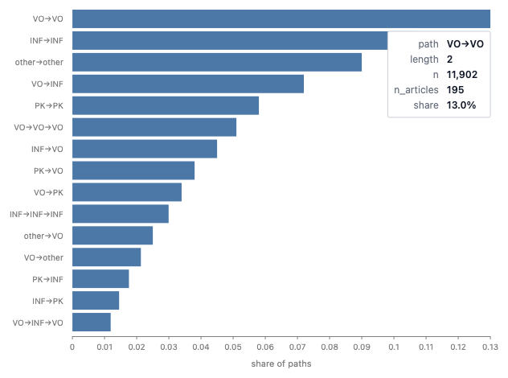
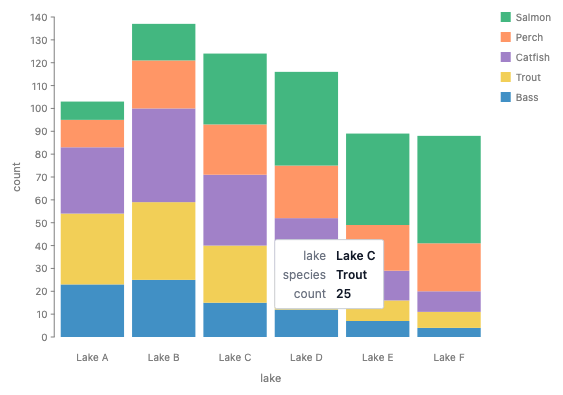
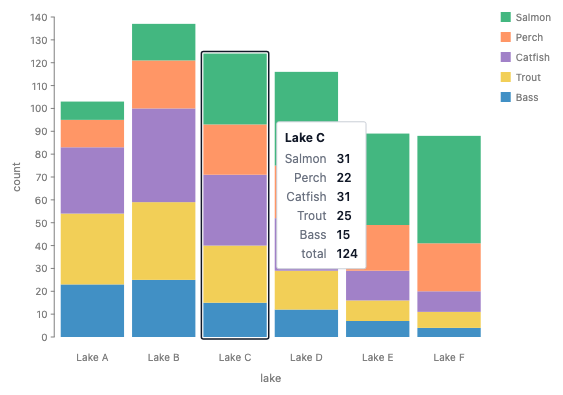
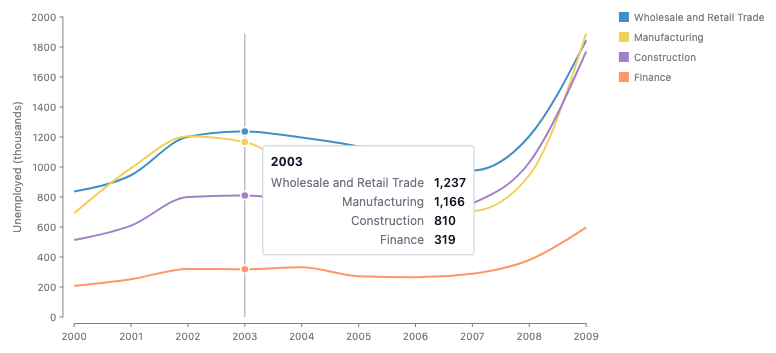
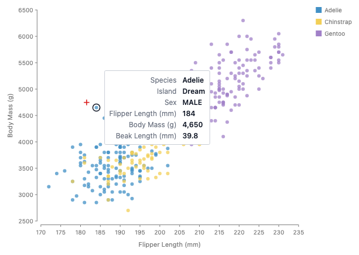
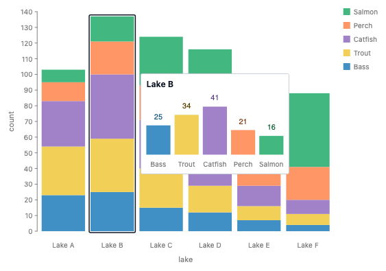
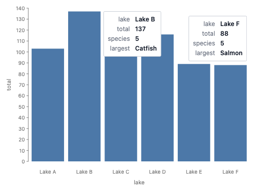
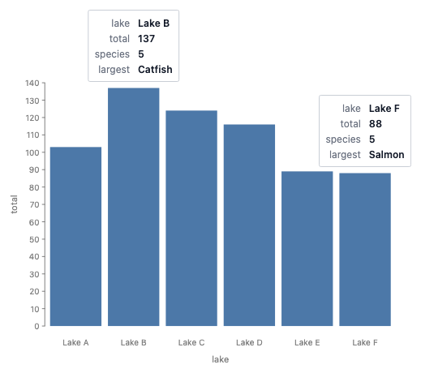

# Tooltip prototype notes (#1395)

Throwaway prototype. The stories live in
`packages/gofish-graphics/stories/_proposals/tooltips/`, under the Storybook
title `Proposals/Tooltips/`. There are no library edits. Every reach past the
public API is in the stories and is listed under "Private hooks" below.

The idea under test: `.tooltip()` is sugar for one more layer of the same
chart, `.layer(chart(<the focused mark of selectAll(name)>).mark(<a box beside it>))`.
There is no overlay tier. The box must stay inside the chart and must not take
room in the layout.

The sugar lines below are illustrative spellings, not a decided API. The
expanded code is what the stories run.

## The live demos on the page (`demo/`)

The proposal page mounts the Interactive stories live from one bundle,
`demo/tooltip-demos.js`. The stories export `mountInteractive...(container)`
functions, and both Storybook and the bundle call them, so there is one
implementation. Build from the repo root:

    pnpm --filter gofish-graphics exec vite build --config ../../proposals/tooltips/demo/vite.config.mjs

The entry is `demo/src/entry.ts`. It exposes
`window.TooltipDemos.mount(name, element)`. Publish `demo/tooltip-demos.js`
beside `page.html`, with `img/`. The page keeps each picture until its demo
mounts, so a blocked bundle leaves the pictures.

Story-side fixes made for the live demos:

- No render sizing. `pointer().dataPos()` is undefined in a chart with its
  own `w`/`h` (a library bug), and render sizing clipped the axes. The line
  and scatter charts keep their own size, and the focus is read off the drawn
  marks (below). The axes are no longer clipped.
- Touch (now `touchHold` in `focusRuntime.ts`): a tap ends with
  `pointerleave`, which clears the pointer. So after a touch the pointer is
  held where it tapped until the next tap.
- `noPointer` (now `floatingOutOfTheWay` in `focusRuntime.ts`) also turns off hits for everything painted after the box, so a
  chart inside a tooltip does not take the hit and flicker.
- The line rule (one box for the year) is always drawn and hidden with no
  focus, so the y axis keeps 0 whether the box is open or not. The live
  one-row lines demo has no rule, and its box's layer is empty while closed,
  so opening the box moves the lines by 0.75 px (the empty-layer bug).
- A `live()` opacity on a `line` did not register the pointer. The rule's live
  opacity reads it instead.
- `sideOf` opens the box to the left for the last lakes. Past the right edge
  the box widened the canvas and moved the axis labels.
- `EdgeCases` has a new `InteractiveFlipped` story.

## Version 1 alignment

The proposal now follows version 1, draft PR #1401. What changed in the
prototype and the page:

- Reach first, then position. `.within(reach)` now keeps only the marks
  whose outline is within `reach` px of the pointer (the current focus out to
  `reach + 4`), then runs the behavior on them. It was a limit on the convex
  hull of all the marks. The default reach is 16 (`TOOLTIP_REACH` in
  `focus.ts`), and the default is
  `Focus.first([Focus.hit(), Focus.closest({ stickiness: 4 })]).within(16).snap(4)`.
- A behavior returns a candidate or `undefined`. There is no gap.
- Outlines. A candidate's `outline` is a list of parts: a box, a round box, a
  segment of a stroked path, or a region (a filled path, nonzero winding).
  `focusRuntime.ts` reads them off the drawn elements and samples a curve
  every 4 px. `Focus.hit` is "inside the outline", the topmost mark first.
  `Focus.closest` measures a candidate with no position (a line) to its
  outline.
- `.snap(stickiness)`: on a line drawn through rows, the row nearest the
  pointer, with a head start for the current row. A candidate's `points`
  holds its rows. The lines demo is now one row with a marker, not one box
  for the year; that form stays a static, proposed figure.
- Nothing keeps the box open because the pointer is over it. The box is no
  pointer target, so the mark under it is reached as usual.
- New Donut story and live demo (`Donut.stories.tsx`): a wedge is a region,
  and the hole shows no box. Shortcut: the box is placed by hand, right of
  the ring and level with the wedge's middle, because a `ref` to a wedge has
  its box in clock space. Version 1 seats it from the drawn geometry.
- The switcher has seven behaviors: default, hit, center, outline, hull (the
  earlier default, a plain function `hullLimit` in the story file, in place
  of "no hull limit"), pin, custom. It runs on three charts: the issue bars,
  bars 60 px apart (`Far Apart`) and the donut (`On Donut`).
- Show regions draws each mark's 16 px reach, and the current focus's 20 px
  reach dashed, in place of the hull and the limit lines. The marks stay
  untinted.
- Background: a "Where this stands" section (version 1 scope, #803 advanced
  with four gaps, what is fixed, what is open); `dataPos` is #1403;
  `pointer-events` is fixed in version 1.

Measured with the real mouse (`focus.mjs`), each point approached from off
the chart, svg px. Bars: rows 27 px apart with 4 px gaps; INF→VO at y 162 to
185, PK→VO at 189 to 212; PK→INF ends at x 148 (y 323 to 346); INF→PK ends
at x 136 (y 350 to 373). Far bars: rows at 0, 78, 156, 234, 312, 18 px tall,
60 px gaps. Donut: center (120, 120), radii 50 and 100.

| Point                                    | Default     | Hit         | Center 40 | Outline     | Hull        | Custom      |
| ---------------------------------------- | ----------- | ----------- | --------- | ----------- | ----------- | ----------- |
| Inside INF→VO                            | INF→VO      | INF→VO      | INF→VO    | INF→VO      | INF→VO      | PK→PK       |
| Gap, 1 px under INF→VO                   | INF→VO      | closed      | PK→VO     | INF→VO      | INF→VO      | PK→PK       |
| INF→PK's row, 2 px right of PK→INF's end | INF→PK      | closed      | closed    | PK→INF      | INF→PK      | VO→other    |
| 12 px right of INF→PK                    | INF→PK      | closed      | closed    | INF→PK      | INF→PK      | VO→other    |
| 70 px right of INF→PK                    | closed      | closed      | closed    | closed      | closed      | PK→INF      |
| 30 px right of bar 2                     | INF→INF     | closed      | closed    | INF→INF     | other→other | VO→VO       |
| 20 px under the last bar                 | closed      | closed      | VO→INF→VO | closed      | closed      | INF→PK      |
| Far: 10 px under INF→INF                 | INF→INF     | closed      | closed    | INF→INF     | INF→INF     | INF→INF     |
| Far: middle of a 60 px gap               | closed      | closed      | closed    | closed      | other→other | INF→INF     |
| Far: inside other→other                  | other→other | other→other | closed    | other→other | other→other | other→other |
| Donut: hole center                       | closed      | closed      | closed    | closed      | Salmon      | Bass        |
| Donut: 5 px into the hole                | Bass        | closed      | closed    | Bass        | Bass        | Bass        |
| Donut: inside Bass                       | Bass        | Bass        | Bass      | Bass        | Bass        | Bass        |
| Donut: 10 px past the ring               | Bass        | closed      | closed    | Bass        | Bass        | Bass        |

- The hole and the wide gap are quiet under the default (asserted in
  `focus.mjs`, and in `check.mjs` for the donut on the Examples tab).
- Center within 40 px is closed inside other→other on the far bars: the bar
  is 18 px tall but long, so its center is more than 40 px from x 150.
- Click to pin: a move opens nothing; a click on INF→VO pins it; it stays
  through moves, leaving the chart, and a click in the gap under it; a click
  12 px right of INF→PK moves it there; a click 70 px right clears it.
- A sweep down across bars 5 to 8, 10 px in, 1 px steps: hit only went
  VO→VO→VO, closed, INF→VO, closed, PK→VO, closed, VO→PK. The default went
  VO→VO→VO, INF→VO, PK→VO, VO→PK and never closed. `check.mjs` sweeps the
  Examples bars from bar 2 to bar 6 in 1 px steps: the box never closes.

Known fault, not fixed: in the live lines demo, opening the box moves the
lines by 0.75 px, because the box's layer is empty while it is closed (the
empty-layer finding). `check.mjs` allows up to 1 px of movement there.

## The focus: direct hit, then nearest by position

Every live demo picks its focus with one rule. It was `focusAt` in
`helpers.ts`. It is now `defaultFocus` in `focus.ts`, written as user code
(see "Focus behaviors in user space" below):

1. A pointer inside a mark's drawn box (inside a scatter dot's circle) picks
   that mark.
2. Otherwise the focus is the mark nearest by position, its size ignored.
   Each mark is one point. Along an axis where the layout or a position
   channel places the mark (a `spread` slot, a `stack` place, a scatter's
   `x`/`y`) the point is the mark's center. Along an axis where the mark only
   has a size from a shared baseline (a bar's length) the axis drops out. Each
   story passes the placing axes as data (`position: ["y"]` for the issue
   bars, `["x", "y"]` for segments and scatter points, `["x"]` for stacks,
   the edge bars and the years) with a comment saying which operator or
   channel places the mark.
3. The current focus has a head start of `stickiness` px (default 4) in rule 2. A direct hit on another mark always switches.
4. Rules 1 and 2 run only on the marks drawn within the reach of the pointer,
   measured to each mark's outline (16 px by default, 30 for the scatter).
   The current focus counts out to reach + 4. With none in reach there is no
   focus. (Until version 1 this was a limit on the convex hull of all the
   marks, 8 px, 12 once focused. See "Version 1 alignment".)
5. On a line drawn through rows, the focus then snaps to its row nearest the
   pointer (`.snap(4)`), and a marker is drawn there.

This is Declarative Dragging's rule (#1294): `closest` over one point per
state with a stickiness bonus, and `whenFar` with in and out thresholds. Here a
mark's placed position is its point, and the direct hit is added, which
dragging does not need.

PRIVATE HOOK (3), removed: `snapToNearest` re-targeted each real
`pointermove` and `pointerdown` to the element of the focused mark, so
`pointer().datum()` was that mark's datum. `snap` in `focusRuntime.ts` now
writes the focus key directly, so nothing reads the DOM hit. The lines'
hull is now over the year dots alone, which cover the lines.

Measured in the headless browser with the real mouse (probe page, client px), with the earlier hull rule. Items a to d do not depend on the limit; e does, and was not re-measured with the reach. The reach measurements are under "Version 1 alignment".

- **a. Issue bar, level with a short bar, to its right.** Bar 6 (INF→VO) at
  x 273, 288, 328 and 388: INF→VO each time. Bar 10 (other→VO) at x 208:
  other→VO. Bar 13 (INF→PK) at x 166: INF→PK. The pointer's row decides
  with no `axis` option.
- **b. Issue bar, slow sweep across all 15 bars** (x 92, 0.5 px steps). Down:
  16 focus changes, 2 closed states (before the first bar and after the
  last), 16 layout re-runs. Every switch is 2.0 to 2.5 px past the middle of
  the 4 px gap (bar pitch 26.9 px). Up: the same counts, and every switch is
  2.0 to 2.5 px past the middle the other way. So the hysteresis band is
  about 4 to 5 px wide, from the 4 px head start.
- **c. Stacked segments.** In Lake A, a 66.3 px Catfish segment under a 27.4
  px one: 1, 2 and 4 px inside Catfish's top edge the focus is Catfish (a
  direct hit), though the short segment's center is nearer (14.7 px against
  32.1 px at 1 px). In the 8 px gap between Lake B and Lake C, swept in 0.5
  px steps: at y 326 one switch at 4.5 px into the gap (Bass to Bass), at y
  216 one switch at 3.0 px (Lake B Trout to Lake C Catfish, the nearer
  center), at y 58 one switch at 8.0 px (on reaching Lake C, a direct hit).
  At y 48 and 33, above Lake C's top, Lake B's Salmon stays: its center is
  nearer than Lake C's.
- **d. Scatter, the old switching spot** (svg 180.71, 307.5 and 183.04,
  307.5). Six 1 px moves: no switch. Approached from below, the focus is
  #141 throughout (its center 9.05 and 9.11 px away, against #119 at 5.83 and
  #79 at 7.01, inside the 4 px head start). Approached from 3 px left, it is
  #119 throughout (5.83 and 8.16 px, against #79 at 7.01). From #119 at
  (180.71, 307.5) the focus changes after moving 4 px right (to #79), 5.5 px
  down (to #141), 8 px up (to #31) or 14.75 px left (to #59).
- **e. Leaving the marks.** Issue bar, down from the last bar's bottom edge:
  the box closes at 12.5 px out and reopens at 8 px coming back. Scatter,
  down from the lowest dot: closes at 34.5 px, reopens at 30 px.

### Before (box distance)

Measured in the headless browser with the real mouse, with the old rule (distance to each mark's box, and `axis`):

- **Issue bar, level with a short bar, to its right.** With `axis: "y"` the
  pointer's row decides. At bar 6 (INF→VO, ends at x 268, row y 172 to 195),
  the pointer at y 183 and x 273, 288, 328 and 388 picks INF→VO every time.
  With plain distance, x 288 and 328 pick VO→VO→VO (the bar above) and x 388
  picks VO→INF (three rows up). At bar 10 (other→VO, ends at x 188), x 208
  picks INF→INF→INF by plain distance. At bar 13 (INF→PK), x 166 picks
  PK→INF. So `axis` is the default for banded layouts. The hull's right side
  runs from the end of the longest bar to the end of the shortest, so level
  with a short bar the hull ends some way right of it: at bar 13 the box
  closes 60 px right of the bar's end, and at bar 10, 120 px right.
- **Stacked bar segments, the 8 px gap between Lake B and Lake C.** Swept
  in 0.5 px steps at five heights: one change each, at 4.5 px into the gap,
  from a Lake B segment to the Lake C segment at the same height. Above Lake
  C's top (but inside the hull) the column decides: Lake C's top segment.
  Before, the box closed for the whole gap.
- **Scatter, 1 px moves over the box.** The switching is real nearest-point
  picking. At svg (180.71, 307.50) point #119 is 2.83 px away and #26 3.20 px.
  At (183.04, 307.50) point #79 is 2.81 px away and #119 5.17 px. The two
  points are about 2 px apart, so a 1 px move crosses between them.
- **Issue bar, slow sweep down across all 15 bars** (x 92, 1 px steps).
  Before: 30 focus changes, 16 closed states, 30 layout re-runs. After: 16
  focus changes (open on the first bar, one per boundary between bars, close
  8 px below the last bar), 2 closed states (before and after), 16 layout
  re-runs, and no closed state between bars.

## The helpers (`helpers.ts`)

- `table(pairs, {title})`: two `spread`s in y side by side. Names are gray and
  right-aligned, values are dark, bold and left-aligned.
- `box(content)`: an `enclose` with a white fill, a light stroke and `rx: 4`.
- `rowTooltip(row, {fields, format})`: `box(table(entries(row)))`.
- `beside(anchor, content, {side, align, gap, ink})`: one `spread` of the
  anchor and the box. With `ink` on (the default) the box is marked ink (private
  hook 1), so it takes no room.
- `focusFrom(read)` (kept for the Measure stories only): the focus split. A Solid effect outside the spec maps the
  pointer to a key and writes a `signal` only when the key changes.
- `floatingOutOfTheWay(container)` (in `focusRuntime.ts`, was `noPointer`): private hook 2, CSS that takes the box out of the
  hit test.

## 1. Issue bar chart



Sugar:

```js
chart(pathTypes, { w: 520, h: 400 })
  .flow(spread({ by: "path", dir: "y", spacing: 4 }))
  .mark(rect({ w: "share" }).name("bars"))
  .tooltip("bars", { focus, format: { share: percent1, n: thousands } });
```

Expanded:

```js
  .layer(
    chart(selectAll("bars"))
      .flow(filter((bar) => bar.datum[0].path === focus()), group({ by: "path" }))
      .mark((bar) =>
        beside(bar[0], rowTooltip(bar[0].datum[0], { format }),
          bar[0].datum[0].share > 0.09
            ? { side: "bottom", align: "end", gap: 4 }
            : { side: "right" })))
```

Stories: Pinned (VO→VO), Closed, Interactive.

Flaws: the data are invented (15 rows, 91,554 paths in total). The "Top 15
path types" title is missing because charts have no title. The top bar touches
the top edge of the image. The side is chosen from the datum (see "Keep
inside").

## 2. Stacked bar: one segment and the whole stack (#802)




Sugar:

```js
chart(seafood, { w: 420, h: 320 })
  .flow(spread({ by: "lake", dir: "x" }), stack({ by: "species", dir: "y" }))
  .mark(rect({ h: "count", fill: "species" }).name("segments"))
  .tooltip("segments", { focus })                 // one segment
  .tooltip(<the stack>, { focus, body: stackTable }) // the whole stack, see #802
```

Expanded, whole stack (the segment form is story 1's with
`filter(lake && species)` and `group({by: "species"})`):

```js
  .layer(
    chart(selectAll("segments"))
      .flow(filter((s) => s.datum[0].lake === focus()), group({ by: "lake" }))
      .mark((s) =>
        beside(
          enclose({ padding: 2, fill: "none", stroke: "#111827" }, s).zOrder(1),
          box(table([...speciesRowsTopFirst, ["total", total]], { title: lake })))))
```

Stories: PinnedSegment (Lake C / Trout), PinnedWholeStack (Lake C), Closed,
InteractiveSegment, InteractiveWholeStack.

Wall (#802): the stack's group cannot be named, so there is no ref to the
stack. The stand-in is an `enclose` of the segment refs, which draws an outline
I would want anyway. `layer(refs)` as a stand-in throws "layer: axis 1 has a
continuous type but no size claim". A relational mark paints under the marks it
references by default, which put the box under the next lake's bars, so the
anchor is raised with `.zOrder(1)`.

## 3. Multi-series line, shared tooltip



Sugar:

```js
chart(yearly, { w: 520, h: 300 })
  .flow(group({ by: "series" }))
  .mark(line({ x: "year", y: "count", stroke: "series" }))
  .tooltip({ by: "year", focus: nearestX, rule: true, dots: true });
```

Expanded (three layers, a rule, dots and the box):

```js
  .layer(chart(YEARS.filter((y) => y === focus()).map((year) => ({ year, top: TOP })))
    .flow(scatter({ by: "year", x: "year" }))
    .mark(rect({ w: 1, h: "top", fill: "#9ca3af" })))
  .layer(chart(yearly).flow(scatter({ x: "year", y: "count" }))
    .mark(circle({ r: 4, fill: "series", stroke: "white",
                   opacity: (d) => (d.year === focus() ? 1 : 0) }).name("pts")))
  .layer(chart(selectAll("pts"))
    .flow(filter((pt) => pt.datum[0].year === focus()), group({ by: "year" }))
    .mark((pts) => beside(
      enclose({ padding: 6, fill: "none", stroke: "none" }, pts).zOrder(1),
      box(table(rowsSortedByCount, { title: year })),
      { side: year > 2005 ? "left" : "right" })))
```

Stories: Pinned (2003), Closed, Interactive (the nearest year to
`pointer().dataPos().x`).

Flaws: the dots are drawn for every row at opacity 0 and shown only at the
focused year, which is a trick. A filtered data layer would be cleaner but
then needs its own name for `selectAll`. The box covers the lines under it, as
any tooltip does.

## 4. Scatter: nearest point within a radius, with a ring



Sugar:

```js
chart(penguins, { w: 440, h: 360 })
  .flow(scatter({ x: "Flipper Length (mm)", y: "Body Mass (g)" }))
  .mark(circle({ r: 3, fill: "Species" }).name("pts"))
  .tooltip("pts", { focus: nearest({ radius: 30 }), ring: true, fields });
```

Expanded:

```js
  .layer(chart(selectAll("pts"))
    .flow(filter((pt) => pt.datum[0].id === focus()), group({ by: "id" }))
    .mark((pt) => beside(
      enclose({ shape: Shape.oval(), padding: 3, fill: "none", stroke: "#111827" }, pt).zOrder(1),
      rowTooltip(pt[0].datum[0], { fields }),
      { side: pt[0].datum[0][X] > 215 ? "left" : "right" })))
```

The pinned story draws the virtual pointer as a red "+" that is not on a point.
The nearest point within 30 px (Adelie, 184 mm, 4,650 g) gets the ring and the
box.

Wall (#849): `Pointer` gives data coordinates but no data-to-px map, so
`nearest` approximates pixel distance from the chart size over the data
extent. It ignores the axis padding.

## 5. A chart in a tooltip



Expanded (the box holds a title and a whole chart):

```js
box(
  spread({ dir: "y", spacing: 6, alignment: "start" }, [
    text({ text: lake, fontWeight: 700 }),
    chart(
      rows.map((r) => ({ species: r.species, n: r.count })),
      { w: 200, h: 70, axes: { x: { title: false } } }
    )
      .flow(spread({ by: "species", dir: "x", spacing: 6 }))
      .mark(rect({ h: "n", fill: "species" }).label("n")),
  ])
);
```

Stories: Pinned (Lake B), Interactive.

Wall: the inner chart is not its own world. Measure-keyed domains are shared
across tiers, so with the field named `count` the inner bars used the outer
chart's `count` scale and came out tiny. Putting count on x instead made the
outer chart warn about mixed data-driven and flexible sizes. The story renames
the field to `n`, which is a workaround. Ink stops the box from taking room. It
does not separate scales or type inference.

## 6. Edge cases



`Flipped`: tall bars open their box to the right, flush with the bar's top
(`{side: "right", align: "end"}`). The last lake opens to the top, aligned to
its right edge. The rest open to the top. All are chosen from the datum.



`Naive` (`ink: false`, side top) shows what happens without the ink flag. The
canvas grows from 471×353 to 497×437 and the plot moves down 84 px.

The layout check stories, against `Closed`, compare the normalized DOM. The
table counts elements of the closed render that are missing or moved in the
open render.

| Story                                     | Render size | Moved   | Canvas                                     |
| ----------------------------------------- | ----------- | ------- | ------------------------------------------ |
| Naive (no ink)                            | none        | 45 / 45 | grows                                      |
| InkOnly                                   | none        | 45 / 45 | grows (ink above the plot shifts the root) |
| NaiveFixedCanvas                          | 480×360     | 45 / 45 | same, plot squeezed, warning               |
| InkOnlyFixedCanvas                        | 480×360     | 0 / 45  | same, box draws past the canvas, warning   |
| Flipped (ink, kept inside by side choice) | none        | 0 / 45  | +0.5 px wide (stroke overhang)             |

## Measurements

The measurements were run in headless Chromium with a real clock. The capture
harness uses a fake clock, so its times are meaningless. The driver is
`proposals/tooltips/measure.ts`, which opens the "Proposals/Tooltips/Measure/Run"
story. To rerun:
`cd tests && CAPTURE_ONE_PORT=4793 pnpm exec tsx ../proposals/tooltips/measure.ts`.

### Does layout re-run on every pointer move?

Yes, when the spec reads the pointer. A read during resolve is a pipeline
dependency, and the pointer changes on every move. Can the focus be split from
the pointer position with today's API? Yes. `focusFrom` maps the pointer to a
key in a Solid effect outside the spec. It writes a `signal` only when the key
changes, and the spec reads only that signal.

The `<svg>` replacements were counted with a MutationObserver during a sweep
of synthetic pointer moves:

| Sweep                         | Moves | Pointer read in spec | Focus split               |
| ----------------------------- | ----- | -------------------- | ------------------------- |
| issue bars, 3 bars × 10 moves | 30    | 30 re-runs           | 3 re-runs                 |
| lines, left to right          | 40    | 40 re-runs           | 10 re-runs (one per year) |

The pointer must still be registered with the chart's runtime. Only a read
inside a spec does that, so each interactive story reads it once in a `live()`
channel, a paint patch that does not re-run layout. In the bar stories that
read is a hover fill. In the lines story it is `live(() => (p.pos(), 1))` as the
line opacity, which is a trick.

### Cost of one re-run

The median of 15 full renders (resolve, layout and paint), after 2 warm-ups,
with a tooltip open:

| Story                                 | ms   |
| ------------------------------------- | ---- |
| 1. issue bar, open                    | 8.0  |
| 1. issue bar, closed                  | 4.6  |
| 2. stacked bar, whole-stack box       | 10.9 |
| 3. shared lines (4 series × 10 years) | 12.2 |

Three runs agreed within about 1.5 ms. These are on an M-series Mac. The
tooltip layer about doubles the cost of the issue bar chart (4.6 to 8.0 ms).

### Does an open tooltip change the layout?

With the ink box, no. The normalized DOM of each pinned story was diffed
against its closed story:

| Story            | Elements moved                                               |
| ---------------- | ------------------------------------------------------------ |
| issue bar        | 0 / 60                                                       |
| stack segment    | 0 / 79                                                       |
| stack whole      | 0 / 79                                                       |
| chart in tooltip | 0 / 79                                                       |
| scatter          | 0 / 398                                                      |
| shared lines     | 85 / 95, a 0.75 px vertical shift (canvas 331.75 → 331 tall) |

The shared-lines shift is in the Closed render, not the box. A diagnostic run
(since deleted) showed that a tier with no marks at all (the closed rule and
tooltip tiers) moves the plot. In a render-sized chart it moved the x axis by
46 px. A tier with marks that is not ink moved nothing. So an empty layer
changes the layout, which is a library issue in its own right and not a
tooltip one.

### Does the box steal the pointer?

Yes. The pointer was held still inside the open box of the top bar, over the
second bar:

- Without CSS: `VO→VO → (none) → INF→INF → …`. The box became the hit, the
  datum turned undefined, the focus cleared, and the box closed for one frame.
  That frame is the flicker.
- With the `noPointer` CSS: `VO→VO → INF→INF → …`. The move goes through to
  the bar under the box, with no closed frame.

Paint never sets `pointer-events`. The fix here is story-side CSS that finds
the box by its stroke color. A real `.tooltip()` would paint its box with
`pointer-events: none`.

## Keep inside (a declared shortcut)

The ink flag keeps the box from taking room. It does not keep the box inside
the canvas. Keeping it inside needs the mark's placed position, which exists
only after the solve. That is the job of a post-solve chooser like the label
chooser: `applyLabelPlacement` in `src/ast/labels/placeStep.ts` already keeps
labels in the frame and hides a label with no spot. In this prototype the
caller picks the side from the datum (`share > 0.09`, `year > 2005`,
`x > 215`). This is a shortcut. The right fix is to run the tooltip's side and
alignment through that chooser, with a list of candidate sides.

## Walls

The issue column below was matched by topic and several numbers are wrong. The checked matches are in `proposal.md` under Findings.

| Wall                                                                                                                                                                                                                                                                                       | Issue      | Where                    |
| ------------------------------------------------------------------------------------------------------------------------------------------------------------------------------------------------------------------------------------------------------------------------------------------ | ---------- | ------------------------ |
| No name for a stack group, so no ref to the whole stack. Enclose of the segment refs as a stand-in. `layer(refs)` throws.                                                                                                                                                                  | #802       | stories 2, 5             |
| `Pointer` has no data-to-px map, so "nearest within N px" is approximated.                                                                                                                                                                                                                 | #849       | story 4                  |
| `pointer().dataPos()` returns undefined when the chart has its own `w`/`h`. It converts only when the size goes to `render()`.                                                                                                                                                             | #849       | stories 3, 4 Interactive |
| A render-sized chart with a tier that has no marks or an ink box draws its axes past the canvas (59 px left, 25 to 46 px below). So the Interactive lines and scatter stories keep chart sizing and map the pointer with `drawnScales` instead of `dataPos()`. Their axes are not clipped. | #849, #850 | stories 3, 4 Interactive |
| An empty layer tier moves the plot.                                                                                                                                                                                                                                                        | #850       | story 3 Closed           |
| The pointer registers only through a read inside the spec, so a focus split needs a dummy `live()` read.                                                                                                                                                                                   | #830, #673 | all Interactive          |
| No `pointer-events` control in paint; the box steals the hit test.                                                                                                                                                                                                                         | #674       | story 1 Interactive      |
| A tooltip chart shares the parent's measure-keyed domains and type inference. Ink covers room, not scales.                                                                                                                                                                                 | #803       | story 5                  |
| The color scale is not reachable outside resolve, so a `live()` fill must spell its palette as literals, and a tooltip cannot draw a series swatch.                                                                                                                                        | #673       | stories 3, 4             |
| A relational mark paints under its operands by default, so an anchor needs `.zOrder(1)`.                                                                                                                                                                                                   |            | stories 2 to 5           |
| `filter` with no match still calls the mark with `[]`. Adding `group({by})` after it avoids the call.                                                                                                                                                                                      |            | all                      |
| Nothing formats numbers beyond `String()`. The helpers carry formatters.                                                                                                                                                                                                                   |            | all                      |
| No drop shadow among the filters. No chart title.                                                                                                                                                                                                                                          |            | all                      |

I matched the issue numbers from the brief's list by topic. I did not reread
the issues, so check the matches before citing them.

## Private hooks and library edits

Library edits: none. `src/ast/gofish.tsx` was instrumented during the work and
restored. `git status` shows only the two new folders.

Private hooks, all in the stories:

1. `GoFishNode.inkOn = [true, true]` on the box (`beside` in `helpers.ts`). It
   must be on the content node. On the `spread` it is lost, because the spread
   elaborates into a new layer.
2. `noPointer`: story CSS that sets `pointer-events: none` on the box and its
   text, found by the box's stroke color.

Workarounds that use public API:

- `.zOrder(1)` on every enclose anchor.
- An enclose of refs as the stand-in for a stack (#802).
- `group({by})` after every `filter`.
- A dummy `live()` read to register the pointer.
- The side chosen from the datum, the keep-inside shortcut.
- The field renamed to `n` in the nested chart.

3. `focusRuntime.ts`: every piece the runtime would have to provide for a
   focus behavior (candidates read off the drawn DOM with rows from the
   chart's private id-to-item map, the pointer, `current`, the click, the
   re-run on a new key, the touch hold). Listed in "What the runtime must
   provide" below.

## Focus behaviors in user space

The focus rule is now user code: `focus.ts` holds the types and the `Focus`
family as pure functions (no DOM, no Solid, no GoFish internals), and
`focusRuntime.ts` holds everything the runtime would have to provide. Every
interactive story mounts through `snap(container, marks, focus)` in
`focusRuntime.ts`. The default:

```js
Focus.first([Focus.hit(), Focus.closest({ stickiness: 4 })])
  .within(16)
  .snap(4);
```

A call (`Focus.hit`, `Focus.closest`, `Focus.first`, `Focus.from`) starts a
behavior or joins several; a chained method (`.within`, `.snap`,
`.onClick`) transforms one.

### Line counts

Code lines only (no blank or comment lines), as of version 1 alignment.

| What                                                      | Lines |
| --------------------------------------------------------- | ----: |
| `focus.ts`, all of it (types, family, geometry)           |   181 |
| `focusRuntime.ts`, the missing runtime API                |   242 |
| `focusDebug.ts`, Show regions                             |   372 |
| Default behavior                                          |     3 |
| Hit only                                                  |     1 |
| Closest center within 40 px                               |     1 |
| Closest outline within 16 px                              |     1 |
| The earlier default (`hullLimit` and the hull), user code |    41 |
| Click to pin                                              |     1 |
| A plain function (largest share within 60 px)             |     5 |

### What each behavior did under the mouse

The switcher on the page (story "Proposals/Tooltips/Focus Behaviors",
`FocusSwitcher.stories.tsx`), driven with the real mouse in headless
Chromium at 1280 px (`focus.mjs` in the live-check folder). The table is
under "Version 1 alignment" above. Every behavior is the same `snap` call
with a different behavior value; the switcher itself is one more user
function, `(f) => behaviors[name](f)`. A click outside the chart's `<svg>`
is not seen, because the listener is on the chart.

### Against the old prototype

Before version 1 alignment, `compare.mjs` ran the same pointer paths on the bundle at HEAD and on the
new one and prints the focus at each step. Issue bar (four offsets right of
bar 6, bar 10, bar 13; a slow sweep; leaving down and coming back),
stacked segments (three gap sweeps), stacks, scatter (leaving down; a
diagonal sweep), edge and chart-in-tooltip: identical. The shared lines
differ, by design: the old hull was over the year dots plus the lines'
bounding boxes; the new hull is over the year dots only, which is the convex
hull of the drawn lines. A sweep across opens 8 px later at the left end
(x 96 against 88), and a sweep down at 2006 opens 32 px lower (y 376.5
against 344.5) and closes 3 px sooner.

### What the runtime must provide

| Piece                                          | The prototype, by hand                                                                                                              | Public API that replaces it                                      | Issue |
| ---------------------------------------------- | ----------------------------------------------------------------------------------------------------------------------------------- | ---------------------------------------------------------------- | ----- |
| Candidates                                     | CSS selector and count over the drawn SVG; boxes measured; rows from the chart's private id-to-item map                             | `snap(selectAll(name))` builds them from the layout frame        | #830  |
| Outlines                                       | Each drawn element read as boxes, round boxes, segments or regions; a curve sampled every 4 px                                      | The display item's outline                                       |       |
| A line's rows                                  | A hidden circle per row, drawn by the same `scatter` as the line                                                                    | The line records where it drew each row (built inside version 1) |       |
| Placed position                                | Each story passes the placing axes                                                                                                  | The layout reports them (the kind of space)                      | #849  |
| Stable key                                     | Each story passes a key function; marks with one key are one candidate                                                              | Keys from spec position and data key                             | #673  |
| The current focus, and re-running on a new key | The chosen key in a `signal`, set only on change; `current` found by key in each new frame                                          | `snap`'s result changes only when its key changes                | #830  |
| The pointer                                    | Container listeners and the screen CTM; a tap holds the pointer until the next tap                                                  | `pointer()` as the frame's pointer, holding a tap on touch       |       |
| The click                                      | A DOM `click` listener                                                                                                              | A click in the frame; `click()` counts only clicks on a mark     | #830  |
| The box out of the pointer's way               | CSS found by the box's stroke                                                                                                       | A floating layer is never a pointer target                       |       |
| Registering the pointer                        | `ping()` read in a `live()` channel                                                                                                 | `snap` registers its input                                       | #830  |
| Reading the frame, for a tool                  | `inspect(container)` hands Show regions the candidates, the current focus, the last pointer and result, and a call after each frame | The input's frame and result are data that any code can read     | #830  |

## Show regions

Every live chart on the page has a **Show regions** checkbox under it, made
by the page script once the demo is live (the 8 Examples demos and the
switcher's three charts). The overlay is `focusDebug.ts`, user code over `inspect` from
`focusRuntime.ts` and the `reads` each behavior declares in `focus.ts`. It
follows Dragology's overlay visualizer: each Dragology operator draws its
targets, a magenta line from the pointer to the target labeled with the gap,
and its active option stronger than the rest. Dragology does not sample
regions; that part is new here.

The regions come from running the behavior at the center of every 3 px cell
of the chart, with `clicked: true` (so pin shows where a click would land),
in slices of at most 8 ms. Borders are traced by marching squares between
cell centers, so they can sit up to 1.5 px off the true border. A second
pass with no current focus draws its borders dashed where they differ. A
pass runs only when the focus or the drawing changes: a sweep of 201 moves
over the bars made 16 focus changes and 16 recomputes.

Cost of one pass (Chrome, M-series Mac), before version 1 alignment:

| Chart, behavior                       | Cells  | Work, ms       | Wall, ms       |
| ------------------------------------- | ------ | -------------- | -------------- |
| Bars: default (and the no-focus pass) | 30 247 | 9 (+9)         | 17             |
| Bars: hit / center / outline / custom | 30 247 | 4 / 7 / 11 / 3 | 4 / 7 / 20 / 3 |
| Stacked segments                      | 22 625 | 9              | 23             |
| Shared lines                          | 27 972 | 12             | 28             |
| Scatter, 342 points                   | 27 186 | 134            | 227            |

The scatter adds long tasks of 50 to 59 ms while regions are on (it has one
52 ms task with them off); the bars add none.

After version 1 alignment, `stats().ms` for one pass on each Examples demo:
issue bars 15, stacked segments 22, whole stacks 12, lines 304, donut 76,
scatter 425, chart in a tooltip 16, edge 5. The lines got much slower: every
cell now measures the distance to each line's sampled path (one segment per
4 px), and the regions run on the lines logged about 50 long tasks of 51 to
69 ms, so the 8 ms slices overrun there. A coarser path sample or a
bounding-box cull before the segment test would bring it down. Not done; the
tooltip itself measures once per pointer move and is not affected.

Agreement: at 24 random points per behavior (7) on each switcher chart (3),
and per Examples demo (8), the real mouse picked the mark the regions show
at 696 of 696 points (`regions.mjs`, after version 1 alignment).
`check.mjs` and `focus.mjs` pass with the boxes on and off, with the same
focus sweeps. Turning a box off removes the layer. The layer has
`pointer-events="none"` and sits under the tooltip box.

What the screenshots show (before version 1 alignment): default, row bands
that end 8 px past the hull, the focused row stronger and 2 px wider into
each neighbor; hit, outlines on
the bars only; center, disks around the bar centers; outline, slanted bands
toward the bar ends; scatter, Voronoi cells clipped by the grown hull;
stacked segments, one band per segment in each column. After: each mark's
16 px reach as a solid band and the focus's 20 px reach dashed; the far
bars' 60 px gaps untinted in the middle; the donut's hole untinted except a
16 px ring inside the wedges; the lines as 16 px tubes around each path.

Known faults: the dashed no-focus border zigzags along the hull's diagonal
at 2x; the gap label can sit on its own line; a plain function declares no
`reads`, so its line ends at the nearest point of the chosen box.

While checking with the boxes on, `check.mjs` found a prototype bug that the
boxes only exposed: the runtime cached the screen-to-svg matrix with the
drawing, so after the page scrolled (checking a box scrolls it into view)
the pointer was read hundreds of px off. `focusRuntime.ts` now reads the
matrix on every event and waits until the chart has its id-to-item map
before reading candidates.
