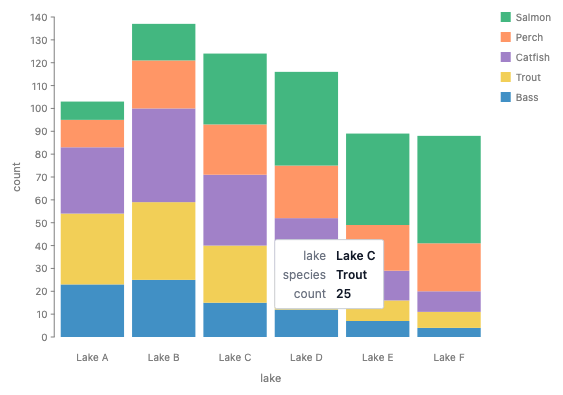

# Tooltips for GoFish

A proposal for issue #1395, a request for tooltips.

- Add `.tooltip()` to every mark and every operator.
- It is sugar for one more layer over the focused mark, the same construct as `.label()`.
- The box floats, so the chart never moves when it opens, and its content is ordinary GoFish.

**Recommendation:** build `.tooltip(content?, options?)` as a rewrite into a layer over the focus, and make that rewrite public as `.layer(fn)` on marks and operators, so third parties add modifiers as imported functions.

Every picture is a real capture of the prototype with the focused mark pinned, because the capture tool cannot hover. On the published page the examples are live: point at a mark, or tap one. To try the stories, run `pnpm storybook` and open the stories under "Proposals/Tooltips/". The Interactive variants respond to the mouse. The stories are in `packages/gofish-graphics/stories/_proposals/tooltips/`.

## Terms

- **tooltip:** a small box of details about one mark, shown while the pointer is on or near it.
- **focus:** the one mark, or group of marks, the pointer currently picks.
- **modifier:** a chained method on a mark or operator that adds something about it: `.name()`, `.label()`, and now `.tooltip()`.
- **layer:** one more chart drawn in the same coordinate space as the first.
- **floating:** drawn, but takes no room in the layout, so nothing else moves when it appears.

## Rule 1: a modifier is a rewrite

A modifier is sugar for one more layer over the thing it is attached to. `.label()` and `.tooltip()` are the same construct. A tooltip differs from a label in exactly three ways: it is drawn only for the focus, its box is floating, and its default content is a table of fields instead of one text.


The issue asked for this (Vega-Lite):


Proposed:

```js
chart(pathTypes)
  .flow(spread({ by: "path", dir: "y" }))
  .mark(rect({ w: "share" }).tooltip());
```

Proposed, what it means. The focus is a dataset of zero or one bar. `pointer().snap(selectAll(...))` is the spelling already chosen in #849 (hover that picks the nearest mark within a radius). Treating an input as a dataset is the direction of #830 (an interaction grammar). The inner spelling is a sketch. In a layer, an empty `chart()` already means the previous tier's marks, so the expansion may not need the name.

```js
// Sketch of the expansion. pointer().snap(...) is the spelling from #849.
chart(pathTypes)
  .flow(spread({ by: "path", dir: "y" }))
  .mark(rect({ w: "share" }).name("bars"))
  .layer(
    // the focus: zero or one bar
    chart(pointer().snap(selectAll("bars"))).mark((bar) =>
      label(table(bar.datum), { of: bar, position: Place.around() }).floating()
    )
  );
```

Runs today (prototype), story "Proposals/Tooltips/Issue Bar Chart":

```js
// helpers.ts: rowTooltip, beside, percent1, thousands
const format = { n: thousands, n_articles: thousands, share: percent1 };

chart(pathTypes, { w: 520, h: 400 })
  .flow(spread({ by: "path", dir: "y", spacing: 4 }))
  .mark(rect({ w: "share" }).name("bars"))
  .layer(
    chart(selectAll("bars"))
      .flow(
        filter((bar) => bar.datum[0].path === focus()),
        group({ by: "path" })
      )
      .mark((bar) =>
        beside(
          bar[0],
          rowTooltip(bar[0].datum[0], { format }),
          // the side is picked by hand from the datum
          bar[0].datum[0].share > 0.09
            ? { side: "bottom", align: "end", gap: 4 }
            : { side: "right" }
        )
      )
  );
```

**Fork: its own modifier, or an option of label.** The pick is `.tooltip()` as its own modifier, so each default fits its job. The alternative is hover as an option of label. It has one operator fewer, but one option would then flip three defaults at once: content, room, and which marks.

```js
rect({ w: "share" }).tooltip();
```

```js
rect({ w: "share" }).label(content, { on: pointer() });
```

## Rule 2: the signature

`.tooltip(content?, options?)` on any mark and on any operator. The content is a list or a function, so an object in first place is the options.

- **No argument:** one row per field with a single value on this mark. That is every field that is constant across the mark's rows, plus each field the mark draws, shown with its drawn value (a stacked segment's summed count). This joins Vega-Lite's "data" and "encoding" contents.
- **A list of fields:** order is row order. This form is plain data, so it serializes and works in Python and in the notebook widget with no Python callback.
- **A function from the rows to any mark:** the content is ordinary GoFish, so a chart in a tooltip needs nothing new. JavaScript only at first.
- **Options:** `by` groups the marks by a field and makes the group the focus. `radius` is how near counts, in pixels. `position` takes the same `Place` family and the same chooser that labels use, so the box stays inside the chart and flips sides. That chooser is a first-fit `choose` over sides (the choice and cost proposal, #486), so keeping the box inside needs no rule of its own, and a box can fall back to shorter content with the same operator: `.tooltip(choose([fullTable, shortTable]))`.

```js
// no argument: every field with a single value on this mark
rect({ w: "share" }).tooltip();

// a list of fields, in row order
rect({ w: "share" }).tooltip(["path", "n", field("share").format(percent)]);

// a function from the rows to any mark
rect({ w: "share" }).tooltip((rows) =>
  chart(rows).mark(text({ text: "path" }))
);

// options only
circle({ r: 3 }).tooltip({ by: "year", radius: 20, position: Place.around() });

// on an operator
spread({ by: "lake", dir: "x" }).tooltip();
```

```python
chart(path_types).flow(spread(by="path", dir="y")).mark(rect(w="share").tooltip())
rect(w="share").tooltip(["path", "n", field("share").format(percent)])
circle(r=3).tooltip(by="year")
```

A stacked segment, story "Proposals/Tooltips/Stacked Bar":



```js
chart(seafood)
  .flow(spread({ by: "lake", dir: "x" }), stack({ by: "species", dir: "y" }))
  .mark(rect({ h: "count", fill: "species" }).tooltip());
```

A chart in a tooltip, story "Proposals/Tooltips/Chart In Tooltip". The prototype renames `count` to `n` in the nested chart, because a nested chart shares the outer chart's scale for a field of the same name.


```js
chart(seafood)
  .flow(
    spread({ by: "lake", dir: "x" }).tooltip((rows) =>
      spread({ dir: "y", spacing: 6, alignment: "start" }, [
        text({ text: rows[0].lake, fontWeight: 700 }),
        chart(rows, { w: 200, h: 70 })
          .flow(spread({ by: "species", dir: "x", spacing: 6 }))
          .mark(rect({ h: "count", fill: "species" }).label("count")),
      ])
    ),
    stack({ by: "species", dir: "y" })
  )
  .mark(rect({ h: "count", fill: "species" }));
```

## Rule 3: the focus is one rule

The focus is the mark whose outline is nearest the pointer within `radius` pixels, where being inside a mark is distance zero. A bar is picked when the pointer is on it. A small point or a thin line is picked when the pointer is near it. There is no mode to switch. #849 sketches a rule per kind of space (distance to a point, distance to a polyline, membership in a band). This single rule is close to that one, and the two need to be reconciled. Compare Plot's `pointer` (a 40 px `maxRadius`), Vega-Lite's `nearest: true` (which does not work on lines), and Plotly's `hoverdistance`.

Story "Proposals/Tooltips/Scatter Nearest". The red cross is the pinned pointer. It is on no point, so the point nearest it within 30 pixels is the focus. The ring is one more layer over the focus.


```js
const X = "Flipper Length (mm)";
const Y = "Body Mass (g)";
const fields = ["Species", "Island", "Sex", X, Y, "Beak Length (mm)"];

chart(penguins)
  .flow(scatter({ x: X, y: Y }))
  .mark(circle({ r: 3, fill: "Species" }).tooltip(fields, { radius: 30 }));
```

## Rule 4: groups come from structure

A tooltip for a group comes from structure. There is no chart-wide mode.

**On an operator.** `spread({ by: "lake", dir: "x" }).tooltip()` is a tooltip for each lake's whole stack. Its default content is a title from the group's key, one row per child of the group, and a total. This needs operators to take `.name()`, which today only marks do (#802).


```js
chart(seafood)
  .flow(
    spread({ by: "lake", dir: "x" }).tooltip(),
    stack({ by: "species", dir: "y" })
  )
  .mark(rect({ h: "count", fill: "species" }));
```

**Fork: which form the docs lead with.** Both forms are kept, and they have the same expansion. The pick is the tooltip on the operator, because it names a group that already exists. The alternative is `by` on the mark, which works without #802.

```js
spread({ by: "lake", dir: "x" }).tooltip();
```

```js
rect({ h: "count", fill: "species" }).tooltip({ by: "lake" });
```

**With `by` on a mark.** `line(...).tooltip({ by: "year" })` groups the rows of every line by year, so the focus is the point of each series at one year. No node in the tree holds that group. This is the shared tooltip that Plotly calls `hovermode: "x unified"`, ECharts `trigger: "axis"`, and Highcharts `shared`. Observable Plot does not have it (its issue 2003 is open). Other libraries need a chart-wide mode for this because their tooltip belongs to one mark, and the points of every series at one year are many marks.

The rule and the dots are not tooltip options. They are two more ordinary layers over the same focus. Here the focus is a part of each line, its point at one year, and not a whole mark. The prototype still gets those points from an extra layer of invisible circles, because a line does not yet expose where it placed each row. Story "Proposals/Tooltips/Shared Line Tooltip":


```js
chart(yearly)
  .flow(group({ by: "series" }))
  .mark(
    line({ x: "year", y: "count", stroke: "series" }).tooltip({ by: "year" })
  );
```

```js
// The focus the tooltip uses, bound to a constant and reused.
// The rule and the dots are a sketch: two ordinary layers over it.
const hover = pointer().snap(selectAll("lines"), { by: "year" });

chart(yearly)
  .flow(group({ by: "series" }))
  .mark(
    line({ x: "year", y: "count", stroke: "series" })
      .name("lines")
      .tooltip({ by: "year" })
  )
  // the rule
  .layer(
    chart(hover)
      .flow(scatter({ by: "year", x: "year" }))
      .mark(rect({ w: 1, fill: "gray" }))
  )
  // the dots
  .layer(chart(hover).mark(circle({ r: 4, fill: "series", stroke: "white" })));
```

```python
line(x="year", y="count", stroke="series").tooltip(by="year")
```

## Rule 5: floating

The tooltip box is drawn, takes no room, and is not a pointer target. `.hidden()` already means "takes room, not drawn". `.floating()` is its counterpart. The engine has this today as a private flag, which the prototype sets by hand, so this names something that exists.

```js
mark.hidden(); // takes room, not drawn
mark.floating(); // drawn, takes no room, not a pointer target
```

```js
// helpers.ts, beside(): the private flag that .floating() would name
node.inkOn = [true, true];
```

With floating boxes, 0 of 45 elements move when two boxes open (left). When the boxes take room, the canvas grows from 471×353 to 497×437 and the plot moves down 84 px (right). Story "Proposals/Tooltips/Edge Cases".

 

Across the pinned stories, 0 elements move in five of six (60 to 398 elements each). In the shared-lines story 85 of 95 move by 0.75 px. The cause is an empty layer in the closed render, a library bug of its own.

## Rule 6: speed without a special tier

The tooltip is an ordinary subtree. Later, incremental layout (#674) re-lays-out only that subtree, and floating is what makes it a boundary, because its size never feeds back to its parent. Until then the pointer is split in two. Which mark is the focus re-runs layout. Where the pointer is does not. The default position is anchored to the mark, so nothing has to move between focus changes. Following the cursor would be one more `Place` strategy later.

| Sweep              | Pointer moves | Pointer read in the spec |              Focus split |
| ------------------ | ------------: | -----------------------: | -----------------------: |
| Issue bars, 3 bars |            30 |               30 re-runs |                3 re-runs |
| Lines              |            40 |               40 re-runs | 10 re-runs, one per year |

One re-run with the tooltip open costs 8.0 ms (issue bar chart), 10.9 ms (stacked bars) and 12.2 ms (4 series by 10 years). That is the median of 15 on an M-series Mac. The closed issue bar chart takes 4.6 ms.

```js
// helpers.ts: map the pointer to a key outside the spec, and write a
// signal only when the key changes. The spec reads only the signal.
export function focusFrom(read, init) {
  const focus = signal(init);
  let last = init;
  createRoot(() =>
    createEffect(() => {
      const k = read();
      if (k !== last) {
        last = k;
        focus.set(k);
      }
    })
  );
  return focus;
}

const p = pointer();
const focus = focusFrom(() => hitRow(p)?.path);
```

## Rule 7: static files and screen readers

The same content is also written as an SVG `<title>` on the mark. A saved SVG and a static Python export still show the browser's own tooltip, and screen readers announce it. Vega-Lite does the same with its ARIA description. Keyboard focus and touch are not designed here. An anchored box is what makes them possible later.

```html
<rect x="0" y="0" width="520" height="22">
  <title>path: VO→VO length: 2 n: 11,902 n_articles: 195 share: 13.0%</title>
</rect>
```

## Rule 8: number formats

The issue's screenshot shows `11,902` and `13.0%`. GoFish formats nothing today beyond `String()`. A tooltip value uses the same formatter as that field's axis ticks, and `field("share").format(...)` overrides it. Formatting needs its own short design, built on `Intl.NumberFormat`. This proposal only depends on it. The prototype carries its own formatters.

## Extending: method or imported function

The question: "I've heard that if we do method chaining and a third party is extending the methods then it will be a runtime error vs if we have a function people have to import then it will be a static error, but I'm not sure."

Partly right. The runtime errors come from patching a method onto marks after the fact. Chaining by itself is safe. The full output is in `research/extensible-modifiers.md`.

- A patched method with a separately declared type passes the type check and then throws `TypeError: rect(...).tooltip is not a function` in seven setups: another file imports the plugin but the entry never does; it is imported after the call runs; it is listed only in tsconfig `types`; `import type`; a dependency's types import it but its code does not; the plugin bundles its own copy of the library; the bundler drops it because the plugin says `"sideEffects": false`.
- Two plugins with the same method name merge silently, and the last loaded wins, even over a method the library adds later.
- An imported function gives `TS2304: Cannot find name 'tooltip'`, or a `SyntaxError` at link time in plain JavaScript.
- In Python, mypy and pyright reject a patched method even when it runs.
- GoFish marks cannot be patched at all today. A mark is a function, and each call re-attaches a fixed private list of methods.

**Recommended.** The extension point is a method that already exists by name. Marks and operators get `.layer(fn)`, where `fn` takes the selection of that mark and returns a chart. That is Rule 1 made public. A third-party modifier is then an imported function. It adds no new word: `layer` already means this on a chart.

```js
import { sparkTip } from "gofish-sparktip";

rect({ h: "count" }).layer(sparkTip({ field: "count" }));

// the built-ins are sugar over the same thing
rect({ h: "count" }).tooltip(); // ≡ .layer(tooltip())
rect({ h: "count" }).label("count"); // ≡ .layer(label("count"))
```

```python
from gofish_sparktip import spark_tip

rect(h="count").layer(spark_tip(field="count"))
```

```js
// Sketch of the package. A modifier is a function from the mark's
// selection to a chart. sparkline() stands for the package's own drawing.
export const sparkTip =
  ({ field }) =>
  (sel) =>
    chart(pointer().snap(sel)).mark((m) =>
      label(sparkline(m.datum, field), { of: m }).floating()
    );
```

- A missing import or a typo is a static error.
- Two packages cannot collide.
- Unused modifiers drop out of a bundle.
- A modifier that is a rewrite into existing constructs crosses to Python with no new serialized format. The research checked this: such a modifier serializes as its layer.

**Fork: `.layer(fn)` or `.pipe(fn)`.** The pick is `.layer(fn)`, a method that already exists and covers every modifier that is a layer. The runner-up is a general `.pipe(fn)` that takes any function from mark to mark, as in RxJS, Effect, pandas and polars. It also covers modifiers that are not layers, at the cost of a new method.

```js
rect({ h: "count" }).layer(sparkTip({ field: "count" }));
```

```js
rect({ h: "count" }).pipe(sparkTip({ field: "count" }));
```

**Rejected:** patching, for the failures above.

```js
import "gofish-sparktip"; // adds .sparkTip to every mark by patching

rect({ h: "count" }).sparkTip({ field: "count" });
```

What this changes:

- `api-design.md` says a method that reaches outward from a node, like `.label`, has no function twin. This recommendation gives `label` and `tooltip` function forms, so that rule would be restated.
- #615 (an internal API for registering modifiers) and #1291 (one table that drives every node modifier) ask for one internal table that defines each modifier once. That table is where the rewrite would live. It has no user-facing spelling.
- #803 (make `.label()` build the public layered form instead of a private one) is the label half of Rule 1. It must keep every label render unchanged.

## Approaches compared

| Approach                                                                               | Makes easy                                                      | Makes awkward                                                                                  |
| -------------------------------------------------------------------------------------- | --------------------------------------------------------------- | ---------------------------------------------------------------------------------------------- |
| A, recommended: a `.tooltip()` modifier defined by rewrite into a layer over the focus | One call for the common case. The long form is ordinary layers. | It needs `.layer(fn)` on marks, nameable operators and `.floating()`, none of which exist yet. |
| B, runner-up: hover as an option of `.label()`                                         | One construct fewer. It reuses label placement as it is.        | One option flips three defaults at once: content, room, and which marks.                       |
| C: no sugar, only the explicit layers (Plot's explicit form, Swift Charts)             | Nothing new to learn. It is A's expansion.                      | Too long for exploration. Altair's multi-series tooltip is five layers.                        |
| D, a foil: a chart-level trigger mode (ECharts, Plotly `hovermode`, Highcharts)        | A shared tooltip across series in one word.                     | It lists modes instead of composing them, and its content is a string template.                |

What would change the pick: if `.layer(fn)` on marks turns out not to be buildable on the label machinery, B becomes more attractive, because it reuses `.label()` as it is.

## Prior work

The details and sources are in `research/prior-work.md`. Observable Plot's `tip: true` is sugar for a tip mark plus a pointer transform, the closest precedent for Rule 1. Swift Charts arrives at the same split: a selection value, then an annotation on an ordinary mark. Vega-Lite treats the tooltip as a channel and nearest as a separate selection. ECharts, Plotly, Highcharts and Bokeh set one trigger mode for the whole chart.

The gaps every system leaves open:

- Shared across series: Plot has none (its issue 2003). Vega-Lite needs a pivot and a rule layer.
- Group totals: in Plot the total of a stack is not reachable (its issue 1975).
- Geometry that is not a point: Plot's pointer understands only points.
- A chart in a tooltip: Plot and Plotly have none. Tableau shows a static image.
- Keyboard and touch: Tableau tooltips are hover only. React Aria shows none on touch.

## Findings

| Finding                                                                            | What it means                                                                                                            | Issue                     |
| ---------------------------------------------------------------------------------- | ------------------------------------------------------------------------------------------------------------------------ | ------------------------- |
| There is no way to name an operator's group.                                       | The whole-stack tooltip uses an outline of the segments as a stand-in.                                                   | #802                      |
| Nearest within a radius needs a data-to-pixel map on the pointer.                  | The prototype estimates pixel distance from the chart size.                                                              | #849                      |
| An input cannot be a chart's dataset yet.                                          | The focus is computed outside the spec.                                                                                  | #830                      |
| Node ids change on every re-run.                                                   | The focus is compared by key.                                                                                            | #673                      |
| Every pointer move re-runs layout unless split by hand.                            | The prototype splits focus from position by hand.                                                                        | #674 is the long-term fix |
| Hover cannot be captured for visual tests.                                         | The pictures pin the focus.                                                                                              | #672                      |
| `pointer().dataPos()` is undefined when the chart sets its own `w`/`h`.            | The interactive line and scatter stories size the render instead.                                                        | unfiled                   |
| A layer with no marks moves the plot.                                              | 0.75 px in the closed line story, and the x axis by 46 px in a render-sized chart.                                       | unfiled                   |
| Nothing sets `pointer-events`.                                                     | A box under the cursor steals the hit and flickers.                                                                      | unfiled                   |
| A chart nested in a tooltip shares the outer chart's scale for a same-named field. | The nested chart renames `count` to `n`.                                                                                 | unfiled                   |
| A relational mark paints under the marks it references.                            | The box needed `.zOrder(1)`.                                                                                             | unfiled                   |
| `filter` with no match still calls the mark with an empty list.                    | Each story adds a `group` after the filter.                                                                              | unfiled                   |
| There is no number formatting.                                                     | The helpers carry their own formatters.                                                                                  | unfiled                   |
| The box's side is picked by hand.                                                  | A first-fit `choose` over sides should pick it, as the label chooser does. This is a declared shortcut in the prototype. | unfiled                   |

Related issues:

- #1395: the request for tooltips.
- #802: operators cannot take `.name()`, which blocks selecting a group.
- #803: build `.label()` from the public selection machinery instead of a private layer.
- #830: an interaction grammar where an input is a dataset.
- #849: hover on thin marks needs nearest-within-radius picking, spelled `pointer().snap(...)`.
- #673: stable identity for scopes and marks across re-runs.
- #674: incremental layout, re-running only what changed.
- #672: scripted interaction states in the capture harness.
- #615: an internal API for registering chained modifiers.
- #1291: one table of node modifiers drives the builder, serialization and types.
- #641: emphasis and highlight on hover from one declaration.
- #1294: declarative dragging derived from the layout's structure.
- #1101: one extensibility model for strategy families such as custom curves.
- #649: axes and legends as modifiers.

## Not prototyped

- `.layer(fn)` on a mark
- `.name()` on an operator
- `.floating()`
- `pointer().snap()`
