# Tooltips for GoFish

A proposal for issue #1395, a request for tooltips.

- Add `.tooltip()` to every mark and every operator.
- It is sugar for one more layer over the focused mark, the same construct as `.label()`.
- The box floats, so the chart never moves when it opens, and its content is ordinary GoFish.
- Version 1 (draft PR #1401) builds `.tooltip()` and `.tooltip([fields])` on marks, in JS and Python, and a public `.name()` on operators. Everything else here is proposed.

**Recommendation:** build `.tooltip(content?, options?)` as a rewrite into a layer over the focus, and make that rewrite public as `.layer(fn)` on marks and operators, so third parties add modifiers as imported functions.

Every picture is a real capture of the prototype with the focused mark pinned, because the capture tool cannot hover. On the published page the examples are live: point at a mark, or tap one. To try the stories, run `pnpm storybook` and open the stories under "Proposals/Tooltips/". The Interactive variants respond to the mouse. The stories are in `packages/gofish-graphics/stories/_proposals/tooltips/`.

## Terms

- **tooltip:** a small box of details about one mark, shown while the pointer is on or near it.
- **focus:** the one mark, or group of marks, the pointer currently picks.
- **modifier:** a chained method on a mark or operator that adds something about it: `.name()`, `.label()`, and now `.tooltip()`.
- **layer:** one more chart drawn in the same coordinate space as the first.
- **floating:** drawn, but takes no room in the layout, so nothing else moves when it appears.

## Rule 1: a modifier is a rewrite

A modifier is sugar for one more layer over the thing it is attached to. `.label()` and `.tooltip()` are the same construct. A tooltip differs from a label in exactly three ways: it is drawn only for the focus, its box is floating, and its default content is a table of fields instead of one text.

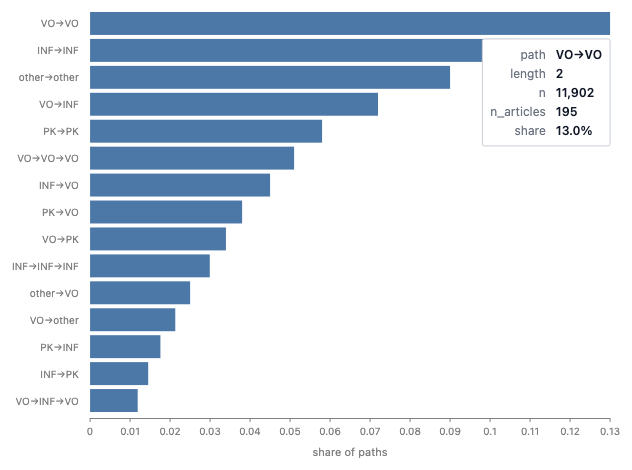

The issue asked for this (Vega-Lite):

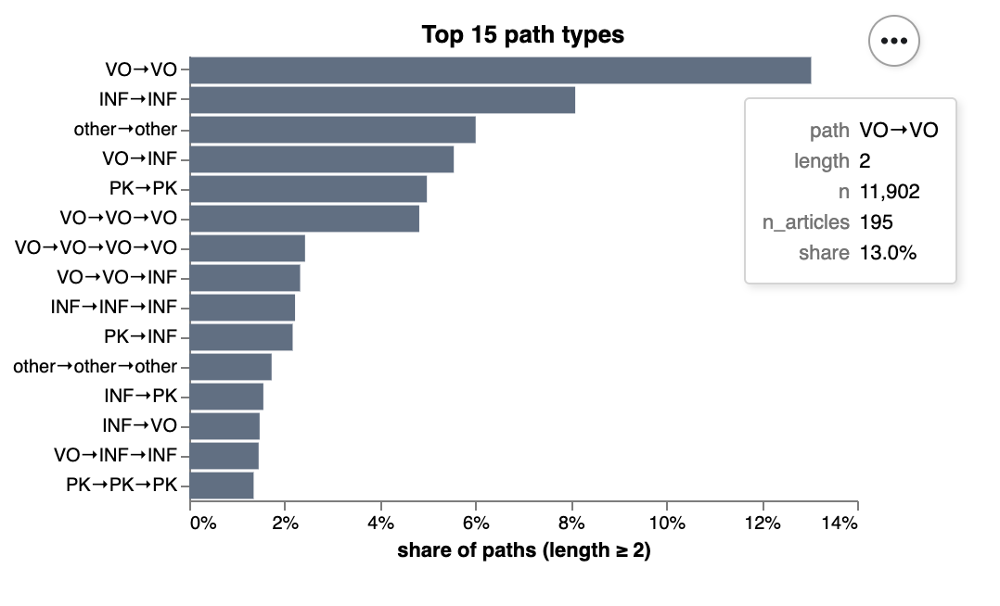

Proposed:

```js
chart(pathTypes)
  .flow(spread({ by: "path", dir: "y" }))
  .mark(rect({ w: "share" }).tooltip());
```

Proposed, what it means. The focus is a dataset of zero or one bar. `pointer().snap(selectAll(...))` is the spelling already chosen in #849 (hover that picks the nearest mark within a radius). Treating an input as a dataset is the direction of #830 (an interaction grammar). The inner spelling is a sketch. In a layer, an empty `chart()` already means the previous tier's marks, so the expansion may not need the name.

```js
// Sketch of the expansion. pointer().snap(...) is the spelling from #849.
chart(pathTypes)
  .flow(spread({ by: "path", dir: "y" }))
  .mark(rect({ w: "share" }).name("bars"))
  .layer(
    // the focus: zero or one bar
    chart(pointer().snap(selectAll("bars"))).mark((bar) =>
      label(table(bar.datum), { of: bar, position: Place.around() }).floating()
    )
  );
```

Runs today (prototype), story "Proposals/Tooltips/Issue Bar Chart":

```js
// helpers.ts: rowTooltip, beside, percent1, thousands
const format = { n: thousands, n_articles: thousands, share: percent1 };

chart(pathTypes, { w: 520, h: 400 })
  .flow(spread({ by: "path", dir: "y", spacing: 4 }))
  .mark(rect({ w: "share" }).name("bars"))
  .layer(
    chart(selectAll("bars"))
      .flow(
        filter((bar) => bar.datum[0].path === focus()),
        group({ by: "path" })
      )
      .mark((bar) =>
        beside(
          bar[0],
          rowTooltip(bar[0].datum[0], { format }),
          // the side is picked by hand from the datum
          bar[0].datum[0].share > 0.09
            ? { side: "bottom", align: "end", gap: 4 }
            : { side: "right" }
        )
      )
  );
```

**Fork: its own modifier, or an option of label.** The pick is `.tooltip()` as its own modifier, so each default fits its job. The alternative is hover as an option of label. It has one operator fewer, but one option would then flip three defaults at once: content, room, and which marks.

```js
rect({ w: "share" }).tooltip();
```

```js
rect({ w: "share" }).label(content, { on: pointer() });
```

## Rule 2: the signature

`.tooltip(content?, options?)` on any mark and on any operator. The content is a list or a function, so an object in first place is the options.

- **No argument:** one row per field with a single value on this mark. That is every field that is constant across the mark's rows, plus each field the mark draws, shown with its drawn value (a stacked segment's summed count). This joins Vega-Lite's "data" and "encoding" contents.
- **A list of fields:** order is row order. This form is plain data, so it serializes and works in Python and in the notebook widget with no Python callback.
- **A function from the rows to any mark:** the content is ordinary GoFish, so a chart in a tooltip needs nothing new. JavaScript only at first.
- **Options:** `by` groups the marks by a field and makes the group the focus. `radius` is the reach: how far from a mark's outline the pointer may be, in pixels (16 by default). `position` takes the same `Place` family and the same chooser that labels use, so the box stays inside the chart and flips sides. That chooser is a first-fit `choose` over sides (the choice and cost proposal, #486), so keeping the box inside needs no rule of its own, and a box can fall back to shorter content with the same operator: `.tooltip(choose([fullTable, shortTable]))`.

```js
// no argument: every field with a single value on this mark
rect({ w: "share" }).tooltip();

// a list of fields, in row order
rect({ w: "share" }).tooltip(["path", "n", field("share").format(percent)]);

// a function from the rows to any mark
rect({ w: "share" }).tooltip((rows) =>
  chart(rows).mark(text({ text: "path" }))
);

// options only
circle({ r: 3 }).tooltip({ by: "year", radius: 20, position: Place.around() });

// on an operator
spread({ by: "lake", dir: "x" }).tooltip();
```

```python
chart(path_types).flow(spread(by="path", dir="y")).mark(rect(w="share").tooltip())
rect(w="share").tooltip(["path", "n", field("share").format(percent)])
circle(r=3).tooltip(by="year")
```

A stacked segment, story "Proposals/Tooltips/Stacked Bar":


```js
chart(seafood)
  .flow(spread({ by: "lake", dir: "x" }), stack({ by: "species", dir: "y" }))
  .mark(rect({ h: "count", fill: "species" }).tooltip());
```

A chart in a tooltip, story "Proposals/Tooltips/Chart In Tooltip". The prototype renames `count` to `n` in the nested chart, because a nested chart shares the outer chart's scale for a field of the same name.

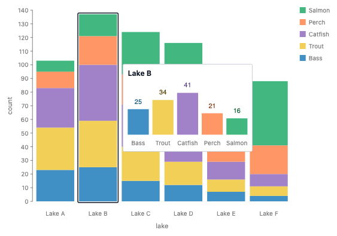

```js
chart(seafood)
  .flow(
    spread({ by: "lake", dir: "x" }).tooltip((rows) =>
      spread({ dir: "y", spacing: 6, alignment: "start" }, [
        text({ text: rows[0].lake, fontWeight: 700 }),
        chart(rows, { w: 200, h: 70 })
          .flow(spread({ by: "species", dir: "x", spacing: 6 }))
          .mark(rect({ h: "count", fill: "species" }).label("count")),
      ])
    ),
    stack({ by: "species", dir: "y" })
  )
  .mark(rect({ h: "count", fill: "species" }));
```

## Rule 3: the focus is one rule

One rule, among the marks the tooltip is on: reach first, then position. Only the marks drawn within 16 px of the pointer count, measured to each mark's outline. The current focus counts out to 20 px. Of those, a mark the pointer is inside wins, the one on top where marks overlap. Otherwise the focus is the mark nearest by position. A mark's position is where the layout put it, and its size does not count. So bars in a column are told apart by row, and a gap between two bars picks the nearer one. The current focus has a 4 px head start, so it does not flip back and forth at a boundary. With no mark in reach there is no focus and no box. There is no mode to switch.

So a donut's hole and a wide gap between bars show no box. The earlier rule measured to the convex hull of all the marks, which covers both.

A line drawn through rows has a point per row. After a line is chosen, the focus snaps to its point nearest the pointer, with the same 4 px head start, and a marker is drawn on that point. Reach is measured to the line's path, so moving along the line between rows keeps the box. A line drawn from a function, or one connecting other marks, has no rows, and gets one box for the whole line.

Written out, the rule is one line of user code (next section). The second form is the default; on a mark with no rows to snap to, `.snap(4)` changes nothing.

```js
Focus.first([Focus.hit(), Focus.closest({ stickiness: 4 })]).within(16);

Focus.first([Focus.hit(), Focus.closest({ stickiness: 4 })])
  .within(16)
  .snap(4);
```

The `radius` option is short for the same behavior with another reach, so `radius: 30` is `.within(30)`.

The box is one per chart: the marks of every `.tooltip()` in a chart are candidates together. It is no pointer target, so a mark under it is reached as if it were not there, and over the box with no mark in reach it closes. On a touch screen a tap opens it, and it stays open until the next tap. It sits right of the mark, else left of it, centered on its row; else under or over it, flush with its end; else it is moved inside the chart. This is what version 1 builds.

In Declarative Dragging (#1294) each reachable state is one point. The drag follows the nearest point, with a head start for the current one. This rule is that one, with a mark's placed position as its point, plus the direct hit, which dragging does not need, plus the reach, which narrows the marks before the nearest is picked.

#849 sketches a rule per kind of space (distance to a point, distance to a polyline, membership in a band). A candidate's `position` leaves out an axis where the mark only has a size, so the distance to a bar in a row is its distance in y. That is the dispatch on the kind of space, carried as data. Compare Plot's `pointer` (a 40 px `maxRadius`), Vega-Lite's `nearest: true` (which does not work on lines), and Plotly's `hoverdistance`.

Story "Proposals/Tooltips/Scatter Nearest". The red cross is the pinned pointer. It is on no point, so the point nearest it, among the points within 30 pixels, is the focus. The reach is wider than the default 16 because the points are small. The ring is one more layer over the focus.

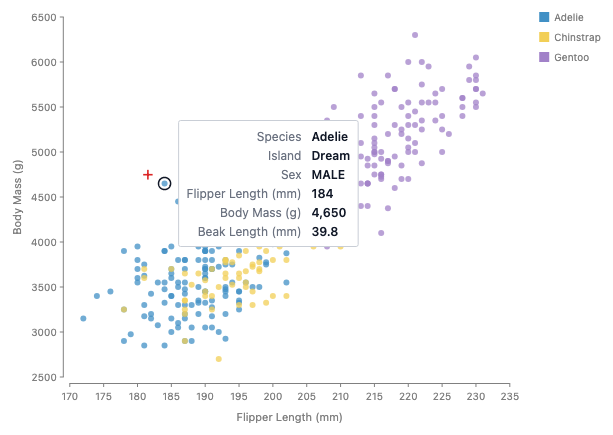

```js
const X = "Flipper Length (mm)";
const Y = "Body Mass (g)";
const fields = ["Species", "Island", "Sex", X, Y, "Beak Length (mm)"];

chart(penguins)
  .flow(scatter({ x: X, y: Y }))
  .mark(circle({ r: 3, fill: "Species" }).tooltip(fields, { radius: 30 }));
```

Story "Proposals/Tooltips/Donut". A filled shape is a region, so a pointer inside a wedge picks it. The hole is near no wedge, so it shows no box. The prototype places the box by hand, right of the ring and level with the wedge's middle, because a `ref` to a wedge has its box in the clock space, not on screen.

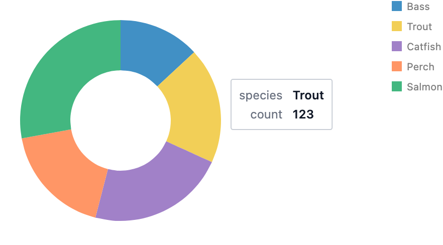

```js
chart(seafood, { coord: Coord.clock() })
  .flow(stack({ by: "species", dir: "x", y: 50, h: 50 }))
  .mark(rect({ w: "count", fill: "species" }).tooltip(["species", "count"]));
```

```python
chart(seafood, coord=Coord.clock()).flow(
    stack(by="species", dir="x", y=50, h=50)
).mark(rect(w="count", fill="species").tooltip(["species", "count"]))
```

## Focus behaviors in user space

The focus rule is user code. A focus behavior is a plain function: it gets a frame and returns a mark, or nothing. The `Focus` family holds the built-in behaviors, and a user function works anywhere a behavior is an argument. The prototype's version is `stories/_proposals/tooltips/focus.ts`, pure functions with no DOM and no GoFish internals. Version 1 runs the default behavior inside `.tooltip()`; `Focus` is internal there and not exported, so this section is proposed.

```ts
type Candidate = {
  key: unknown; // stable across re-runs (#673)
  datum: unknown[]; // the mark's rows
  box: Box; // the drawn box
  position: { x?: number; y?: number }; // where the layout placed it
  outline: Outline; // what it is drawn as
  points?: Candidate[]; // a line's rows, each at its drawn point
};

// A part is a box, a circle (a round box), a segment of a stroked path,
// or a region, a filled path given by the segments of its edge.
type Outline = {
  box: Box;
  round: boolean;
  segment?: [Point, Point];
  region?: [Point, Point][];
}[];

type Frame = {
  pointer: Point | undefined; // undefined off the chart
  candidates: Candidate[];
  current: Candidate | undefined; // what the last frame chose
  clicked: boolean; // true on the frame of a click
};

type FocusBehavior = (frame: Frame) => Candidate | undefined;
```

A candidate's `position` leaves out an axis where the mark only has a size. A line has no position, so it is as near as its path. A behavior keeps no memory of its own: the runtime remembers the last choice and passes it as `current`, and the head start and the wider reach of the current focus both read it.

A call starts a behavior or joins several independent ones, and a chained method transforms the one behavior it is called on. So the rule reads in the order it is said:

```js
Focus.first([Focus.hit(), Focus.closest({ stickiness: 4 })])
  .within(16)
  .snap(4);
```

| Member                                      | What it picks                                                                                                                                                                                                                            | Dragology                                                                                                                                          |
| ------------------------------------------- | ---------------------------------------------------------------------------------------------------------------------------------------------------------------------------------------------------------------------------------------- | -------------------------------------------------------------------------------------------------------------------------------------------------- |
| `Focus.hit()`                               | The mark the pointer is inside, the one on top where marks overlap.                                                                                                                                                                      | None. A drag has no direct hit.                                                                                                                    |
| `Focus.closest({ to, stickiness, radius })` | The nearest candidate, measured to its `position` (the default), its `center` or its `outline`. A candidate with no position is measured to its outline. The current focus gets `stickiness` px of head start. Nothing past `radius` px. | `d.closest(states, { stickiness })` over `d.fixed` states                                                                                          |
| `Focus.first([a, b, ...])`                  | What the first behavior that picks a mark picks.                                                                                                                                                                                         | None. `d.closest` over behaviors picks the one with the lowest gap instead.                                                                        |
| `.within(reach)`                            | The same, run only on the marks whose outline is within `reach` px of the pointer, and the current focus out to `reach + 4`. With none, nothing.                                                                                         | `.whenFar(other, { gapIn, gapOut })`, turned around. It limits the gap to the target the behavior chose. Here the reach narrows the targets first. |
| `.snap(stickiness)`                         | Then, on a line drawn through rows, its point nearest the pointer, with a head start for the current point.                                                                                                                              | `d.closest` over the line's rows                                                                                                                   |
| `.onClick()`                                | The same, but only on a click. Between clicks the focus stays.                                                                                                                                                                           | None.                                                                                                                                              |
| `Focus.from(fn)`                            | What `fn` picks, with the chained methods.                                                                                                                                                                                               | `d.custom(fn)`                                                                                                                                     |

Another name for `.within(16)` is `.near(16)`, if `.within` stays the region clamp of #830. The two do different things: the clamp keeps a value inside a region, and this step keeps only the marks near the pointer. Third parties add behaviors as functions that a user imports and passes as an argument, never as new methods, so the patching problem of the Extending section does not come back.

Fork: how to say "try these in order". Pick `Focus.first([...])`: it depends on no proposal that is not signed off. The other option is `choose([Focus.hit(), Focus.closest({ stickiness: 4 })]).within(16)`. The choice and cost proposal (#486) makes `choose` take the first fit in list order by default, which is this rule. If it lands, one operator says "try these in order" in layout, in placement and in focus.

The same value plugs in at two places. The sugar is `.tooltip({ focus })`. The explicit form is `pointer().snap(selection, { focus })`, a dataset of zero or one mark that any layer reads, and it changes only when the chosen key changes. So layout re-runs once per new focus, not once per pointer move. In the shared-lines example the box, the rule and the dots read the same focus:

```js
const focus = Focus.first([
  Focus.hit(),
  Focus.closest({ stickiness: 4 }),
]).within(16);

line({ x: "year", y: "count", stroke: "series" }).tooltip({
  by: "year",
  focus,
});

const hover = pointer().snap(selectAll("lines"), { by: "year", focus });
chart(yearly)
  .flow(group({ by: "series" }))
  .mark(line({ x: "year", y: "count", stroke: "series" }).name("lines"))
  .layer(
    chart(hover)
      .flow(scatter({ by: "year", x: "year" }))
      .mark(rect({ w: 1, fill: "gray" }))
  )
  .layer(chart(hover).mark(circle({ r: 4, fill: "series", stroke: "white" })));
```

The live switcher on the page runs seven behaviors on three charts: the issue's bars, 4 px apart; five bars 60 px apart; and the donut. Six behaviors are one to three lines. The fifth is the earlier default, a plain function `hullLimit` in the switcher's story file, on while the pointer is within 8 px of the convex hull of the marks. The seventh is a plain function of five lines, the mark with the largest share within 60 px, used as `.tooltip({ focus: largestNear })`, as an argument (`Focus.first([Focus.hit(), largestNear])`) or lifted to chain (`Focus.from(largestNear).within(16)`). What each picked under the real mouse:

| Behavior                                     | 1 px under INF→VO | INF→PK's row, 14 px past its end | 70 px past INF→PK | middle of a 60 px gap | donut hole | 5 px into the hole |
| -------------------------------------------- | ----------------- | -------------------------------- | ----------------- | --------------------- | ---------- | ------------------ |
| Default                                      | INF→VO            | INF→PK                           | none              | none                  | none       | Bass               |
| Hit only                                     | none              | none                             | none              | none                  | none       | none               |
| Closest center, 40 px                        | PK→VO             | none                             | none              | none                  | none       | none               |
| Closest outline, `.within(16)`               | INF→VO            | PK→INF                           | none              | none                  | none       | Bass               |
| Earlier default, hull limit                  | INF→VO            | INF→PK                           | none              | other→other           | Salmon     | Bass               |
| A plain function, largest share within 60 px | PK→PK             | VO→other                         | PK→INF            | INF→INF               | Bass       | Bass               |

Each point was approached from off the chart. Click to pin picks what the default picks, on a click: a click on INF→VO pins it, and it stays through moves, leaving the chart and a click in a gap next to it. A click 70 px right of INF→PK clears it. Sweeping down across four bars, hit only closes in each 4 px gap and the default never closes.
| A plain function, largest share within 60 px | PK→PK | VO→other | a bar within 60 px | INF→INF | Bass | Bass |

### Show regions

Every live chart on the page has a **Show regions** box under it. It tints, for every place the pointer could be, the mark the current behavior would pick there, with the current focus stronger and the borders it would have with no focus dashed. The marks stay untinted. It also draws each mark's reach, the 16 px band around its outline, and the current focus's 20 px reach dashed. It draws what the behavior measures to, and a line from the pointer to the measured point. The regions are found by running the behavior at every point of a 3 px grid, so they are right for any behavior, a plain function included. The idea and the look are from Dragology's overlay visualizer, which draws each drag operator's targets over the running demo.

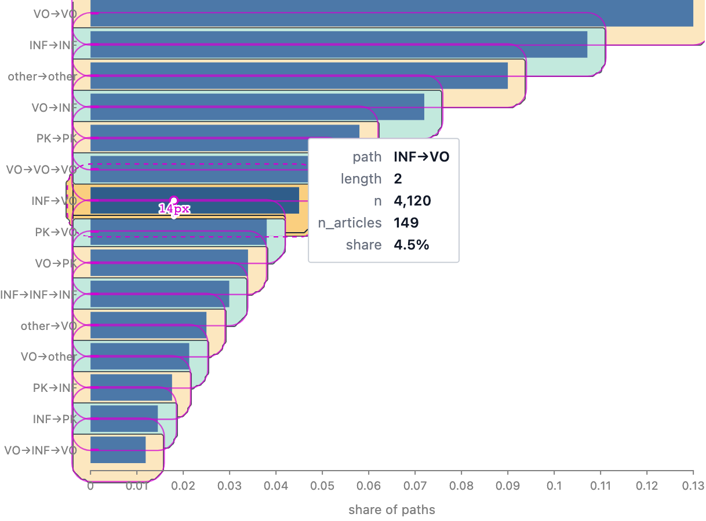

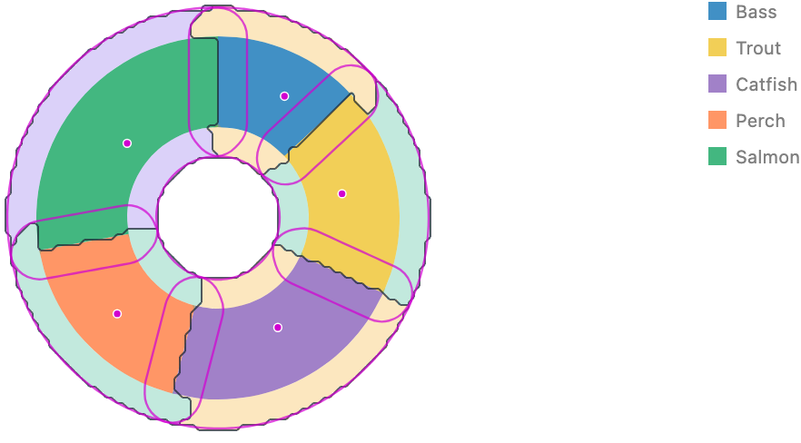

### What the runtime must provide

The behaviors are user code today. The runtime around them is not. The prototype does each piece by hand in `focusRuntime.ts`. Version 1 builds each piece inside the library for `.tooltip()`, but none is public yet. With these public, `focusRuntime.ts` is one call to `pointer().snap`.

| Piece                                          | The prototype, by hand                                                                                                                                      | Public API that replaces it                                                                             | Issue |
| ---------------------------------------------- | ----------------------------------------------------------------------------------------------------------------------------------------------------------- | ------------------------------------------------------------------------------------------------------- | ----- |
| Candidates                                     | Picks the drawn SVG elements with a CSS selector and a count, measures their boxes, reads their rows from the chart's private id-to-item map.               | `snap(selectAll(name))` builds candidates from the layout frame, which already records each node's box. | #830  |
| Outlines                                       | Reads each element's shape: a rect is a box, an ellipse is round, a stroked path is its segments, a filled path is a region. A curve is sampled every 4 px. | The display item's outline, which the runtime already has (its box and a path's `d`).                   |       |
| A line's rows                                  | Draws a circle per row with the same `scatter` as the line, hidden except the focused one, and reads the points off them.                                   | The line records where it drew each row. Version 1 does this inside the library.                        |       |
| Placed position                                | Each story passes the axes that place its marks, such as `position: ["y"]`.                                                                                 | The layout reports where it placed each mark and on which axes.                                         | #849  |
| Stable key                                     | Each story passes a key function. Marks with one key are one candidate (a stack, a year).                                                                   | Keys from spec position and data key.                                                                   | #673  |
| The current focus, and re-running on a new key | Keeps the chosen key in a `signal`, set only when it changes, and finds `current` by key in each new frame, among the candidates and their points.          | The result of `snap` changes only when its key changes.                                                 | #830  |
| The pointer                                    | Listens on the container and converts to SVG pixels. A tap holds the pointer until the next tap.                                                            | `pointer()` as the frame's pointer, holding a tap on touch.                                             |       |
| The click                                      | A DOM `click` listener sets `clicked`.                                                                                                                      | A click in the frame. `click()` today counts only a press and release on one mark.                      | #830  |
| The box out of the pointer's way               | CSS that finds the box by its stroke color and sets `pointer-events: none`.                                                                                 | A floating layer is never a pointer target.                                                             |       |
| Registering the pointer                        | A `live()` channel reads `ping()`, so the chart builds its id-to-item map.                                                                                  | `snap` registers its input itself.                                                                      | #830  |
| Reading the frame, for a tool                  | `inspect(container)` hands Show regions the candidates, the current focus, the last pointer and result, and a call after each frame.                        | The input's frame and result are data that any code can read.                                           | #830  |

One hook of the first prototype is gone: re-targeting each pointer event to the focused mark's element. The adapter now writes the focus directly.

### Compared with Dragology

Dragology's behavior is `(frame: DragFrame) => DragResult`, with a frame of only `{ pointer }` and a result that carries a preview, a drop state and a `gap`, the pointer's distance to where the behavior puts the grab point (`src/DragBehavior.tsx`). A focus behavior keeps the shape of a function from a frame, and returns the mark it chose, or nothing. Four things differ.

- A hover has no grab point, so a mark contributes its placed position and its outline.
- A direct hit exists.
- How near counts. Dragology's `whenFar` compares the gap of the target it chose. `within` drops the marks out of reach before the behavior chooses, because the mark nearest by position can be far from the pointer while another mark is near it.
- A behavior keeps no memory. Dragology keeps memory in an operator object built fresh for each drag (`closest` keeps `lastBest`, `whenFar` keeps `inForeground`), while a hover has no start and end to build one for, so the runtime passes `current`.

Dragology already spells composition this way. `d.closest(states, { stickiness: 4 }).whenFar(d.fixed(start), { gapIn: 8, gapOut: 12 })` is a call over a list, then a chained method. The focus family keeps that rule.

Dragology also has two ways to follow the pointer. `d.closest` snaps to one of several states, and `d.between` moves continuously between them. `.snap` is the first: it picks one row of a line. A line drawn from a function has no rows, so version 1 shows one box for the whole line. The right box there shows the function's value at the pointer, which is `d.between`. It needs content that changes on every pointer move without a re-run of the layout, so it is a follow-up. A sketch:

```js
// The point of the line nearest the pointer, anywhere along it, and the
// function's value there.
line({ x: "t", y: (t) => Math.sin(t) }).tooltip({
  focus: Focus.first([Focus.hit(), Focus.closest()]).within(16).between(),
});
```

The same frame could later serve dragging. There the candidates are the reachable states, each with the position the layout gives the dragged mark in that state, and the gap means what it means in Dragology. A drag also needs a preview and a drop state, which a hover does not.

## Rule 4: groups come from structure

A tooltip for a group comes from structure. There is no chart-wide mode.

**On an operator.** `spread({ by: "lake", dir: "x" }).tooltip()` is a tooltip for each lake's whole stack. Its default content is a title from the group's key, one row per child of the group, and a total. This needs operators to take `.name()`, which on main only marks do (#802). Version 1 adds it.

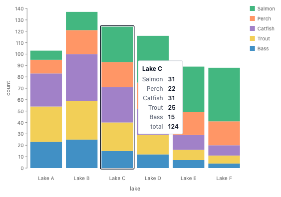

```js
chart(seafood)
  .flow(
    spread({ by: "lake", dir: "x" }).tooltip(),
    stack({ by: "species", dir: "y" })
  )
  .mark(rect({ h: "count", fill: "species" }));
```

**Fork: which form the docs lead with.** Both forms are kept, and they have the same expansion. The pick is the tooltip on the operator, because it names a group that already exists. The alternative is `by` on the mark, which works without #802.

```js
spread({ by: "lake", dir: "x" }).tooltip();
```

```js
rect({ h: "count", fill: "species" }).tooltip({ by: "lake" });
```

**A line, one row.** With no `by`, a line drawn through rows snaps to its row nearest the pointer (Rule 3). The box shows that row, and a marker sits on its point. This is built in version 1. Story "Proposals/Tooltips/Shared Line Tooltip", Pinned Row; live on the page:

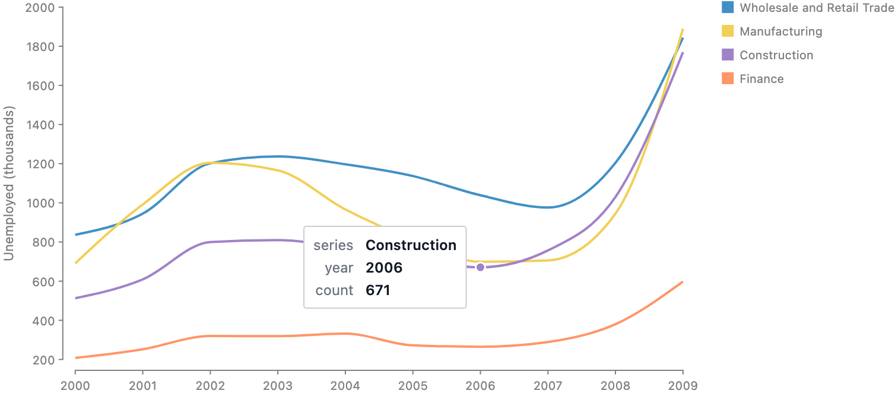

```js
chart(yearly)
  .flow(group({ by: "series" }))
  .mark(line({ x: "year", y: "count", stroke: "series" }).tooltip());
```

```python
chart(yearly).flow(group(by="series")).mark(
    line(x="year", y="count", stroke="series").tooltip()
)
```

The prototype draws a circle per row with the same `scatter` as the line, hidden except the focused one, because a line does not expose where it drew each row.

**With `by` on a mark.** One box for every series at the nearest year is proposed, not built. `line(...).tooltip({ by: "year" })` groups the rows of every line by year, so the focus is the point of each series at one year. No node in the tree holds that group. This is the shared tooltip that Plotly calls `hovermode: "x unified"`, ECharts `trigger: "axis"`, and Highcharts `shared`. Observable Plot does not have it (its issue 2003 is open). Other libraries need a chart-wide mode for this because their tooltip belongs to one mark, and the points of every series at one year are many marks.

The rule and the dots are not tooltip options. They are two more ordinary layers over the same focus. Here the focus is a part of each line, its point at one year, and not a whole mark. The prototype still gets those points from an extra layer of invisible circles, because a line does not yet expose where it placed each row. Story "Proposals/Tooltips/Shared Line Tooltip":

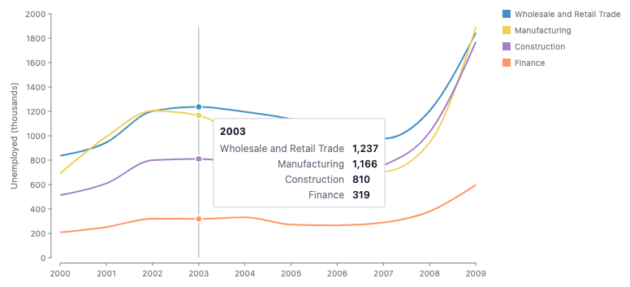

```js
chart(yearly)
  .flow(group({ by: "series" }))
  .mark(
    line({ x: "year", y: "count", stroke: "series" }).tooltip({ by: "year" })
  );
```

```js
// The focus the tooltip uses, bound to a constant and reused.
// The rule and the dots are a sketch: two ordinary layers over it.
const hover = pointer().snap(selectAll("lines"), { by: "year" });

chart(yearly)
  .flow(group({ by: "series" }))
  .mark(
    line({ x: "year", y: "count", stroke: "series" })
      .name("lines")
      .tooltip({ by: "year" })
  )
  // the rule
  .layer(
    chart(hover)
      .flow(scatter({ by: "year", x: "year" }))
      .mark(rect({ w: 1, fill: "gray" }))
  )
  // the dots
  .layer(chart(hover).mark(circle({ r: 4, fill: "series", stroke: "white" })));
```

```python
line(x="year", y="count", stroke="series").tooltip(by="year")
```

## Rule 5: floating

The tooltip box is drawn, takes no room, and is not a pointer target. `.hidden()` already means "takes room, not drawn". `.floating()` is its counterpart. The engine has this today as a private flag, which the prototype sets by hand, so this names something that exists.

```js
mark.hidden(); // takes room, not drawn
mark.floating(); // drawn, takes no room, not a pointer target
```

```js
// helpers.ts, beside(): the private flag that .floating() would name
node.inkOn = [true, true];
```

With floating boxes, 0 of 45 elements move when two boxes open (left). When the boxes take room, the canvas grows from 471×353 to 497×437 and the plot moves down 84 px (right). Story "Proposals/Tooltips/Edge Cases".

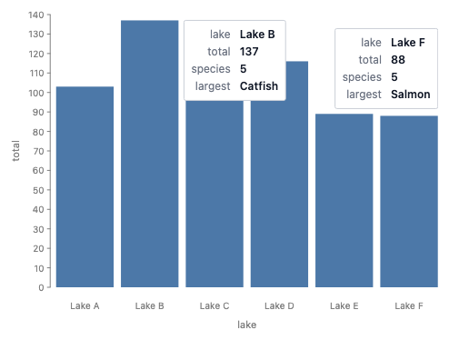 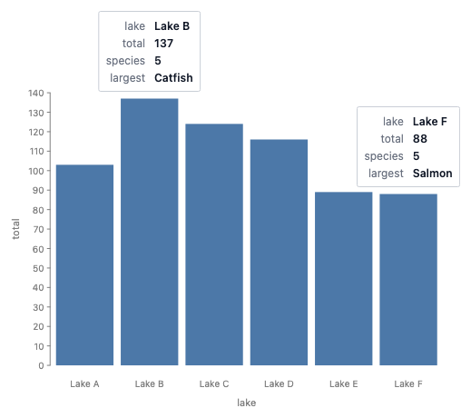

Across the pinned stories, 0 elements move in five of six (60 to 398 elements each). In the shared-lines story 85 of 95 move by 0.75 px. The cause is an empty layer in the closed render, a library bug of its own. The one-box-for-the-year story now always draws its rule and hides it with no focus. The live one-row demo still moves its lines by 0.75 px when the box opens, because the box's layer is empty while it is closed.

## Rule 6: speed without a special tier

The tooltip is an ordinary subtree. Later, incremental layout (#674) re-lays-out only that subtree, and floating is what makes it a boundary, because its size never feeds back to its parent. Until then the pointer is split in two. Which mark is the focus re-runs layout. Where the pointer is does not. The default position is anchored to the mark, so nothing has to move between focus changes. Following the cursor would be one more `Place` strategy later.

| Sweep              | Pointer moves | Pointer read in the spec |              Focus split |
| ------------------ | ------------: | -----------------------: | -----------------------: |
| Issue bars, 3 bars |            30 |               30 re-runs |                3 re-runs |
| Lines              |            40 |               40 re-runs | 10 re-runs, one per year |

One re-run with the tooltip open costs 8.0 ms (issue bar chart), 10.9 ms (stacked bars) and 12.2 ms (4 series by 10 years). That is the median of 15 on an M-series Mac. The closed issue bar chart takes 4.6 ms.

```js
// helpers.ts: map the pointer to a key outside the spec, and write a
// signal only when the key changes. The spec reads only the signal.
export function focusFrom(read, init) {
  const focus = signal(init);
  let last = init;
  createRoot(() =>
    createEffect(() => {
      const k = read();
      if (k !== last) {
        last = k;
        focus.set(k);
      }
    })
  );
  return focus;
}

const p = pointer();
const focus = focusFrom(() => hitRow(p)?.path);
```

## Rule 7: static files and screen readers

The same content is also written as an SVG `<title>` on the mark. A saved SVG and a static Python export still show the browser's own tooltip, and screen readers announce it. Vega-Lite does the same with its ARIA description. Version 1 writes this `<title>`. Touch is in Rule 3. Keyboard focus is not designed here. An anchored box is what makes it possible later.

```html
<rect x="0" y="0" width="520" height="22">
  <title>path: VO→VO length: 2 n: 11,902 n_articles: 195 share: 13.0%</title>
</rect>
```

## Rule 8: number formats

The issue's screenshot shows `11,902` and `13.0%`. GoFish formats nothing today beyond `String()`. A tooltip value uses the same formatter as that field's axis ticks, and `field("share").format(...)` overrides it. Formatting needs its own short design, built on `Intl.NumberFormat`. This proposal only depends on it. The prototype carries its own formatters.

## Extending: method or imported function

The question: "I've heard that if we do method chaining and a third party is extending the methods then it will be a runtime error vs if we have a function people have to import then it will be a static error, but I'm not sure."

Partly right. The runtime errors come from patching a method onto marks after the fact. Chaining by itself is safe. The full output is in `research/extensible-modifiers.md`.

- A patched method with a separately declared type passes the type check and then throws `TypeError: rect(...).tooltip is not a function` in seven setups: another file imports the plugin but the entry never does; it is imported after the call runs; it is listed only in tsconfig `types`; `import type`; a dependency's types import it but its code does not; the plugin bundles its own copy of the library; the bundler drops it because the plugin says `"sideEffects": false`.
- Two plugins with the same method name merge silently, and the last loaded wins, even over a method the library adds later.
- An imported function gives `TS2304: Cannot find name 'tooltip'`, or a `SyntaxError` at link time in plain JavaScript.
- In Python, mypy and pyright reject a patched method even when it runs.
- GoFish marks cannot be patched at all today. A mark is a function, and each call re-attaches a fixed private list of methods.

**Recommended.** The extension point is a method that already exists by name. Marks and operators get `.layer(fn)`, where `fn` takes the selection of that mark and returns a chart. That is Rule 1 made public. A third-party modifier is then an imported function. It adds no new word: `layer` already means this on a chart.

```js
import { sparkTip } from "gofish-sparktip";

rect({ h: "count" }).layer(sparkTip({ field: "count" }));

// the built-ins are sugar over the same thing
rect({ h: "count" }).tooltip(); // ≡ .layer(tooltip())
rect({ h: "count" }).label("count"); // ≡ .layer(label("count"))
```

```python
from gofish_sparktip import spark_tip

rect(h="count").layer(spark_tip(field="count"))
```

```js
// Sketch of the package. A modifier is a function from the mark's
// selection to a chart. sparkline() stands for the package's own drawing.
export const sparkTip =
  ({ field }) =>
  (sel) =>
    chart(pointer().snap(sel)).mark((m) =>
      label(sparkline(m.datum, field), { of: m }).floating()
    );
```

- A missing import or a typo is a static error.
- Two packages cannot collide.
- Unused modifiers drop out of a bundle.
- A modifier that is a rewrite into existing constructs crosses to Python with no new serialized format. The research checked this: such a modifier serializes as its layer.

**Fork: `.layer(fn)` or `.pipe(fn)`.** The pick is `.layer(fn)`, a method that already exists and covers every modifier that is a layer. The runner-up is a general `.pipe(fn)` that takes any function from mark to mark, as in RxJS, Effect, pandas and polars. It also covers modifiers that are not layers, at the cost of a new method.

```js
rect({ h: "count" }).layer(sparkTip({ field: "count" }));
```

```js
rect({ h: "count" }).pipe(sparkTip({ field: "count" }));
```

**Rejected:** patching, for the failures above.

```js
import "gofish-sparktip"; // adds .sparkTip to every mark by patching

rect({ h: "count" }).sparkTip({ field: "count" });
```

What this changes:

- `api-design.md` says a method that reaches outward from a node, like `.label`, has no function twin. This recommendation gives `label` and `tooltip` function forms, so that rule would be restated.
- #615 (an internal API for registering modifiers) and #1291 (one table that drives every node modifier) ask for one internal table that defines each modifier once. That table is where the rewrite would live. It has no user-facing spelling.
- #803 (make `.label()` build the public layered form instead of a private one) is the label half of Rule 1. It must keep every label render unchanged.

## Approaches compared

| Approach                                                                               | Makes easy                                                      | Makes awkward                                                                                  |
| -------------------------------------------------------------------------------------- | --------------------------------------------------------------- | ---------------------------------------------------------------------------------------------- |
| A, recommended: a `.tooltip()` modifier defined by rewrite into a layer over the focus | One call for the common case. The long form is ordinary layers. | It needs `.layer(fn)` on marks, nameable operators and `.floating()`, none of which exist yet. |
| B, runner-up: hover as an option of `.label()`                                         | One construct fewer. It reuses label placement as it is.        | One option flips three defaults at once: content, room, and which marks.                       |
| C: no sugar, only the explicit layers (Plot's explicit form, Swift Charts)             | Nothing new to learn. It is A's expansion.                      | Too long for exploration. Altair's multi-series tooltip is five layers.                        |
| D, a foil: a chart-level trigger mode (ECharts, Plotly `hovermode`, Highcharts)        | A shared tooltip across series in one word.                     | It lists modes instead of composing them, and its content is a string template.                |

What would change the pick: if `.layer(fn)` on marks turns out not to be buildable on the label machinery, B becomes more attractive, because it reuses `.label()` as it is.

## Prior work

The details and sources are in `research/prior-work.md`. Observable Plot's `tip: true` is sugar for a tip mark plus a pointer transform, the closest precedent for Rule 1. Swift Charts arrives at the same split: a selection value, then an annotation on an ordinary mark. Vega-Lite treats the tooltip as a channel and nearest as a separate selection. ECharts, Plotly, Highcharts and Bokeh set one trigger mode for the whole chart.

The gaps every system leaves open:

- Shared across series: Plot has none (its issue 2003). Vega-Lite needs a pivot and a rule layer.
- Group totals: in Plot the total of a stack is not reachable (its issue 1975).
- Geometry that is not a point: Plot's pointer understands only points.
- A chart in a tooltip: Plot and Plotly have none. Tableau shows a static image.
- Keyboard and touch: Tableau tooltips are hover only. React Aria shows none on touch.

## Findings

### Where this stands

Version 1 is draft PR #1401. It builds `.tooltip()` and `.tooltip([fields])` on marks, in JS and Python, and a public `.name()` on operators. It runs the default focus behavior inside the library. `Focus` is internal and not exported. Everything else here is still proposed.

#803 (build `.label()` from the public selection machinery) is advanced, not finished. Labels and tooltips now share one lowering, `lowerSelectionLayers`. Four gaps remain:

- a layer that resolves after the axes;
- a layer that is not framed as its own chart;
- constraints across layers;
- a placement hook that runs after the layout is solved.

Fixed in version 1, from the findings below:

- Nothing set `pointer-events`, so a box under the cursor stole the hit.
- A pointer input had to be registered by a read in the spec.
- A drag lost the pointer when it left the chart.
- A static drawing had no `<title>` on its marks.

Still open:

- A layer with no marks moves the plot.
- `filter` with no match still calls the mark with an empty list.
- `pointer().dataPos()` is undefined when the chart sets its own size (#1403).
- A relational mark paints under the marks it references.
- A chart nested in another shares its scale for a field of the same name.
- There is no number formatting outside tooltips.

### What the prototype found

The bugs below get fixed as part of implementing this, not filed separately. The prototype is eight stories, one helper file, the focus family in `focus.ts` and the runtime stand-ins in `focusRuntime.ts`. It edits no library code.

| Finding                                                                            | What it means                                                                                                            | Issue                     |
| ---------------------------------------------------------------------------------- | ------------------------------------------------------------------------------------------------------------------------ | ------------------------- |
| There is no way to name an operator's group.                                       | The whole-stack tooltip uses an outline of the segments as a stand-in.                                                   | #802                      |
| Nearest within a radius needs a data-to-pixel map on the pointer.                  | The live demos read the marks' drawn positions (`focusRuntime.ts`).                                                      | #849                      |
| An input cannot be a chart's dataset yet.                                          | The focus is computed outside the spec.                                                                                  | #830                      |
| Node ids change on every re-run.                                                   | The focus is compared by key.                                                                                            | #673                      |
| Every pointer move re-runs layout unless split by hand.                            | The prototype splits focus from position by hand.                                                                        | #674 is the long-term fix |
| Hover cannot be captured for visual tests.                                         | The pictures pin the focus.                                                                                              | #672                      |
| `pointer().dataPos()` is undefined when the chart sets its own `w`/`h`.            | The live line and scatter charts keep their own size and read where each row was drawn off the drawn marks.              | #1403                     |
| A layer with no marks moves the plot.                                              | 0.75 px in the line stories, and the x axis by 46 px in a render-sized chart.                                            | unfiled                   |
| Nothing sets `pointer-events`.                                                     | A box under the cursor steals the hit and flickers. The prototype fixes it with story CSS.                               | fixed in version 1        |
| A chart nested in a tooltip shares the outer chart's scale for a same-named field. | The nested chart renames `count` to `n`.                                                                                 | unfiled                   |
| A relational mark paints under the marks it references.                            | The box needed `.zOrder(1)`.                                                                                             | unfiled                   |
| `filter` with no match still calls the mark with an empty list.                    | Each story adds a `group` after the filter.                                                                              | unfiled                   |
| There is no number formatting.                                                     | The helpers carry their own formatters. Version 1 formats tooltip values only.                                           | unfiled                   |
| The box's side is picked by hand.                                                  | A first-fit `choose` over sides should pick it, as the label chooser does. This is a declared shortcut in the prototype. | unfiled                   |

Related issues:

- #1395: the request for tooltips.
- #802: operators cannot take `.name()`, which blocks selecting a group.
- #803: build `.label()` from the public selection machinery instead of a private layer.
- #830: an interaction grammar where an input is a dataset.
- #849: hover on thin marks needs nearest-within-radius picking, spelled `pointer().snap(...)`.
- #673: stable identity for scopes and marks across re-runs.
- #674: incremental layout, re-running only what changed.
- #672: scripted interaction states in the capture harness.
- #615: an internal API for registering chained modifiers.
- #1291: one table of node modifiers drives the builder, serialization and types.
- #641: emphasis and highlight on hover from one declaration.
- #1294: declarative dragging derived from the layout's structure.
- #1101: one extensibility model for strategy families such as custom curves.
- #649: axes and legends as modifiers.

## Not prototyped

- `.layer(fn)` on a mark
- `.name()` on an operator (built in version 1)
- `.floating()`
- `pointer().snap()`
