# A type system for GoFish (version 2)

**Summary.** GoFish already has most of the type system that the "GoFish Goes to School" draft describes: units, traits on columns, traits on coord axes, and facts about spaces that layout computes. The draft's one new idea is that adding up is a fact about a column and a key together, and that idea fixes real charts that GoFish draws wrong today. This proposal writes the whole system in GoFish's own words, gives a typing rule for every operator, channel and coord, and answers the questions the draft deferred. Written on the twenty example datasets, the vocabulary fits the clean tables and runs out in ten named places. A table's key turns out to be a fact about the data, while what a visualization groups by is a choice, often of fields that are not key columns.

**Recommendation.** Keep types as run-time values in the existing `Unit`, `Trait` and `Domain` families. Add one keyed trait, `Trait.canSum({ over })`, on the column, plus a `weight` for averages and a declared table `key` that names the table's identity. A `by` is a grouping read against that identity, and the operations that change the identity are typed steps. Derive everything else. Treat the draft's Nominal, Ratio, Extensive and so on as names for bundles, not as primitives. Keep `coord` at the chart boundary, and if it becomes a method, put it at the start of the chain. Mirror a small part of the checks in TypeScript later.

Status: design proposal, nothing implemented. Every spelling marked "new" is hypothetical until signed off.

Research behind each section is in [`research/`](research/):
[current-types](research/current-types.md),
[traits-and-embedding](research/traits-and-embedding.md),
[key-space](research/key-space.md),
[type-equality](research/type-equality.md),
[summarizability-partition](research/summarizability-partition.md),
[coord-method](research/coord-method.md),
[dataset-types](research/dataset-types.md),
[key-roles](research/key-roles.md),
[space-types-check](research/space-types-check.md) (which checks the outside notes in [notes-2026-11-13-space-types](research/notes-2026-11-13-space-types.md)).

## Terms

- **Trait.** A named fact about a type that says what can be done with its values. GoFish names them `Has<Thing>` or `Can<Verb>`: `HasOrder`, `HasZero`, `CanSum`.
- **Unit.** A unit of measure such as USD or items. Two amounts can share an axis or be added only when their units match.
- **Domain.** The set of values a column can take, such as a list of levels or the interval from 0 to 1.
- **Key.** A column, or a set of columns, that says which thing a row is about. In a table of inventory per warehouse per month, the key is (warehouse, month). It is the table's **identity**: a fact about the data, the same for every visualization of it. When no set of columns is unique, the identity is the row itself.
- **Grouping.** A field, bin or calendar part named in a `by`. It decides which mark a row lands in. It is a choice the visualization makes, and it need not be a key column.
- **Key context.** The keys that the operators so far have split by, at a given point in a `.flow(...)`.
- **Rest key.** The identity's columns that the groupings so far do not fix. A mark draws one group of rows, and those rows differ only in the rest key.
- **Fold.** Turning the several rows of one group into one value: sum, mean, last, and so on.
- **Extensive.** A value that adds up over a key, such as units sold over stores. In this proposal it is the trait `CanSum` over that key.
- **Intensive.** A value per unit of something, such as a price. It combines by a mean weighted by its denominator.
- **Snapshot.** A reading at a point along an ordered key, such as inventory at the end of a month. Adding snapshots along that key counts the same things again. The draft called this Cumulative, which sounds like it sums. A running total, such as year-to-date sales, is the special case that really is a prefix sum.
- **Summarizability.** The conditions under which a sum over groups is correct: the groups do not overlap, they cover everything, and the value is of a kind that adds.
- **Space fact.** Something layout computes about a space, not something a user declares. Examples: this axis has lengths that start at 0, or this mark is a glyph that a coord moves but does not bend.
- **Elaboration.** Filling in a default from the types, so that the result is a spec the user could have written by hand.
- **Gradual typing.** A column with no declaration passes every check. Declaring more catches more.

## Related issues

- #1199: tracker for the type system.
- #1198: stocks, flows and values per unit. It compares per-dimension tags with one entity key and recommends the entity key. This proposal joins the two.
- #1195: an axis is described by facts that name what layout must keep. It rejected Stevens's levels as primitives.
- #1142: a unit is one definition (domain plus traits). Unit algebra such as USD/item is still open there.
- #1051 and #1052: `HasZero` and `HasCycle` on data columns. Both open.
- #1326: stacking in a log coord is an error unless the user overrides. Proposed.
- #984 and #992: rebuild space kinds from traits, and the net amount of a signed stack.
- #48: binning and cells. `partition` requires a key that has a region.
- #1208: sums taken while a chart is built see only that chart's units.
- #1281: tag operators by the traits they keep.
- #999: column types through `derive`.
- #1120: strict mode.
- #941: the LLM authoring benchmark, which could measure whether type errors help agents.
- #1289: make internal operands public so that defaults can expand into user code.

Earlier design work this builds on: the space-traits research (artifact N6YYcKQM), the scale-transforms proposal (artifact TduMB8U1), the stacking design space (3uB2dfsd) and the Flint notes (`internals/design/flint-chart-notes.md`).

## 1. The motivating example in real GoFish syntax

The draft's example used a `table(...)` call, TypeScript-style types and a `.coord()` method. None of those exist. `table` is already the grid operator. Here is the same example in today's families plus the new parts.

```js
const Items = Unit("items");
// Levels and no order: nothing lies between two warehouses.
const Warehouse = Unit({
  domain: Domain.discrete(["North", "South", "West"]),
});
// Levels in calendar order, and December is next to January.
const Month = Unit({
  domain: Domain.discrete(MONTHS),
  traits: [Trait.ordered(), Trait.cyclic()], // cyclic is new on a column (#1052)
});

const inv = chart(rows, {
  key: ["warehouse", "month"], // new: the table's key
  schema: {
    warehouse: Warehouse,
    month: Month,
    // new: traits on a column, keyed with `over`
    stock: { unit: Items, traits: [Trait.canSum({ over: "warehouse" })] },
    sold: { unit: Items, traits: [Trait.canSum()] },
    price: {
      unit: "USD/items",
      traits: [Trait.canAverage({ weight: "sold" })],
    },
    temp: { unit: Celsius },
  },
});
```

```python
inv = chart(
    rows,
    key=["warehouse", "month"],
    schema={
        "warehouse": Warehouse,
        "month": Month,
        "stock": {"unit": Items, "traits": [Trait.can_sum(over="warehouse")]},
        "sold": {"unit": Items, "traits": [Trait.can_sum()]},
        "price": {"unit": "USD/items", "traits": [Trait.can_average(weight="sold")]},
        "temp": {"unit": Celsius},
    },
)
```

What the checker then says:

| Spec                                                                                               | Result                                                                                                                                                                                                                                                                                |
| -------------------------------------------------------------------------------------------------- | ------------------------------------------------------------------------------------------------------------------------------------------------------------------------------------------------------------------------------------------------------------------------------------- |
| `spread({ by: "month" })`, `stack({ by: "warehouse" })`, `rect({ h: "stock" })`                    | Draws. Stock adds up over warehouses.                                                                                                                                                                                                                                                 |
| `spread({ by: "warehouse" })`, `stack({ by: "month" })`, `rect({ h: "stock" })`                    | Error: "`stock` is a snapshot along `month`. It adds up over `warehouse`, not over `month`. Stacking it by month would count the same items once per month. Use one month, or `field("stock").last()` or `.mean()`."                                                                  |
| `spread({ by: "month" })`, `rect({ h: "price" })`                                                  | Draws. The bar height elaborates to `field("price").mean({ weight: "sold" })`. Today an undeclared `price` is summed, and a `price` with a declared unit is an error that says to call `.mean()`, which is unweighted.                                                                |
| `stack({ by: "warehouse" })`, `rect({ h: "price" })`                                               | Error: "`price` is an average weighted by `sold`. It does not add up over `warehouse`."                                                                                                                                                                                               |
| `spread({ by: "month" })`, `stack({ by: "warehouse" })`, `rect({ h: "sold" })` in a log coord on y | Error: "a stack draws lengths from 0, and a log axis has no 0" (#1326).                                                                                                                                                                                                               |
| `spread({ by: "month", dir: "theta" })`, `rect({ h: "sold" })` in `Coord.clock()`                  | Draws. Month has `HasCycle`, so the spread closes the loop with the same gap between December and January as between other months (#1052).                                                                                                                                            |
| `rect({ h: "temp" })`                                                                              | Error: "`temp` is in °C, which has no zero, so a bar length means nothing. Subtract a reference, or use a position." (#1051) Today a declared °C is already an error, but for the wrong reason: the message says it has no `CanSum`, even with one row per bar. Undeclared, it draws. |

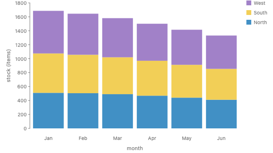

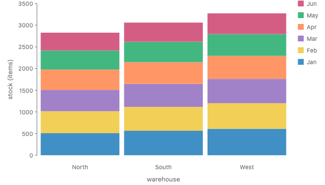

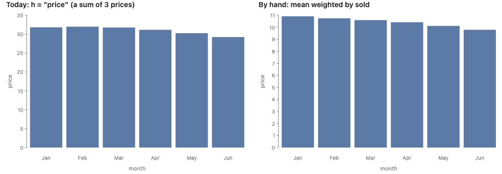

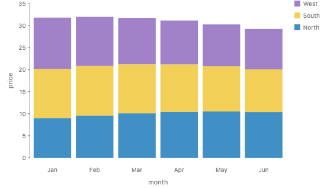

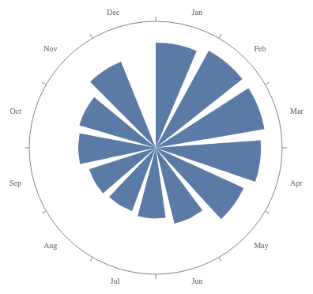

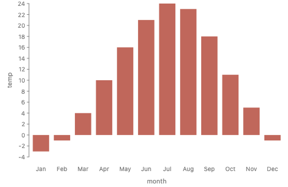

### Most specs on this small example are wrong

Take the four value columns, the two orders of `month` and `warehouse`, and the four ways to arrange two operators, all with `rect({ h })`. That is 32 specs. Every one of them renders today when the columns are undeclared. Under the rules in this proposal, 11 are valid.

| Value                            | spread, stack | stack, spread | spread, spread | stack, stack | Valid  |
| -------------------------------- | ------------- | ------------- | -------------- | ------------ | ------ |
| `sold` (sums over every key)     | 2             | 0             | 2              | 2            | 6 of 8 |
| `stock` (a snapshot along month) | 1             | 0             | 2              | 0            | 3 of 8 |
| `price` (an average)             | 0             | 0             | 2              | 0            | 2 of 8 |
| `temp` (no zero)                 | 0             | 0             | 0              | 0            | 0 of 8 |

- **Switching the fields** goes wrong whenever the value does not sum over both keys. For `stock`, exactly one order is valid.
- **Switching `spread` and `stack`** always goes wrong for a real stacked bar. A stack outside a spread adds the tallest bar of each group, which is the total of nothing. The only exceptions are one bar per group, or equal bars.

This is not special to GoFish. The errors are of two kinds, and a fixed grammar rules out only one.

|                     | Structural: a stack outside a spread | Data: the wrong field or key |
| ------------------- | ------------------------------------ | ---------------------------- |
| Specs out of the 32 | 8, all wrong                         | 24, of which 13 are wrong    |
| Vega-Lite           | cannot be written                    | can be written, and render   |
| GoFish today        | render                               | render                       |
| With these types    | error                                | error                        |

So of the 24 specs that Vega-Lite can roughly express, a little under half are valid, against about a third of GoFish's 32. Stacking month-end inventory over months, summing prices, stacking means, and drawing °C as bars from zero are all ordinary Vega-Lite specs. Its types (nominal, ordinal, quantitative, temporal) cannot tell them apart.

The same is true of programs in general: few syntactically valid programs type-check. The useful reading is the one Haskell, Rust and Lean users know. The type of the data constrains the valid specs so strongly that a chart could nearly be synthesized from it: enumerate the operator compositions, let the types prune them, then rank what is left. Mackinlay's APT split the problem the same way, into expressiveness and effectiveness, over a fixed list of chart kinds.

These counts were worked by hand from the rules, not run. The 24 specs Vega-Lite can express were compiled and drawn with Vega-Lite 5.23, and none printed a warning. Its pictures show the same totals as GoFish's. The single bar of nested stacks is a rough equivalent.

All 32 are rendered below, as GoFish draws them today with undeclared columns, each with what its bar or axis really shows (the review page's "All 32" tab hides the verdicts until asked).

| Value, key order           | 1. spread, stack                                                                                                                              | 2. stack, spread                                                                                                                                                              | 3. spread, spread                                                                                                    | 4. stack, stack                                                                                                                                                  |
| -------------------------- | --------------------------------------------------------------------------------------------------------------------------------------------- | ----------------------------------------------------------------------------------------------------------------------------------------------------------------------------- | -------------------------------------------------------------------------------------------------------------------- | ---------------------------------------------------------------------------------------------------------------------------------------------------------------- |
| `sold`, month outside      | 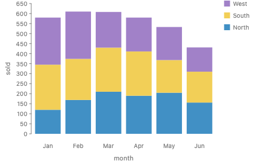 valid: each bar is one month's units sold, added over the three warehouses                                | 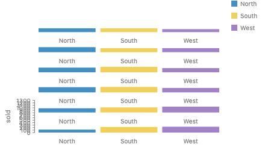 each row of bars is one month group, as tall as its tallest bar, and the stack adds those heights, which is the total of nothing          | 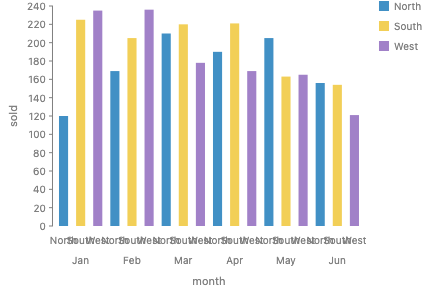 valid: each bar is one warehouse's units sold in one month                       | 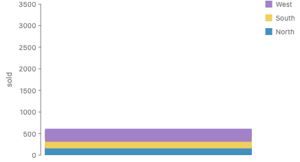 valid spec, but today's render overlaps the six month stacks at 0: the bar shows about 600 while the axis runs to 3,500      |
| `sold`, warehouse outside  | 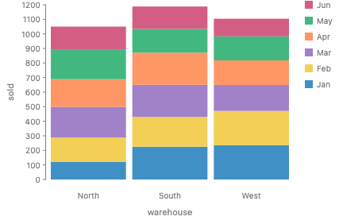 valid: each bar is one warehouse's units sold, added over the six months                              | 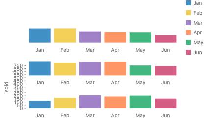 each row of bars is one warehouse group, as tall as its tallest bar, and the stack adds those heights, which is the total of nothing  | 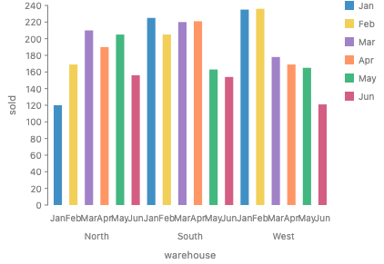 valid: each bar is one warehouse's units sold in one month                   | 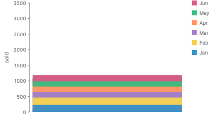 valid spec, but today's render overlaps the three warehouse stacks at 0: the bar shows about 1,200 of a total near 3,300 |
| `stock`, month outside     | 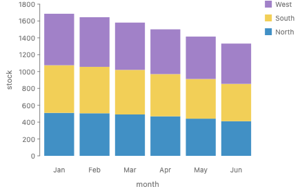 valid: each bar is one month-end inventory, added over the three warehouses                              | 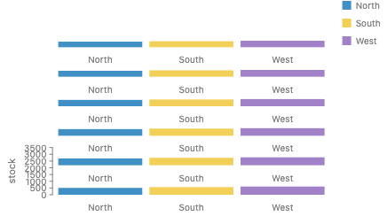 each row of bars is one month group, as tall as its tallest bar, and the stack adds those heights, which is the total of nothing         | 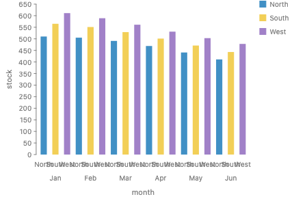 valid: each bar is one warehouse's inventory at one month end                   | 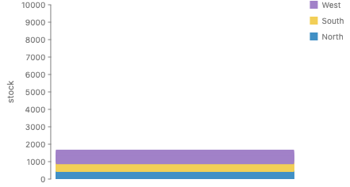 one bar of 18 month-end inventories added (the axis runs to 10,000), and today the month stacks also overlap at 0           |
| `stock`, warehouse outside | 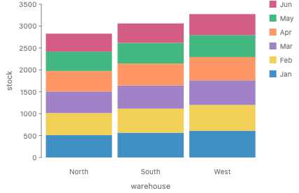 bar height = six month-end inventories added together, so the same items are counted up to six times | 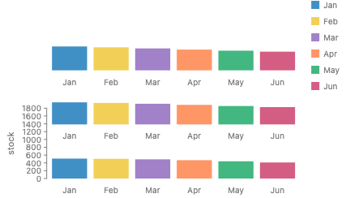 each row of bars is one warehouse group, as tall as its tallest bar, and the stack adds those heights, which is the total of nothing | 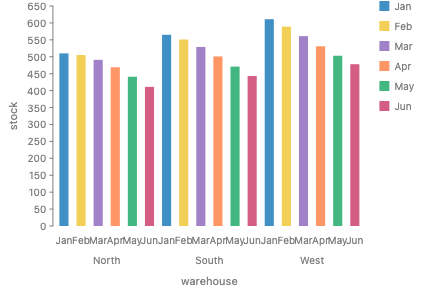 valid: each bar is one warehouse's inventory at one month end               | 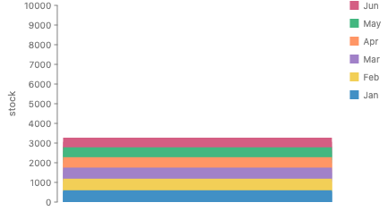 one bar of 18 month-end inventories added (the axis runs to 10,000), and today the warehouse stacks also overlap at 0   |
| `price`, month outside     | 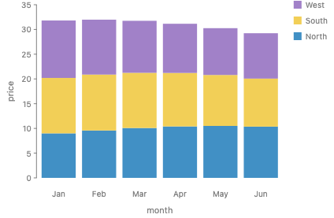 bar height = three prices added, about 30 USD, a price no customer pays                                  | 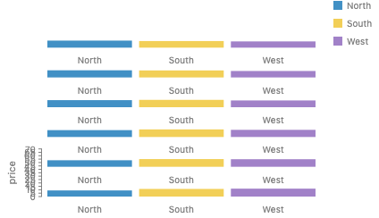 each row of bars is one month group, as tall as its tallest bar, and the stack adds those heights, which is the total of nothing         | 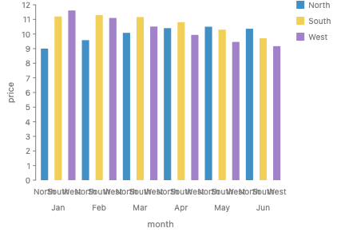 valid: each bar is one warehouse's price in one month                           | 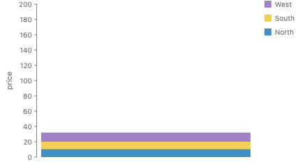 one bar of 18 prices added (the axis runs to 200 USD), and today the month stacks also overlap at 0                         |
| `price`, warehouse outside | 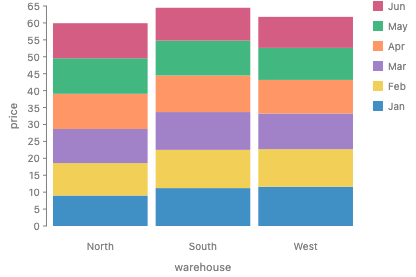 bar height = six monthly prices added, about 60 USD                                                  | 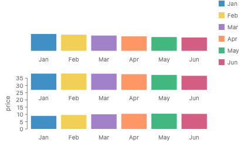 each row of bars is one warehouse group, as tall as its tallest bar, and the stack adds those heights, which is the total of nothing | 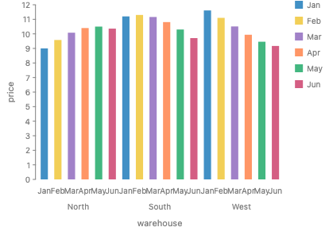 valid: each bar is one warehouse's price in one month                       | 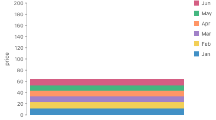 one bar of 18 prices added (the axis runs to 200 USD), and today the warehouse stacks also overlap at 0                 |
| `temp`, month outside      | 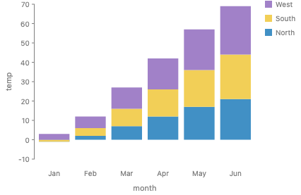 three temperatures added, measured from 0 °C: June reaches 69 °C                                          | 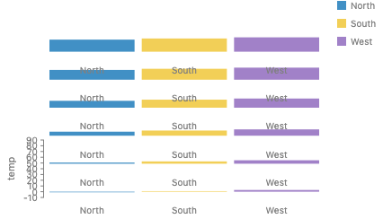 each row of bars is one month group, as tall as its tallest bar, and the stack adds those heights, which is the total of nothing          | 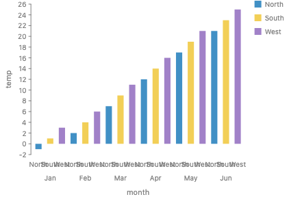 a bar length from 0 °C: in °F or kelvin the same data draws different ratios     | 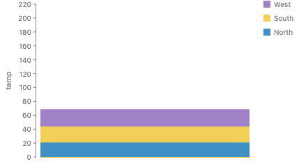 18 temperatures added from 0 °C (the axis runs to 220), and today the month stacks also overlap at 0                         |
| `temp`, warehouse outside  | 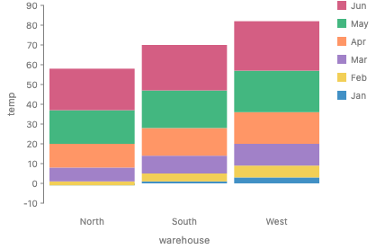 six monthly temperatures added, measured from 0 °C                                                    | 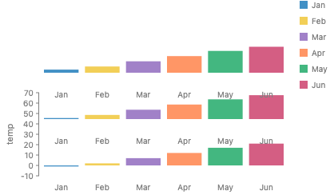 each row of bars is one warehouse group, as tall as its tallest bar, and the stack adds those heights, which is the total of nothing  | 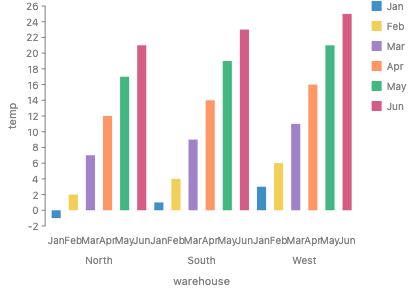 a bar length from 0 °C: in °F or kelvin the same data draws different ratios | 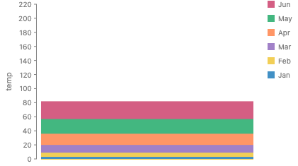 18 temperatures added from 0 °C (the axis runs to 220), and today the warehouse stacks also overlap at 0                 |

## 2. What GoFish has today, next to the draft

The full table with file references is in [current-types](research/current-types.md). The short version:

| Draft                                                      | GoFish today                                                                                                                                  | Verdict                                                                                                                                                              |
| ---------------------------------------------------------- | --------------------------------------------------------------------------------------------------------------------------------------------- | -------------------------------------------------------------------------------------------------------------------------------------------------------------------- |
| Units (`USD`, `items`)                                     | `HasUnit`, declared with `Unit(...)`, unified across the figure, gradual                                                                      | Same                                                                                                                                                                 |
| Unit algebra (`USD / items`)                               | None (#1142 follow-up)                                                                                                                        | Draft has more                                                                                                                                                       |
| `Nominal`                                                  | `Domain.discrete(levels)` with no order                                                                                                       | Same                                                                                                                                                                 |
| `Ordered`                                                  | `HasOrder` from `Trait.ordered()`                                                                                                             | Same                                                                                                                                                                 |
| `Diverging(mid)`                                           | `HasMidpoint { at }` from `Trait.diverging(mid?)`, on an ordered key                                                                          | Same. The draft puts it on the value. GoFish puts it on the stack's key, which is right for Likert.                                                                  |
| `Cyclic(n)`                                                | `HasCycle` on coord axes and on calendar parts. Not on plain columns (#1052).                                                                 | Partly there                                                                                                                                                         |
| `Affine<u>`                                                | Only time: an instant minus an instant is a duration                                                                                          | Draft has more                                                                                                                                                       |
| `Ratio<u>`                                                 | `HasZero` exists on coord axes only (#1051 for columns)                                                                                       | Draft has more                                                                                                                                                       |
| `Bounded[lo, hi]`, `Positive`                              | Only a computed `HasDomain`. `Domain.continuous` is a TODO.                                                                                   | Draft has more. These are domains, not traits.                                                                                                                       |
| The ladder Nominal < Ordered < Affine < Ratio              | Facts that compose, with no ladder                                                                                                            | Conflicts with a decision on #1195: Stevens's names are allowed only as bundles                                                                                      |
| `Extensive<k>`                                             | `CanSum` on the unit, with no key                                                                                                             | Draft is finer, and this is the part worth taking                                                                                                                    |
| `Intensive<k, w>`                                          | No `CanSum`. `.mean()` is unweighted.                                                                                                         | Draft has more                                                                                                                                                       |
| `Cumulative<k>`                                            | Nothing. #1198 is the open design.                                                                                                            | Draft only                                                                                                                                                           |
| Key structure                                              | `HasOrder`, binned cells, the `HasRegion` flag that `partition` requires, calendar `HasCycle`                                                 | Mostly there                                                                                                                                                         |
| Embedded versus attached, decided by spread versus scatter | Decided by the operator and the units together: a size that its parent places at a datum, in a unit other than that axis's, is a glyph (#972) | GoFish is finer. The draft's rule is the common case. It is wrong for a bar in a scatter whose width is in the x axis's unit (a Gantt bar), which is still embedded. |
| (nothing)                                                  | Quantity apart from unit, time zones, origin state of a space (pinned, free, none), mirrored axes                                             | GoFish only                                                                                                                                                          |

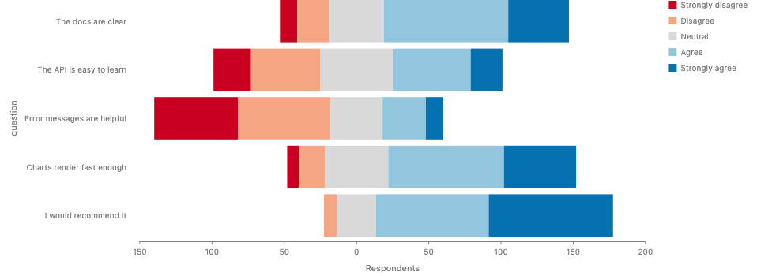

Which is better. Where the two differ in kind, GoFish's version is better, because it is made of small facts that compose and it matches decisions already taken. Where the draft has more, it is naming a real gap. The one place the draft changes the design is additivity per key.

Two memory notes turned out to be wrong and I corrected them: PR #1268 only renamed terms to "trait" and did not add `HasVector`, and `CanAdd` was renamed `CanSum` by #1311.

## 3. Are traits needed?

Yes. They looked buried in the draft because the draft names bundles of traits instead of the traits.

| Draft name            | Written as traits                                    |
| --------------------- | ---------------------------------------------------- |
| `Nominal`             | no `HasOrder`                                        |
| `Ordered`             | `HasOrder`                                           |
| `Affine<u>`           | `HasUnit` with a difference unit, and no `HasZero`   |
| `Ratio<u>`            | `HasUnit` plus `HasZero`                             |
| `Diverging(mid)`      | `HasMidpoint { at }`                                 |
| `Cyclic(n)`           | `HasCycle`                                           |
| `Bounded`, `Positive` | a domain: `Domain.continuous([lo, hi])`              |
| `Count<u>`            | `HasZero`, `CanSum` over every key, whole numbers    |
| `Extensive<k>`        | `CanSum { by: k }`                                   |
| `Intensive<k, w>`     | `CanAverage { weight: w }`                           |
| `Cumulative<k>`       | no `CanSum` over `k`, where `k` has `HasOrder`       |
| units                 | the parameter of `HasUnit`, not a trait              |
| coordinate frame      | space facts that operators compute, not a data trait |

So the trait list is short:

- **Value traits:** `HasZero` (#1051), `HasOrder`, `HasMidpoint`, `HasCycle` (#1052 for columns), and `HasUnit` with its difference unit.
- **Domains:** `Domain.discrete(levels)` and `Domain.continuous([lo, hi])` (new).
- **Keyed traits on a column:** `CanSum { by }` and `CanAverage { weight }` (both new in this form).
- **Key traits:** the same value traits on a key column, plus `HasRegion`.
- **Space facts:** computed, never declared.

Two corrections to the draft's rules fall out of writing them this way:

- **`HasZero` and summing are separate.** A price has a zero and does not add up across stores. So Ratio must not imply Extensive. Today `Trait.summable()` on a unit mixes the two.
- **Log needs two facts, not one.** The values must be above 0, which is a domain fact. And no mark on that axis may draw a length from 0, which is a space fact that a stack or a bar produces. A concentration has a meaningful zero and still plots well as dots on a log axis. The draft's rule would reject it.

Traits also carry elaboration. Each trait supplies the code its default expands to, so every default has a spelling the user could write (the "a default is sugar" rule in `api-design.md`):

| Trait found                                 | Default it supplies                | Written by hand                              | Public today?               |
| ------------------------------------------- | ---------------------------------- | -------------------------------------------- | --------------------------- |
| `CanSum` over the rest key                  | the fold of a size channel         | `h: field("sold").sum()`                     | yes                         |
| `CanAverage { weight }`                     | the fold                           | `h: field("price").mean({ weight: "sold" })` | needs `weight` on `.mean()` |
| no `CanSum` over an ordered rest key        | none: an error that offers choices | `h: field("stock").last()`                   | needs `.last()`             |
| `HasMidpoint` on a stack key                | the stack's origin                 | a stack option naming the origin             | internal only               |
| `HasMidpoint` or `HasZero` on a color field | a diverging palette centered there | a palette with a middle stop                 | needs a midpoint option     |
| `HasCycle` on a spread key                  | a closed spread in polar           | a spread option that closes the loop         | not built                   |

Four of these need a public spelling first. That is #1289.

## 4. Additivity: three ways to declare it

This is the main new API. The three kinds from the draft are the right way to explain it. The question is what the user writes.

### A. One trait per kind, each keyed (the draft)

```js
stock: {
  unit: Items,
  traits: [Trait.canSum({ over: "warehouse" }), Trait.snapshot({ along: "month" })],
},
price: { unit: "USD/items", traits: [Trait.canAverage({ weight: "sold" })] },
```

- The user states every kind for every key.
- The check is static: it reads the schema only.
- A key the user did not foresee, such as a later bin, has no tag.
- Precedent: `cell_methods` in the CF conventions for climate data (`time: point area: sum`), and Kimball's additive, semi-additive and non-additive facts.

### B. One entity key, checked on the rows (#1198's recommendation)

```js
stock: { unit: Items, entity: "warehouse" },
```

- The user states one fact: which thing the value belongs to.
- A sum is valid only when that key is unique among the rows being summed.
- It catches double counting along any key, including keys made later, and it catches values copied by a join.
- It cannot check data that is already aggregated and has no entity column.
- The check runs on the data, so it costs a pass over each summed group.
- Precedent: Lenz and Shoshani's disjointness read as a key constraint, Looker's symmetric aggregates, dbt MetricFlow's entities.

### C. One keyed trait, whose meaning is B and whose fast path is A (recommended)

`Trait.canSum({ over: "warehouse" })` and `entity: "warehouse"` say the same thing. Both name the keys the value may be summed across. So there is one declaration:

```js
stock: { unit: Items, traits: [Trait.canSum({ over: "warehouse" })] },
sold: { unit: Items, traits: [Trait.canSum()] }, // sums over every key
price: { unit: "USD/items", traits: [Trait.canAverage({ weight: "sold" })] },
```

- **Meaning.** A sum of `stock` over a set of rows is valid when no two of those rows share a `warehouse`. This is B's rule.
- **Static rule.** When the table's `key` is declared, the checker does not need the rows. `stack({ by: k })` needs `k` to be in the column's `over`. A channel fold needs every column of the rest key to be in `over`. This is A's rule, and it reports the error before any data is read.
- **Fallback.** When a key is unknown (no declared `key`, a `by` that is a function, anything after `derive`), the checker uses the row check.
- **The other kinds are derived, not declared.**
  - A key not in `over`, along which the value changes, is a snapshot. If that key has `HasOrder`, the error says so and offers `.last()` and `.mean()`. This is the draft's Cumulative.
  - A key not in `over`, along which the value is the same on every row, is a copy from a join. The error offers `.first()`. This is the fan trap, and the key-space research calls it Constant.
  - A bin of a key inherits the key's entry. `stock` does not add up over `month`, so it does not add up over quarters either.
- **Unit-level `Trait.canSum()`** (today's `Trait.summable()`) stays as "sums over every key" for every column in that unit. A unit that declares it cannot also hold a column with a narrower `over`. That is an error when the schema is applied, so "one unit cannot both add up and not" still holds.

Why C. It keeps #1198's single declaration and its coverage of unforeseen keys. It keeps the draft's static errors. It names the key with `over`, which reads as a sum over warehouses and has no group-by reading. And it adds no trait whose only job is to name a case: Cumulative and Constant come out of the check.

What C makes awkward. A user who wants the draft's derivations (a running sum of a flow is a running total, and the first difference of a running total is a flow) gets them only if a later example forces a declared `Trait.snapshot({ along })`. I would wait for that example. The waterfall chart is the likely one.

Runner-up: A, if Josh wants each kind visible in the schema. What would change my pick: a real chart that needs the snapshot declared to draw correctly, not only to explain an error.

### `over` and `along`: two spellings of one check

Along an ordered key, a value is one of two things, and they are opposites.

|           | Attached to                                        | You can                           | Typical mark                         | Word    |
| --------- | -------------------------------------------------- | --------------------------------- | ------------------------------------ | ------- |
| Extensive | an interval of the key (sales during March)        | add intervals, bin them           | bars, areas where area is the amount | `over`  |
| Snapshot  | a point of the key (inventory at the end of March) | read between points, connect them | lines                                | `along` |

An extensive value is a measure on regions of the key. A snapshot is a function of points on it. Measures add and functions connect. An averaged value such as a price is also a function of points, which is why it connects and does not add. So "a reading along month" and "does not sum over month" are one fact seen from two sides.

For inventory the distinctive key is month, and `canSum({ over: "warehouse" })` names the other one. When the table's `key` is declared, the two forms are complements:

```js
// names where it adds
stock: { unit: Items, traits: [Trait.canSum({ over: "warehouse" })] },

// names where it is a reading, and adds everywhere else
stock: { unit: Items, traits: [Trait.canSum(), Trait.snapshot({ along: "month" })] },
```

They differ on a key nobody foresaw, such as `product`:

- With `over: "warehouse"`, the new key is not summable. That is wrong for inventory, which adds over products.
- With `along: "month"`, the new key is summable. That matches Lenz and Shoshani's stock, which sums along every dimension except time.

`over` is still the right form when the value belongs to an entity and no ordered key is involved, such as students in joint programs counted in two departments.

"Connected" already means something about the key alone: `month` has `HasOrder`, so marks along it can be joined. `along` is about the field and the key together: the value is a reading at each point. An honest line needs both.

Josh (11-12): two spellings seem fine, and more examples are needed to tell them apart. Examples to collect before deciding:

- population per country per year (a snapshot along year that adds over countries)
- account balances per account per month
- open bugs per team per day, binned by week
- students in joint programs per department (an entity, no ordered key)
- lake area copied onto catch rows by a join (a copy, no ordered key)
- river length across the countries it crosses (overlap along a key that is not time)
- inventory with a `product` key added later (the unforeseen key)
- a table that is already aggregated, with no entity column

### A key made of more than one field

`over` takes a list, and the rule is about the tuple: a sum over a set of rows is valid when no two of those rows agree on every column in `over`.

```js
// one row per (store, product, month)
key: ["store", "product", "month"],
schema: {
  on_hand: { unit: Items, traits: [Trait.canSum({ over: ["store", "product"] })] },
  floor_area: { unit: SquareMeter, traits: [Trait.canSum({ over: "store" })] },
  units_sold: { unit: Items, traits: [Trait.canSum()] },
}
```

- The static rule: a sum is valid when every key column that varies among the summed rows is in `over`.
- `stack({ by: "store" })` inside one month with `h: "on_hand"` draws. The rows vary in store and product, and both are in `over`.
- `stack({ by: "month" })` is an error. Month is not in `over`.
- `h: "floor_area"` in a bar per store is an error. The rows vary in product and month. The values are copies, so the message offers `.first()`.
- Listing two fields means each one adds on its own too, with the other fixed. So the list is a set of dimensions, not one indivisible composite. I could not construct a value that adds over a pair jointly but not over either member. That is an argument, not a proof.
- Nested keys are why the row check is the definition. With `over: ["county"]` and a stack by state, the static rule passes only if it knows that state is a function of county. Otherwise it checks the rows, and they pass.
- What it cannot say: a counted thing that is not a column, such as students in joint programs in a table that is already aggregated by department. That is #1198's open question 2, and it stays open.

### A rate: the unit says "per", the column says which weight

Neither the unit nor the column can hold both facts about an averaged value.

- The unit can say that the value is a rate. A quotient unit such as `USD/items` never sums, so once unit algebra lands, stacking a price is an error from the unit alone.
- The unit cannot name the weight. A unit is shared across columns and tables, and the weight is a column. Price per store is weighted by that store's units sold. A list price in the same unit has no weight. In the inventory table both `stock` and `sold` are in items, so the unit cannot pick one.
- Some weights have no quotient at all: mean temperature weighted by area, or a rating weighted by the number of reviews. And some rates cancel: an unemployment rate is persons over persons.
- Together they give a check that neither gives alone. The unit says "per items", so the weight must be a summable column in items. Naming `revenue` as the weight of a price is a type error.

```js
price: { unit: Unit.per(USD, Items), traits: [Trait.canAverage({ weight: "sold" })] },
```

A rate with no declared weight still cannot be stacked. A fold of it is an error that asks for the weight column or an explicit `.mean()`. A `derive` helper that computes `revenue / sold` supplies both the unit and the weight.

The trait is `canAverage` and not `weighted`, because `weighted` does not say what is weighted. `Trait.canAverage()` with no weight is a plain mean, which suits temperatures.

**When a column has both traits.** A measurement of an individual can do both. Penguin body mass sums (the mass of a group) and averages (the mean mass of a group). The rules above fill in a size channel's fold from the one trait a column has, and say nothing when it has two. The choices are the sum, the mean, or an error that offers both. This is an open decision (section 14). In the dataset schemas (section 16) I left `canSum` off beak lengths, which makes the declaration a statement of what the author means rather than of what the physics allows.

### Names

Two changes from the first version of this proposal, both from Josh's review on 11-12.

- **`over`, not `by`.** "Sum by warehouse" reads to a SQL or polars user as "group by warehouse, then sum", which is the invalid sum. "Can sum over warehouse" reads as a sum over warehouses. `line` and `ribbon` name their path tier with `along`, so `over` is free. Its only other use is an internal IR name.
- **`canSum` and `canAverage`, not `summable` and `weighted`.** `weighted` does not say what is weighted. `canAverage({ weight })` names the operation and what it needs, and with no weight it is a plain mean.

| Trait         | Builder                        | Kind of word                |
| ------------- | ------------------------------ | --------------------------- |
| `CanSum`      | `Trait.canSum({ over })`       | the operation               |
| `CanAverage`  | `Trait.canAverage({ weight })` | the operation               |
| `HasOrder`    | `Trait.ordered()`              | an adjective for the values |
| `HasCycle`    | `Trait.cyclic()`               | an adjective for the values |
| `HasMidpoint` | `Trait.diverging(mid?)`        | an adjective for the values |

The split follows the trait names. A `Can<Verb>` trait is an operation, and its builder is the trait's own name, so the word in an error message is the word the user wrote. A `Has<Thing>` trait describes the values, and its builder is the adjective, because `diverging` has no good `has` form. This replaces the rule in `api-design.md` that every builder word is an adjective, and it renames today's `Trait.summable()`.

**`canSum` with no `over`.** `Trait.canSum()` means the value sums over every key of its table, so any set of its rows may be added. This is a flow, such as units sold, where each row is its own event. When the table's `key` is declared, it is the same as listing every key column in `over`. Unit-level and column-level `Trait.canSum()` mean the same thing. The unit form applies it to every column in that unit.

| Declaration                           | Meaning                                                                                          |
| ------------------------------------- | ------------------------------------------------------------------------------------------------ |
| `Trait.canSum()`                      | sums over every key                                                                              |
| `Trait.canSum({ over: "warehouse" })` | sums over `warehouse` only                                                                       |
| `Trait.canSum({ over: [] })`          | sums over no key. This should be an error, since it only says "not summable" in a confusing way. |
| a declared unit with no `canSum`      | not summable, as today                                                                           |
| an undeclared column                  | unknown, so every check passes                                                                   |

"Every key" means every key of the table the column was declared in. If a join copies the column onto many rows, a sum along the new key is still wrong. The join rule catches that, not `canSum`: the joined column remembers its own key, and the error offers `.first()`.

Together these names are easier to hold than extensive, intensive and cumulative. Extensive and intensive stay as words for explaining, not as API. Cumulative is replaced by snapshot, because "cumulative" sounds like "it sums", and most such values (inventory, population, a balance) are readings at a moment, not running sums.

### Overlap check

- `Trait.canSum()` on a unit and `Trait.canSum({ over })` on a column: the first is the second with every key. Exact composition, one mechanism.
- `Trait.canAverage` and `.mean()`: the trait supplies the default fold, and `.mean({ weight })` is that fold written out. Exact composition.
- `entity` from #1198: the same fact as `over`. The `entity` name goes.

### Real charts this changes

- **Daily inventory snapshots binned by month.** `spread({ by: field("day").bin(Calendar.month) })`, `stack({ by: "warehouse" })`, `rect({ h: "stock" })`. Today GoFish sums about 30 daily snapshots per bar. With C, the rest key is `day`, which is not in `by`, so the mark is an error that offers `.last()`.
- **Melted quantiles.** The box plot story keeps five quantile columns in USD. Melt them into a `quantile` key and stack, and the chart type-checks today whenever USD is summable. With C, the melted value has no `by` that contains `quantile`.
- **Mosaic.** The story normalizes the share of `cylinders` within each `origin`. That share adds up over `cylinders` and is an average across `origin`. One unit-level flag cannot say that. A keyed trait can.
- **County rates rolled up to states.** A choropleth of unemployment by state from county rows needs the mean weighted by labor force. A plain mean or sum is wrong.
- **Lake area after a join.** `area_km2` repeats on every catch row. Summing it counts each lake once per species. The check finds the repeat and offers `.first()`.

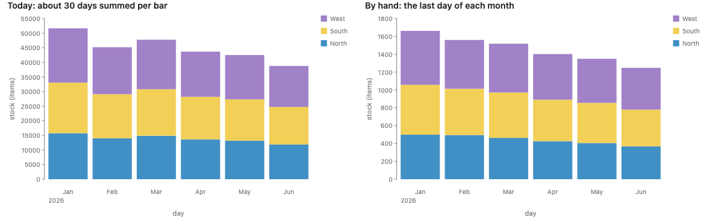

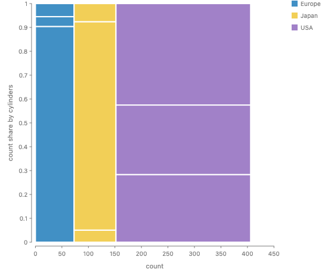

## 5. Where the types live: the DSL, TypeScript, or both

The draft's syntax (`Count<items> & Cumulative<month>`) reads as TypeScript types. Three options:

|                                                                    | TypeScript types only                        | Run-time values in the DSL (recommended) | Both, from one definition (later) |
| ------------------------------------------------------------------ | -------------------------------------------- | ---------------------------------------- | --------------------------------- |
| Reasoning and elaboration                                          | No. Types are erased before the engine runs. | Yes                                      | Yes                               |
| Errors that name the data                                          | No                                           | Yes                                      | Yes                               |
| Python                                                             | No                                           | Yes, through the IR                      | Yes                               |
| Facts that depend on data (domains, dependent keys, the row check) | No                                           | Yes                                      | Run-time side only                |
| Errors in the editor before running                                | Yes                                          | No                                       | Yes, for a subset                 |

GoFish already does the middle column: `Unit`, `Trait` and `Domain` build values, and the wire carries the traits. So the DSL is the source of truth.

A TypeScript mirror is possible. One value can give both the wire record and a static type, the way Zod, Effect Schema and ArkType do. Experiments against the repo's TypeScript 5.9 (in [traits-and-embedding](research/traits-and-embedding.md), Part 3) showed:

- A stack over a key the field does not add up over is caught with a readable message.
- A stack of an averaged field is caught. Log after a stack is caught. A misspelled column gets a "did you mean" hint.
- The red underline lands on the mark, not on the stack, because the field is only known at the mark.
- Untyped rows, dynamic field names and undeclared columns compile with no error, so the static side never blocks a chart.
- Unit equality is easy. Unit arithmetic works for small exponents, but the editor shows an unreadable type.
- 300 checked pipelines added about 0.06 seconds to a compile. That was a toy builder, so the real cost is unmeasured.

Today `by` accepts any string and `stack` returns `Operator<any[], any[]>`, so TypeScript does not even check field names. The cheap first step is to check channel names and `by` against the row type. Mirror the trait checks later, generated from the same definitions, if the LLM benchmark (#941) shows that editor errors help.

## 6. Units

- Keep units as they are: gradual, unified across the figure, a clash between two declared units is an error.
- Add unit algebra (#1142): products, quotients and "per". `revenue / units` has unit `USD/items`.
- A quotient of two columns that both add up over a key is an average weighted by its denominator. So `derive` helpers that divide can supply `Trait.canAverage` without the user writing it.
- Points and differences: a unit with no zero has a difference unit, as time has duration. `20 °C + 20 °C` fails because a point plus a point is not defined, and `°C − °C` is in Δ°C. The same split serves geometry, where a position is a point and a size is a difference.
- Named types such as `Month`, `Temperature` and `Revenue` are aliases over these parts, like chart templates over operators. They come after the parts.

Open: whether unit conversion (°C to °F) and area-preserving maps belong here. The scale-transforms proposal already places the second with coords (`Coord.clock({ radius: "area" })`), and I would leave it there.

## 7. Keys

### A table's identity is universal. What a visualization keys on is not.

Josh asked whether a dataset's keys are universal, or whether different visualizations of one dataset use key spaces with different fields, not only a subset of one key. A survey of the stories answers both readings ([key-roles](research/key-roles.md)). It uses the two words from the Terms: the **identity** is the table's candidate key, a fact about the data; a **grouping** is what a visualization names in a `by`, an `along` or `time.sequence`, which is a choice.

| Finding, over about 186 stories and 14 datasets                                                                                                                                                                      | Count                                       |
| -------------------------------------------------------------------------------------------------------------------------------------------------------------------------------------------------------------------- | ------------------------------------------- |
| Stories that key only on fields of the table's identity: a projection (some of the key columns) or a fiber (one key column fixed to one value)                                                                       | about 108                                   |
| Stories that key on something else: an attribute such as `Species` or `weather`, a bin of a measured value, a calendar part, or a key the table does not have (a copy index, a column name, a sample grid, a row id) | about 78                                    |
| Fields that looked like a key in one story and a value in another, such as the driving data's `year`, `temp_max`, four penguin measurements, IMDB rating and `lake`                                                  | 13, of which 0 are real flips (audit below) |
| Datasets with two stories whose key sets do not derive from each other, such as month of the year against weekday for the Seattle weather                                                                            | 6 of 14                                     |

These are hand counts from each story's `.flow(...)` and `.mark(...)` lines, so treat them as plus or minus a few. Candidate keys and dependencies between fields were checked by running scripts over the data. The first pass rendered nothing; the audit of the 13 fields below rendered every story it cites.

A re-check of the other counts found that every grouping in them is a function of the one identity. The 78 stories group by a column (a column is a function of the row) or by a bin or calendar part of one. The 6 datasets pair two such functions, such as `lake` and `species` of (lake, species), or month and weekday of `date` (reasoning, from the code). One caveat: some bins are computed from the whole column, namely `Bin.quantiles`, a `Bin.step` anchored at the column's extent, and `Bin.voronoi` seeded by the rows, so a row can land in a different cell when other rows are filtered out (read from `binKey`, not tested).

### The 13 fields, one at a time

Each field was checked against six explanations:

- **(a)** The key is a bin of the value. The key is the cell, and the field stays a value.
- **(b)** The field is a position in both stories. It only looks like a key because there is one mark per row.
- **(c)** The field is part of the identity in both stories, and the "value" use reads the key as a position.
- **(d)** A line's order comes from the field while the field is also a position. That is one role.
- **(e)** The two stories use different tables, such as an aggregate or a derived table.
- **(f)** The field is only named in `field(f).count()`, which counts rows and reads no value.

| Field                    | Key story                                       | Value story                               | Verdict                 | Explanation |
| ------------------------ | ----------------------------------------------- | ----------------------------------------- | ----------------------- | ----------- |
| `year` (driving)         | `Scatter.Connected`                             | `FacetedChart.FacetedScatterDriving`      | not a flip              | c, d        |
| `temp_max`               | `Croissant.Ridgeline`, `RidgelineChart.Default` | `Bin.WeekdayTemperature`                  | not a flip              | a, e        |
| `IMDB Rating`            | `Histogram.Default`                             | the same story's `.count()`               | not a flip (miscounted) | a, f        |
| `Rotten Tomatoes Rating` | `2DHistogramScatterPlot`                        | none                                      | not a flip (miscounted) | a           |
| `Body Mass (g)`          | `Partition.ProductForm`                         | `Separate.PenguinMass`                    | not a flip              | a, b        |
| `Flipper Length (mm)`    | `Partition.ProductForm`                         | `Filter.FieldBetween`                     | not a flip              | a, b        |
| `Beak Length (mm)`       | `MarginalHistogram` (top)                       | `MarginalHistogram` (scatter)             | not a flip              | a, b        |
| `Beak Depth (mm)`        | `MarginalHistogram` (side)                      | `MarginalHistogram` (scatter)             | not a flip              | a, b        |
| `lake`                   | `Bar.Stacked` and most catch stories            | `Ribbon.Polar` (angle)                    | not a flip              | c           |
| `fertility`              | `AvoidingTrendLine` (`ends` table)              | `AvoidingTrendLine` (countries)           | not a flip              | e, b        |
| `longitude`              | `Partition.AirportHexbin`                       | `Partition.AirportsByNearestHub` (hubs)   | not a flip              | a, b, f     |
| `latitude`               | `Partition.AirportHexbin`                       | `Partition.AirportsByNearestHub` (hubs)   | not a flip              | a, b, f     |
| `Miles_per_Gallon`       | `Partition.CarHexbin`                           | `ScatterPlot` (its `by: "Name"` is a bug) | not a flip              | a, f        |

Genuine flips: 0. By main explanation, 10 are a bin of the value (a), 2 are an identity field read as a position (`year`, `lake`, c), and 1 is the identity of a different, derived table (`fertility`, e). Two of the 13, both movie ratings, were miscounts: their only "value" use is `.count()`, or nothing. Every story above was rendered with `pnpm capture-one` on 11-13 (images in `img/keys/`). Six renders were looked at closely (the cars scatter, the fill bug, the polar ribbon, the trend line, the weekday bars, the faceted scatter); the rest were spot-checked. That no story groups the ten (a) fields raw comes from a grep of `stories/`.

**Penguin body mass: a cell in one, a position in the other (a, b).** The key is a 500 g cell; the beeswarm has no `by`, so each dot is one penguin and the mass is its position.

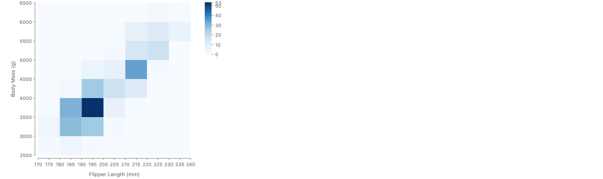

```js
chart(measured, { color: Color.gradient("blues") })
  .flow(
    partition({
      by: {
        x: field("Flipper Length (mm)").bin(Bin.step(10)),
        y: field("Body Mass (g)").bin(Bin.step(500)),
      },
    })
  )
  .mark(region({ fill: field("Body Mass (g)").count() }));
```

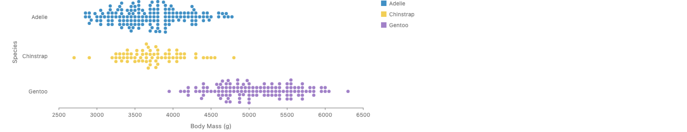

```js
chart(weighed, { w: 560 })
  .flow(
    spread({ by: "Species", dir: "y", spacing: 16 }),
    scatter({
      x: "Body Mass (g)",
      alignment: "middle",
      overlap: Overlap.separate({ padding: 1 }),
    })
  )
  .mark(circle({ r: 3, fill: "Species" }));
```

**Driving `year`: the identity read as a position (c, d).** The faceted scatter has no `by`, so its marks are keyed by the row, and the row is the year.

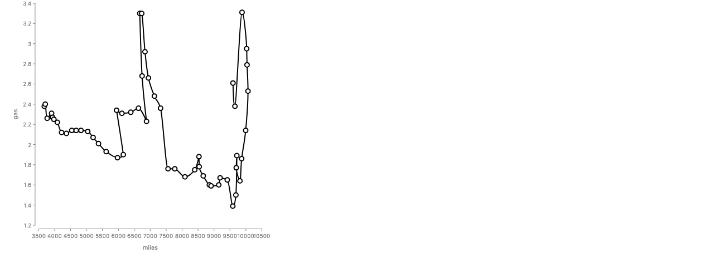

```js
chart(drivingShifts)
  .flow(scatter({ by: "year", x: "miles", y: "gas" }))
  .mark(circle({ r: 4, fill: "white", stroke: "black", strokeWidth: 2 }))
  .layer(line({ stroke: "black", strokeWidth: 2 }));
```

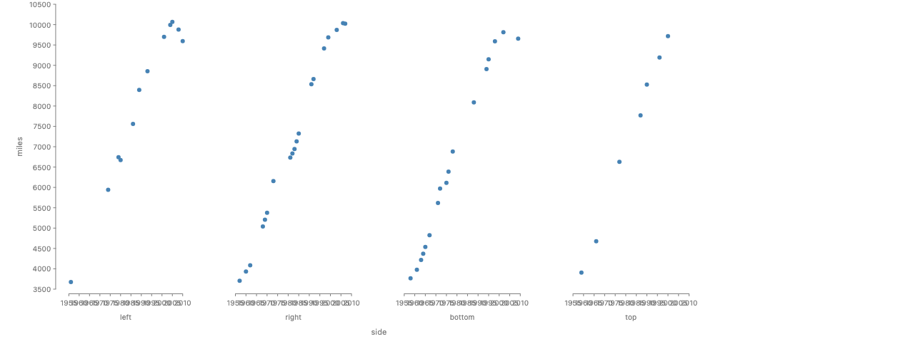

```js
chart(drivingShifts)
  .flow(
    spread({ by: "side", dir: "x", spacing: 50 }),
    scatter({ x: "year", y: "miles", axes: { x: true, y: false } })
  )
  .mark(circle({ r: 3, fill: "#4682b4" }));
```

The marginal histogram (code under "Three stories that show it", below) has one identity, the row, and two bins of values: its three "key spaces" are not three keys of the table, and its `by: "id"` is redundant. The polar ribbon reads `lake` as the angle, which places each lake key at its own angle; the ribbon stays open, so the chart is fine.

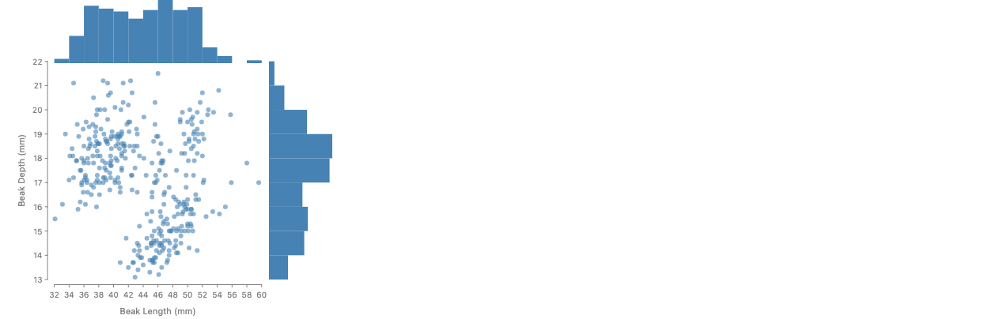

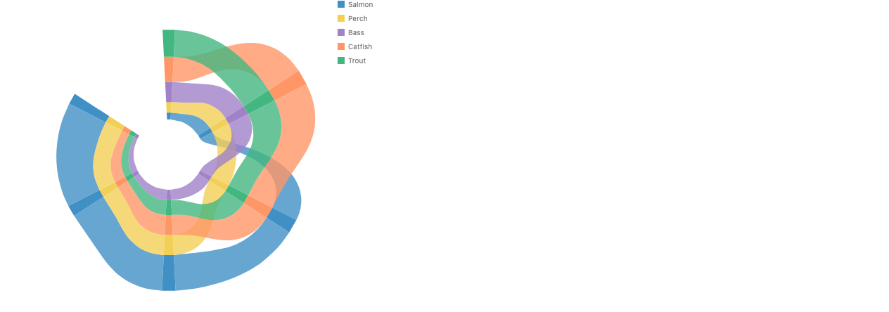

Two story bugs the audit confirmed by render, neither a key flip: `vega-lite/ScatterPlot` groups by `Name`, so 392 cars draw as exactly 300 dots, and `InferredSize.LegendTracksComputedExtent` fills each lake's bar with the first row's species, so every bar is Bass blue.

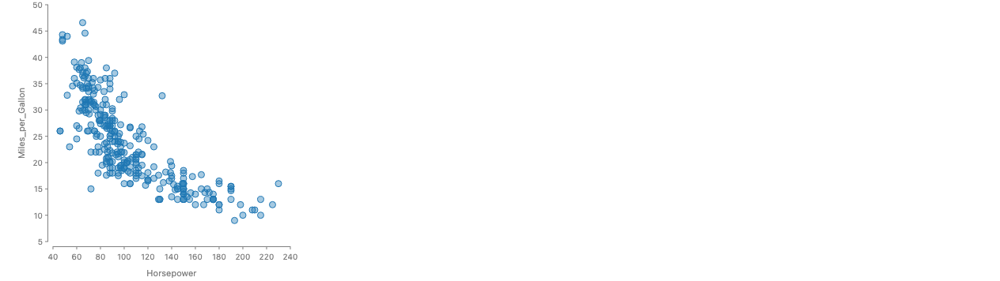

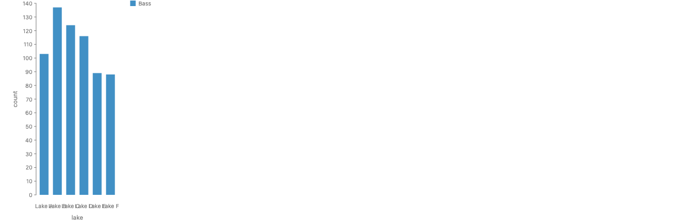

```js
chart(seafood)
  .flow(spread({ by: "lake", dir: "x" }))
  .mark(rect({ h: "count", fill: "species" }));
```

### The rule that covers all 13

> A field with a continuous `Domain` is grouped only through a bin, so the key is the cell and the field stays a value. A field is grouped raw only when its `Domain` is discrete or it is in the table's `key`. Any channel may read a `key` field, which reads the key and never folds rows.

The first sentence covers the ten (a) cases. The second covers `year` and `fertility`: both are numbers, and each is grouped raw only in a table where it is the identity, so each group has one row. The third covers `year` as x, `lake` as the angle, and `fertility` as x.

The rule touches existing stories that group raw by an undeclared number outside the identity: `vega-lite/StripPlot` spreads by `cylinders`, and the titanic passenger stories spread or stack by `pclass` (1, 2, 3) and `survived` (0, 1). They draw correctly, since the numbers have few values. Under the rule each needs one `Domain.discrete` line on the column. Whether a raw `by` on an undeclared number should be an error or a lint is open (section 14). `population.json` spreads by `age`, which is in its identity, so it passes.

So both readings come down to one. Every table has one identity, and no story disagrees with it. A column does have a stable role, and the role is already given by two facts: its `Domain` (discrete or continuous) and whether it is in `key`. Within one table every column is a function of the row, so every grouping by a column, a bin or a calendar part is a coarser view of the identity. A visualization chooses which function, not which subset of fields.

| What changes                   | How the new index relates to the identity                               | Stories                                                     |
| ------------------------------ | ----------------------------------------------------------------------- | ----------------------------------------------------------- |
| Which function groups the rows | coarser: a projection, an attribute, a bin or a calendar part           | most                                                        |
| A relabeling                   | equivalent: (week, weekday) for a date, "Male" for 1                    | `CalendarHeatmap`, the population stories                   |
| A fiber                        | one key field fixed to one value                                        | gapminder at one year                                       |
| A finer index                  | a new key field: a copy, a column name, the right table's key, a sample | waffles, `GroupedBarChartRepeat`, pie glyphs, density grids |
| A new table                    | an aggregate keyed by the grouping                                      | `RidgelineChart`, `SemanticZoomHistogram`, `titanic`        |

Only the last two make a key that is not a function of the old identity. Those are the operations that need typing.

### Three stories that show it

**`seaborn/MarginalHistogram`: one identity and two bins of values in one figure.** The scatter keys on a row id the story makes, which is the row, so the `by` is redundant. Each histogram keys on a bin of a different measurement, and the measurement stays a value. The null filter, the colors and the `layer` that lines the three up are left out here.

```js
const data = penguins.map((d, i) => ({ ...d, id: i }));

chart(data)
  .flow(scatter({ by: "id", x: "Beak Length (mm)", y: "Beak Depth (mm)" }))
  .mark(circle({ r: 3 }));

chart(data, { h: 80 })
  .flow(partition({ by: field("Beak Length (mm)").bin(Bin.step(2)), dir: "x" }))
  .mark(rect({ h: field("Beak Length (mm)").count() }));

chart(data, { w: 80 })
  .flow(partition({ by: field("Beak Depth (mm)").bin(Bin.step(1)), dir: "y" }))
  .mark(rect({ w: field("Beak Depth (mm)").count() }));
```

**`vega-lite/ScatterPlot`: a `by` that is not a key.** After the story drops rows with nulls, 392 cars have 300 distinct names (run). A position channel averages its group (read in `channels.ts`), so the chart draws 300 dots, and 92 cars are averaged into other dots with no message (rendered: exactly 300 dots).

```js
chart(cars)
  .flow(scatter({ by: "Name", x: "Horsepower", y: "Miles_per_Gallon" }))
  .mark(circle({ r: 4 }));
```

**`forwardsyntax/WaffleChart`: a value becomes the size of a new key.** `repeat` turns each row into `count` copies, so the marks are keyed by (lake, species, copy), finer than the rows. It runs inside `derive`, so every check after it is skipped. Spacing and alignment options are left out.

```js
chart(seafood)
  .flow(
    spread({ by: "lake", dir: "x" }),
    derive((d) => d.flatMap((d) => repeat(d, "count"))),
    spread({ by: chunk(5), dir: "y" }),
    spread({ dir: "x" })
  )
  .mark(rect({ w: 8, h: 8, fill: "species" }));
```

### Three designs for what `key` means

**A. "Key" is a role on the column**, as Tableau's dimensions and Flint's identifier role do it.

```js
chart(penguins, {
  schema: {
    Species: { role: "key" },
    "Body Mass (g)": { role: "value", unit: Grams },
  },
});
```

It is not wrong: the audit above found that a column's role is stable. But the role already follows from the column's `Domain` and from whether it is in `key`, so declaring it again repeats information, and A still needs bins and a key read as a position. It also says nothing about identity, so a `by` on `cars.Name` passes. "Dimension" and "measure" can be doc words for those two facts rather than API.

**B. The table declares its identity. Every `by` is a grouping read as a function of it. Operations that change the identity are typed steps (recommended).**

```js
chart(countryPopulations, {
  key: ["country"],
  schema: {
    country: { traits: [Trait.nested({ in: "region" })] }, // new: HasParent
    region: { traits: [Trait.nested({ in: "continent" })] },
    pop: { unit: People, traits: [Trait.canSum()] },
  },
});
```

The rest key at a mark is the identity's columns that the groupings do not fix. A grouping fixes an identity column when that column depends on it: it is the column, or a declared dependency or a calendar rule says so. That keeps `canSum({ over })` a static check even when a visualization groups by a field outside the key. Its cost is a new dependency declaration (`Trait.nested`, which is `HasParent`) and typed versions of steps that are a `derive` today.

**C. No table identity. The key is whatever the flow builds**, and additivity is checked on the rows of each sum, as in approach B of section 4.

```js
chart(seafood, {
  schema: { count: { unit: Items, traits: [Trait.canSum()] } },
});
```

It needs no new declaration. It cannot tell a grouping that merges different things from one that merges copies, because it does not know what a thing is. It is the runner-up, and it is what B falls back to when no key is declared, so choosing B does not lose C.

### Four specs worked in each design

**Binned: monthly precipitation (`Bin.MonthBarsChained`).**

```js
chart(weather, {
  key: ["date"],
  schema: {
    date: Unit.time(),
    precipitation: { unit: Millimeters, traits: [Trait.canSum()] },
  },
})
  .flow(
    spread({
      by: field("date").bin(Calendar.year).bin(Calendar.month),
      dir: "x",
    })
  )
  .mark(rect({ h: field("precipitation").sum() }));
```

| Design | Check                                                                                                                                                                                     |
| ------ | ----------------------------------------------------------------------------------------------------------------------------------------------------------------------------------------- |
| A      | `date` is a key column and the bin is a key. Nothing says the sum runs over days.                                                                                                         |
| B      | The context is the month cell. A month does not fix a date, so the rest key is `date`, and `precipitation` sums over it. Passes. A daily snapshot would fail the same way inventory does. |
| C      | The row check sums each month's rows and finds nothing against it. Passes, after a pass over the data.                                                                                    |

**Unpivoted: two grosses per genre (`vega-lite/Bar/GroupedBarChartRepeat`, with the proposed `unpivot`).**

```js
chart(movies, {
  schema: {
    "US Gross": { unit: USD, traits: [Trait.canSum()] },
    "Worldwide Gross": { unit: USD, traits: [Trait.canSum()] },
  },
})
  .flow(
    unpivot(["US Gross", "Worldwide Gross"], { key: "market", value: "gross" }),
    spread({ by: "Major Genre", dir: "x" }),
    stack({ by: "market", dir: "y" })
  )
  .mark(rect({ h: "gross", fill: "market" }));
```

| Design | Check                                                                                                                                                                                                                                                                           |
| ------ | ------------------------------------------------------------------------------------------------------------------------------------------------------------------------------------------------------------------------------------------------------------------------------- |
| A      | `market` is a new column with no declared role. If it defaults to key, the stack passes.                                                                                                                                                                                        |
| B      | `unpivot` outputs the identity (row, market). `gross` sums over the row, as both columns did, and not over `market`. So the stack is an error: worldwide gross includes US gross, and stacking counts it twice. `spread({ by: "market" })` passes, which is the original story. |
| C      | No two rows in a segment share a market, so it passes. The double count is not caught.                                                                                                                                                                                          |

**A scatterplot of two measures (`vega-lite/ScatterPlot`, code above).**

| Design | Check                                                                                                                                                                                                                                                                 |
| ------ | --------------------------------------------------------------------------------------------------------------------------------------------------------------------------------------------------------------------------------------------------------------------- |
| A      | `Name` is marked as a key, so the spec passes, and 92 cars are averaged into other dots.                                                                                                                                                                              |
| B      | No key is declared, so the identity is the row. `Name` does not fix the row, so each position folds several rows into a mean. A lint: "`scatter` by `Name` puts 392 cars on 300 dots." With `key: ["Name"]` declared, the uniqueness check fails on the data instead. |
| C      | The flow's key is `Name`, each dot is a group, and a mean of positions is allowed. Passes.                                                                                                                                                                            |

**Coarser than the rows: barley yield (`vega-lite/Bar/HorizontalStackedBarChart`).**

```js
chart(barley, {
  key: ["variety", "year", "site"],
  schema: {
    yield: { unit: Unit.per(Bushels, Acres), traits: [Trait.canAverage()] },
  },
})
  .flow(spread({ by: "variety", dir: "y" }), stack({ by: "site", dir: "x" }))
  .mark(rect({ w: "yield", fill: "site" }));
```

| Design | Check                                                                                                                                                                                                        |
| ------ | ------------------------------------------------------------------------------------------------------------------------------------------------------------------------------------------------------------ |
| A      | `yield` is a value, so it may be aggregated. Passes, as in Vega-Lite.                                                                                                                                        |
| B      | The rest key is `year`, so the mark folds two years into a mean. The stack adds yields across sites, and a rate in bushels per acre does not add, so the stack is an error. `spread({ by: "site" })` passes. |
| C      | It reaches the same error as B, but only from `canAverage` and after reading the data.                                                                                                                       |

Recommendation: B, with C as its fallback when no key is declared. A is not rejected for being wrong; it repeats what `Domain` and `key` already say. What would change it: two real stories that need two different identities for one table with no operator between them. Then the key would belong on the chart, not the table. Wickham's phone-number example in "Tidy Data" is the candidate, and it is an unpivot.

### What a key type carries

| Property                                  | Today                                                                  | Proposed                                                                                                                                                                          |
| ----------------------------------------- | ---------------------------------------------------------------------- | --------------------------------------------------------------------------------------------------------------------------------------------------------------------------------- |
| Identity (equal keys mean the same thing) | groups by value, or the row by position when there is no `by`          | the declared `key` is a candidate key, checked on the rows when a rule relies on it. A `by` that does not fix the identity, under a channel that expects one row, is reported.    |
| Levels or a continuous range              | `Domain.discrete` levels, bins over the column's domain                | the same, plus `Domain.continuous`, which allows values between keys                                                                                                              |
| Order, real or arbitrary                  | `HasOrder` from `Trait.ordered()` or a bin, otherwise first appearance | `HasOrder` only from a declaration, a bin, a calendar part or a continuous key. An order made by `.sort(...)` or by first appearance places slots but does not allow a connector. |
| Cycle                                     | `HasCycle` on calendar parts                                           | the same, plus `Trait.cyclic()` on columns (#1052)                                                                                                                                |
| Region or cell                            | the `hasRegion` flag on binned fields                                  | `HasRegion` on every bin output                                                                                                                                                   |
| Nesting                                   | `KeyCell.parent` for bin chains, nothing for columns                   | a declared dependency, `Trait.nested({ in })` (`HasParent`): every value of the finer field has one value of the coarser one                                                      |
| The output key of each operator           | not tracked                                                            | the table below                                                                                                                                                                   |

| Operator                                                           | Output identity                                              | What the value columns can sum over afterward                                         |
| ------------------------------------------------------------------ | ------------------------------------------------------------ | ------------------------------------------------------------------------------------- |
| `spread`, `stack`, `group`, `scatter`, `table`, `partition` by `k` | unchanged; the context adds `k`                              | unchanged                                                                             |
| `filter` on one value of an identity field                         | unchanged; the context fixes that field                      | unchanged                                                                             |
| `join` along a foreign key                                         | unchanged                                                    | joined columns keep their own table's `over`                                          |
| `join` that is one-to-many                                         | the left identity plus the right identity                    | as above                                                                              |
| `repeat` (a typed step, new)                                       | the old identity plus a copy index                           | nothing sums over the copy index                                                      |
| `unpivot(columns, { key, value })` (new)                           | the old identity plus `key`, with `Domain.discrete(columns)` | `value` sums over the old identity as the columns did, not over `key` unless declared |
| an aggregate into a new table (a typed `derive` helper)            | the grouping fields; the context starts over                 | a count sums over everything                                                          |
| a density, sample grid or interpolation                            | a continuous key; the context starts over                    | a density adds over its key only as an integral                                       |
| `derive(fn)`                                                       | unknown                                                      | unknown: checks after it use the row check                                            |

### Keys and values in graphical space

The draft asked how keys and values show up in the picture. The answer that held on ten chart types:

> The key always gives a mark its identity. On each axis, a mark's position comes from its key or from a value, and so does its size.

| Operator    | Position along its axis                 | Size along its axis           |
| ----------- | --------------------------------------- | ----------------------------- |
| `spread`    | key (a slot)                            | value, or the mark's own size |
| `table`     | key (row and column)                    | key (the cell)                |
| `partition` | key (its region)                        | key (its region)              |
| `scatter`   | value                                   | value, or the mark's own size |
| `stack`     | running sum of values over earlier keys | value                         |
| `treemap`   | the tiling, from values                 | value (area)                  |

`stack` is the only operator that turns a key into a position by adding values. That is why `stack` needs `CanSum` over its key and `spread` does not. It matches the rule that `stack` glues its children's spaces into one and `spread` keeps them apart.

### The key is a list of fields, and the key space comes from their types

`key: ["warehouse", "month"]` holds two facts and no more: which columns identify a row, and that no two rows agree on all of them. It says nothing about the shape of the key space, which is the set of places a row can sit. That shape is not declared a second time. It is the product of the key columns' own types.

| Fact about the key space                    | Where it is declared                                                                       | In the inventory example                                |
| ------------------------------------------- | ------------------------------------------------------------------------------------------ | ------------------------------------------------------- |
| which columns identify a row                | `key: [...]`                                                                               | `warehouse` and `month`                                 |
| the points along one key column             | the column's `Domain`                                                                      | three warehouses, twelve months                         |
| what is next to what along one key column   | the column's traits: none, `HasOrder`, `HasCycle`                                          | warehouses are not connected; months are, and they wrap |
| what is next to what across the whole space | nothing new: two rows are neighbors when they differ in one column and are neighbors there | a 3 by 12 grid, connected along `month` only            |
| whether every combination has a row         | not declared. It is read from the rows.                                                    | all 36 are present                                      |

So the key space is not a type of its own, and a declaration for it would repeat the column types. Every rule in this proposal reads one of two things: the list (the `over` check, the rest key) or one column's traits (a line needs `HasOrder` on the key it runs along). No rule reads the product as a whole.

This is why every key column needs a type. An earlier draft of the example left `warehouse` undeclared. It then passed every check as unknown, and a ribbon between warehouses would have passed too. Declared with levels and no order, that ribbon is an error.

Three things a per-column type cannot say. Each waits for an example that needs it:

- **Connections that are not along one column.** Lakes joined by a branching river, or countries that share a border, are a graph. `Trait.ordered()` can only say a chain. This is the deferred `HasNeighbors`.
- **A dependency between key columns**, such as a city inside a country. The space is then not the full product. This is the proposed `Trait.nested({ in })`.
- **Missing combinations.** Whether an absent warehouse and month pair is a zero, a gap, or impossible is a fact about the table, not about either column.

`Month` carries both `Trait.ordered()` and `Trait.cyclic()`. `.last()` on `stock` needs a last month, which a bare cycle does not have. Whether `cyclic` alone should imply an order with a conventional start is decision 41.

### Key traits

"Is a key" follows from a column's `Domain` and from membership in `key`, so it needs no separate role. What lives on the column is its key traits, and they hold however the column is read: `temp_max` has `HasOrder` whether it is a position or a bin, and the bin adds `HasRegion`. A key column uses the same traits as any column. No second vocabulary is needed.

| Trait on the key                             | What it allows                                                                 | Status                                       |
| -------------------------------------------- | ------------------------------------------------------------------------------ | -------------------------------------------- |
| none                                         | bars and points. No connectors.                                                | exists                                       |
| `HasOrder`                                   | sorted slots, a line or ribbon between neighbors, a stack origin at a midpoint | exists                                       |
| `HasCycle`                                   | a closed line, a closed polar spread                                           | exists for calendar parts, #1052 for columns |
| `HasRegion`                                  | `partition`                                                                    | exists as a TypeScript flag on binned fields |
| a continuous column as the key               | values between neighbors, so smooth curves and areas                           | follows from the column, no name needed      |
| a grid                                       | the product of two keys                                                        | no trait needed                              |
| `HasParent` (trees), `HasNeighbors` (graphs) | links to a parent, links along edges                                           | new names. Wait for an example.              |

Examples the key traits decide:

- **Ribbons between lakes, and between species.** The lakes in the seafood data lie along connected rivers, so Lake A to Lake F is a real order, and the ribbon stories show values flowing from lake to lake. That order is a fact about the world that the strings do not show, so only a declaration can supply it: `lake` with its levels and `Trait.ordered()`. With it, a ribbon along `lake` passes. `species` has no order. With `species` declared by its levels alone, `spread({ by: "species" })` followed by a ribbon is an error, because the band would say that Trout lies between Bass and Catfish. This is the question from the PyData talk.
- **The check applies once the key is declared.** An undeclared key is unknown and passes, like every undeclared column. Today no story declares the lake order, so the six gallery stories that draw bands between lakes (Area `Basic` and `Stacked`, Ribbon `Basic` and `Polar`, Streamgraph `Default`, and "Area Chart With Flexible Gaps") pass as undeclared, and they stay valid once the order is declared. The engine, by contrast, already treats an undeclared string key as having no order when it draws an axis.
- **Radar chart over unordered attributes.** The polygon's area depends on an order the attributes do not have. Error: "a closed line over `attribute` needs `HasCycle`".
- **Smooth curve over Likert levels.** A lint: the curve reads values between levels, and there are none.

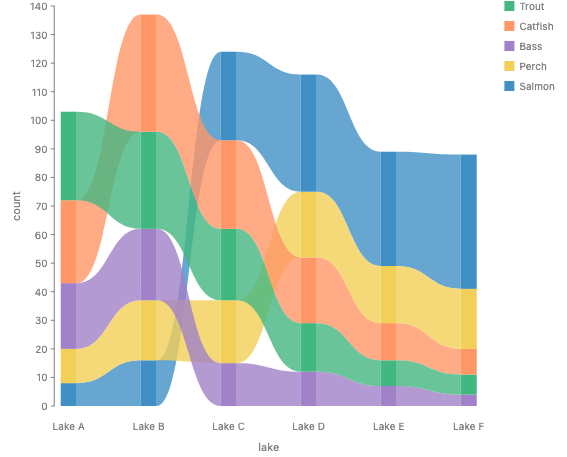

### The key context

Each `by` adds a grouping to the context. The checker tracks two sets: the groupings so far, and the rest key, which is the identity's columns that those groupings do not fix. Additivity is looked up in two places:

1. `stack({ by: k })` and `treemap` add their children over `k`. They need `CanSum` over `k`.
2. A channel folds the rows of one group. It needs a fold that suits every column of the rest key.

Disjoint and complete, the first two summarizability conditions, cost almost nothing on `by`. A column has one value per row, so groups never overlap. Completeness fails only for a null key. Today a null becomes an unlabeled group in `by` and is dropped silently by a bin. Those should agree.

### Product keys and missing pairs

After `spread({ by: "lake" })` and `stack({ by: "species" })`, a species can be missing from a lake. Whether a missing pair is zero is a fact about how the table was made, not about the value's traits:

- In a complete table, such as a catch survey that lists every lake and species it covered, a missing pair of a value that adds up and has a zero is zero. The ribbon narrows to nothing.
- In a truncated table, a missing pair is not zero. `categoryBrands` lists the top brands of each year: 75 in 2000 and 100 after, and only 37 of 173 brands are present in all 20 years (run). A brand that drops out of the list still has a value, so a ribbon that drew it at zero would be false.

So the default is a gap, and a zero needs either an explicit fill or a declaration that the table is complete. How to declare that is open (section 14). GoFish has no rule for this today.

### Multi-table inputs (smallest useful piece)

- A foreign key is a function from one table's key to another's.
- A join along a foreign key keeps the key context. Each joined column remembers the key of the table it came from.
- A join on a column that is not a key of the right table adds a key, the same way `by` does.
- A joined column summed along a key it does not depend on is the fan trap, caught by the check in section 4.

### Hannah's model, in type theory

Hannah Aizenman's papers ("Mind Your νs and Qs", GUGOG 2026, and the longer TopoInVis 2026 version) model a dataset as a bundle over a base space of keys, and a visualization as a structure-preserving map. Each piece has a type-theory reading:

| Her model                         | Type theory                                                                                                                                       |
| --------------------------------- | ------------------------------------------------------------------------------------------------------------------------------------------------- |
| A section of the bundle           | A dependent function from keys to records                                                                                                         |
| The base space K and its topology | A key type with traits. On finite data a topology carries no more than a neighbor relation.                                                       |
| The sheaf conditions              | They hold for any function. They only become a check when a key has duplicate rows, which is a uniqueness check.                                  |
| Equivariance of an artist         | Parametricity: an operator that is generic in the key type, given some traits, commutes with every relabeling of the keys that keeps those traits |
| The map from graphic back to data | Every node knows its key, which GoFish already does                                                                                               |

That last row gives a statement worth keeping. Each trait fixes the relabelings that must not change the picture's meaning: any renaming for a plain key, order-keeping renamings for `HasOrder`, rotations for `HasCycle`, changes of unit for a unit. Kennedy proved the unit case this way in 1997. It is also a testing recipe: change the data in an allowed way and measure that the marks change to match.

I found no strong reason to prefer the categorical form. Sheaf gluing says something new only for covers that overlap, and GoFish has none. TypeScript does not enforce parametricity, so the statement becomes a rule for operator authors plus property tests.

## 8. Equality of types and of data shapes

The draft deferred "long versus wide and sparse versus dense should type the same". The recommendation is the smallest thing that works:

1. **One canonical form, which is a type and not a copy of the data.** Rows stay a list. The schema gains a declared `key`. The checker checks that the key is unique only where an operator relies on it.
2. **Equality is up to field order and key order only.** No search over isomorphisms and no e-graph. Nesting needs no rule, because `spread` then `stack` already turns a flat key into a nested one.
3. **Every other reshape is a named conversion that states what it needs:**
   - `unpivot` (wide to long) needs the melted columns to share one unit. The new key gets `Domain.discrete(columns)`.
   - `pivot` (long to wide) needs a unique key or an allowed fold.
   - Filling missing keys needs a value that adds up and has a zero in a table known to be complete, or an explicit fill. A rate has no honest fill, and neither does a top-N list.
   - Aggregating needs `CanSum`, or a weight.
4. **Grids, trees and positional indexes** stay in `derive` or polars.

Only `unpivot` has stories that need it now. The population pyramid, the heatmap, the Likert data and the ridgeline all reshape by hand before `chart`, so no check sees the reshape.

Declared shortcut: `unpivot` rejects columns with different units. The right fix is a value type that depends on the key, so that a spread over the new key passes and a stack fails. That needs new design.

Things that must not be equal: wide columns in different units, row order when the key has no order (today groups come out in first-appearance order when no levels are declared, so order is part of the input), a bag with several rows per key, and raw rows versus an aggregate.

## 9. Summarizability and partitioning

They connect, through the regions of a key. But the rule is not "a partition needs Extensive". There are two families of partition-shaped layout, and they need opposite things.

- **Value-sized pieces:** `stack`, `treemap`, `.normalize()`, pie, `cut`. The value sets each piece's size. This is plain summarizability: the groups split the parent, the size adds up over the key, and it is not negative when the whole is given. Then the whole's size is the parent's total.
- **Key-sized pieces:** `partition`, bins, calendar cells, map regions. The key sets each piece's size. A channel read as an amount should then be a value per unit of the cell: a count per unit width, or per km². This is Bertin's rule, and it is the classic choropleth mistake when broken.

Examples that decide it:

- **Histogram with unequal bins.** Bar area is the count. Bar height is the density. With equal bins the two agree, which is why the mistake hides.

  

- **Choropleth.** Regions split the map, and color shows a value. An extensive value such as population colored by state mostly shows state size.
- **Monthly sales on true month widths.** It looks right and is slightly wrong, since months differ in length. So the key-sized rule should be a lint, not an error.
- **Venn and UpSet.** The groups overlap, so sizes do not add. The fix is to group by the exact combination of sets.
- **Top N before `.normalize()`.** Completeness is broken by `filter`. I would not add a "partial" type. A lint on `.normalize()` and on total labels is enough.

One correction to the draft. It says the cumulative case (a snapshot, in this proposal's words) is the disjointness condition. There are two disjointnesses. Groups of rows are disjoint for any `by` on a column. What fails for inventory over months is that the things each value counts overlap. That check belongs on the column and the key, and on every sum, not only on `stack`. Section 4's rule does this.

Recommendation: no shared trait now. Keep the word `partition` on the operator. The value-sized rule is section 4. The key-sized rule comes from units with "per" once #1142 lands.

## 10. Typing every operator, channel and coord

How to read the tables:

- **Needs** is what the construct requires. A failed need is an error unless it says lint.
- **Keys** is what it does to the key context.
- **Gives** is the space fact it produces.
- **Fills in** is the default it elaborates.
- **Now** says whether GoFish checks it today: yes, part, or no.

### Flow operators

| Operator                      | Needs                                                                                                                                                                                                                                                                      | Keys                                                                 | Gives                                                                                     | Fills in                                                                                     | Now                             |
| ----------------------------- | -------------------------------------------------------------------------------------------------------------------------------------------------------------------------------------------------------------------------------------------------------------------------- | -------------------------------------------------------------------- | ----------------------------------------------------------------------------------------- | -------------------------------------------------------------------------------------------- | ------------------------------- |
| `spread({ by, dir })`         | nothing of the value                                                                                                                                                                                                                                                       | adds `by`                                                            | one slot per key along `dir`. Children keep their own spaces. The axis is a list of keys. | slot order from `HasOrder`. Closes the loop if the key has `HasCycle` and the axis does too. | part                            |
| `stack({ by, dir })`          | the stacked size has `CanSum` over `by`, has `HasZero`, and its parts share a unit. Each child is one length along `dir`. A spread or layer of several lengths has an extent there, its tallest bar, but no amount to add, so a stack outside a spread is an error (#992). | adds `by`                                                            | one continuous space along `dir` with lengths from a fixed origin                         | origin at the midpoint if `by` has `HasMidpoint`                                             | part (unit-level `CanSum` only) |
| `scatter({ by, x, y })`       | `x` and `y` are numbers or instants. A unit clash on a shared axis is an error.                                                                                                                                                                                            | adds `by`                                                            | positions at data values. Marks are glyphs unless their sizes are in the axis unit.       | position fold: mean, weighted if the column has a weight                                     | part                            |
| `group({ by })`               | nothing                                                                                                                                                                                                                                                                    | adds `by`                                                            | a layer of children                                                                       |                                                                                              | yes                             |
| `table({ by: { x, y } })`     | nothing of the value                                                                                                                                                                                                                                                       | adds both keys                                                       | a grid. Both axes are lists of keys.                                                      | fills missing pairs with empty cells                                                         | yes                             |
| `treemap({ by, size, tile })` | `size` has `CanSum` over `by`, has `HasZero`, and is not negative                                                                                                                                                                                                          | adds `by`                                                            | areas that add up to the parent's area. No axis.                                          |                                                                                              | part                            |
| `pack({ by })`                | the circle size has `HasZero` and is not negative                                                                                                                                                                                                                          | adds `by`                                                            | circles with no axis. Areas compare and do not add up to the parent.                      |                                                                                              | no                              |
| `partition({ by })`           | `by` has `HasRegion`                                                                                                                                                                                                                                                       | adds `by`                                                            | each key's own region on a shared scale                                                   | lint: a size channel read as an amount inside a cell should be per unit of the cell          | part (`HasRegion` only)         |
| `enclose` (flow step)         | nothing                                                                                                                                                                                                                                                                    | none                                                                 | an outline around the children                                                            |                                                                                              | yes                             |
| `derive(fn)`                  | nothing                                                                                                                                                                                                                                                                    | unknown after it, unless the helper is typed                         |                                                                                           | checks after it use the row check                                                            | no (#999)                       |
| `filter(pred)`                | nothing                                                                                                                                                                                                                                                                    | same keys, fewer rows                                                |                                                                                           | lint on a later `.normalize()` or total label                                                | no                              |
| `join(right, { on })`         | `on` exists on both sides                                                                                                                                                                                                                                                  | same keys if `on` is a key of the right table. Otherwise adds a key. |                                                                                           | joined columns remember their own key                                                        | no                              |
| `resolve`                     | the name exists in scope                                                                                                                                                                                                                                                   | the key context of the named marks                                   |                                                                                           |                                                                                              | yes                             |
| `log`                         | nothing. It is a debug pass-through and should be renamed before a log coord ships.                                                                                                                                                                                        |                                                                      |                                                                                           |                                                                                              |                                 |

**Open problem: the stack rule, read literally, rejects the Nested Mosaic story.** `NestedMosaicChart` stacks `class` on y around a stack of `sex` on x, each with `size: field("count").normalize()`. Read literally, the Stack row says each child must be one length along `dir`, and a stack of several lengths "has an extent but no amount". But here the outer stack sets each child's length from its own `size` option, so it never reads the child's extent, and the picture is right. The suggested exemption: a stack whose `size` option gives each child's length does not read the child's extent, so the "one length" condition does not apply to it. The rule above is not changed yet. This is a reading of the rule's text, not the output of a checker (section 14).

### Data helpers and field methods

| Construct                         | Needs                                                                     | Result type                                                                                                                | Now                                  |
| --------------------------------- | ------------------------------------------------------------------------- | -------------------------------------------------------------------------------------------------------------------------- | ------------------------------------ |
| `.sum()`                          | `CanSum` over the rest key                                                | same unit, `CanSum` over the keys split so far                                                                             | part                                 |
| `.mean()`                         | a unit, or a difference unit. With `{ weight }`, the weight has `CanSum`. | same unit, no `CanSum`                                                                                                     | no weight today                      |
| `.median()`, `.min()`, `.max()`   | `HasOrder`                                                                | same unit, no `CanSum`                                                                                                     | no                                   |
| `.last()`, `.first()` (new)       | `.last()` needs an ordered rest key                                       | same type                                                                                                                  | new                                  |
| `.count()`                        | nothing                                                                   | count unit, `CanSum` over every key, `HasZero`, whole numbers                                                              | yes                                  |
| `.distinct()`                     | nothing                                                                   | count unit, `HasZero`, and no `CanSum` across groups                                                                       | wrong today: the docs say it adds up |
| `.normalize()`                    | `CanSum` over the key it shares across, not negative                      | a share in [0, 1]. Adds up within its group. Across groups it is an average weighted by the group total.                   | part (adds up everywhere today)      |
| `.bin(Bin.*)`, `.bin(Calendar.*)` | a number or an instant                                                    | a key with `HasRegion` and `HasOrder`. Calendar parts also get `HasCycle`. It inherits additivity from the column it bins. | yes, except the last part            |
| `.sort()`, `.reverse()`           | `HasOrder`, or a field to sort by                                         | same key in a new order. A reordered key loses a midpoint that no longer splits it.                                        | part                                 |
| `.dropNulls()`                    | nothing                                                                   | same type with no nulls                                                                                                    | yes                                  |
| `repeat`                          | a count: whole numbers with `CanSum`                                      | one row per unit                                                                                                           | no                                   |
| `unpivot` (new)                   | the melted columns share one unit                                         | a new key over the column names                                                                                            | new                                  |

### Mark channels

| Channel                                    | On                                           | Needs                                                                                | Fold over the rest key                                                                     | Now                                 |
| ------------------------------------------ | -------------------------------------------- | ------------------------------------------------------------------------------------ | ------------------------------------------------------------------------------------------ | ----------------------------------- |
| size (`w`, `h`, `r`)                       | rect, ellipse, petal, polygon, image, circle | `HasZero`. A fold that suits the rest key.                                           | sum if `CanSum`. Weighted mean if there is a weight. Otherwise an error that offers folds. | part: always sums, unit-level check |
| area (`area`)                              | circle (rect and ribbon are proposed)        | same as size                                                                         | same, then the square root                                                                 | part                                |
| position (`x`, `y`, `cx`, `x2`, and so on) | every box mark                               | a number or an instant. `x` and `w` together need `w` in the difference unit of `x`. | mean, weighted if there is a weight                                                        | no check                            |
| color (`fill`, `stroke`)                   | every mark                                   | one value per group, or an explicit fold                                             | none: the value must agree across the group                                                | no check                            |
| raw (`text`, `href`)                       | text, image                                  | one value per group, or an explicit fold                                             | none                                                                                       | no check                            |
| `dims`                                     | rect                                         | each slot follows its own kind                                                       |                                                                                            | yes                                 |

The palette a color channel gets follows the type: categorical for no order, sequential for `HasOrder` or a number, diverging around the midpoint or the zero when the data spans it, cyclic for `HasCycle`.

### Relational marks and combinators

| Construct                                                         | Needs                                                                                | Gives                                                                                              | Fills in                                                                                                                          | Now  |
| ----------------------------------------------------------------- | ------------------------------------------------------------------------------------ | -------------------------------------------------------------------------------------------------- | --------------------------------------------------------------------------------------------------------------------------------- | ---- |
| `line` along a key                                                | the key has `HasOrder` or `HasCycle`. Lint: a smooth `Curve` needs a continuous key. | a path through the marks                                                                           | closes if `HasCycle` in a cyclic axis. Breaks at a missing key.                                                                   | no   |
| `ribbon` along a key                                              | as `line`. If it fills down to a baseline, the value has `HasZero`.                  | a band                                                                                             | a gap at a missing pair. Zero only if the value has `CanSum` and `HasZero` and the table is declared complete (open, section 14). | no   |
| `arrow`, `position`, `offset`                                     | the referenced marks exist                                                           | a glyph between placed marks. A coord does not bend it.                                            |                                                                                                                                   | yes  |
| `layer([...])`                                                    | children that share an axis agree on its unit                                        | the union of the children's spaces. With `coord`, a new space that the parent places as one glyph. |                                                                                                                                   | yes  |
| `enclose`                                                         | nothing                                                                              | an outline. Its size is not a data length.                                                         |                                                                                                                                   | yes  |
| `union`, `intersect`, `subtract`, `exclude`, `atop`               | nothing of the data                                                                  | one region. Its sizes are no longer data lengths, so a parent stack cannot add them.               |                                                                                                                                   | no   |
| `cut`                                                             | the weights have `CanSum`, `HasZero`, and are not negative                           | pieces whose sizes add up to the shape                                                             |                                                                                                                                   | part |
| `ref`, `selectAll`                                                | the name is in scope                                                                 | the marks with their keys. A later `by` may use any key in their context.                          |                                                                                                                                   | yes  |
| `text`, `image`, `blank`, `ellipse`, `petal`, `polygon`, `region` | the channel rules above                                                              | a box like a rect of the same size                                                                 |                                                                                                                                   | part |

### Coords

A coord is checked against the space facts of what is inside it. For each axis it says which data operation becomes addition on screen (#1326), and what it does to lengths and to glyphs.

| Coord                                                | Axis traits                                                      | Needs from its content                                                                                                                                      | Lengths                                                  | Glyphs          | Fills in                                                                            | Now      |
| ---------------------------------------------------- | ---------------------------------------------------------------- | ----------------------------------------------------------------------------------------------------------------------------------------------------------- | -------------------------------------------------------- | --------------- | ----------------------------------------------------------------------------------- | -------- |
| linear (internal)                                    | none                                                             | nothing                                                                                                                                                     | kept                                                     | moved           | zero baseline for `HasZero`, midpoint for `HasMidpoint`                             | yes      |
| `Coord.polar()`, `Coord.clock()`                     | angle: `HasCycle`. Radius: `HasZero`.                            | Lint: a radius with no zero (dates) leaves an arbitrary hole. Lint: a filled mark whose radius shows an amount reads as area, so it wants `radius: "area"`. | bent into arcs and wedges                                | moved, not bent | a key with `HasCycle` on the angle closes the loop. Data 0 sits at the start angle. | part     |
| `Coord.wavy()`                                       | none                                                             | Lint: lengths are no longer comparable                                                                                                                      | bent                                                     | moved           |                                                                                     | yes      |
| `Coord.geo({ projection })`                          | longitude: `HasCycle`. Both axes in degrees.                     | Lint: a filled amount needs an equal-area projection                                                                                                        | not kept. Areas are kept only by equal-area projections. | moved           |                                                                                     | part     |
| `Coord.log` (proposed)                               | no zero. Screen addition is data multiplication.                 | The domain is above 0. No length is pinned at 0 on that axis. An additive `stack` is an error unless overridden (#1326).                                    | become ratios                                            | moved           | tick ladder                                                                         | proposed |
| `Coord.clock({ radius: "area" })` (proposed)         | radius: `HasZero`                                                | the radius value has `HasZero`                                                                                                                              | wedge area follows the value                             | moved           |                                                                                     | proposed |
| `Coord.envelope` (#1284, proposed)                   | one axis measures area                                           | the fill value has `HasZero`                                                                                                                                | follow the outline's area                                | moved           |                                                                                     | proposed |
| `Coord.along`, `Coord.spiral({ period })` (proposed) | one axis runs along a curve. Spiral: the period acts as a cycle. | Lint: a key laid along a spiral period should have `HasCycle` or a calendar part                                                                            | bent along the curve                                     | moved           | lines up equal phases                                                               | proposed |

Embedding, refined from the draft. It is a space fact computed from two inputs, as today (`foreignPlaced` and `isGlyph` in `_node.ts`): how the operator places the child, and whether the units match. A size is a glyph, moved by a coord and not bent, when its parent places it at a datum (a point or a cell, as `scatter` and `partition` do) and its unit differs from that axis's unit. A mark's own position in another unit counts the same way. Every other data size is a length of the space and is bent. So a bubble in a scatter is a glyph, a bar in a spread slot is a length, and a Gantt bar in a scatter, whose width is in the x axis's unit, is also a length. The draft's rule (spread embeds, scatter attaches) is the common case. The exception applies only inside a coord, and an explicit `emX` or `emY` forces embedding.

### The rules as judgments

`Γ` gives each column its type. `S` is the set of keys split so far and `R` is the rest key. `Φ` is the set of space facts. `⇝` means "elaborates to".

```text
              k ∈ R
(Spread)  ─────────────────────────────────────────────────────────
          Γ; S; R ⊢ spread(k) ⇒ S ∪ {k}; R ∖ {k}
                    ▷ slots along dir, closed if Γ ⊢ k : HasCycle

          k ∈ R    Γ ⊢ f : CanSum[k]    Γ ⊢ f : HasZero
(Stack)   ─────────────────────────────────────────────────────────
          Γ; S; R ⊢ stack(k) over f ⇒ S ∪ {k}; R ∖ {k}
                    ▷ lengths from the origin along dir

              R = ∅
(One row) ──────────────────────────────
          Γ; S; R ⊢ h: f ⇝ h: field(f)

              Γ ⊢ f : CanSum[R]
(Sum)     ──────────────────────────────────────
          Γ; S; R ⊢ h: f ⇝ h: field(f).sum()

              Γ ⊢ f : CanAverage[w]
(Mean)    ──────────────────────────────────────────────────────
          Γ; S; R ⊢ h: f ⇝ h: field(f).mean({ weight: w })

              Γ ⊢ a : CanSum[k]    Γ ⊢ b : CanSum[k]
(Ratio)   ──────────────────────────────────────────────────
          Γ ⊢ a / b : unit(a)/unit(b), CanAverage[b]

          dom(f) ⊆ (0, ∞)    Φ(axis) has no length pinned at 0
(Log)     ──────────────────────────────────────────────────
          Φ ⊢ log(axis) ok
```

The check runs in two directions. Types and the key context flow down the pipeline. Space facts flow back up from the marks, and the coord is checked against them. Then the solved traits fill in the defaults.

## 11. The `.coord()` method

Today a coord is one option on the two boundaries: `chart(data, { coord })` and `layer({ coord }, [...])`. The full study, with each option written on six stories in JS and Python, is in [coord-method](research/coord-method.md).

A fact that settles a lot: in GoFish, layout always runs in the space's own coordinates, and operators resolve `dir: "theta"` against the coord around them. So the position of a `.coord()` call in the chain can never change what the flow computes. A coord is a scope, not a last step.

| Option                           | Spelling                                               | For                                                                                                                                | Against                                                                                                                                                                                                                     |
| -------------------------------- | ------------------------------------------------------ | ---------------------------------------------------------------------------------------------------------------------------------- | --------------------------------------------------------------------------------------------------------------------------------------------------------------------------------------------------------------------------- |
| A. Keep the option               | `chart(data, { coord: Coord.clock() })`                | One spelling on both boundaries. Sits beside `axes`, `padding`, `w`, `h`. No IR or Python change.                                  | Not a method.                                                                                                                                                                                                               |
| B. Method at the end (the draft) | `chart(data).flow(...).mark(...).coord(Coord.clock())` | Reads like ggplot2's `+ coord_polar()`.                                                                                            | Teaches "lay out, then view in polar", which is not what happens. A misplaced parenthesis changes the picture with no error: a pie per group becomes one whole-chart polar space, or a map overlay gets its own projection. |
| C. Method at the start           | `chart(data).coord(Coord.clock()).flow(...).mark(...)` | Same meaning as A. Reads as a scope. Names such as `theta` are declared before they are used. Python gets `.coord(y=Coord.log())`. | Two spellings, since `layer([...])` keeps the option. Frame settings split between the options and the method.                                                                                                              |
| D. Anywhere                      | either                                                 | Honest about order not mattering.                                                                                                  | Three spellings, and B's trap.                                                                                                                                                                                              |
| E. A wrapper                     | `Coord.clock(chart(...))`                              |                                                                                                                                    | `layer({ coord }, ...)` already says this.                                                                                                                                                                                  |

Layer rules that hold under any spelling:

1. One coord per boundary. It covers the flow, the mark, every `.layer()` tier and every child of `layer([...])`.
2. A boundary with no coord is in its parent's space.
3. A boundary with its own coord, inside another, is a separate space that the outer one places as a glyph. The two do not compose and neither overrides the other.
4. Sibling charts in different coords are separate boxes. Two sibling `geo` charts do not share a projection, so an overlay goes inside the map's boundary.
5. Combining transforms happens inside one coord value: per-axis warps, then one 2D map, as in `Coord.clock({ r: Coord.log() })`. A second `.coord()` call on one boundary is an error.

Why the start and not the end. The chain already reads from the outside in, not in the order things run. In `.flow(spread(...), stack(...)).mark(rect(...))` the spread contains the stack, which contains the rect, and the mark, written last, is the innermost thing. A coord is the outermost scope, so by the chain's own convention it comes first. It is true that the coord's map to the screen runs after layout. That is function application, `coord(layout(...))`, where the function applied last is written first. The coord also declares the names `r` and `theta` that the flow's `dir` uses, and a name should be declared before it is used. Josh's first guess was the end, and he reached the same conclusion from the code and from the names.

The type rule does not pick a position by itself. Axis names and traits flow down from the coord, and space facts flow up to it.

Recommendation: A, with C as the form to take if Josh wants the method. B is the one to avoid. I would move to C if axes and legends also become methods as part of the chrome work, so that the chain is the one place frame settings live.

One oddity found on the way: in a `.layer()` chain, the first chart's coord silently covers every later tier. That should be documented or made explicit. How a `selectAll` reference behaves across a coord boundary was not verified in the code.

## 12. Comparison with Flint

| Flint                                                       | Here                                                                                                                         |
| ----------------------------------------------------------- | ---------------------------------------------------------------------------------------------------------------------------- |
| Aggregation role per field (additive, intensive, and so on) | `CanSum { by }` and a weight, per column and key. Flint cannot say "adds over warehouses, not over months".                  |
| Zero baseline: meaningful, arbitrary, contextual, none      | `HasZero` is a data fact. Whether to show the zero is an operator choice.                                                    |
| Diverging: none, conditional, inherent                      | `HasMidpoint { at }`, which carries the point. "Conditional" becomes: the palette diverges when the data spans the midpoint. |
| Domain shape: open, bounded, fixed, cyclic                  | `Domain.continuous([lo, hi])` and `HasCycle`. Flint draws no working line between bounded and fixed.                         |
| A silent mean when a sum is invalid                         | An error that names the trait, per the "units are types" rule.                                                               |
| 44 named types                                              | Aliases over traits.                                                                                                         |

What Flint has that this does not yet: an identifier role (a key that must never be folded), and signed-additive (profit). Signed amounts already stack both ways from zero in GoFish (#773).

## 13. Recommendation, in order of work

1. **Column traits that are already open issues:** `HasZero` (#1051), `HasCycle` (#1052), `Domain.continuous`.
2. **`Trait.canSum({ over })` on the column, a declared `key`, and the row check** (this closes #1198). Public `.last()`, `.first()`, and `weight` on `.mean()`. The diagnostic record of section 15 comes with this step, since it brings the first check with more than one condition.
3. **`Trait.canAverage({ weight })`** and the schema-driven default fold.
4. **Key checks for connectors:** `line` and `ribbon` need `HasOrder` or `HasCycle`.
5. **Unit algebra** (#1142), then the key-sized lint.
6. **`unpivot`.**
7. **Field-name checks in TypeScript.**

Each step removes a wrong chart that renders today. Why this shape, against the principles in `api-design.md`:

- It desugars into the core. Every default expands to a fold or an option a user can write.
- One concept is one trait. `canSum` with `over` covers the unit flag, the entity key and the draft's Extensive.
- Meaning lives on the data type, and a mismatch is a loud error that names the trait.
- Few new terms: `Trait.canSum({ over })`, `Trait.canAverage({ weight })`, `Trait.cyclic`, `key`, `Domain.continuous`.
- A type is added only where a chart forces it. Snapshot, Constant, `HasNeighbors`, `HasParent` and cells all wait.
- The same shape in JS and Python, because the types are values on the wire.

## 14. Decisions for Josh

1. Is `Trait.canSum({ over })` the one declaration for additivity (approach C), or do you want each kind declared (approach A)?
2. Settled 11-12: the key word is `over`, not `by` or #1198's `entity`. Line and ribbon use `along`, so there is no clash.
3. Open: a snapshot can be declared by where it adds (`canSum({ over })`) or by where it is a reading (`snapshot({ along })`). Two spellings seem fine for now. Which examples tell them apart?
   Also: Should a column that does not add up over an ordered key get a default fold (`.last()`), or an error that offers the choices? I recommend the error.
4. Settled 11-12: operations are spelled as the trait, `Trait.canSum` and `Trait.canAverage`. Open: do the value-structure words stay adjectives (`ordered`, `cyclic`, `diverging`), and should today's `Trait.summable()` be renamed to match?
5. Is `key` a chart option beside `schema`, or part of the schema?
6. Do plain numbers have `HasZero` by default, with units such as °C opting out through a difference unit?
7. Does `HasMidpoint` go on amounts too (profit around 0), as well as on ordered keys?
8. Are the key-sized checks (histogram density, choropleth of counts) lints and not errors?
9. `.coord()`: keep the option, or add the method at the start of the chain?
10. Should a null `by` value be an error, a visible "missing" group, or stay an unlabeled group? Bins drop nulls silently today.
11. Should declared levels keep empty groups, as cells do?
12. Is the TypeScript mirror worth starting with field names now?
13. Should `log`, the debug pass-through, be renamed before `Coord.log` exists?
14. Should every type check report through one diagnostic record and one list, with `render` throwing once at the end (section 15)? I recommend yes.
15. Are the words made on the JS side for both languages, from one table in `gofish-ir`, or does Python keep its own messages? I recommend one table.
16. Should filled-in defaults be recorded as notes that the user can ask to see?
17. Are the codes (`cannot-sum`, `no-zero`) public names that users can search for and use to turn a lint off?

### Keys (section 7)

18. Does `key: [...]` mean the table's identity, a candidate key checked on the rows when a rule relies on it, and never "the fields a chart may split by"?
19. With no declared key, is the identity the row?
20. How is a dependency between fields declared? The draft spelling is `Trait.nested({ in: "region" })` on `country`.
21. Is an order made by `.sort(...)` on a value a display order only, so that a line or ribbon along that key still needs `HasOrder`?
22. Should a `scatter({ by })` whose groups hold more than one row be a lint, an error, or allowed (`cars.Name`)?
23. Should a color or text channel that reads a field that varies inside the mark be an error? Today it reads the first row.
24. Should `repeat` and `chunk` become typed flow steps that output a key, in place of `derive`?
25. After `unpivot`, does the value sum over the new key? I recommend no, unless declared.
26. Do aggregates built into a new table need a typed helper, so the checker sees the new key? About 12 stories build one by hand.
27. Should a key with no declared order be "unknown" (it passes, as the proposal says) or "no order" (as the engine already treats an undeclared string key for axes)?
28. Should a `by` on an undeclared number that is not in the table's `key` be an error that asks for a bin or `Domain.discrete`, or only a lint? It affects `StripPlot` (`cylinders`) and the titanic passenger stories (`pclass`, `survived`).

### Datasets (section 16)

29. When a column has both `canSum` and `canAverage`, which fold does a size channel fill in: the sum, the mean, or an error that offers both?
30. Is a missing pair a gap by default, with zero only for a table declared complete? How is "complete" or "top N" declared?
31. How does a number column get an order or a time granularity (a year stored as 1956)? Should `Unit.time()` reject a plain number?
32. Should a column be able to say it belongs to a coarser key in a flat table, such as `{ unit, key: "region" }` for `uncertainty`?
33. Should a table with no id column get an implicit row key, so that the static rules work on `penguins` and `denseMasses`?
34. Should the stack rule exempt a stack whose `size` option gives each child's length (the Nested Mosaic case in section 10)?

### Space side (section 17)

35. Adopt the join rule for sibling spaces on one shared axis, with the `mixed-sides` error and the `no-shared-baseline` lint? Should the mirrored fix ship now, before the type system?
36. Write the Gives column of section 10 in the five words position, length, difference, slot and area?
37. Is "an area reads as an amount when the product of its two length units can sum over the product key" a lint that waits for #1142?
38. Scope the key and coord lint by what the mark asserts, so that pies and Cartesian bars of months stay silent?
39. Build a small metamorphic test kit on top of `capture-one`'s normalized DOM?
40. Add an opt-in lint class, under strict mode (#1120), for structure a layout invents or drops?

41. Does `Trait.cyclic()` alone give an order with a conventional first level (so `.last()` works on months), or must a column say `ordered` and `cyclic` both? The example now says both.

Syntax to review: `Trait.canSum({ over })`, `Trait.canAverage({ weight })`, `Trait.cyclic()`, `key: [...]`, `traits` on a column record, `Domain.continuous([lo, hi])`, `.mean({ weight })`, `.last()`, `.first()`, `unpivot`, `Trait.nested({ in })`, `repeat` as a flow step.

## 15. How the checker reports

The checks in sections 4, 9 and 10 need one way to tell the user what is wrong. Today GoFish has three ways, and none of them fits a checker with many rules.

| Path today                                                                       | Shape                                                                        | What it lacks                                                            |
| -------------------------------------------------------------------------------- | ---------------------------------------------------------------------------- | ------------------------------------------------------------------------ |
| Thrown errors: 327 `throw new` sites, `checkSummable` in `measure.ts` among them | A string. `MeasureClash` is the only error class that carries data.          | The first error stops the render, so the user fixes one problem per run. |
| The IR validator (`gofish-ir`, `validate.ts`)                                    | A list of `{ path, message }`                                                | It collects every problem, but only about the shape of the document.     |
| Layout warnings (`layoutWarnings.ts`)                                            | A record with a `kind`, the node, numbers and a message, gathered per render | It collects and the chart still draws, but only for layout.              |

Two more gaps follow from throwing strings:

- The wording is written for JS only. Python receives the JS error as one string (`widget.py` documents the reply as `{error: str}`), so a Python user is told to write `Unit("°C", { traits: [Trait.summable()] })`.
- A check that throws can report only one of its failed conditions. A declared °C bar is rejected for having no `CanSum`, and the missing zero is never mentioned (see the gaps list).

### The proposal: one record, one list

1. A check does not throw. It adds a **diagnostic** to a list on the render session and goes on to the next check.
2. A diagnostic is data: a code, a severity, the place in the spec, the schema line the rule read, the facts the message names, and the fixes. It holds no finished sentence.
3. The words are made from the record when it is shown, in the spelling of the user's language.
4. `render` decides at the end. If the list has an error, it throws one error that lists them all. Lints are printed and the chart draws.

```ts
type Diagnostic = {
  code: string; // the condition that failed; stable, so people can search for it
  severity: "error" | "lint";
  site: Site; // the operator or channel in the user's spec
  declared?: Site; // the schema line the rule read
  facts: Record<string, string | string[]>; // columns, keys and units the message names
  fixes: Fix[]; // spec fragments the user can write instead
};
```

`MeasureClash` is already close to this. It carries both units, the columns bound to each, and the place where they met, and it gets its axis name filled in on the way up the tree. The layout warning record is close too. Both would become diagnostics with their own codes.

### One failed condition

The "Inventory by month" example from section 1.

```js
inv
  .flow(spread({ by: "warehouse", dir: "x" }), stack({ by: "month", dir: "y" }))
  .mark(rect({ h: "stock", fill: "month" }));
```

```python
inv.flow(spread(by="warehouse", dir="x"), stack(by="month", dir="y")).mark(rect(h="stock", fill="month"))
```

The record:

```js
({
  code: "cannot-sum",
  severity: "error",
  site: { operator: "stack", by: "month" },
  declared: { schema: "stock", trait: "canSum", over: ["warehouse"] },
  facts: { column: "stock", addsOver: ["warehouse"], summedOver: "month" },
  fixes: ["one-group", "last", "mean"],
});
```

Shown to a JS user (draft wording):

```text
GoFish: 1 error

error[cannot-sum] at stack({ by: "month" })
  `stock` adds up over `warehouse`, not over `month`.
  Stacking it by month would count the same items once per month.
  declared at schema.stock: Trait.canSum({ over: "warehouse" })
  fix: keep one month, or use field("stock").last() or field("stock").mean()
```

Shown to a Python user, from the same record:

```text
GoFish: 1 error

error[cannot-sum] at stack(by="month")
  `stock` adds up over `warehouse`, not over `month`.
  Stacking it by month would count the same items once per month.
  declared at schema["stock"]: Trait.can_sum(over="warehouse")
  fix: keep one month, or use field("stock").last() or field("stock").mean()
```

### Two failed conditions in one run

Temperatures stacked by warehouse. The Stack rule in section 10 has two conditions on the column, `CanSum` over the stack key and `HasZero`, and °C meets neither.

```js
chart(rows, { schema: { temp: { unit: Celsius } } })
  .flow(spread({ by: "month", dir: "x" }), stack({ by: "warehouse", dir: "y" }))
  .mark(rect({ h: "temp" }));
```

```python
chart(rows, schema={"temp": {"unit": Celsius}}).flow(spread(by="month", dir="x"), stack(by="warehouse", dir="y")).mark(rect(h="temp"))
```

Both are reported (draft wording):

```text
GoFish: 2 errors

error[cannot-sum] at stack({ by: "warehouse" })
  `temp` does not add up over `warehouse`. It has no CanSum.
  declared at schema.temp: { unit: Celsius }
  fix: put the warehouses side by side with spread, or use field("temp").mean()

error[no-zero] at rect({ h: "temp" })
  `temp` is in °C, which has no zero, so a bar length means nothing.
  declared at schema.temp: { unit: Celsius }
  fix: subtract a reference temperature, or use a position (y) in place of a length (h)
```

A check that throws stops at the first of these. The user fixes the sum, runs again, and only then learns about the zero.

### One code per condition

Each condition above the line of a rule in section 10 is one code. The names are drafts.

| Rule                         | Condition that failed                | Code              | Severity |
| ---------------------------- | ------------------------------------ | ----------------- | -------- |
| Stack, Sum                   | the column has `CanSum` over the key | `cannot-sum`      | error    |
| Stack, any length channel    | the column has `HasZero`             | `no-zero`         | error    |
| `line`, `ribbon`             | the key has `HasOrder` or `HasCycle` | `no-order`        | error    |
| Log                          | the domain is above 0                | `log-domain`      | error    |
| Log                          | no length is pinned at 0 on the axis | `log-zero-length` | error    |
| Key-sized pieces (section 9) | the amount is per unit of the cell   | `amount-in-cell`  | lint     |

One code can have more than one sentence. `cannot-sum` on `stock` says "adds up over `warehouse`, not over `month`". On `price` it says "is an average weighted by `sold`". The facts in the record pick the sentence.

### Where the words are made

The table of codes and their sentences lives in one place, in `gofish-ir` beside the descriptors, with each spec fragment written in both spellings. The JS side makes the words for both languages, and the Python bridge asks for the Python wording. Python then needs no message code of its own.

A later step could store each fix as a piece of IR and print it as JS or Python source. That would also let an editor apply the fix. It needs a printer from IR to source in both languages, so it is not part of the first step.

### Filled-in defaults

The same list can hold a third kind of entry: a note for each default the checker filled in, such as "`price` is drawn as its mean weighted by `sold`". Every default in this proposal expands to code the user could write, and a note is where the user can read that code. Notes are not printed unless the user asks. How the user asks is not designed here.

### Other ways to do it

|                                  | Throw at the first failure (today) | A result or effect library (Effect, neverthrow)            | One record and one list (recommended)       |
| -------------------------------- | ---------------------------------- | ---------------------------------------------------------- | ------------------------------------------- |
| Every problem in one run         | No                                 | Possible, if the checker is written in the library's style | Yes                                         |
| Lints that do not stop the chart | A second path                      | A second path                                              | The same path, by severity                  |
| Python wording                   | No                                 | Not addressed                                              | Yes, the record is data                     |
| New dependency                   | No                                 | Yes                                                        | No                                          |
| Precedent                        |                                    |                                                            | rustc, Elm, the TypeScript compiler, ESLint |

A result or effect library answers a different question: which failures can this function produce, and has the caller handled them. A checker wants to gather many small findings from a walk over a tree and word them well. The compilers listed all do that with a plain list of records.

### What this does not cover

- The 327 existing throw sites are not migrated. A wrong option value or a bug in GoFish can keep throwing.
- The first users are the new type checks. `MeasureClash`, the layout warnings and the IR validator can move to the same record later, one at a time.
- Sites need a way to point at the user's spec. Today a site is a string such as `spread(by: "site")`. Pointing at a line of the user's source file is out of scope.

## 16. The example datasets, typed

To see how the types work on data GoFish already draws, [dataset-types](research/dataset-types.md) writes this proposal's vocabulary on all twenty datasets in `packages/gofish-graphics/src/data/`. Every spelling marked proposed is new and was not run, since none of it exists. Keys, row counts and dependencies between fields were checked by scripts. 22 specs in today's spelling were built against the library: 19 drew and 3 threw. Which stories the rules would reject comes from reading the rules, not from a checker.

### How to read a schema

| Part                           | What it says                                                                                                   | Status   |
| ------------------------------ | -------------------------------------------------------------------------------------------------------------- | -------- |
| `key: [...]`                   | the table's identity: no two rows share these columns. Checked on the rows when a rule relies on it.           | proposed |
| `unit`                         | what the values measure. Two columns can share an axis or be added only when their units match.                | today    |
| `domain`                       | the values a column can take: `Domain.discrete(levels)`, or `Domain.continuous([lo, hi])` (proposed)           | part     |
| `Trait.ordered()`              | `HasOrder`: neighbors mean something, so a line or ribbon may join them                                        | today    |
| `Trait.cyclic()`               | `HasCycle`: the last level is next to the first                                                                | proposed |
| `Trait.diverging()`            | `HasMidpoint`: a stack over this key starts from the middle level                                              | today    |
| `Trait.canSum({ over })`       | `CanSum`: rows may be added when they differ only in the listed key columns. With no `over`, every key column. | proposed |
| `Trait.canAverage({ weight })` | `CanAverage`: rows combine by a mean, weighted by the named column. With no weight, a plain mean.              | proposed |
| nothing declared               | unknown: the column passes every check                                                                         | today    |

The seafood catch table, which about 30 story files draw from, annotated:

```js
const Fish = Unit("fish");

chart(seafood, {
  // The identity: no two rows share a (lake, species) pair. Checked on the
  // rows when a rule relies on it.
  key: ["lake", "species"],
  schema: {
    // The lakes lie along connected rivers, so Lake A to Lake F is an order.
    // The strings do not show it, so only this declaration can supply it.
    // It allows a line or ribbon along lake.
    lake: Unit({
      domain: Domain.discrete([
        "Lake A",
        "Lake B",
        "Lake C",
        "Lake D",
        "Lake E",
        "Lake F",
      ]),
      traits: [Trait.ordered()],
    }),
    // Levels and no order. A ribbon along species is an error.
    species: Unit({
      domain: Domain.discrete(["Bass", "Trout", "Catfish", "Perch", "Salmon"]),
    }),
    // A count of fish. Each fish is caught once, in one lake, so the count
    // adds over both key columns: canSum() with no `over` means every key.
    count: { name: "Catch", unit: Fish, traits: [Trait.canSum()] },
  },
});
```

Today's spelling of the same order, which main accepts (not run with the order; the schema without it was run):

```js
const Fish = Unit("fish", { traits: [Trait.summable()] });

chart(seafood, {
  schema: {
    // The lakes lie along connected rivers.
    lake: Unit({
      domain: Domain.discrete([
        "Lake A",
        "Lake B",
        "Lake C",
        "Lake D",
        "Lake E",
        "Lake F",
      ]),
      traits: [Trait.ordered()],
    }),
    count: { name: "Catch", unit: Fish },
  },
});
```

This is a good teaching case for the order. Nothing in the strings "Lake A" to "Lake F" says the lakes are connected by rivers; it is a fact about the world, and only the declaration carries it. With this schema, `BarStacked` (spread by lake, stack by species, `h: "count"`) passes, Pie `Basic` passes (the rest key is `lake`, and `count` sums over it), and Area `Stacked` passes, because a ribbon along `lake` needs `HasOrder` and now has it. A ribbon along `species` would be an error. Today's spelling accepts the same `lake` declaration (`Trait.ordered()` on `Domain.discrete` levels), with `count` in a summable unit, and `BarStacked` and Area `Stacked` both draw (run, without the `lake` order; the order is not declared in any story today).

### All twenty, in one table

From the cleanest fit to the hardest.

| Dataset                  | Rows               | Key (checked)                                      | The one interesting typing fact                                                                                |
| ------------------------ | ------------------ | -------------------------------------------------- | -------------------------------------------------------------------------------------------------------------- |
| `olympicMedals`          | 60                 | `Country_Code`, `Medal_Type`                       | the cleanest fit: a count that sums over every key, and an ordered medal key                                   |
| `seafood` (catch)        | 30                 | `lake`, `species`                                  | `lake` has a river order that the strings do not show, so only a declaration supplies it; `species` has none   |
| `fishData`               | 30                 | `Lake`, `Fish Type`                                | a second copy of the catch table with other column names, and 28 of 30 counts differ                           |
| `titanic`                | 16                 | `class`, `sex`, `survived`                         | already aggregated. `class` has a partial order: Crew is not after Third                                       |
| `nightingale`            | 36                 | `Month`, `Type`                                    | the Rose story stacks square roots of deaths, and `derive` hides it from every rule                            |
| `gapminderCountries`     | 191                | `Country`                                          | the weight for life expectancy (`Population`) is in the table, but the weight for fertility is not             |
| `seattleWeather`         | 1,461              | `date`                                             | the gallery story "Seattle Highs by Day of the Week" draws bars of °C from 0, so the `HasZero` rule rejects it |
| `catchDataWithLocations` | 30                 | `lake`, `species`                                  | `x` and `y` belong to the lake and are copied onto every species row, with no join to remember that            |
| `countryPopulations`     | 70                 | `country`                                          | `uncertainty` belongs to the region and repeats on every country, so summing it counts it about five times     |
| `titanicPassengers`      | 1,309              | none after parsing; the raw file: `name`, `ticket` | `fare` is per ticket, so summing it over passengers gives 43,550 instead of 19,303                             |
| `categoryBrands`         | 1,975              | `year`, `name`                                     | a top-N list: a missing brand is not a zero                                                                    |
| `drivingShifts`          | 55                 | `year`                                             | `year` is a number, and `Unit.time()` today silently reads 1956 as 1.956 seconds after 1970                    |
| `birds`                  | 26,280             | `species`, `day`                                   | `day` is a day of the year, and closing the loop is right: day 365 lies 0.03° from day 1                       |
| `caltrain`               | 1,436              | `Train`, `Station`                                 | `Time` is minutes after midnight and runs past 1,440 for trains after midnight                                 |
| `streamgraphData`        | 50                 | `x`, `c`                                           | `c` is a category coded as a number                                                                            |
| `newCarColors`           | 160                | `Color`, `Year`, and also `Year`, `Rank`           | two candidate keys: a rank is a key inside a year                                                              |
| `genderPayGap`           | 10                 | `Gender`, `Pay Grade`                              | a wide table of five order statistics: none of them sums or averages                                           |
| `penguins`               | 344                | none                                               | per-penguin measurements can both sum and average, which leaves the default fold open                          |
| `denseMasses`            | 1,000              | none (735 exact duplicate rows)                    | individuals with no id: there is no spelling for "one row per thing, no id column"                             |
| `energy`                 | 48 nodes, 68 links | links: `source`, `target`                          | a graph, not a table. Adding every link counts energy 2.77 times                                               |
| `world110m`              | 287 rings          | none (`id` repeats for 30 countries)               | a row is a ring of points, and the vocabulary has nothing for it                                               |

### Five more schemas worth reading

**`categoryBrands`: a snapshot along year, in a truncated table.** Proposed, not run.

```js
chart(categoryBrands, {
  key: ["year", "name"],
  schema: {
    year: { unit: "year", traits: [Trait.ordered()] }, // a number with an order
    // A brand's value on January 1st. It adds over brands, not over years.
    value: {
      name: "Brand value",
      unit: USDMillion,
      traits: [Trait.canSum({ over: "name" })],
    },
  },
});
```

Today a bar per brand over all years draws and adds up to 20 yearly values (run). Under the proposal it is an error that offers `.last()` or `.mean()`. The year-by-year race passes. The table is the top 100 brands of each year, so a missing brand is not zero, and nothing in the schema can say the source was truncated.

**`titanicPassengers`: a value that belongs to a coarser key.** Proposed, written on the raw file, since the parser drops `name` and `ticket`.

```js
chart(titanicRaw, {
  key: ["name", "ticket"],
  schema: {
    // The price of the whole ticket, repeated on every passenger who shared
    // it. It adds over tickets, not over passengers.
    fare: { unit: "GBP", traits: [Trait.canSum({ over: "ticket" })] },
  },
});
```

216 tickets cover 596 passengers. Summed over passengers, fares total 43,550; summed over tickets, 19,303 (run). `canSum({ over: "ticket" })` says this exactly, but only on the raw file. On the parsed rows no declaration can repair it.

**`seattleWeather`: the `HasZero` rule finds a gallery story.** Proposed, not run.

```js
chart(seattleWeather, {
  key: ["date"],
  schema: {
    date: Unit.time(),
    precipitation: { unit: "mm", traits: [Trait.canSum()] }, // a flow
    temp_max: { unit: Celsius, traits: [Trait.canAverage()] }, // no HasZero
  },
});
```

`Bin.WeekdayTemperature` draws `rect({ h: field("temp_max").mean() })`, bars of °C from 0, so a 15 °C day looks half as hot as a 30 °C day. Today it draws with °C declared (run). Without the `.mean()` it throws "cannot be summed ... average them instead", and following that advice gives the same story.

**`gapminderCountries`: a weight that is in the table, and one that is not.** Proposed, not run.

```js
chart(gapminderCountries, {
  key: ["Country"],
  schema: {
    Population: { unit: Persons, traits: [Trait.canSum()] },
    LifeExpectancy: {
      unit: "years",
      traits: [Trait.canAverage({ weight: "Population" })],
    },
    // Births per woman. The right weight, women aged 15 to 49, is not here.
    FertilityRate: { unit: "births/woman" },
  },
});
```

A bar of `LifeExpectancy` per region elaborates to the population-weighted mean. A bar of `FertilityRate` per region is an error that asks for a weight, which is right, and the table cannot answer it.

**`penguins`: no key, and both folds hold.** Proposed, not run.

```js
chart(penguins, {
  // no key: one row per penguin, with no id
  schema: {
    "Beak Length (mm)": { unit: mm, traits: [Trait.canAverage()] },
    "Body Mass (g)": {
      unit: "g",
      traits: [Trait.canAverage(), Trait.canSum()], // which is the default?
    },
  },
});
```

The static rules need a declared key, and this table has none. Body mass sums and averages, and the proposal does not say which fold a size channel fills in. `Sex` has two kinds of missing value (null and `"."`); `spread({ by: "Sex" })` with the levels declared throws a correct error that prints the nulls as `undefined` (run).

The other fifteen are in the research file.

### What typing the datasets taught us

Vocabulary gaps, ranked by how many datasets hit them:

1. **Times and orders stored as numbers** (7 datasets). There is no spelling for "this number is a year" or "this number has an order but no sum". `Trait.ordered()` needs `Domain.discrete(levels)`, and `Unit.time()` reads a number as milliseconds since 1970 with no error (run).
2. **A value that belongs to a coarser key in a flat table** (4). The proposal catches this only after a `join`. Here there was never a join. A spelling such as `{ unit, key: "region" }` on the column would say it.
3. **No key at all** (4: `penguins`, `denseMasses`, `titanicPassengers`, `world110m`). An implicit row key, where each row is its own thing, would make the static rules work. It is what `canSum()` already assumes.
4. **Weights that are not in the table** (3). Miles per person needs population per year, and gas price needs gallons sold. `canAverage()` with no weight then claims equal weights, which the data cannot back.
5. **Pre-aggregated statistics with no fold** (2). A median neither sums nor averages. "Neither trait" is right for the checker, but the error's advice needs to know it is an order statistic.
6. **Cycles that are not quite cycles** (3). `nightingale.Month` is months of 1855, `birds.day` really is a cycle, and `caltrain.Time` is a time of day unrolled past midnight.
7. **Wide tables** (2). `unpivot` covers both.
8. **Shapes and graphs** (2: `world110m`, `energy`). Out of scope.
9. **Two candidate keys** (1: `newCarColors`). `key` takes one list.
10. **A partial order** (1: `titanic.class`). First, Second and Third are ordered, and Crew is not in that order.

Rules that look wrong on real data, each fixed or recorded where the rule lives:

- "A missing pair is zero if the value sums and has a zero" is wrong for the top-N `categoryBrands`. Section 7 now makes the default a gap.
- The stack rule, read literally, flags `NestedMosaicChart`. Recorded as an open problem in section 10.
- `derive` hides a real error in the Rose story. It stacks `Math.sqrt(Death)` by cause, so each wedge's radius is √a + √b + √c instead of √(a + b + c): January's is 80 where it should be about 56. Today it draws with no error (run). Under the proposal `derive` makes the column unknown, so no rule fires. If `derive` kept a column's type by name (one reading of #999, which asks how column types pass through `derive`), the stack would pass `canSum` and still be wrong. The right spelling is the proposed `Coord.clock({ radius: "area" })` with `h: "Death"` and no derive.
- No default fold is stated when a column has both `canSum` and `canAverage`. Now a decision (section 14).

Existing stories the rules would reject, once the relevant column is declared:

| Story                              | Rule                                  | Right?                                                 |
| ---------------------------------- | ------------------------------------- | ------------------------------------------------------ |
| Bin `WeekdayTemperature` (gallery) | `HasZero`: a bar of °C from 0 (#1051) | Yes                                                    |
| Bin "Seattle Rain on a Time Axis"  | the key-sized lint of section 9       | A lint. Months differ by up to 3 days, about 10%.      |
| NestedMosaicChart `Default`        | a stack outside a stack               | No. A false positive of the literal rule (section 10). |
| Pie `Rose`                         | none fires                            | A miss. The story is wrong and no rule sees it.        |

The six gallery stories that draw bands between lakes (Area `Basic` and `Stacked`, Ribbon `Basic` and `Polar`, Streamgraph `Default`, "Area Chart With Flexible Gaps") and LineChart `Default` are valid: the lakes lie in river order. They do not declare that order today, so under gradual typing they pass as undeclared, and they pass again once `lake` is declared ordered. Ribbon `Polar` is valid too: `lake` is ordered but not cyclic, and its ribbon stays open rather than closing around the turn, which is the case the scoped key and coord lint of section 17 (rule 4) is designed to leave silent.

## 17. What a rule gives: the space side

Notes from a design conversation on 11-13 ([notes-2026-11-13-space-types](research/notes-2026-11-13-space-types.md)) proposed typing each layout operator by the structure it keeps, read once on the data side and once on the space side. [space-types-check](research/space-types-check.md) checked them against this proposal and the engine. Each claim below is marked run (a probe story was rendered), read (from the code) or reasoning. Terms:

- **Space type.** What a layout makes of the data on screen. In the engine it is each node's `UnderlyingSpace` on each axis.
- **Origin state.** The engine's one fact about where a continuous axis's data 0 sits: `pinned` (data 0 is placed, so positions mean something), `free` (a length whose baseline a parent has not placed yet), or `none` (only differences mean something).
- **Mirrored.** A flag on a continuous space whose two sides of 0 both hold nonnegative amounts, as in a Likert chart. Its axis labels ticks with their distance from 0.

### What was already here

| Idea in the notes                                     | Where it already is                                                                       | Verdict                                            |
| ----------------------------------------------------- | ----------------------------------------------------------------------------------------- | -------------------------------------------------- |
| An operator's type is the structure it keeps          | Section 10's Needs and Gives columns; each operator's `resolveUnderlyingSpace` (read)     | there, under other names                           |
| Space-side words: position, length, area, order       | `pinned`, `free`, `none` and ordinal slots (read). No area fact.                          | new, fits: name the words, area is missing         |
| Reference point: edge, neutral point, or none         | one `StackOrigin { part, fraction, mirrored }` record for every stack (read)              | there, as one record                               |
| Shared axes unify on unit and baseline                | units: `joinUnits` and `MeasureClash`. Baseline: `overlayOrigin` and `allMirrored` (read) | there; the baseline join is unstated and has a bug |
| A stack of means is rejected by additivity            | the Stack and `.mean()` rows of section 10                                                | there in the proposal; breaks today                |
| Diverging and cyclic tags pick a layout               | `HasMidpoint` on the stack key, `HasCycle` on a spread key (sections 2 and 3)             | there                                              |
| An `arbitrary` order on the output                    | the absence of `HasOrder`, which axes already act on (read)                               | there; no new word needed                          |
| Data declares, chart requires, extra columns are fine | `applySchema` accepts extra columns (read); nothing infers what a chart requires          | there; the "requires" record is not built          |
| Lints fire at one boundary                            | checks run at many sites, gathered into one report (section 15)                           | conflicts                                          |
| Bidirectional checking                                | the passes already alternate down and up (read)                                           | there                                              |
| A data-by-coord table: exact, lossy, missing          | section 10's Coords lints                                                                 | conflicts as stated; fits when scoped to the mark  |

### The eleven examples

| #   | Example                                                      | Verdict                                | How checked     | Why                                                                                                                                            |
| --- | ------------------------------------------------------------ | -------------------------------------- | --------------- | ---------------------------------------------------------------------------------------------------------------------------------------------- |
| 1   | Mosaic as a stack of stacks: length times length gives area? | holds only with a condition            | run, read       | Right only because the inner size is a share and the outer width is its weight. With raw counts on both axes, the cells are count times count. |
| 2   | Mosaic from two one-level treemaps                           | holds for areas                        | run             | Same cell areas. The stack route has two honest axes, and the treemap route has none.                                                          |
| 3   | Squarified treemap                                           | breaks the composition rule            | run, reasoning  | Its strips are groups the algorithm invents. A treemap's area rule is its own, which GoFish already does.                                      |
| 4   | Stacked means                                                | holds under the proposal; breaks today | run             | Today the axis reads 35 USD, three mean prices added, because `.mean()` keeps a summable unit.                                                 |
| 5   | Small multiples with a shared axis                           | holds; the baseline half is unwritten  | read, reasoning | A `none` sibling beside a pinned one joins with no message. Not rendered.                                                                      |
| 6   | One diverging and one linear sibling                         | breaks today; a right join exists      | run             | The shared axis prints negative counts for the survey. See below.                                                                              |
| 7   | Likert: tag the data, no spec change                         | holds for the tag                      | read            | With five levels Neutral straddles 0. An explicit origin is the elaborated code and should not lint.                                           |
| 8   | Radial chart and the data-by-coord table                     | holds only with a third input          | read, reasoning | Linting every lossy cell flags every pie and every bar chart of months. The fit must depend on what the mark claims.                           |
| 9   | Upper stack segments are lengths only                        | undecided                              | read            | The engine has the pieces, and no reader needs them yet.                                                                                       |
| 10  | A bar chart on a wide table                                  | holds                                  | read            | Extra columns are accepted.                                                                                                                    |
| 11  | Unordered categories into a stack                            | holds for slots                        | read            | First-appearance order. "Arbitrary" is the absence of `HasOrder`.                                                                              |

### The Likert finding: one shared axis, two kinds of space

A Likert row (`response` with `Trait.diverging()`) and a row of contact counts stacked by `channel`, as two charts in one `spread` along y, so they share the x axis (run, story `Probe/Space Types`, in `proposals/type-system/stories/SpaceTypes.stories.tsx`):

```js
spread({ dir: "y", spacing: 24 }, [
  chart(survey, { schema: { response: Likert } }) // Likert has Trait.diverging()
    .flow(stack({ by: "response", dir: "x" }))
    .mark(rect({ w: "count", h: 30, fill: "response" })),
  chart(contacts)
    .flow(stack({ by: "channel", dir: "x" }))
    .mark(rect({ w: "count", h: 30, fill: "channel" })),
]);
```


Alone, the Likert axis reads 60, 40, 20, 0, 20, 40: counts measured away from 0. With a sibling of plain counts, it reads −60, −40, −20, 0, 20, and the survey's left half becomes negative counts. The cause (read): the shared axis is the overlay of the two rows, and `overlay` keeps `mirrored` only when every child has it (`allMirrored`). In the probe the colors are defaults, because the palette passed to the combinator's `render` was not applied, the layout overflowed by 12 px, and the Likert row is clipped at the top. The tick labels, which are the point, are as described.

The join the notes proposed, "a linear space is a diverging one with its neutral point at the edge", is right when the linear sibling has nothing below 0: there a distance from 0 and a signed value are the same number (reasoning). With a negative part in the sibling, no one labeling is right for both rows.

### What to adopt, as rules

Ranked by what they catch for what they cost.

1. **Siblings on one shared axis join by these rules.** Add them to the `layer` row of section 10 and to the codes of section 15.

   | Siblings on one axis                      | Result                                                                                |
   | ----------------------------------------- | ------------------------------------------------------------------------------------- |
   | all mirrored, or mirrored and nonnegative | mirrored                                                                              |
   | mirrored, and another reaches below 0     | error `mixed-sides`: one axis cannot label both                                       |
   | one `pinned` and one `none`               | lint `no-shared-baseline`: the row with no data 0 is not described by the shared axis |
   | units differ                              | error, as today (`MeasureClash`)                                                      |

   It catches the wrong tick labels above, which render today with no message. The mirrored part is a bug fix on its own and could ship before the type system.

2. **The Gives column uses five words**, four of which the engine already computes:

   | Word                 | Engine fact         | Example                                 |
   | -------------------- | ------------------- | --------------------------------------- |
   | position             | `pinned`            | a scatter axis, a stack's total         |
   | length               | `free`              | a bar before its parent places it       |
   | difference           | `none`              | a middle-aligned overlay, a streamgraph |
   | slot, ordered or not | ordinal, `hasOrder` | `spread`, `table`                       |
   | area                 | none today          | `treemap`, a mosaic cell                |

   It catches nothing on its own. It makes the join rule and the log rule readable against one table. Add the area fact only when a reader needs it.

3. **An area reads as an amount when the product of its two length units can sum over the product key.** A count times a count share is a count, so the mosaic is right. A count times a count is not an amount. This needs unit products from #1142 (where a unit is one definition and products are still open), and it is a lint, for the reason section 9 gives.

   

   

   ```js
   chart(cars)
     .flow(
       stack({ by: "origin", dir: "x", size: "count" }),
       stack({ by: "cylinders", dir: "y" })
     )
     .mark(rect({ h: "count", fill: "origin" }));
   ```

4. **The key and coord fit depends on what the mark asserts.** Lint a key with `HasOrder` and no `HasCycle`, on an angle axis with `HasCycle`, only under a closed line or slots placed around the full turn. Pies of nominal categories and Cartesian bar charts of months stay silent. It catches a radial line of years that joins the last year to the first, which the radar rule in section 7 does not cover.

5. **A small metamorphic test kit**, as the testing half of section 7's statement about relabelings. A metamorphic test changes the input in a known way and checks that the output changes to match. Permute the rows of a nominal key, and a `treemap` with `sort: "desc"` keeps each key's tile (run). Scale a value column, and only the tick labels scale. Rotate a cyclic key, and a polar chart rotates.

6. **An opt-in lint class for structure a layout invents or drops**, under strict mode (#1120): an order made by first appearance, a treemap over an ordered key, a palette assigned by first appearance. Opt-in only, since `principles.md` says GoFish does not judge whether a chart is a good idea.

### Not adopted

- **Lean as a design surface.** Section 7 already turns the laws into property tests. Lean would add a language that checks nothing the tests do not.
- **An `asLinear(...)` wrapper on the data.** The override belongs on the stack as its origin option, once that is public (#1289, which makes internal operands public). A wrapper would be a second way to say one choice.
- **A lint on every override of a trait's default.** An explicit option is the elaborated code written out. Linting it contradicts "a default is sugar".
- **An `arbitrary` keyword.** It is the absence of `HasOrder`.
- **"Untagged data defaults to linear."** In the proposal an undeclared column is unknown. In the engine an undeclared string key has no order for axes and the default edge origin for stacks. Neither is linear.
- **Per-instance layout types.** The engine solves the same problem with one `StackOrigin` record and per-axis traits, with no table of every kind against every other.
- **Per-part baseline facts** for upper stack segments, until a label or tooltip needs them.
- **An effectiveness ranking as a check.** It may belong in a tool that suggests charts, not in the checker.

Where the notes are wrong about GoFish (read): `stack` does not need an ordered key; the default treemap does make an order, by size; checks do not fire at one boundary; data and keys flow down from `chart` while space types flow up; a cyclic calendar key is treated as ordered today and cut at its first part; and with an odd number of Likert levels no segment starts at the baseline.

Not verified: the `none` and `pinned` join (argued from `alignment.ts`, not rendered), whether a `line` over months closes in `Coord.clock()`, and #1270 (bidirectional resolution of spaces), which was cited from an earlier survey.

## Gaps found on main (not filed)

- The schema docs list `.distinct()` among things that add up. Distinct counts do not add across groups.
- A bin drops rows with a null key silently, while `by` keeps them as a group.
- Daily snapshot data binned by month is summed.
- `.normalize()` shares add up across groups.
- In a `.layer()` chain the first chart's coord covers later tiers without saying so.
- A spread of months in `Coord.clock()` with default spacing and no `w` draws wedges at uneven angles that overlap.
- `field("day").bin(Calendar.month)` over half a year keeps all 12 months on the axis and overlaps the labels of the empty ones.
- A declared °C bar is rejected for having no `CanSum`, even with one row per bar. The reason should be the missing zero.
- `CLAUDE.md` lists a `keyContext` that is not in the source. Keys live on nodes.
- `treemap` turns a negative weight into 0 with no message (`resolveWeight` in `treemap.tsx`; read).
- One diverging and one linear sibling on a shared axis print negative tick labels for the survey's counts, because `allMirrored` drops `mirrored` (run).
- A `pinned` sibling and a `none` sibling join on a shared axis with no message, and the axis does not describe the `none` one (reasoning from `alignment.ts`; not rendered).
- Stacked means pass today's check, because `.mean()` keeps a summable unit: the axis reads 35 USD, three mean prices added (run).
- Calendar cycle parts get `hasOrder: true` and are cut at their first part with no message (read).
- A `color` palette passed to a combinator's `render` was not applied in the space-type probes (run; not investigated).
- `Unit.time()` accepts a number and reads the year 1956 as 1,956 ms after 1970; the axis reads "12:00:01 AM" (run).
- Pie `Rose` stacks square roots of deaths, so each wedge's radius is the sum of roots, not the root of the sum; it draws with no error (run).
- Bin `WeekdayTemperature`, a gallery story, draws mean °C as bars from 0 (rendered).
- The "cannot be summed" error tells a user to call `.mean()` on a median column, and a mean of medians is not a median (run, `genderPayGap`).
- The stray-level error of `spread` prints null values as `undefined` (run, `penguins.Sex`).
- A `fill` channel does not check values outside declared levels, so `penguins.Sex` `"."` passes (run).
- `fishData` is a second copy of the catch table, and 28 of its 30 counts differ from `seafood` (run).
- The `titanicPassengers` parser drops `name` and `ticket`, the table's key, leaving 221 duplicate rows; a sum of `fare` per class then counts shared tickets once per passenger (run).
- `energy` is not used by any story, test or doc (read).
- `vega-lite/ScatterPlot` groups by `Name`, which is not a key, so 392 cars draw as 300 dots (rendered: exactly 300 dots).
- `InferredSize.LegendTracksComputedExtent` colors each lake's bar by the first species in its rows, so every bar is Bass blue (rendered).
- `vega-lite/Bar/HorizontalStackedBarChart` sums barley yields, a rate, over sites and years, copying the Vega-Lite example (read).
- `Bin.CalendarHeatmap` labels its week axis with months, and weeks do not nest in months (read; render not inspected).
- The seafood lakes lie in river order, but no story or doc declares that order (read).

Not verified: whether `cut` weights skip the `CanSum` check. The Lenz and Shoshani paper was read through #1198 and secondary sources, not in full.
