# Key roles: is a dataset's key space universal, or does it depend on the visualization?

> Correction (Josh, 11-13): in the seafood catch data `lake` is ordered. The lakes lie along connected rivers, so Lake A to Lake F is a real order. The ribbons show flow between lakes, and the polar ribbon does not close, so it is fine. The text below has been corrected to match.

Research note for the type-system proposal. Status: research, nothing signed off. Written 2026-11-13.

Josh's question (11-13): "I think our data type for keys is underexplored. I'm also curious if the keys for a dataset are 'universal' or somehow unique to different visualization problems. I don't just mean a visualization uses a subset of the key space but that the key space actually has different fields."

This note builds on [key-space](key-space.md), which covers key traits, the key context, Hannah Aizenman's model and multi-table joins. It does not repeat them. `dataset-types.md` did not exist when this was written.

How each claim was checked is marked in brackets:

- **[code]** I read the source.
- **[ran]** I ran a script over the real data. The scripts are in `/Users/jmp/.claude/jobs/e051d870/tmp/keys/`.
- **[reasoning]** It follows from the rules, and nothing was run.
- **[memory]** It is from my memory of a source I did not open for this note.

## Summary

- **The answer.** Both readings are half right, and the corpus says exactly where. Each table has one identity: the fields that say which thing a row is about. That identity is a fact about the data, and it is the same for every visualization. But the fields that decide a visualization's marks are a choice, and they are usually not key columns at all. In about 186 stories over 14 datasets, about 108 split only by fields of the table's identity. The other 78 split by something else. That is an attribute such as `Species` or `weather`, a bin of a measured value, a calendar part, or a key that the table does not have, such as one copy per unit counted or a column name.
- **What varies is the index, not the identity.** Every grouping of one table is a function of its rows, so every grouping is a coarser view of the row identity. What a visualization chooses is which function. Five kinds of change turn up, and each changes the key in a different way: grouping by an attribute, binning a value, re-indexing (relabeling, or a new key that is equivalent to the old one), adding a finer key (repeat, unpivot, a one-to-many join, sampling a curve), and taking a fiber (filtering one key field to one value).
- **One field seems to play both roles, but it never really does.** Thirteen fields looked like a key in one story and a value in another. The audit in "The 13 fields, one at a time" finds no genuine flip. Ten are values whose bins are keys, two are identity fields read as positions, and one is the identity of a different, derived table. So a column does have a stable role, but it follows from its `Domain` and the table's `key`, not from a separate declaration.
- **Recommendation.** Keep the proposal's declared `key`, and give it one meaning: the table's identity, a candidate key that the checker verifies on the rows when a rule relies on it. A `by` is a grouping, never a new key. It is read as a function of the identity, and the rest key at a mark is the identity fields that the groupings so far do not fix. Operators that really change the identity (`repeat`, `unpivot`, a one-to-many `join`, sampling, aggregation into a new table) are typed, and each says what key its output has. Dependencies between fields (country inside region, month inside year) are declared facts. The order of a key made by sorting on a value is a display order and is not `HasOrder`.
- **Three stories show it best.** `seaborn/MarginalHistogram` has three key spaces in one figure, and none of them is a column. In `vega-lite/ScatterPlot`, `scatter({ by: "Name" })` groups by a field that is not a key: 392 cars become 300 dots, and 92 of those cars are averaged into other dots without any message. In `forwardsyntax/WaffleChart`, the value `count` becomes the number of members of a new key.

## Part 1: what the stories do

### Method

I extracted each story's `.flow(...)` and `.mark(...)` lines for every dataset that at least two stories draw from (script `extract.py`, output in `catch.txt`, `dt.txt`, `pw.txt` and `vd.txt`). Then I classified each story by hand. I checked candidate keys and functional dependencies by running scripts over the real data (`keys.mjs` and `local.mts`). A **candidate key** is a set of columns that no two rows share. A **functional dependency** from A to B says that rows that agree on A agree on B.

The counts are story exports. A file with eleven exports that share one spec (`BarAxesPermutations`) counts once. The animated variants of one spec count separately, because they are separate stories. The counts are hand counts, so treat them as plus or minus a few.

Terms used below:

- **Identity.** The table's candidate key. It is checked with a script [ran]. When no column is a key, the identity is the row itself.
- **Key role.** A field named in `by`, `along`, `time.sequence`, a bin, or anything else that decides how many marks there are and which mark a row lands in.
- **Value role.** A field read as an amount or a place: a size, a position, a fold, or a color read as a number.
- **Coarser.** A mark draws more than one row, so a channel folds them. GoFish sums a size channel and averages a position channel [code: `inferSize` and `inferPos` in `src/ast/channels.ts`]. A color or text channel reads the first row only [code: `firstRowValue`, same file].
- **Finer.** There are more marks than rows.

### The datasets

| Dataset                          | Rows  | Identity [ran]                                                               | Stories |
| -------------------------------- | ----- | ---------------------------------------------------------------------------- | ------- |
| `seafood` (catch.ts)             | 30    | (lake, species)                                                              | 54      |
| `catchLocations` (catch.ts)      | 6     | lake                                                                         | 7       |
| `drivingShifts`                  | 55    | year. `side` depends on year.                                                | 15      |
| `titanic` (aggregated)           | 16    | (class, sex, survived)                                                       | 5       |
| `titanicPassengers`              | ~1300 | the row. There is no id column.                                              | 9       |
| `penguins`                       | 344   | the row. There is no id column.                                              | 26      |
| Seattle weather (module and CSV) | 1461  | date                                                                         | 14      |
| `movies.json`                    | 3201  | the row. `Title` is not unique: 3177 distinct.                               | 6       |
| `cars.json`                      | 406   | the row. `Name` is not unique: 300 distinct of the 392 rows the story keeps. | 3       |
| `barley.json`                    | 120   | (variety, year, site)                                                        | 5       |
| `population.json`                | 570   | (year, age, sex)                                                             | 4       |
| `gapminder.json`                 | 682   | (country, year). `cluster` depends on country.                               | 21      |
| `countryPopulations`             | 70    | country. `region` depends on country, and `continent` depends on region.     | 9       |
| `birds`                          | 26280 | (species, day), from the module's doc comment, not checked                   | 7       |
| `airports.csv`                   | ~3300 | the row (`iata` was not checked)                                             | 4       |

### What each story keys on

#### `seafood`, identity (lake, species), value `count`

| Key fields at the mark                                               | Stories                                                                                                                                                                                                                                                                                                                                                                                                                                              | Kind                                                   |
| -------------------------------------------------------------------- | ---------------------------------------------------------------------------------------------------------------------------------------------------------------------------------------------------------------------------------------------------------------------------------------------------------------------------------------------------------------------------------------------------------------------------------------------------- | ------------------------------------------------------ |
| lake                                                                 | BarBasic, BarHorizontal, BarAxesPermutations, InferredSize (2), AccessorChannels (2), HoverHighlight, Labels (Default, Above, Right, Rotated, AllPositions, TwoLabelsPerBar), BarWithLabels (2), CircleArea (2), Area.Basic: 19                                                                                                                                                                                                                      | coarser: `count` summed over species                   |
| species                                                              | ColorScales (PaletteNamedScheme, PaletteStringArray), Pie (Basic, Donut): 4                                                                                                                                                                                                                                                                                                                                                                          | coarser: `count` summed over lake                      |
| lake, species                                                        | BarStacked, BarStackedFluent, BarSortedStacked, BarStackedWithLabels, BarGrouped, DocsContextRegression, FacetedChart.Default, Area.Stacked, Streamgraph, Lengths.AreaFrGaps, LabelPlacement.StreamgraphInteriorLabels, Pie.SmallMultiples, ColorScales (NestedDerive, SelectiveDerive, SelectiveGroup, RibbonHighlight), Labels (Center, Below, Left, AboveStart, AboveEnd, LabelOnSpread), Ribbon (Basic, Polar), Pack (Nested, NestedByCount): 27 | one mark per row                                       |
| lake, then one copy per fish (`repeat(d, "count")`), then `chunk(5)` | WaffleChart (Default, Composed): 2                                                                                                                                                                                                                                                                                                                                                                                                                   | finer: the value `count` becomes the size of a new key |

The `lake` and `species` rows are two projections of one identity. A **projection** keeps some key columns and drops the rest. Neither of these two key sets contains the other, but both are parts of the declared key. That is "a subset of one key space", in the sense Josh set aside.

Three seafood stories go further:

- **`Ribbon.Polar`** writes `scatter({ by: "lake", x: "lake" })`. Here `lake` is both the key and the x value [code].
- **`InferredSize.LegendTracksComputedExtent`** writes `spread({ by: "lake" })` and then `rect({ h: "count", fill: "species" })`. The bar draws five rows, but the color reads the first row's species [code: `firstRowValue`]. So every bar has the color of whichever species comes first in that lake's rows. A field that varies inside the mark is read as if it were a key of the mark.
- **`BarWithLabels.SpeciesCountPerLake`** labels each lake with the number of distinct species. Here a key field becomes a counted value.

#### `catchLocations` joined to `seafood`

- **`Scatter.Basic`, `LineChart.Default`, `InferredSize.PositionScatterDefault`.** These are keyed by lake, and `x` and `y` are values. `LineChart.Default` draws a line through the lakes in row order, which is Lake A to Lake F. The lakes lie along connected rivers, so that order is real. Nothing in the story declares it, so today it comes from first appearance.
- **`Scatter.WithPieGlyphs`** writes `scatter({ by: "lake" })`, then `join(seafood, { on: "lake" })`, then `stack({ by: "species" })`. The join is one-to-many, so the mark key becomes (lake, species). That key is finer than the locations table's.
- **`Scatter.WithPieGlyphsDenormalized`, `FlowerChart.Default`, `BalloonChart`** do the same join by hand before `chart`.

#### `drivingShifts`, identity year, values miles and gas, attribute side

| Story                                                   | Key role                              | Value role                 |
| ------------------------------------------------------- | ------------------------------------- | -------------------------- |
| `Scatter.Connected`                                     | year (identity and the line's order)  | miles (x), gas (y)         |
| `LineChart.GasPrices`                                   | year                                  | year (x), gas (y)          |
| `FacetedChart.FacetedScatterDriving`, `FacetedScatterY` | side, then the row                    | year (x), miles or gas (y) |
| `CurveLadder` (3)                                       | year, `along: "year"`                 | miles or year (x), gas (y) |
| `ConnectedScatterplot` (8)                              | year, read as time by `time.sequence` | miles, gas                 |

Here `year` plays three roles. It is only the identity and the order in `Connected`, a position as well in `GasPrices`, and only a position in `FacetedChart`. In `FacetedChart` the split is by `side`, an attribute that depends on year. So the split is coarser than the identity and is not part of it.

#### `titanic` (aggregated) and `titanicPassengers`

These are two tables of one population. The aggregate is keyed by (class, sex, survived), and its `count` is the number of passengers in each group. The passenger table has no key column.

- **Aggregate:** `IcicleChart` (2), `SankeyTree`, `NestedMosaicChart`, `NestedWaffleChart`. They key on the prefixes (class), (class, sex) and (class, sex, survived). The icicle and the Sankey tree draw all three levels in one picture, so marks are keyed at three grains at once. The nested waffle repeats each row `count` times, so it is finer than the rows.
- **Passengers:** `UnitColumnChart`, `UnitHistogram`, `UnitMosaic`, `TitanicFacet` and `Violin` split by `pclass`, `sex`, `survived` or an age bin, and then by row position (`chunk` or a `derive` that chunks). Each dot is one passenger. `Mosaic` adds `count: 1` to every passenger and stacks by `pclass` and then `survived`, which rebuilds the aggregate's count column inside the chart. `TitanicUnitDots` uses `fare` as a treemap size. `Labels.LabelOnStackOperator` and `LabelOnStackAggregate` stack by `pclass` with `h: field("survived").count()`.

`NestedMosaicChart` and `Mosaic` draw nearly the same picture. One starts from the aggregate, whose identity is the grouping. The other starts from the passengers, whose identity is the person, and groups them. So the identity of the input is not what decides the picture. The grouping is.

The age bins are made by hand before `chart` in `UnitHistogram` and `Violin`. So the measured value `age` becomes a key that no checker sees being made.

#### `penguins`, identity the row

| Key fields at the mark                                                        | Stories                                                                                                   | Kind                                     |
| ----------------------------------------------------------------------------- | --------------------------------------------------------------------------------------------------------- | ---------------------------------------- |
| the row                                                                       | `Filter.FieldBetween`, `Separate.MixedRadii`                                                              | values as positions                      |
| Species, then the row                                                         | `Separate` (2), `Noise` (3)                                                                               | Species is an attribute used as a key    |
| the row, and Species for the outline                                          | `EncloseShapes` penguin stories (8)                                                                       | two grains in one figure                 |
| flipper bin, mass bin                                                         | `Partition` (ProductForm, NestedForm, PenguinCellCounts, NestedFlipperThenMass, NestedMassThenFlipper): 5 | measured values made into keys, coarser  |
| a Voronoi cell seeded by each penguin                                         | `Partition.PenguinBeakVoronoi`                                                                            | a bin whose cells are the rows           |
| derived `id` for the dots, beak-length bin on top, beak-depth bin on the side | `MarginalHistogram`                                                                                       | three key spaces in one figure           |
| derived `id`, one chart per species                                           | `ColoredScatterPlot`                                                                                      | row index made into a column             |
| a sample grid of body mass, made by a density estimate                        | `Croissant.PenguinBodyMass`, `ViolinPlot`                                                                 | a continuous key that is not in the data |
| a bin, made by `derive` into a new table                                      | `SemanticZoomHistogram`                                                                                   | aggregation into a new table             |

The penguin measurements change roles freely. `Body Mass (g)` is a position (`Separate`, `Noise`), a bin key (`Partition`), a filter predicate (`Filter`), a radius (`Separate.MixedRadii`) and the axis of a sampled density (`Croissant`). `Flipper Length`, `Beak Length` and `Beak Depth` are both positions and bin keys.

#### Seattle weather, identity date

| Story                                                                    | Key role                                     | Value role                      |
| ------------------------------------------------------------------------ | -------------------------------------------- | ------------------------------- |
| `Bin.SeasonalPrecipitation`                                              | month of the year, over four years           | precipitation (mean)            |
| `Bin.MonthBarsProduct`, `MonthBarsChained`, `MonthBarsProductTrueWidths` | (year, month)                                | precipitation (sum)             |
| `Bin.GroupedMonthBars`, `GroupedMonthBarsHiddenInner`                    | (year, month), weather                       | count of days                   |
| `Bin.WeekdayTemperature`                                                 | weekday                                      | temp_max (mean, drawn as a bar) |
| `Bin.CalendarHeatmap`                                                    | (week, weekday)                              | temp_max (mean, as color)       |
| `StackedBarChart`, `StackedBarChartRounded`                              | month (made by `derive`), weather            | count of dates                  |
| `1DStripPlot`                                                            | date                                         | precipitation (x)               |
| `RidgelineChart`                                                         | month, a temp_max bin (both made by hand)    | count                           |
| `Croissant.Ridgeline`, `Croissant.SeattleHighsByMonth`                   | month and a sample grid; (year, month) cells | density; a 15-day rolling mean  |

Four of these key sets do not nest. Month of the year and weekday are both functions of the date, and neither is a function of the other. Weeks do not nest in months, yet `CalendarHeatmap` labels its week axis with months and years. (week, weekday) is equivalent to date: each date has exactly one pair, and each pair that occurs has one date. So the calendar heatmap re-indexes the table without changing its grain. `weather` is a value of each day, and it is a key in four stories. `temp_max` is a fold, a position and a bin key.

#### The other datasets

- **`movies.json`.** The stories key on bins of `IMDB Rating` (`Histogram`, `2DHistogramScatterPlot`, `Partition.MovieRatingsHeatmap`), on `Major Genre` (`Treemap`, `CircleTreemap`), or on `Major Genre` plus the column names `US Gross` and `Worldwide Gross` (`GroupedBarChartRepeat`). The last one draws two rects per genre, one per column. It unpivots by hand inside the mark: the column name is a key that is not a column. **Unpivot** means turning several value columns into one value column plus a key column that holds the old column names.
- **`cars.json`.** `ScatterPlot` writes `scatter({ by: "Name", x: "Horsepower", y: "Miles_per_Gallon" })`. `Name` is not a key. After the story drops rows with nulls, 392 rows have 300 names [ran]. A position channel averages its group [code], so the chart draws 300 dots, and some of them are the mean of two or more different cars [reasoning; not rendered]. `StripPlot` splits by `Cylinders`, a measured count used as a key. `Partition.CarHexbin` keys on hex cells of (MPG, weight).
- **`barley.json`.** `HorizontalStackedBarChart` writes `spread({ by: "variety" })`, then `stack({ by: "site" })`, then `rect({ w: "yield" })`. The rest key is `year`, so each segment adds two years' yields [code]. Yield is in bushels per acre [memory], which is a rate. `LayeredBarsAndArea` (3) and `SlopeChart` use the full key, nested in different orders.
- **`population.json`.** Every story filters to `year === 2000`, which is a fiber. A **fiber** is the part of the table where one key field has one fixed value. `AggregateBarChart` and `AggregateBarChartSorted` spread by `age` and sum `people` over `sex`. The sorted one orders `age` by `people`, so a value decides the order of a key. `NormalizedStackedBarChart` and `Labels.NormalizedStackedBarWithLabels` recode `sex` from 1 and 2 to "Male" and "Female", which relabels a key.
- **`gapminder.json`.** `LabelPlacement` (2) and `Gapminder.Frame1955` take the fiber at one year and key by country. The `Gapminder` sparklines take the fiber at one country and key by year. `SpatialTwin` spreads by year, scatters by country, and draws `line({ along: "year" })`. The animated stories (about 13) map year to time. `GapminderTower.L1` and `L2` key by (year, country), select the marks, and regroup them by country. That is the same key nested the other way. `L3` interpolates rows at a year that is not in the data, which is a continuous key. `LabelPlacement.AvoidingTrendLine` builds a two-row table keyed by `fertility`, the two ends of a trend line.
- **`countryPopulations`.** `VoronoiTreemap` (5) and `BubbleTreemap` (3) nest continent, region, then country. Region and continent are attributes that depend on the identity [ran], so every level is a coarsening of country.
- **`birds`.** The stories key by (species, day). Day is either the order of a line or time.
- **`airports.csv`.** The stories key on hex cells of (longitude, latitude) at two radii, or on Voronoi cells around hub airports. These are three cell systems on one pair of values. They do not nest, and none of them is a column.

### Classification

Each story can have more than one tag, so the counts overlap. The total is about 186 stories.

| Pattern                                                                                                                     | Stories (about)  | Examples                                                                                                                           |
| --------------------------------------------------------------------------------------------------------------------------- | ---------------- | ---------------------------------------------------------------------------------------------------------------------------------- |
| Keys only on fields of the identity (a projection, or a fiber of one)                                                       | 108              | seafood bars, barley, population, gapminder, birds, driving connected scatter                                                      |
| Keys on an attribute that is not part of the identity                                                                       | 44               | `Species`, `side`, `weather`, `pclass`, `sex`, `survived`, `Major Genre`, `Cylinders`, region and continent                        |
| Keys on a bin of a measured value or an instant                                                                             | 32               | `Bin.*`, `Partition.*`, histograms, hexbins, age bins                                                                              |
| Key made outside `chart` by hand (a bin, a count table, a pivot, a join)                                                    | 12               | `RidgelineChart`, `SemanticZoomHistogram`, `UnitHistogram`, `FlowerChart`, `BalloonChart`                                          |
| Marks coarser than the rows (a channel folds a group)                                                                       | about 60         | seafood by lake, barley stacked, every histogram                                                                                   |
| Marks finer than the rows                                                                                                   | 12               | waffles (3), pie glyphs after the join (3), density grids (3), unpivot (1), interpolation (1), row chunks                          |
| Several grains in one figure                                                                                                | 12               | `MarginalHistogram`, `IcicleChart`, `SankeyTree`, `EncloseShapes` penguins                                                         |
| A field that looks like a key in one story and a value in another (none is a real flip; see "The 13 fields, one at a time") | 13 fields        | driving `year`, `temp_max`, IMDB and Rotten Tomatoes ratings, four penguin measures, `lake`, `fertility`, longitude, latitude, MPG |
| A key whose order comes from a value (`sort("count")`, `sort("people")`)                                                    | 9                | `BarSortedStacked`, `Ribbon.*`, `RibbonHighlight`, `AggregateBarChartSorted`, `LayeredBarsAndArea` (3)                             |
| A `by` that is not a key and merges different things                                                                        | 1                | `vega-lite/ScatterPlot` (`Name`)                                                                                                   |
| Key sets in two stories of one dataset where neither is a function of the other                                             | 6 of 14 datasets | seafood (lake vs species), weather (month vs weekday), penguins, movies, airports, gapminder (country vs year)                     |

### What the evidence says

The question has two readings, and the corpus separates them.

1. **Is there one identity per table?** Yes. Every table above has one candidate key, or the row, and no story disagrees with it. When two stories group the same table in different ways, they still draw the same things: each mark is a set of rows of that one identity. This holds even for `Mosaic` and `NestedMosaicChart`, which start from two different tables of one population. The aggregate table is the passenger table grouped by (class, sex, survived) and counted.
2. **Is a visualization's key a subset of the identity's fields?** No, in about 78 of 186 stories. The fields that decide the marks are often not key columns. They are attributes (`Species`, `weather`, `side`), bins of measurements, calendar parts, or fields that are not in the table (the copy index of a waffle, the column name in an unpivot, a sample grid, a derived `id`). Josh's suspicion is right for these: the key space has different fields.

The reconciling fact is simple. Within one table every column is a function of the row, so every grouping by a column, a bin or a calendar part is a coarser view of the identity, even when it is not a projection. So what a visualization chooses is a function of the identity, not a subset of its fields. Five things vary:

| What changes                   | How the index relates to the identity                                   | Stories                                                     |
| ------------------------------ | ----------------------------------------------------------------------- | ----------------------------------------------------------- |
| Which function groups the rows | a coarsening: projection, attribute, bin or calendar part               | most                                                        |
| A relabeling                   | an equivalent key: (week, weekday) for date, "Male" for 1               | `CalendarHeatmap`, population stories                       |
| A fiber                        | one key field fixed to one value                                        | gapminder, population                                       |
| A finer index                  | a new key field: a copy, a column name, the right table's key, a sample | waffles, `GroupedBarChartRepeat`, pie glyphs, density grids |
| A new table                    | an aggregate keyed by the grouping, built before or inside the chart    | `RidgelineChart`, `SemanticZoomHistogram`, `titanic`        |

Only the last two make a key that is not a function of the original identity. They are exactly the operations that need typing. The first three are the ordinary `by`, and the checker can read them as functions of a declared identity.

## Part 2: what theory says

### Candidate keys and functional dependencies are facts. Grouping keys are choices.

Codd's relational model (1970) defines a candidate key as a minimal set of columns on which every other column depends. Armstrong (1974) gives the rules for deriving functional dependencies from others [memory; both are also cited in key-space]. These are facts about the data. A table either satisfies them or does not, and a checker can test them on the rows. The run above found two stories that rely on a dependency that is false: `cars.Name` is not a key, and `movies.Title` is not unique (no story keys on it).

SQL's `GROUP BY` names a grouping key. It is a choice made by the query, not a property of the table. The result of a grouped query has the grouping columns as its candidate key. Gray and colleagues' data cube operator (1997) makes the choice explicit: a cube is every grouping of a set of dimensions at once [memory]. So databases already separate the two meanings that GoFish's word "key" mixes. GoFish's declared `key` is the first meaning. A `by` is the second.

### Dimensions and measures are a convention

OLAP and Kimball's dimensional modeling split columns into dimensions, which group and filter, and measures, which are aggregated [memory]. Tableau uses the same split. Its documentation says that dimensions "contain qualitative values (such as names, dates, or geographical data)" and that measures are what it aggregates. It also lets the user flip a field's role: "If a measure isn't supposed to be aggregated (such as numeric IDs), convert the field to a dimension", and a dimension can be turned into a measure by choosing an aggregation ([Tableau, "Dimensions and Measures, Blue and Green"](https://help.tableau.com/current/pro/desktop/en-us/datafields_typesandroles.htm)). Binning a measure into a dimension is a standard Tableau and Vega-Lite operation. So the split is a default role per field, not a type. The thirteen fields above that play both roles show the same thing.

### Tidy data: variables and observations depend on the problem

Wickham's "Tidy Data" (JSS 2014) says this directly ([PDF](https://vita.had.co.nz/papers/tidy-data.pdf), section 2.1): "For a given dataset, it's usually easy to figure out what are observations and what are variables, but it is surprisingly difficult to precisely define variables and observations in general." His example is phone numbers. Home phone and work phone can be two variables, "but in a fraud detection environment we might want variables phone number and number type". That is an unpivot chosen by the question being asked, so the key gains a field (`number type`) that the wide table did not have. The movies story `GroupedBarChartRepeat` is the same case with `US Gross` and `Worldwide Gross`.

Wickham also separates fixed variables, which "describe the experimental design and are known in advance", from measured variables, and notes that "computer scientists often call fixed variables dimensions". The fixed variables are the identity. But a measured variable can still be grouped on, which is what a histogram does.

### The dependent-function reading: what changing the key means

key-space reads a table as a function from its key to its records. In that reading, each kind of change in Part 1 is a standard operation. Spivak's functorial data migration (2012, cited in key-space) names three of them.

| Change                                     | Operation in the function reading                                                                                                                                                                  | Story                                      |
| ------------------------------------------ | -------------------------------------------------------------------------------------------------------------------------------------------------------------------------------------------------- | ------------------------------------------ |
| Nesting `spread` by lake, then species     | Currying. A function of (lake, species) becomes a function of lake that returns a function of species. The other order is the other currying.                                                      | `BarStacked`, `GapminderTower.L2`          |
| A relabeling or a join along a foreign key | Re-indexing along a function: read the table at the image of each new key. Spivak calls this Δ.                                                                                                    | `CalendarHeatmap`, `Scatter.WithPieGlyphs` |
| Filtering one key field to one value       | Taking a fiber: restrict the function to the keys over one value.                                                                                                                                  | gapminder at 2005, population at 2000      |
| Grouping by a coarsening and folding       | A pushforward along the coarsening map, by a fold. Spivak calls the union form Σ. A sum is valid only when the value adds along the fibers of the map, which is the proposal's `canSum({ over })`. | every bar over a coarser key               |
| `repeat(d, "count")`                       | A dependent sum. The new key is a pair of an old key and a number below that row's count. The value `count` becomes the size of a type.                                                            | `WaffleChart`, `NestedWaffleChart`         |
| Unpivot                                    | A product with the set of column names: the new key is (old key, measure).                                                                                                                         | `GroupedBarChartRepeat`                    |
| A density grid or interpolation            | A new index that is not built from the old one. It is a resampling, not a migration.                                                                                                               | `Croissant`, `GapminderTower.L3`           |

Every row of this table except the last can say what the output key is from the input key and the operator. That is what makes the check static.

### Sources

- Tableau. [Dimensions and Measures, Blue and Green](https://help.tableau.com/current/pro/desktop/en-us/datafields_typesandroles.htm). Read for this note.
- Wickham. [Tidy Data](https://vita.had.co.nz/papers/tidy-data.pdf). JSS 59(10), 2014. Read for this note (section 2.1 and the fixed and measured variables passage).
- Codd, "A relational model of data for large shared data banks", CACM 1970. Armstrong, "Dependency structures of data base relationships", IFIP 1974. [memory]
- Gray, Chaudhuri, Bosworth, Layman, Reichart, Venkatrao, Pellow, Pirahesh, "Data Cube: A Relational Aggregation Operator Generalizing Group-By, Cross-Tab, and Sub-Totals", Data Mining and Knowledge Discovery 1997. [memory]
- Kimball and Ross, The Data Warehouse Toolkit. [memory]
- Spivak, [Functorial Data Migration](https://arxiv.org/abs/1009.1166), 2012, as summarized in key-space. Not reread.

## Part 3: what the data type of a key should be

### Three things the word "key" has been doing

| Meaning                                            | Who decides it                              | Example                                       | Where it lives                                       |
| -------------------------------------------------- | ------------------------------------------- | --------------------------------------------- | ---------------------------------------------------- |
| Identity: which thing a row is about               | the data                                    | (lake, species), date, the passenger          | the table's `key: [...]`                             |
| Grouping: which rows one mark draws                | the visualization                           | `by: "Species"`, `by: field("date").bin(...)` | each operator's `by`                                 |
| Key traits: how keys relate (order, cycle, region) | the data, or the operator that made the key | `HasOrder` on a bin, `HasCycle` on a weekday  | the column's traits, or the key the operator outputs |

The corpus rules out putting "is a key" on the column as its type. Thirteen fields are both keys and values. What can live on a column is its key traits. `temp_max` has `HasOrder` whether it is a position or a bin, and the bin adds `HasRegion`.

### What a key type has to carry

| Property                                  | Today                                                                                    | Proposed                                                                                                                                                                                                                                                                                                                                                                                                                                                         |
| ----------------------------------------- | ---------------------------------------------------------------------------------------- | ---------------------------------------------------------------------------------------------------------------------------------------------------------------------------------------------------------------------------------------------------------------------------------------------------------------------------------------------------------------------------------------------------------------------------------------------------------------- |
| Identity (equal keys mean the same thing) | Groups by value. The row, by position, when there is no `by` [code: `splitByOf`].        | The declared `key` is a candidate key. The checker tests uniqueness on the rows when a rule relies on it, as section 8 of the proposal already says. A `by` on a field that does not determine the identity, with a position or color channel that expects one row, is reported (`cars.Name`).                                                                                                                                                                   |
| Levels or a continuous range              | `Domain.discrete` levels, bins over the column's domain                                  | Same, plus `Domain.continuous`. A continuous key allows values between keys: interpolation, smooth curves, a sampled density.                                                                                                                                                                                                                                                                                                                                    |
| Order, real or arbitrary                  | `HasOrder` from `Trait.ordered()` or a bin. Otherwise first appearance. `sort` reorders. | `HasOrder` only from a declaration, a bin, a calendar part, or a continuous key. `.sort(...)` and first appearance give a display order, which places slots but does not allow a connector. `lake` in the catch data is ordered (the rivers run from Lake A to Lake F), so `LineChart.Default` and `Ribbon.Basic` pass once the data declares `lake: { traits: [Trait.ordered()] }`. Without the declaration they rely on row order, which is the display order. |
| Cycle                                     | `HasCycle` on calendar parts                                                             | Same, plus `Trait.cyclic()` on levels (#1052, `HasCycle` on columns). Month of the year and weekday get it from the bin.                                                                                                                                                                                                                                                                                                                                         |
| Region or cell                            | the `hasRegion` flag on binned fields                                                    | `HasRegion` on every bin output. The cell's extent is the region.                                                                                                                                                                                                                                                                                                                                                                                                |
| Nesting                                   | `KeyCell.parent` for bin chains. Nothing for columns.                                    | A declared dependency between two fields: every value of the finer field has one value of the coarser one. This is `HasParent` from key-space. It lets the checker know that grouping by `region` fixes nothing about `country`, while grouping by `country` fixes `region`. Calendar bins get it for free (a month has one year). Weeks do not have it for months.                                                                                              |
| The output key of each operator           | not tracked                                                                              | The table below.                                                                                                                                                                                                                                                                                                                                                                                                                                                 |

### What each operator outputs as the key

The key context is the list of groupings so far. The rest key is the identity fields that the context does not fix. A context field fixes an identity field when the identity field depends on it: it is that field, or a declared dependency or calendar rule says so.

| Operator                                                           | Output identity                                              | Context                                                                        | What the value columns can sum over afterward                                                     |
| ------------------------------------------------------------------ | ------------------------------------------------------------ | ------------------------------------------------------------------------------ | ------------------------------------------------------------------------------------------------- |
| `spread`, `stack`, `group`, `scatter`, `table`, `partition` by `k` | unchanged                                                    | adds `k`                                                                       | unchanged                                                                                         |
| `field(f).bin(...)` as a `by`                                      | unchanged                                                    | adds the cell, with `HasRegion`, `HasOrder`, and a parent when `f` is calendar | unchanged. A bin of an identity field leaves that field in the rest key.                          |
| `filter(field("k").equals(v))` on an identity field                | unchanged                                                    | fixes `k`                                                                      | unchanged                                                                                         |
| `join` along a foreign key                                         | unchanged                                                    | unchanged                                                                      | joined columns keep their own table's `over`. They do not sum over the left table's extra fields. |
| `join` that is one-to-many                                         | the left identity plus the right identity                    | unchanged                                                                      | as above                                                                                          |
| `repeat` (made a typed step)                                       | the old identity plus a copy index                           | unchanged                                                                      | nothing sums over the copy index. The repeated column is the same on every copy.                  |
| `unpivot(columns, { key, value })` (new)                           | the old identity plus `key`, with `Domain.discrete(columns)` | unchanged                                                                      | `value` sums over the old identity as the columns did, and not over `key` unless declared         |
| an aggregate into a new table (a typed `derive` helper)            | the grouping fields                                          | starts over                                                                    | a count sums over everything. A sum keeps the input's `over` restricted to the grouping fields.   |
| a density, sample grid, or interpolation                           | a continuous key, plus the grouping it ran in                | starts over                                                                    | a density adds over its key only as an integral, so a bar of density is a lint                    |
| `derive(fn)`                                                       | unknown                                                      | unknown                                                                        | unknown: checks after it use the row check                                                        |

### Three designs

#### Design A: "key" is a role on the column (Tableau and Flint)

Each column says once whether it is a key (dimension, identifier) or a value (measure).

```js
chart(penguins, {
  schema: {
    Species: { role: "key" },
    "Body Mass (g)": { role: "value", unit: Grams },
  },
});
```

- It is easy to explain, and it gives a good default role for each field.
- It cannot describe 13 of the fields in the corpus, which are keys in one story and values in another. `Body Mass (g)` is both in `Partition` and in `Separate`. Tableau handles this by letting the user flip the role in each view, which is design C with a default.
- It says nothing about identity. `cars.Name` would be marked as a key and pass.

#### Design B: identity is declared on the table, groupings are functions of it, and changes of identity are typed (recommended)

The table declares its identity. Every `by` is a grouping read against it. Fields declare dependencies between them. Operators that change the identity say what they output.

```js
const Items = Unit("items");

chart(seafood, {
  key: ["lake", "species"],
  schema: {
    count: { unit: Items, traits: [Trait.canSum()] },
  },
});

chart(countryPopulations, {
  key: ["country"],
  schema: {
    country: { traits: [Trait.nested({ in: "region" })] }, // new: HasParent
    region: { traits: [Trait.nested({ in: "continent" })] },
    pop: { unit: People, traits: [Trait.canSum()] },
  },
});
```

```python
chart(
    seafood,
    key=["lake", "species"],
    schema={"count": {"unit": Items, "traits": [Trait.can_sum()]}},
)
```

- A grouping on a non-key field is fine, and the static check stays static. The rest key is the identity fields that the context does not fix.
- `canSum({ over })` keeps the meaning it has in the proposal. It names identity fields. A `stack` by an attribute or a bin adds over whatever identity fields vary across the stacked groups, so the stack needs `canSum` over those fields.
- Keys made by `repeat`, `unpivot`, a one-to-many `join`, an aggregate or a density are new identities, with a stated `over` for each value column.
- A table with no declared key has the row as its identity. Then every fold is over rows, which is the proposal's fallback to the row check.
- Cost: a dependency declaration (`Trait.nested`) that does not exist, and typed versions of steps that are a `derive` today.

#### Design C: no table identity, the key is whatever the flow builds (today, plus the row check)

Each visualization's `by`s are its key. Nothing is declared on the table. Additivity is checked on the rows of each sum, as in the proposal's approach B.

```js
chart(seafood, {
  schema: { count: { unit: Items, traits: [Trait.canSum()] } },
});
```

- No new declaration, and it matches how users write charts today.
- `canSum({ over: "warehouse" })` can only be checked on the data. "No two summed rows share a warehouse" is a row check.
- It cannot tell a grouping that merges different things (`cars.Name`) from one that merges copies, because it does not know what a thing is.
- The runner-up. It is what design B falls back to when no key is declared, so choosing B does not lose C.

### Four specs worked in each design

Each spec is from a real story. "B" is the recommended design. The proposal's traits are used as written there.

#### 1. Binned: monthly precipitation (`Bin.MonthBarsChained`)

```js
chart(weather, {
  key: ["date"],
  schema: {
    date: Unit.time(),
    precipitation: { unit: Millimeters, traits: [Trait.canSum()] },
    temp_max: { unit: Celsius },
  },
})
  .flow(
    spread({
      by: field("date").bin(Calendar.year).bin(Calendar.month),
      dir: "x",
    })
  )
  .mark(rect({ h: field("precipitation").sum() }));
```

| Design | Check                                                                                                                                                                                                                                                                                 |
| ------ | ------------------------------------------------------------------------------------------------------------------------------------------------------------------------------------------------------------------------------------------------------------------------------------- |
| A      | `date` is a key column, and the bin is a key. Precipitation is a value. Nothing says the sum runs over days.                                                                                                                                                                          |
| B      | The context is the month cell. A month does not fix a date, so the rest key is `date`. `precipitation` sums over every key, so the sum passes. If `precipitation` were a daily snapshot (`canSum({ over: [] })` in effect), the same rule gives the proposal's daily-inventory error. |
| C      | The row check sums each month's rows and finds nothing that forbids it. It passes, with a pass over the data.                                                                                                                                                                         |

The sibling story `Bin.WeekdayTemperature` draws `rect({ h: field("temp_max").mean() })`. Under every design that knows °C has no zero, that is the proposal's `no-zero` error. Today it draws a bar from 0 °C.

#### 2. Unpivoted: two grosses per genre (`vega-lite/Bar/GroupedBarChartRepeat`)

Today the story draws two rects by hand inside each genre. With a typed `unpivot`:

```js
chart(movies, {
  schema: {
    "US Gross": { unit: USD, traits: [Trait.canSum()] },
    "Worldwide Gross": { unit: USD, traits: [Trait.canSum()] },
  },
})
  .flow(
    unpivot(["US Gross", "Worldwide Gross"], { key: "market", value: "gross" }),
    spread({ by: "Major Genre", dir: "x" }),
    stack({ by: "market", dir: "y" })
  )
  .mark(rect({ h: "gross", fill: "market" }));
```

| Design | Check                                                                                                                                                                                                                                                                                                                                                                                     |
| ------ | ----------------------------------------------------------------------------------------------------------------------------------------------------------------------------------------------------------------------------------------------------------------------------------------------------------------------------------------------------------------------------------------- |
| A      | `market` is a new column with no declared role. If it defaults to key, the stack passes.                                                                                                                                                                                                                                                                                                  |
| B      | `unpivot` outputs the identity (row, market). `gross` sums over the row, as both columns did, and not over `market`. The `stack` by `market` needs `canSum` over `market`, so it is an error: "Worldwide gross includes US gross, so stacking them counts US gross twice. Use `spread` to put them side by side." With `spread({ by: "market" })` it passes, which is the original story. |
| C      | The row check sees that no two rows in a stack segment share a market, and passes. The double count is not caught, because nothing says what a gross counts.                                                                                                                                                                                                                              |

This is the case where the output key of an operator decides the check, and only B states it.

#### 3. A scatterplot of two measures (`vega-lite/ScatterPlot`)

```js
chart(cars)
  .flow(scatter({ by: "Name", x: "Horsepower", y: "Miles_per_Gallon" }))
  .mark(circle({ r: 4 }));
```

| Design | Check                                                                                                                                                                                                                                                                                                                                                                                                                                                           |
| ------ | --------------------------------------------------------------------------------------------------------------------------------------------------------------------------------------------------------------------------------------------------------------------------------------------------------------------------------------------------------------------------------------------------------------------------------------------------------------- |
| A      | `Name` is marked as a key, so the spec passes. 92 cars are averaged into other dots.                                                                                                                                                                                                                                                                                                                                                                            |
| B      | No key is declared, so the identity is the row. The context is `Name`, which does not determine the row, so the rest key is not empty and each position folds several rows into a mean. The checker reports a lint: "`scatter` by `Name` puts 392 cars on 300 dots. A dot for a repeated name is the mean of those cars. Leave out `by` for one dot per car, or group by a key." With `key: ["Name"]` declared, the uniqueness check fails on the data instead. |
| C      | The flow's key is `Name`, so each dot is a group, and a mean of positions is allowed. It passes.                                                                                                                                                                                                                                                                                                                                                                |

Without `by`, every design draws one dot per row, and the rest key is empty. That is the usual scatterplot: two measures are the positions, and the row is the only key.

#### 4. Coarser than the rows: barley yield (`vega-lite/Bar/HorizontalStackedBarChart`)

```js
chart(barley, {
  key: ["variety", "year", "site"],
  schema: {
    yield: { unit: Unit.per(Bushels, Acres), traits: [Trait.canAverage()] },
  },
})
  .flow(spread({ by: "variety", dir: "y" }), stack({ by: "site", dir: "x" }))
  .mark(rect({ w: "yield", fill: "site" }));
```

| Design | Check                                                                                                                                                                                                                                                                                                                                                                            |
| ------ | -------------------------------------------------------------------------------------------------------------------------------------------------------------------------------------------------------------------------------------------------------------------------------------------------------------------------------------------------------------------------------- |
| A      | `yield` is a value, so it may be aggregated. It passes, as Vega-Lite does.                                                                                                                                                                                                                                                                                                       |
| B      | The context is (variety, site), so the rest key is `year`. The mark folds two years. `yield` can be averaged, not summed, so the fold elaborates to `field("yield").mean()`. The stack by `site` adds yields across sites, and a rate does not add, so the stack is an error: "`yield` is in bushels per acre. It does not add up over `site`." `spread({ by: "site" })` passes. |
| C      | The row check finds the rows of each segment distinct, but it still needs `canAverage` to reject the stack. With that trait, it reaches the same error as B, but only after reading the data.                                                                                                                                                                                    |

The seafood version of a coarser mark is `InferredSize.LegendTracksComputedExtent`: `spread({ by: "lake" })` with `rect({ h: "count", fill: "species" })`. In B the rest key is `species`, so `count` sums, but the color channel needs one value per mark. `species` varies across the five rows, so the color is an error: "`fill: "species"` reads one species per bar, but each bar draws five. Stack by `species`, or color by `lake`." Today the color reads the first row.

#### Also: finer than the rows (`WaffleChart`)

```js
chart(seafood, { key: ["lake", "species"] })
  .flow(
    spread({ by: "lake", dir: "x" }),
    repeat({ count: "count" }), // new: a typed step in place of derive
    spread({ by: chunk(5), dir: "y" }),
    spread({ dir: "x" })
  )
  .mark(rect({ w: 8, h: 8, fill: "species" }));
```

In B, `repeat` outputs the identity (lake, species, copy). The column `count` is now the same on every copy of a row, so `rect({ h: "count" })` after the repeat would be an error: it would add a lake's count once per fish. The `fill: "species"` passes, because each mark is one copy of one row. In C the repeat is a `derive`, so every check after it is skipped.

### Recommendation

Design B, with C as its fallback when no key is declared.

- A table's `key` is its identity: a fact about the data, checked on the rows when relied on. This answers Josh's question for the identity: it is universal.
- A visualization's key is its groupings. They are a choice, and they may use any field, bin or calendar part. This answers the question for the visualization: it varies, and its fields are often not key columns.
- The two meet in one rule: the rest key at a mark is the identity fields the groupings do not fix. That rule is what keeps `canSum({ over })` static when a visualization keys on a field outside the declared key.
- Five operators change the identity. Each states its output key and what its value columns can sum over.
- Key traits live on columns, as the proposal already says: `HasOrder`, `HasCycle`, `HasRegion`, and the new `HasParent` (`Trait.nested({ in })`). An order made by sorting on a value is a display order, not `HasOrder`.

What would change my mind: a story where the identity itself depends on the question, not only the grouping. The phone-number example in Wickham's paper is the candidate, and it is an unpivot. If two real GoFish stories needed two different identities for one table without an operator between them, the key would belong on the chart, not the table.

### Decisions for Josh

1. Does `key: [...]` mean the table's identity (a candidate key, checked unique on the rows), and never "the fields a chart may split by"?
2. With no declared key, is the identity the row?
3. How should a dependency between fields be declared? The draft spelling is `Trait.nested({ in: "region" })` on `country`, which is `HasParent`.
4. Is an order made by `.sort(...)` on a value a display order only, so that a `line` or `ribbon` along that key still needs `HasOrder`?
5. Should a `scatter({ by })` whose groups have more than one row be a lint, an error, or allowed?
6. Should a color or text channel that reads a field that varies inside the mark be an error? Today it reads the first row.
7. Should `repeat` and `chunk` become typed flow steps that output a key, in place of `derive`?
8. After `unpivot`, does the value sum over the new key? I recommend no, unless declared.
9. Do aggregates built into a new table (a count per bin made by hand) need a typed helper, so the checker sees the new key? About 12 stories build one by hand today.

### Gaps found on main (not filed)

- `vega-lite/ScatterPlot` groups by `Name`, which is not a key: 300 dots for 392 cars [ran for the counts; rendered: the SVG has 300 `ellipse` elements].
- `InferredSize.LegendTracksComputedExtent` colors each lake's bar by the first species in its rows [rendered: all six bars are blue and the legend shows only "Bass"].
- `Bin.WeekdayTemperature` draws mean °C as bars from 0 [rendered; °C is undeclared there, so nothing checks it].
- `vega-lite/Bar/HorizontalStackedBarChart` sums barley yields, a rate, over sites and years. This copies the Vega-Lite example [code].
- `Bin.CalendarHeatmap` labels a week axis with months, and weeks do not nest in months [code; the render was not inspected].

### What was not verified

- Parts 1 to 3 rendered no story. Their claims about what a chart draws come from reading `channels.ts` and `datumProjection.ts` and from data scripts. The follow-up section below rendered 19 stories with `pnpm capture-one`.
- The `birds` identity and the `airports` key were not checked on the data.
- The story counts are by hand from the extracted spec lines.
- `Trait.nested`, `unpivot`, `repeat` as a flow step, and every error wording are hypothetical.
- Codd, Armstrong, Gray and Kimball are cited from memory. Tableau and Wickham were read for this note.

## The 13 fields, one at a time

Josh's follow-up (11-13): the number is "non-trivial but also kind of small", so go through them and see whether each is an error, a genuine example of the problem, or something another rule explains.

Every story below was rendered with `pnpm capture-one` on 11-13, and the images are in [`../img/keys/`](../img/keys/). Status marks are the same as above, plus **[rendered]**.

The explanations tested for each field:

- **(a)** The key use is a bin or another function of the value. The key is the derived cell, and the field itself stays a value.
- **(b)** The field is a position on a continuous axis in both stories. It only looks like a key because there is one mark per row. A scatter's `x` is a value read as a place, not a grouping.
- **(c)** The field is part of the table's identity, or determined by it, in both stories. The "value" use is the key read as a label, color or position.
- **(d)** A line's order comes from the field (`along`) while the field is also drawn as a position. That is one role, not two.
- **(e)** The two stories use different tables: an aggregate, a join, a sample grid or an unpivot of the other. The field is a key of one table and a value of the other.
- **(f)** Found during the audit: the field is only named in `field(f).count()`. A count reads no value of the field. It counts the rows in the group, so the field's name is only a label for what is counted.

### 1. `year` in `drivingShifts`

Identity: `year` (55 rows, 55 years) [ran].

Key: `Forward Syntax/Scatter/Connected`.

```js
chart(drivingShifts, { w: args.w, h: args.h })
  .flow(scatter({ by: "year", x: "miles", y: "gas" }))
  .mark(circle({ r: 4, fill: "white", stroke: "black", strokeWidth: 2 }))
  .layer(line({ stroke: "black", strokeWidth: 2 }));
```

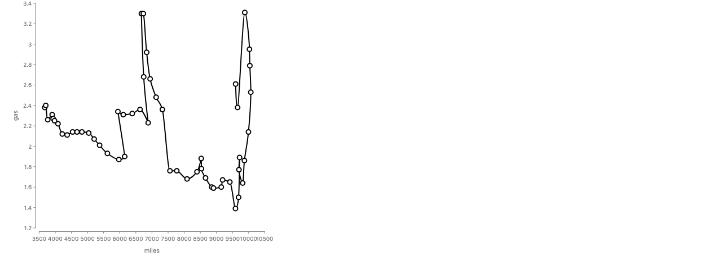

Value: `Forward Syntax/Faceted Chart/FacetedScatterDriving`.

```js
chart(drivingShifts, { w: args.w, h: args.h })
  .flow(
    spread({ by: "side", dir: "x", spacing: 50 }),
    scatter({ x: "year", y: "miles", axes: { x: true, y: false } })
  )
  .mark(circle({ r: 3, fill: "#4682b4" }));
```

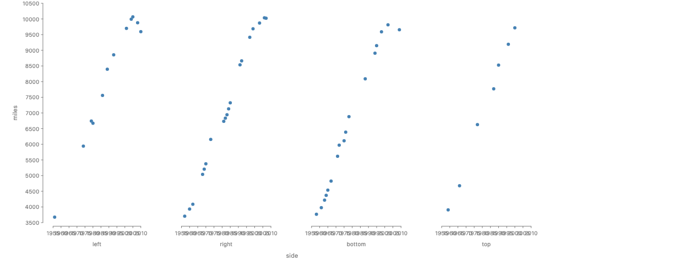

`LineChart.GasPrices` does both at once: `scatter({ by: "year", x: "year", y: "gas" })` with a line ([render](../img/keys/year-both-gas-prices.png)).

**Verdict: not a flip, (c) and (d).** `year` is the identity in both stories. The faceted scatter has no `by`, so its marks are keyed by the row, and the row is the year. It reads the key as a position. In the connected scatter the line's order comes from `year`, which is (d). [rendered; ran]

**Automatic rule.** `year` is in the declared `key`. A channel that reads a `key` field reads the key, and it never folds, because each mark has one value of it. So the rule is: a `key` field in a position channel is a position of the key.

### 2. `temp_max` in Seattle weather

Identity: `date` (1461 rows) [ran].

Key: `Forward Syntax/Croissant/Ridgeline`, which partitions by `field("temp_max").bin(Bin.quantiles(5))`. It runs on `monthlyDensity`, a sample grid of a density estimate per month, not on the weather rows.

```js
chart(monthlyDensity, { w: args.w })
  .flow(spread({ by: field("month").sort(months), dir: "y" }))
  .mark(
    layer({ h: 34 }, [
      chart()
        .flow(scatter({ x: "temp_max" }))
        .mark(ribbon({ h: "pdf" }).name("density").hidden()),
    ]).relate(({ density }) => [
      chart()
        .flow(
          derive((rows) =>
            quantileRows(rows, { x: "temp_max", density: "pdf", n: 1000 })
          ),
          partition({ by: field("temp_max").bin(Bin.quantiles(5)), dir: "x" })
        )
        .mark(/* ... */),
    ])
  );
```

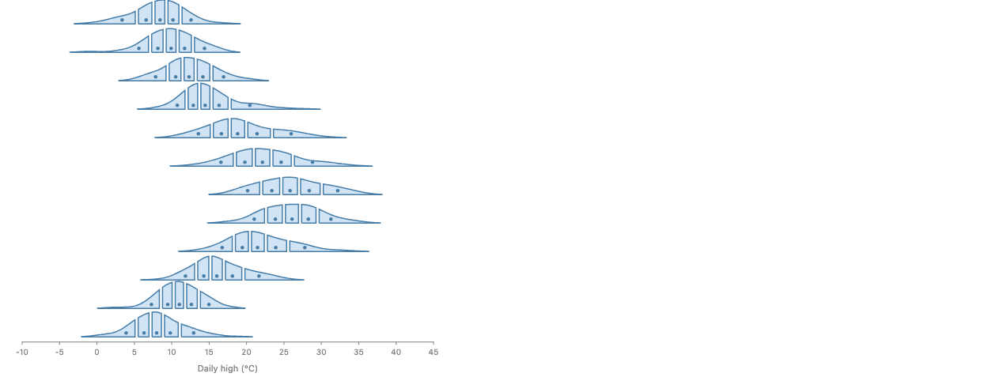

`Forward Syntax/Ridgeline Chart/Default` also keys on `temp_max`. It bins the days by hand before `chart` into a table keyed by (month, bin), and it names the bin center `temp_max` ([render](../img/keys/temp-max-key-ridgeline.png)).

Value: `Forward Syntax/Bin/WeekdayTemperature`.

```js
chart(weather, {
  schema: { date: Unit.time() },
  axes: true,
  w: args.w,
  h: args.h,
})
  .flow(spread({ by: field("date").bin(Calendar.weekday), dir: "x" }))
  .mark(rect({ h: field("temp_max").mean(), fill: "steelblue" }));
```

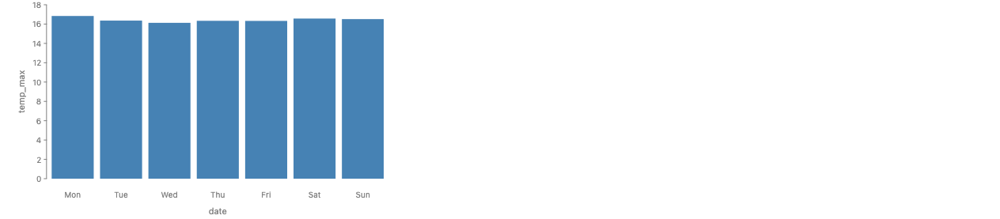

**Verdict: not a flip, (a) and (e).** In the croissant the key is a quantile cell of `temp_max`, and it is computed on a different table (the density grid). In the hand-built ridgeline the key is a bin center in an aggregate table. The weather table's `temp_max` is never grouped raw. [rendered; read from code]

A separate issue: the weekday render draws mean °C as bars from 0. That is the proposal's `no-zero` case, not a key problem. [rendered]

**Automatic rule.** A `by` of the form `field(f).bin(...)` makes a key with `HasRegion`. The key is the cell, and `f` keeps its value type. A field of a table made by `derive` belongs to that table, not to the input.

### 3. `IMDB Rating` in `movies.json`

Identity: the row (`Title` is not unique) [ran].

Key: `Vega-Lite/Histogram/Histogram/Default`.

```js
chart(context.loaded.movies as any[], { w: args.w, h: args.h })
  .flow(spread({ by: field("IMDB Rating").bin(), dir: "x", spacing: 1 }))
  .mark(rect({ h: field("IMDB Rating").count() }));
```

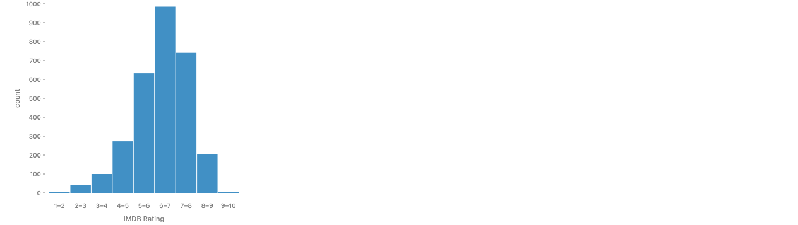

Value: the same story, and `Vega-Lite/2D Histogram Scatter Plot/Default` (`area: field("IMDB Rating").count()`, [render](../img/keys/imdb-rt-key-2d-histogram.png)). No story reads `IMDB Rating` as a position or an amount [read from code: grep over `stories/`].

**Verdict: not a flip, (a) and (f).** The key is a bin of the rating. The "value" use is `field("IMDB Rating").count()`, which counts the movies in the bin and reads no rating. I miscounted it as a value role in the first pass. [rendered; read from code]

**Automatic rule.** `field(f).count()` is a count of rows. It has the count type from the proposal's section 10 and reads nothing of `f`'s type, so it is not a value role of `f`.

### 4. `Rotten Tomatoes Rating` in `movies.json`

Identity: the row.

Key: `Vega-Lite/2D Histogram Scatter Plot/Default`.

```js
chart(movies, { w: args.w, h: args.h })
  .flow(
    partition({
      by: {
        x: field("IMDB Rating").bin(Bin.step(1)),
        y: field("Rotten Tomatoes Rating").bin(Bin.step(10)),
      },
    })
  )
  .mark(circle({ area: field("IMDB Rating").count(), fill: "transparent" }));
```

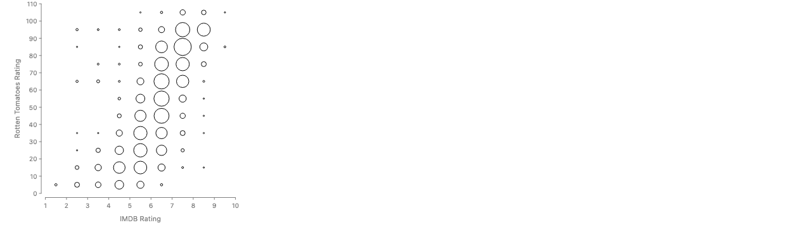

Value: none. No story reads it outside a bin [read from code: grep].

**Verdict: not a flip, (a).** It was a miscount in the first pass: the field is only ever binned. [rendered; read from code]

**Automatic rule.** Same as `IMDB Rating`.

### 5. `Body Mass (g)` in `penguins`

Identity: the row (344 rows, no id column).

Key: `Forward Syntax/Partition/ProductForm`.

```js
chart(measured, {
  color: Color.gradient("blues"),
  axes: true,
  w: args.w,
  h: args.h,
})
  .flow(
    partition({
      by: {
        x: field("Flipper Length (mm)").bin(Bin.step(10)),
        y: field("Body Mass (g)").bin(Bin.step(500)),
      },
    })
  )
  .mark(region({ fill: field("Body Mass (g)").count() }));
```

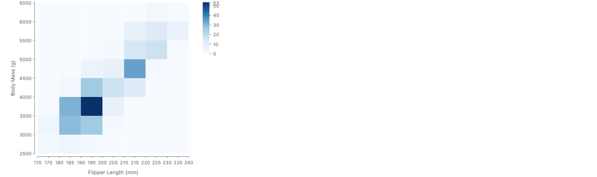

Value: `Forward Syntax/Separate/PenguinMass`.

```js
chart(weighed, { w: 560 })
  .flow(
    spread({ by: "Species", dir: "y", spacing: 16 }),
    scatter({
      x: "Body Mass (g)",
      alignment: "middle",
      overlap: Overlap.separate({ padding: 1 }),
    })
  )
  .mark(circle({ r: 3, fill: "Species" }));
```

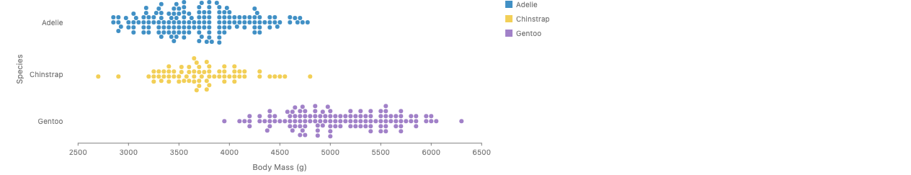

**Verdict: not a flip, (a) and (b).** The key is a 500 g cell. In the beeswarm the mass is a position, and the scatter has no `by`, so each dot is one penguin. `Croissant.PenguinBodyMass` keys on a sample grid of mass, which is (e). [rendered]

**Automatic rule.** As for `temp_max`: a binned `by` keys on the cell. A `scatter` with no `by` keys on the identity, so its `x` is a value.

### 6. `Flipper Length (mm)` in `penguins`

Key: `Forward Syntax/Partition/ProductForm` (the spec above).

Value: `Forward Syntax/Filter/FieldBetween`.

```js
chart(penguins, { w: 400, h: 300 })
  .flow(
    filter(field("Body Mass (g)").between(3500, 4500, { closed: "left" })),
    scatter({ x: "Flipper Length (mm)", y: "Beak Length (mm)" })
  )
  .mark(circle({ r: 3, fill: "Species" }));
```

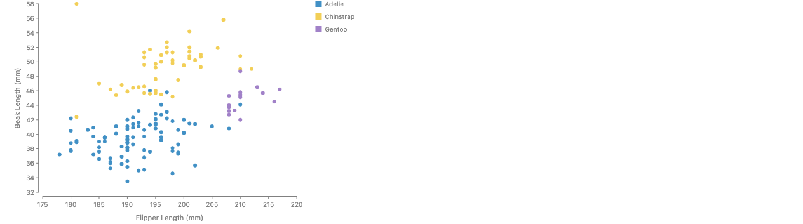

**Verdict: not a flip, (a) and (b).** [rendered]

**Automatic rule.** Same as body mass.

### 7 and 8. `Beak Length (mm)` and `Beak Depth (mm)` in `penguins`

Both roles are in one story: `Seaborn/Marginal Histogram/Default`.

```js
const sc = await chart(data)
  .flow(scatter({ by: "id", x: "Beak Length (mm)", y: "Beak Depth (mm)" }))
  .mark(circle({ r: 3, fill: "steelblue", fillOpacity: 0.6 }))
  .resolve();

const topHist = await chart(data, { h: 80 })
  .flow(partition({ by: field("Beak Length (mm)").bin(Bin.step(2)) }))
  .mark(rect({ h: field("Beak Length (mm)").count(), fill: "steelblue" }))
  .resolve();

const rightHist = await chart(data, { w: 80 })
  .flow(partition({ by: field("Beak Depth (mm)").bin(Bin.step(1)) }))
  .mark(rect({ w: field("Beak Depth (mm)").count(), fill: "steelblue" }))
  .resolve();
```

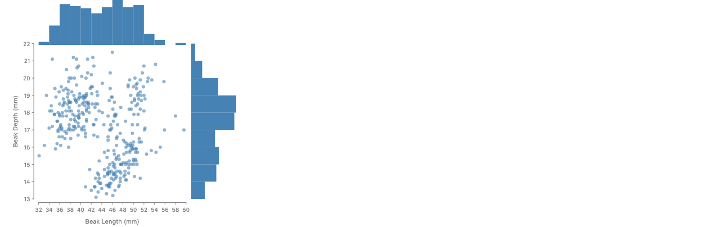

**Verdict: not a flip, (a) and (b), for both fields.** The scatter is keyed by `id`, the row index the story adds, and reads both measures as positions. The histograms key on cells of each measure. The three key spaces I counted in the first pass are one identity (the row) and two bins of values. The `by: "id"` is redundant: without it the scatter is keyed by the row anyway. [rendered]

**Automatic rule.** Same as body mass.

### 9. `lake` in `seafood`

Identity: (lake, species) (30 rows) [ran].

Key: almost every catch story, for example `Forward Syntax/Bar/Stacked` with `spread({ by: "lake" })`.

Value: `Forward Syntax/Ribbon/Polar`.

```js
layer({ coord: clock(), w: args.w, h: args.h }, [
  chart(seafood)
    .flow(
      scatter({
        by: "lake",
        x: "lake",
        w: 2 * Math.PI,
        axes: { x: false, y: true },
      }).translate({ y: 50 }),
      stack({ by: field("species").sort("count"), dir: "y", label: false })
    )
    .mark(rect({ w: 0.1, h: "count", fill: "species" }).name("bars")),
  chart(selectAll("bars"))
    .flow(group({ by: "species" }))
    .mark(ribbon({ opacity: 0.8 })),
]);
```

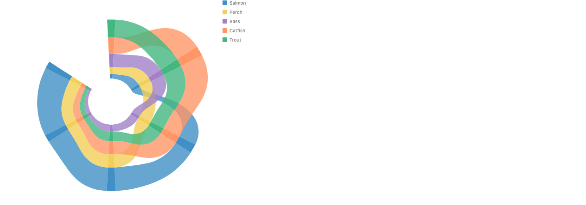

**Verdict: not a flip, (c).** `lake` is part of the identity in both stories. In the polar chart it is also read as the angle, which places each lake key at its own angle. That is the key read as a position. `lake` is ordered (the rivers run from Lake A to Lake F), and the polar ribbon does not close, so the chart is fine. [rendered]

**Automatic rule.** Same as `year`: a `key` field in a position channel is a position of the key. A position channel on a field with a discrete domain should place it by its levels, in order when the field has `HasOrder`.

### 10. `fertility` in `gapminder.json`

Identity of the gapminder table: (country, year) [ran].

Key and value, both in `Forward Syntax/Label Placement/AvoidingTrendLine`.

```js
return chart(ends, { w: 640, h: 440 })
  .flow(scatter({ by: "fertility", x: "fertility", y: "life_expect" }))
  .mark(blank().name("ends"))
  .layer(
    chart(selectAll("ends")).mark(
      line({ stroke: "#9e9e9e", strokeWidth: 2 }).name("trend")
    )
  )
  .layer(
    chart(countries)
      .flow(scatter({ by: "country", x: "fertility", y: "life_expect" }))
      .mark(circle({ r: 4 }).label("country", { avoiding: selectAll("trend") }))
  );
```

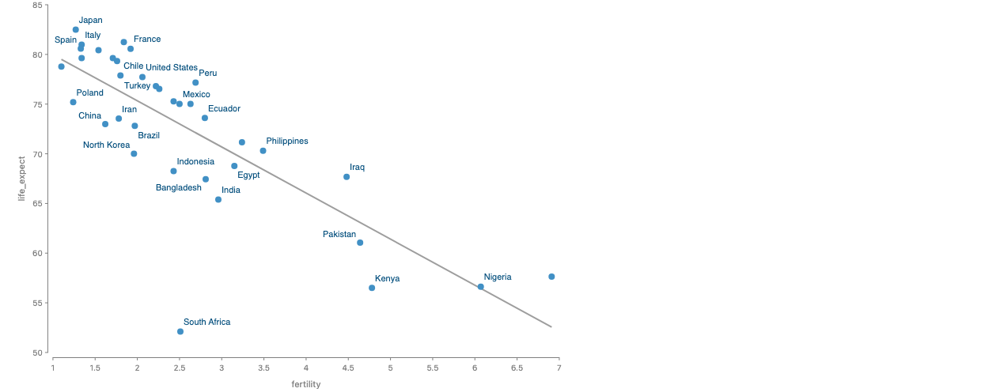

**Verdict: not a flip, (e) and (b).** `ends` is a two-row table the story builds by hand: the two ends of a least-squares line. Its identity is `fertility`, and `by: "fertility"` gives one mark per row. In the gapminder table `fertility` is only a position. So the key use is the identity of a derived table, and in that table the field is still a position. The `by` is redundant there too. [rendered; read from code]

**Automatic rule.** A field of a table built outside `chart` belongs to that table. Inside one table, a `by` on the identity gives one mark per row, the same as no `by`.

### 11 and 12. `longitude` and `latitude` in `airports.csv`

Identity: the row.

Key: `Forward Syntax/Partition/AirportHexbin`.

```js
chart(contiguous(context.loaded.airports), { w: args.w, h: args.h })
  .flow(
    partition({
      by: struct({ x: "longitude", y: "latitude" }).bin(Bin.hex({ radius: 1 })),
    })
  )
  .mark(region({ fill: field("longitude").count(), stroke: "white" }));
```

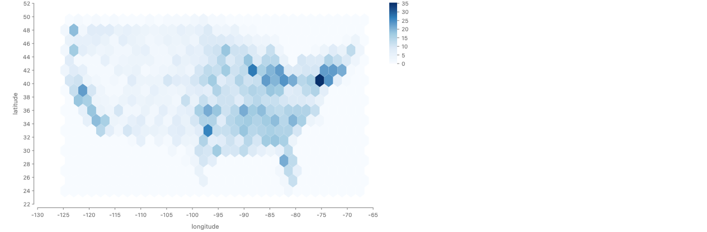

Value: `Forward Syntax/Partition/AirportsByNearestHub`, whose hub layer is `chart(hubs).flow(scatter({ x: "longitude", y: "latitude" })).mark(circle({ r: 3, fill: "black" }))`. The same story's first layer bins the airports into Voronoi cells around the hubs.

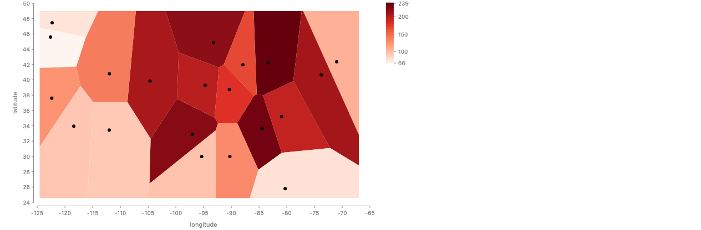

**Verdict: not a flip, (a), (b) and (f), for both fields.** The keys are hex or Voronoi cells of the pair. The positions are a no-`by` scatter. `field("longitude").count()` counts airports. [rendered]

**Automatic rule.** A `struct({ ... }).bin(...)` key is a cell with `HasRegion`, and its fields stay values.

### 13. `Miles_per_Gallon` in `cars.json`

Identity: the row. `Name` is not a key, and neither is (Name, Year) [ran].

Key: `Forward Syntax/Partition/CarHexbin`.

```js
chart(cars, {
  color: Color.gradient("viridis"),
  axes: true,
  w: args.w,
  h: args.h,
})
  .flow(
    partition({
      by: struct({ x: "Miles_per_Gallon", y: "Weight_in_lbs" }).bin(
        Bin.hex({ radius: { x: 1.5, y: 250 } })
      ),
    })
  )
  .mark(region({ fill: field("Miles_per_Gallon").count() }));
```

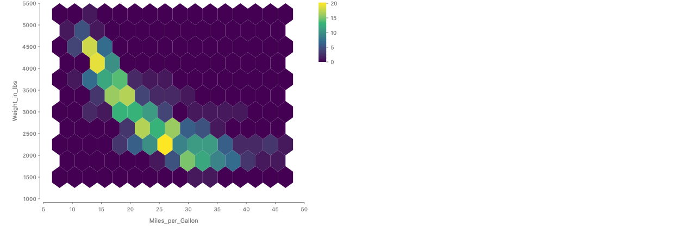

Value: `Vega-Lite/Simple Scatter Plot/Default`.

```js
chart(cars, { w: args.w, h: args.h })
  .flow(
    log("cars before scatter"),
    scatter({ by: "Name", x: "Horsepower", y: "Miles_per_Gallon", debug: true })
  )
  .mark(circle({ r: 4, fill: "rgba(31, 119, 180, 0.4)" }));
```

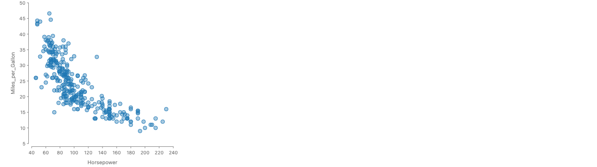

**Verdict: not a flip, (a) and (f).** MPG is a hex cell in one story and a position in the other. The value story has a real bug, but the bug is in its `by`, not in MPG. It groups by `Name`, so 392 cars draw 300 dots, and a dot for a repeated name sits at the mean of those cars. The render has exactly 300 `ellipse` elements. [rendered; ran]

**Automatic rule.** For MPG, the bin rule. For the bug: a `by` on a field that does not determine the `key`, followed by a position channel, folds several rows into one place. The checker reports that, as in Part 3, spec 3.

### Summary

| Field                    | Key story                                       | Value story                               | Verdict                 | Explanation |
| ------------------------ | ----------------------------------------------- | ----------------------------------------- | ----------------------- | ----------- |
| `year` (driving)         | `Scatter.Connected`                             | `FacetedChart.FacetedScatterDriving`      | not a flip              | c, d        |
| `temp_max`               | `Croissant.Ridgeline`, `RidgelineChart.Default` | `Bin.WeekdayTemperature`                  | not a flip              | a, e        |
| `IMDB Rating`            | `Histogram.Default`                             | the same story's `.count()`               | not a flip (miscounted) | a, f        |
| `Rotten Tomatoes Rating` | `2DHistogramScatterPlot`                        | none                                      | not a flip (miscounted) | a           |
| `Body Mass (g)`          | `Partition.ProductForm`                         | `Separate.PenguinMass`                    | not a flip              | a, b        |
| `Flipper Length (mm)`    | `Partition.ProductForm`                         | `Filter.FieldBetween`                     | not a flip              | a, b        |
| `Beak Length (mm)`       | `MarginalHistogram` (top)                       | `MarginalHistogram` (scatter)             | not a flip              | a, b        |
| `Beak Depth (mm)`        | `MarginalHistogram` (side)                      | `MarginalHistogram` (scatter)             | not a flip              | a, b        |
| `lake`                   | `Bar.Stacked` and most catch stories            | `Ribbon.Polar` (angle)                    | not a flip              | c           |
| `fertility`              | `AvoidingTrendLine` (`ends` table)              | `AvoidingTrendLine` (countries)           | not a flip              | e, b        |
| `longitude`              | `Partition.AirportHexbin`                       | `Partition.AirportsByNearestHub` (hubs)   | not a flip              | a, b, f     |
| `latitude`               | `Partition.AirportHexbin`                       | `Partition.AirportsByNearestHub` (hubs)   | not a flip              | a, b, f     |
| `Miles_per_Gallon`       | `Partition.CarHexbin`                           | `ScatterPlot` (its `by: "Name"` is a bug) | not a flip              | a, f        |

Counts:

- Genuine flip: **0**.
- Not a flip: **13**. By main explanation: 10 are (a), a value whose bin is the key. 2 are (c), an identity field read as a position (`year`, `lake`). 1 is (e), the identity of a derived table (`fertility`). Two of the 13 (both movie ratings) were miscounts: their only "value" use is `.count()`, or nothing.
- Error in a story, found on the way: **1** that bears on keys, `vega-lite/ScatterPlot` grouping by `Name` (confirmed by render). The same renders also confirmed `InferredSize.LegendTracksComputedExtent` (all bars "Bass" blue) and `Bin.WeekdayTemperature` (°C bars from 0).

### The general rule

One rule covers all 13:

> A field of continuous `Domain` is grouped only through a bin, so the key is the cell and the field stays a value. A field is grouped raw only when its `Domain` is discrete or it is in the table's `key`. Any channel may read a `key` field, which reads the key and never folds it.

How it covers each field:

- **The first sentence** covers the ten (a) cases: `temp_max`, both ratings, the four penguin measures, longitude, latitude and MPG. None of them is ever grouped raw in a story [read from code].
- **The second sentence** covers `year` and `fertility`. Both are numbers, so their domain is continuous, and both are grouped raw. But each is the identity of the table it is grouped in. A group then has one row, so grouping by it is the same as having no `by`.
- **The third sentence** covers `year` as x, `lake` as the angle, and `fertility` as x in the `ends` table.

What it does not cover among the 13: nothing. What it flags elsewhere in the corpus, in stories that group raw by a number that is not in the identity:

- `vega-lite/StripPlot` spreads by `cylinders`, a count with five values.
- The titanic passenger stories spread or stack by `pclass` (1, 2, 3) and `survived` (0, 1).
- `population.json` spreads by `age`, but `age` is in its identity, so that one passes.

These draw correctly, since the numbers have few values. Under the rule they need `Domain.discrete` declared on the column, which is one line each. Whether undeclared numbers grouped raw should be an error or a lint is a new decision (10 below).

### What this changes

- **Design B stays.** The audit removes the evidence I gave for "a field can be a key in one story and a value in another". What remains is the identity and the bins, which B already describes.
- **Design A looks better than I said.** A column does have a stable role. But the role is already given by two facts the proposal has: the column's `Domain` (discrete or continuous) and whether it is in `key`. A separate role declaration would repeat them, and it would still need bins and reading a key as a position. So A is not wrong, it is redundant with B plus `Domain`. I would describe "dimension" and "measure" in the docs as names for those two facts, not add them as API.
- **The Summary's claim** that "key cannot be a fixed property of a column" was too strong. I have corrected it above.
- **The decisions.** None of the nine changes. One is added: 10. Should a `by` on an undeclared number that is not in the table's `key` be an error that asks for a bin or `Domain.discrete`, or a lint? It affects `StripPlot`, the titanic passenger stories, and any `pclass`-like code.

### The other headline counts, re-examined

- **The ~44 stories that split by an attribute.** Each `by` there names a column (`Species`, `side`, `weather`, `pclass`, `sex`, `survived`, `Major Genre`, `Cylinders`, `region`, `continent`), and a column is a function of the row. So every one is a coarsening of the identity [reasoning, from the code: `splitKeyFn` reads one row per key]. The only `by`s that are not functions of the row content are `chunk(n)` and a key function that reads the row's position. Those were counted as row chunks, not attributes.
- **The ~32 stories that split by a bin or calendar part.** Each is a function of the row once the binning is fixed. But some binnings are computed from the whole column: `Bin.quantiles`, a `Bin.step` anchored at the column's extent, and `Bin.voronoi` seeded by the rows themselves (`PenguinBeakVoronoi`, whose cells are the penguins). So the cell is a function of the row and the column's domain. That is still a function of the identity for one table, but the same row can land in a different cell if other rows are filtered out [read from code: `binKey` bins over `data`'s domain]. None of them breaks the rule.
- **The six datasets with key sets that do not nest.** Each pair is two different functions of one identity [reasoning]:
  - seafood: `lake` and `species` are two projections of (lake, species).
  - Seattle weather: month of the year and weekday are two calendar functions of `date`.
  - penguins: `Species`, the flipper and mass cells, and the two beak cells are functions of the row.
  - movies: `Major Genre` and the rating cells are functions of the row.
  - airports: the hex cells and the Voronoi cells are two binnings of (longitude, latitude).
  - gapminder: `country` and `year` are two projections of (country, year).

So the corpus has no case of two visualizations of one table that need two different identities. Each visualization picks a different function of the same identity. Keys that are not functions of it come only from the identity-changing operations in Part 3.

### Files added for this section

Images in `proposals/type-system/img/keys/`, all rendered by `pnpm capture-one` on 11-13:

`year-key-connected-scatter.png`, `year-value-faceted-scatter.png`, `year-both-gas-prices.png`, `temp-max-key-croissant-ridgeline.png`, `temp-max-key-ridgeline.png`, `temp-max-value-weekday.png`, `imdb-key-histogram.png`, `imdb-rt-key-2d-histogram.png`, `penguin-key-partition.png`, `mass-value-beeswarm.png`, `flipper-value-filter-scatter.png`, `beak-both-marginal-histogram.png`, `lake-key-and-position-polar-ribbon.png`, `fertility-trend-line.png`, `lonlat-key-airport-hexbin.png`, `lonlat-value-hubs.png`, `mpg-key-car-hexbin.png`, `mpg-value-cars-scatter-by-name.png`, `fill-first-row-species.png`.

No prototype story was needed: every case is an existing story.

### Not verified in this section

- The renders were looked at for the cars scatter, the fill bug, the polar ribbon, the trend line, the weekday bars and the faceted scatter. The other renders were captured and copied but only spot-checked.
- The claim that no story groups any of the ten (a) fields raw comes from a grep of `stories/`, not from running every story.
- Which binnings depend on the column's whole domain was read from `binKey`, not tested by filtering.
