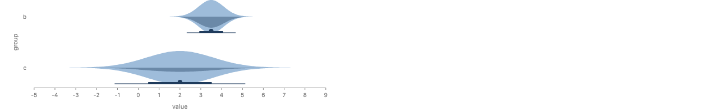
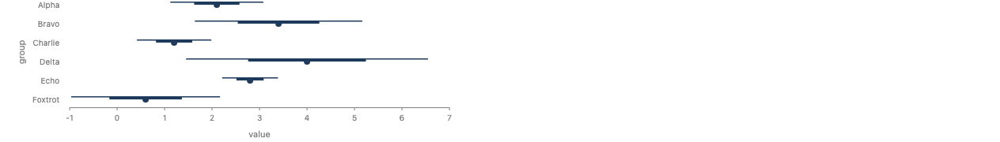
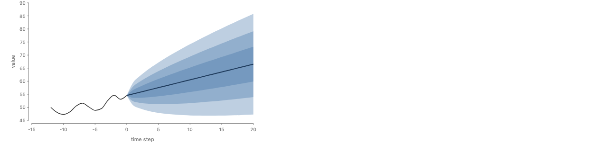
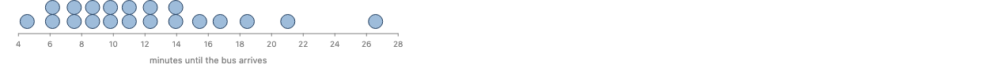

# What slab, interval and dots elaborate into (#980)

This page defines the three signal marks as code. Each definition is real
TypeScript that runs today, in
`packages/gofish-graphics/stories/proposals/uncertainty/elaborations.ts`. It
uses only marks and operators that GoFish exports now. The story file
`ElaborationsCheck.stories.tsx` beside it draws the prototypes with these
definitions, from normal and lognormal parameters. No grid, quantile or
interval is precomputed.

## How a signal mark is written

In the library, each mark would be one line:

```ts
export const slab = createMark(slabBody, { x: "dist", y: "dist" }, "slab");
```

Here `"dist"` is the proposed channel kind. It folds a group's rows into one
Dist before the body runs, as `size` sums and `pos` averages. A story cannot
add a channel kind, and `createMark` gives its body the inferred channels, not
the rows. So each mark here is a plain `Mark<T[]>`, which is what a
`createMark` mark is underneath. It takes the group's rows and calls
`foldDist` itself. That is the same work the `dist` channel would do.

`Dist` does not exist yet, so the file has a small stand-in:

```ts
export interface Dist {
  quantile(p: number): number;
  pdf(x: number): number;
  cdf(x: number): number;
  support(): [number, number];
}
```

It has one more method than the brief's minimal interface. The quantile of a
mixture has no closed form, so it is found by inverting the mixture's CDF.
`support()` is a display range. A normal's true support is the whole line, so
`normal` returns mean ± 4 sd. This is types.md's open decision 8.

The constructors are `normal(mean, sd)`, `lognormal(meanlog, sdlog)`,
`empirical(values, weights?, smoothing?)`, `mixture(dists, weights?)` and
`pure(x)`. `empirical` has the sample's own quantiles (type 7) and CDF, and a
Gaussian KDE for its density. Its bandwidth is Silverman's rule,
1.06 · sd · n^(−1/5), as in `Croissant.stories.tsx`. A `dist` stand-in
namespace builds one Dist per row from parameter columns:
`dist.normal({ mean: "mean", sd: "sd" })`.

The one-fold rule from types.md is `foldDist`:

```ts
export function foldDist<T>(
  channel: DistChannel<T>,
  rows: T[],
  smoothing: Smoothing = "silverman"
): Dist {
  if (isDist(channel)) return channel;
  const cells = rows.map((r) =>
    typeof channel === "string" ? (r as any)[channel] : channel(r)
  ) as (Dist | number)[];
  if (cells.every((c) => typeof c === "number"))
    return empirical(cells as number[], undefined, smoothing);
  return mixture(cells.map((c) => (isDist(c) ? c : pure(c))));
}
```

Rows with Dist cells fold to their mixture, with equal weights. One row gives
its own Dist. Plain values fold to their empirical Dist. A mix of both is a
mixture in which a plain value is `pure` of itself. A pure value has no
density, so a slab of such a mix draws only the Dist cells.

## Slab

### Definition

Let D be the group's folded Dist, f its density, v the value axis and s the
cross axis. The slab is the region

- side end: { (v, s) : 0 ≤ s ≤ f(v) / Z },
- side start: { (v, s) : −f(v) / Z ≤ s ≤ 0 },
- side both: { (v, s) : |s| ≤ f(v) / Z },

for v in D's display range. For `normalize: "all"`, Z is 1, so every slab is
in density units on one size scale. For `normalize: "group"`, Z is the
group's peak max f(v), so every slab's peak is 1. The chart's size scale then
maps the largest s to the space the slab is given.

The region, the side rule and what each normalize divides by are decided
semantics. These are defaults: the grid of k = 121 even points over
`support()`, the display range of an unbounded Dist, the Silverman bandwidth,
and the curve through the grid (ribbon's automatic monotone curve).

### Code

```ts
export const slab = <T>(o: SlabOptions<T>): Mark<T[]> =>
  signalMark((rows: T[]) => {
    const { axis, cross, channel } = distAxis(o, "slab");
    const side = o.side ?? "end";
    const k = o.k ?? 121;
    const grid = (rows: T[]) => {
      const d = foldDist(channel, rows, o.smoothing);
      const [lo, hi] = d.support();
      const pts = Array.from(
        { length: k },
        (_, i) => lo + ((hi - lo) * i) / (k - 1)
      );
      const Z =
        (o.normalize ?? "all") === "group"
          ? Math.max(...pts.map((p) => d.pdf(p)))
          : 1;
      return pts.map((p) => ({ v: p, s: d.pdf(p) / Z, neg: -d.pdf(p) / Z }));
    };
    const size = cross === "y" ? "h" : "w";
    const paint = { fill: o.fill, stroke: o.stroke, opacity: o.opacity };
    const half = (sign: 1 | -1) =>
      chart(rows)
        .flow(derive(grid), scatter({ [axis]: "v" }))
        .mark(ribbon({ ...paint, dir: axis, [size]: sign > 0 ? "s" : "neg" }));
    if (side === "end") return half(1);
    if (side === "start") return half(-1);
    return layer([half(1), half(-1)]);
  });
```

`signalMark` only widens the declared type. `Mark<T>` says a mark returns a
node or a chart builder, but the runtime also takes a `LayerBuilder` and a
combinator mark such as `layer([...])`.

### Elaborates into

A slab is a `derive` of k grid rows `{ v, s }` for one group, a `scatter`
along v, and a `ribbon` through anchors of size s. That is side end. Side
start is the same ribbon with size −s. It is a signed extent (#773), so it
hangs from the line. Side both is a `layer` of the two halves. A slab along y
swaps the axes: the scatter places by y, the ribbon runs along y, and its
anchors have width s.

### Render

The elaboration:


The prototype, with its precomputed grid:


The two are the same picture. The check story `SlabOptions` draws side both
with `normalize: "group"` (light) and side start (dark) on two groups:



### Design questions

- **Where `normalize: "all"` gets Z.** "All" needs one value shared by every
  slab, which is outside each group. This definition gets it for free. The
  heights are raw densities, and the chart's one size scale maps them all, so
  the tallest slab fills its space and the rest are in proportion. This is how
  the prototype worked too. The catch is that the scale is shared with every
  other size channel on that axis. So "all" means "every mark on this scale",
  not "every slab". A chart that puts a bar and a slab on one size scale would
  mix their units. A unit check (density is a unit, #1200) would catch that.
- **The line the slab sits on.** The line s = 0 is the slab's own origin. Two
  slabs in one `layer` share it, so a violin and a start half line up, as the
  check story shows. An `interval` beside a start or both slab does not. The
  layer puts the interval's box at the layer's bottom, not at the slab's
  origin. A literal `cy: 0` on the interval did not pin it there either. So
  the half-eye works only because side end's origin is its bottom. This
  could not be expressed with today's layout. It needs a layer that aligns
  its children by their origins, which is a layout question and not a slab
  question.
- **Grid size k.** 121 points look smooth at chart sizes. A narrow peak in a
  wide range can fall between points. An adaptive grid (denser where f
  changes fast) is a default to decide, not a semantic.
- **The display range.** Each slab draws over its own `support()`. For a
  normal that is mean ± 4 sd. The axis extent of an unbounded Dist is still
  open (types.md decision 8).
- **Horizontal against vertical.** The dist channel's name picks the value
  axis, and everything else swaps. Nothing else needs a flag.

## Interval

### Definition

Let D be the group's folded Dist, Q its quantile function, and
p₁ > p₂ > … > pₙ the levels, widest first. The point form is

- for each level pᵢ, the segment [Q((1 − pᵢ)/2), Q((1 + pᵢ)/2)] on the value
  axis, with cross-axis thickness tᵢ, where t₁ < t₂ < … < tₙ;
- the point Q(0.5).

With `along: a` and `Band.pointwise()`, let D_a be the Dist of the rows at
step a of the tier. For each level p, the band is the region between the
curves a ↦ Q_a((1 − p)/2) and a ↦ Q_a((1 + p)/2). The median is the curve
a ↦ Q_a(0.5).

`Band.depth({ outliers })` is defined here but not implemented. It needs
joint draws c₁ … c_m, each a whole curve over the tier. The modified band
depth of a curve c is the mean, over pairs j < k, of the share of steps a
where min(c_j(a), c_k(a)) ≤ c(a) ≤ max(c_j(a), c_k(a)). The band of level p
is the pointwise envelope of the ⌈p · m⌉ deepest curves. The median is the
deepest curve. A curve is an outlier when it leaves the 0.5 envelope, widened
by `outliers` times its width, at some step. It would elaborate into the same
ribbons plus one `line` per outlier curve. Only the `derive` changes.

Equal-tailed central intervals, the median as the point, thickness that
decreases in p, and pointwise bands by default are decided semantics. These
are defaults: levels [0.66, 0.95], thickness from 1.5 to 4 px, a 4 px point,
and in the band form an opacity of 1 − 0.3^(1/n) per band. With that opacity,
the innermost of n nested bands reaches 0.7 where they overlap.

### Code

```ts
const ladder = (n: number, i: number, thin = 1.5, thick = 4) =>
  n === 1 ? thick : thin + ((thick - thin) * i) / (n - 1);

const central = (d: Dist, p: number) => ({
  lo: d.quantile((1 - p) / 2),
  hi: d.quantile((1 + p) / 2),
});

export const interval = <T>(o: IntervalOptions<T>): Mark<T[]> =>
  signalMark((rows: T[]) => {
    const { axis, cross, channel } = distAxis(o, "interval");
    const levels = [...(o.levels ?? [0.66, 0.95])].sort((a, b) => b - a);
    const fill = o.fill ?? "#1f3b5c";
    if (o.along !== undefined) return intervalAlong(o, rows, levels, fill);
    const d = foldDist(channel, rows, o.smoothing);
    const thick = cross === "y" ? "h" : "w";
    return layer([
      ...levels.map((p, i) => {
        const { lo, hi } = central(d, p);
        return rect({
          [axis]: v(lo),
          [`${axis}2`]: v(hi),
          [thick]: ladder(levels.length, i),
          fill,
        });
      }),
      circle({ [`c${axis}`]: v(d.quantile(0.5)), r: o.r ?? 4, fill }),
    ]);
  });

const intervalAlong = <T>(
  o: IntervalOptions<T>,
  rows: T[],
  levels: number[],
  fill: string
) => {
  const { axis, cross, channel } = distAxis(o, "interval");
  const along = o.along!;
  const steps = (rows: T[]) => {
    const keys = [...new Set(rows.map((r) => (r as any)[along]))];
    return keys.map((key) => ({
      key,
      d: foldDist(
        channel,
        rows.filter((r) => (r as any)[along] === key),
        o.smoothing
      ),
    }));
  };
  const bands = (rows: T[]) =>
    levels.flatMap((p) =>
      steps(rows).map(({ key, d }) => ({
        [along]: key,
        level: p,
        ...central(d, p),
      }))
    );
  const medians = (rows: T[]) =>
    steps(rows).map(({ key, d }) => ({
      [along]: key,
      median: d.quantile(0.5),
    }));
  const opacity = o.opacity ?? 1 - 0.3 ** (1 / levels.length);
  const thin = cross === "x" ? "w" : "h";
  return layer([
    chart(rows)
      .flow(
        derive(bands),
        group({ by: "level" }),
        scatter({
          by: along,
          [cross]: along,
          [`${axis}Min`]: "lo",
          [`${axis}Max`]: "hi",
        })
      )
      .mark(rect({ [thin]: 0 }))
      .layer(ribbon({ fill, opacity, dir: cross })),
    chart(rows)
      .flow(
        derive(medians),
        scatter({ by: along, [cross]: along, [axis]: "median" })
      )
      .mark(
        line({ stroke: o.stroke ?? "#1f3b5c", strokeWidth: 2, dir: cross })
      ),
  ]);
};
```

### Elaborates into

The point form is a `layer` of one `rect` per level, from `v(lo)` to `v(hi)`
with a fixed thickness, and a `circle` at `v(median)`. The band form is a
`layer` of two charts, each over a `derive` that folds every step. The first
has one `rect` of width 0 per step and level, joined by a `ribbon` per level
(`group` by level). The second is a `line` through the medians. So `along`
turns an interval into a ribbon per level and a median line, the same marks
the fan-chart prototype drew by hand.

### Render

Point interval, the elaboration:



The prototype:


They are the same picture.

Fan chart, the elaboration:



The prototype:


The bands are the same. The prototype colors each level from a palette and
has a legend. The elaboration uses one fill and nested opacity, so it has no
legend.

### Design questions

- **`along` needs every step.** The band form reads all the steps of the
  tier, so it cannot be a mark that sees one group. In the proposal it sits
  after the user's `scatter({ by: "t" })`, as `line` and `ribbon` do. Those
  are relational marks. The chart builder rewrites `.mark(R)` into
  `.mark(blank).layer(R)` (`tagRelationalFusable`, which is internal). That
  rewrite makes one blank per group, but a band needs one anchor per step and
  level. So `createRelationalMark`, which is exported, cannot express it
  either. Here the band form is a mark at the root, over all rows, and it
  splits by `along` itself. The story writes
  `chart(forecast).mark(interval({ y, along: "t", ... }))`, with no
  `scatter` in the flow. The proposal's spelling, with the scatter, needs a
  chart-level rewrite that the exported API does not offer.
- **`Band.depth` needs the draw key.** Depth ranks whole curves, so it needs
  the joint draw id across every step. That is outside every step's group. It
  reads the `draws` record from types.md.
- **The thickness ladder.** 1.5 to 4 px, linear in the level's rank, is
  ggdist's look in pixels. It is a default. A thickness in data units would
  need the cross-axis scale.
- **Band color.** Nested opacity needs no scale and no legend. A palette by
  level (the prototype) needs a color scale and gives a legend. Which one is
  the default is open.
- **Horizontal against vertical.** As with the slab, the channel's name picks
  the value axis. In the band form, `along` is placed on the other axis.

## Dots

### Definition

Let D be the group's folded Dist and Q its quantile function. The dots are
the n quantiles qᵢ = Q((i − 0.5)/n), for i = 1 … n. Each dot is a probability
of 1/n. The dots are binned on the value axis with bin width w and stacked on
the cross axis from 0, one dot per quantile.

The binning is Wilkinson's dot-density rule (1999) by default. A bin starts
at the smallest quantile not yet binned and takes every quantile below its
start plus w. Its stack sits at the midpoint of its first and last quantile.
`binning: { kind: "fixed" }` is the prototype's rule instead: bins
[kw, (k + 1)w), each stack at the bin's center.

The n quantiles at (i − 0.5)/n and a stack that counts quantiles are decided
semantics. These are defaults: n = 20, Wilkinson binning, the bin width w and
the 9 px radius.

### Code

```ts
const binQuantiles = (qs: number[], kind: "wilkinson" | "fixed", w: number) => {
  if (kind === "fixed")
    return qs.map((q) => {
      const b = Math.floor(q / w);
      return { bin: b, center: (b + 0.5) * w };
    });
  const out: { bin: number; center: number }[] = [];
  let b = 0;
  for (let i = 0; i < qs.length; b++) {
    let j = i;
    while (j + 1 < qs.length && qs[j + 1] < qs[i] + w) j++;
    for (let m = i; m <= j; m++)
      out.push({ bin: b, center: (qs[i] + qs[j]) / 2 });
    i = j + 1;
  }
  return out;
};

export const dots = <T>(o: DotsOptions<T>): Mark<T[]> =>
  signalMark((rows: T[]) => {
    const { axis, cross, channel } = distAxis(o, "dots");
    const n = o.n ?? 20;
    const kind = o.binning?.kind ?? "wilkinson";
    const quantileRows = (rows: T[]) => {
      const d = foldDist(channel, rows, o.smoothing);
      const qs = Array.from({ length: n }, (_, i) => d.quantile((i + 0.5) / n));
      const w = o.binning?.width ?? (qs[n - 1] - qs[0]) / Math.ceil(n / 2);
      return binQuantiles(qs, kind, w).map((b, i) => ({ ...b, q: qs[i] }));
    };
    return chart(rows)
      .flow(
        derive(quantileRows),
        scatter({ by: "bin", [axis]: "center", alignment: "end" }),
        stack({ dir: cross })
      )
      .mark(
        circle({
          r: o.r ?? 9,
          fill: o.fill,
          stroke: o.stroke,
          strokeWidth: o.strokeWidth ?? 1,
          opacity: o.opacity,
        })
      );
  });
```

### Elaborates into

Dots are a `derive` of n rows `{ bin, center }`, a `scatter` by bin at the
bin's center, aligned so the stacks rise from the baseline, and a `stack` of
`circle`s along the cross axis. This is `sample({ n, at: "quantiles" })`
from the proposal, followed by the prototype's scatter and stack.

### Render

The elaboration, with Wilkinson binning and w = 1 minute:



The prototype, with fixed 1-minute bins:


The quantiles are the same. The stacks differ because the binning differs.
Wilkinson's bins start at a quantile, so they follow the data. Fixed bins
start at multiples of w, so they follow the axis.

### Design questions

- **The bin width needs the scale.** A dotplot is only right when a dot's
  diameter equals the bin width on screen: w times the pixels per unit equals
  2r. The pixels per unit come from the value axis's scale, which belongs to
  the whole chart and is outside the group. This definition takes w (in data
  units) and r (in pixels) as two options, and the author must match them.
  The story sets w = 1 and r = 9 by hand, as the prototype did. The right
  default picks w from the scale, as ggdist's automatic bin width does. No
  mark body gets layout information like that today. The placeholder default
  is w = (q_n − q_1) / ⌈n / 2⌉.
- **Which binning.** Wilkinson's rule is the dot-density standard. Fixed bins
  line up across groups, which helps when several dotplots share an axis.
  The descriptor in types-sketch.ts has only `n`, so `binning` is a new
  option to decide.
- **No gap in a stack.** `stack` drops `spacing`, so the prototype's
  `spacing: 1` did nothing. Dots touch. A gap would need `spread` with a
  spacing, which is not glued.
- **Horizontal against vertical.** With `y`, the bins are on y and the
  stacks grow along x.

## How they compose

A half-eye is a layer of a slab and an interval. This is the `HalfEye` check
story:

```ts
const value = dist.normal({ mean: "mean", sd: "sd" });

chart(halfEyeGroups, { w: 520, axes: { x: { title: "value" }, y: true } })
  .flow(spread({ by: "group", dir: "y", anchor: "baseline", spacing: 64 }))
  .mark(
    layer({ h: 60 }, [
      slab({ x: value, fill: SLAB }),
      interval({ x: value, levels: [0.66, 0.95], fill: INK }),
    ])
  );
```

A raincloud is a layer of a slab, an interval and a jittered scatter of the
raw rows. The column is plain, so the slab and the interval fold each
species' rows to their empirical Dist, and the slab smooths it with the
Silverman bandwidth:

```ts
chart(penguins, { w: 560, axes: { x: { title: "Body mass (g)" }, y: true } })
  .flow(spread({ by: "Species", dir: "y", spacing: 20 }))
  .mark(
    layer([
      slab({ x: "Body Mass (g)", fill: SLAB, opacity: 0.7 }),
      interval({ x: "Body Mass (g)", levels: [0.66, 0.95], fill: INK }),
      chart()
        .flow(
          scatter({ x: "Body Mass (g)", overlap: Overlap.jitter() }).translate({
            y: -16,
          })
        )
        .mark(circle({ r: 1.5, fill: "Species", opacity: 0.6 })),
    ])
  );
```

The raincloud was not rendered for this page. Its rain sits below the line,
so it meets the same question as side start: the layer has to place the rain
relative to the slab's origin.

## Summary of what needed information outside the group

| Piece                    | What it needs                        | How this page handles it                           |
| ------------------------ | ------------------------------------ | -------------------------------------------------- |
| slab `normalize: "all"`  | one Z for every slab                 | the chart's shared size scale, for free            |
| slab side start and both | the group's line, shared with others | not expressed: the layer aligns boxes, not origins |
| interval `along`         | every step of the tier               | a mark at the root that splits by `along`          |
| interval `Band.depth`    | the joint draw key across steps      | defined in comments, not implemented               |
| dots bin width           | the value axis's pixels per unit     | two options the author matches by hand             |
